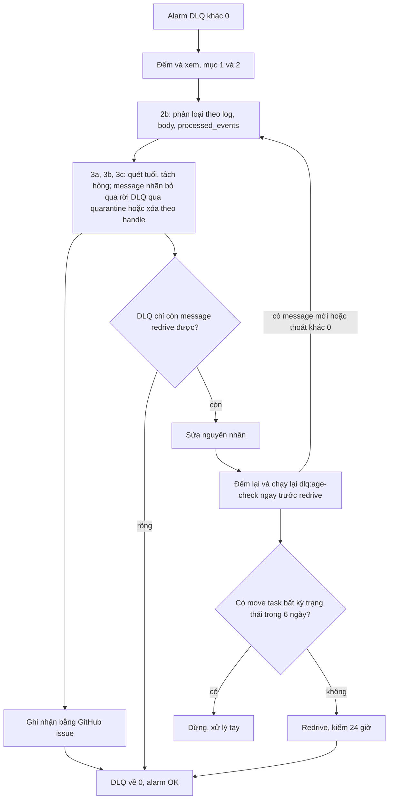

# DBS-164 · Runbook DLQ: xem message, redrive, bỏ qua có ghi nhận

> **Status:** Implemented (sau G4) · **Vai:** Dev (docs) · **Cặp đôi review:** Dev khác · **Nhánh:** `docs/DBS-164-dlq-runbook` · **PR:** — · **Cập nhật:** 2026-11-15

## 1. Bối cảnh

- **Task trên board:** Task · Tuần 6 · Ưu tiên Low · Deliverable P4 · Status board `To Do`. **Expect:** Ai trực cũng xử lý được. **Thực trạng (board, cũ):** Chưa có hướng dẫn xử lý khi alarm DLQ bật.
- **DoD:**
  1. Runbook ngắn: cách xem message trong DLQ, phân loại nguyên nhân, redrive về queue chính, khi nào bỏ qua và ghi vào đâu
  2. Thử theo runbook một lần trên dev và ghi kết quả
  3. PR đã merge vào main; Dev review; không còn liên kết hỏng, tên bảng/cột/mã lỗi khớp các tài liệu khác (đã grep)
- **Phụ thuộc (đối chiếu repo):** DBS-163 (alarm DLQ): đã merge, [#187](https://github.com/Lawliet119/digital-banking-simulator/pull/187) (`d365137`); task này tìm PR Ops đang chặn, review và merge trước theo chỉ dẫn của người dùng. DBS-125 (test DLQ và runbook đầu): Done, `docs/runbooks/dlq-redrive.md` trên `main`.
- **Đã có gì (board lệch repo):** [`docs/runbooks/dlq-redrive.md`](../runbooks/dlq-redrive.md) (DBS-125, 135 dòng) đã có bước đếm, xem, quét tách message hỏng và quá 6 ngày (`dlq:age-check`, BL-210), redrive bằng `start-message-move-task`, kiểm sau redrive (quy tắc 24 giờ, mỗi `eventId` một lần), đã chạy thật trên ElasticMQ (DBS-125) và một phần trên AWS dev (BL-051; DBS-163 đo alarm). **Thiếu so với DoD 1:** (a) mục **phân loại nguyên nhân**; (b) mục **bỏ qua có ghi nhận**; (c) bản tóm tắt cho người trực (135 dòng không còn "ngắn"). **Thiếu so với DoD 2:** lần chạy toàn bộ runbook (xem, tách, redrive, bỏ qua) trên SQS dev thật. **Doc lệch:** status ghi "chưa chạy trên AWS (BL-161)" và dòng "Alarm mới ở Terraform, chưa kích hoạt thử trên AWS (BL-051)" trong khi DBS-163 đã kích hoạt thử; feature doc DBS-163 còn status `Draft` dù đã merge (task này sửa status vì cùng runbook; phần §7 và §8 của DBS-163 ghi việc đặt `worker desiredCount`, lúc đó có thể đã có phiên ECS nên không có bằng chứng để sửa, giữ nguyên).
- **Baseline (docs-only):** `check-doc-links.mjs` → `422 files checked, 0 broken link(s)` (2026-11-15, `main` d365137).
- **Vai trên board:** `Dev`; việc là tài liệu vận hành kèm chạy thật trên hạ tầng của #5 (SQS dev trong `base`, luôn bật, không dựng phiên).
- **Ngoài phạm vi:** đổi code `dlq:age-check`, Terraform, `.gitignore`, alarm (DBS-163), kênh gửi thông báo cho người trực, đường đọc `processed_events` cho Ops, chạy consumer thật trên cloud (cần phiên ECS, thuộc DBS-183/184). Các việc này đi vào bàn giao (§8).
- **BACKLOG cùng module:** không có dòng nào về DLQ (đã grep `DLQ|dlq`). BL-051 đã đóng ở #196.
- **Quyết định ở G1 (agent tự quyết):**
  1. **Không viết runbook mới**: mở rộng `dlq-redrive.md` (một nguồn); giữ nguyên số mục 1–5 để các tham chiếu cũ không gãy, thêm mục 2b (phân loại) và 3c (bỏ qua có ghi nhận), cộng bản tóm tắt đầu trang.
  2. **"Ghi vào đâu"** quyết định ở §2 (repo không có quy ước; `audit_log` không ghi được từ vai Ops).
  3. Lần thử dùng **chỉ SQS** (không ECS, không worker) với message tổng hợp (UUID ngẫu nhiên, không PII). Chọn DLQ **notification**: DLQ risk đã có một lần redrive `COMPLETED` ngày 2026-11-14 (xác nhận bằng `list-message-move-tasks`), nên redrive lại trong 6 ngày sẽ phạm chính quy tắc của runbook.
  4. Nhánh tách từ `origin/main` sau khi merge #187.
- **Câu hỏi mở:** không có.

## 2. Hành vi

Sản phẩm là bản sửa của [`docs/runbooks/dlq-redrive.md`](../runbooks/dlq-redrive.md). Các bước kỹ thuật 1–5 đã được kiểm chứng giữ nguyên; thêm phần dưới.

**A. Tóm tắt cho người trực** (đầu trang, một màn hình):

| # | Việc | Dừng khi |
|---|---|---|
| 1 | Alarm `dbs-dev-<risk\|notification>-dlq-not-empty` gửi thư: xác định DLQ nào | biết tên DLQ |
| 2 | Đếm (mục 1) rồi xem (mục 2) | biết số message và mẫu body |
| 3 | **Phân loại nguyên nhân** (mục 2b): log worker, tuổi, nội dung body | mỗi message có một nhãn |
| 4 | Quét (mục 3): tách hỏng và quá hạn; **bỏ qua có ghi nhận** (mục 3c) mọi message nhãn "bỏ qua" **trước khi redrive** | DLQ chỉ còn message redrive được, hoặc rỗng |
| 5 | Sửa nguyên nhân. **Ngay trước redrive**: đếm lại (mục 1) và chạy lại `dlq:age-check`; có message mới hoặc thoát khác 0 thì quay về bước 3. Kiểm `list-message-move-tasks`: có task **bất kỳ trạng thái** (hoặc `ApproximateNumberOfMessagesMoved` > 0) bắt đầu trong 6 ngày qua thì **không redrive**. Redrive (mục 4); kiểm (mục 5) | queue chính về 0 trong 24 giờ |
| 6 | Ba thuộc tính của DLQ đều 0, alarm về `OK` (≈ 3 phút sau khi cạn, đo ở DBS-163); ghi nhận nếu có bỏ qua | alarm `OK` |

**B. Mục 2b · Phân loại nguyên nhân.** Nguồn: một dòng log mức `error` (số 50 trong JSON, khóa thông điệp là `message`) của worker cho mỗi message vào DLQ, log group `/dbs/dev/worker`. Các lần thử lại là mức `warn` (40). Lọc theo consumer, giới hạn thời gian và phân trang (`--end-time`, `nextToken`):

```bash
aws logs filter-log-events --log-group-name /dbs/dev/worker --start-time <epoch ms> --end-time <epoch ms> \
  --filter-pattern '{ ($.outcome = "dead_letter") && ($.consumer = "risk") }' --query 'events[].message' --output text
```

Dòng có `consumer` (`risk` hoặc `notification`), `outcome: "dead_letter"`, `reason`, `receiveCount`; `eventId` (khi body hợp lệ) **hoặc** `messageId` và `issueCodes` (khi body không hợp lệ: body không được ghi vào log); `errorType` (`Error` hoặc `NonError`) và `code` (SQLSTATE hoặc mã mạng) của lỗi gốc nếu có (hai dòng `invalid_event` và `unknown_event_type` không có hai trường này). **`messageId` trong log là id trên queue chính**: bản sao trong DLQ có `MessageId` mới (`SqsClient.deadLetter` gửi bản sao), nên đối chiếu `invalid_event` với message trong DLQ theo khung giờ, `consumer`, `issueCodes` và nội dung body (mục 2), rồi ghi cả hai id.

| `reason` (hoặc dấu hiệu) | Nghĩa | Việc làm |
|---|---|---|
| `invalid_event` | body không phải JSON hoặc sai schema (`issueCodes` nói loại lỗi) | không redrive; tìm nơi gửi; **bỏ qua có ghi nhận** (mục 3c) |
| `unknown_event_type` | `issueCodes` có `UNKNOWN_EVENT_TYPE`: consumer chưa biết loại sự kiện (producer mới hơn consumer) | deploy consumer biết loại đó rồi redrive; nếu loại sự kiện bị bỏ hẳn thì bỏ qua có ghi nhận |
| `poison` | handler tự kết luận không xử lý được; `code` là SQLSTATE của lỗi gốc (ví dụ `23503` khóa ngoại) | điều tra dữ liệu của `eventId`; sửa dữ liệu hoặc code rồi redrive; không sửa được thì bỏ qua có ghi nhận |
| `attempts_exhausted` | lỗi 5 lần liền; các dòng `retry` (mức `warn`) cùng `eventId` đứng trước | lỗi tạm (failover PostgreSQL 60–120 s, hết kết nối) hay lỗi code: chờ hạ tầng hồi phục hoặc deploy bản sửa rồi redrive |
| `dlq:age-check` báo **stale** (gửi gốc quá 6 ngày) | quá hạn dedup 7 ngày: redrive có thể áp hiệu ứng lần hai | không redrive; **bỏ qua có ghi nhận** (file quarantine) |
| `processed_events` đã có dòng `(consumer, event_id)` | sự kiện đã áp hiệu ứng (hiếm: bản trùng lỗi ở `prepare` năm lần trong khi một bản khác đã commit) | xóa message khỏi DLQ, không redrive, ghi nhận. Cần đọc bảng `processed_events` trong RDS của phiên (`SELECT 1 FROM processed_events WHERE consumer = '<risk\|notification>' AND event_id = '<eventId>'`); Ops hiện chưa có đường đọc DB (bàn giao ở §8), nên bước này làm cùng người có quyền DB |

Không có dòng log (log group hết hạn giữ, worker chưa từng chạy, message do tay gửi): phân loại theo nội dung body (mục 2), tuổi (`dlq:age-check`) và, khi có phiên, `processed_events`; ghi "không rõ" vào bản ghi nhận.

**C. Mục 3c · Bỏ qua có ghi nhận (làm trong lúc quét, trước redrive).** Redrive chuyển **mọi** message của DLQ, nên mọi message nhãn "bỏ qua" phải rời DLQ trước, nếu không nó vào lại DLQ và phạm quy tắc "mỗi `eventId` một lần".

- **Khi nào được bỏ qua:** (1) `invalid_event`, hoặc `unknown_event_type` không còn cần xử lý; (2) `poison` mà dữ liệu không sửa được; (3) quá 6 ngày; (4) sự kiện đã xử lý (`processed_events`). **Không** bỏ qua khi chưa biết nguyên nhân hoặc khi DLQ vẫn đang tăng (lỗi còn xảy ra: sửa nguồn trước), và không bỏ qua chỉ để tắt alarm.
- **Cách làm:** (i) quá hạn: `dlq:age-check --delete-stale --quarantine-file <file>` (lưu body rồi mới xóa, mục 3a). (ii) Các loại còn lại: ở bước 2 của mục 3b, lưu body ra file rồi xóa bằng **handle mới nhất** của message đó, với mọi message nhãn "bỏ qua".
- **File ngoài repo, tên không trùng.** Thư mục `~/dbs-ops/dlq/`, đường dẫn tuyệt đối, **không** dùng đường dẫn tương đối khi đang đứng trong `backend/` (file nằm trong cây repo, chưa được `.gitignore`, một lệnh `git add -A` đưa body lên repo công khai). Tạo thư mục một lần (`mkdir -p ~/dbs-ops/dlq`: CLI không tự tạo, thiếu thì thoát 2 và không xóa gì). **Đặt tên một lần cho cả lần xử lý** rồi dùng biến ở mọi lệnh, để mọi lô quét cùng vào một file: `SCAN=~/dbs-ops/dlq/scan-<queue>-$(date +%Y%m%dT%H%M%S).tsv` (mục 3b), `SKIP=…/skip-<queue>-….jsonl` (body bỏ qua, mục 3c), `QF=…/stale-<queue>-….jsonl` (mục 3a), kiểm `test -e "$QF" && echo "đã có, đổi tên"` trước khi chạy: CLI ghi đè file cũ (`writeFileSync`), body của message đã xóa khỏi SQS sẽ mất vĩnh viễn nếu dùng lại tên. Truyền cờ có dấu cách và biến trong dấu nháy kép (`--quarantine-file "$QF"`), **không** dùng `--quarantine-file=~/…` (Git Bash không mở rộng `~` sau dấu `=`, file rơi vào thư mục hiện tại, tức trong repo). File chứa dữ liệu sự kiện: ở nơi chỉ nhóm vận hành mở được, giữ đủ lâu để điều tra, rồi xóa; không dán vào chat hay issue.
- **Ghi vào đâu:** một **GitHub issue** trong repo, tiêu đề `DLQ bỏ qua <YYYY-MM-DD> <queue>` (không có chỗ nào khác ghi được: `audit_log` chỉ do api và worker ghi, Ops không có quyền; BACKLOG dành cho việc còn tồn của task, không phải nhật ký vận hành). Nội dung: tên DLQ; số message; `eventId` (hoặc `messageId` của queue chính và của DLQ nếu `invalid_event`); nhãn `reason` ở bảng trên; **GitHub handle** của người quyết định và giờ; cách xử lý (quarantine hay xóa) và **tên file** (không dán đường dẫn có tên người dùng máy); báo cáo JSON của `dlq:age-check` (không có body); việc sửa nguyên nhân (liên kết issue hoặc `BL-NNN`). **Không** dán body, `ReceiptHandle`, nội dung file quarantine, token hay dữ liệu khách (repo công khai).

**D. Mục 4 (Redrive) thêm hai dòng trước lệnh:** (i) đếm lại và chạy lại `dlq:age-check`, vì giữa lúc quét và lúc redrive có thể đã qua nhiều giờ (sửa nguyên nhân, chờ hạ tầng) và redrive chuyển mọi message; (ii) `aws sqs list-message-move-tasks --source-arn "$SRC_ARN"`: task **bất kỳ trạng thái** (kể cả `CANCELLED`, `FAILED`, `RUNNING`) bắt đầu trong 6 ngày qua, hoặc `ApproximateNumberOfMessagesMoved` > 0, thì **không** redrive: message đã chuyển có thể quay lại DLQ và sống quá mốc 7 ngày của `processed_events`. **Hai chỗ trong runbook cần sửa câu "không có dòng `processed_events`":** mục "Khi nào dùng" (dòng 12) thành "thường không có (ngoại lệ ở mục 2b)", và mục 5 "Vì sao an toàn với dedup 7 ngày" (dòng 117): redrive trong 7 ngày vẫn an toàn vì dòng đã có chặn bản trùng (`INSERT … ON CONFLICT DO NOTHING` trong `consumer-base.ts`).

**E. Dọn lệch:** status đầu trang runbook (đã chạy trên AWS dev, DBS-164); bỏ câu "chưa kích hoạt thử trên AWS (BL-051)"; sửa status `Draft` của [DBS-163](DBS-163-dlq-age-alarms.md) thành `Implemented` (PR #187 đã merge).

## 3. Kiến trúc

- **Vị trí:** `docs/runbooks/dlq-redrive.md` (sửa), `docs/features/DBS-163-dlq-age-alarms.md` (sửa lệch), `docs/features/README.md`, `docs/BACKLOG.md`. Không đổi code, Terraform, hợp đồng sự kiện hay `ErrorCode`.
- **Dữ liệu chạm tới (đọc để đối chiếu):** `processed_events(consumer, event_id, processed_at)`; log worker (`consumer`, `outcome`, `reason`, `receiveCount`, `eventId`, `messageId`, `issueCodes`, `errorType`, `code`); queue `dbs-dev-{risk,notification}-events` và `-events-dlq`; alarm `dbs-dev-<risk|notification>-dlq-not-empty`; CLI `dlq:age-check`.
- **Luồng của runbook:**



- **Ranh giới transaction và quyền:** không áp dụng. Lần thử chạy bằng IAM user của nhóm `dbs-admin` (profile `dbs`), nên **không** kiểm danh sách quyền tối thiểu ở mục "Quyền" của runbook và không kiểm lệnh `Deny` BL-241 (allow-list mặc định là mọi IAM user của tài khoản); §8 ghi rõ điều này.
- **Hệ quả của lần thử:** redrive thật DLQ notification ngày 2026-11-15 dùng hết cửa sổ 6 ngày của DLQ đó, và DLQ risk đã redrive ngày 2026-11-14: tới khoảng 2026-11-21 sự cố thật trên hai DLQ này không theo được bước 5 của runbook. §8 và mục "Lần chạy thật" của runbook ghi ngày được redrive lại và cách xử lý tay trong thời gian đó.
- **Thay đổi cấp hệ thống:** không có.

## 4. Test cases tự động

Task docs-only: kiểm bằng grep đối chiếu và kiểm liên kết; nội dung vận hành được kiểm bằng lần chạy thật (§5).

| ID | Truy vết | Lớp | Given · When · Then |
|---|---|---|---|
| TC-164-01 | DoD #1 | grep | runbook có đủ: xem (mục 2), phân loại (2b), redrive (mục 4), bỏ qua có ghi nhận kèm nơi ghi (3c), bản tóm tắt; mục 3c nằm trước mục 4 (`grep -nE "^#{2,3} " docs/runbooks/dlq-redrive.md`) |
| TC-164-02 | DoD #3 | grep đối chiếu | bốn `reason` (`invalid_event`, `unknown_event_type`, `poison`, `attempts_exhausted`), khóa `outcome`/`consumer`/`receiveCount`/`eventId`/`messageId`/`issueCodes`/`errorType`/`code` có trong `consumer-base.ts` và `logging.options.ts`; `consumer` `risk` và `notification` ở hằng `RISK_CONSUMER`, `NOTIFICATION_CONSUMER`; log group `/dbs/dev/worker` ở `envs/dev/base/worker.tf`; `processed_events(consumer, event_id)` ở `database-design.md`; alarm ở `alarms.tf`; cờ `--delete-stale`, `--quarantine-file`, `--max-age-days` ở `dlq-age-check.ts` |
| TC-164-03 | DoD #2 | thủ công AWS thật | chạy trọn runbook trên SQS dev: M-164-01..12 |
| TC-164-04 | DoD #3 | link check + grep | `check-doc-links.mjs` sạch; `grep -n "chưa kích hoạt" docs/runbooks/dlq-redrive.md` trống; status DBS-163 không còn `Draft` |
| TC-164-05 | DoD #3 | quy trình | PR merge, Dev review: làm ở PR |

## 5. Test thủ công (SQS dev thật, `ap-southeast-1`, profile `dbs`, **DLQ notification**; chỉ SQS và CloudWatch, không dựng phiên)

Điều kiện: không cluster ECS (`aws ecs list-clusters` rỗng) nên không worker nào lấy message; bốn queue rỗng; `list-message-move-tasks` của DLQ notification không có task (DLQ risk đã redrive 2026-11-14 nên không dùng). Message thử là dữ liệu tổng hợp. File thử nằm ở `~/dbs-ops/dlq/` (ngoài repo; tạo bằng `mkdir -p`) và bị xóa cuối lần thử. Chạy với `AWS_PROFILE=dbs AWS_REGION=ap-southeast-1`; `dlq:age-check` từ `backend/` nhưng file ghi bằng đường dẫn tuyệt đối. Lệnh đúng như runbook, `$SQS` là `aws sqs`.

| Bước | Việc làm | Kết quả mong đợi |
|---|---|---|
| M-164-01 | Baseline: `describe-alarms` hai alarm DLQ, `get-queue-attributes` bốn queue, `ecs list-clusters`, `list-message-move-tasks` của DLQ notification (kể cả task không `COMPLETED`) | alarm `OK`, bốn queue 0, không cluster, không move task nào |
| M-164-02 | Inject vào `dbs-dev-notification-events-dlq`: (a) event hợp lệ có `eventId` mới và loại sự kiện đã biết, (b) body không phải JSON, (c) JSON có `eventId` nhưng loại sự kiện lạ | `ApproximateNumberOfMessages` = 3 (mục 1) |
| M-164-03 | Xem (mục 2) visibility 0 | thấy ba body và thuộc tính; số message vẫn 3 |
| M-164-04 | Alarm: poll `describe-alarms` | `dbs-dev-notification-dlq-not-empty` sang `ALARM` ≤ 5 phút |
| M-164-05 | Phân loại (mục 2b): `filter-log-events` trên `/dbs/dev/worker`; đối chiếu body với danh sách loại sự kiện ở event-contract | log trống (không có worker: ghi rõ, không phải lỗi runbook); (a) = redrive được, (b) = `invalid_event`, (c) = `unknown_event_type`. `processed_events`: **không chạy** (cần phiên có RDS) |
| M-164-06 | `dlq:age-check` chỉ báo cáo (mục 3a) | `checked` 3, `fresh` 3, `stale` rỗng, thoát 0 |
| M-164-07 | Quét + bỏ qua (3b, 3c): lưu body (b) và (c) vào `$SKIP` (`SCAN` cho các lô quét) ở thư mục ngoài repo, xóa bằng handle mới nhất; trả (a) về visibility 0 | DLQ còn đúng 1 message (a); `$SKIP` có hai body; `git status --porcelain` không có file `.tsv` hay `.jsonl` mới |
| M-164-08 | Redrive (mục 4): đếm lại và chạy lại `dlq:age-check` (1 message, `fresh`), kiểm `list-message-move-tasks` rỗng (mọi trạng thái), rồi `start-message-move-task` với `--destination-arn`, đợi `COMPLETED` | 1 message chuyển; `dbs-dev-notification-events` có 1, DLQ 0; `ecs list-clusters` vẫn rỗng |
| M-164-09 | Dọn queue chính ngay: `receive-message`, kiểm `eventId` đúng của (a), `delete-message` bằng handle đó; **không** `purge-queue` | bốn queue 0 ở ba thuộc tính |
| M-164-10 | Inject (d) vào DLQ, chờ ít nhất 90 giây, chạy `dlq:age-check --max-age-days 0.0007 --delete-stale --quarantine-file "$QF"` với `QF=~/dbs-ops/dlq/stale-notification-<giờ>.jsonl` (mô phỏng quá hạn) | báo cáo: `stale` 1 phần tử, `deleted` 1, `complete: true`, thoát 0; file có body (d); chạy lại cùng tên file thì phải bị chặn bằng kiểm "file chưa tồn tại" của runbook (kiểm bằng `test -e`) |
| M-164-11 | Cuối: DLQ và queue chính 0 ở ba thuộc tính; alarm về `OK` ≤ 5 phút sau khi cạn | alarm `OK` |
| M-164-12 | Điền bản ghi nhận mẫu theo mục 3c (dán ở §8; không tạo issue thật cho lần thử); xóa file thử | bản ghi đủ trường, không có body, `ReceiptHandle` hay đường dẫn có tên người dùng |

## 6. Domain review (AI)

**Reviewer:** subagent, model Opus 5.5 (`opus`, effort medium), ngày 2026-11-15 (bị ngắt một lần vì giới hạn 5 giờ, chạy tiếp được) · **Kết quả:** 12 phát hiện (blocking 2, should-fix 5, minor 5), verdict REVISE · [trả lời nguyên văn](screenshots/DBS-164/domain-review.md)

| # | Mức | Phát hiện | Xử lý |
|---|---|---|---|
| 1 | blocking | Lần thử redrive DLQ risk đã redrive 2026-11-14: phạm quy tắc 6 ngày | đã sửa: thử trên DLQ notification (đã xác nhận không có move task); thêm dòng kiểm `list-message-move-tasks` ở bản tóm tắt, mục 4 và M-164-08 |
| 2 | blocking | Tên file quarantine chỉ theo ngày, CLI ghi đè | đã sửa §2 C: tên theo queue và giờ, kiểm file chưa tồn tại, M-164-10 kiểm; việc đổi CLI sang `wx` bàn giao (§8) |
| 3 | should-fix | File ghi vào `backend/` trong cây repo chưa ignore | đã sửa: đường dẫn tuyệt đối ngoài repo `~/dbs-ops/dlq/`; `.gitignore` bàn giao (§8) |
| 4 | should-fix | Bỏ qua đặt sau redrive; redrive chuyển mọi message | đã sửa: mục 3c nằm trong lúc quét, trước redrive; bản tóm tắt và sơ đồ đổi theo |
| 5 | should-fix | `messageId` trong log là id queue chính, DLQ có id mới | đã sửa §2 B: ghi rõ, đối chiếu theo khung giờ, consumer, `issueCodes`, body; ghi cả hai id |
| 6 | should-fix | Dòng `processed_events` mâu thuẫn câu cũ; không có đường đọc DB cho Ops; lần thử không chạy được | đã sửa §2 B, D; M-164-05 ghi "không chạy"; bàn giao (§8) |
| 7 | should-fix | Lần thử bằng quyền admin không kiểm quyền tối thiểu | đã sửa §3 và sẽ ghi ở §8: không tuyên bố đã kiểm danh sách quyền |
| 8 | minor | `0.0007` ngày ≈ 60,5 s; `stale` là mảng | đã sửa M-164-10: chờ ≥ 90 s, kỳ vọng `stale` 1 phần tử |
| 9 | minor | Message hợp lệ nằm lại ở queue chính; không nói cách dọn | đã sửa: M-164-09 dọn ngay bằng `delete-message` theo `eventId`, không `purge-queue`, kiểm lại không cluster |
| 10 | minor | Level là số (50/40); pattern lọc rộng; trường lỗi là `errorType` và `code` | đã sửa §2 B và TC-164-02 |
| 11 | minor | Issue công khai có thể lộ người quyết định và đường dẫn file | đã sửa §2 C: GitHub handle, tên file không đường dẫn, thêm `ReceiptHandle` vào "không dán" |
| 12 | minor | Thiếu danh sách bàn giao | đã thêm ở §8 (BL cho từng việc) |

**Vòng 2** (kiểm lại phần đã sửa, [nguyên văn](screenshots/DBS-164/domain-review-2.md)): 9 phát hiện (blocking 0, should-fix 4, minor 5), REVISE; đã sửa hết:

| # | Mức | Phát hiện | Xử lý |
|---|---|---|---|
| 2.1 | should-fix | quy tắc 6 ngày chỉ nhìn task `COMPLETED` | đã sửa: task bất kỳ trạng thái hoặc `ApproximateNumberOfMessagesMoved` > 0 (§2 A bước 5, D, M-164-01/08) |
| 2.2 | should-fix | quét có thể cũ hàng giờ khi redrive | đã thêm "đếm lại và chạy lại `dlq:age-check` ngay trước redrive" (§2 A, D, sơ đồ, M-164-08) |
| 2.3 | should-fix | mỗi lô quét ghi một file vì tên có giờ | đã sửa: đặt `SCAN`, `SKIP`, `QF` một lần, dùng biến |
| 2.4 | should-fix | lần thử dùng hết cửa sổ 6 ngày của hai DLQ | đã ghi hệ quả ở §3, sẽ ghi ngày và cách xử lý tay ở §8 và runbook |
| 2.5 | minor | `mkdir`, `--quarantine-file=~` không mở rộng | đã sửa §2 C, §5 |
| 2.6 | minor | sơ đồ lệch bảng A | đã vẽ lại theo thứ tự thật |
| 2.7 | minor | thiếu mẫu `skip-` và `git status` không thể sạch | đã sửa tên mẫu và kỳ vọng M-164-07 |
| 2.8 | minor | runbook mục 5 còn nói "chưa từng commit" | đã sửa §2 D, nêu cả hai chỗ |
| 2.9 | minor | dòng `invalid_event`/`unknown_event_type` không có `errorType`/`code` | đã ghi ở §2 B |

**Quyết định ở G2 (agent tự quyết):** (1) không chạy vòng review thứ ba: vòng 2 không còn blocking, các điểm còn lại là lệnh cụ thể sẽ được chạy thật ở M-164-01..12; (2) giữ GitHub issue làm nơi ghi nhận dù lần thử không tạo issue thật (tránh nhiễu repo công khai); (3) `processed_events` không kiểm được ở lần thử này, ghi rõ.

## 7. Kế hoạch triển khai

Task docs-only: "test viết trước" là các lệnh grep của TC-164-01/02/04; "đỏ" là grep chưa ra gì vì runbook chưa có phần mới.

| Bước | File | Test viết trước | Kết quả đỏ (điền khi chạy) | Lệnh chứng minh | Commit |
|---|---|---|---|---|---|
| 1 | `docs/runbooks/dlq-redrive.md` (tóm tắt, 2b, 3c, mục 3 và 4 thêm file ngoài repo/kiểm lại/move task, sửa câu `processed_events`, bỏ câu "chưa kích hoạt") | TC-164-01, 02, 04 | `grep -c "Phân loại nguyên nhân" docs/runbooks/dlq-redrive.md` = 0; `grep -n "chưa kích hoạt"` còn 1 dòng | các grep ở §4, `check-doc-links.mjs` | `docs(runbook): DLQ phân loại, bỏ qua có ghi nhận, kiểm lại trước redrive (DBS-164)` |
| 2 | `docs/features/DBS-163-dlq-age-alarms.md` (status `Draft` → `Implemented`) | TC-164-04 | status còn `Draft` | `grep -n "Status" docs/features/DBS-163-dlq-age-alarms.md` | gộp bước 1 |
| 3 | `docs/features/screenshots/DBS-164/manual-test.txt` | M-164-01..12 | — | lệnh runbook trên SQS dev thật | `docs(runbook): kết quả chạy thử DLQ trên dev (DBS-164)` |
| 4 | runbook mục "Lần chạy thật" (kết quả, ngày được redrive lại), `docs/features/README.md`, `docs/BACKLOG.md`, feature doc §8–§9 | G4 | — | `check-doc-links.mjs` | `docs(features): hoàn tất DBS-164, bàn giao BL-360..364` |

- **Plan sweep:** hạn chế nêu trong runbook (`list-message-move-tasks` làm ElasticMQ sập: không đổi), "chưa chạy trên AWS" (bước 1 và 3), status DBS-163 lệch (bước 2), `processed_events` không kiểm được (bàn giao BL-362), quyền tối thiểu không kiểm (BL-363), log chưa kiểm trên log thật vì không có worker (BL-364), ghi đè file quarantine và `.gitignore` (BL-360, BL-361). Không còn mục nào chưa có hàng kế hoạch.
- **Rủi ro và cách lùi:** (1) lần thử để message tổng hợp trong queue dev: dọn ở M-164-09/11 bằng `delete-message` theo `eventId`, không `purge-queue`, kiểm lại không có cluster ECS trước redrive; (2) file thử chứa body tổng hợp: xóa cuối lần thử; (3) sai nhãn runbook phát hiện khi chạy: sửa tài liệu theo kết quả, không sửa kết quả. Back-out: không đổi code, bỏ commit docs. Hệ quả: DLQ notification hết cửa sổ redrive tới 2026-11-21 (ghi ở §8).
- **Quyết định ở G3 (agent tự quyết):** BL của task này lấy dải 360–364 (các PR khác đang mở dùng dải 265–342, BL-350, 351 đã dùng).

## 8. Kết quả

- **Lệnh kiểm tra (docs-only, lúc bàn giao):** `check-doc-links.mjs` → `421 files checked, 0 broken link(s)`. TC-164-01: runbook có "Tóm tắt cho người trực" (dòng 5), mục 2 (Xem), 2b (Phân loại), 3a, 3b, 3c (dòng 135, trước mục 4 ở dòng 145), mục 4 (Redrive). TC-164-02: bốn `reason` (`invalid_event`, `unknown_event_type`, `'poison'`, `attempts_exhausted`) có trong `consumer-base.ts`; các khóa `outcome`, `consumer`, `receiveCount`, `eventId`, `messageId`, `issueCodes` có trong `consumer-base.ts`, `errorType` và `code` trong `logging.options.ts` (`safeErrorMetadata`); `RISK_CONSUMER = 'risk'`, `NOTIFICATION_CONSUMER = 'notification'`; log group `/dbs/dev/worker` ở `envs/dev/base/worker.tf:7`; alarm `dbs-dev-${each.key}-dlq-not-empty` ở `alarms.tf:29`; cờ `--delete-stale`, `--quarantine-file`, `--max-age-days` ở `dlq-age-check.ts`; `processed_events` ở `database-design.md` §4.6. TC-164-04: `grep -n "chưa kích hoạt" docs/runbooks/dlq-redrive.md` → 0 dòng; status DBS-163 `Implemented`.
- **Đối chiếu test case:**

| ID | Kiểm bằng | Đạt? |
|---|---|---|
| TC-164-01 | grep tiêu đề runbook | đạt |
| TC-164-02 | grep đối chiếu nguồn (kết quả ở trên) | đạt |
| TC-164-03 | M-164-01..12 trên SQS dev thật | đạt, trừ hai chỗ chưa kiểm ghi ở M-164-05 và BL-362..364 |
| TC-164-04 | link check và grep | đạt |
| TC-164-05 | quy trình | làm ở PR |

- **Test thủ công** (raw: [manual-test.txt](screenshots/DBS-164/manual-test.txt); chạy trên commit `deab1a2`, sau đó chỉ thêm ba lưu ý và mục "Lần chạy thật" vào runbook, không đổi lệnh nào ngoài việc thêm `--query` cho `list-message-move-tasks`; SQS dev, DLQ notification, profile `dbs`):

| Bước | Kết quả |
|---|---|
| M-164-01 | đạt: hai alarm `OK`, bốn queue 0, không cluster ECS, DLQ notification chưa có move task, DLQ risk có một task `COMPLETED` (2026-11-14). Lệnh `list-message-move-tasks --query 'length(Results)'` báo lỗi khi chưa có task (không có `Results`): đã sửa runbook |
| M-164-02 | đạt: ba message vào DLQ, `visible=3` |
| M-164-03 | đạt: thấy bodies; một lần xem trả cùng message nhiều lần (3 message ra 10 dòng): đã ghi vào runbook mục 2 |
| M-164-04 | đạt: `dbs-dev-notification-dlq-not-empty` sang `ALARM` sau +139 s (≤ 5 phút) |
| M-164-05 | một phần: phân loại theo body đạt ((a) hợp lệ, (b) `invalid_event`, (c) `unknown_event_type`). Lệnh lọc log lần đầu hỏng vì Git Bash đổi `/dbs/dev/worker` thành đường dẫn Windows; chạy lại với `MSYS_NO_PATHCONV=1` trả `0` (log group có, chưa dòng nào vì không có worker). **Chưa chạy:** dòng log thật (BL-364), `processed_events` (BL-362) |
| M-164-06 | đạt: `checked` 3, `fresh` 3, `stale` 0, thoát 0 |
| M-164-07 | đạt: hai message "bỏ qua" ghi vào `$SKIP` (2 dòng) và xóa theo handle mới nhất; (a) trả về; `git status --porcelain` không có `.tsv`/`.jsonl` mới |
| M-164-08 | đạt: đếm lại `visible=1`, `age-check` `fresh` 1 thoát 0, không move task, không cluster; `start-message-move-task` `COMPLETED` (1 message); queue chính có 1 message |
| M-164-09 | đạt: xóa đúng message theo `eventId`, không `purge-queue`; bốn queue 0 |
| M-164-10 | đạt: sau 100 s, `--max-age-days 0.0007 --delete-stale --quarantine-file "$QF"` báo `stale` 1, `deleted` 1, `failed` rỗng, `complete: true`, thoát 0; file có body (d); kiểm `test -e` báo file đã có (không dùng lại tên); DLQ 0 |
| M-164-11 | đạt: hai alarm `OK`, bốn queue 0 ở ba thuộc tính; move task `COMPLETED` 1 message |
| M-164-12 | đạt: bản ghi nhận mẫu (dưới), file thử đã xóa, thư mục `~/dbs-ops/dlq` rỗng |

- **Bản ghi nhận mẫu** (đầu ra của M-164-12; không tạo issue thật cho lần thử): tiêu đề `DLQ bỏ qua 2026-11-15 notification-events-dlq`; DLQ `dbs-dev-notification-events-dlq`; 3 message bỏ qua ((b) `invalid_event`, (c) `unknown_event_type` eventId `71aa0d6d-…`, (d) quá hạn mô phỏng eventId `7e57748d-…`); người quyết định `<GitHub handle>`; xử lý: lưu body ra `skip-notification-…` và `stale-notification-…` ngoài repo rồi xóa khỏi DLQ; báo cáo `dlq:age-check` `checked 1, stale 1, deleted 1, complete true`; sửa nguyên nhân: không áp dụng.
- **Hệ quả của lần thử:** DLQ notification đã redrive thật ngày 2026-11-15, **không redrive lại trước 2026-11-21**; DLQ risk đã redrive 2026-11-14, không trước 2026-11-20. Sự cố thật trong khoảng đó xử lý tay; đã ghi ở runbook, mục "Lần chạy thật".
- **Phạm vi so với §7:** `git diff --stat origin/main...HEAD`: runbook, DBS-163 (chỉ status), feature doc, `docs/features/README.md`, `docs/BACKLOG.md`, ba file `screenshots/DBS-164/`. Khớp §7 bước 1–4.
- **Lệch so với kế hoạch (agent tự duyệt):**
  1. Bước 2 của §7 thu hẹp: chỉ sửa status `Draft` của DBS-163, không sửa §7 và §8 của DBS-163 vì không có bằng chứng chúng sai (lúc đó có thể đã có phiên ECS).
  2. Phân loại ở M-164-07 làm bằng script Node nhỏ (`JSON.parse`, đối chiếu `eventType` với danh sách đã biết) thay cho đọc tay, cùng quy tắc với mục 2b; lệnh AWS đúng như runbook.
  3. Trong lúc chạy phát hiện ba điều đã sửa vào runbook sau lần chạy (xem M-164-01, 03, 05); không đổi hành vi.
  4. Không chạy vòng domain review thứ ba (G2 QĐ).
- **Ảnh chụp:** không áp dụng (docs-only; bằng chứng là `manual-test.txt`, đã thay id tài khoản AWS, không có token hay `ReceiptHandle`).
- **Bàn giao cho vai khác:** **BL-360** (Dev chủ outbox/messaging): `dlq:age-check` ghi đè file quarantine. **BL-361** (#5): `.gitignore` cho file quarantine và quét. **BL-362** (#5): đường đọc `processed_events` cho Ops. **BL-363** (#5): kiểm quyền tối thiểu và `Deny` BL-241. **BL-364** (Dev chạy DBS-183/184): kiểm log `dead_letter` và lệnh lọc trên log thật.

## 9. Tài liệu đã cập nhật

- `docs/runbooks/dlq-redrive.md` (tóm tắt cho người trực, mục 2b, 3c, kiểm lại và quy tắc move task ở mục 4, đường dẫn ngoài repo, sửa hai câu `processed_events`, bỏ "chưa kích hoạt", "Lần chạy thật").
- `docs/features/DBS-163-dlq-age-alarms.md` (status `Draft` → `Implemented`), `docs/features/README.md` (hàng DBS-164).
- `docs/BACKLOG.md`: thêm BL-360, BL-361, BL-362, BL-363, BL-364; không xóa dòng nào.

## Checklist G4

- [x] 5/5 test case đạt (TC-164-05 quy trình, làm ở PR), 0 đơn giản hóa; TC-164-03 đạt trừ hai điểm chưa kiểm đã thành BL
- [x] Test thủ công trên SQS dev thật, commit `deab1a2` (dòng đầu `manual-test.txt`); M-164-05 một phần: dòng log thật và `processed_events` **chưa chạy** (không có worker, không có phiên RDS), nêu trong PR
- [x] Ảnh chụp: không áp dụng; `manual-test.txt` không có token, `ReceiptHandle`; id tài khoản AWS đã thay
- [x] `git diff --stat origin/main...HEAD` khớp §7
- [x] Baseline docs-only (`check-doc-links.mjs`) chạy lúc bàn giao: 421 file, 0 liên kết hỏng
- [x] Mọi doc có fact bị đổi đã sửa (runbook, DBS-163 status); trạng thái doc Implemented
- [x] Bàn giao và DoD chưa đạt đã có BL-360..364 trong `docs/BACKLOG.md`
