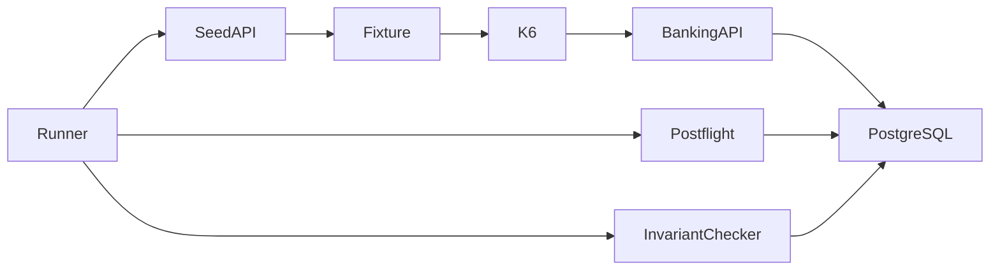

# DBS-165 · Năm kịch bản k6 và cổng kiểm bất biến

> **Status:** Implemented · **Vai:** Dev · **Cặp đôi review:** Dev khác · **Nhánh:** `codex/DBS-165-k6-scenarios` · **PR:** [#128](https://github.com/Lawliet119/digital-banking-simulator/pull/128) · **Cập nhật:** 2026-11-10

## 1. Bối cảnh

Task Story, Tuần 7, ưu tiên Highest, Demo 5, Status To Do. Expect: Có bộ kịch bản tải lặp lại được bằng một lệnh.

DoD nguyên văn từ sheet:

1. load-tests/{baseline,hot-account,duplicate,stress,rate-limit}.js dùng k6; dữ liệu tạo bằng seed qua API, token từ cách đã chốt ở DBS-53 hoặc Cognito demo
2. Mỗi kịch bản có ngưỡng thành công/thất bại (thresholds) khớp NFR
3. Chạy thử nhỏ ở local để chắc kịch bản đúng trước khi chạy tải thật
4. README hướng dẫn chạy; kết quả thô lưu dạng JSON
5. PR đã merge vào main (CI xanh); Dev review; bảng «Đối chiếu test case» trong PR điền đủ

Phụ thuộc: DBS-70 và DBS-69 Done, seed API và checker đã có trên main `478ab4c`. DBS-139 To Do: dựng cloud từ trống ≤30 phút chưa chứng minh. Phạm vi giảm: viết đủ script, kiểm cấu hình và smoke local trên PostgreSQL thật; không triển khai AWS hoặc chứng nhận NFR trên cloud (DBS-166/Ops). Không giả lập guard/service.

Thực trạng: `load-tests/README.md` có demo correctness nhưng chưa có năm script. Docker PostgreSQL 17, Valkey 8 và ElasticMQ đang chạy. Worktree riêng từ origin/main, giữ nguyên nhánh DBS-186 của người dùng. Baseline đang chạy sau `npm ci --ignore-scripts`; lượt khởi động nhầm khi npm chưa hoàn tất báo thiếu module, không dùng làm baseline.

Backlog liên quan: BL-050 (tải AI: không áp dụng vì chỉ HTTP đồng bộ, không đánh giá AI), BL-127 (gắn checker sau load: nhận phần runner), BL-128 (checker cần devDependencies: runner yêu cầu checkout đầy đủ), BL-161 (cloud chưa sẵn sàng), BL-179 (rate limit hai task/ALB), BL-213 (seed sau 7 ngày: yêu cầu DB mới cho mỗi đợt đo), BL-216 (Redis/cloud drill thuộc Ops).

Baseline trên main `478ab4c`, Node24.15.0: lint đạt, typecheck đạt, unit98 suites/1770 tests đạt, e2e17 suites/163 tests đạt, skipped0. Docker compose up -d đạt. File output baseline lưu ở thư mục TEMP của phiên.

Quyết định ở G1 (agent tự quyết): chọn phạm vi local hữu ích thay vì chờ DBS-139; không sửa backend, CI, dependency hay giới hạn nghiệp vụ. G1 qua; người dùng chuyển board sang In Progress.

## 2. Hành vi

Nguồn chuẩn: [BRD §8](../BRD.md), [kiến trúc §9, §12, §14](../03_HIGH_LEVEL_ARCHITECTURE.md), [ADR-05](../adr/0005-idempotency-in-postgres.md), [ADR-12](../adr/0012-redis-valkey-node.md).

| Script | Tải mặc định | Cổng kết quả |
|---|---|---|
| baseline | Ba plateau 12/60/120 RPS, mỗi plateau 15 phút; scenario đọc/ghi riêng 80/20, mỗi iteration đúng một HTTP request | đọc p95<150ms; chuyển p95<300ms, p99<1000ms; lỗi hệ thống<0,001; không dropped iteration; mọi phản hồi nghiệp vụ mong đợi |
| hot-account | 20 chuyển/giây vào cùng một tài khoản, 15 phút | chuyển p95<1000ms; lỗi<0,001; không dropped iteration; 201 COMPLETED |
| duplicate | Một burst/giây, 60 giây; mỗi burst 10 POST song song cùng user/key/body, rồi đổi amount | 10 response 201 cùng transferId/body; đổi body trả 422 IDEMPOTENCY_KEY_REUSED; lỗi<0,001; checks=100% |
| stress | 120→180→240 RPS, ba stage 5 phút, 80/20 đọc/ghi | giữ thresholds NFR để chỉ ra điểm gãy, không tự nới ngưỡng khi đỏ |
| rate-limit | Một iteration; 11 chuyển cùng user rồi 101 GET qua hai URL API luân phiên trong cùng phút | 10 chuyển 201 rồi 429; request IP thứ 101 trả 429; mọi 429 có problem+json, RATE_LIMITED, Retry-After từ 1 đến 60 |

Smoke: giảm thời lượng và arrival rate (baseline/stress 5 RPS, hot 2 RPS, duplicate 1 burst); giữ nguyên thresholds và ghi rõ không phải chứng minh NFR. Rate-limit vẫn giữ 11/101 để chứng minh biên thật. Chờ sang phút kế tiếp trước từng pha, không xóa bộ đếm Redis; không giả X-Forwarded-For. Hai URL mặc định có thể cùng trỏ một instance để smoke; chỉ ghi multi-instance khi Ops cung cấp hai instance thật. Khi Redis down bài này phải đỏ vì limiter fail-open.

Seed qua `runSeed` của DBS-70: onboarding, accounts, deposit và transfer qua HTTP; tiền `"1000"` là chuỗi đồng. Fixture gồm token customer, accountId và URL, chỉ lưu trong `load-tests/results/` được gitignore. Sau seed, nạp bù CHECKING lên50 triệu bằng deposit API (delta tối đa50 triệu/lệnh). Hot dùng nguồn Minh Anh và đích Hà cố định:18 triệu cho15 phút. Baseline/stress quay vòng ba CHECKING; trước tải đọc DB kiểm số dư và tổng DEBIT hôm nay theo giờ Việt Nam; yêu cầu ngân sách bảo thủ cho số iteration tối đa, không tự nâng hạn mức ngày200 triệu. Local token dùng DBS-53, exp 4 giờ (chỉ môi trường local); cloud nhận token Cognito từ file riêng, phải còn hạn cho toàn run. Không ghi token vào output, không bật HTTP debug; raw JSON chỉ dùng systemTags an toàn, route name cố định.

Ví dụ transfer: `POST /v1/transfers`, header Idempotency-Key UUID, body `{"fromAccountId":"<UUID>","toAccountId":"<UUID>","amount":"1000"}` → 201 `{"transferId":"<UUID>","status":"COMPLETED"}`. Không retry tự động. Tách lỗi hệ thống (không tính 422 nghiệp vụ, 429) khỏi checks nghiệp vụ: 422/429 ngoài bài rate-limit vẫn làm checks đỏ để tránh đo toàn request bị từ chối mà báo đạt. Không dùng `http_req_failed` mặc định làm oracle.

Runner Node một lệnh chuẩn bị seed (hoặc fixture có sẵn), chạy k6, ghi raw JSON và summary JSON rồi luôn chạy checker DBS-69 trên DATABASE_URL được cung cấp, kể cả k6 lỗi. Giữ mã lỗi k6/checker; không có k6, DB, fixture hợp lệ hoặc target không khớp thì fail. Không đưa DATABASE_URL vào argv/log. Cấu hình harness chỉ ở process Node/k6, không thêm env backend.

## 3. Kiến trúc

Node `run.cjs` → `prepare.cjs` (DBS-70/53) → fixture riêng → k6 scripts → HTTP API → ledger PostgreSQL. Sau k6, Node gọi checker thật → report PASS/FAIL. Không thay exported symbol backend, bảng, transaction, contract, quy tắc tiền hay ADR. Các URL đọc là `/v1/accounts/:id` và `/v1/accounts/:id/transactions?limit=20`.

File chính: năm entrypoint, `lib/config.js` (cấu hình thuần), `lib/client.js` (HTTP/checks/metrics), `prepare.cjs`, `run.cjs`; unit Node kiểm plan, thresholds và fail-closed runner; smoke driver chạy AppModule thật trên DB tạm. Không thêm production dependency. Giới hạn hiệu năng nâng bằng env có sẵn ở ứng dụng chạy tải theo docs/03 §12; rate-limit chạy instance khác với mặc định 10/100.

## 4. Test cases tự động

| ID | Truy vết | Lớp | Given · When · Then |
|---|---|---|---|
| TC-165-01 | DoD1,2; PERF01/02, SCAL01 | Node unit | baseline có đúng 12/60/120 RPS, 80/20, plateau 900s; thresholds đúng và smoke không đổi thresholds |
| TC-165-02 | DoD1,2; SCAL02 | Node unit/k6 thật | hot 20/s chung đích; duplicate batch10 thực sự song song; stress vượt120 |
| TC-165-03 | DoD1,2; SEC05 | k6/HTTP/PG thật | biên10/11 và100/101; 429 RATE_LIMITED + Retry-After; cùng phút và luân phiên URL |
| TC-165-04 | DoD3 | smoke HTTP/PG thật | đủ5 script chạy local; không retry/SQL seed tiền; checker PASS sau mỗi run |
| TC-165-05 | DoD4 | Node unit/manual | runner giữ exit lỗi, vẫn checker khi k6 lỗi; raw/summary JSON; thiếu config/fixture sai/target down phải đỏ |
| TC-165-06 | DoD1,4 | Node unit và kiểm output | fixture thiếu bị từ chối; không dùng tag URL hay token trong raw output. Từ BL-233, mỗi biến thể sai của validator có một unit riêng trong `load-tests/test/fixture-validation.test.mjs` (CI chạy ở job `unit`): `cleanUrl` từ chối thiếu/không phải chuỗi, thiếu scheme, scheme khác http(s), khoảng trắng hoặc xuống dòng, query, fragment, userinfo; `validateFixture` từ chối sai số khách (0, 1, 2, 4), `customers` không phải mảng, `baseUrl` thiếu/sai/khác mục tiêu (host, cổng, scheme), `accountId` thiếu/sai độ dài/không hex, `sub` thiếu, token thiếu/không phải chuỗi/sai số đoạn/đoạn rỗng/có khoảng trắng/có tiền tố Bearer/ký tự ngoài base64url, hai khách trùng tài khoản; `assertTokensOutliveRun` (tách từ `run.cjs`, hành vi giữ nguyên) từ chối token hết hạn, hết hạn trước khi chạy xong, thiếu hoặc sai kiểu `exp`, sai hoặc thiếu `sub`, payload không phải JSON, và chốt biên đúng 60 giây sau khi chạy xong; lỗi không lặp lại URL hay token bị từ chối |
| Quy trình | DoD5 | review/CI | CI xanh, Dev khác review, merge do người quản lý repo |

## 5. Test thủ công

| Bước | Thao tác | Mong đợi |
|---|---|---|
| M-165-01 | Checkout sạch, cài dependency, start AppModule api thật với DB tạm, local JWKS và Valkey riêng; seed qua API | report seed, 3 customer/4 accounts, checker PASS |
| M-165-02 | Chạy runner --smoke cho baseline/hot-account/duplicate/stress | exit0, thresholds/checks đạt; raw JSON, summary JSON; checker PASS sau từng bài |
| M-165-03 | Start hai AppModule api với cùng DB/Valkey, mặc định10/100; rate-limit smoke | biên11/101 đúng, 429 đúng; checker PASS |
| M-165-04 | Target HTTP không hoạt động; chạy baseline smoke | k6/runner exit khác0, checker vẫn chạy; không báo đạt |
| M-165-05 | Redis riêng dừng, chạy rate-limit | fail rõ vì không nhận429; bật lại Redis; không ảnh hưởng container dùng chung |
| M-165-06 | Dừng Docker sau khi đóng app tạm; chạy harness và phục hồi | harness fail rõ; chỉ thực hiện với Docker/context riêng để không dừng dịch vụ người khác; nếu không cô lập được ghi chưa chạy |

Không quay tải cloud, không chỉnh .env người dùng. SHA code cuối đặt dòng đầu manual-test.txt; raw JSON chứa token fixture không commit.

Thiết kế hậu kiểm bổ sung: fixture/DB phải dành riêng cho đợt tải, không có traffic khác. Runner chụp tổng số transfers và ledger_entries trước k6; bài duplicate hậu kiểm delta chính xác bằng số burst và hai lần số burst, đồng thời đếm key theo runId. Checker5 bất biến không đủ phát hiện giao dịch trùng nhưng vẫn cân sổ. Negative control unit phải từ chối delta thừa ngay cả khi checker PASS. Từng plateau baseline và từng endpoint đọc có threshold riêng, tránh số đo nhanh che phần chậm. Preflight ghi số dư, ngân sách ngày cho hot và chuyển tiền, kiểm token còn hạn cho toàn run; nếu thiếu dừng thay vì đo toàn422.

## 6. Domain review (AI)

**Reviewer:** subagent kế thừa model của phiên (không cung cấp model ID), ngày2026-11-10. Lượt1 REVISE: blocking1, should-fix2, minor0; [nguyên văn](screenshots/DBS-165/domain-review.md). Đã sửa: hậu kiểm duplicate exact delta+keys, thresholds từng plateau/operation, nạp bù qua API và preflight ngân sách. Review lại0 phát hiện, Verdict: APPROVE; [nguyên văn lượt2](screenshots/DBS-165/domain-review-r2.md).

Quyết định ở G2 (agent tự quyết): giữ kiểm cân sổ và kiểm cardinality là hai oracle độc lập; chọn fixture/DB riêng để delta có ý nghĩa; không thay đổi hạn mức nghiệp vụ.

## 7. Kế hoạch triển khai

| Bước | File | Test viết trước | Đỏ | Lệnh chứng minh | Commit |
|---|---|---|---|---|---|
| 1 | load-tests/package.json, lib/config.js, test/config.test.mjs | TC-165-01/02/06: rates, thresholds, fixture, budget | ERR_MODULE_NOT_FOUND lib/config.js | node --test load-tests/test/config.test.mjs | test(load): define k6 workload contracts |
| 2 | load-tests/lib/client.js, năm entrypoint, prepare.cjs, run.cjs, postflight.cjs, test/runner.test.mjs | TC-165-05: fail exit, always checker, duplicate overcount | Cannot find module run.cjs | node --test load-tests/test/*.test.mjs; k6 inspect | feat(load): add five k6 scenarios and invariant runner |
| 3 | load-tests/test/smoke.cjs, backend build hiện hữu | TC-165-03/04 và manual5 bài qua AppModule thật, PG/Valkey riêng | duplicate checks62,5% do thứ tự khóa JSON, thêm regression rồi sửa | node load-tests/test/smoke.cjs | test(load): verify scenarios against real banking API |
| 4 | load-tests/README.md, docs/features/README.md, docs/BACKLOG.md, feature doc và screenshots/DBS-165/* | DoD4/5, links, evidence | không áp dụng | check-doc-links.mjs; baseline4 lệnh | docs(load): document k6 operation and evidence |

Plan sweep: đủ5 script, seedAPI/DBS53/Cognito, thresholdsNFR, local smoke, rawJSON, README và quy trình review/merge. Ngoài phạm vi: cloud provisioning139, load acceptance166, AI latency174, multi-instanceALB+Redis down thực tếBL179. Không sửa backend/CI, không thêm dependency. Rủi ro: DB không riêng làm delta vô nghĩa; bắt buộc môi trường riêng. Token hết hạn hoặc không đủ ngân sách thì fail trước tải. Cách lùi: revert các commit chỉ thêm load harness/docs; không có migration hoặc backend change. G2 APPROVE; G3 qua sau khi sweep từng DoD/limitation. Quyết định agent tự duyệt giữ phạm vi này.

## 8. Kết quả

Code cuối: `32208dd60d4bf6ca3fbe0bc38b7e0c640c91ec52`; clone sạch ở `D:/UET_PROJECT/dbs165-clean-validation`, npm ci từ lockfile, Node24.15.0, k6v2.3.0. AppModule thật role api, PostgreSQL17/Valkey8 riêng bằng Testcontainers, hai process API cho limiter; không mock DB, không seed SQL tiền. Output [manual-test.txt](screenshots/DBS-165/manual-test.txt) ghi SHA dòng đầu, chạy bằng Git Bash. Raw/summary/invariants của từng run còn ở thư mục load-tests/results của clone sạch, không commit.

Kiểm tra bàn giao: lint đạt, typecheck đạt; unit98 suites/1770 tests đạt; e2e17 suites/163 tests đạt; Node load tests9/9 đạt, skipped0; build đạt; cả5 entrypoint qua k6 inspect với cấu hình full. Mermaid render SVG qua mermaid.ink đạt. Không chạy full test:db vì không đổi backend; smoke đã chạy logic tiền thật với checker sau mọi bài. Output baseline ở [verification.txt](screenshots/DBS-165/verification.txt).

| ID | Test chứng minh | Kết quả |
|---|---|---|
| TC-165-01 | config.test.mjs; k6 inspect full; baseline smoke | đạt cấu hình, smoke chỉ5RPS, không chứng minh NFR120RPS |
| TC-165-02 | config.test.mjs, runner.test.mjs; hot/duplicate/stress smoke; exact DB postflight | đạt; negative control unit phát hiện giao dịch cân sổ dư; JSON replay so theo giá trị, không theo thứ tự khóa jsonb |
| TC-165-03 | rate-limit.js qua2AppModule dùng chung Valkey | đạt local10/11 và100/101; cloud/ALB chưa chạy BL-232 |
| TC-165-04 | smoke.cjs từ clone sạch | đủ5bài, checkerPASS sau mỗi bài |
| TC-165-05 | runner.test.mjs và API unreachable | đạt: k6 exit99, checker vẫnPASS; checker lỗi thì runner đỏ |
| TC-165-06 | unitfixture thiếu, đọc validator, kiểm raw output | đã có unit từng biến thể URL/token sai (BL-233, `fixture-validation.test.mjs`); không đổi chính sách auth backend; raw không token/Authorization/DB URL/ARN |
| DoD5 quy trình | PR/CI/Dev review | Cập nhật 2026-11-14 (kiểm bằng `gh`): [PR #128](https://github.com/Lawliet119/digital-banking-simulator/pull/128) đã merge ngày 2026-11-11, 6 job CI xanh; GitHub không có review của người khác tác giả. Dev khác review còn ở BL-233 |

| Bước | Lệnh/kết quả thật | Kết luận |
|---|---|---|
| M-165-01 | `cd backend; node -r ts-node/register -r tsconfig-paths/register ../load-tests/test/smoke.cjs`; seedAPI tạo3customer, nạp bù, checkerPASS | đạt |
| M-165-02 | runner baseline/hot-account/duplicate/stress --smoke; baseline25HTTP, hot10, duplicate3burst/33HTTP →3transfer/6entries/3keys; stress26HTTP; tất cả checks100%, errors0, invariantExit0 | đạt local |
| M-165-03 | runner rate-limit --smoke,112HTTP, checks100%, 2process dùng chung Redis; invariantExit0 | đạt local |
| M-165-04 | fixture trỏ port không có listener; baseline exit99, checks0%, system_errors100%, invariantExit0 | đạt ca âm |
| M-165-05 | dừng Valkey riêng rồi chạy rate-limit | đạt ca âm: clone sạch exit99 vì checks không đạt, invariantExit0 |
| M-165-06 | dừng PostgreSQL riêng rồi chạy runner; tắt Docker daemon thật | PostgreSQL riêng: runner khác0, invariantExit2; đạt ca âm. Docker daemon thật chưa chạy để không dừng dịch vụ dùng chung, BL-233 |

Số p95 smoke (ms, không dùng làm benchmark cloud): baseline chuyển54,08/đọc23,10; hot26,87; duplicate60,28; stress chuyển40,66/đọc19,75. Raw output giữ số chính xác, không suy ra120RPS từ smoke.

Lệch/điều chỉnh trong phạm vi §7: lượt đầu duplicate đỏ vì JSON.stringify phân biệt thứ tự khóa của response mới/replay jsonb; thêm unit đỏ rồi so đúng2field theo giá trị, giữ oracle cardinality. Arrival executor có thể phát iteration đúng cuối duration; preflight cộng biên. Không đổi contract/backend/dependency. Unit TC-165-06 hẹp hơn mô tả ban đầu: ghi đơn giản hóa, không nhận là coverage đầy đủ.

Ảnh chưa có: `01-k6-summary.png`, `02-rate-limit.png`, `03-negative-controls.png`. Computer Use đã dừng vì không xác định được URL trình duyệt đủ chắc chắn để thực thi chính sách; không dùng cách khác vượt kiểm tra. Output thô được giữ, không tạo ảnh giả. Chưa tắt cả Docker daemon; chỉ dừng PostgreSQL và Valkey thuộc test. Các giới hạn này ghi ở BL-233.

Bàn giao: BL-232 cho Ops (DBS-139/166, tải/cloud/Cognito/TLS/ALB/Redis), BL-233 cho Dev review/merge và ảnh/daemon thật. Giữ BL-127 (còn các money test khác và metric/alarm) và BL-128 (checker production image). Không đóng backlog chỉ vì runner đã có.

## 9. Tài liệu đã cập nhật

load-tests/README.md, docs/features/README.md, docs/BACKLOG.md (thêm BL-232 và BL-233; số BL-226 đến BL-231 đã thuộc DBS-135, DBS-137 và DBS-186). Không thay ADR/API schema hoặc tài liệu backend.

## Checklist G4

- [x] TC01–05 đạt theo phạm vi local; TC06 đơn giản hóa có ghi rõ;9 unit/harness tests, skipped0.
- [x] Test thủ công clone sạch trên SHA code cuối: đủ5bài thành công và ca âm API/Redis/PostgreSQL; daemon thật chưa chạy, BL-233.
- [x] Raw output quét không token/Authorization/DB URL/ARN;3ảnh còn thiếu được nêu tên/lý do và BL-233.
- [x] Diff chỉ load-tests và docs đã có trong §7; không sửa code backend, CI, dependency.
- [x] Bốn baseline command bàn giao đạt:1770unit,163e2e, lint/typecheck; build đạt.
- [x] Link checker cuối:367files/0broken; G4 qua theo phạm vi local.
- [x] DoD/handoff chưa đạt có BL-232 và BL-233 và được nêu trong §8; cloud không nhận là localPASS.
