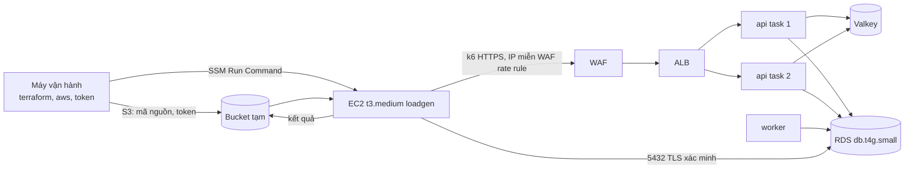

# DBS-166 · Chạy tải 12 → 60 → 120 RPS, tài khoản nóng, stress từ máy cùng region và viết báo cáo

> **Status:** Draft (đang làm, đến G2) · **Vai:** #5 Platform & Ops · **Cặp đôi review:** Dev khác · **Nhánh:** `test/DBS-166-load-report` · **PR:** — · **Cập nhật:** 2026-11-21

## 1. Bối cảnh

- **Task trên board:** Story · Tuần 7 · Ưu tiên Highest · Demo 5 · Status board `To Do`. **Thực trạng (board):** «Chưa có số liệu tải thật. Quy tắc: chạy từ một máy cùng region AWS, không từ laptop qua mạng nhà.» **Expect:** «Số liệu thật cho câu bảo vệ 6 (5×, 10× tải).»
- **DoD (nguyên văn):**
  1. Báo cáo p95/p99/error rate ở 12, 60, 120 RPS; tài khoản nóng 20 lệnh/s; stress tìm điểm gãy; ghi cấu hình (số task, cỡ RDS, phiên bản commit)
  2. Sau MỖI lần chạy chạy DBS-69 → đúng
  3. Lỗi < 0,1% liên tục 15 phút ở 120 RPS hoặc ghi rõ lý do chưa đạt và hướng xử lý
  4. Báo cáo và kết quả thô lưu docs/components/load-tests
  5. PR đã merge vào main (CI xanh); Dev review; bảng «Đối chiếu test case» trong PR điền đủ
- **Phụ thuộc:** DBS-165 (năm kịch bản k6): board ghi `In Progress` nhưng [PR #128](https://github.com/Lawliet119/digital-banking-simulator/pull/128) đã merge ngày 2026-11-11, kịch bản có trên `main` (board chậm; xem [DBS-165 §8](DBS-165-k6-scenarios.md)). DBS-121 (worker trên ECS): Done, `envs/dev/session/worker.tf` có trên `main`. DBS-69 (checker bất biến): có trên `main`.
- **Đã có gì:** `load-tests/` (5 kịch bản, `run.cjs`, `prepare.cjs`, `postflight.cjs`, README); stack Terraform `envs/dev/session` (RDS, Valkey, ALB, WAF, ECS api và worker; [DBS-139](DBS-139-dev-env-rebuild-demo-checklist.md) đo dựng từ trống ≈ 12 phút); `infra/scripts/{db-roles,demo-token,verify-clean}.sh`, `.github/scripts/migrate.sh`. Không có tài nguyên tính tiền nào đang chạy (kiểm 2026-11-21: ECS, RDS, ALB, NAT, EC2 đều rỗng). Image `dbs-api` có tag `0d5874b64491ae9cee0e041d6a201870668e9979` (`main`).
- **Baseline (2026-11-21, `main` `0d5874b`):** `terraform init -backend=false && fmt -check && validate && test` ở `envs/dev/session`: 97 test đạt; `node --test load-tests/test/*.test.mjs`: 81 test đạt (trước khi thêm test của task này). Backend không đổi trong PR này nên bốn lệnh backend không chạy lại (CI chạy khi mở PR).
- **Lỗi harness tìm thấy khi đọc mã (chặn DoD 2, vòng quyết định G1):** `run.cjs` gọi `backend/test/support/invariants.ts`, từ BL-128 chỉ còn là `export *` nên chạy nó thoát 0 mà không in gì: mọi lần chạy ở DBS-165 báo `invariantExit=0` dù không kiểm. Đã tái hiện: với DB không nối được, đường `test/support` thoát 0 và im lặng, đường `src/scripts/invariants` thoát 2 và in `CHECK_ERROR`. Sửa trong PR này (TC-166-10..12).
- **Ngoài phạm vi:** đổi mã backend; nghiệm thu tải AI (DBS-174); drill Redis/RDS dưới tải (DBS-167, BL-216, BL-221); rollback và alarm (đã có); chỉnh ngưỡng thành đạt khi bài đỏ (không nới ngưỡng).
- **Backlog xét ở G1** (quyết định bằng subagent opus, mục «Quyết định G1»):

| Nhóm | Dòng | Quyết định |
|---|---|---|
| Đưa vào, đóng khi có số đo | BL-232 (nghiệm thu tải cloud), BL-127 (checker sau mỗi lượt trên AWS), BL-292 (miễn WAF cho IP máy tải), BL-179 (giới hạn dùng chung hai task, `request.ip` sau ALB) | làm, xóa dòng khi đủ điều kiện đóng (mục §8) |
| Đưa vào ở mức đo được | BL-187 (số RDS thật cho extract fraud), BL-385 (p95 chuyển tiền khi worker tắt), BL-382 (2 task api), BL-265 (dựng `session` bằng profile `dbs`), BL-302 (b) (dựng RDS+Valkey dưới key policy DBS-154) | làm phần đo được, giữ dòng với ghi chú phần còn lại |
| Không chặn tải, để nguyên | BL-104, BL-109 (workflow `Deploy`; image đã có trong ECR), BL-252 (seed qua ALB bằng `prepare.cjs`), BL-381, BL-182, BL-275, BL-276, BL-264, BL-361, BL-396, BL-251, BL-290, BL-291; nhóm AI/holdout (BL-043, 171, 392, 407, 403, 409, 410) | không đụng, lý do ở feature doc |

- **Quyết định ở G1 (agent tự quyết; subagent opus, effort high, 2026-11-21):**
  1. **Cấu hình đo (sửa sau domain review #5):** `envs/dev/session` với RDS `db.t4g.small` **Multi-AZ** (`db_multi_az=true`), Valkey `cache.t4g.micro` **1 replica** (`redis_replicas=1`), 2 task api (0,5 vCPU/1 GB), 1 worker, WAF bật; đúng cấu hình đo tải của ADR-11 và docs/03 §13.1, thêm ≈ 0,06 USD/giờ. Không dùng stack prod. Mọi biến nằm trong một file `dbs166.tfvars` (không commit) dùng cho **mọi** `plan`, `apply`, `destroy` (review #4: quên một biến âm thầm đổi cỡ RDS, mất miễn trừ WAF hoặc mất `COGNITO_CLIENT_ID`).
  2. **Máy tải:** EC2 `t3.medium` on-demand (không spot: bị thu hồi giữa baseline 46 phút làm mất cả lượt, tiết kiệm ≈ 0,1 USD), public subnet có IP công khai gán lúc khởi động, SG chỉ egress 443 và 5432 tới SG RDS, điều khiển bằng SSM, stack riêng `envs/dev/loadgen`.
  3. **Token:** client Cognito tạm `dbs-loadgen` (token 240 phút) trong stack loadgen thay vì sửa `base` (không đụng `base`; `update-user-pool-client` đặt lại mặc định các trường không truyền). `session` đặt `COGNITO_CLIENT_ID` theo client này qua `api_extra_environment`.
  4. **Giới hạn tốc độ:** biến `api_extra_environment` (chỉ ba khóa cho phép) ở `session`; bài `rate-limit` chạy trước với mặc định 10/100, rồi `apply` thêm `RATE_LIMIT_*` và `update-service` bằng ARN từ state, rồi các bài còn lại.
  5. **TLS:** chứng chỉ ALB tự ký nên k6 dùng `K6_INSECURE_SKIP_TLS_VERIFY=true` và riêng `prepare.cjs` dùng `NODE_TLS_REJECT_UNAUTHORIZED=0` (như BL-252 đã chấp nhận); mọi lệnh `run.cjs` khác không đặt biến này và TLS tới RDS luôn xác minh bằng CA bundle.
  6. **Kết quả thô:** `raw.json` k6 (hàng trăm MB) không commit; commit `summary.json`, `invariants.txt`, `aggregate.json`, `per-minute.json` và `requests.csv.gz` (mỗi request một dòng, tính lại phân vị cho cửa sổ bất kỳ) cùng sha256 và kích thước của raw.
  7. **Tuần tự trên một fixture/DB:** rate-limit → baseline → hot-account → duplicate → stress (BL-213 cấm seed lại), nghỉ ≥ 60 giây giữa các bài, duplicate không chạy ngay sau stress. Ngân sách Minh Anh ≈ 53,2 triệu/200 triệu mỗi ngày (rate-limit 0,01 + smoke 0,012 + seed 2 + baseline 11,52 + hot 18 + duplicate 0,061 + stress 10,8 + stress worker 0 10,8; số dư đủ vì baseline và stress quay vòng ba tài khoản, sau hot còn ≈ 32 triệu). Trước `duplicate` chạy `loadgen-run.sh quiesce` (hai lần đếm `transfers` cách 30 giây phải bằng nhau).
  8. **Trần bật 90 phút của README không đủ:** lượt này cần 2,5 đến 3 giờ; ngoại lệ có lý do, trần cứng 3,5 giờ; ngân sách có sẵn (50/100/150 USD).
  9. **BL-385** chạy thêm `stress` với worker 0, chỉ lấy plateau 120; bỏ nếu quá 2 giờ 45 phút bật.
  10. **429 ngoài bài `rate-limit` là lỗi hạ tầng (review #2):** giới hạn của app đã nâng, nên 429 là của WAF hoặc ALB; `aggregate-raw.cjs` tính nó vào lỗi hệ thống (k6 `record()` của DBS-165 thì coi hợp lệ: ghi cả hai số, bàn giao DBS-165 ở §8). Lượt chỉ hợp lệ khi `BlockedRequests` của WAF rule `rate-limit` bằng 0 trong cửa sổ; không stop máy tải (IP công khai đổi thì mất miễn trừ).
  11. **Ràng buộc ngày (review #16):** WAF bật với miễn trừ IP chỉ đúng khi chạy trước `2026-11-26` (BL-291). Chạy sau ngày đó thì `waf_enabled=false` và ghi trong báo cáo.
  12. **Token operator** chỉ tải ở `prepare` rồi xóa khỏi máy và bucket (review #8a). Máy tải giữ mật khẩu `dbs_api` (có INSERT/UPDATE trên sổ cái, không chỉ SELECT): chấp nhận có hạn trong một phiên, bucket và máy bị hủy; role chỉ-SELECT cho harness là việc của Dev (BL mới, §8).
  13. **Lý do «Hoãn» cho các dòng «Trước tải» còn lại (review #15, quy tắc «Rà lại» của BACKLOG)** nằm ở §8, bảng «Rà lại backlog».

## 2. Hành vi (kịch bản đo)

Đo bằng đúng năm kịch bản của DBS-165, từ máy tải trong VPC `ap-southeast-1` vào ALB, không đổi ngưỡng. Mỗi lần chạy: `node load-tests/run.cjs <kịch bản>` rồi checker bất biến (đã sửa), rồi `aggregate-raw.cjs`.

| Bài | Tải | Cấu hình app | Ngưỡng đạt (từ `lib/config.js`, docs/03 §14) |
|---|---|---|---|
| `rate-limit` | 11 chuyển/phút rồi 101 GET/phút, ALB, hai task | mặc định 10 chuyển/phút/khách, 100 yêu cầu/phút/IP | 10 lần 201 rồi 429; 100 lần 200 rồi 429; `RATE_LIMITED`, `Retry-After` 1..60; cả hai task nhận request (BL-179) |
| `baseline` | 12, 60, 120 RPS, mỗi plateau 900 giây, 80% đọc/20% chuyển | giới hạn tốc độ nâng lên 1.000.000 | chuyển p95 < 300 ms, p99 < 1 s; đọc p95 < 150 ms; lỗi hệ thống < 0,1%; không dropped iteration |
| `hot-account` | 20 chuyển/giây, 900 giây, cùng nguồn Minh Anh | như trên | chuyển p95 < 1 s; mọi lệnh 201 COMPLETED |
| `duplicate` | 60 burst, mỗi burst 10 POST song song cùng khóa | như trên | 10 lần 201 cùng body; đổi amount 422 `IDEMPOTENCY_KEY_REUSED`; đúng 1 transfer, 2 bút toán mỗi burst |
| `stress` | 120 → 180 → 240 RPS, mỗi plateau 300 giây | như trên | giữ ngưỡng NFR để tìm điểm gãy |
| `stress` (worker 0) | như `stress`, chỉ đọc plateau 120 | worker `desired_count = 0` | p95 chuyển so với `stress` có worker (BL-385) |

Ngưỡng chung của k6 (`lib/config.js`) áp cho mọi bài trừ `rate-limit`: `checks rate==1`, `system_errors rate<0.001`, `dropped_iterations count==0`; `duplicate` còn `transfer_latency p95<300`. Nếu `duplicate` đỏ chỉ vì `transfer_latency` (10 request cùng khóa phải xếp hàng) trong khi AC-5.4 đạt (đủ 10 lần 201 cùng body, đúng delta), báo cáo ghi hai kết luận tách nhau, không gộp thành «đạt».

Điểm gãy được xác định là plateau đầu tiên mà một ngưỡng đỏ, kèm nút thắt (CPU task, CPU RDS, số kết nối, độ trễ Redis) đọc từ CloudWatch.

**Phán quyết DoD 3 (chốt trước khi chạy, review #1):** «đạt» chỉ khi, trên đúng cửa sổ của plateau 120 RPS của `baseline` (`read_120` và `write_120` gộp, từ yêu cầu đầu tới yêu cầu cuối của plateau, ≈ 900 giây), tỉ lệ lỗi hệ thống **< 0,1%**, tính từ `requests.csv.gz` bởi `aggregate-raw.cjs` (`plateaus["120"].meetsErrorBudget`, TC-166-20..21). Lỗi hệ thống = status ngoài 200/201/422/429, status 0 (timeout, đứt kết nối), và **mọi 429 ngoài bài `rate-limit`** (review #2). Chuỗi theo phút của plateau (`perMinute`, cửa sổ 60 giây tính từ đầu plateau) chỉ là bằng chứng phụ để chỉ ra phút nào lỗi. Ngưỡng `system_errors` của k6 tính trên cả lượt baseline nên không dùng làm phán quyết DoD 3. Không đạt thì báo cáo nêu lý do và hướng xử lý, không chạy lại để chọn lượt đẹp: mọi lượt đã chạy đều có trong báo cáo. RPS đạt được theo từng plateau (`achievedRps`) và `dropped_iterations` được ghi để biết plateau nào bị giới hạn bởi phía client (`maxVUs` 300, timeout 2 giây, review #12).

## 3. Kiến trúc

- **Vị trí:** `infra/terraform/envs/dev/loadgen` (mới), `infra/terraform/envs/dev/session` (biến `api_extra_environment`), `infra/scripts/loadgen-{bootstrap,run}.sh` và `loadgen-tokens.mjs`, `load-tests/aggregate-raw.cjs`, `load-tests/run.cjs` (sửa checker), báo cáo ở `docs/components/load-tests/`.
- **Dữ liệu chạm:** DB `dbs` của phiên (mới, dựng rồi hủy). Chỉ đọc bằng role `dbs_api` từ máy tải (SELECT cho checker và postflight). Không migration, không sửa schema, không SQL tạo tiền: seed qua API (`prepare.cjs`, DBS-70).
- **Ranh giới transaction:** không đổi mã sản phẩm.

- **IAM:** instance role = SSM core, bucket tạm, `GetSecretValue` chỉ `dbs/dev/db-api-*`, `kms:Decrypt` qua Secrets Manager. Không đọc secret master hay `demo-accounts` (token lấy trên máy vận hành bằng `loadgen-tokens.mjs`, mật khẩu chỉ nằm trong thân HTTPS). Role `dbs_api` không chỉ đọc (có INSERT `transfers`/`ledger_entries` và UPDATE `balance`); rủi ro được chấp nhận trong một phiên có hủy (G1 quyết định 12).
- **Chi phí:** ≈ 0,4 USD/giờ (RDS small Multi-AZ ≈ 0,12, Valkey 2 node ≈ 0,04, ALB ≈ 0,035, 3 task ≈ 0,06, EC2 0,053, WAF ≈ 0,01), dự kiến 3 giờ ≈ 1,5 đến 2,5 USD. Để quên bật ≈ 10 USD/ngày: hủy ngay khi xong, kiểm bằng `verify-clean.sh`.
- **Thay đổi cấp hệ thống:** `infra/terraform/README.md` (mục «Máy chạy tải»), `load-tests/README.md` (lỗi checker, cách chạy trên cloud), `docs/components/load-tests/` (báo cáo), `docs/BACKLOG.md`.

## 4. Test cases tự động

| ID | Truy vết | Lớp | Given · When · Then | Mong đợi |
|---|---|---|---|---|
| TC-166-01 | DoD1 (cấu hình ghi được, máy tải cùng region) | `terraform test` (mock) | plan stack loadgen | máy ở public subnet, IMDSv2 bắt buộc, đĩa mã hóa, có IP công khai |
| TC-166-02 | DoD1; ADR-10 | `terraform test` | SG của loadgen | không ingress; egress chỉ 443 và 5432 tới SG RDS; RDS nhận thêm đúng một luật |
| TC-166-03 | NFR-SEC-06 | `terraform test` | bucket và IAM | bucket chặn public, chỉ TLS; role không đọc secret master hay `demo-accounts` |
| TC-166-04..07 | DoD4 | Node unit | `aggregate-raw.cjs` | phân vị nội suy; gộp theo scenario/tên; status 0 là lỗi hệ thống; CLI đọc `raw.json` và `.gz`, thoát khác 0 khi thiếu raw; `requests.csv.gz` tính lại đúng p95 |
| TC-166-08..09 | DoD1 | Node unit | `loadgen-tokens.mjs` | bốn token đúng nhãn seed, mật khẩu không ở URL/header; Cognito từ chối hoặc thử thách thì dừng |
| TC-166-10 | DoD2 | Node unit | `run.cjs` | chạy CLI thật `src/scripts/invariants/invariants.ts` có `require.main`, không dùng re-export |
| TC-166-11 | DoD2 (negative control) | Node unit | thoát 0 nhưng im lặng hoặc báo cáo không PASS | `invariantExit` = 2, không bao giờ 0 |
| TC-166-12 | DoD2 | Node unit | thoát 1, 2, `null`, 0 kèm PASS | ánh xạ 1, 2, 2, 0 |
| TC-166-13 | DoD3 (token đủ dài) | `terraform test` | client `dbs-loadgen` | token 240 phút, không secret, chỉ luồng mật khẩu và refresh, tên khác `dbs-app` |
| TC-166-14..18 | docs/03 §12 | `terraform test` | `api_extra_environment` | mặc định rỗng; thêm hai giới hạn; từ chối khóa lạ và giá trị không phải số; `COGNITO_CLIENT_ID` thay thế không trùng tên |
| TC-166-20..21 | DoD3 | Node unit | phán quyết plateau trong `aggregate-raw.cjs` | cửa sổ riêng của plateau, < 0,1% đạt, ≥ 0,1% không đạt, một lỗi ở phút thiếu không lật kết quả, hai plateau không lẫn nhau |
| TC-166-22 | DoD3 | Node unit | 429 ngoài bài rate-limit | là lỗi hệ thống; trong bài rate-limit là hợp lệ |
| TC-166-19 | DoD1..4 | thủ công trên AWS | §5 | số đo thật |
| Quy trình | DoD5 | CI, review | PR, CI xanh, squash merge | — |

## 5. Test thủ công (kế hoạch chạy)

Điều kiện: `AWS_PROFILE=dbs`, `ap-southeast-1`, Git Bash, Node 24, `PYTHONUTF8=1`, `MSYS_NO_PATHCONV=1`; `python3` giả bằng shim trỏ `python` (cho `db-roles.sh`, `migrate.sh`). State tạm: `dev/session-dbs166.tfstate`, `dev/loadgen-dbs166.tfstate` (không đụng `dev/base.tfstate`, `dev/session.tfstate`). Mọi `plan`/`apply`/`destroy` của `session` dùng `-var-file=dbs166.tfvars` (không commit): `account_id`, `state_bucket`, `image_tag` (SHA 40 ký tự có trong ECR), `db_instance_class=db.t4g.small`, `db_multi_az=true`, `redis_replicas=1`, `desired_count`, `worker_desired_count`, `waf_rate_limit_exempt_cidrs`, `api_extra_environment`. SSM chạy bằng `AWS-RunShellScript` với `executionTimeout=5400` và `--output-s3-bucket-name`; bài dài chạy nền (`nohup`) và hỏi bằng lệnh ngắn.

| Bước | Việc làm | Kết quả mong đợi |
|---|---|---|
| M-166-01 | `aws sts get-caller-identity`, `describe-budgets`, `verify-clean.sh`; lưu `describe-user-pool-client` của `dbs-app` và `terraform plan -lock=false` của `base` (chỉ đọc, không apply); `ecr describe-images` cho SHA | đúng tài khoản, có budget, sạch (exit 0), SHA có trong ECR |
| M-166-02 | `apply` loadgen; `git archive --add-file=COMMIT -o src.tgz HEAD backend load-tests infra/scripts` (COMMIT chứa SHA harness) lên bucket cùng `loadgen-bootstrap.sh`; chạy bootstrap bằng SSM (k6 v2.3.0); ghi `/opt/loadgen/run.env` (BUCKET, BASE_URL, DB_HOST, TOKENS_S3_KEY); `loadgen-tokens.mjs` với `COGNITO_CLIENT_ID` của `dbs-loadgen`, đẩy token lên bucket | máy tải có Node, k6, `npm ci`; in phiên bản và SHA; token sống ≥ 230 phút |
| M-166-03 | `apply` session (`desired_count=0`, `worker_desired_count=0`), `db-roles.sh`, `IMAGE_TAG=<sha> migrate.sh`, rồi `apply` lại với `desired_count=2`, `worker_desired_count=1` | các migration thoát 0; `/health/ready` 200 qua ALB; hai task api và một worker `RUNNING` |
| M-166-04 | `loadgen-run.sh prepare`; smoke `run baseline --smoke` (giữ nguyên giới hạn mặc định: ≈ 5 lệnh chia ba khách, tránh đỏ giả của 10 chuyển/phút) | fixture 3 khách, CHECKING ≥ 50 triệu; smoke đạt, `invariantExit=0` từ checker thật; token trong bucket và trên máy đã xóa |
| M-166-05 | `run rate-limit` (mặc định 10/100); đếm dòng log theo log stream `api/api/<task-id>` của từng task trong đúng cửa sổ | biên 10/11 và 100/101; cả hai task có request (BL-179); `request.ip` là IP máy tải |
| M-166-06 | cập nhật `api_extra_environment` (cả ba khóa) trong tfvars, `apply`, `update-service` bằng ARN task definition từ state, chờ ổn định; một request đọc kiểm tra | hai task mới `RUNNING`, ALB healthy, không 401 (token vẫn hợp lệ) |
| M-166-07 | `run baseline`; nghỉ; `run hot-account`; nghỉ; `quiesce`; `run duplicate`; nghỉ; `run stress` | mỗi bài có `summary.json`, `invariants.txt`, `exit.json` (`invariantExit` 0), `run.log`, `aggregate.json`, `requests.csv.gz` |
| M-166-08 | `update-service` worker 0, `run stress`, đưa worker về 1 | p95 plateau 120 cho BL-385 |
| M-166-09 | CloudWatch trong cửa sổ từng bài: CPU, kết nối, `CPUCreditBalance` của RDS; CPU task api; `risk_transfer_to_flag_ms`, tuổi outbox; ALB `HTTPCode_ELB_5XX`, `HTTPCode_Target_5XX`, `TargetResponseTime`; WAF `BlockedRequests` của rule `rate-limit` | số cho nút thắt, BL-187, và điều kiện hợp lệ (WAF block = 0) |
| M-166-10 | kéo kết quả về; `destroy` session rồi loadgen; `list-user-pool-clients` chỉ còn `dbs-app`; so `describe-user-pool-client` và plan `base` trước/sau; bucket tạm mất; `verify-clean.sh` | thoát 0; `dbs-app` và plan `base` giống trước |

**Đường lỗi và phục hồi:** M-166-04 chạy lại `prepare` phải từ chối (BL-213, in «fixture đã có»); `quiesce` thoát 1 nếu còn ghi; checker thoát khác 0 hoặc im lặng làm lượt đỏ (TC-166-11, thử ở local trước bằng DB dừng, `local-smoke-driver.txt`). BL-381: dừng task giữa lúc đang có tải trả 500, nên không `update-service` khi một bài đang chạy.

Bước nào không chạy được ghi **chưa chạy** kèm lý do; số trong báo cáo chỉ lấy từ k6 và CloudWatch của lượt thật.

## 6. Domain review (AI)

**Reviewer:** subagent opus, effort high, 2026-11-21 · **Kết quả lượt 1:** 17 phát hiện (blocking 1, should-fix 7, minor 9), Verdict REVISE · [nguyên văn](screenshots/DBS-166/domain-review.md)

| # | Mức | Phát hiện | Xử lý |
|---|---|---|---|
| 1 | blocking | Phán quyết DoD 3 theo ô phút không khớp cửa sổ plateau | đã sửa §2 «Phán quyết DoD 3»; `aggregate-raw.cjs` tính `plateaus[N]` trên cửa sổ riêng; TC-166-20..21 (có negative control) |
| 2 | should-fix | 429 ngoài bài rate-limit bị coi là hợp lệ | đã sửa (G1 QĐ 10, TC-166-22); điều kiện WAF `BlockedRequests` = 0 và tách `ELB_5XX`/`Target_5XX` ở M-166-09; không stop máy tải |
| 3 | should-fix | smoke hot-account đỏ giả vì 10 chuyển/phút | đã sửa M-166-04: smoke `baseline` |
| 4 | should-fix | `apply` thiếu biến âm thầm đổi cấu hình | đã sửa (G1 QĐ 1): một `dbs166.tfvars` cho mọi lệnh |
| 5 | should-fix | Single-AZ lệch ADR-11 | đã sửa (G1 QĐ 1): Multi-AZ + replica; mục «tính đại diện» bắt buộc trong báo cáo |
| 6 | should-fix | mã thoát của checker chưa vào kết quả | đã sửa `loadgen-run.sh`: `exit.json`, `run.log`, `--output-s3-bucket-name`; kiểm ở M-166-07 (không có unit riêng cho script shell, ghi **đơn giản hóa** ở §8) |
| 7 | should-fix | thiếu lệnh cụ thể, `executionTimeout`, `COMMIT`, `IMAGE_TAG` | đã sửa §5 M-166-02/03 và README Terraform |
| 8 | should-fix | token operator ở lại trên S3/máy; `dbs_api` không chỉ-đọc | đã sửa: token chỉ ở `prepare` rồi xóa; rủi ro `dbs_api` ghi ở G1 QĐ 12, BL mới chuyển cho Dev |
| 9 | minor | ngân sách Minh Anh 40,4 → 53,2 triệu | đã sửa G1 QĐ 7 |
| 10 | minor | duplicate cần hệ thống lặng | đã sửa: `loadgen-run.sh quiesce` |
| 11 | minor | thiếu ngưỡng chung, duplicate đỏ vì latency | đã sửa §2 |
| 12 | minor | RPS đạt được theo plateau | đã sửa: `achievedRps` mỗi plateau |
| 13 | minor | ghim k6 | đã sửa: mặc định v2.3.0 |
| 14 | minor | comment sai trong `loadgen-tokens.mjs` | đã sửa |
| 15 | minor | lý do «Hoãn» cho dòng «Trước tải» | đã sửa: §8 «Rà lại backlog» |
| 16 | minor | ràng buộc ngày WAF 2026-11-26 | đã sửa G1 QĐ 11 |
| 17 | bàn giao | 429 hợp lệ ở `client.js` (DBS-165), hot-account một nguồn một đích, role DB chỉ-SELECT cho harness | chuyển sang §8 «Bàn giao» (BL mới) |

**Quyết định ở G2 (agent tự quyết):** chạy lượt review thứ hai (opus, effort high) trên mọi phần đã đổi, kết quả ở dưới; sửa có hành vi mới đều có test đỏ rồi xanh (TC-166-20..22).

(kết quả lượt 2: điền khi có)

## 7. Kế hoạch triển khai

| Bước | File | Test viết trước (đỏ ghi khi chạy) | Lệnh chứng minh | Commit |
|---|---|---|---|---|
| 1 | `load-tests/run.cjs`, `test/runner.test.mjs` | TC-166-10..12; đỏ: `checkerExit`/`checkerFile` chưa có (`undefined`) | `node --test load-tests/test/*.test.mjs` | `fix(load): chạy CLI bất biến thật, thoát 0 im lặng không là PASS (DBS-166)` |
| 2 | `load-tests/aggregate-raw.cjs`, `test/aggregate-raw.test.mjs` | TC-166-04..07, 20..22 (phán quyết plateau, 429); đỏ: `Cannot find module '../aggregate-raw.cjs'` | như trên | `feat(load): rút gọn raw k6 thành aggregate và CSV từng request (DBS-166)` |
| 3 | `infra/scripts/loadgen-tokens.mjs`, `test/loadgen-tokens.test.mjs` | TC-166-08..09 | như trên | `feat(infra): lấy token Cognito cho máy tải (DBS-166)` |
| 4 | `envs/dev/session/{variables,ecs}.tf`, `tests/session.tftest.hcl` | TC-166-14..18; đỏ: `Invalid index` (biến chưa khai báo) | `terraform test` ở `session` | `feat(infra): api_extra_environment cho đợt đo tải (DBS-166)` |
| 5 | `envs/dev/loadgen/*`, `tests/loadgen.tftest.hcl` | TC-166-01..03, 13; đỏ: `invalid JSON policy` khi dùng `aws_iam_policy_document` dưới mock, chuyển `jsonencode` | `terraform test` ở `loadgen` | `feat(infra): stack loadgen cho máy chạy k6 (DBS-166)` |
| 6 | `infra/scripts/loadgen-{bootstrap,run}.sh` | thử thật ở M-166-02..04 | M-166 | `feat(infra): script cài và chạy k6 trên máy tải (DBS-166)` |
| 7 | chạy §5 trên AWS, `docs/components/load-tests/**`, README, feature doc, BACKLOG | TC-166-19 | M-166-01..10 | `docs(load): báo cáo tải cloud và bằng chứng (DBS-166)` |

**Rủi ro và cách lùi:** (a) quên hủy: hủy ngay sau bài cuối, `verify-clean.sh` là cổng; nếu một bước lỗi giữa chừng thì dọn trước khi báo cáo; (b) bài đỏ: báo cáo trung thực, không chạy lại để chọn lượt đẹp; (c) token hết hạn giữa chừng: tạo token mới và chỉ thay trường `token` trong fixture; (d) k6 bị `run.cjs` giết (thời lượng + 60 giây): ghi nhận, không sửa ngưỡng; (e) lùi mã: revert các commit chỉ thêm harness, infra mới và docs, không có migration.

**Plan sweep:** DoD1 (5 bài + cấu hình, §5 M-166-03..08), DoD2 (TC-166-10..12 và `invariantExit` mỗi lượt), DoD3 (§2 phán quyết plateau, TC-166-20..22), DoD4 (docs/components/load-tests), DoD5 (quy trình); BL-179/232/127/292 có bước; BL-187/385/382/265/302 có bước hoặc ghi giữ lại. Giới hạn trong docs: README Terraform «trần 90 phút» (ngoại lệ ở G1 quyết định 8), «không NAT, không endpoint» (giữ nguyên), `ignore_changes = [task_definition]` (dùng `update-service`).

**Quyết định ở G3 (agent tự quyết):** thứ tự thực tế lệch skill một chỗ: sau vòng quyết định G1 (subagent opus) tôi viết trước mã harness, Terraform và test (đều có đỏ rồi xanh) trong lúc chờ reviewer, rồi mới viết lại §1–§6 theo review; không có mã chạy trên AWS trước G3. Ghi ở §8 «Lệch so với kế hoạch» và `Techlead waiver` ở commit.

## 8. Kết quả

(điền sau khi chạy)

## 9. Tài liệu đã cập nhật

(điền ở Phase 5)
