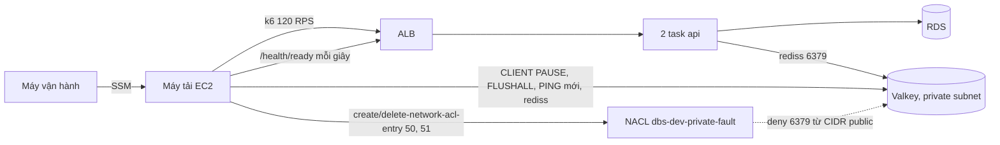

# DBS-167 · Tải có/không Redis và Redis chậm giữa tải

> **Status:** Implemented (sau G4) · **Vai:** #5 Platform & Ops · **Cặp đôi review:** Dev khác · **Nhánh:** `test/DBS-167-redis-fault-load` · **PR:** — · **Cập nhật:** 2026-11-22

## 1. Bối cảnh

- **Task trên board:** Task · Tuần 7 · Ưu tiên High · Demo 5 · Status board `To Do`. **Thực trạng (board):** «Chưa đo ảnh hưởng của Redis lên tải. Test mức nghiệp vụ (DBS-100) và báo cáo tải cơ sở (DBS-166) là điều kiện; kết quả dùng cho câu bảo vệ 6 và 10.» **Expect:** «Biết Redis không phải điểm chết duy nhất của chuyển tiền.»
- **DoD (nguyên văn):**
  1. Chạy cùng kịch bản ở 120 RPS khi Redis bật, tắt, và bị làm chậm giữa tải; so sánh p95, lỗi
  2. Bất biến đúng; /health/ready vẫn 200; p95 trong ngưỡng
  3. Ghi vào báo cáo tải; vấn đề thấy được thành issue
  4. PR đã merge vào main (CI xanh); Dev review; bảng «Đối chiếu test case» trong PR điền đủ
- **Phụ thuộc (đã kiểm trong repo):** DBS-166 Done ([PR #224](https://github.com/Lawliet119/digital-banking-simulator/pull/224), `f9f324f6`; harness k6, máy tải `envs/dev/loadgen`, `loadgen-run.sh`, `aggregate-raw.cjs`); DBS-100 Done ([PR #113](https://github.com/Lawliet119/digital-banking-simulator/pull/113); mức nghiệp vụ, 20 lệnh tuần tự trên localhost). DBS-173 đã giảm p95 `baseline` plateau 120 xuống 92 ms ([PR #228](https://github.com/Lawliet119/digital-banking-simulator/pull/228)), nên số «Redis bật» là số của `main` hiện tại, không phải số DBS-166.
- **Backlog xét ở G1:** BL-216 (drill cloud DBS-100: Redis chậm rồi chết, chuyển tiền vẫn COMPLETED, p95 trong SLO) và BL-221 (ảnh hưởng của `GET` Redis tới p95 đọc khi Redis chậm; giữ, bỏ hoặc thêm cache âm) **đưa vào task, đóng khi có số đo**. BL-216 chỉ đóng phần «chậm rồi chết» ở tải (review #9): phần **failover** ElastiCache nằm ngoài task này, giữ lại và chuyển cho DBS-186 (nếu còn giờ) hoặc dòng còn lại. Phần «tìm nguyên nhân `TC-114-12` đỏ một lần» của BL-221 không đo được ở tải và **giữ lại**. Số đo của BL-221 phải nói rõ rằng trên đường đọc Redis được gọi **hai** lần nối tiếp (rate limit IP và `revoked_at` của `JwtAuthGuard`), GET thu hồi phiên chỉ là một trong hai.
- **Ngoài phạm vi:** đổi mã backend (kể cả cache âm: chỉ quyết định dựa trên số đo, làm ở BL nếu cần); failover ElastiCache (nếu còn giờ thì để DBS-186); đo tải AI (DBS-174); đổi ngưỡng SLO.
- **Quyết định ở G1 (agent tự quyết, có subagent opus effort high chốt cách tiêm sự cố, 2026-11-22):**
  1. **Đo một plateau 120 RPS, ba lượt cùng kịch bản** (thêm kịch bản k6 `redis-fault`: một plateau 120 RPS, 900 s, 80% đọc, 20% chuyển, ngưỡng k6 như `baseline`): **đối chứng** (không sự cố), **chậm giữa tải**, **tắt giữa tải**. So sánh **giữa các cửa sổ trong cùng một lượt**, không so giữa hai lượt (DBS-173 cho thấy hai lượt cùng cấu hình lệch 218 và 344 ms).
  2. **Cơ chế «tắt»** = NACL riêng `dbs-dev-private-fault` của stack `loadgen`, gắn vào hai private subnet; driver thêm luật ingress số 50 và 51 «deny tcp 6379 từ CIDR của hai public subnet» (api, worker và máy tải ở public subnet) và xóa khi khôi phục. NACL không giữ trạng thái nên cắt cả kết nối đang mở (SG thì không: connection tracking) và không sinh drift ở `base` (`base` không có `aws_network_acl`; cả bốn subnet đang dùng NACL mặc định). Đây là blackhole (không có RST), đúng ca xấu của node chết.
  3. **Cơ chế «chậm»** = xung `CLIENT PAUSE <P> ALL` từ máy tải (ElastiCache node-based cho phép `CLIENT`, `EVAL`, `FLUSHALL`; `CLIENT PAUSE` chỉ bị chặn ở bản serverless), hai bậc trong cửa sổ sự cố: **nhẹ** P=100 ms mỗi 200 ms (≈ 25% lệnh vượt timeout 50 ms, breaker gần như luôn đóng) trong 150 s, rồi **nặng** P=180 ms mỗi 200 ms (≈ 65% lệnh hết giờ, breaker mở đóng liên tục) trong 150 s. P ≤ 500 ms và P < chu kỳ (chặn cứng trong mã); lệnh tự hết hạn nếu driver chết.
  4. **Cơ chế «flush»** (dùng lại ở DBS-186) = `FLUSHALL SYNC` qua cùng công cụ; «tắt» của DBS-186 dùng đúng cơ chế NACL ở mục 2.
  5. **Hạ tầng chỉ ở `envs/dev/loadgen`, sau biến `redis_fault_enabled` (mặc định `false`)**: egress 6379 của SG loadgen tới SG Redis, **một** luật ingress 6379 vào SG Redis của `base` từ SG loadgen (khuôn của `db_from_loadgen`: luật nằm trong state của loadgen, `destroy` gỡ), NACL và association hai private subnet, quyền IAM đọc secret Redis và `ec2:Create/DeleteNetworkAclEntry` giới hạn theo ARN của NACL. Apply `loadgen` TRƯỚC `session` (lúc chưa có RDS) và destroy `session` trước `loadgen`.
  6. **Tự khôi phục ba lớp**: `trap` trong driver, `systemd-run --on-active` độc lập tự gọi `restore` sau thời lượng + 60 s, và `destroy` của stack `loadgen` (gỡ association nên subnet về NACL mặc định, mất luật deny). `restore` chạy lại được nhiều lần; `status` từ chối bắt đầu lượt mới nếu luật 50 hoặc 51 còn.
  7. **Mốc thời gian** (CIDR public lấy từ `data "aws_subnet"` của `public_subnet_ids`, không gõ tay; sau khi thêm luật `down` kiểm bằng một kết nối mới từ máy tải phải hết giờ, nếu không thì gỡ luật và thoát 1; review #7): driver ghi `fault-events.jsonl` (`epoch_ms`, `action`, `mode`, tham số) và `health.jsonl` (mỗi giây `GET /health/ready` qua ALB: mã HTTP, trường `redis`); công cụ mới `load-tests/window-stats.cjs` chia `requests.csv.gz` theo cửa sổ **trước** (từ +60 s tới lúc tiêm, bỏ khởi động), **sự cố** (riêng bậc nhẹ và nặng ở lượt chậm), **hồi phục** (60 s đầu sau khi khôi phục), **sau**.
  8. **Tiêu chí (chốt trước khi chạy, không nới sau; sửa ở G2 theo review #2, #3, #4, #5, #8)**: *đạt* ở MỌI cửa sổ kể cả cửa sổ sự cố khi chuyển tiền p95 < 300 ms và p99 < 1 s, đọc p95 < 150 ms, lỗi hệ thống < 0,1% (lỗi hệ thống = mọi status ngoài 200, 201, 422: 5xx, 0, 429 và 4xx khác, như `validStatuses` của BL-415) và **mọi** mẫu `/health/ready` có mã 200; cả **lượt** còn phải có `dropped_iterations` = 0 (không tính theo cửa sổ được: `requests.csv.gz` không có) và `invariantExit` = 0. *Chấp nhận được nhưng xấu đi* khi vẫn đạt và p95 chênh so với cửa sổ «trước»: lượt chậm **≤ 150 ms cho chuyển tiền** (ba lần gọi Redis nối tiếp: rate limit IP, `revoked_at` của `JwtAuthGuard`, rate limit khách; mỗi lần bị cắt ở 50 ms) và **≤ 100 ms cho đọc** (hai lần: IP, `revoked_at`); lượt tắt ≤ max(20 ms, 2N) cho cả hai, N là dao động tự nhiên giữa các cửa sổ của lượt đối chứng; p95 về lại mức «trước» ± (2N + mức cho phép) trong cửa sổ hồi phục. *Hồi phục của api* = giây từ lúc khôi phục tới mẫu `/health/ready` **không-`up` cuối cùng** (mẫu đi qua ALB nên mỗi giây chỉ trúng một trong hai task: lần `up` đầu tiên không chứng minh cả hai đã hồi phục). **Phải thành BL** khi: vượt SLO ở bất kỳ cửa sổ nào; có lỗi hệ thống; `/health/ready` khác 200; hồi phục > 60 s; chênh lệch quá mức cho phép; `dropped_iterations` > 0; có failover ngoài ý muốn. **Chứng minh breaker mở** không dùng `redis_fallback_total` (tăng ở mọi lần thất bại: TIMEOUT, CIRCUIT_OPEN, UNAVAILABLE, không có nhãn lý do) mà đếm dòng log `rate limit skipped … (CIRCUIT_OPEN)` so với `(TIMEOUT)` theo từng cửa sổ bằng Logs Insights (`rate-limiter.ts:52`); breaker không mở ở lượt tắt thì thành BL. Checker FAIL là blocker: dừng đợt đo, hủy stack.
  9. **Lặp lượt «tắt»** chỉ khi sát ngưỡng, cửa sổ «trước» đã vượt SLO, hoặc chênh nhỏ hơn 2N; mọi lượt đã chạy đều có trong báo cáo (không chọn lượt đẹp).
  10. **Thứ tự trên stack**: loadgen → session → prepare, smoke → thử công cụ (status, flush trên Redis rỗng, xung 10 s, tắt 20 s rồi khôi phục) → đối chứng → chậm → tắt → (DBS-186 drill, vì `FLUSHALL` làm bẩn số đo) → destroy. Ước tính ≈ 2 giờ 6 phút, trần 3,5 giờ.
  11. **Rủi ro biết trước, phải đo**: kết nối TCP đang giữ sẽ chỉ sống lại khi gói truyền lại kế tiếp trúng, nên api có thể hồi phục chậm tới ≈ 2 phút sau khi mạng thông; thời gian hồi phục đo từ `health.jsonl` là số liệu bắt buộc của báo cáo (lâu hơn 60 s thì mở BL: ngắt và nối lại ioredis khi breaker mở hoặc `TCP_USER_TIMEOUT`). `CLIENT PAUSE ALL` cũng làm chậm worker nên `risk_transfer_to_flag_ms` xấu đi: ghi vào báo cáo, không tính vào DoD.

## 2. Hành vi

Công cụ `infra/scripts/redis-fault.sh` (chạy TRÊN máy tải, bằng instance role; cấu hình ở `/opt/loadgen/run.env`: `REDIS_HOST`, `REDIS_FAULT_NACL_ID`, `REDIS_FAULT_DENY_CIDRS`, `BASE_URL`, `REDIS_AUTH_SECRET_ID`):

| Lệnh | Việc làm | Kết quả |
|---|---|---|
| `status` | liệt kê luật 50, 51 của NACL; kiểm `PING` mới tới Redis | thoát 0 nếu **không** có luật deny; thoát 1 nếu còn (từ chối bắt đầu lượt mới) |
| `down` | thêm luật ingress 50, 51 deny 6379 từ các CIDR public (không có tham số thời lượng); rồi `probe` (kết nối mới + PING từ máy tải) phải hết giờ trong ≤ 5 lần thử, nếu không thì **gỡ luật và thoát 1**; ghi sự kiện `down` chỉ khi đã chặn được | blackhole trong vài giây |
| `wait-healthy [N]` | đợi N (mặc định 60) mẫu `/health/ready` liên tiếp đều `200 up`, tối đa 600 mẫu | cổng trước mỗi lượt đo: thoát 1 nếu api còn kẹt |
| `restore` | xóa luật 50, 51 (bỏ qua `NotFound`); ghi sự kiện `restore`; chạy lại được | Redis thông trở lại |
| `slow <giây> <P> <chu kỳ>` | `CLIENT PAUSE P ALL` mỗi chu kỳ trong `giây`; luôn `CLIENT UNPAUSE` khi thoát; P ≤ 500 và P < chu kỳ, nếu không thoát 2 | Redis chậm có thời hạn |
| `flush` | `FLUSHALL SYNC`, in `DBSIZE` trước và sau | Redis còn sống nhưng mất khóa |
| `schedule <chậm\|tắt\|none>` | đợi `k6` chạy, tính từ lúc k6 bắt đầu: ghi `health.jsonl` mỗi giây; ở +300 s tiêm sự cố (`slow`: 150 s nhẹ rồi 150 s nặng; `down`: 300 s rồi `restore`); ghi `fault-events.jsonl`; `systemd-run` deadman | dừng khi k6 thoát |

Token Redis chỉ ở biến môi trường của tiến trình, không ghi đĩa, log hay argv. `window-stats.cjs <thư mục kết quả>`: đọc `requests.csv.gz`, `fault-events.jsonl`, `health.jsonl` và in/ghi `windows.json` (số request, p50/p95/p99 tách chuyển, `balance`, `history`, `read`; lỗi hệ thống; 422; mã `/health/ready`; giây tới mẫu không-`up` cuối cùng sau `restore`) cùng phán quyết theo quyết định G1.8; thoát khác 0 khi thiếu một trong ba file ở lượt có sự cố.

Ví dụ `fault-events.jsonl`:

```json
{"epoch_ms":1795226975123,"action":"slow_start","mode":"slow","pause_ms":100,"period_ms":200}
{"epoch_ms":1795227125201,"action":"slow_step","mode":"slow","pause_ms":180,"period_ms":200}
{"epoch_ms":1795227275330,"action":"slow_end","mode":"slow"}
```

## 3. Kiến trúc

- **Vị trí:** `infra/terraform/envs/dev/loadgen/redis_fault.tf` (mới) và `main.tf`, `variables.tf`, `outputs.tf`, `tests/loadgen.tftest.hcl`; `infra/scripts/redis-fault.sh`; `load-tests/redis-fault.js`, `redis-fault.cjs` (xung và flush), `window-stats.cjs`, `lib/config.js`; `infra/scripts/loadgen-run.sh` (chép `fault-events.jsonl`, `health.jsonl`, `windows.json` cạnh kết quả). Không đổi mã backend, `session` hay `base`.
- **Dữ liệu chạm:** DB của phiên (cùng harness DBS-166); Redis của phiên (`CLIENT PAUSE`, `FLUSHALL`). Không migration, không SQL tạo tiền.
- **Ranh giới transaction:** không đổi.



- **Thay đổi cấp hệ thống:** `infra/terraform/README.md` (mục «Máy chạy tải»: biến `redis_fault_enabled`, thứ tự apply/destroy), `load-tests/README.md`, `docs/components/load-tests/` (báo cáo 05), `docs/BACKLOG.md`.

## 4. Test cases tự động

| ID | Truy vết | Lớp | Given · When · Then | Mong đợi |
|---|---|---|---|---|
| TC-167-01 | DoD 1 | Node unit (`config.test.mjs`) | `workload("redis-fault")` | đúng một plateau 120 (`read_120`, `write_120`), 900 s, ngưỡng chung, `durationSeconds` 930 |
| TC-167-02 | DoD 1 | Node unit (`window-stats.test.mjs`) | CSV tổng hợp có mốc sự cố | phân vị và lỗi đúng theo từng cửa sổ; bậc nhẹ/nặng tách riêng; chỉ 200, 201, 422 là hợp lệ (5xx, 0, 429, 401 là lỗi hệ thống) |
| TC-167-03 | DoD 2 | Node unit | phán quyết | vượt p95 một cửa sổ → «vượt SLO»; chênh ≤ 150 ms (chuyển) hoặc ≤ 100 ms (đọc) → «chấp nhận được»; hồi phục (mẫu không-`up` cuối cùng) quá 60 s, `/health/ready` khác 200, lỗi hệ thống, bất biến FAIL → «phải mở BL» hoặc «blocker» |
| TC-167-04 | DoD 2 (negative control) | Node unit | thiếu `fault-events.jsonl` hoặc `health.jsonl` ở lượt có sự cố | thoát khác 0, không in «đạt» |
| TC-167-05 | an toàn | Node unit (`redis-fault.test.mjs`) | `P` > 500 hoặc ≥ chu kỳ; thoát giữa chừng; `probe` | từ chối (thoát 2); luôn gọi `CLIENT UNPAUSE`; `probe` chỉ `ok` khi PING trả PONG, lỗi hoặc treo là `ok=false` |
| TC-167-06 | DoD 1 | Node unit (`redis-fault-sh.test.mjs`, bash + `aws`, `curl`, công cụ Node giả) | `down`, `restore` hai lần, `status`, `wait-healthy` | thêm đúng luật 50, 51 với đúng CIDR và cổng 6379; `restore` lặp không lỗi, lỗi thật (không phải NotFound) thì thoát khác 0; `status` thoát 1 khi luật còn; `down` tự gỡ luật và thoát 1 khi kết nối mới vẫn thông; `wait-healthy` thoát 1 khi api còn `degraded`; token chỉ ở môi trường |
| TC-167-07 | hạ tầng | `terraform test` (mặc định) | `redis_fault_enabled=false` | không NACL, không luật 6379, policy không có `ec2:` hay secret Redis |
| TC-167-08 | hạ tầng | `terraform test` (bật) | `redis_fault_enabled=true` | 6379 hai phía đúng SG; association đúng các private subnet; Terraform chỉ tạo luật 100 «allow» hai chiều (NACL mới mặc định chặn hết: review #1); `ec2:Create/DeleteNetworkAclEntry` chỉ trên ARN NACL, `DescribeNetworkAcls` trên `*` (không giới hạn được); secret đúng ARN Redis; CIDR deny là của public subnet |
| TC-167-09 | DoD 1..3 | thủ công trên AWS | §5 | số đo thật |
| Quy trình | DoD 3, 4 | báo cáo, BL, CI, review | `05-ket-qua-redis-2026-11-22.md`, BL cho từng vấn đề | — |

## 5. Test thủ công

Điều kiện: như DBS-166 §5 (`AWS_PROFILE=dbs`, Git Bash, Node 24, shim `python3`, `TMPDIR` dạng `F:/...`, state tạm `dev/loadgen-dbs167.tfstate` và `dev/session-dbs167.tfstate`, một `dbs167.tfvars` cho mọi lệnh). Image CI của `main` (`76b80bdb` trở đi), không build tay. Cấu hình: RDS `db.t4g.small` Multi-AZ, Valkey 1 replica, 2 api, 1 worker, WAF theo hạn 2026-11-26.

| Bước | Việc làm | Kết quả mong đợi |
|---|---|---|
| M-167-01 | `verify-clean.sh`, `describe-user-pool-client` `dbs-app`, `ecr describe-images` cho SHA | sạch, SHA có |
| M-167-02 | `apply` loadgen với `redis_fault_enabled=true`, bootstrap máy tải, ghi `run.env` | luật 6379 và NACL có; instance role đọc được secret Redis |
| M-167-03 | `apply` session, `db-roles.sh`, `migrate.sh`, nâng 2 api + 1 worker | `/health/ready` 200 qua ALB |
| M-167-04 | thử công cụ **trước `prepare` và smoke** (Redis còn trống: `flush` không xóa cache cần cho đo): `redis-fault.sh status` (0), `flush` (DBSIZE), `slow 10 100 200`, `down` (phải in «kết nối mới từ máy tải hết giờ») rồi `restore`, `wait-healthy 60`; đọc `health.jsonl` | `redis_fallback_total` tăng ở bước chậm và tắt; luật 50, 51 mất sau `restore`; đo giây hồi phục |
| M-167-05 | token mới, `prepare`, smoke (`invariantExit=0`); `wait-healthy 60`; `schedule none` + `FAULT_MODE=none loadgen-run.sh run redis-fault` (đối chứng); `window-stats` | đo N; checker PASS |
| M-167-06 | `wait-healthy 60`; `schedule slow` + `FAULT_MODE=slow FAULT_NOISE=<N> run redis-fault` | p95 theo cửa sổ nhẹ và nặng; `/health/ready` luôn 200; checker PASS |
| M-167-07 | `wait-healthy 60`; `schedule down` + `FAULT_MODE=down FAULT_NOISE=<N> run redis-fault` (lặp nếu sát ngưỡng) | breaker mở; giây hồi phục; checker PASS |
| M-167-08 | CloudWatch từng lượt (`redis_fallback_total`, p95 chuyển tiền, ElastiCache, ALB 5xx), `describe-events` ElastiCache (không failover); **Logs Insights** đếm `rate limit skipped … (CIRCUIT_OPEN)` và `(TIMEOUT)` theo cửa sổ (chứng minh breaker mở); ảnh dashboard lúc 120 RPS (DBS-178) | số và ảnh |
| M-167-09 | (DBS-186 drill) rồi `destroy` session, `destroy` loadgen, `verify-clean.sh`, `describe-user-pool-client`, `describe-network-acls` (không còn NACL riêng) | thoát 0; trạng thái như trước |

Đường lỗi: nếu `restore` không chạy được (máy tải chết), người vận hành xóa luật 50 và 51 bằng `aws ec2 delete-network-acl-entry` hoặc `destroy` loadgen. Bước nào không chạy được ghi **chưa chạy** kèm lý do.

## 6. Domain review (AI)

**Reviewer:** subagent opus, effort high, 2026-11-22 · **Kết quả lượt 1:** 12 phát hiện (blocking 1, should-fix 6, minor 5), Verdict REVISE · [nguyên văn](screenshots/DBS-167/domain-review.md)

| # | Mức | Phát hiện | Xử lý |
|---|---|---|---|
| 1 | blocking | NACL tự tạo mặc định chặn hết, thiếu luật 100 allow | đã sửa: `redis_fault.tf` có luật 100 allow hai chiều, TC-167-08 kiểm (đã có trong mã trước khi review trả về) |
| 2 | should-fix | ngưỡng 100 ms sai: chuyển tiền gọi Redis 3 lần, đọc 2 lần | đã sửa G1.8: 150 ms chuyển, 100 ms đọc; `window-stats.cjs` kiểm riêng từng loại (TC-167-03) |
| 3 | should-fix | `redis_fallback_total` không chứng minh breaker mở | đã sửa G1.8 và M-167-08: đếm log `CIRCUIT_OPEN` so với `TIMEOUT` bằng Logs Insights |
| 4 | should-fix | mẫu health đi qua ALB: «up đầu tiên» không đủ; cần cổng trước mỗi lượt | đã sửa: hồi phục = mẫu không-`up` cuối cùng (TC-167-03); `redis-fault.sh wait-healthy` (TC-167-06); M-167-05..07 |
| 5 | should-fix | 4xx ngoài 422 là lỗi hệ thống (BL-415) | đã sửa: `window-stats.cjs` chỉ nhận 200, 201, 422 (TC-167-02) |
| 6 | should-fix | thiếu `ec2:DescribeNetworkAcls` | đã sửa: statement `Describe` trên `*`, TC-167-08 |
| 7 | should-fix | CIDR public gõ tay có thể sai làm lượt «tắt» vô nghĩa | đã sửa: `data "aws_subnet"` + output; `down` kiểm bằng `probe` và tự gỡ luật nếu không chặn được (TC-167-05, 06) |
| 8 | minor | `dropped_iterations` không tính theo cửa sổ | đã sửa G1.8: tiêu chí cả lượt |
| 9 | minor | BL-216 còn phần failover | đã sửa §1: chỉ đóng phần chậm/tắt, failover giữ lại |
| 10 | minor | cú pháp `down`; `flush` thử sau smoke làm bẩn cache | đã sửa §2, §5: M-167-04 chạy trước prepare/smoke |
| 11 | minor | CI liệt kê từng file test | đã sửa §7 bước 6 và `ci.yml` (dòng 80) |
| 12 | minor | commit trước G2 | **Lệch quy trình, ghi ở §8**: do gate tự duyệt và có `Techlead waiver`; code đã được kiểm lại sau review (`f243c3db`) |

**Quyết định ở G2 (agent tự quyết):** không chạy lượt review 2 vì không còn phát hiện blocking mở, mọi sửa có hành vi đều có test (mutation check ở `window-stats.cjs`, `loadgen.tftest.hcl`); các sửa thiết kế khác chỉ là con số và câu chữ. Reviewer của PR kiểm lại phần này.

## 7. Kế hoạch triển khai

| Bước | File | Test viết trước | Lệnh chứng minh | Commit |
|---|---|---|---|---|
| 1 | `load-tests/lib/config.js`, `redis-fault.js`, `test/config.test.mjs` | TC-167-01 | `node --test load-tests/test/config.test.mjs` | `feat(load): kịch bản redis-fault 120 RPS (DBS-167)` |
| 2 | `load-tests/window-stats.cjs`, `test/window-stats.test.mjs` | TC-167-02..04 | `node --test load-tests/test/window-stats.test.mjs` | `feat(load): thống kê theo cửa sổ sự cố (DBS-167)` |
| 3 | `load-tests/redis-fault.cjs`, `test/redis-fault.test.mjs` | TC-167-05 | `node --test` | `feat(load): xung CLIENT PAUSE và FLUSHALL có chặn cứng (DBS-167)` |
| 4 | `infra/scripts/redis-fault.sh`, `loadgen-run.sh`, `test/redis-fault-sh.test.mjs` | TC-167-06 | `node --test` | `feat(infra): công cụ tắt, chậm, flush Redis trên máy tải (DBS-167)` |
| 5 | `envs/dev/loadgen/{redis_fault,main,variables,outputs}.tf` (luật 100 allow hai chiều, `data "aws_subnet"` cho CIDR, `Describe` trên `*`), `tests/loadgen.tftest.hcl` | TC-167-07..08 | `terraform test` ở `loadgen` | `feat(infra): NACL và luật 6379 cho máy tải sau redis_fault_enabled (DBS-167)` |
| 6 | `.github/workflows/ci.yml` dòng 80 (bước Node của `load-tests`: thêm ba file test mới; `terraform test` của `loadgen` đã chạy ở dòng 330), README, feature doc | — | `check-doc-links.mjs` | `docs(load): cách chạy lượt Redis (DBS-167)` |
| 7 | chạy §5 trên AWS, `docs/components/load-tests/results/redis-*`, báo cáo 05, BACKLOG (BL-216, BL-221 đóng hoặc cập nhật, BL mới theo tiêu chí G1.8) | TC-167-09 | M-167 | `docs(load): đo Redis bật, chậm, tắt ở 120 RPS (DBS-167)` |

**Rủi ro và cách lùi:** (a) luật deny còn sót: ba lớp khôi phục (G1.6) và `destroy` loadgen; (b) `FLUSHALL` làm bẩn số: chạy sau các lượt đo; (c) đổi association NACL chạm subnet RDS: apply loadgen trước session; (d) lùi mã: revert commit, chỉ thêm harness, biến mặc định tắt, không migration. **Plan sweep:** DoD 1 (TC-167-01..02, 05..08, M-167-05..07), DoD 2 (TC-167-03..04, health, checker), DoD 3 (báo cáo, BL), DoD 4 (quy trình); BL-216 và BL-221 có bước đo.

**Quyết định ở G3 (agent tự quyết):** thứ tự thực tế lệch skill: bước 1 đến 4 (code harness) đã viết trước khi review G2 trả về; không có gì chạy trên AWS và không có gì lên GitHub trước G3. Sau review mã được sửa và kiểm lại (125 test Node đạt, 7 test Terraform của `loadgen` đạt). **Plan sweep:** DoD 1 (TC-167-01..02, 05..08, M-167-05..07), DoD 2 (TC-167-03..04, health, `wait-healthy`, checker), DoD 3 (báo cáo 05, BL), DoD 4 (quy trình); BL-216 (chậm/tắt) và BL-221 (số đo p95 đọc) có bước đo; giới hạn trong docs: README Terraform «trần 90 phút» (ngoại lệ ghi ở DBS-166 G1.8: trần cứng 3,5 giờ), «không NAT, không endpoint» giữ nguyên. Back-out: revert các commit (chỉ thêm harness, hạ tầng mặc định tắt, không migration).

## 8. Kết quả

- **Lệnh kiểm tra (chạy lúc bàn giao, 2026-11-22):** `node --test load-tests/test/*.test.mjs` (Node 24.22.2; `TEST_BASH` trỏ Git Bash): **125 test đạt, 0 lỗi, 0 skipped** (trước task: 99); `terraform fmt -check`, `validate`, `test` ở `envs/dev/loadgen`: **7 đạt** (trước: 5); `envs/dev/session` `terraform test` ở cây tích hợp (ba nhánh): 111 đạt; `check-doc-links.mjs` và `check-backlog.mjs` (106 dòng): 0 lỗi. Backend không đổi nên bốn lệnh backend do CI chạy. Baseline trước khi sửa: `runner.test.mjs` đỏ chỉ vì worktree mới chưa có `backend/node_modules` (đã nối junction tới bản của `main-2`; 99 đạt).
- **Đối chiếu test case:**

| ID | Test | Đạt? |
|---|---|---|
| TC-167-01 | `load-tests/test/config.test.mjs` › «TC-167-01 redis-fault is one 120 RPS plateau…» | đạt |
| TC-167-02 | `window-stats.test.mjs` (cửa sổ, phân vị, chỉ 200/201/422 hợp lệ, lượt đối chứng) | đạt |
| TC-167-03 | `window-stats.test.mjs` (vượt SLO, chấp nhận được, vượt mức cho phép, health/5xx/bất biến/hồi phục, nhiễu N, mức cho phép riêng cho đọc, hồi phục = mẫu không-`up` cuối) | đạt; mutation (đổi hằng số) làm đỏ 2 test |
| TC-167-04 | `window-stats.test.mjs` › CLI thoát 2 khi thiếu `fault-events.jsonl` hoặc `health.jsonl` | đạt |
| TC-167-05 | `redis-fault.test.mjs` (7 test: từ chối `P` ≥ 500 hoặc ≥ chu kỳ, `UNPAUSE` luôn chạy, bậc xung, `flush`, token chỉ ở môi trường, `enableOfflineQueue`, `probe`) | đạt |
| TC-167-06 | `redis-fault-sh.test.mjs` (7 test, bash + `aws`, `curl`, công cụ Node giả) | đạt (đã chạy ở Git Bash; CI Linux chạy cùng file) |
| TC-167-07, 08 | `loadgen.tftest.hcl` › `redis_fault_is_off_by_default`, `redis_fault_enabled_is_scoped` | đạt; đổi số luật NACL làm đỏ đúng test |
| TC-167-09 | thủ công trên AWS, [manual-test.txt](screenshots/DBS-167/manual-test.txt) | đạt phần đã chạy (bảng dưới) |
| Quy trình DoD 4 | CI, Dev review | chờ PR; Dev review **chưa đạt về hình thức** (`Techlead waiver`) |

- **Test thủ công** (AWS `ap-southeast-1`, 2026-11-22; SHA harness trên máy tải: nhánh tích hợp `96720c8d`, nội dung `load-tests`, `infra/scripts`, `infra/terraform` giống commit `45158823` của task này; output thô ở [manual-test.txt](screenshots/DBS-167/manual-test.txt)):

| Bước | Kết quả thật | Kết luận |
|---|---|---|
| M-167-01 | tài khoản đúng, budget 6,66/150 USD, `verify-clean.sh` exit 0, image `76b80bdb` có trong ECR; `dbs-app` đã lưu (sha256 `538da192e3f0…`); plan `base` đã lưu | đạt |
| M-167-02 | `apply` loadgen với `redis_fault_enabled=true`: 21 tài nguyên, NACL `dbs-dev-private-fault` và hai association; bootstrap Node 24.22.2, k6 v2.3.0; `redis-fault.sh status` chạy bằng instance role | đạt |
| M-167-03 | `apply` session 17 phút (06:31 đến 06:48); `db-roles.sh` 54 s; `migrate.sh` 54 s; `desired_count=2`, `worker=1`; `/health/ready` 200 `redis: up`; **`pgss.sh enable` và `reset` chạy thật lần đầu (BL-420)** | đạt |
| M-167-04 | thử công cụ (lượt 1: lỗi thật `REDIS_HOST` không tới công cụ, `down` tự gỡ luật và thoát 1 đúng thiết kế; sửa; lượt 2): `flush` ok, `slow 10 100 200` ok, `down` in «kết nối mới hết giờ» sau 7 s, `redis: degraded` ngay, `restore`, api `up` sau ≈ 26 s | đạt sau khi sửa |
| M-167-05..07 | 3 lượt + 1 lượt lặp (§3 báo cáo): đối chứng (đạt), chậm lượt 1 (vượt SLO ở `pre` vì đứng hình), tắt (phải mở BL: 2 lỗi ở `pre`), chậm lượt 2 (vượt SLO ở `pre` và `history` bậc nhẹ 154 ms); mọi lượt `invariantExit` 0 | đạt về thực thi; kết quả đo xem báo cáo |
| M-167-08 | CloudWatch từng lượt (`cloudwatch.json`), Logs Insights chứng minh breaker (1.581 `CIRCUIT_OPEN` trong 10 giây đầu của lượt tắt; 20.317 ở bậc nặng), `describe-events` không có failover, lịch sử alarm (`dbs-dev-redis-fallback` OK → ALARM khi Redis tắt) | đạt |
| M-167-09 | `destroy` session (66 tài nguyên, 7 phút 16 giây) rồi loadgen (21, 42 giây); `verify-clean.sh` exit 0 (13 loại); `list-user-pool-clients` chỉ còn `dbs-app` và `describe-user-pool-client` giống hệt trước (sha256 `538da192e3f0…`); plan `base` giống hệt trước; NACL riêng 0, hai private subnet về NACL mặc định; bucket tạm 404; hai state tạm đã xóa; stack sống 06:30 đến 08:37 +07 (2 giờ 7 phút), ước ≈ 1,1 USD | đạt |

- **Phạm vi so với §7:** `git diff --stat origin/main...HEAD` (trên) khớp §7; thêm ngoài kế hoạch (gate phụ): `infra/scripts/pgss.sh` (sửa đường dẫn Windows, BL-420), `docs/components/load-tests/results/redis-*` (kết quả thô), báo cáo `05-ket-qua-redis-2026-11-22.md`, `docs/BACKLOG.md`.
- **Lệch so với kế hoạch (agent tự duyệt):** (1) mã bước 1 đến 5 viết trước khi review G2 trả về (ghi ở §6, §7; không lên GitHub, không chạy AWS trước G3); (2) **`flush` thử chạy sau `prepare`**, không trước như review #10 đề nghị (đã có fixture; Redis chỉ có khóa rate limit và cache cấu hình, không ảnh hưởng số đo); (3) **thêm lượt chậm thứ hai** theo G1.9 vì cửa sổ `pre` của lượt 1 vượt SLO; (4) hai lỗi chỉ thấy khi chạy thật và đã sửa: `REDIS_HOST` không được export cho công cụ Node (`set -a`), `enableOfflineQueue` phải bật cho công cụ (lệnh đầu bị từ chối), thêm test cho cả hai; (5) `pgss.sh` Windows (BL-420); (6) hai nhánh khác (DBS-178, DBS-186) chạy chung stack: xem feature doc của từng task.
- **Phát hiện chính:** xem [báo cáo 05](../components/load-tests/05-ket-qua-redis-2026-11-22.md) §1: Redis tắt an toàn; **Redis chậm vừa phải mới là ca xấu** (đọc p95 138 đến 149 ms, `history` 154 ms vượt SLO ở lượt 2); đứng hình 1 đến 3 giây trước sự cố ở 3/4 lượt, không do event loop, GC hay Redis (BL-419); hồi phục 42,5 giây sau khi mạng thông (BL-424); không có metric chứng minh breaker mở (BL-425).
- **Bàn giao (BL):** BL-221 (cập nhật, Hoãn · H4), BL-216 (thu hẹp còn failover), BL-419 (cập nhật), **BL-424, BL-425 (mới)**; BL-420 đã đóng (xóa dòng). Không có việc nào chưa làm của DoD mà không có BL.
- **Ảnh chụp:** ảnh dashboard lúc 120 RPS (Redis bật, Redis tắt) thuộc DBS-178: `docs/components/observability/screenshots/120rps-redis-on|off/`; ảnh trong PR này: không áp dụng (kết quả là số và file thô). Không có ảnh console AWS (không có màn hình trong phiên tự động).

## 9. Tài liệu đã cập nhật

`docs/components/load-tests/05-ket-qua-redis-2026-11-22.md` và `results/redis-*`, `results/redis-evidence/` (mới); `load-tests/README.md` (bài `redis-fault`); `infra/terraform/README.md` (mục `redis_fault_enabled`); `.github/workflows/ci.yml` (bước test Redis); `docs/features/README.md` (dòng DBS-167); `docs/BACKLOG.md` (xóa BL-420; cập nhật BL-216, BL-221, BL-419; thêm BL-424, BL-425).

## Checklist G4

- [x] 8 trong 8 test case tự động đạt đủ độ sâu (TC-167-01..08), 0 đơn giản hóa; TC-167-09 thủ công đã chạy, `loadgen-run.sh` kiểm bằng lượt thật (không có test đơn vị riêng ngoài `redis-fault-sh.test.mjs`)
- [x] Test thủ công chạy trên cây có commit cuối đổi code của task (`45158823`); đường thành công đã chạy; không có bước «chưa chạy» ngoài ảnh console AWS (không có màn hình)
- [x] Không có token, header `Authorization`, id tài khoản AWS hay ARN trong `results/redis-*` và `manual-test.txt` (quét `grep -E "amazonaws|ACCT|arn:aws|eyJ"`: 0)
- [x] `git diff --stat origin/main...HEAD` khớp §7; file lạ có quyết định gate phụ ở trên
- [x] Lệnh kiểm tra chạy lúc bàn giao có số đếm (đầu mục 8)
- [x] Doc cập nhật; `check-doc-links.mjs` sạch
- [x] BL cho mọi việc bàn giao; `check-backlog.mjs` sạch; dòng đã xử lý (BL-420) đã xóa
