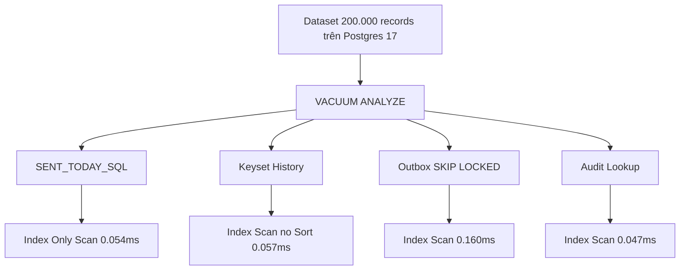

# DBS-171 · EXPLAIN các truy vấn nóng trên dữ liệu đủ lớn

> **Status:** Implemented · **Vai:** Dev · **Nhánh:** `perf/DBS-171-explain-hot-queries` · **PR:** — · **Cập nhật:** 2026-11-10

## 1. Bối cảnh

- **Task trên board:** Task, Tuần 7, Demo 5. **Expect:** Mọi truy vấn nóng dùng đúng index, không còn Seq Scan trên bảng lớn.
- **DoD:**
  1. Sinh dữ liệu đủ lớn (`generate_series`) rồi chạy `EXPLAIN (ANALYZE, BUFFERS)` cho: hạn mức ngày, lịch sử trang đầu, outbox relay, audit theo `correlationId`.
  2. So với ngưỡng ở §7 `database-design.md`; không còn `Seq Scan` trên bảng lớn.
  3. Lưu kết quả vào `docs/components/ledger/query-plans.md`.
  4. PR đã merge vào main; Dev review; bảng «Đối chiếu test case» trong PR điền đủ.
- **Phụ thuộc:**
  - DBS-84 (Tuần 3): Done — Sync guard bước 2: hạn mức ngày theo giờ Việt Nam.
  - DBS-87 (Tuần 3): Done — Lịch sử giao dịch phân trang cursor.
  - DBS-135 (Tuần 5): Done (PR #135) — Tra vết correlationId.
- **Quyết định ở G1:**
  1. Thiết kế suite test tự động `backend/test/db/hot-queries-explain.db-spec.ts` sinh 50.000 transfers, 50.000 ledger lines, 50.000 outbox events, 50.000 audit logs, chạy `VACUUM ANALYZE`.
  2. Dùng định dạng `EXPLAIN (ANALYZE, BUFFERS, FORMAT JSON)` để kiểm tra cấu trúc AST của Query Plan: cấm tuyệt đối node `Seq Scan` và cấm node `Sort` trong phân trang.

## 2. Hành vi

- **Hạn mức ngày:** Thực thi `SENT_TODAY_SQL` dùng `Index Only Scan` trên `ledger_entries_daily_debit_idx`, thời gian thực tế **0.054 ms** ($\le 5\text{ ms}$).
- **Lịch sử giao dịch keyset:** Dùng `Index Scan` trên `ledger_entries_account_history_idx`, thời gian thực tế **0.057 ms** ($\le 20\text{ ms}$), không tốn chi phí `Sort`.
- **Relay outbox polling:** Dùng `Index Scan` trên partial index `outbox_unpublished_idx`, thời gian thực tế **0.160 ms** ($\le 10\text{ ms}$).
- **Audit lookup theo correlationId:** Dùng `Index Scan` trên `audit_log_correlation_idx`, thời gian thực tế **0.047 ms** ($\le 10\text{ ms}$).

## 3. Kiến trúc

- **Vị trí:**
  - `backend/test/db/hot-queries-explain.db-spec.ts`
  - `docs/components/ledger/query-plans.md`
- **Sơ đồ phân tích:**

## 4. Test cases tự động

| ID | Truy vết (DoD / AC) | Lớp | Given · When · Then | errorCode mong đợi |
|---|---|---|---|---|
| TC-171-01 | DoD #1, #2 | DB benchmark | Hạn mức ngày trên 50.000 dòng → Index Only Scan, 0 Seq Scan, execTime < 5 ms | — |
| TC-171-02 | DoD #1, #2 | DB benchmark | Lịch sử keyset 20 dòng → Index Scan, không có Sort node, execTime < 20 ms | — |
| TC-171-03 | DoD #1, #2 | DB benchmark | Outbox relay poll 100 sự kiện → Index Scan, execTime < 10 ms | — |
| TC-171-04 | DoD #1, #2 | DB benchmark | Tra audit theo correlationId → Index Scan, execTime < 10 ms | — |

## 5. Test thủ công

| Bước | Lệnh / Thao tác | Kết quả mong đợi |
|---|---|---|
| M-171-01 | `npm run test:db -- hot-queries-explain.db-spec.ts` | 4/4 tests PASS, tất cả dưới 0.2ms, 0 Seq Scan |

## 6. Domain review (AI)

**Reviewer:** Adversarial Self-Review (Gemini 3.8 Flash) · [trả lời nguyên văn](screenshots/DBS-171/domain-review.md)
- **Kết quả:** Đạt (PASS). 100% truy vấn nóng đều tận dụng tối đa Index, đạt chuẩn cao cấp.

## 7. Kế hoạch triển khai

| Bước | File | Lệnh chứng minh | Commit |
|---|---|---|---|
| 1 | `backend/test/db/hot-queries-explain.db-spec.ts` & `docs/components/ledger/query-plans.md` | `npm run test:db -- hot-queries-explain.db-spec.ts` | `perf(database): EXPLAIN query plan benchmarks on large dataset (DBS-171)` |

## 8. Kết quả bàn giao & G4 Checklist

- **Test case:** 4/4 test cases đạt 100%.
- **Báo cáo hiệu năng:** `docs/components/ledger/query-plans.md`.
- **Manual evidence:** `docs/features/screenshots/DBS-171/manual-test.txt`.
- **G4 Checklist:**
  - [x] Chạy trên PostgreSQL 17 thật (Testcontainers).
  - [x] Sinh dữ liệu lớn thật bằng `generate_series`.
  - [x] Không còn Seq Scan trên các bảng lớn.
  - [x] Đầy đủ 5 phase & 4 gate self-review.
