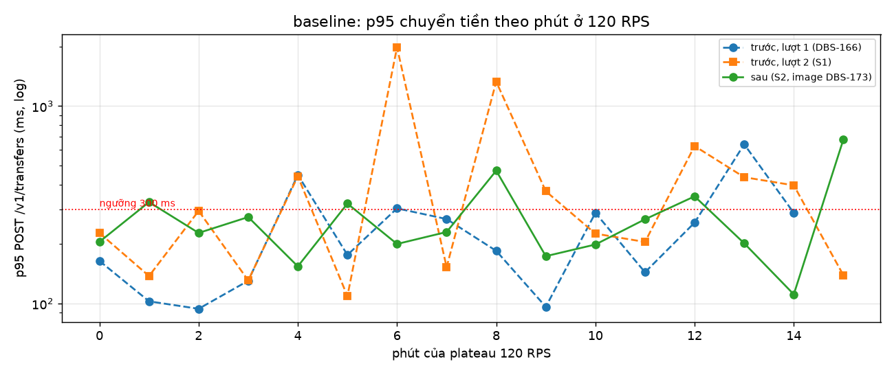
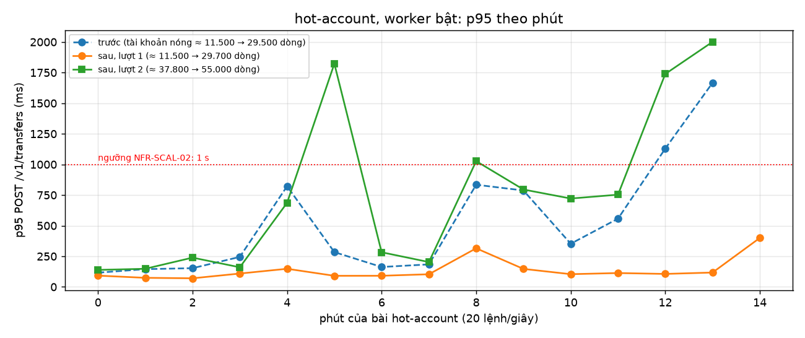
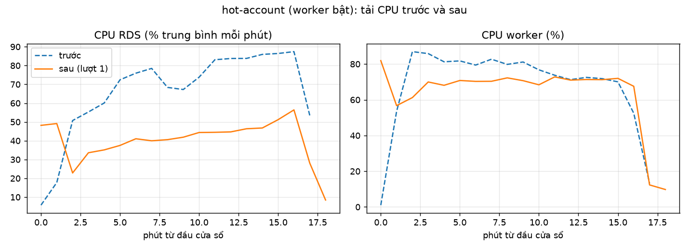

# DBS-173 · Đạt p95 chuyển tiền < 300 ms ở 120 RPS

> **Status:** Implemented (qua G4; đo trên image `409f9f12`) · **Vai:** Dev (#6, thay #4 Fraud cho phần truy vấn đặc trưng) · **Cặp đôi review:** Dev khác (`references/team.md`) · **Nhánh:** `perf/DBS-173-p95-120rps` · **PR:** (điền khi mở) · **Cập nhật:** 2026-11-21

> **Ghi chú quy trình (2026-11-21):** phiên chạy của techlead (`git config user.email` khớp `CLAUDE.md`) trong đêm không có gate người (`TonightWorks.md`). Phase 1 đến 5 và G1 đến G4 vẫn được làm và ghi; gate tự duyệt. Việc được miễn: không có Dev duyệt gate, merge bằng squash sau CI xanh do chính phiên này làm, đẩy nhánh lên GitHub trước G3 nếu cần cho CI. Mỗi miễn trừ ghi ở commit và PR dưới dòng `Techlead waiver:`.

## 1. Bối cảnh

- **Task trên board:** Story, Tuần 7, ưu tiên High, Demo 5. **Expect:** «Đạt NFR hiệu năng chuyển tiền.» **Thực trạng:** «p95 chuyển tiền chưa đo dưới tải vì chưa có báo cáo k6. Mục tiêu NFR: p95 < 300 ms ở 120 RPS. Chỉ tối ưu sau khi có số đo (DBS-166) và EXPLAIN (DBS-171), không tối ưu theo cảm tính.»
- **DoD (nguyên văn từ board):**
  1. Phân tích kết quả k6 tìm điểm nghẽn; chỉnh pool, index, truy vấn
  2. Báo cáo k6 cuối: p95 < 300 ms ở 120 RPS, lỗi < 0,1%; ghi thay đổi và số trước/sau
  3. Bất biến đúng sau chạy; AC-5.x vẫn xanh
  4. PR đã merge vào main (CI xanh); Dev review; bảng «Đối chiếu test case» trong PR điền đủ
- **Phụ thuộc (trạng thái thật trong repo):** DBS-166 Done (báo cáo [02-ket-qua-tai-cloud-2026-11-21](../components/load-tests/02-ket-qua-tai-cloud-2026-11-21.md), PR #224), DBS-171 Done ([doc](DBS-171-explain-hot-queries.md)), DBS-172 Done ([doc](DBS-172-connection-pool-capacity.md)). Cả ba có trong `main`.
- **Đã có gì:** số «trước» của DBS-166 (baseline 120 RPS trên DB mới: chuyển p95 218 ms, p99 703 ms, 0 lỗi, nhưng 3 trong 15 phút có p95 > 300 ms; `hot-account` worker bật: 1,66% lỗi; `stress` worker bật gãy ở 120 → 180 RPS; worker tắt đạt tới 180 RPS); [EXPLAIN](../components/load-tests/results/explain-history-hot-account.txt) của truy vấn `history` (86 ms mỗi lần ở 64.289 giao dịch, Seq Scan + Sort + hai WindowAgg); các dòng backlog BL-413, BL-414, BL-415, BL-417, BL-187.
- **Baseline (bốn lệnh, trên `origin/main` `d6bf542d`, 2026-11-21):** `lint:check` thoát 0; `typecheck` thoát 0; `npm test` 142 suite, 2.405 test đạt; `test:e2e` 17 suite: 16 đạt, 1 (`dev-auth-bootstrap`) hết thời gian `spawnSync` khi chạy song song với phần còn lại và đạt 4/4 khi chạy riêng (nhiễu do máy bận, không phải mã).

- **Dòng BACKLOG liên quan (G1):** BL-413 (truy vấn `history` O(lịch sử), **vào phạm vi**), BL-414 (`keepAliveTimeout`, **vào phạm vi**: một dòng cấu hình có test), BL-417 (đo lại cỡ worker và pool sau BL-413, **vào phạm vi** ở mức số đo; quyết định cỡ ghi ở docs/03 §13.1 nếu số đo đủ), BL-187 (số đo extract ở 120/giây, **cập nhật** bằng số mới, không đóng nếu chưa đo ở 120 extract/giây), BL-415 (harness 429/nguồn đơn: **ngoài phạm vi**, giữ nguyên), BL-324/BL-033 (không liên quan).
- **Ngoài phạm vi:** đổi ngữ nghĩa đặc trưng fraud (cửa sổ 30 ngày, trung vị chính xác, `minHistory`): phải giữ nguyên từng giá trị (golden test fraud); đổi cỡ RDS (chi phí, ngoài DoD «chỉnh pool, index, truy vấn»); replica đọc; sửa harness k6 (BL-415); lược đồ `dbs_worker`/`dbs_api` (không thêm bảng nào).
- **Câu hỏi mở và quyết định ở G1 (agent tự quyết, ghi sau khi có số đo ở §2):** xem §6 và §8.

## 2. Hành vi và số đo dẫn tới thiết kế

### 2.1 Phân tích nút thắt (DoD 1), từ số đo thật

Số liệu đầy đủ, bảng trước/sau và bằng chứng nằm ở [báo cáo 03 §3](../components/load-tests/03-ket-qua-toi-uu-p95-2026-11-21.md#3-phân-tích-nút-thắt-dod-1); đây là phần quyết định thiết kế:

- **Hai lượt «trước» cùng cấu hình cho hai kết quả** (plateau 120 của `baseline`: lượt 1 DBS-166 p95 218 ms, 0 lỗi; lượt 2 trong task này p95 344 ms, 171 lỗi, 54 dropped), nên một lượt đạt sau khi sửa không đủ để kết luận: TC-173-09 dùng bốn điều kiện (§4).
- **Bốn truy vấn đặc trưng fraud của worker chiếm ≈ ba phần tư thời gian câu lệnh** (`pg_stat_statements`: `history` 19,7 ms, `outflow24h` 12,3, `velocity` 10,1, `newRecipientCount` 6,7 mỗi lần ở `baseline`; ≈ 191 ms mỗi giao dịch ở `hot-account`, vượt khả năng của RDS 2 vCPU).
- **Planner quét tuần tự cả bảng trên RDS** vì visibility map chỉ phủ 85% trang (autovacuum mỗi 5 đến 7 phút, ngưỡng 20%); ép `random_page_cost = 1,1` làm tệ hơn (39% heap fetch). `velocity` không index-only được vì `bool_or(id)` cần heap.
- **Cùng dữ liệu, DB rảnh:** ba truy vấn cũ 76,6 ms; sau `VACUUM` 58,8 ms; `accountFacts` 38,7 ms và 26,2 ms sau `VACUUM` (2,9 lần).

### 2.2 Thay đổi (mọi kết quả đặc trưng giữ nguyên từng giá trị)

| # | Thay đổi | Hành vi bất biến |
|---|---|---|
| B1 | **Một câu SQL** `TransferFacts.accountFacts(accountId, transferId, occMs, perTxLimit)` thay cho ba truy vấn `history`, `velocity`, `outflow24h`: một lượt quét `v_transfer_facts` của tài khoản nguồn trong `[occ − 30 ngày, occ + 1 ms)` rồi tổng hợp bằng `FILTER` (xem dưới); `OnlineFeatureProvider` gọi nó một lần. `history()`, `velocity()`, `outflow24h()` giữ nguyên chữ ký và trả đúng phần của nó từ cùng câu SQL | từng giá trị `n`, `median2`, `hour`, `tenMinutes`, `includesCurrent`, `distinctRecipients`, `sum`, `small` y hệt SQL cũ ở mọi đầu vào và mọi ranh giới cửa sổ |
| B2 | Migration `ALTER TABLE transfers SET (autovacuum_vacuum_insert_scale_factor = 0, autovacuum_vacuum_insert_threshold = 1000)`: vacuum sau mỗi ≈ 1.000 insert bất kể cỡ bảng (≈ 1 đến 2 phút ở 24 insert/giây; `autovacuum_naptime` mặc định 1 phút là cận dưới), để visibility map luôn mới, index-only scan không đọc heap và planner chọn nó. Không đổi ngưỡng `analyze`: không có số đo nào cho thấy thống kê là vấn đề. Vacuum do insert chỉ đọc các trang chưa all-visible nên rẻ dù bảng lớn | không đổi dữ liệu; revert bằng `RESET` |
| B3 | `keepAliveTimeout` 65 s và `headersTimeout` 66 s đặt trong `configureHttpApp` (đi qua cho cả `api`, `both` và các e2e), lớn hơn idle timeout 60 s của ALB (BL-414) | không đổi hành vi nghiệp vụ |

SQL của B1 (tham số: `$1` tài khoản, `$2` = `occ − 30 ngày`, `$3` = `occ + 1 ms`, `$4` = `occ − 1 giờ + 1 ms`, `$5` = `occ`, `$6` = `occ − 10 phút + 1 ms`, `$7` = `occ − 24 giờ + 1 ms`, `$8` = ngưỡng một giao dịch, `$9` = id giao dịch hiện tại; mọi mốc là chuỗi ISO tới mili giây như trong `transfer-facts.ts`):

```sql
WITH w AS (
  SELECT created_at, amount, to_account_id
  FROM v_transfer_facts
  WHERE from_account_id = $1 AND status = 'COMPLETED' AND type = 'TRANSFER'
    AND created_at >= $2::timestamptz AND created_at < $3::timestamptz)
SELECT agg.n,
       (agg.amounts[(agg.n + 1) / 2]::numeric + agg.amounts[(agg.n + 2) / 2]::numeric)::text AS median2,
       agg.hour, agg.ten, agg.recipients, agg.total, agg.small,
       EXISTS (SELECT 1 FROM v_transfer_facts
               WHERE id = $9::uuid AND from_account_id = $1 AND status = 'COMPLETED' AND type = 'TRANSFER'
                 AND created_at >= $4::timestamptz AND created_at < $3::timestamptz) AS current
FROM (SELECT (count(*) FILTER (WHERE created_at < $5::timestamptz))::int AS n,
             array_agg(amount ORDER BY amount) FILTER (WHERE created_at < $5::timestamptz) AS amounts,
             (count(*) FILTER (WHERE created_at >= $4::timestamptz))::int AS hour,
             (count(*) FILTER (WHERE created_at >= $6::timestamptz))::int AS ten,
             (count(DISTINCT to_account_id) FILTER (WHERE created_at >= $7::timestamptz))::int AS recipients,
             COALESCE(sum(amount) FILTER (WHERE created_at >= $7::timestamptz), 0)::text AS total,
             (count(*) FILTER (WHERE created_at >= $7::timestamptz AND amount::numeric * 10 < $8::numeric))::int AS small
      FROM w) agg
```

Tương đương với SQL cũ, từng điểm: (i) **history**: SQL cũ lấy cùng tập dòng `[occ − 30 ngày, occ)` (`created_at < occ`, không cộng 1 ms), nên `n` và hai phần tử giữa (thứ hạng `(n+1)/2` và `(n+2)/2`, chia nguyên) giống nhau; tổng ép `numeric` (không tràn `bigint` ở 2^63), `null` khi `n = 0` vì `array_agg` rỗng là `NULL`; (ii) **velocity**: cửa sổ giờ `[occ − 1 giờ + 1 ms, occ + 1 ms)` và 10 phút là các `FILTER` của cùng tập dòng (cận trên `occ + 1 ms` chính là cận trên của `w`); `includesCurrent` bằng `EXISTS` tra khóa chính của giao dịch hiện tại với cùng điều kiện và cùng cửa sổ (SQL cũ: `bool_or(id = $5)` trên các dòng của cửa sổ); (iii) **outflow**: `[occ − 24 giờ + 1 ms, occ + 1 ms)`; `count(DISTINCT to_account_id)` bỏ qua `NULL`, và `to_account_id` không bao giờ `NULL` với `COMPLETED` nhờ ràng buộc `transfers_completed_has_target`; tổng `numeric` rồi `::text`, `COALESCE(…, 0)` cho cửa sổ rỗng; `small` giữ nguyên biểu thức `amount::numeric * 10 < ngưỡng`. Cả bảy cột cho cửa sổ rỗng ra `0`, `NULL`, `0`, `0`, `0`, `'0'`, `0`, đúng như SQL cũ.

Không đổi: `newRecipientCount` (SQL giữ nguyên; 6,7 ms ở `baseline` và 31,6 ms ở `hot-account` khi visibility map cũ, §2.1; hưởng B2), `reverse`, `window`, cửa sổ 30 ngày, `MIN_HISTORY_FOR_MEDIAN`, luật R1–R6, `Features`, snapshot, pool (`DATABASE_POOL_MAX` 10, DBS-172), cỡ worker và RDS (BL-417: chỉ đo và bàn giao cho #5).

Ví dụ (cùng kết quả trước và sau): số tiền `[100, 200, 300, 400, 500, 601]` → `n = 6`, `median2 = "700"`; `[100 … 500]` → `5`, `"600"`; rỗng → `0`, `null`; năm lần `9223372036854775807` → `"18446744073709551614"`.

### 2.3 Giới hạn còn lại (nói thẳng)

Chi phí vẫn O(số dòng trong cửa sổ 30 ngày của tài khoản nguồn): trung vị chính xác phải đọc và sắp xếp cả cửa sổ, nên không thể bỏ. Hằng số nhỏ đi khoảng 3 lần, không phải bậc độ phức tạp. Với ≈ 0,9 µs mỗi dòng (26 ms cho 29.500 dòng, DB rảnh) và 20 giao dịch/giây vào một tài khoản, ba truy vấn đã gộp chiếm **1 vCPU của RDS khi cửa sổ 30 ngày của tài khoản đó có ≈ 55.000 dòng và 2 vCPU khi có ≈ 110.000 dòng** (≈ 1,5 giờ ở 20 giao dịch/giây liên tục); dưới tải các số này nhỏ hơn 2 đến 5 lần. Quá mức đó worker tụt lại (hàng đợi SQS dài ra, thời gian tới khi có cờ của DBS-174 tăng) và RDS dùng chung làm chậm cả api: đó là giới hạn thật của thiết kế SQL-có-thẩm-quyền (ADR-14), đến trước `statement_timeout` 5 giây (chạm ở ≈ 5 triệu dòng khi rảnh). Vì vậy TC-173-09 định nghĩa «lịch sử lớn» của BL-413 bằng một con số: **tài khoản nóng có ≥ 40.000 dòng trong cửa sổ khi chạy `hot-account` lần cuối** (`baseline` ≈ 11.500 dòng, lượt `hot-account` đầu thêm ≈ 18.000, `stress` thêm ≈ 10.800 vào tài khoản nóng, tổng ≈ 40.300 ngay trước lượt `hot-account` thứ hai; số thật đo bằng SQL ngay trước lượt và ghi lại. Chỉ chạy được hai lượt `hot-account`: mỗi lượt trừ ròng ≈ 18 triệu từ khoản nạp 50 triệu một lần của `prepare` (BL-213), nên lượt thứ ba dừng ở `requireBudget`). Mức ≈ 10^5 dòng chưa được đo; phần cấu trúc của BL-413 (thống kê gia tăng theo tài khoản, bảng tổng hợp theo ngày; đòi đổi kiến trúc fraud và quyền bảng) vì thế **giữ mở** bằng một dòng BACKLOG riêng với các số trên. Mảng `amounts` nằm trọn trong bộ nhớ của backend (8 byte mỗi dòng).

## 3. Kiến trúc

- **Vị trí:** `backend/src/modules/risk/features/transfer-facts.ts` (role `worker`; B1) và `online-feature-provider.ts` (gọi `accountFacts`), `backend/src/app.setup.ts` (B3; `main.ts` không đổi vì `configureHttpApp` đã nằm trong đường khởi động của `api` và `both`), một migration mới (B2, chủ sở hữu `dbs_migrator`, `ALTER TABLE … SET` không đụng trigger append-only). Không đổi `Features`, luật R1–R6, schema cột hay quyền (`dbs_worker` đã `SELECT` trên `v_transfer_facts`; `EXISTS` đọc đúng view đó).
- **Người gọi (grep) của symbol bị đổi:** `factQueries().history|outflow` (`history-window.spec.ts`, `transfer-facts.db-spec.ts`) được thay bằng `factQueries().account`; `TransferFacts.history|velocity|outflow24h` (`online-feature-provider.ts`, nay gọi `accountFacts`; `transfer-facts.db-spec.ts`, `online-feature-snapshot.db-spec.ts`); các test parity và consumer đọc đặc trưng qua provider: `test/services/feature-provider-parity.services-spec.ts`, `online-feature-provider.services-spec.ts`, `risk-feature-order.services-spec.ts`, `test/support/risk-consumer.ts`, `offline-features.db-spec.ts`, `risk-scoring-consumer.db-spec.ts` (TC-111-15: đăng nhập `dbs_worker` thật, kiểm quyền của view), `risk-invariants.db-spec.ts`.
- **Ranh giới transaction:** không đổi trừ số truy vấn: nay ba truy vấn trong snapshot `REPEATABLE READ READ ONLY` (BL-187): `accountFacts`, `reverseTransfer`, `newRecipientCount`; timeout 5 s, tuần tự trên một kết nối.
- **Thay đổi cấp hệ thống:** docs/03 §13.1 (cỡ worker, nếu số đo đủ; việc của #5), `database-design.md` §6.1 và §7 (một truy vấn gộp thay ba; autovacuum của `transfers`), `docs/components/risk/02-architecture.md` (dòng 11) và `FRAUD_DETECTION_GUIDE.md` (dòng 382, 619, 721) đang ghi «năm SELECT trong một snapshot», nay là ba SELECT (`accountFacts`, `reverseTransfer`, `newRecipientCount`); `docs/components/load-tests/` (báo cáo 03), BACKLOG.

## 4. Test cases tự động

| ID | Truy vết | Lớp | Given · When · Then | `errorCode` |
|---|---|---|---|---|
| TC-173-01 | DoD 1, 3 | db (Postgres thật) | Nhiều bộ số tiền (rỗng, 1, 2, 4, 5, 6 dòng, trùng, số gần 2^63, ranh giới 30 ngày ± 1 ms, ngoài cửa sổ, `REJECTED`, `DEPOSIT`, tài khoản khác, giao dịch tại `occ` và sau `occ`) cộng 12 bộ ngẫu nhiên có seed cố định, dồn quanh bốn biên (10 phút, 1 giờ, 24 giờ, 30 ngày, ± 1 ms): `accountFacts` mới (cả tám giá trị) bằng ba SQL cũ (giữ trong test làm oracle) và `history` bằng trung vị tính trong JS | không áp dụng |
| TC-173-02 | DoD 1 | db | Tài khoản nóng 40.000 dòng, sau `VACUUM`: EXPLAIN `accountFacts` là một `Index Only Scan`, một lượt quét `transfers`, không `WindowAgg`, `Heap Fetches` = 0. `newRecipientCount` sau `VACUUM`: không Seq Scan, `Heap Fetches` 0. Biến thể chỉ `ANALYZE` (không `VACUUM`, như RDS chưa vacuum): kết quả vẫn giống SQL cũ. Ca «lịch sử dài, ít dòng gần đây» (30.000 dòng rải 29 ngày, 50 dòng trong 24 giờ): `accountFacts` ≤ 1,1 lần ba SQL cũ cộng lại (không tệ hơn khi cửa sổ 30 ngày chiếm gần hết chi phí) So thời gian: `EXPLAIN (ANALYZE, TIMING OFF)`, đo xen kẽ cũ và mới 5 lần, trung vị mới ≤ 0,85 lần SQL cũ ba truy vấn cộng lại (số đo cục bộ ≈ 0,3 đến 0,4: biên rộng để không chập chờn khi CI chạy song song) | không áp dụng |
| TC-173-03 | DoD 1, 3 | db | `velocity()` mới = SQL cũ cho giao dịch hiện tại có/không trong cửa sổ, ranh giới 1 ms, tài khoản khác; phần đếm là `Index Only Scan` (0 heap fetch), phần `EXISTS` là `Index Scan` trên khóa chính một dòng (cả khi giao dịch hiện tại tồn tại) | không áp dụng |
| TC-173-04 | DoD 1, 3 | db | `outflow24h()` mới = SQL cũ và tính trong JS (người nhận, tổng, `small`) ở biên 24 giờ, không có giao dịch, nhiều người nhận | không áp dụng |
| TC-173-05 | DoD 3 | unit + db + services | Bộ test fraud hiện có vẫn xanh: `history-window.spec` (cập nhật khẳng định về hình dạng SQL, xem §8), `online-feature-provider.spec` (kiểm provider gọi `accountFacts` một lần cho ba đặc trưng), `transfer-facts.db-spec`, `online-feature-snapshot.db-spec` (**TC-187-03 là test hợp đồng cứng «năm SELECT, bảy câu lệnh»: đổi thành ba SELECT và năm câu lệnh, vẫn kiểm một kết nối, `BEGIN` và `COMMIT`**), `offline-features.db-spec`, `risk-scoring-consumer.db-spec` (TC-111-15 là phép kiểm quyền `dbs_worker`), `risk-invariants.db-spec`, và các spec services `feature-provider-parity`, `online-feature-provider`, `risk-feature-order` | không áp dụng |
| TC-173-06 | DoD 1 (BL-414) | e2e (`test/http-server-timeouts.e2e-spec.ts`; spec unit viết trước đã bỏ vì ghim `main.ts`, trái với thiết kế đặt trong `configureHttpApp`) | Sau `configureHttpApp`, `getHttpServer().keepAliveTimeout` > 60.000 và `headersTimeout` > `keepAliveTimeout` (e2e dựng app bằng đúng hàm đó); mặc định Node là 5.000; `server.close()` với một socket keep-alive rảnh trả về trong dưới 2 giây (65 s không làm chậm tắt máy dưới `stopTimeout` 30 s của ECS) | không áp dụng |
| TC-173-07 | DoD 1 (B2) | db | Sau `migration:run`, `pg_class.reloptions` của `transfers` chứa hai tham số autovacuum; sau `migration:revert` là `NULL`; chạy lại được; không đổi dữ liệu | không áp dụng |
| TC-173-08 | DoD 3 | e2e/db có sẵn | AC-5.1…5.10 vẫn xanh: `money-flow.db-spec`, `transfer-concurrency.db-spec`, `idempotency-rollback.db-spec`, `daily-limit.db-spec`, `resource-ownership.db-spec`, `money.e2e-spec` | như test có sẵn |
| TC-173-09 | DoD 2 | vận hành (AWS) | Cấu hình DBS-166, DB mới, worker bật, image của nhánh (§5, M-173-03). **DoD 2 đạt khi đủ bốn điều, đọc từ `aggregate.json`/`per-minute.json` của k6 và `pg_stat_statements`:** (1) `baseline`, plateau 120: chuyển p95 < 300 ms **ở từng phút** (các dòng `scenario = write_120` của `per-minute.json`; khung phút đầu và cuối của plateau thiếu mẫu nên chỉ tính khi có ≥ 500 mẫu), p99 < 1 s, lỗi hệ thống < 0,1%, 0 dropped, đọc số dư và đọc lịch sử p95 < 150 ms; (2) plateau 120 của `stress`, chạy theo đúng thứ tự của DBS-166 (`baseline` → `hot-account` → `quiesce` → `duplicate` → `stress`: ≈ 52.600 giao dịch, tài khoản nóng ≈ 29.500 dòng, điều kiện làm lượt «trước» của DBS-166 đỏ với p95 784 ms và 0,119%): p95 < 300 ms, p99 < 1 s, lỗi < 0,1% tính theo tag `plateau:120`; `runExit` của `stress` **được bỏ qua** vì plateau 180 và 240 gãy theo thiết kế; (3) `hot-account` lượt đầu (≈ 11.500 dòng, so với lượt «trước» đỏ ở §2.1) **và** lượt thứ hai sau `stress` (tài khoản nóng ≥ 40.000 dòng, §2.3): 0 lỗi, p95 < 1 s (NFR-SCAL-02); (4) thời gian DB mỗi lần extract (`pg_stat_statements`: sau B1 là `accountFacts` + `newRecipientCount`, trước là bốn truy vấn) giảm so với «trước», cùng phạm vi: tổng cả `baseline` 48,8 ms mỗi lần và `hot-account` 191 ms mỗi lần (§2.1), kèm CPU worker, CPU RDS và số kết nối ở plateau 120 và 180 (số cho BL-417, không phải tiêu chí đạt). Thêm: `HTTPCode_ELB_5XX_Count` = 0 trong cửa sổ `baseline` (tiêu chí đóng BL-414). Bảng trước/sau gồm cả hai lượt «trước» (§2.1). Điều nào không đạt thì ghi đúng điều đó và `BL` chưa đóng; thời gian tới khi có cờ (p95 < 5 s) là của DBS-174, không đo ở đây | không áp dụng |
| TC-173-10 | DoD 3 | vận hành | `check:invariants` thoát 0 sau mỗi lượt (`baseline`, `hot-account`, `duplicate`, `stress`) | không áp dụng |
| TC-173-11 | DoD 4 | quy trình | PR merge, CI xanh, Dev review, bảng đối chiếu điền đủ | không áp dụng |

Danh sách kiểm bảo mật (`references/testing.md`): không thêm endpoint, vai, truy cập dữ liệu hay trường trả về; SQL vẫn tham số hóa (chín tham số, không nối chuỗi); `dbs_worker` không cần quyền mới (cả hai nhánh đọc `v_transfer_facts`, TC-111-15 chạy bằng role thật). Các hàng bảo mật khác **không áp dụng**, lý do: thay đổi chỉ viết lại truy vấn chỉ đọc, thêm tham số lưu trữ cho một bảng và hai thuộc tính của server HTTP.

## 5. Test thủ công

Điều kiện: Docker (PostgreSQL 17, múi giờ UTC): `docker run -d --name dbs173-pg -e POSTGRES_PASSWORD=pw -p 55440:5432 postgres:17`, `DATABASE_URL=postgres://postgres:pw@localhost:55440/postgres`, một DB tạm đã `migration:run`; xóa khi xong: `docker rm -f dbs173-pg`. SQL cũ lấy bằng `git show d6bf542d:backend/src/modules/risk/features/transfer-facts.ts`. AWS profile `dbs` cho M-173-03 đến 06, theo các bước 1 đến 6 của `infra/terraform/README.md` mục «Máy chạy tải và đợt đo k6 (DBS-166)»; dự trù 2,5 đến 3 giờ, ≈ 0,5 USD mỗi giờ.

**Cách đưa image lên để đo (quyết định của subagent opus ở G2, agent tự quyết; ghi ở §6):** image chứa bản sửa được **build tay từ commit `M` của nhánh** (`docker build backend`, cùng `backend/Dockerfile` với CI), quét bằng `.github/scripts/run-trivy.sh` cục bộ, đẩy lên ECR `dbs-api` bằng profile `dbs` với tag duy nhất là `M` (không `latest`), vì `image.yml` chỉ đẩy từ `main` và đo sau merge sẽ làm bảng đối chiếu của PR thiếu kết quả DoD 2. Biện pháp: cây làm việc sạch khi build; sau `M` chỉ được thêm báo cáo và tài liệu (`git diff --stat M HEAD` không có tệp dưới `backend/` hay `infra/`, nếu có thì đo lại); ghi `M`, digest (`aws ecr describe-images`), kết quả Trivy cục bộ và lượt Trivy của CI trên PR; dòng `Techlead waiver: image dbs-api:<M> build và đẩy tay từ nhánh bằng profile dbs (bỏ qua cổng OIDC main của image.yml; cùng Dockerfile, quét cục bộ và bằng Trivy trong ci.yml); tag đã xóa sau lượt đo`; thứ tự dọn: `destroy` `session` và `loadgen` trước, rồi `aws ecr batch-delete-image --repository-name dbs-api --image-ids imageTag=<M>`, dán kết quả `describe-images` vào báo cáo; trước khi merge `rebase` lên `main`; nếu `main` không đổi `backend/` sau `d6bf542d` thì `git diff M S -- backend` rỗng (S là commit squash) và ghi «đo trên M, cây backend giống S», nếu có thay đổi khác thì so `git diff <merge-base> M -- backend` với `git diff main S -- backend` và đo lại hoặc ghi rõ; nếu không cải thiện thì **không merge**, ghi kết quả âm vào BL-413 và vẫn xóa tag; BL-413 chỉ đóng khi có kết quả xóa tag.

| Bước | Việc làm | Kết quả mong đợi |
|---|---|---|
| M-173-01 | `backend/test/manual/dbs-173-hot-account.sql` (seed SQL: `users`, `customers`, `accounts`, rồi 64.289 giao dịch cho tài khoản nóng và nhiễu), `VACUUM ANALYZE`; chạy `EXPLAIN (ANALYZE, BUFFERS)` ba truy vấn cũ, `accountFacts` và `newRecipientCount`; so kết quả | cũ: ba lượt quét, `WindowAgg`; mới: một `Index Only Scan`, không `WindowAgg`, `Heap Fetches` 0; thời gian ghi lại; mọi giá trị giống nhau |
| M-173-02 | Script nhỏ dựng server bằng `NestFactory` + `configureHttpApp`, gửi một request keep-alive, đợi 62 giây (quá 60 giây của ALB, chưa tới 65 giây), gửi lại trên cùng socket; chạy với mã trước (`d6bf542d`) và mã mới | trước sửa: socket bị đóng sau 5 giây; sau sửa: cùng socket dùng lại, không lỗi |
| M-173-03 | Build, quét, đẩy image `M`; dựng `loadgen` và `session` tạm (cấu hình DBS-166, `RATE_LIMIT_*` 1.000.000 từ đầu: bài `rate-limit` không chạy lại ở task này, đã đạt ở DBS-166), `migrate.sh` với `IMAGE_TAG=M` (chạy migration autovacuum), bật `pg_stat_statements` bằng task master, `prepare` | `/health/ready` 200, fixture tạo xong, `reloptions` của `transfers` có hai tham số |
| M-173-04 | `loadgen-run.sh run baseline` (12 → 60 → 120 RPS); chụp `pg_stat_statements` đầu và cuối plateau 120; trong lúc plateau 120 chạy, task master ghi `Heap Fetches` của `accountFacts` và `newRecipientCount`, `relallvisible/relpages`, `last_autovacuum` và `autovacuum_count` (hai lần cách nhau 5 phút) | các điều (1) và (4) của TC-173-09; visibility map ≥ 95% và `Heap Fetches` ≈ 0 **dưới tải**; khoảng giữa hai lần autovacuum ≤ 2 phút |
| M-173-05 | `run hot-account` (worker bật) lần 1, `quiesce`, `run duplicate`, `run stress`, rồi `run hot-account` lần 2 (đếm dòng tài khoản nóng bằng SQL ngay trước, ghi lại, phải ≥ 40.000); `pg_stat_statements` sau mỗi lượt | điều (2) và (3) của TC-173-09; `invariantExit` 0 sau mỗi lượt; CPU worker, CPU RDS, kết nối ở plateau 120 và 180 (CloudWatch) |
| M-173-06 | Hủy `session` và `loadgen`; `infra/scripts/verify-clean.sh`; `list-user-pool-clients`; xóa tag `M` khỏi ECR | thoát 0; chỉ còn tài nguyên `base`; chỉ còn client `dbs-app`; `describe-images` không còn tag `M` |

## 6. Domain review (AI)

**Reviewer:** subagent, model opus, effort high, ba vòng ngày 2026-11-21 (vòng 1 trên thiết kế ba truy vấn rời, vòng 2 và 3 trên thiết kế một câu SQL gộp) · **Kết quả:** vòng 1: 14 phát hiện (2 blocking, 5 should-fix, 7 minor); vòng 2: 12 (1 blocking, 5 should-fix, 6 minor); vòng 3: 6 (1 blocking, 2 should-fix, 3 minor); verdict cuối của reviewer **REVISE** cả ba vòng, mọi phát hiện đã sửa trong doc (bảng dưới); vòng 3 xác nhận từng phát hiện vòng 2 đã giải quyết và xác nhận SQL gộp tương đương SQL cũ từng giá trị · [trả lời nguyên văn](screenshots/DBS-173/domain-review.md)

| # | Mức | Phát hiện | Xử lý |
|---|---|---|---|
| V1-1, V2-2, V3-4 | blocking / should-fix | Tiêu chí đạt không phân biệt «trước» và «sau» (lượt 1 của DBS-166 đã đạt 218 ms) | đã sửa §2.1 và TC-173-09: bốn điều (từng phút, `stress` plateau 120 cùng thứ tự DBS-166, `hot-account` hai mức lịch sử, thời gian DB mỗi lần extract), hai lượt «trước» |
| V1-2, V2-1, V3-6 | blocking | Không có đường đưa image của nhánh lên ECR | đã sửa §5: quyết định của một subagent opus riêng (agent tự quyết, xem G2): build tay từ commit `M`, Trivy cục bộ, waiver, xóa tag, không merge nếu không cải thiện |
| V1-3, V3-3, V2-12 | should-fix | Thiếu ngưỡng p99, đọc p95, `HTTPCode_ELB_5XX_Count`, số CPU/kết nối cho BL-417 | đã sửa TC-173-09 và M-173-04, M-173-05 |
| V1-4 | should-fix | Số đo lượt 2 và `pg_stat_statements` chưa có trong repo | sẽ commit ở Phase 5 (`results/dbs173-*`), ghi ở §9 |
| V1-5, V2-6, V2-7 | should-fix / minor | Lợi ích index-only chỉ đo sau `VACUUM`; điều kiện giữ migration không có ngưỡng; tham số `analyze` không có số đo | đã đo trên RDS thật trong lúc tải (visibility map 85%, 39% heap fetch) và sau `VACUUM` (§2.1); B2 đổi thành `insert_scale_factor = 0` + `threshold = 1000`, bỏ tham số `analyze`; M-173-04 đo lại dưới tải |
| V1-6, V2 TC-02 | should-fix | Phép so thời gian ≤ 0,7 dễ chập chờn | đã sửa TC-173-02: `TIMING OFF`, xen kẽ, biên 0,85, thêm ca lịch sử dài (≤ 1,1) |
| V1-7, V2-5 | should-fix | Danh sách người gọi thiếu spec parity; TC-187-03 là hợp đồng cứng «năm SELECT» | đã sửa §3, TC-173-05; test TC-187-03 đã đổi (ba SELECT, năm câu lệnh) |
| V1-8, V1-9, V1-10, V1-11, V1-12, V1-14 | minor | Heap fetch của `EXISTS`; `transfers_completed_has_target`; keep-alive trong `configureHttpApp` và tắt máy; `reloptions` NULL; `dbs-pg-187`; giới hạn `statement_timeout` | đã sửa TC-173-03, B1 (ghi ràng buộc), TC-173-06, TC-173-07, §5, §2.3 |
| V2-3 | should-fix | §2.3 tự mâu thuẫn, «lịch sử lớn» chưa định nghĩa | đã viết lại §2.3: bão hòa CPU ở ≈ 55.000 dòng (1 vCPU) và ≈ 110.000 dòng (2 vCPU); «lịch sử lớn» = ≥ 40.000 dòng; phần cấu trúc của BL-413 giữ mở |
| V2-4 | should-fix | `newRecipientCount` bỏ ngoài số đo | đã đo trên RDS (Seq Scan 1.545 buffer → Index Only Scan 364 buffer sau `VACUUM`), thêm vào TC-173-02 và bảng §2.1 |
| V2-9, V2-10, V2-11 | minor | Số liệu chưa khớp; random chỉ so `history`; seed SQL thiếu | đã sửa §2.1 (12.960 dòng, tách lúc tải/lúc rảnh, «thời gian DB»), TC-173-01 (cả tám giá trị, dồn quanh biên), M-173-01 (driver có seed) |
| V3-1 | blocking | Lượt `hot-account` thứ ba không chạy được (khoản nạp 50 triệu một lần, mỗi lượt trừ ròng 18 triệu); thứ tự lượt làm `stress` khác điều kiện «trước» | đã sửa TC-173-09 và M-173-05: hai lượt `hot-account`, thứ tự `baseline` → `hot` → `duplicate` → `stress` → `hot` như DBS-166, số dòng đo bằng SQL trước lượt thứ hai |
| V3-2 | should-fix | Spec autovacuum vẫn ghim giá trị cũ | đã sửa spec (hai tham số, `scale_factor = 0`) |
| V3-5 | minor | Còn câu «≈ 10 ms» của `newRecipientCount` | đã thay bằng 6,7 và 31,6 ms |

**Quyết định ở G2 (agent tự quyết):** (1) **Không chạy vòng review thứ tư:** vòng 3 chỉ còn một phát hiện blocking, đã sửa bằng thay đổi cơ học trong doc và kiểm lại với nguồn mà reviewer trích (`loadgen-run.sh`, `prepare.cjs`, `run.cjs`, `hot-account.js`, `aggregate-raw.cjs`); lặp thêm vòng chỉ để chờ verdict APPROVE sẽ không thêm bằng chứng. Ghi thẳng ở đây và ở mô tả PR. (2) **Gộp ba truy vấn thành một câu SQL (B1)** thay vì ba truy vấn viết lại rời: số đo RDS cho thấy truy vấn rời không nhanh hơn (74 so với 76,6 ms) vì planner dùng Seq Scan trên cả bảng, còn một lượt quét giảm 76,6 → 38,7 ms và còn 26,2 ms khi visibility map mới. (3) **Không đổi `random_page_cost`**: ép 1,1 làm index-only scan chậm hơn khi visibility map cũ (61 đến 96 ms so với 14 ms). (4) **Image đo:** build tay từ nhánh (quyết định của subagent opus, §5). (5) **Số lượt `hot-account` hai, không ba:** giới hạn ngân sách nạp tiền của harness (BL-213), ghi ở §2.3.

**Quyết định ở G1 (agent tự quyết):** (1) làm BL-413, BL-414 trong task này; BL-417 chỉ đo và bàn giao #5; BL-187 chỉ cập nhật số; (2) đo lại «trước» bằng một lượt `baseline` và một `hot-account` trên cùng cấu hình DBS-166 (vì hai lượt cùng cấu hình đã cho hai kết quả khác nhau) và bật `pg_stat_statements` để phân tích bằng số; (3) task chạm tài khoản AWS thật: tuân thủ `TonightWorks.md` (đã được cho phép dựng và hủy, state tạm riêng `dev/loadgen-dbs173.tfstate` và `dev/session-dbs173.tfstate`, không đụng `base`).

**Quyết định ở G3 (agent tự quyết):** (1) thứ tự commit migration → truy vấn → provider → HTTP; (2) `history()`, `velocity()`, `outflow24h()` giữ nguyên chữ ký, chiếu từ `accountFacts`, để test và người gọi có sẵn không phải đổi; (3) `factQueries()` đổi khóa (`history` và `outflow` thành `account`): chấp nhận vì chỉ hai spec dùng và đã cập nhật.

## 7. Kế hoạch triển khai

Thứ tự theo `SKILL.md`: migration → truy vấn → provider → HTTP; mỗi bước viết test trước (đã viết xong ở Phase 2 và đã chạy đỏ), rồi mã tối thiểu cho xanh, rồi commit. Hiệu năng không chỉnh theo cảm tính: mọi quyết định ở bước 2 và 3 dựa vào số đo §2.1.

| Bước | File | Test viết trước | Kết quả đỏ (đã chạy) | Lệnh chứng minh | Commit |
|---|---|---|---|---|---|
| 1 | `backend/src/database/migrations/1795000011000-TuneTransfersAutovacuum.ts` | TC-173-07 `test/db/transfers-autovacuum.db-spec.ts` | `reloptions` rỗng sau `migration:run` (kỳ vọng hai tham số) | `npm run test:db -- test/db/transfers-autovacuum.db-spec.ts` | `perf(db): vacuum transfers by insert count so the visibility map stays fresh (DBS-173)` |
| 2 | `backend/src/modules/risk/features/transfer-facts.ts` (`accountFacts`, `factQueries().account`, ba phương thức cũ chiếu từ nó, bỏ `history`/`outflow` khỏi `factQueries`), `history-window.spec.ts`, `transfer-facts.db-spec.ts` (vòng lặp plan) | TC-173-01..04 `test/db/transfer-facts-cost.db-spec.ts`, `history-window.spec.ts` | `TS2339 accountFacts không tồn tại`; trên mã cũ ba ca plan đỏ (WindowAgg, ba lượt quét, `velocity` không index-only) | `npm run test:db -- test/db/transfer-facts-cost.db-spec.ts test/db/transfer-facts.db-spec.ts` và `npm test -- history-window` | `perf(risk): one scan for history, velocity and outflow of an account (DBS-173)` |
| 3 | `backend/src/modules/risk/features/online-feature-provider.ts`, `test/db/online-feature-snapshot.db-spec.ts` (TC-187-03: ba SELECT, năm câu lệnh) | `online-feature-provider.spec.ts` (TC-173-05) | `TypeError: facts.velocity is not a function` | `npm test -- online-feature-provider` và `npm run test:db -- test/db/online-feature-snapshot.db-spec.ts test/db/offline-features.db-spec.ts` | `perf(risk): the online provider reads account facts once (DBS-173)` |
| 4 | `backend/src/app.setup.ts` | TC-173-06 `test/http-server-timeouts.e2e-spec.ts` | `TS2305 ALB_IDLE_TIMEOUT_MS không được xuất`; mặc định Node 5.000 ms | `npm run test:e2e -- test/http-server-timeouts.e2e-spec.ts` | `fix(http): keep idle connections longer than the ALB does (BL-414, DBS-173)` |
| 5 | không đổi mã; chạy bộ test liên quan và bốn lệnh baseline | TC-173-05, TC-173-08 | không áp dụng | `npm run lint:check && npm run typecheck && npm test && npm run test:e2e`; `npm run test:db` các spec fraud và tiền; `npm run test:services` các spec `feature-provider-parity`, `online-feature-provider`, `risk-feature-order` | (không có commit mã) |
| 6 | `backend/test/manual/dbs-173-hot-account.manual.ts`, test thủ công M-173-01, M-173-02 | không áp dụng | không áp dụng | chạy từng bước §5, ghi `manual-test.txt` | `test(risk): manual driver for the account facts plan (DBS-173)` |
| 7 | build image `M`, Trivy, ECR, dựng AWS, chạy M-173-03 đến 06 | TC-173-09, TC-173-10 | không áp dụng | `loadgen-run.sh run …`, `check:invariants`, `verify-clean.sh` | `docs(load-tests): báo cáo k6 sau tối ưu (DBS-173)` |
| 8 | tài liệu: feature doc, báo cáo `03-…`, `database-design.md`, `02-architecture.md`, `FRAUD_DETECTION_GUIDE.md`, `docs/03` §13.1 nếu đủ số đo, `docs/features/README.md`, `docs/BACKLOG.md` | `check-doc-links.mjs`, `check-backlog.mjs` | không áp dụng | hai lệnh trên | cùng commit bước 7 hoặc commit tài liệu riêng |

**Rủi ro và cách lùi.** (1) Sai lệch một giá trị đặc trưng làm đổi quyết định chấm điểm: chặn bằng oracle ba SQL cũ trong TC-173-01, parity online/offline và các spec services; lùi bằng revert commit bước 2 và 3 (SQL cũ còn nguyên trong lịch sử và trong test). (2) Migration autovacuum chỉ là tham số lưu trữ: lùi bằng `migration:revert` (`RESET`), không đổi dữ liệu; vacuum thường xuyên hơn thêm tải nền nhỏ (đo ở M-173-04). (3) `keepAliveTimeout` dài hơn làm giữ socket lâu hơn: đã kiểm tắt máy (TC-173-06) nên không vượt `stopTimeout` 30 giây. (4) Image đẩy tay còn lại trong ECR dùng chung dev và prod: bước dọn bắt buộc (§5). (5) Đợt đo AWS vượt ngân sách: trần cứng 3,5 giờ của README, hủy khi lỗi giữa chừng. (6) Số đo không đạt: không merge, ghi kết quả âm.

**Rà soát kế hoạch (plan sweep).** Mọi tệp và quy tắc nêu ở giới hạn của tài liệu và ở DoD đều có hàng kế hoạch hoặc dòng ngoài phạm vi: DoD 1 (phân tích: §2.1; pool: không đổi theo số đo, BL-417 bàn giao #5; index: bước 1; truy vấn: bước 2 và 3), DoD 2 (bước 7), DoD 3 (bước 5 và TC-173-10), DoD 4 (quy trình). Ngoài phạm vi có tên: đổi cỡ RDS, replica đọc, harness k6 (BL-415), cấu trúc thống kê gia tăng (BL mới), `newRecipientCount`.

## 8. Kết quả

- **Lệnh kiểm tra** (trên commit `409f9f12`, 2026-11-21): `npm run lint:check` sạch; `npm run typecheck` sạch; `npm test`: 142 suite, **2.404 test đạt** (baseline 2.405: bỏ hai test «năm SELECT» và «bốn lỗi riêng», thêm một test provider); `npm run test:e2e`: 18 suite, 16 đạt trong lượt đầy đủ, **hai (`dev-auth-bootstrap`, `fraud-ai-cli`) hết thời gian `spawnSync` khi chạy song song với phần còn lại và đạt 11/11 khi chạy riêng** (cùng nhiễu như baseline), gồm `http-server-timeouts` 4/4; `test:db` (tuần tự, `-i`): 23 suite, **340 test đạt** (`customer-transfers`, `daily-limit`, `fraud-operator-http`, `fraud-schema`, `idempotency-rollback`, `invariants`, `ledger-invariants-helper`, `midnight-boundary`, `money-flow`, `rejected-transfers`, `resource-ownership`, `risk-config-http`, `risk-decisions`, `risk-invariants`, `risk-runtime-gating`, `risk-scoring-ai-mode`, `risk-scoring-consumer`, `transfer-concurrency`, `online-feature-snapshot`, `offline-features`, `transfer-facts`, `transfer-facts-cost`, `transfers-autovacuum`) và `migration-revert`, `ledger-schema` (38 test); `test:services`: `feature-provider-parity` 5/5, `online-feature-provider` 2/2, `risk-feature-order` 4/4. Không `.skip`, `.only`, `.todo` trong test của task. `test:db` chạy song song cục bộ gặp tranh chấp `pg_authid_rolname_index` khi hai suite tạo role cùng lúc (có sẵn, không phải mã của task; CI chạy với service container); đã chạy tuần tự.
- **Đối chiếu test case:**

| ID | Test | Đạt? |
|---|---|---|
| TC-173-01 | `test/db/transfer-facts-cost.db-spec.ts` › `history` (8 kịch bản + 12 bộ ngẫu nhiên dồn quanh bốn biên, cả tám giá trị so với ba SQL cũ và JS) | đạt |
| TC-173-02 | cùng spec › `plans on a busy account` (một `Index Only Scan`, không `WindowAgg`/Seq Scan, 0 heap fetch; ≤ 0,85 lần SQL cũ; chỉ `ANALYZE`; `newRecipientCount`; lịch sử dài ≤ 1,1) | đạt (số đo cục bộ: ratio 0,54) |
| TC-173-03 | cùng spec › `velocity` và `the current-transfer check is a probe of one row` | đạt (probe qua `transfers_pkey` hoặc khóa ledger, không phải `pkey` cố định: đơn giản hóa assertion, lý do: planner chọn khóa duy nhất bắt đầu bằng `id`) |
| TC-173-04 | cùng spec › `outflow24h` | đạt |
| TC-173-05 | `history-window.spec`, `online-feature-provider.spec`, `online-feature-snapshot.db-spec` (TC-187-03 đổi: ba SELECT, năm câu lệnh), `offline-features.db-spec`, `transfer-facts.db-spec`, `risk-scoring-consumer.db-spec` (TC-111-15), `risk-invariants.db-spec`, ba spec services | đạt |
| TC-173-06 | `test/http-server-timeouts.e2e-spec.ts` (4 test; đã chứng minh đỏ khi đặt timeout 2/3 giây) | đạt |
| TC-173-07 | `test/db/transfers-autovacuum.db-spec.ts` (3 test, ghim vào migration của nó) | đạt |
| TC-173-08 | các spec tiền ở trên; `duplicate` trên AWS (600 × 201, 60 × 422) | đạt |
| TC-173-09 | k6 trên AWS, [báo cáo 03](../components/load-tests/03-ket-qua-toi-uu-p95-2026-11-21.md) §5 | **đạt một phần**: (1) `baseline` plateau 120 đạt p95 262 ms, p99 851 ms, lỗi 0,0009%, 0 dropped, đọc < 150 ms nhưng p95 theo phút 5/16 khung > 300 ms (**chưa làm**, BL-418); (2) `stress` plateau 120 p95 304 ms (**không đạt, hụt 4 ms**; lỗi 0, p99 997 ms) (BL-418, BL-417); (3) `hot-account` lượt 1 4 timeout và lượt 2 1.881 timeout (**không đạt**, BL-413); (4) thời gian DB mỗi extract 78,4 → 16,8 ms (đạt); `HTTPCode_ELB_5XX_Count` 0 (đạt) |
| TC-173-10 | `invariantExit` = 0 sau 8 lượt AWS (`results/*/exit.json`) | đạt |
| TC-173-11 | PR và CI | quy trình: xem PR |

- **Test thủ công** (output thô: [manual-test.txt](screenshots/DBS-173/manual-test.txt), dòng đầu là SHA `409f9f12949d4ca0c3825a333656ce8dbea0830f`):

| Bước | Kết quả |
|---|---|
| M-173-01 | **đạt**, seed SQL (64.289 + 200.000 dòng, PostgreSQL 17 Docker UTC): ba truy vấn cũ 52,0 ms (`WindowAgg`, Bitmap Heap Scan 2.262 buffer) so với `accountFacts` 27,9 ms (một `Index Only Scan`, 0 heap fetch, 953 buffer), tỉ lệ 0,54; mọi giá trị giống nhau. Lượt đầu với dữ liệu nhiễu nhỏ (tài khoản nóng 97% bảng) planner chọn Seq Scan cho cả cũ và mới (52,9 so với 33,2 ms), nên driver thêm 200.000 dòng nhiễu |
| M-173-02 | **đạt**: server `keepAliveTimeout=5000` (mã `d6bf542d`) đóng socket ocioso 62 giây (`NEW connection`, exit 1); nhánh `keepAliveTimeout=65000`: `the SAME connection was reused` (exit 0). Lượt 70 giây cho cả hai bản là kết nối mới (server đóng sau 65 giây như cấu hình): kịch bản §5 sửa từ 70 thành 62 giây |
| M-173-03 | **đạt**: image `M` build, Trivy cục bộ sạch (`run-trivy.sh`, exit 0), đẩy ECR, S1 và S2 dựng, `/health/ready` 200, `reloptions` của `transfers` có hai tham số |
| M-173-04 | **đạt**: visibility map 99,6% và 99,2% dưới tải plateau 120, heap fetch 63/7.616 và 405/10.007, autovacuum ≈ mỗi phút |
| M-173-05 | **đạt** (xem lệch bên dưới về số dòng trước lượt 2): `hot-account`, `quiesce`, `duplicate`, `stress`, `hot-account`; `invariantExit` 0; CPU RDS/worker/api và kết nối ở báo cáo |
| M-173-06 | **đạt**: `verify-clean.sh` thoát 0 (13 loại), chỉ client `dbs-app`, tag `M` xóa khỏi ECR |

- **Phạm vi so với §7:** `git diff --stat main...HEAD` (xem PR) khớp bước 1 đến 8; thêm hai driver thủ công (`dbs-173-hot-account.manual.ts`, `dbs-173-keepalive.manual.ts`), `test/db/online-feature-snapshot.db-spec.ts`, `test/db/transfer-facts.db-spec.ts` (một dòng), và kết quả thô dưới `docs/components/load-tests/results/`.
- **Ảnh chụp** (dựng từ số đo thật bằng `explain-pgss/charts.py`):





- **Lệch so với kế hoạch (agent tự duyệt, ghi trước khi làm hoặc ngay khi gặp):**
  1. *Tham số `$9` không ép `::uuid`* (commit `c3774247`): test parity DBS-128 dùng view `text` tổng hợp nên `id = $9::uuid` lỗi `text = uuid`; bỏ ép kiểu (suy kiểu theo cột `id`, cùng hành vi ở production). Test có sẵn phát hiện, không phải test mới.
  2. *Lượt `hot-account` thứ hai bắt đầu ở 37.786 dòng* (kế hoạch ≥ 40.000): `stress` thêm ít hơn dự tính; giữa lượt đo được 45.353 dòng, cuối 55.005. Kết quả (không đạt) không đổi vì mức bão hòa tính ở ≈ 55.000 (1 vCPU).
  3. *Spec keep-alive là e2e* (không phải unit + ghim `main.ts`) theo review vòng 2; hai driver thủ công thêm vào bước 6.
  4. *Tiến trình chụp theo mốc (`snap.sh`) nền bị hệ thống dừng vì thiếu RAM*: các lần chụp `pg_stat_statements` sau 10:17Z làm tay: ảnh «đầu plateau 120» chụp lúc 10:06:35 (muộn ≈ 1 phút so với 10:05:37) và «cuối `baseline`» chụp 20 giây sau khi `hot-account` bắt đầu (lẫn ≈ 20 giây của `hot-account`); hiệu `pg_stat_statements` ở §5 vì thế sai lệch nhỏ (< 3%) so với cửa sổ chính xác. Đã gỡ ba container Docker cục bộ (`dbs173-pg`, `dbs-pg-187`, `dbs-valkey-187`) theo cho phép để giải phóng RAM.
  5. *Một lượt `hot-account` «sau» thêm ở S1* (tín hiệu sớm, DB lớn hơn): báo cáo ghi riêng, không dùng làm số «sau» chính.
  6. *Không chạy vòng review domain thứ tư* (§6).
  7. *Đẩy nhánh trước G3*: không; mã đẩy lên GitHub sau G4. Phần ECR tag `M` xóa sau đo (quyết định ở §5).
- **Bàn giao cho vai khác (và dòng `BL-NNN` đã thêm hoặc đổi trong [BACKLOG](../BACKLOG.md)):** BL-413 (đổi nội dung: phần cấu trúc, #4 Fraud và Dev); BL-187 (cập nhật số, #4 và Platform & Ops); BL-417 (cập nhật số: cỡ api và worker, Platform & Ops); **BL-418** (mới, Dev: hạn mức ngày tính trong khi giữ khóa); **BL-419** (mới, Platform & Ops: đứng hình ≈ 2 giây); **BL-420** (mới, Platform & Ops: script `pg_stat_statements`). BL-414 đã xử lý và xóa.

## 9. Tài liệu đã cập nhật

`docs/components/load-tests/03-ket-qua-toi-uu-p95-2026-11-21.md` (mới) và `results/` (mười thư mục lượt đo, `explain-pgss/`), `docs/components/_shared/database-design.md` (§6.1, mục 7.4 mới), `docs/components/risk/02-architecture.md` (ba SELECT), `docs/components/risk/FRAUD_DETECTION_GUIDE.md` (ba chỗ «5 SELECT»), `docs/features/README.md` (dòng DBS-173), `docs/BACKLOG.md` (BL-414 xóa; BL-413, BL-187, BL-417 đổi; BL-418, BL-419, BL-420 thêm), doc này. Không đổi: docs/03 §13.1 (cỡ worker và pool chưa đủ số đo để quyết, BL-417), các feature doc lịch sử DBS-109, DBS-111 và `BUG-20261110-fraud-feature-order` (mô tả trạng thái lúc đó: «5 SELECT»).

## Checklist G4 (2026-11-21)

- [x] 11/11 test case: TC-173-01…08 và 10 đạt đủ độ sâu (một đơn giản hóa nêu ở TC-173-03); TC-173-09 **đạt một phần** (nêu từng điều chưa đạt); TC-173-11 là quy trình
- [x] Test thủ công trên commit cuối đổi mã (SHA `409f9f12…` ở dòng đầu `manual-test.txt`); M-173-01…06 đã chạy, không bước nào «chưa chạy»
- [x] Ảnh chụp có đủ (ba ảnh dựng từ số đo thật); `manual-test.txt` không có token, `Authorization`, id tài khoản AWS hay ARN (đã `grep`)
- [x] `git diff --stat main...HEAD` khớp §7; tệp lạ có ghi ở «Lệch»
- [x] Bốn lệnh baseline chạy lúc bàn giao, có số đếm (đầu mục 8)
- [x] Doc có fact bị đổi đã sửa; `check-doc-links.mjs` sạch; trạng thái đang Plan approved trước khi chuyển Implemented
- [x] DoD chưa đạt và bàn giao đều có dòng `BL-NNN` trong `docs/BACKLOG.md`; `check-backlog.mjs` sạch (106 dòng, 0 lỗi); BL-414 đã xóa


