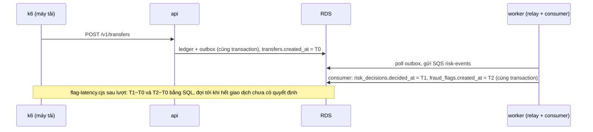

# DBS-174 · Đo thời gian từ giao dịch tới cờ ở 12/60/120 RPS

> **Status:** Implemented (B0 đã đo trên AWS, B2 chưa chạy được: BL-434; G4 qua; Dev review do opus thay người) · **Vai:** #5 Platform & Ops (board ghi `Dev`) · **Cặp đôi review:** opus high thay người · **Nhánh:** `perf/DBS-174-time-to-flag` · **PR:** — · **Cập nhật:** 2026-11-22

## 1. Bối cảnh

- **Task trên board:** Task, tuần 7, Deliverable P4. **Expect:** «Biết độ trễ thực của đường bất đồng bộ.» **Thực trạng:** «Mục tiêu p95 < 5 giây từ giao dịch tới cờ chưa được đo dưới tải.»
- **DoD (chép nguyên văn):**
  1. Đo p50/p95/p99 thời gian từ giao dịch COMPLETED tới khi cờ xuất hiện ở ba mức tải
  2. Theo dõi độ sâu queue và outbox chưa gửi trong lúc tải, kiểm không tồn đọng
  3. Ghi vào báo cáo tải
  4. PR đã merge vào main (CI xanh); Dev review; bảng «Đối chiếu test case» trong PR điền đủ
  5. Đo ở cả B0 (rule_only) và B2 (rules_with_external_ai); ghi fallback, timeout, 429 và độ phủ AI
- **Phụ thuộc:** DBS-166 (Done, #224), DBS-111 (Done, consumer chấm điểm). Cả hai có trong `main`.
- **Đã có gì:** metric `risk_transfer_to_flag_ms` (`risk-scoring.consumer.ts:222`, ghi **chỉ khi có cờ**), alarm `dbs-dev-transfer-to-flag-p95` (DBS-177), gauge tuổi outbox, `cw-export.mjs`, `loadgen-run.sh`, kịch bản k6 (DBS-165). Báo cáo [03 §5 mục 4](../components/load-tests/03-ket-qua-toi-uu-p95-2026-11-21.md) nêu **chưa có điểm dữ liệu `risk_transfer_to_flag_ms`** ở mọi lượt đo trước.
- **Baseline (worktree sạch từ `origin/main` `ddd5dd8c`):** chạy lại lúc bàn giao ở §8.
- **Ngoài phạm vi:** chỉnh poll/lô của relay (DBS-175, PR riêng); sửa cấu trúc thống kê 30 ngày (BL-413, đã quyết GIỮ dòng ở [DBS-173 §2.4](DBS-173-p95-120rps.md)); thu hồi hay nạp khóa OpenAI (BL-403, BL-397: việc của người); chạy B2 khi chưa đủ điều kiện (G1.3).

### Phát hiện khi đọc code và khi review (thay đổi cách đo)

| # | Phát hiện | Bằng chứng | Hệ quả |
|---|---|---|---|
| F1 | Tải tổng hợp **không sinh cờ**: bộ luật v1 `thresholds {medium 40, high 70}`, R1 (> 5 lệnh/10 phút) nặng 30 < 40; R4 không kích hoạt vì luồng chuyển khép vòng A→B→C→A; ba khách cố định | `CreateFraudStorage` `V1_CONFIG`; cột `flag_p95` rỗng ở mọi `cloudwatch.json` đã có | Cần **phiên bản cấu hình thứ hai** (`POST /v1/admin/risk-config/versions`, đủ khóa `mode`, `thresholds`, `rules` R1..R6, `high > medium`) với `medium` 30 để mọi giao dịch sau lệnh thứ 6 trong 10 phút bị gắn cờ MEDIUM. Đây là trường hợp xấu nhất cho worker (thêm INSERT cờ, hit, audit mỗi giao dịch), **không phải tỉ lệ cờ thật**. Cần token role `admin` của client `dbs-loadgen` (token `dbs-app` bị 401 vì `client_id` phải khớp `COGNITO_CLIENT_ID` của phiên). Alarm `dbs-dev-risk-flag-rate` (20/1.000) sẽ kêu: biết trước |
| F2 | Cờ và quyết định ghi **cùng một transaction** (`apply`): `risk_decisions.decided_at` ≤ `fraud_flags.created_at` cùng giao dịch | `risk-scoring.consumer.ts` | Đo **cả hai**: quyết định (mọi giao dịch, kể cả LOW) và cờ (MEDIUM/HIGH) |
| F3 | `occurredAt` của sự kiện là `transfers.created_at`; cờ cùng đồng hồ DB (`clock_timestamp()`) | chú thích ở `apply` | Độ trễ tính bằng SQL, không cần đồng bộ giờ giữa máy |
| F4 | Role `dbs_api` có SELECT trên `transfers`, `risk_decisions`, `fraud_flags` nhưng **không** đọc `outbox_events` | `CreateDbRolesAndGrants` dòng 74, 83; `CreateRiskDecisions` dòng 106 | «Outbox chưa gửi» lấy từ gauge tuổi outbox, `outbox_quarantined_events`, độ sâu/tuổi/đang xử lý của queue risk và DLQ trên CloudWatch, cộng đếm giao dịch **chưa có quyết định** |
| F5 | Secret `dbs/dev/openai-api-key` **chưa tồn tại** (2026-11-22 `list-secrets` ba vùng chỉ có `demo-accounts`, `redis-auth`); `base/ai_secret.tf` chưa apply (BL-409, BL-397). Không được `apply` `base` khi đang có stack | `describe-secret` → `ResourceNotFoundException` | **B2 chưa chạy được**; kiểm lại ngay trước khi dựng stack |
| F6 | Bài `hot-account` có scenario `hot`, không khớp `PLATEAU = /^(?:read|write)_N$/` nên `aggregate.plateaus = {}` | `config.js`, `aggregate-raw.cjs:21` | Công cụ luôn đo thêm cửa sổ `run` (cả lượt, từ yêu cầu đầu tới cuối) để `hot-account`, `duplicate`, `rate-limit` cũng có số |
| F7 | k6 xếp plateau cách nhau `seconds + 10` giây (0, 910, 1820 s): nối liền sẽ trộn 10 s plateau 60 vào 120 và **mất 20 s cuối** của plateau 120 (≈ 2,2%, đoạn dễ tồn đọng nhất) | `config.js` `startTime`; `aggregate-raw.cjs` có `p.first/p.last` nhưng không xuất | `aggregate.json` xuất `startedAt`/`endedAt` của từng plateau, công cụ dùng mốc thật (fallback cũ cộng 10 s) |

### Quyết định ở G1 (agent tự quyết)

1. **Hai chỉ số, một công cụ.** `load-tests/flag-latency.cjs`: cửa sổ theo plateau (mốc thật) và cửa sổ `run`; SQL tính p50/p95/p99/max độ trễ quyết định và độ trễ cờ, theo cửa sổ và theo phút; số giao dịch chưa có quyết định; `mode`/`ai_status`; số nạp tiền trong cửa sổ (để so với `NumberOfMessagesSent`, DBS-175); số dòng lịch sử 30 ngày mỗi tài khoản nguồn với **nhãn ổn định** `nguon-N` (theo id đã sắp, cùng một tài khoản cùng nhãn ở mọi cửa sổ). Phiên DB **chỉ đọc** (`SET SESSION CHARACTERISTICS AS TRANSACTION READ ONLY`) vì `dbs_api` còn quyền ghi.
2. **Phán quyết SLO không bao giờ «đạt» khi còn tồn đọng:** `…P95UnderSlo` là `null` nếu còn giao dịch chưa có quyết định hoặc không có mẫu cờ; `false` khi p95 ≥ 5.000 ms.
3. **B2 không giả số.** Chỉ chạy khi đủ năm điều kiện của TonightWorks §3 mục 4; chưa có secret ⇒ DoD 5 ghi «chưa đạt (B0 đã đo)» kèm BL.
4. **Tiêu chí đạt chốt trước khi đo:** p95 độ trễ tới cờ < 5.000 ms ở từng mức 12, 60, 120; «không tồn đọng» = `backlog: false` (sau tối đa 120 giây không còn giao dịch thiếu quyết định), tuổi queue risk không tăng đơn điệu trong plateau, DLQ không tăng so với mốc đầu phiên (queue và DLQ sống ở `base`, nên đo **delta** so với lần chụp trước lượt đầu), `outbox_quarantined_events` không tăng.
5. **Thứ tự đo (đổi sau review #3, để DB còn mới cho số chính):** smoke → **v2 «gắn cờ mọi giao dịch» + `baseline` 12→60→120 trên DB mới (số chính của DoD 1)** → v3 (đúng giá trị v1) + `hot-account` (có `pgss`) + `redis-fault` không sự cố ở 120 RPS (không cờ) → v4 (như v2) + quét relay của DBS-175. Mọi lượt ghi `relay_idle_delay_ms`/`relay_batch_size` và revision task definition của worker.
6. **Phạm vi khối đo với DB mới:** `hot-account` ở DB mới chỉ đạt vài chục nghìn dòng, dưới ngưỡng bão hòa ≈ 55.000 của BL-413; số «trước» này không đóng BL-413 (nó đã quyết GIỮ dòng), chỉ cập nhật.

## 2. Hành vi

**Lệnh:** `node load-tests/flag-latency.cjs <thư mục kết quả> [--settle 120] [--window nhãn=ISO,ISO]…` (cần `DATABASE_URL`, `DATABASE_SSL`, `DATABASE_SSL_CA_PATH`; `loadgen-run.sh run` gọi sau `aggregate-raw.cjs`). Ghi `flag-latency.json` cạnh kết quả; thoát 0 (xong, không tồn đọng, hoặc lượt rỗng ghi `{"skipped":"no-window"}`), 1 (còn giao dịch chưa có quyết định sau hạn đợi), 2 (không đo được). `exit.json` có `flagLatencyExit`: `null` = công cụ không chạy (thiếu `aggregate.json`), 0, 1, 2.

```json
{ "sloMs": 5000, "settledAfterSeconds": 3.1, "undecidedAfterSettle": 0, "backlog": false,
  "windows": [{ "label": "120rps", "transfers": 21600, "deposits": 0, "decided": 21600, "undecided": 0, "flagged": 21594,
    "decisionLagMs": { "p50": 41.2, "p95": 180.5, "p99": 620.0, "max": 1900.4, "mean": 70.3 },
    "flagLagMs":     { "p50": 43.0, "p95": 183.1, "p99": 625.2, "max": 1903.0, "mean": 72.9 },
    "decisionP95UnderSlo": true, "flagP95UnderSlo": true,
    "modes": [{ "mode": "rule_only", "aiStatus": "DISABLED", "decisions": 21600 }],
    "perMinute": [{ "minute": 0, "transfers": 1440, "decided": 1440, "flagged": 1438, "decisionP95Ms": 90.1, "decisionMaxMs": 800.5, "flagP95Ms": 92.0 }],
    "sourceAccountRows30d": [{ "source": "nguon-1", "rows30d": 9000 }] }] }
```
(số minh họa, không phải kết quả đo.)

| Điều kiện | Kết quả |
|---|---|
| Không có cờ trong cửa sổ | `flagLagMs` toàn `null` (không phải 0), `flagP95UnderSlo: null` |
| p95 đúng 5000 ms | `…UnderSlo: false` (nghiêm: `< 5000`) |
| Còn giao dịch chưa có quyết định sau `--settle` | `backlog: true`, thoát 1, vẫn ghi JSON; `…UnderSlo: null` ở cửa sổ có tồn đọng |
| `baseline`, `stress`, `redis-fault` | một cửa sổ mỗi plateau (mốc thật) cộng `run` |
| `hot-account`, `duplicate`, `rate-limit` | chỉ cửa sổ `run` |
| `aggregate.json` không có mốc thời gian | ghi `skipped`, thoát 0, không mở DB |
| Thiếu `aggregate.json` và `--window` | thoát 2 với thông báo |
| `--window` ngược hay rỗng, cờ lạ | thoát 2 |

Ca biên: REJECTED và DEPOSIT không tính vào `transfers` (nạp tiền đếm riêng); cửa sổ nửa mở `[from, to)`; `undecidedAfterSettle` là cửa sổ tồi nhất (không cộng, vì `run` chứa các plateau).

## 3. Kiến trúc

- **Vị trí:** `load-tests/lib/flag-latency.cjs` (SQL, cửa sổ, vòng đợi), `load-tests/flag-latency.cjs` (CLI), `load-tests/aggregate-raw.cjs` (xuất `startedAt`/`endedAt`), `infra/scripts/loadgen-run.sh` (gọi công cụ; `flagLatencyExit`), `docs/components/load-tests/results/cw-export.mjs` (thêm `worker_cpu_max`, `worker_mem_max`, `risk_q_depth`, `risk_q_notvisible`, `risk_q_age`, `risk_q_sent`, `risk_q_received`, `risk_dlq_depth`, `outbox_quarantined`), `.github/workflows/ci.yml` (chạy `flag-latency.test.mjs`). Không đụng code ứng dụng, không migration, không đổi quyền DB.
- **Dữ liệu:** đọc `transfers(type, status, created_at, from_account_id)`, `risk_decisions(decided_at, mode, ai_status)`, `fraud_flags(created_at)`; không ghi. `transfers` không có index trên `created_at`: mỗi truy vấn quét bảng, chấp nhận ở cỡ 10^5 dòng.
- **Ranh giới transaction:** chỉ SELECT, phiên chỉ đọc.
- **Sơ đồ:**



- **Thay đổi cấp hệ thống:** README `load-tests` (một mục), `infra/terraform/README.md` (bước 5 và dòng `POST /v1/admin/risk-config` ở §Môi trường sửa thành `/versions`), báo cáo [06](../components/load-tests/06-ket-qua-thoi-gian-toi-co-2026-11-22.md).

## 4. Test cases tự động

| ID | Truy vết | Lớp | Given · When · Then |
|---|---|---|---|
| TC-174-01 | DoD 1 | unit (`load-tests/test`) | cửa sổ plateau theo `startedAt/endedAt` thật, thứ tự mức RPS, 10 s giữa hai plateau không thuộc cửa sổ nào, biên nửa mở |
| TC-174-02 | DoD 1 | unit | `aggregate.json` cũ (không có mốc) nối từ `window.start` cộng 10 s; thiếu mốc cho `[]` |
| TC-174-03 | DoD 1 | unit | `--window` nhận `nhãn=from,to`, từ chối ngược/rỗng/sai dạng |
| TC-174-04 | DoD 1, 2 | unit (client giả) | hàng SQL → p50/p95/p99, SLO, `modes`, theo phút, số nạp tiền, nhãn nguồn theo id đã sắp, không lộ id |
| TC-174-05 | DoD 1 | unit | p95 = 5000 không đạt; không có cờ cho `null` |
| TC-174-06 | DoD 2 | unit | đợi worker xử lý hết rồi mới đo |
| TC-174-07 | DoD 2 | unit | hết hạn đợi còn tồn đọng → `backlog: true` và phán quyết `null` |
| TC-174-08 | DoD 1 | unit | `parseArgs` |
| TC-174-09 | DoD 1 | unit | `windowsOf`: plateau + `run`; chỉ `run` cho bài không plateau (`hot-account`) |
| TC-174-10 | DoD 1 | unit (tiến trình thật) | không có mốc thời gian: `skipped`, thoát 0, không mở DB |
| TC-174-11 | DoD 1 | unit (tiến trình thật) | thiếu `aggregate.json` thoát 2 |
| TC-174-12 | DoD 1 | unit | nhãn nguồn ổn định giữa các cửa sổ |
| TC-174-13 | DoD 2 | unit | `undecided` là cửa sổ tồi nhất, không đếm đôi |
| TC-174-14 | DoD 1 | unit (`aggregate-raw`) | mỗi plateau xuất `startedAt`/`endedAt` đúng cửa sổ |
| TC-174-21 | DoD 1, 3 | db (PostgreSQL thật, consumer thật) | một giao dịch gắn cờ và một sạch: đếm đúng, độ trễ cờ bằng `fraud_flags.created_at − transfers.created_at` tính độc lập, độ trễ quyết định ≤ độ trễ cờ |
| TC-174-22 | DoD 2 | db | giao dịch chưa được chấm → `undecided`, `backlog` true; cửa sổ quá khứ rỗng và `null` |
| TC-174-23 | DoD 1 | db | số dòng 30 ngày theo nguồn, nhãn theo id đã sắp, cắt đúng biên cuối, không lộ id |
| TC-174-24 | DoD 1, 2 | db | REJECTED bị loại và không bao giờ «chưa có quyết định»; nạp tiền đếm riêng; biên nửa mở `[from, to)` |
| (quy trình) | DoD 4 | — | PR, CI xanh (test chạy trong `ci.yml`), Dev review (opus), bảng đối chiếu ở PR |
| (đo thật) | DoD 1, 2, 3, 5 | AWS | §5 |

DoD 3 («ghi vào báo cáo tải») được chứng minh bằng báo cáo [06](../components/load-tests/06-ket-qua-thoi-gian-toi-co-2026-11-22.md), `check-doc-links.mjs`, và `docs/features/README.md`. DoD 5 (B2) không có TC tự động: phụ thuộc secret và quyết định của người.

## 5. Test thủ công (đo trên AWS, một phiên, hủy cuối phiên)

Điều kiện: profile `dbs`; image build tay từ nhánh này (Trivy cục bộ sạch, tag ECR xóa khi hủy; image CI chỉ build từ `main`, mà DBS-175 cần biến env mới); cấu hình như báo cáo [04 §1](../components/load-tests/04-ket-qua-bl-418-2026-11-22.md#1-cấu-hình-đo); các bước 1 đến 6 của `infra/terraform/README.md` («Máy chạy tải và đợt đo k6», gồm `db-roles.sh`, `migrate.sh`, `api_extra_environment` nâng `RATE_LIMIT_*` ngay từ lần `apply` đầu để baseline không nhận 429, `desired_count=2` và `worker_desired_count=1`, `run.env`, token ngay trước `prepare`). **Ngân sách:** dựng ≈ 45 phút, đo ≈ 3 giờ, hủy ≈ 10 phút, ≈ 4 giờ 15 phút tổng, ≈ 2 USD ước (0,5 USD/giờ, chưa đối chiếu hóa đơn); trần cứng **5 giờ** của AWS-B ([02 §capacity](../components/platform-infra/02-capacity-cost.md)); token của `dbs-loadgen` sống 240 phút kể từ lúc lấy trước `prepare`, nên **mọi lượt phải bắt đầu trước phút 240 sau token** (fixture không làm mới token; BL-213).

| Bước | Việc làm | Kết quả mong đợi |
|---|---|---|
| M-174-01 | `describe-secret dbs/dev/openai-api-key`; `verify-clean.sh`; chụp độ sâu queue risk, notification và DLQ (mốc đầu phiên) | điều kiện B2 (a) ghi lại; tài khoản sạch; mốc queue |
| M-174-02 | dựng `loadgen` rồi `session`, `db-roles.sh`, `migrate.sh`, `pgss.sh enable` + `reset`, `prepare`, `run baseline --smoke` | `flag-latency.json` của smoke có số đếm (`dbs_api` đọc được ba bảng; phiên chỉ đọc) |
| M-174-03 | lấy token `admin` của `dbs-loadgen`, `POST /v1/admin/risk-config/versions` v2 (cấu hình v1 với `medium: 30`, `high: 70`), `GET /v1/admin/risk-config` đúng v2, đợi > 60 s (TTL cache) | phiên bản mới có hiệu lực; alarm `risk-flag-rate` sẽ kêu (biết trước) |
| M-174-04 | `run baseline` (12 → 60 → 120) trên DB mới | p50/p95/p99 tới cờ và quyết định ở ba mức; `flagged ≈ transfers` |
| M-174-05 | `cw-export.mjs` cho cửa sổ lượt (và đối chiếu p95 SQL với `flag_p95` của CloudWatch) | tuổi/độ sâu/đang xử lý queue risk, DLQ delta, tuổi outbox, quarantined, CPU và bộ nhớ worker từng plateau |
| M-174-06 | v3 = đúng giá trị v1 (không cờ); `run hot-account` với `pgss.sh snapshot` sát đầu và cuối; rồi `run redis-fault` không sự cố (120 RPS, không cờ) | độ trễ quyết định không cờ ở 20/s và 24/s; `flagged = 0`; số dòng 30 ngày của nguồn nóng |
| M-174-07 | v4 như v2, đợi > 60 s: khối quét relay của DBS-175 (xem DBS-175 §5) | bảng S0..S3 |
| M-174-08 | `destroy` `session`, `loadgen`; `verify-clean.sh`; `describe-user-pool-client dbs-app` giống trước; xóa state tạm; xóa tag ECR build tay; xóa token trong bucket | thoát 0, chỉ còn `base` |
| M-174-09 | (biên) B2 | chỉ khi đủ điều kiện (a) đến (e); không thì «chưa chạy (lý do)» |

**Dừng và hủy khi:** bất biến FAIL; stack sống quá 5 giờ; `backlog: true` kéo dài sau lượt (ghi, không bỏ qua). **Thứ tự cắt khi thiếu giờ:** bỏ S3, rồi S0', giữ phần còn lại (số chính của DoD 1 đã ở M-174-04, chạy trước).

## 6. Domain review (AI)

**Reviewer:** subagent, model opus, effort high, 2026-11-22 · **Kết quả:** 15 phát hiện (1 blocking, 6 should-fix, 7 minor, 1 hand-off), verdict REVISE · [trả lời nguyên văn](screenshots/DBS-174/domain-review.md)

| # | Mức | Phát hiện | Xử lý |
|---|---|---|---|
| 1 | blocking | `hot-account` không có plateau nên công cụ bỏ qua | đã sửa: cửa sổ `run` luôn có (F6), TC-174-09 |
| 2 | should-fix | cửa sổ nối liền bỏ khoảng nghỉ 10 s, mất 20 s cuối plateau 120 | đã sửa: `startedAt/endedAt` thật (F7), TC-174-01/02/14; `undecided` đếm cả cửa sổ `run` |
| 3 | should-fix | DB dùng chung làm sai số chính; thứ tự đo | đã sửa: G1.5, §5 (baseline cờ chạy ngay sau smoke trên DB mới) |
| 4 | should-fix | phán quyết «đạt» khi còn tồn đọng | đã sửa: `null` (G1.2), TC-174-07 |
| 5 | should-fix | không ghi cách lấy token admin, thân request | đã sửa: F1, M-174-03 |
| 6 | should-fix | test không chạy trong CI | đã sửa: `ci.yml` |
| 7 | should-fix | DoD 2 hở (không tính đang xử lý, quarantined, DLQ cũ) | đã sửa: `cw-export` thêm `risk_q_notvisible`, `outbox_quarantined`; delta so với mốc M-174-01 (G1.4); đếm `outbox_events` chưa gửi bằng task master: **không làm** (tuổi outbox và `undecided` đủ; ghi ở báo cáo) |
| 8 | minor | trần 5 giờ vs 3,5 giờ, thiếu bước, thiếu ước lượng | đã sửa: §5 (dẫn bước 1–6, ngân sách, 5 giờ lấy từ `02-capacity-cost.md`; 3,5 giờ của README là cho đợt đủ năm bài DBS-166) |
| 9 | minor | `flagLatencyExit` mơ hồ | đã sửa: `null`/`skipped` |
| 10 | minor | alarm `risk-flag-rate` sẽ kêu; đối chiếu `flag_p95` | đã sửa: F1, M-174-05 |
| 11 | minor | thiếu ca REJECTED, biên nửa mở | đã sửa: TC-174-24 |
| 12 | minor | phiên ghi được | đã sửa: `READ ONLY` |
| 13 | minor | nhãn nguồn không ổn định | đã sửa: TC-174-12, TC-174-23 |
| 14 | minor | báo cáo 06 chưa có | sẽ tạo ở Phase 5 trước `check-doc-links` |
| 15 | hand-off | BL-413 cần ≥ 55.000 dòng; sửa đường dẫn README; role chỉ đọc cho công cụ tải | đã sửa đường dẫn README (`/versions`); BL mới cho role chỉ đọc: ở §8 sau khi đo |

**Quyết định ở G2 (agent tự quyết):** (1) không thêm bước đếm `outbox_events` bằng task master: sẽ cần cấp quyền hoặc task thêm, gauge tuổi outbox đã có và `undecided = 0` chứng minh mọi sự kiện đã đi qua relay và consumer; (2) giữ cửa sổ `run` kể cả ở bài có plateau: phục vụ kiểm tồn đọng toàn lượt. Vòng review thứ hai: các phần đã đổi (F6, F7, TC, §5) được kiểm lại ở diff review cuối (G4), không gọi thêm reviewer vì mọi phát hiện đều sửa được bằng test chạy thật.

## 7. Kế hoạch triển khai

| Bước | File | Test viết trước | Lệnh chứng minh | Commit |
|---|---|---|---|---|
| 1 | `load-tests/lib/flag-latency.cjs`, `load-tests/flag-latency.cjs`, `aggregate-raw.cjs` | TC-174-01..14 | `node --test load-tests/test/flag-latency.test.mjs load-tests/test/aggregate-raw.test.mjs` | `feat(load-tests): đo độ trễ giao dịch → quyết định và cờ…` + `fix(load-tests): …` |
| 2 | `backend/test/db/flag-latency.db-spec.ts` | TC-174-21..24 | `env -u DATABASE_URL npx jest --config ./test/jest-db.js --runInBand test/db/flag-latency.db-spec.ts` | cùng commit |
| 3 | `infra/scripts/loadgen-run.sh`, `cw-export.mjs`, `ci.yml` | — | `bash -n`; chạy thật ở M-174-02 | cùng commit |
| 4 | tài liệu, báo cáo 06, README | — | `check-doc-links.mjs`, `check-backlog.mjs` | `docs(load-tests): …` |

Rủi ro và lùi: công cụ chỉ đọc; lỗi ở công cụ không làm đỏ lượt (`flagLatencyExit`). Khối đo AWS có điều kiện dừng ở §5. Ghi chú quy trình: code bước 1 đến 3 viết trước tài liệu (waiver), các TC viết cùng lúc, không thấy đỏ trước khi viết code (ghi ở §8).

**Quyết định ở G3 (agent tự quyết):** plan sweep đã chạy: mọi file nêu ở DoD và ở review có hàng ở §4 hoặc §5; DoD 5 (B2) và đo thật nằm ở §5 và §8.

## 8. Kết quả

- **Lệnh kiểm tra** (chạy lúc bàn giao, nhánh `perf/DBS-175-relay-tuning` chứa cả code của DBS-174; kết quả dán từ output):

```
node --test load-tests/test/*.test.mjs           162 test, 162 qua, 0 lỗi, 0 bỏ qua (23 ở flag-latency + aggregate-raw)
npm run lint:check (backend)                     sạch (eslint, 0 lỗi)
npm run typecheck (backend)                      sạch (tsc --noEmit, 0 lỗi)
npm test (backend, unit)                         143 suite, 2.439 test, 0 lỗi
test:db flag-latency.db-spec.ts (PostgreSQL 17)  1 suite, 4 test, 0 lỗi (PostgreSQL 17, Testcontainers)
check-doc-links.mjs / check-backlog.mjs          0 liên kết hỏng; check-backlog 0 lỗi
```

- **Đối chiếu test case:**

| ID | Test | Đạt? |
|---|---|---|
| TC-174-01..13 | `load-tests/test/flag-latency.test.mjs` › cùng tên (13 test) | đạt |
| TC-174-14 | `load-tests/test/aggregate-raw.test.mjs` › TC-174-14 | đạt |
| TC-174-21 | `backend/test/db/flag-latency.db-spec.ts` › TC-174-21 | đạt (PostgreSQL 17 thật, consumer thật) |
| TC-174-22 | idem › TC-174-22 | đạt |
| TC-174-23 | idem › TC-174-23 | đạt |
| TC-174-24 | idem › TC-174-24 | đạt |
| Quy trình DoD 4 | PR, CI, Dev review | CI: xem PR; **Dev review do opus high thay người (domain review hai vòng, một lượt review diff cuối): DoD «Dev review» chưa đạt về hình thức** |

Test chạy trong CI: bước `node --test` của `load-tests/test/flag-latency.test.mjs` trong `ci.yml` và `test:db`. Không có `.skip`, `.only`, `.todo`. **TC viết cùng lúc với code, không có lượt «đỏ» trước** (waiver); độ sâu được kiểm bằng cách sửa lỗi review rồi chạy lại.

- **Test thủ công** (đo trên AWS, B0; output ở [manual-test.txt](screenshots/DBS-174/manual-test.txt), số chi tiết ở [báo cáo 06](../components/load-tests/06-ket-qua-thoi-gian-toi-co-2026-11-22.md)):

| Bước | Kết quả |
|---|---|
| M-174-01 | **đạt**: secret OpenAI không tồn tại (điều kiện B2 (a) ghi lại); tài khoản sạch; bốn queue 0 tin |
| M-174-02 | **đạt**: dựng, `db-roles.sh`, `migrate.sh`, `pgss.sh enable/reset` (lần đầu chạy thật ở phiên này chỉ để dùng, không lỗi), `prepare`, smoke: công cụ chạy bằng `dbs_api` ở phiên chỉ đọc, đo 6 giao dịch |
| M-174-03 | **đạt**: phiên bản cấu hình v2 bằng API admin (token `dbs-loadgen` lấy bằng `login` của `loadgen-tokens.mjs`; `demo-token.sh` hỏng trên Windows: BL-436), có hiệu lực sau ≈ 60 giây, `risk_transfer_to_flag_ms` có điểm dữ liệu |
| M-174-04 | **đạt**: p95 tới cờ 578 / 828 / 2.009 ms ở 12 / 60 / 120 RPS (< 5.000 ms), 0 lỗi, 0 dropped, invariant PASS, không tồn đọng |
| M-174-05 | **đạt**: tuổi/độ sâu/đang xử lý queue risk, DLQ 0, tuổi outbox lớn nhất 1,73 giây, quarantined 0, gửi = nhận = số POST của k6 = 34.563, CPU worker 16,5 / 46,0 / 89,0% (trung vị); **đối chiếu p95 SQL với `flag_p95` CloudWatch: không khớp** (CloudWatch 4.840 đến 5.150 ms ở 6 trong 15 phút của 120 RPS, SQL ≤ 2.681 ms; metric lượng tử hóa theo bucket: [BL-440](../BACKLOG.md)) |
| M-174-06 | **đạt**: `hot-account` 0 cờ, p95 quyết định 1.691 ms, nguồn 29.526 dòng, truy vấn đặc trưng 30,73 ms; `redis-fault` không cờ 120 RPS p95 2.567 ms |
| M-174-07 | **đạt** (xem DBS-175) |
| M-174-08 | **đạt**: hủy sạch (66 + 14 tài nguyên), `verify-clean.sh` thoát 0, chỉ còn `base`, tag ECR đã xóa, state tạm đã xóa |
| M-174-09 | **chưa chạy (lý do: secret `dbs/dev/openai-api-key` không tồn tại)**: B2; [BL-434](../BACKLOG.md) |

- **Phạm vi so với §7:** `git diff --stat main...HEAD` của nhánh khớp §7: `load-tests/{flag-latency.cjs,lib/flag-latency.cjs,aggregate-raw.cjs}` và test, `backend/test/db/flag-latency.db-spec.ts`, `infra/scripts/loadgen-run.sh`, `docs/components/load-tests/results/cw-export.mjs` và kết quả thô, `.github/workflows/ci.yml`, README và tài liệu. File ngoài §7 ban đầu, mỗi cái có lý do: `aggregate-raw.cjs` + test (review #2, xuất mốc plateau thật), `ci.yml` (review #6), `loadgen-run.sh` (đã có ở §7).
- **Ảnh chụp:** không áp dụng (đo và công cụ dòng lệnh, không có giao diện; không có ảnh console AWS). Bằng chứng: `manual-test.txt` và `results/dbs174-*`.
- **Lệch so với kế hoạch (đã tự duyệt):**
  1. *Quy trình*: code viết trước tài liệu và không có lượt đỏ trước (Techlead waiver, ghi ở commit và PR).
  2. *Thứ tự đo* đổi theo review #3: baseline cờ ở mọi giao dịch ngay sau smoke trên DB mới, rồi `hot-account`, rồi lượt không cờ; ghi ở G1.5.
  3. *Cửa sổ `run`* thêm cho mọi bài (review #1) và `startedAt/endedAt` trong `aggregate.json` (review #2): đổi `aggregate-raw.cjs`, schema thêm hai khóa (không đổi khóa cũ).
  4. *Sự cố điều hành khi chạy khối quét của DBS-175*: hai driver chạy chồng làm hỏng lượt S1 đầu (số bị loại, không đưa vào báo cáo); dừng, đợi queue trống, chạy lại sạch. Không ảnh hưởng số của DBS-174 (`baseline`, `hot-account`, `redis-fault` không cờ chạy trước đó, một driver).
  5. *`hot-account`* chỉ tới 29.526 dòng (dưới ngưỡng 37.800): không đóng BL-413.
  6. Không đo trực tiếp `outbox_events` chưa gửi (quyết định G2, §6).
  7. *CloudWatch xuất lại sau lượt*: metric SQS đến muộn vài phút nên bản xuất ngay sau lượt thiếu các phút cuối (phát hiện ở review diff); mọi `cloudwatch.json` đã xuất lại đủ phút (metric còn sau khi hủy stack).
  8. *Giao dịch đầu tiên của mỗi cửa sổ* bị bỏ sót (mốc cửa sổ là phản hồi k6 đầu tiên): SQL 34.562 so với 34.563 POST; giới hạn đã nêu ở báo cáo 06 §2 và §5, không sửa code vì số đo đã chạy với bản này.
- **Bàn giao:** [BL-434](../BACKLOG.md) (B2, DoD 5), [BL-436](../BACKLOG.md) (`demo-token.sh` trên Windows), [BL-438](../BACKLOG.md) (role chỉ đọc cho công cụ đo); cập nhật [BL-413](../BACKLOG.md), [BL-417](../BACKLOG.md), [BL-419](../BACKLOG.md) (số mới; BL-413 và BL-419 chuyển từ «Trước tải · T4» sang «Hoãn · H4» vì DBS-174 đã chạy, lý do ở báo cáo 06). Cập nhật thêm [BL-440](../BACKLOG.md) (metric lượng tử hóa). Chỉ BL-434 là DoD chưa đạt của task này; BL-435, BL-437, BL-439 thuộc DBS-175.

## 9. Tài liệu đã cập nhật

Báo cáo [06](../components/load-tests/06-ket-qua-thoi-gian-toi-co-2026-11-22.md) (mới); `load-tests/README.md` (mục «Độ trễ giao dịch → quyết định và cờ»); `infra/terraform/README.md` (bước 5, đường dẫn `POST /v1/admin/risk-config/versions`); [observability 01](../components/observability/01-concept-brief.md) (cách đo thứ hai); [P4-production-engineering.md](../deliverables/P4-production-engineering.md) (dòng «thời gian tới cờ» và «việc của người»); `docs/features/README.md`; `docs/BACKLOG.md` (thêm BL-434, BL-436, BL-438, BL-440; cập nhật BL-413, BL-417, BL-419; không xóa dòng nào vì không có dòng nào đóng hẳn: BL-410 và các dòng khác không liên quan).

## Checklist G4

- [x] 18/18 test case đạt đủ độ sâu của task này (TC-174-01..14, 21..24), 0 đơn giản hóa
- [x] Test thủ công chạy trên commit cuối đổi code (SHA ở dòng đầu `manual-test.txt`); M-174-01..08 đạt, M-174-09 chưa chạy (BL-434) và nêu ở PR
- [x] Ảnh chụp: không áp dụng (nêu lý do); `manual-test.txt` đã che token, tên miền và ID tài khoản (quét `grep`: 0 kết quả)
- [x] `git diff --stat` khớp §7, file ngoài kế hoạch có lý do (§8)
- [x] Bốn lệnh kiểm tra chạy lúc bàn giao, có số đếm (§8)
- [x] Mọi doc có fact đổi đã sửa; `check-doc-links.mjs` sạch
- [x] Bàn giao và DoD chưa đạt có dòng BL; `check-backlog.mjs` sạch
