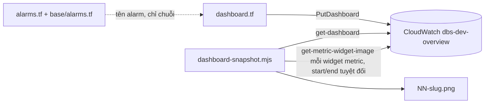
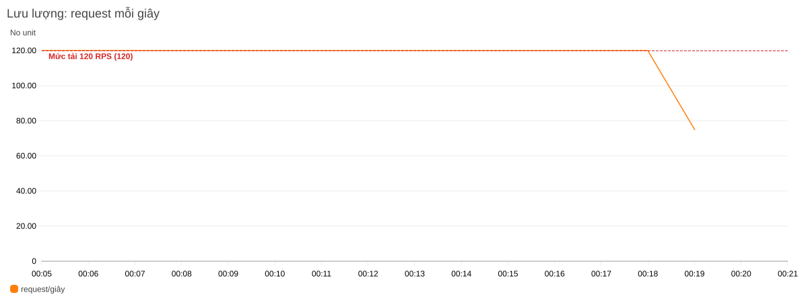
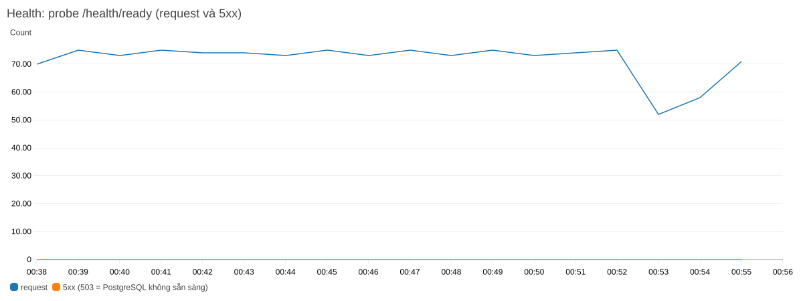
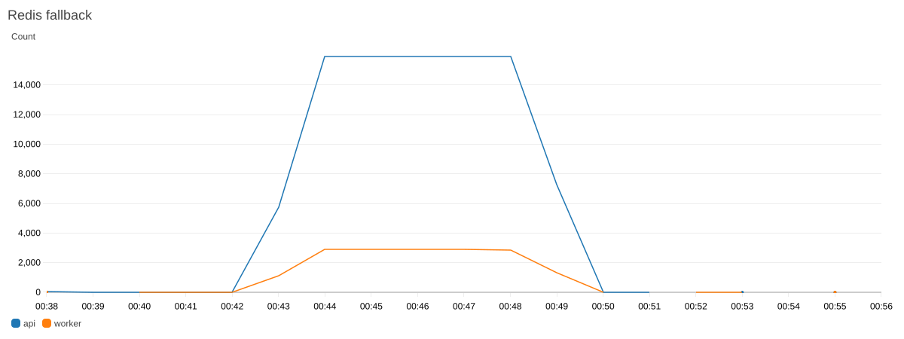
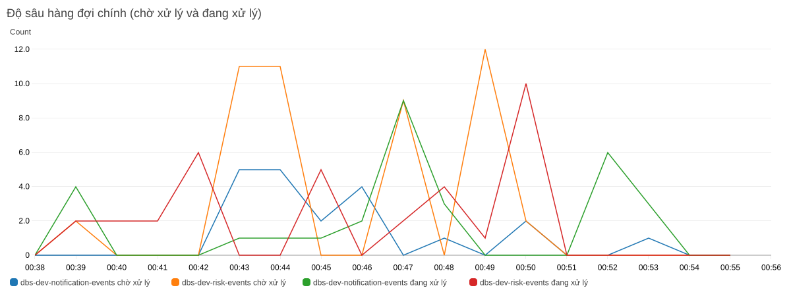
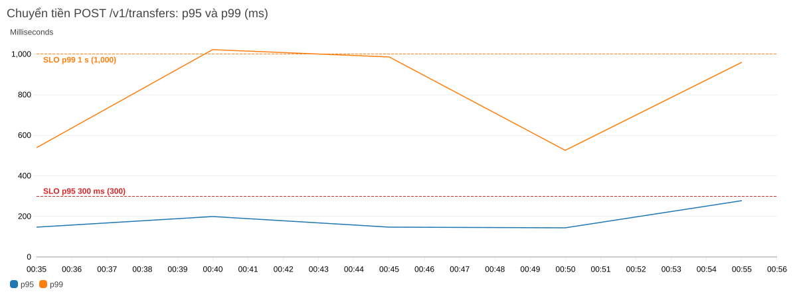

# DBS-178 · Dashboard hoàn chỉnh và ảnh chụp lúc chạy tải

> **Status:** Implemented · **Vai:** #5 Platform & Ops · **Cặp đôi review:** Dev khác (chưa chỉ định) · **Nhánh:** `feat/DBS-178-dashboard-complete` · **PR:** chưa mở (không push theo yêu cầu phiên; mô tả viết sẵn ở [pr-body.md](screenshots/DBS-178/pr-body.md)) · **Cập nhật:** 2026-11-22

## 1. Bối cảnh

- **Task trên board:** Task, Tuần 7, Ưu tiên Medium, Deliverable/Demo P4, Vai `#5 Platform & Ops`, status To Do. **Expect:** «Có bằng chứng quan sát cho P4.» **Thực trạng (board):** «Dashboard bản đầu chưa đủ chỉ số và chưa có ảnh lúc tải.»
- **DoD (chép nguyên văn từ board):**
  1. Dashboard có p95, error rate, độ sâu queue/DLQ, redis_fallback_total, trạng thái health, chỉ số cảnh báo fraud
  2. Ảnh chụp lúc chạy tải 120 RPS lưu docs/components/observability
  3. PR đã merge vào main (CI xanh); Dev review; bảng «Đối chiếu test case» trong PR điền đủ
- **Phụ thuộc:** DBS-177 (alarm SLO) và DBS-166 (chạy tải 12/60/120) Done trên board và có trên `main` (alarm ở `session/alarms.tf`; báo cáo tải ở `docs/components/load-tests`).
- **Phạm vi:** code và test trước khi dựng (Terraform, công cụ chụp, tài liệu: phiên của tôi) rồi hoàn tất sau phiên AWS-A do người điều phối chạy (`terraform apply` thật, ảnh 120 RPS hai lượt Redis bật và tắt, cùng DBS-167). DoD 1 và 2 đạt (ảnh là PNG dựng bằng API, chưa có ảnh console); DoD 3 (PR, Dev review) chưa đạt về hình thức, xem §8.
- **Thực trạng kiểm bằng code (2026-11-22, nhánh từ `origin/main` `76b80bdb`):**
  - `session/dashboard.tf` dựng `dbs-dev-overview` với 21 widget (1 văn bản, 20 metric). Có: p50/p95/p99 toàn dịch vụ, p95/p99 chuyển tiền, p95 đọc, tỉ lệ 5xx, request/5xx/bị ngắt, p95 theo route, tuổi outbox, **chỉ DLQ (độ sâu) và tuổi message**, `redis_fallback_total`, rate limit, fallback Redis cấu hình luật, đối soát, CONFIG_INVALID và lỗi luật, thời gian giao dịch → cờ, cờ/1.000 giao dịch (ô 1 giờ, 24 giờ, xu hướng), cờ theo mức, cờ do AI bổ sung.
  - **Thiếu so với DoD 1:** (a) độ sâu hàng đợi **chính** (`ApproximateNumberOfMessagesVisible` trên hàng chính; mới có DLQ); (b) **trạng thái health**: không có widget nào; (c) chỉ số cảnh báo fraud đã có phần lớn (xem quyết định G1 số 3).
  - Route `/health/ready` **có** được ghi: `http-stats.ts:112-117` gửi `/health/*` chỉ ở bộ dimension `[Route, Method]` (không có bộ tổng, không có `Role`) để probe ALB không làm loãng tỉ lệ 5xx toàn dịch vụ; ALB gọi `/health/ready` mỗi 15 giây (`alb.tf:11-26`). `HealthController.ready()` trả **200** với `redis: "degraded"` khi Redis chết (chỉ PostgreSQL làm `/health/ready` trả 503): Redis chết hiện ở `redis_fallback_total`, **không** ở probe.
  - 22 alarm: 18 ở `session/alarms.tf`, 4 ở `base/alarms.tf` (hai `dlq-not-empty` đã apply; hai `dlq-oldest-age` có trong code nhưng chưa apply ở base, BL-409).
  - Chưa có công cụ chụp lặp lại được: DBS-145 chụp bằng script tạm không nằm trong repo.
- **Baseline (2026-11-22, Node 24.22.2, Terraform 1.16.6, Windows):** `terraform init -backend=false && fmt -check && validate` sạch; `terraform test` ở `envs/dev/session`: **103 passed, 0 failed**. Nhóm test Node của `load-tests/test/` chạy ở bước 4b. Không đổi code ứng dụng nên không chạy bốn lệnh backend (không có Docker trên máy này; lý do ở quyết định 5).
- **Dòng BACKLOG cùng DoD:** **BL-262** (chụp console dashboard, nhóm `Trong tải · L (DBS-178)`) và **BL-404** (xem trên console hai ô `singleValue` cờ/1.000 giao dịch): cả hai cần phiên AWS có ảnh, nên **giữ nguyên** ở PR này; người điều phối xử lý sau khi có ảnh. Không xóa, không sửa.
- **Ngoài phạm vi:** đổi tên dashboard, đổi bộ dimension (hợp đồng với app, `common/metrics`); dựng hay hủy stack AWS và chụp ảnh thật (người điều phối); alarm mới (DBS-177 đã xong; probe `/health/ready` không có alarm riêng ở task này); widget cho `risk_ai_call_duration_ms` (không có SLO hay alarm); dashboard hạ tầng `dbs-dev-infra` (giữ nguyên, ALB `HealthyHostCount` đã ở đó).
- **Câu hỏi mở và quyết định ở G1 (agent tự quyết):**
  1. *Trạng thái health là gì?* Chọn **hai widget bổ sung nhau**: (i) widget `type = "alarm"` liệt kê trạng thái các alarm SLO, dựng ARN từ chuỗi (không tham chiếu `aws_cloudwatch_metric_alarm`, để giữ tính chất `-target` được); (ii) widget probe `/health/ready` (số request và 5xx của `[Route=/health/ready, Method=GET]`). Alarm cho cái nhìn «hệ thống có đang vi phạm SLO», probe cho «DB có sẵn sàng theo ALB». Lý do không dùng `HealthyHostCount`: cần `arn_suffix` của ALB, đã ở `dbs-dev-infra`.
  2. *Alarm `dlq-oldest-age` có đưa vào widget không?* **Không**: chúng chưa được apply ở base (BL-409), ARN của alarm không tồn tại có thể làm widget báo lỗi mà ta chưa kiểm được. Widget gồm 20 alarm: 18 ở session + 2 `dlq-not-empty`. Khi BL-409 apply, thêm hai tên vào danh sách (ghi ở §8). Chống trôi hai lớp: `terraform test` so danh sách với `alarm_name` của 16 alarm đơn + `queue_age` (nêu tên từng resource), và một test Node đọc `session/alarms.tf` và `base/alarms.tf` bằng regex `alarm_name`, báo đỏ khi thêm alarm mới mà dashboard chưa có tên (trừ `dlq-oldest-age`, có ngoại lệ tường minh).
  3. *Chỉ số cảnh báo fraud đã đủ chưa?* Đã có cờ/1.000 giao dịch (1 giờ, 24 giờ, xu hướng theo mode), cờ theo `RiskLevel`, cờ do AI bổ sung, thời gian giao dịch → cờ p95, CONFIG_INVALID và lỗi luật. Thiếu: **khối lượng quyết định chấm điểm theo `AiStatus`** (mẫu số của cờ/1.000 giao dịch và nơi thấy fallback AI mà alarm `dbs-dev-risk-ai-fallback-rate` đang theo dõi; chưa có widget) và hai alarm fraud trong widget trạng thái. Thêm một widget `risk_decision_total` theo `AiStatus`; **không** thêm gì cho `risk_ai_call_duration_ms` (không SLO).
  4. *Bố cục:* thêm tiêu đề từng nhóm (widget `text` cao 1), sắp theo thứ tự DoD: trạng thái, API, hàng đợi, Redis, fraud; ô số và đồ thị cùng chiều cao; widget có đường SLO (chuyển tiền, 5xx) rộng 12 cột. Ghi chú «cách đọc» chuyển xuống cuối trang để hàng đầu hiện ngay trạng thái. Thêm widget **request/giây** với đường 120 để ảnh lúc tải chứng minh mức tải.
  5. *Không chạy bốn lệnh backend:* task không chạm `backend/`; baseline theo loại task «Infrastructure code» là Terraform (`task-kinds.md`). Test của công cụ chụp là Node thuần, chạy được không cần Docker.
  6. *Công cụ chụp ở `infra/scripts/dashboard-snapshot.mjs`, test ở `load-tests/test/dashboard-snapshot.test.mjs`* (cùng thói quen `loadgen-tokens.mjs`/`loadgen-tokens.test.mjs`; test Python của `infra/scripts/tests/` cần Linux). Thêm tệp vào bước `node --test` ở job `unit` của CI.

## 2. Hành vi

### 2.1 Dashboard `dbs-dev-overview` (tên, bộ dimension giữ nguyên)

Cột 24, `start = -PT3H`, `periodOverride = inherit` (giữ). 33 widget: 7 `text`, 1 `alarm`, 25 `metric`. Thứ tự và vị trí (y, x, rộng × cao):

| Nhóm (y) | Widget | Nguồn · đường kẻ | Ghi chú |
|---|---|---|---|
| intro (0) | Tiêu đề ngắn (24×2) | | |
| **1. Trạng thái** (2, tiêu đề; 3) | **Alarm SLO** (0, 14×7) `type = "alarm"`, 20 ARN | trạng thái từng alarm | **mới** (DoD «health») |
| | **Health: probe `/health/ready`** (14, 10×7) | `http_requests_total`, `http_5xx_total` `[Route=/health/ready, Method=GET]`, Sum, 60 s | **mới** |
| **2. API** (10; 11) | Chuyển tiền p95/p99 (0, 12×6) | `[Route,Method]` · 300 ms, 1 s | giữ, rộng 12 |
| | Tỉ lệ 5xx % (12, 12×6) | `100 * FILL(m5, 0) / mr` · 1% | giữ, rộng 12 |
| (17) | **Request / giây** (0, 8×6) | `rq / PERIOD(rq)`, 60 s · 120 | **mới** |
| | Đọc p95 (8, 8×6) | · 150 ms | giữ |
| | Độ trễ toàn dịch vụ p50/p95/p99 (16, 8×6) | `[]` | giữ |
| (23) | Request, 5xx, bị ngắt (0, 8×6); p95 theo Route (8, 16×6) | | giữ; SEARCH loại `/health/*` |
| **3. Hàng đợi** (29; 30) | **Độ sâu hàng đợi chính** (0, 8×6) | `AWS/SQS` `ApproximateNumberOfMessagesVisible` và `...NotVisible`, `QueueName` = hai hàng chính, Maximum, 60 s | **mới** (DoD «độ sâu queue») |
| | Tuổi message cũ nhất (8, 8×6) | · 60 s, 120 s | giữ |
| | Tuổi outbox (16, 8×6) | · 10 s, 30 s | giữ |
| (36) | DLQ: số message (0, 12×6) | · > 0 | giữ, rộng 12 |
| | **Consumer: message retry và dead_letter** (12, 12×6) | SEARCH `{ns,Role,Consumer,Outcome}` `consumer_message_total`, Sum, 60 s | **mới** (báo trước DLQ) |
| **4. Redis, giới hạn, đối soát** (42; 43) | `redis_fallback_total` (0, 8×6); rate limit (8, 8×6); đối soát (16, 8×6) | | giữ |
| **5. Fraud** (49; 50) | Cờ/1.000 giao dịch 1 giờ (0, 6×6), 24 giờ (6, 6×6), xu hướng (12, 12×6) | · 20 | giữ, ô số cao 6 |
| (56) | Cờ theo `risk_level` (0, 8×6); cờ do AI (8, 8×6); **Risk: quyết định theo AiStatus** (16, 8×6) | SEARCH `{ns,Role,AiStatus}` `risk_decision_total`, Sum, 300 s | cuối **mới** |
| (62) | Thời gian giao dịch → cờ p95 (0, 8×6); CONFIG_INVALID và lỗi luật (8, 8×6); fallback Redis của cấu hình luật (16, 8×6) | · 5 s | giữ |
| cuối (68) | **Cách đọc** (24×7) | | chuyển từ đầu trang; thêm ghi chú health |

Quy tắc:
- **Alarm widget** dùng ARN dạng `arn:aws:cloudwatch:<var.region>:<var.account_id>:alarm:<tên>`; 20 tên: 16 alarm đơn của `session/alarms.tf` (`dbs-dev-outbox-age`, `-outbox-quarantined`, `-risk-config-invalid`, `-risk-rule-error`, `-risk-ai-fallback-rate`, `-risk-flag-rate`, `-reconciliation-failed`, `-redis-node-missing`, `-redis-fallback`, `-risk-config-redis-fallback`, `-risk-config-freshness`, `-rate-limited`, `-api-5xx-rate`, `-transfer-latency-p95`, `-read-latency-p95`, `-transfer-to-flag-p95`), hai `<tên hàng chính>-age` và hai `dbs-dev-<khóa>-dlq-not-empty`. Dashboard không tham chiếu tài nguyên session.
- **Probe:** `/health/ready` ghi chỉ ở `[Route, Method]`, nên dòng metric khai đúng bốn phần tử dimension, không `Role`. Không có điểm dữ liệu = chưa có request tới task api (không phải «khỏe»). 5xx trên route này ≈ PostgreSQL không sẵn sàng (503); **Redis chết trả 200 `redis: degraded`** nên chỉ thấy ở `redis_fallback_total`. Lưu ý (reviewer đã kiểm code): `ready()` gọi `redis.ping()` qua `RedisClient.run`, mà `run` tăng `redis_fallback_total` ở mỗi lần lỗi, nên **probe ALB tự nó cũng cộng vào `redis_fallback_total`** khi Redis chết (≈ vài lượt mỗi phút mỗi task, không cần có tải người dùng). Ghi cả hai điều trong «Cách đọc».
- **Request/giây:** `rq` là `http_requests_total` bộ `[]` (tổng, không gồm probe), chia `PERIOD(rq)`.
- **Độ sâu hàng đợi:** hai hàng chính là tên DLQ bỏ hậu tố `-dlq` (như `queue_names` đã có). Không đường SLO (docs/03 §14 không có SLO độ sâu, chỉ tuổi và DLQ).
- Không đổi tên dashboard, tên widget đang có (test và tài liệu dùng tiêu đề), namespace, hay bộ dimension. Mọi dimension mới (`Consumer`, `Outcome`) nằm trong `EMF_DIMENSION_NAMES`.

### 2.2 Công cụ chụp `infra/scripts/dashboard-snapshot.mjs`

```
node infra/scripts/dashboard-snapshot.mjs --start 2026-11-22T10:00:00Z --end 2026-11-22T10:15:00Z --out docs/components/observability/screenshots/120rps-redis-on [--dashboard dbs-dev-overview] [--region ap-southeast-1] [--profile dbs] [--width 1200] [--height 450] [--aws-bin aws] [--aws-arg <đối số thêm, lặp lại được>]
```

`--aws-bin`/`--aws-arg` cho phép trỏ tới `node` kèm một script giả (`--aws-bin node --aws-arg load-tests/test/fixtures/fake-aws-cloudwatch.mjs`): `execFile` không qua shell không chạy được tệp `.mjs`, `.cmd` hay shebang trên Windows (Node 24 từ chối `.cmd` với `EINVAL`), chỉ chạy được `.exe`. Mọi lệnh `aws` thêm `--output json --no-cli-pager`, `execFile` đặt `maxBuffer` 64 MB.

| Điều kiện | Kết quả |
|---|---|
| `--start`, `--end` ISO 8601 **có múi giờ** (`Z` hoặc `±hh:mm`), start < end, `--out` có mặt | tiếp tục; mặc định `--dashboard dbs-dev-overview`, `--region ap-southeast-1`, `--width 1200`, `--height 450` |
| thiếu hoặc sai tham số (không múi giờ, start ≥ end, **khung ngắn hơn 60 giây**, tham số lạ) | in lỗi, **thoát 2**, không gọi `aws` |
| `aws cloudwatch get-dashboard` lỗi hoặc `DashboardBody` không phải JSON | in lỗi, **thoát 1**, không ghi ảnh |
| mỗi widget `metric` | gọi `aws cloudwatch get-metric-widget-image` với `MetricWidget` = `properties` của widget cộng `start`/`end` **tuyệt đối**, `width`, `height`; ghi PNG `NN-<slug>.png` (NN = thứ tự đọc 01.. theo (y, x) trong số widget được vẽ; slug = tiêu đề bỏ dấu, chữ thường, chữ số và `-`) |
| widget `singleValue` | **vẽ thành `timeSeries`** (API không vẽ được ô số): bỏ `setPeriodToTimeRange`, `view = timeSeries`, `period` = `periodFor(300)`, tiêu đề trong ảnh thêm hậu tố « (đồ thị trong khung chụp)» vì ô gốc là tổng cả khoảng; tên tệp vẫn theo tiêu đề gốc |
| widget có `period` lớn hơn khung chụp | **một hàm** `periodFor(p) = min(p, max(60, floor(khung_giây / 60) * 60))` dùng cho cả hai dòng này (khung 270 s → 240; khung 15 phút, period 3600 → 900): API chỉ nhận `period` ≥ 60 và là bội của 60, và một bucket 3600 s trong khung 15 phút chỉ cho một điểm lệch mốc giờ. Khi `period` bị đổi, **mọi** đối số chu kỳ trong `SEARCH('…', '<stat>', N)` cũng được ghi lại thành cùng giá trị (để các chuỗi chia cho nhau cùng cỡ bucket, ví dụ `fr`, `fe` với `d`, `dd` của widget xu hướng), và **mọi** widget có `period` bị đổi (không chỉ `singleValue`) được thêm hậu tố tiêu đề « (period X → Y giây theo khung chụp)» để ảnh không ghi `period 3600` khi vẽ 900 |
| widget có `region` | gọi `aws` bằng chính `region` của widget (API đòi `region` của MetricWidget trùng vùng của lệnh); `--region` chỉ dùng cho `get-dashboard` |
| widget `text` và `alarm` | bỏ qua, in `SKIP` (ảnh của hai loại này chụp từ console, BL-262) |
| ảnh trả về | base64 trong JSON; chấp nhận khi byte đầu là chữ ký PNG `89 50 4E 47`; dòng cảnh báo trên stderr (ví dụ `invalid input`) **không** làm thất bại khi chữ ký hợp lệ, được in kèm |
| một widget lỗi (aws lỗi, không phải PNG) | in `FAIL <tiêu đề>: <lý do>`, **vẫn vẽ các widget còn lại**, cuối cùng **thoát 1** |
| mọi widget vẽ được | **thoát 0**; in tóm tắt `N ảnh, M bỏ qua, K lỗi` |

Không có thư viện ngoài; gọi `aws` bằng `execFile` (không qua shell), thân `MetricWidget` đi qua tệp tạm `file://` (tránh giới hạn độ dài và dấu nháy ở Windows), tệp tạm xóa sau khi gọi. Mọi chữ tool in ra (kể cả stderr của `aws`) qua bước che: `arn:aws...` → `<arn>`, dãy 12 chữ số → `<acct>` (lỗi `AccessDenied` của AWS CLI chứa ARN người dùng và ID tài khoản). Ghi đè ảnh cùng tên (chạy lại được). Tệp MetricWidget **thuần ASCII** (ký tự ngoài ASCII viết `\uXXXX`): AWS CLI v2 đọc `file://` bằng bảng mã của máy (cp1252 trên Windows) và từ chối tiêu đề tiếng Việt viết UTF-8 («Unable to load paramfile»; phát hiện khi thử thật ở M-178-03, không có trong thiết kế ban đầu: xem §8 «Lệch so với kế hoạch»). Quyền IAM tối thiểu: `cloudwatch:GetDashboard` và `cloudwatch:GetMetricWidgetImage`. Chụp xong chờ ≈ 5 phút sau plateau rồi mới chạy (EMF và SQS có độ trễ nhập số).

## 3. Kiến trúc

- **Vị trí:** `infra/terraform/envs/dev/session/dashboard.tf` (role không áp dụng, tài nguyên session), `session/tests/dashboard.tftest.hcl`, `infra/scripts/dashboard-snapshot.mjs`, `load-tests/test/dashboard-snapshot.test.mjs`, `.github/workflows/ci.yml` (một dòng `node --test`).
- **Interface:** `aws_cloudwatch_dashboard.overview` (tên không đổi; output `dashboard_name`, `dashboard_url` không đổi; không người gọi nào đổi). Dashboard chỉ đọc `local.base.sqs_dlq_names`, `var.metrics_namespace`, `var.region`, `var.account_id` (`var.account_id` mới, đã là biến bắt buộc của module). Công cụ chụp xuất `parseArgs`, `slugify`, `widgetImageProperties`, `snapshotDashboard`, `main` (nhận hàm `run` để test thay `aws`).
- **Dữ liệu:** không chạm bảng, không migration, không sửa app. Metric mới chỉ đọc: `http_requests_total`/`http_5xx_total` bộ `[Route, Method]` của `/health/ready` (đã phát), `consumer_message_total` `[Role, Consumer, Outcome]`, `risk_decision_total` `[Role, AiStatus]`, `AWS/SQS` `ApproximateNumberOfMessagesVisible/NotVisible`. Đối chiếu `backend/src/common/metrics/metrics.service.ts` (`counterDimensionSets`) và `http-stats.ts` (`toEmfSpecs`).
- **Ranh giới transaction:** không áp dụng.
- **Sơ đồ:**



- **Chi phí:** dashboard không tính theo widget; vượt 50 metric mỗi dashboard thì không còn trong 3 dashboard miễn phí (≈ 3 USD/tháng tính theo giờ tồn tại, đã ghi ở README); `get-metric-widget-image` ≈ 0,02 USD/1.000 metric (số của DBS-145). Hủy cùng phiên (`destroy` của session).
- **Cách lùi:** `git revert`; dashboard dựng lại bản cũ ở lần `apply` kế tiếp (PutDashboard ghi đè); công cụ chụp là tệp mới, bỏ được.
- **Thay đổi cấp hệ thống:** không có ADR hay docs/03 đổi; cập nhật `01-concept-brief.md` (mục Dashboard), `infra/terraform/README.md`, `docs/features/README.md`.

## 4. Test cases tự động

Terraform: `infra/terraform/envs/dev/session/tests/dashboard.tftest.hcl` (mock provider, không AWS). Node: `load-tests/test/dashboard-snapshot.test.mjs` (`node --test`, `aws` giả).

| ID | Truy vết | Lớp | Given · When · Then | Lỗi mong đợi |
|---|---|---|---|---|
| TC-178-01 | DoD 1 | terraform test | `plan` mặc định → 33 widget (7 text, 1 alarm, 25 metric); mọi widget trong lưới 24 cột; **không hai widget chồng nhau**; metric widget ghim region | — |
| TC-178-02 | DoD 1 (health) | terraform test | widget `alarm`: 20 ARN theo mẫu `arn:aws:cloudwatch:ap-southeast-1:123456789012:alarm:<tên>`; tập tên **bằng** tập `alarm_name` của 16 alarm đơn session + `queue_age` + `dlq-not-empty` của base; đổi `account_id`, `region` thì ARN đổi; không có `dlq-oldest-age` | — |
| TC-178-03 | DoD 1 (health) | terraform test | widget probe: `http_requests_total` và `http_5xx_total`, `Route=/health/ready`, `Method=GET`, **đúng hai dimension** (không `Role`), Sum 60 s | — |
| TC-178-04 | DoD 1 (độ sâu queue) | terraform test | widget độ sâu: `AWS/SQS` `Visible` và `NotVisible` cho **cả hai hàng chính** và không tên nào có hậu tố `-dlq`; DLQ widget vẫn tên DLQ | — |
| TC-178-05 | DoD 1 (error rate, p95) | terraform test | có widget request/giây (`rq / PERIOD(rq)`, đường 120, 60 s); widget 5xx % và chuyển tiền giữ đường 1% và 300/1000 ms, rộng 12 | — |
| TC-178-06 | DoD 1 (fraud) | terraform test | widget `risk_decision_total` theo `AiStatus` (SEARCH `{ns,Role,AiStatus}`), widget consumer (`{ns,Role,Consumer,Outcome}`); cờ/1.000 giao dịch (5 widget DBS-187) vẫn có | — |
| TC-178-07 | DoD 1 | terraform test | bảng phủ DoD: p95 (`stat=p95`), 5xx %, `ApproximateNumberOfMessagesVisible` hàng chính **và** DLQ, `redis_fallback_total`, widget `alarm` + probe, `risk_flag_total`, `risk_decision_total` đều có trong body | — |
| TC-178-08 | bố cục | terraform test | đúng 5 tiêu đề nhóm (text bắt đầu `### `, cao 1) theo thứ tự y tăng; mỗi tiêu đề ngay trên một hàng widget không phải tiêu đề; «Cách đọc» ở dưới cùng và nhắc `/health/ready`, `degraded`, `redis_fallback_total` | — |
| TC-178-09 | hợp đồng | terraform test | allowlist dimension (thêm `Consumer`, `Outcome`) và `SEARCH` chỉ dùng tên cho phép; không dữ liệu cá nhân; namespace đổi được; `overview` không có `AWS/ECS`, `AWS/RDS`, `AWS/ApplicationELB`, `AWS/ElastiCache`; tên dashboard và output không đổi | — |
| TC-178-10 | tái phát | terraform test | **toàn bộ 103 test cũ** vẫn xanh; ba run cũ được sửa có chủ đích: `dashboard_shape` (21 → 33 widget, 20 → 25 metric, 1 → 7 text, thêm 1 alarm), `dashboard_has_every_metric` (thêm `consumer_message_total`) và `dashboard_labels_are_safe` (allowlist dimension và regex `SEARCH` thêm `Consumer`, `Outcome`) | — |
| TC-178-11 | DoD 2 (công cụ) | unit (node) | `parseArgs`: thiếu `--start`/`--end`/`--out`, thời điểm không múi giờ, `start >= end`, tham số lạ, giá trị không có → lỗi; hợp lệ → mặc định (`dbs-dev-overview`, `ap-southeast-1`, 1200×450) | thoát 2 |
| TC-178-12 | DoD 2 | unit | `slugify`: bỏ dấu tiếng Việt, `đ` → `d`, ký tự lạ → `-`, không `--`, không `-` đầu/cuối, tối đa 60; tên tệp khớp `^\d{2}-[a-z0-9]+(-[a-z0-9]+)*\.png$` cho mọi tiêu đề thật trong `dashboard.tf` | — |
| TC-178-13 | DoD 2 | unit | `widgetImageProperties`: `singleValue` → `timeSeries`, không `setPeriodToTimeRange`, `period` 300, tiêu đề có hậu tố; `start`/`end` tuyệt đối thay thế `-PT1H`/`P0D`; `periodFor`: 3600 và 900 trong khung 15 phút → 900, khung 270 s → 240, khung 90 s → 60, period nhỏ hơn khung giữ nguyên; widget xu hướng (bản mẫu chép đúng từ `dashboard.tf` vào test) trong khung 15 phút **không còn `3600` nào** trong `period` hay trong mọi `SEARCH(…, N)`, và tiêu đề có hậu tố; giữ `metrics`, `annotations`, `yAxis`; không đổi widget gốc | — |
| TC-178-14 | DoD 2 | unit | `snapshotDashboard` với `aws` giả: dashboard có text, alarm, 3 metric widget (một `singleValue`) → một lần `get-dashboard`, ba lần `get-metric-widget-image`, ba PNG đúng tên và nội dung, text/alarm `SKIP`; tệp `MetricWidget` đọc được lúc gọi mang `start`/`end` tuyệt đối; tệp tạm bị xóa | thoát 0 |
| TC-178-14b | DoD 2 | unit | tệp `MetricWidget` ghi cho `aws` **không có byte ngoài ASCII** mà `JSON.parse` vẫn ra đúng tiêu đề tiếng Việt (tái hiện lỗi cp1252 ở M-178-03) | — |
| TC-178-15 | DoD 2 | unit | một widget `aws` lỗi, một widget trả byte không phải PNG → hai `FAIL`, các widget khác vẫn ghi ảnh, **thoát 1** | thoát 1 |
| TC-178-16 | DoD 2 | unit | stderr `invalid input` kèm PNG hợp lệ → thành công, cảnh báo được in; stderr cùng chữ nhưng ảnh không phải PNG → thất bại | — |
| TC-178-17 | DoD 2 | unit | `get-dashboard` lỗi, hoặc `DashboardBody` không phải JSON, hoặc không có widget → thoát 1, không ghi ảnh; thân JSON không nằm trong argv (dùng `file://`); `--region`, `--profile`, `--output json`, `--no-cli-pager` có mặt; lệnh gọi widget dùng `region` của widget | thoát 1 |
| TC-178-20 | DoD 1 (health), chống trôi | unit (node) | hàm thuần `alarmContract({ sessionAlarms, baseAlarms, dashboard })` nhận **nội dung** ba tệp. Quy tắc: lấy mọi `alarm_name = "…"` của `session/alarms.tf` và `base/alarms.tf`; tên **không có** `${…}` phải xuất hiện nguyên văn như một chuỗi trong `dashboard.tf` (16 alarm đơn là literal ở local `dash_alarm_names`); tên có `${…}` chuẩn hóa (`${…}` → `*`) phải thuộc tập đã biết {`*-age` ↔ biểu thức `"${n}-age"` trên `local.queue_names`, `dbs-dev-*-dlq-not-empty` ↔ `"dbs-dev-${k}-dlq-not-empty"` trên khóa của `sqs_dlq_names`} hoặc ngoại lệ tường minh `dbs-dev-*-dlq-oldest-age`; mẫu lạ là lỗi. Ca đột biến: thêm `alarm_name = "dbs-dev-moi"` vào chuỗi alarms.tf giả → đỏ; mẫu `${…}` lạ → đỏ; bỏ một literal khỏi dashboard giả → đỏ. Chạy trên tệp thật: xanh | — |
| TC-178-21 | bảo mật | unit | stderr của `aws` có ARN và ID 12 chữ số (`AccessDenied`) → dòng `FAIL` in ra không còn ARN hay ID (`<arn>`, `<acct>`), kể cả cảnh báo kèm PNG hợp lệ | thoát 1 |
| TC-178-22 | DoD 2 | node, tiến trình thật | chạy `process.execPath` với `dashboard-snapshot.mjs` và `--aws-bin process.execPath --aws-arg <fake-aws-cloudwatch.mjs>` (đường `execFile` thật, không qua `run` giả; **mọi đường dẫn dựng từ `import.meta.url`**, vì CI chạy test từ `backend/` và bản `node` trên PATH có thể khác bản chạy test): ghi PNG, thoát 0; tham số sai thoát 2 | thoát 0 / 2 |
| TC-178-18 | quy trình | — | PR merge, CI xanh, Dev review, bảng «Đối chiếu test case» trong PR (DoD 3): **quy trình**, chưa làm ở phiên này | — |
| TC-178-19 | DoD 2 | thủ công (AWS) | ảnh lúc chạy tải 120 RPS lưu ở `docs/components/observability/screenshots/`: M-178-07, M-178-08 (phiên AWS-A) | — |

## 5. Test thủ công

Điều kiện chạy: Git Bash, Node 24 (`export PATH="$APPDATA/fnm/node-versions/v24.22.2/installation:$PATH"`), Terraform 1.16, profile AWS `dbs` (chỉ khi một bước nói rõ). `aws.exe` cần đường dẫn dạng `C:/...`/`F:/...`. Phần A chạy ngay trong phiên này; phần B do người điều phối chạy ở phiên AWS-A (stack 120 RPS của DBS-167: lượt «Redis bật» rồi lượt «Redis tắt»; dashboard đã có sau `terraform apply` đầy đủ của `session`, không cần `-target`).

**A. Trước khi dựng (chạy ở phiên này)**

| Bước | Việc làm | Kết quả mong đợi |
|---|---|---|
| M-178-01 | Từ `infra/terraform/envs/dev/session`: `terraform init -backend=false && terraform fmt -check && terraform validate && terraform test` | không lỗi; số test = 103 + test mới, 0 failed |
| M-178-02 | `grep -nE "aws_[a-z_]+\.[a-z_]+" dashboard.tf` và `grep -no "local\.[a-z_]*" dashboard.tf \| sort -u` | tài nguyên: không dòng nào khớp `aws_<loại>.<tên>` (khai báo `resource "aws_cloudwatch_dashboard" "overview"` dùng cú pháp khác, nên không có tham chiếu tới tài nguyên nào); `local.` chỉ là local của chính `dashboard.tf` (`dash_*`, `w_*`, `dlq_names`, `queue_names`, `dashboard_body`) và `local.base`, không dùng `redis_node_id` hay local của `alarms.tf` (`-target` vẫn đúng) |
| M-178-03 | Lấy body do Terraform dựng, **không cần AWS**: tạo tệp tạm `tests/zz_dump.tftest.hcl` (không commit) gồm 103 dòng đầu của `dashboard.tftest.hcl` và một `run` có `assert { condition = aws_cloudwatch_dashboard.overview.dashboard_body == "" ... error_message = "BODY=${aws_cloudwatch_dashboard.overview.dashboard_body}" }` (`condition = false` bị từ chối: điều kiện phải tham chiếu một đối tượng), chạy `terraform test -json -filter='tests\zz_dump.tftest.hcl'` (**dấu `\`**: `tests/zz...` in «Found 0 files» và vẫn thoát 0), rút `dashboard_body` từ `diagnostic.detail` bắt đầu bằng `BODY=` vào `$TMP/body.json` (ngoài repo; chứa ID giả `123456789012`), xóa tệp tạm. Đầu ra phải có «Found 1 file and 1 run block». Với từng widget metric **mới** gọi `aws cloudwatch get-metric-widget-image --profile dbs --region ap-southeast-1 --output json` (chỉ đọc) | mỗi lệnh trả PNG hợp lệ (chữ ký `89504E47`); mở từng PNG xem có chữ báo lỗi trong ảnh không. Không dữ liệu thì ảnh trống: chỉ chứng minh JSON widget được CloudWatch chấp nhận (cú pháp `SEARCH`, `PERIOD`, dimension) |
| M-178-04 | Chạy công cụ chụp qua tiến trình thật với `aws` giả (giữ `export PATH` Node 24 ở trên: `node` mặc định của máy là 18; đặt `NODE=$(node -p "process.execPath.split(String.fromCharCode(92)).join('/')")`, vì `$(which node)` cho đường dẫn dạng `/c/...` mà Node trên Windows hiểu thành đường dẫn tương đối): `node infra/scripts/dashboard-snapshot.mjs --aws-bin "$NODE" --aws-arg load-tests/test/fixtures/fake-aws-cloudwatch.mjs ...` (fake đọc body từ biến `FAKE_DASHBOARD_BODY_FILE` = `$TMP/body.json`, trả PNG nhỏ) | 25 ảnh `01-…png`..`25-…png`, 8 widget `SKIP` (7 text + 1 alarm), thoát 0; tên tệp không dấu; thân `$TMP/body.json` không bao giờ nằm trong repo |
| M-178-05 | Biên và lỗi: `--end` trước `--start` (thoát 2, không gọi aws); `--dashboard dbs-dev-khong-co --profile dbs --region ap-southeast-1` với `aws` thật (chỉ đọc, `ResourceNotFound`); cùng lệnh với profile không có quyền (nếu có) hoặc `AWS_PROFILE` sai | thoát 2; thoát 1 kèm thông báo đã che ARN/ID tài khoản, không tệp ảnh nào |

**B. Phiên AWS-A (người điều phối; điền kết quả sau phiên, không điền trước)**

| Bước | Việc làm | Kết quả mong đợi |
|---|---|---|
| M-178-06 | Sau `apply` session (mọi lệnh `aws` kèm `--profile dbs --region ap-southeast-1`): `aws cloudwatch get-dashboard --dashboard-name dbs-dev-overview` rồi `put-dashboard` cùng body lên tên tạm `dbs-dev-dbs178-validate`, đọc `DashboardValidationMessages`, `delete-dashboards` tên tạm | 33 widget; thông báo hợp lệ rỗng; tên tạm đã xóa. Ghi cách widget `alarm` xử lý nếu thiếu alarm (alarm `dlq-oldest-age` không có trong danh sách) |
| M-178-07 | Lượt **Redis bật**, 120 RPS (plateau do DBS-167 chọn): `node infra/scripts/dashboard-snapshot.mjs --profile dbs --start <đầu plateau Z> --end <cuối plateau Z> --out docs/components/observability/screenshots/120rps-redis-on` (chạy **≈ 5 phút sau** cuối plateau, chờ EMF và SQS nhập số) | thoát 0, 25 ảnh; «Request / giây» ≈ 120 (đường 120); p95 chuyển tiền, 5xx %, độ sâu hàng chính và DLQ (0), tuổi message, tuổi outbox, probe (request đều, 5xx 0), cờ/1.000 giao dịch, `risk_decision_total` đều có dữ liệu; `redis_fallback_total` **≈ 0, không kéo dài** (ngưỡng lệnh Redis 50 ms có thể chạm dưới tải): ghi giá trị thật, không giả định đúng 0 |
| M-178-08 | Lượt **Redis tắt** (DBS-167): cùng lệnh, `--out .../120rps-redis-off` | `redis_fallback_total` > 0 (api, worker; phần của api gồm cả lượt `ping` của chính probe `/health/ready`); probe `/health/ready` vẫn **200** (5xx 0) trong lúc Redis chết; nếu alarm `dbs-dev-redis-fallback` chuyển ALARM thì ghi trạng thái |
| M-178-09 | Chụp console cho widget `alarm`, hai ô `singleValue` cờ/1.000 giao dịch và bố cục tổng (trình duyệt) vào cùng thư mục | ảnh có đủ tiêu đề nhóm, đường SLO, trạng thái alarm; dùng để đóng BL-262 và BL-404 (người điều phối quyết) |
| M-178-10 | Không lộ dữ liệu: quét tên tệp ảnh và **cả `manual-test.txt`** (không ID tài khoản 12 chữ số, ARN, tên miền ALB, token); ảnh console (M-178-09) cắt hoặc che thanh trên có tên/ID tài khoản trước khi commit; `destroy` session theo `TonightWorks.md` §4 | sạch; `verify-clean.sh` thoát 0 |

## 6. Domain review (AI)

**Reviewer:** subagent mới mỗi vòng, read-only, model opus (effort high), 2026-11-22 · **2 vòng**: vòng 1 = 12 phát hiện (0 blocking, 5 should-fix, 7 minor), vòng 2 = 5 phát hiện (0 blocking, 2 should-fix, 3 minor) và xác nhận 12/12 phát hiện vòng 1 đã sửa · Verdict cả hai vòng **REVISE** vì còn should-fix; không có phát hiện blocking nào; theo giới hạn hai vòng, các mục vòng 2 được sửa trong doc, không chạy vòng 3 (ghi ở quyết định G2) · [trả lời nguyên văn hai vòng](screenshots/DBS-178/domain-review.md)

| # | Mức | Phát hiện (tóm tắt) | Xử lý |
|---|---|---|---|
| V1-1 | should-fix | `--aws-bin` không chạy được script `.mjs` bằng `execFile` trên Windows | đã sửa §2.2: thêm `--aws-arg`, M-178-04 và TC-178-22 dùng nó |
| V1-2 | should-fix | stderr `aws` (AccessDenied) lộ ARN và ID tài khoản vào `manual-test.txt` | đã sửa §2.2 che `<arn>`/`<acct>`; TC-178-21; M-178-10 quét `manual-test.txt` |
| V1-3 | should-fix | `period` lớn hơn khung chụp, ô số mất nghĩa | đã sửa §2.2: `periodFor`, TC-178-13, M-178-07 chờ 5 phút |
| V1-4 | should-fix | Test chống trôi tên alarm không thể liệt kê mọi resource | đã sửa: TC-178-02 liệt kê tường minh + TC-178-20 (node) |
| V1-5 | should-fix | M-178-03 thiếu lệnh lấy body dashboard | đã sửa M-178-03 (kỹ thuật `terraform test -json`, đã được reviewer chạy thử) |
| V1-6..11 | minor | TC-178-10 thiếu run phải sửa; `--output json --no-cli-pager`, region của widget; probe cộng vào `redis_fallback_total`; thiếu `--profile`/`--region`; giá 0,02; grep `local.` | đã sửa §2, §3, §4, §5 |
| V1-12 | minor (bàn giao) | thêm `dlq-oldest-age` khi BL-409 apply; đóng BL-262/BL-404 và che thanh console | chuyển sang §8 Bàn giao |
| V2-1 | should-fix | Ghi lại `period` trong `SEARCH(…, N)` và hậu tố tiêu đề cho mọi widget đổi period | đã sửa §2.2, TC-178-13 |
| V2-2 | should-fix | Quy tắc so khớp tên alarm chưa rõ | đã sửa TC-178-20 (hàm thuần, mẫu chuẩn hóa, ca đột biến) |
| V2-3..5 | minor | cạm bẫy `condition = false` và `-filter`; `periodFor` một hàm và khung ≥ 60 s; đường dẫn tuyệt đối trong test, `process.execPath` | đã sửa §2.2, §4, §5 |

**Quyết định ở G2 (agent tự quyết):** (1) Dừng ở hai vòng như yêu cầu, vì mọi phát hiện vòng 2 đều là should-fix/minor đã sửa bằng chữ trong doc và được kiểm lại khi viết test; không có blocking. (2) Giữ `period = 300` cho ô số vẽ thành đồ thị thay vì cả khung: ô gốc («tổng cả khoảng») không có ảnh API tương đương, đồ thị theo khung kèm hậu tố tiêu đề là bản gần nhất trung thực; BL-404 (xem console) vẫn là nơi kiểm ô số thật. (3) Alarm widget có 20 tên, không `dlq-oldest-age`.

## 7. Kế hoạch triển khai

| Bước | File | Test viết trước | Kết quả đỏ | Lệnh chứng minh | Commit |
|---|---|---|---|---|---|
| 1 | `docs/features/DBS-178-dashboard-complete.md` (§1–§5, §7), `docs/features/screenshots/DBS-178/domain-review.md` | không áp dụng | | `check-doc-links.mjs` (504 tệp, 0 hỏng) | `96c41007` `docs(observability): thiết kế dashboard hoàn chỉnh và công cụ chụp (DBS-178)` |
| 2 | `session/tests/dashboard.tftest.hcl` | TC-178-01..09 (cập nhật `dashboard_shape` 21 → 33) | `13 passed, 4 failed, 7 skipped`: `dashboard_shape`, `dashboard_has_every_metric`, `dashboard_labels_are_safe` đỏ vì chưa có widget mới/allowlist, `dashboard_alarm_status_widget` đỏ (`Invalid index`: chưa có widget `alarm`), bảy run sau bị bỏ qua | `terraform test` | cùng commit bước 3 (không commit trạng thái đỏ để CI mỗi commit vẫn xanh) |
| 3 | `session/dashboard.tf`, `session/tests/dashboard.tftest.hcl` | các test bước 2 | | `terraform fmt -check && validate && test` → `111 passed, 0 failed` (103 cũ + 8 run mới) | `5c87380a` `feat(infra): dashboard đủ trạng thái health, độ sâu hàng đợi và chỉ số fraud (DBS-178)` |
| 4 | `load-tests/test/dashboard-snapshot.test.mjs`, `load-tests/test/fixtures/fake-aws-cloudwatch.mjs` | TC-178-11..17, 20..22 | `ERR_MODULE_NOT_FOUND ... infra/scripts/dashboard-snapshot.mjs` (module chưa có) | `node --test load-tests/test/dashboard-snapshot.test.mjs` | cùng commit bước 5 |
| 5 | `infra/scripts/dashboard-snapshot.mjs`, `.github/workflows/ci.yml` | các test bước 4 | | `node --test ...` → 22 pass, 0 fail; chạy từ `backend/` như CI | `5ccabd72` `feat(infra): công cụ chụp ảnh dashboard CloudWatch lặp lại được (DBS-178)` |
| 5b (phát sinh) | `infra/scripts/dashboard-snapshot.mjs`, test | TC-178-14b | `AssertionError: tệp MetricWidget có byte ngoài ASCII` (lỗi thật gặp ở M-178-03: 11/25 widget `Unable to load paramfile`) | `node --test ...` → 23 pass; M-178-03 lại: 25/25 | `dc44e19b` `fix(infra): tệp MetricWidget của công cụ chụp thuần ASCII ... (DBS-178)` |
| 6 | M-178-01..05 chạy thật (SHA `dc44e19b`); `docs/components/observability/01-concept-brief.md`, `infra/terraform/README.md`, `docs/features/README.md`; `docs/features/screenshots/DBS-178/manual-test.txt` | không áp dụng | | `check-doc-links.mjs`, `check-backlog.mjs` (nếu đổi BACKLOG: không đổi) | `docs(observability): cập nhật dashboard và cách chụp (DBS-178)` |

Rủi ro và cách lùi: (a) widget `alarm` có thể hiện lỗi nếu một ARN không tồn tại: chỉ đưa vào alarm chắc chắn có, kiểm ở M-178-06; (b) `PERIOD()` hay `SEARCH` sai cú pháp: M-178-03 gọi CloudWatch thật; (c) body dashboard lớn hơn: giới hạn của `PutDashboard` là 1 MB, body hiện ≈ 25 KB; (d) hai phiên cùng dựng dùng chung tên dashboard (đã biết, README). Lùi: `git revert`, `apply` lại. Không có migration, không đổi app.

**Quyết định ở G3 (agent tự quyết):** (1) Plan sweep: mọi dòng DoD 1 có TC (01–09, 20), DoD 2 có công cụ (TC-178-11..17, 21, 22) nhưng **ảnh thật chờ AWS** (TC-178-19, M-178-07..09), DoD 3 là quy trình (TC-178-18); không còn mục nào trong giới hạn của doc quan sát bị bỏ sót (probe `/health/ready` và Redis `degraded` đã ghi; `dlq-oldest-age` có ngoại lệ tường minh). (2) Thứ tự: test Terraform đỏ trước khi sửa `dashboard.tf`; test Node đỏ (module chưa có) trước khi viết công cụ. (3) Không thêm BL mới trước khi có kết quả: BL-262 và BL-404 đã phủ phần chưa chụp; các bàn giao mới (thêm `dlq-oldest-age`) ghi vào BL-409 hiện có nếu cần, quyết ở §8.

## 8. Kết quả

**Tóm tắt trung thực:** DoD 1 đạt (dashboard 33 widget đã `apply` thật và hiển thị đủ chỉ số); DoD 2 đạt **ở dạng ảnh PNG dựng bằng API** ở 120 RPS, hai lượt (Redis bật và tắt), lưu ở `docs/components/observability/screenshots/` (**chưa có ảnh console AWS** của widget `alarm`, hai ô `singleValue` và bố cục: BL-262, BL-404 giữ); DoD 3 **chưa đạt về hình thức**: PR chưa mở (không `git push`, không `gh`), Dev review không có (techlead waiver, thay bằng domain review AI hai vòng).

- **Lệnh kiểm tra** (chạy lại lúc bàn giao ở `c6651e68`; mã cuối đổi code là `dc44e19b`; output thô ở phần C của [manual-test.txt](screenshots/DBS-178/manual-test.txt)):
  - `cd infra/terraform/envs/dev/session && terraform init -backend=false && terraform fmt -check -recursive && terraform validate && terraform test` → `init: ok`, `fmt -check -recursive: ok`, `Success! The configuration is valid.`, **`Success! 111 passed, 0 failed.`** (103 cũ + 8 run mới). `terraform fmt -check -recursive infra/terraform` (như CI): ok.
  - `node --test load-tests/test/dashboard-snapshot.test.mjs`: **23 tests, 23 pass, 0 fail, 0 skipped, 0 todo**; cùng kết quả khi chạy từ `backend/` như CI. Không có `.skip`/`.only`/`.todo` trong hai tệp test của task.
  - `node .claude/skills/dbs-delivering-task/scripts/check-doc-links.mjs` → `504 files checked, 0 broken link(s)`. `node .claude/skills/dbs-delivering-task/scripts/check-backlog.mjs` → `105 dòng, 0 lỗi` (đã sửa câu chữ BL-262 và BL-404, không xóa).
  - Bốn lệnh backend **không chạy** (không đổi `backend/`, không có Docker; quyết định G1 số 5). Cụm test Node của job `unit` chạy từ `backend/`: `runner.test.mjs` đỏ vì worktree không có `backend/node_modules` (`Cannot find module '../backend/node_modules/pg'`), không liên quan task; CI có `npm ci`.
- **Đối chiếu test case** (bảng này là bảng «Đối chiếu test case» cho PR):

| ID | Test | Đạt? |
|---|---|---|
| TC-178-01 | `dashboard.tftest.hcl` › `dashboard_shape` (33 widget; 7 text, 1 alarm, 25 metric; lưới 24 cột; không chồng nhau; region) | đạt |
| TC-178-02 | › `dashboard_alarm_status_widget`, `dashboard_alarm_arns_follow_account` (20 ARN, tập tên = `alarm_name` của 16 alarm đơn + `queue_age` + hai `dlq-not-empty`, không `dlq-oldest-age`, ARN theo `account_id`) | đạt. Hai tên `dlq-not-empty` của base viết lại từ khóa mock (chỉ chứng minh mẫu tên); lớp chống trôi thật là TC-178-20 |
| TC-178-03 | › `dashboard_health_probe_widget` | đạt |
| TC-178-04 | › `dashboard_queue_depth_widget` | đạt |
| TC-178-05 | › `dashboard_rps_and_slo_widgets` | đạt |
| TC-178-06 | › `dashboard_risk_decisions_and_consumer_widgets` | đạt |
| TC-178-07 | › `dashboard_covers_dod` | đạt (kiểm bằng chuỗi trong body; độ sâu hơn là TC-178-03..06) |
| TC-178-08 | › `dashboard_layout_and_notes` | đạt |
| TC-178-09 | › `dashboard_labels_are_safe`, `dashboard_namespace_variable`, `overview_has_no_infra_metrics`, `dashboard_outputs` (allowlist thêm `Consumer`, `Outcome`) | đạt |
| TC-178-10 | `terraform test` toàn bộ: 111 passed (103 cũ xanh; ba run cũ sửa có chủ đích) | đạt |
| TC-178-11 | `dashboard-snapshot.test.mjs` › ba test `parseArgs` | đạt |
| TC-178-12 | › `slugify ...`, `every real widget title of dashboard.tf ...` | đạt |
| TC-178-13 | › `periodFor ...`, ba test `widgetImageProperties` (singleValue, period hạ, SEARCH hạ theo khung) | đạt |
| TC-178-14, 14b | › `snapshotDashboard renders every metric widget ...`, `numbers images in reading order`, `the MetricWidget temp file is pure ASCII` | đạt |
| TC-178-15, 16 | › `a failing widget and a non-PNG answer ...`, `a warning on stderr ...` | đạt |
| TC-178-17 | › `main exits 1 and writes nothing ...` (4 kịch bản), `main exits 2`, `aws is called without a shell ...`, `each widget is rendered in its own region` | đạt |
| TC-178-18 | PR merge, CI xanh, Dev review, bảng «Đối chiếu test case» trong PR | **chưa làm** (quy trình): PR chưa mở theo yêu cầu phiên; Dev review không có, thay bằng domain review AI (techlead waiver) |
| TC-178-19 | ảnh lúc chạy tải 120 RPS lưu `docs/components/observability` | đạt, ở dạng PNG dựng bằng API (50 ảnh, hai lượt); ảnh console chưa có (BL-262, BL-404) |
| TC-178-20 | › `the real alarms.tf, base/alarms.tf and dashboard.tf agree ...`, `the alarm contract goes red when ...` (5 ca đột biến) | đạt |
| TC-178-21 | › `ARNs and 12-digit account ids never reach the output ...` | đạt |
| TC-178-22 | › `the real CLI writes PNGs through execFile ...`, `the real CLI exits 2 ... and 1 on an AWS error with the ARN redacted` | đạt |

  23 mã (kể cả TC-178-14b): **22 đạt, 0 đơn giản hóa, 1 quy trình chưa làm (TC-178-18)**.

- **Test thủ công** (output thô: [manual-test.txt](screenshots/DBS-178/manual-test.txt), dòng đầu SHA `dc44e19b009045afe0d060372f089c1e8d77665e`; ID tài khoản AWS thay `<acct>`; không token, không `Authorization`; phần B ghi nguồn từng dòng):

| Bước | Kết quả |
|---|---|
| M-178-01 | **đạt**: `init: ok`, `fmt -check: ok`, `valid`, `Success! 111 passed, 0 failed.` |
| M-178-02 | **đạt**: không có tham chiếu `aws_<loại>.<tên>` nào trong `dashboard.tf`; `local.` chỉ của chính tệp và `local.base` |
| M-178-03 | **đạt, với một lỗi phát hiện và sửa**: body dựng bằng `terraform test -json` (33 widget: text 7, alarm 1, metric 25, 17.165 byte). Lần đầu `get-metric-widget-image` thật (profile `dbs`, chỉ đọc) báo `Unable to load paramfile ... text contents could not be decoded` cho 11/25 widget có dấu: AWS CLI đọc `file://` bằng cp1252. Thêm TC-178-14b (đỏ), sửa công cụ ghi tệp thuần ASCII, chạy lại: **25 ảnh, 8 bỏ qua, 0 lỗi, 25/25 chữ ký PNG `89504e47`**. Khung thử không có tải nên ảnh trống: chỉ chứng minh JSON widget được CloudWatch chấp nhận |
| M-178-04 | **đạt**: tiến trình thật, `aws` giả qua `--aws-bin <node.exe> --aws-arg fake-aws-cloudwatch.mjs`, body thật: 25 ảnh, 8 `SKIP`, thoát 0, tên tệp không có ký tự ngoài ASCII |
| M-178-05 | **đạt**: `--end` trước `--start` → thoát 2, không thư mục ra; thời điểm không múi giờ → thoát 2; dashboard không tồn tại (aws thật) → `ResourceNotFound`, thoát 1, không thư mục ra; profile sai → thoát 1; `AccessDenied` giả có ARN → thoát 1, in `<arn>` |
| M-178-06 | **đạt một phần**: `terraform apply` thật của `session` (người điều phối báo) thành công 0 lỗi, tức `PutDashboard` không trả `DashboardValidationMessages`, và 20 alarm của widget đều tồn tại lúc apply. Mỗi lần chụp trên dashboard thật in `25 ảnh, 8 bỏ qua, 0 lỗi` → `get-dashboard` trả 33 widget. **Chưa chạy:** `put-dashboard` lên tên tạm rồi `delete-dashboards` (stack đã hủy) và cách widget `alarm` xử lý một alarm không tồn tại (không có ca nào: 20/20 tồn tại) |
| M-178-07 | **đạt**: [lượt Redis bật](../components/observability/screenshots/120rps-redis-on/), khung 00:05 đến 00:21 UTC, 25 ảnh, 0 lỗi (xem nhận xét dưới) |
| M-178-08 | **đạt**: [lượt Redis tắt](../components/observability/screenshots/120rps-redis-off/), khung 00:38 đến 00:56 UTC, 25 ảnh, 0 lỗi (xem nhận xét dưới) |
| M-178-09 | **chưa chạy**: phiên tự động không có màn hình hay Chrome để chụp console; BL-262 và BL-404 giữ (đã sửa câu chữ: đã có ảnh PNG dựng bằng API ở 120 RPS, còn ảnh console và hai ô `singleValue`) |
| M-178-10 | **đạt**: quét `grep -rEal "[0-9]{12}\|amazonaws\.com\|arn:aws\|elb\."` trên `docs/components/observability/screenshots` và `manual-test.txt`: không tệp text nào khớp; 1 trong 50 PNG khớp mẫu 12 chữ số do chuỗi byte nén `888888888888` (xác nhận bằng `grep -ao`), không phải ID. Hủy stack (người điều phối, `teardown.txt`): stack hủy xong 2026-11-22 08:37:37 +07 (`destroy` session 66 tài nguyên 08:29:28 đến 08:36:44, loadgen 21 tài nguyên đến 08:37:29); `verify-clean.sh` thoát 0 («sạch (13 loại)»: NAT, ALB, RDS, snapshot, ElastiCache, ECS, EIP, ENI, WAF, endpoint, backup, EBS); client Cognito chỉ còn `dbs-app` giống hệt trước; NACL riêng đã xóa; state tạm đã xóa; `plan` của `base` sau khi hủy giống trước (không drift) — nguồn: `teardown.txt` của người điều phối |

- **Nhận xét ảnh 120 RPS** (đã mở từng ảnh bằng Read; số đọc từ đồ thị, gần đúng; ghi chi tiết ở phần B của `manual-test.txt`):
  - **Lưu lượng** (`04-luu-luong-request-moi-giay.png`, lượt bật): phẳng 120 request/giây từ 00:05 đến 00:18, chạm đường 120; điểm cuối rơi xuống ≈ 75 (bucket cuối), **chưa giải thích được**, không ảnh hưởng kết luận.
  - **Health** (`01-health-probe-...png`): 70 đến 75 request/phút ổn định, **5xx = 0 ở cả hai lượt, kể cả lúc Redis chết** (00:44 đến 00:49 UTC): đúng ghi chú «Cách đọc» (Redis chết không làm `/health/ready` lỗi).
  - **Redis** (`14-redis-fallback.png`): lượt tắt, api lên ≈ 16.000 và worker ≈ 2.900 **mỗi điểm 60 giây** (period của widget; điều phối ghi «mỗi 5 phút») đúng cửa sổ sự cố, về 0 từ 00:50; lượt bật ≈ 0 nhưng **không tuyệt đối 0** (api 1 đến 3 mỗi điểm, worker tới 33 ở điểm đầu): đúng với M-178-07 («≈ 0, không kéo dài»).
  - **Hàng đợi, DLQ** (`09-...`, `12-...`): độ sâu hai hàng chính 0 đến 15 (lượt bật) và 0 đến 12 (lượt tắt), lên xuống rồi về 0, không tích lũy; DLQ luôn 0; widget consumer retry/dead_letter không có điểm (không có sự kiện).
  - **Độ trễ** (`02-...`, `05-...`, bucket 5 phút, số phía máy chủ): lượt bật chuyển tiền p95 ≈ 95 đến 105 ms, p99 ≈ 300 đến 520 ms, đọc p95 ≈ 50 đến 55 ms. Lượt tắt chuyển tiền p95 ≈ 145 đến 275 ms, **p99 chạm đường 1 s** (≈ 1.020 ms ở điểm 00:40, phần lớn là trước sự cố; ≈ 985 và ≈ 960 ms ở hai điểm sau; phân vị CloudWatch là ước lượng quanh biên bucket 1000 ms), đọc p95 ≈ 55 đến 105 ms (SLO 150). 5xx % = 0 cả hai lượt. Số k6 phía máy khách (đối chứng p95 56 đến 85 ms; tắt 119 ms; 0 lỗi trong sự cố) ở báo cáo tải 05 của DBS-167: hai nguồn đo khác nhau, không so trực tiếp.
  - **Fraud**: quyết định risk `AiStatus = DISABLED` ≈ 6.600 đến 7.300 mỗi 5 phút; cờ / 1.000 giao dịch bằng 0 và thời gian giao dịch → cờ không có điểm (tải tổng hợp không sinh cờ); `19-...xu-huong...` có tiêu đề « (period 3600 → 960 giây theo khung chụp)» đúng quy tắc `periodFor`.
  - **Alarm thật** (`alarm-history.txt` của DBS-167): `dbs-dev-risk-config-redis-fallback` kêu và hết vài lần; `dbs-dev-outbox-age` kêu lúc worker chưa chạy rồi hết; các alarm latency, 5xx, rate-limited giữ OK. **Khác với lời báo của điều phối:** `dbs-dev-redis-fallback` OK → ALARM lúc 06:59:53 +07 = 23:59:53 UTC ngày 21, **trước** lượt đối chứng (00:04:52) và trước lúc tiêm sự cố (00:44:00), và không có dòng ALARM → OK sau đó; nên lần kêu này không phải do lượt Redis tắt đã chụp, nguyên nhân chưa xác định. Không dùng làm bằng chứng «alarm kêu đúng lúc Redis tắt»; đã báo lại điều phối ở báo cáo cuối.
- **Phạm vi so với §7:** `git diff --stat origin/main...HEAD` ở commit mã cuối `dc44e19b`: `.github/workflows/ci.yml` (1 dòng), `infra/scripts/dashboard-snapshot.mjs` (+292), `session/dashboard.tf` (+319/-58 gộp), `session/tests/dashboard.tftest.hcl` (+267), `load-tests/test/dashboard-snapshot.test.mjs` (+568), `load-tests/test/fixtures/fake-aws-cloudwatch.mjs` (+94), feature doc và `domain-review.md`. Khớp §7. Các commit tài liệu sau đó thêm `01-concept-brief.md`, `infra/terraform/README.md`, `docs/features/README.md`, `docs/BACKLOG.md` (câu chữ BL-262, BL-404), `manual-test.txt`, `pr-body.md`, ba ảnh mẫu và 50 ảnh 120 RPS, và, ngoài danh sách §7, một dòng ở `docs/03_HIGH_LEVEL_ARCHITECTURE.md` (lệch số 4).
- **Ảnh chụp:**
  - Ảnh 120 RPS, 50 tệp (25 mỗi lượt), thư mục [`docs/components/observability/screenshots/120rps-redis-on/`](../components/observability/screenshots/120rps-redis-on/) và [`.../120rps-redis-off/`](../components/observability/screenshots/120rps-redis-off/). Năm ảnh quan trọng:







  - Ba ảnh mẫu của M-178-03 (không có dữ liệu) ở `docs/features/screenshots/DBS-178/01-…`, `02-…`, `03-…` (khung không tải).
  - Đây là ảnh **vẽ bằng `GetMetricWidgetImage`, không phải màn hình console**; `singleValue` vẽ thành đường; `text` và `alarm` không có ảnh.
- **Lệch so với kế hoạch** (mỗi chỗ có lý do; không có thay đổi hợp đồng, ADR, `ErrorCode`, env var hay quy tắc tiền):
  1. **Ghi tệp MetricWidget thuần ASCII** (không có trong thiết kế): phát hiện khi thử thật M-178-03 (lỗi cp1252 của AWS CLI trên Windows), thêm TC-178-14b trước khi sửa. Quyết định (agent tự quyết, ghi trước khi làm): sửa trong công cụ thay vì bắt người dùng đặt biến môi trường, vì `PYTHONUTF8` không ảnh hưởng bản exe của AWS CLI v2 và công cụ phải chạy được ở mọi máy Windows của nhóm.
  2. Test chống trôi tên alarm viết bằng Node (TC-178-20) ngoài `terraform test`, theo phát hiện của reviewer V1-4: `terraform test` không liệt kê được mọi resource và không thấy alarm của `base`.
  3. «Cách đọc» cao 7, không 5 như bảng §2.1 ban đầu (đã sửa bảng): nội dung dài hơn khi thêm ghi chú health.
  4. `docs/03_HIGH_LEVEL_ARCHITECTURE.md` được sửa một dòng (§14 mục Dashboard), ngoài danh sách tài liệu ở §3: để mục tham chiếu đúng nội dung mới và neo `#dashboard-dbs-145-dbs-178`.
  5. **Sửa câu chữ BL-262 và BL-404** (`docs/BACKLOG.md`), không xóa, theo yêu cầu điều phối: ngoài danh sách tài liệu ở §3; lý do: hai dòng nêu «chưa có ảnh» trong khi đã có ảnh PNG dựng bằng API ở 120 RPS.
  6. **M-178-06..10 do người điều phối chạy ở phiên AWS-A** thay vì tôi (đã dự kiến ở §5); phần tôi tự kiểm là đọc và nhận xét ảnh, quét ID, chạy lại lệnh G4.
- **Bàn giao cho vai khác:**
  - **Người điều phối:** (a) `dbs-dev-redis-fallback` kêu lúc 06:59:53 +07, không khớp lúc tiêm sự cố 07:44:00 +07 và không về OK: cần đối chiếu nguyên nhân (không làm BL mới ở đây vì thuộc báo cáo tải DBS-167; nếu xác định là lỗi của alarm hoặc của metric thì thêm BL ở PR đó); (b) đã có `teardown.txt` (hủy sạch, `verify-clean.sh` thoát 0), chép vào PR DBS-167; (c) chép số liệu k6 vào PR DBS-167 (báo cáo 05 chưa có trên nhánh này, nên mục Dashboard của brief chỉ nêu đường dẫn, không dẫn liên kết).
  - **BL-262 và BL-404 (giữ, #5 và Dev reviewer):** còn thiếu ảnh console AWS của widget `alarm` và hai ô `singleValue` ở một phiên có trình duyệt. Chưa thêm BL mới: mọi DoD chưa đạt (ảnh console) đã có hai dòng này.
  - **#5, khi `base` được apply (BL-409):** thêm hai tên `dbs-dev-<khóa>-dlq-oldest-age` vào `dash_alarm_names`, bỏ ngoại lệ trong `alarmContract` và sửa `dashboard_alarm_status_widget` (20 → 22). Là một dòng trong cột «Việc còn thiếu» của BL-409 khi nó được làm.

## 9. Tài liệu đã cập nhật

- `docs/components/observability/01-concept-brief.md`: mục «Dashboard (DBS-145, DBS-178)» viết lại (bảng 33 widget theo nhóm, trạng thái health và giới hạn probe/Redis, chi phí), mục «Chụp ảnh lúc chạy tải (DBS-178)» (công cụ, hai thư mục ảnh 120 RPS, ảnh tiêu biểu và nhận xét, alarm thật, giới hạn); dòng Status và ngày.
- `infra/terraform/README.md`: mục «Dashboard CloudWatch» (DBS-178: 33 widget, widget alarm dựng ARN từ chuỗi, cách chụp, neo mới).
- `docs/03_HIGH_LEVEL_ARCHITECTURE.md`: một dòng §14 mục Dashboard (DBS-178) và neo `#dashboard-dbs-145-dbs-178`.
- `docs/features/README.md`: dòng DBS-178.
- `docs/BACKLOG.md`: sửa câu chữ **BL-262** và **BL-404** (giữ, không xóa); không thêm, không xóa BL nào khác; `check-backlog.mjs` 0 lỗi.
- `docs/features/screenshots/DBS-178/pr-body.md`: mô tả PR viết sẵn.

## Checklist G4

- [x] 22/23 test case đạt đủ độ sâu, 0 đơn giản hóa; 1 là quy trình (TC-178-18: PR merge, CI, Dev review) chưa làm: `terraform test` 111 passed, `node --test` 23 pass, mỗi TC có test ở bảng §8
- [x] Test thủ công chạy trên commit cuối đổi code (`dc44e19b`, dòng đầu `manual-test.txt`): M-178-01..05, 07, 08, 10 đạt; **chưa chạy / một phần, nêu tên:** M-178-06 (`put-dashboard` tên tạm; xử lý alarm thiếu: stack đã hủy), M-178-09 (ảnh console: không có màn hình); hai bước này có trong mô tả PR
- [x] Ảnh chụp có đủ: 50 ảnh 120 RPS + 3 ảnh mẫu; thiếu ảnh console (BL-262, BL-404); `manual-test.txt` không token, không `Authorization`, không ID tài khoản AWS hay ARN thật (quét `grep -rEal` ở trên: không tệp text nào khớp; 1 PNG khớp giả do byte nén)
- [x] `git diff --stat origin/main...HEAD` khớp §7; mỗi tệp lạ (`docs/03...`, `docs/BACKLOG.md`) có ghi ở §8 «Lệch so với kế hoạch» số 4 và 5
- [x] Baseline của loại tác vụ «Infrastructure code» chạy lúc bàn giao, có số đếm: `terraform init -backend=false && fmt -check -recursive && validate && test` (111 passed) và `node --test` (23 pass)
- [x] Mọi doc có fact bị đổi đã sửa; `check-doc-links.mjs` 0 link hỏng (504 tệp); trạng thái doc = Implemented
- [x] Việc bàn giao và DoD chưa đạt ghi ở §8 **và** có dòng `BL-NNN`: DoD ảnh console = BL-262, BL-404 (giữ, câu chữ đã cập nhật), việc thêm alarm khi apply base = BL-409 (hiện có); `check-backlog.mjs` 0 lỗi (105 dòng); không còn DoD chưa đạt nào không có dòng (DoD 3 là quy trình)
