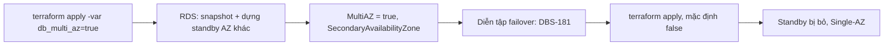

# DBS-180 · Bật Multi-AZ cho RDS bằng Terraform

> **Status:** Draft · **Vai:** #5 Platform & Ops · **Cặp đôi review:** Dev · **Nhánh:** `infra/DBS-180-rds-multi-az` · **PR:** — · **Cập nhật:** 2026-11-14

## 1. Bối cảnh

- **Task trên board:** Task, Tuần 8, Deliverable Demo 3, Ưu tiên High, board "To Do". Vai trên board là #5 Platform & Ops, khớp loại việc (Terraform). **Expect:** Có cấu hình HA để diễn tập failover.
- **DoD** (nguyên văn, đánh số):
  1. Tham số Multi-AZ trong envs (bật khi diễn tập, tắt khi không cần để tiết kiệm)
  2. Ghi chi phí chênh lệch theo giờ
  3. PR đã merge vào main (CI xanh); Dev review; bảng «Đối chiếu test case» trong PR điền đủ
- **Thực trạng trên board:** RDS ở DBS-66 đang Single-AZ (cấu hình dev, rẻ nhất). Multi-AZ chỉ nên bật khi diễn tập vì chi phí instance DB tăng khoảng gấp đôi.
- **Phụ thuộc:** DBS-66 (Done, đã có trên `main`: [DBS-66](DBS-66-terraform-rds.md)).
- **Đã có gì (đã chạy thử, không chỉ đọc):** `envs/dev/session/rds.tf` đã có `multi_az = var.db_multi_az` và `variables.tf` đã có `db_multi_az` (mặc định `false`) từ DBS-66, kèm test `rds_variables` (TC-66-10) bật cùng lúc với đổi cỡ instance. Thiếu so với DoD: (a) chưa có test cho đúng một biến bật Multi-AZ mà mọi thứ khác giữ nguyên; (b) chưa có output cho biết trạng thái, nên người diễn tập không biết sau `apply` DB đang tính tiền gấp đôi; (c) chưa có chi phí chênh lệch theo giờ và quy trình bật/tắt trong README ([`infra/terraform/README.md`](../../infra/terraform/README.md) chỉ nói "production đổi"); (d) chưa chạy thật trên RDS: chuyển Single-AZ ↔ Multi-AZ tại chỗ (không thay thế instance) chưa được kiểm. Stack `session` của `dev` đang dựng trên AWS (RDS `dbs-dev` `db.t4g.micro` Single-AZ, `available`).
- **Baseline** (`main` 957dcbf; `session`, Terraform 1.16.6, `-parallelism=1`, `GOMAXPROCS=2`): `terraform fmt -check -recursive` sạch, `terraform validate` đạt, `terraform test -filter=tests/session.tftest.hcl` 31/31.
- **Loại task:** Infrastructure code (#5) cộng ghi chi phí; kiểm thật trên RDS đang dựng.
- **Ngoài phạm vi (bàn giao ở §8):** diễn tập failover và đo RTO (DBS-181); so sánh chi phí đo thật Single-AZ và Multi-AZ trên Cost Explorer (DBS-182, DBS-143); môi trường `prod/session` (DBS-152, nhánh riêng); `db.t4g.small`; retry kết nối của app khi failover (BL-210); alarm nhắc "Multi-AZ quên tắt" (BL-324).
- **Câu hỏi mở và quyết định ở G1** (agent tự quyết, người dùng vắng): (1) Không thêm tfvars mẫu: một biến, một cờ `-var`, đủ rõ trong README; đề xuất đồng ý. (2) Giữ tên biến `db_multi_az` đã có (đổi tên là đổi giao diện không cần thiết). (3) Chuyển đổi tại chỗ cần RDS tạo snapshot và standby, kéo dài nhiều phút và làm chậm I/O: chấp nhận trong phiên dev; đo thời gian ở M-180-04.

## 2. Hành vi

| Đầu vào | Kết quả |
|---|---|
| Không đặt `db_multi_az` (mặc định `false`) | `aws_db_instance.main.multi_az = false`, output `db_multi_az = false`: một instance, ≈ 0,029 USD/giờ |
| `-var db_multi_az=true` | RDS sửa **tại chỗ** (`~ update in-place`, không thay thế): `multi_az` `false → true`; có thêm standby ở AZ khác, output `db_multi_az = true`; mọi thuộc tính khác giữ nguyên (cỡ, 20 GB gp3, CMK, `rds.force_ssl`, backup 1 ngày, `apply_immediately`, không snapshot cuối) |
| Đặt lại `false` | RDS bỏ standby tại chỗ; về Single-AZ; plan sau đó "No changes" |
| `db_multi_az` không phải bool (ví dụ `maybe`) | Terraform từ chối: `Invalid value for input variable` |

Ca biên: `terraform destroy` khi đang Multi-AZ dùng cùng `skip_final_snapshot`, `delete_automated_backups`, `deletion_protection = false` (TC-180-02 kiểm bằng mock); **chưa chạy `destroy` thật khi đang Multi-AZ** (người dùng không cho destroy trong phiên này), nên quy trình luôn rút về Single-AZ trước khi hết phiên.

**Liên hệ NFR:** Multi-AZ ở dev là điều kiện để DBS-181 diễn tập failover đo RTO (NFR-REC-02, NFR-AVL-01 ở docs/03 D-7). Standby đồng bộ nên RPO về lý thuyết ≈ 0 khi failover. Task này không tuyên bố đạt NFR nào; việc đo là của DBS-181.

**Chi phí chênh lệch theo giờ** (giá niêm yết on-demand PostgreSQL ở `ap-southeast-1`, đọc bằng AWS Price List API; storage 20 GB tính theo 730 giờ/tháng), điền vào README:

| Mục | Single-AZ | Multi-AZ | Chênh lệch |
|---|---|---|---|
| Instance `db.t4g.micro` | 0,0250 USD/giờ | 0,0510 USD/giờ | +0,0260 |
| Storage gp3 20 GB (0,138 / 0,276 USD/GB-tháng) | ≈ 0,0038 | ≈ 0,0076 | +0,0038 |
| **Cộng** | **≈ 0,0288** | **≈ 0,0586** | **≈ +0,030 (gấp ≈ 2,03 lần)** |

Quên tắt ≈ +0,72 USD/ngày; phiên diễn tập 90 phút ≈ +0,045 USD.

## 3. Kiến trúc

- **Vị trí:** `infra/terraform/envs/dev/session` (stack tính tiền theo phiên). File đổi: `variables.tf` (mô tả biến có chi phí và cách dùng), `outputs.tf` (output `db_multi_az`), `tests/session.tftest.hcl` (hai run mới), README Terraform (mục DBS-180), feature doc, `docs/BACKLOG.md`, `docs/features/README.md`. `rds.tf` **không đổi**: `multi_az = var.db_multi_az` đã đúng.
- **Interface:** biến `db_multi_az` (bool, mặc định `false`), output `db_multi_az`. Người gọi: không module nào khác tham chiếu (grep `db_multi_az`: `rds.tf`, `variables.tf`, test). `prod/session` chưa có trên `main`.
- **Dữ liệu và mạng:** DB subnet group `dbs-dev` (`base`) có 2 private subnet ở 2 AZ, đủ cho standby; SG `dbs-dev-db` không đổi; standby dùng cùng endpoint DNS (`db_address` không đổi), DNS trỏ sang standby khi failover.
- **Ranh giới transaction:** không áp dụng (không đụng code ứng dụng).
- **Sơ đồ:**

- **Thay đổi cấp hệ thống:** [`infra/terraform/README.md`](../../infra/terraform/README.md) mục RDS và mục chi phí; docs/03 §13.1 và ADR-11 đã đúng ("Multi-AZ khi demo HA"), không sửa.

## 4. Test cases tự động

| ID | Truy vết | Lớp | Given · When · Then | `errorCode` |
|---|---|---|---|---|
| TC-180-01 | DoD 1 (tắt khi không cần) | tf test mock (`session`) | Không biến → `multi_az = false` và output `db_multi_az = false` | không |
| TC-180-02 | DoD 1 (bật khi diễn tập) | tf test mock (`session`) | `db_multi_az = true` → `multi_az = true`, output `true`; cỡ micro, 20 GB gp3, mã hóa, không public, backup 1, `apply_immediately`, không snapshot cuối, không bảo vệ xóa, parameter group `dbs-dev-postgres17` không đổi | không |
| TC-180-03 | DoD 1 | tf test mock (có sẵn TC-66-10) | `db_multi_az = true` cùng `db_instance_class = db.t4g.small` vẫn theo biến | không |
| TC-180-04 | DoD 2 | thủ công (M-180-03, `check-doc-links`) | README có bảng giá chênh lệch theo giờ khớp AWS Price List | không |
| TC-180-05 | DoD 3 | quy trình | PR, CI, Dev review, bảng đối chiếu: sau G4, ngoài khả năng agent | không |

## 5. Test thủ công

Điều kiện: `AWS_PROFILE=dbs-admin`, `ap-southeast-1`, stack `session` đang dựng (người dùng cho phép dùng AWS trong phiên này, **không destroy**); `terraform init -backend-config=backend.hcl` ở `envs/dev/session`. Bộ biến phải trùng stack đang chạy, nếu không plan lẫn thay đổi khác (worker đi 1 → 0): `account_id`, `state_bucket`, `image_tag` = SHA trong image của task definition `api` đang chạy (`aws ecs describe-task-definition` và `terraform state show aws_ecs_task_definition.api`), `desired_count=1`, `worker_desired_count=1` (đọc từ `terraform state show aws_ecs_service.api` và `.worker`). `image_tag` lấy từ `terraform state show` (nguồn của plan); nếu khác task đang chạy thì ghi lại và dựa vào chốt dưới. **Báo kênh chat** trước M-180-04 và sau M-180-06 (README Terraform, mục Quy ước: Multi-AZ làm chậm I/O của DB dùng chung). **Chốt:** nếu M-180-01 không phải "No changes" thì dừng, không apply. Bật Multi-AZ chỉ để chạy M-180-04 và rút về ngay ở M-180-06; stack `session` còn nguyên sau phiên và phải được báo là còn chạy.

| Bước | Việc làm | Kết quả mong đợi |
|---|---|---|
| M-180-01 | `terraform plan` mặc định (`db_multi_az` không đặt) | RDS không đổi (đường thành công, đối chứng); output `db_multi_az = false` |
| M-180-02 | `terraform plan -var db_multi_az=true` | RDS `~ update in-place`, chỉ `multi_az false → true`, không replace; mọi tài nguyên khác không đổi |
| M-180-03 | `aws pricing get-products --region us-east-1 --service-code AmazonRDS` (Price List chỉ phục vụ ở us-east-1; lọc `regionCode=ap-southeast-1`) Single-AZ và Multi-AZ `db.t4g.micro` PostgreSQL và gp3 | Giá khớp bảng §2 |
| M-180-04 | `terraform apply -var db_multi_az=true`, đo thời gian; `aws rds describe-db-instances` | `MultiAZ = True`, `SecondaryAvailabilityZone` khác `AvailabilityZone`, `DBInstanceStatus = available`; `terraform output db_multi_az` = `true`; vòng `while :; do curl -sk -o /dev/null -w '%{http_code}\n' https://<alb>/health/ready; sleep 15; done` chạy nền từ trước `apply` tới sau khi `describe-db-instances` báo `available`; **đạt khi 0 lần khác 200** (nếu có thì ghi từng lần và đánh giá, không giấu); dữ liệu có sống sót không **chưa kiểm** (chưa seed số dư demo, BL-252) |
| M-180-05 | (biên) `terraform plan -var db_multi_az=maybe` | Lỗi `Invalid value for input variable`, không có plan |
| M-180-06 | (phục hồi) `terraform apply` mặc định, đo thời gian; `describe-db-instances`; `terraform plan` lần nữa | `MultiAZ = False`, không còn `SecondaryAvailabilityZone`; plan "No changes"; `db_multi_az` = `false`; thăm dò `/health/ready` như M-180-04 |

## 6. Domain review (AI)

**Reviewer:** subagent mới (Agent tool, model opus, read-only), 2026-11-14, hai lần · **Kết quả lần 1:** 7 phát hiện (1 blocking, 3 should-fix, 3 minor), REVISE; **lần 2** (sau khi sửa): 6 phát hiện (2 should-fix, 4 minor), REVISE, toàn bộ đã xử lý, không còn blocking · [trả lời nguyên văn cả hai lần](screenshots/DBS-180/domain-review.md)

| # | Mức | Phát hiện | Xử lý |
|---|---|---|---|
| 1.1 | blocking | Bộ biến thiếu `worker_desired_count`, plan lẫn thay đổi worker 1 → 0 | đã sửa §5 điều kiện (đủ biến, nguồn từng giá trị, chốt "No changes") |
| 1.2 | should-fix | Thăm dò sức khỏe có điều kiện, chỉ một lần | đã sửa M-180-04/06 (vòng liên tục, đạt khi 0 lần khác 200); dữ liệu sống sót là chưa kiểm, BL-325 |
| 1.3 | should-fix | Ai `destroy` cuối phiên, báo kênh | một phần: báo kênh thêm vào §5; `destroy` bị người dùng cấm trong phiên này, stack để nguyên và báo ở §8 (BL-326) |
| 1.4 | should-fix | `destroy` khi đang Multi-AZ chưa kiểm | đã sửa §2: ghi chưa chạy thật, mock kiểm cờ; BL-326 |
| 1.5 | minor | Assert TC-180-02 thiếu CMK, CA, subnet, SG, mật khẩu | đã sửa test |
| 1.6 | minor | Chưa truy vết NFR | đã sửa §2 (liên hệ NFR, không tuyên bố đạt) |
| 1.7 | minor | Bàn giao chưa thành danh sách | đã sửa: §8 Bàn giao có bảng; BL-324..328 trong BACKLOG |
| 2.1 | should-fix | §8 chưa có, BL-324 chưa tồn tại | đã sửa: §8 và BACKLOG |
| 2.2 | should-fix | Người `destroy` cuối phiên | BL-326; §8 nêu stack còn chạy |
| 2.3 | minor | Chưa có lệnh vòng thăm dò và tiêu chí đạt | đã sửa M-180-04 |
| 2.4 | minor | Price List chỉ ở us-east-1 | đã sửa M-180-03 |
| 2.5 | minor | Hai nguồn `image_tag` | đã sửa §5 |
| 2.6 | minor | §6 chưa điền | đã sửa |

**Quyết định ở G2** (agent tự quyết, người dùng vắng): không chạy lần review thứ ba vì lần 2 không còn blocking và các điểm còn lại là sửa văn bản/BL đã làm xong; hai lần REVISE đều được xử lý hết.

## 7. Kế hoạch triển khai

| Bước | File | Test viết trước | Kết quả đỏ | Lệnh chứng minh | Commit |
|---|---|---|---|---|---|
| 1 | `tests/session.tftest.hcl`, `outputs.tf`, `variables.tf` | TC-180-01, TC-180-02 | `An output value with the name "db_multi_az" has not been declared` (run `rds_multi_az_default_off` fail, 15 run sau skip) | `terraform test -parallelism=1 -filter=tests/session.tftest.hcl` (33/33 sau khi thêm output) | `infra(rds): output db_multi_az và test bật Multi-AZ bằng một biến (DBS-180)` |
| 2 | `infra/terraform/README.md` | TC-180-04 | không áp dụng (tài liệu) | `check-doc-links.mjs` | `docs(infra): chi phí chênh lệch và quy trình Multi-AZ (DBS-180)` |
| 3 | M-180-01..06 trên AWS | — | — | `manual-test.txt` | (cùng commit docs) |
| 4 | feature doc, BACKLOG, `features/README.md` | — | — | `check-doc-links.mjs` | `docs(infra): DBS-180 feature doc, backlog (DBS-180)` |

Rủi ro và cách lùi: chuyển tại chỗ trên RDS dùng chung có thể làm chậm I/O vài phút khi người khác đang dùng stack; lùi bằng `terraform apply` mặc định (M-180-06), không destroy. Nếu `apply` lỗi giữa chừng (quota, AZ), dừng, đọc `describe-events`, rút về `false`. **Quyết định ở G3** (agent tự quyết): không đổi `rds.tf`; chỉ thêm output, test, tài liệu; chạy thật có điều kiện rút về cuối phiên.
