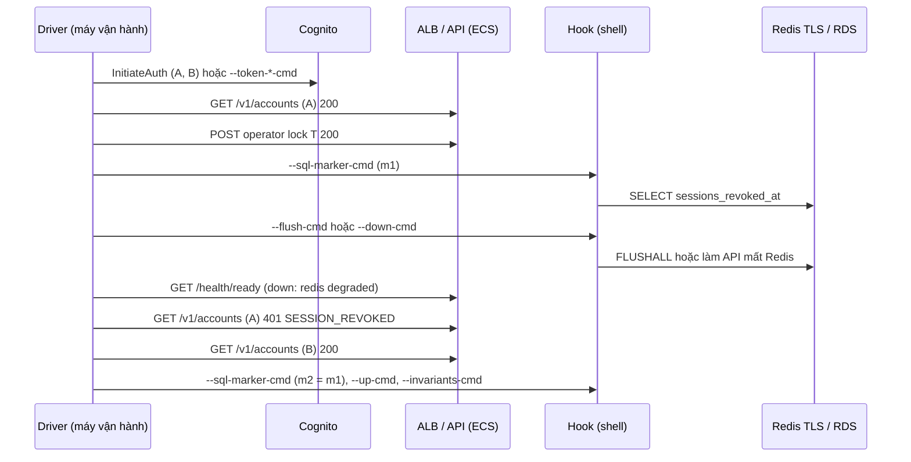
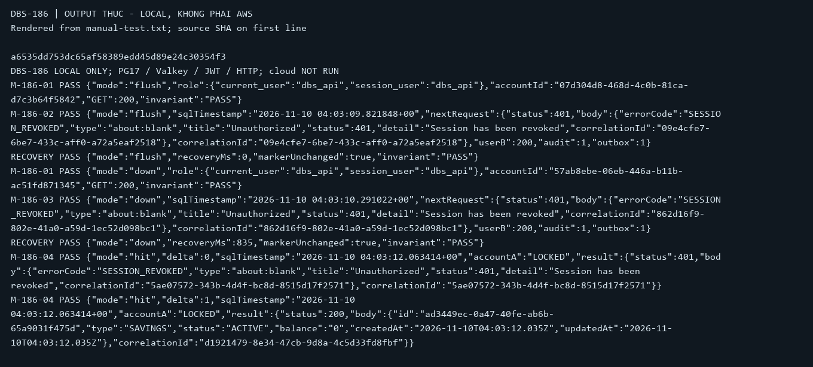

# DBS-186 · Thu hồi phiên khi Redis mất dữ liệu hoặc dừng

> **Status:** Implemented (phần local, #127) · phần cloud (§1.1, §2.1, §3.1, §5.1, §7.1): Draft, driver viết và chạy thử local, chưa chạy trên AWS · **Vai:** Dev · **Cặp đôi review:** Dev khác · **Nhánh:** `codex/DBS-186-redis-revocation-drill`; phần cloud `test/DBS-186-cloud-drill` · **PR:** [#127](https://github.com/Lawliet119/digital-banking-simulator/pull/127); phần cloud chưa có · **Cập nhật:** 2026-11-22

## 1. Bối cảnh

Task Tuần 8, Medium, Demo 3, board To Do. Expect nguyên văn: «Thu hồi phiên vẫn đúng khi Redis mất dữ liệu.»

DoD nguyên văn:
1. Khóa tài khoản A rồi flush hoặc tắt Redis: request kế tiếp của A vẫn bị từ chối (đọc users.sessions_revoked_at)
2. Chạy cả hai kiểu: Redis chết và Redis bị flush (còn sống nhưng mất khóa); kết quả như nhau
3. Có test tự động và một lần chạy trên cloud; ghi vào bảng sự cố P4
4. PR đã merge vào main (CI xanh); Dev review; bảng «Đối chiếu test case» trong PR điền đủ

AC-11.1 nguyên văn từ BRD: «Khách A đang đăng nhập, tài khoản `ACTIVE` | Nhân viên khóa tài khoản A | Yêu cầu kế tiếp của A bị từ chối (không chờ phiên hết hạn)».

Phụ thuộc DBS-114 và DBS-75 đều Done trên sheet. Main `478ab4c` có SessionRevocationCache, guard SQL fallback, publish sau commit và Terraform Valkey TLS. ADR-12 là tài liệu kiến trúc, không phải ticket phụ thuộc bị thiếu. [DBS-114](DBS-114-session-revocation.md) đã có TC-114-04 (lock → flush → request kế tiếp → 401 và nạp lại cache) và TC-114-06 (dừng Redis **trước** lock); chế độ flush của TC-186-01 mở rộng TC-114-04 (đếm SQL, timestamp, user B, audit/outbox), còn phần mới thật sự là đúng thứ tự lock → dừng Redis → request kế tiếp và kiểm cùng giây/giây sau khi cache mất hoặc dừng.

Đã đọc BRD AC-11.1/NFR-SEC-02; docs/03 §6.2,9,11; ADR-06/12; CONTRIBUTING §5/5b; database-design users và event-contract AccountStatusChanged; README identity; các feature114/115 và source/fixture tương ứng. Baseline main478ab4c: Compose 3 services started; lint/typecheck đạt, unit: 98 suites, 1.770/1.770 (157.268s), e2e17 suites163/163 (154.151s); DB revocation-cache+boundary2 suites14/14 (37.023s), 0 skip.

Phạm vi: test hồi quy PG17/Valkey/HTTP/JWT thật; driver thủ công container riêng; bảng sự cố P4 có nhãn local/cloud rõ ràng. Không sửa production, schema, tiền, event, dependency hoặc env. Không flush Redis chung. User xác nhận «tôi chưa có giờ chỉ chạy local thôi!»; phạm vi thực thi của phiên chỉ local, không chạy cloud. Cloud chưa có CLI, biến AWS/Cognito/endpoint hoặc credentials profile trong phiên; giữ mục cloud là chưa chạy và bàn giao BL-220, không suy diễn local thành AWS acceptance. BL-221 (p95/drift/flaky114) ngoài phạm vi; BL-222 chỉ nhận kiểm boundary cache local, cloud vẫn mở. BL-132/103/195 không thuộc task này.

**G1 qua — agent tự quyết:** dependency/source/baseline xanh; nhận toàn bộ test local và P4, cloud chưa chạy không được nhận đạt (BL-220/222); không thay production vì existing fallback đã chứng minh. Đề nghị user đưa board sang In Progress, agent không sửa sheet.

### 1.1 Phần cloud (phiên 2026-11-22)

Techlead waiver: phần này làm theo skill nhưng G1..G3 do agent tự duyệt, domain review do opus (không phải người), Dev review chưa có. Code và test local của task đã merge ở #127 (xem trên). Chỉ còn DoD 3, nửa sau, nguyên văn: «một lần chạy trên cloud; ghi vào bảng sự cố P4» (BL-220, BL-222 ở [BACKLOG](../BACKLOG.md)). Kế hoạch đêm 2026-11-22 (Phiên 2 AWS-A, Action 3) nằm ở file không commit `TonightWorks.md`: phần cần thiết được chép vào đây.

**Phạm vi của phiên viết code (trước khi dựng):** driver cloud `infra/scripts/drill-revocation-cloud.mjs` (Node, không phụ thuộc ngoài), máy chủ giả và test của nó (`infra/scripts/tests/`, chạy trong CI), tài liệu này. **Không** chạy lệnh AWS ghi, không dựng stack, không chạy trên cloud: người điều phối chạy trên stack `session` của DBS-167 sau lượt k6 cuối và sau checker bất biến của 167, lúc không có tải; kết quả thật điền ở §8.1 và P4 (hiện chỉ có dòng «chờ chạy»). Không sửa production, schema, env, Terraform, `seed-cognito.sh`, `demo-token.sh`.

**Thực trạng (đã chạy/đọc):**

| Mục | Kết quả |
|---|---|
| `manual-dbs186.cjs` | chỉ chạy local qua `createSessionRevocationFixture` (Valkey/PG container riêng, JWT ký local); không dùng được trên ALB |
| `/health/ready` | chỉ PostgreSQL chặn readiness: luôn **200 kể cả khi Redis chết**; Redis nằm ở trường `redis: up\|degraded` của thân (`health.controller.ts`, docs/03 §14, DBS-78). Vì vậy «sẵn sàng» và «Redis chết» chỉ đo được qua trường này |
| Guard | token hết hạn bị từ chối `TOKEN_EXPIRED` **trước** khi xét thu hồi; cache hit thì từ chối ngay không đọc SQL (`identity.service.ts`); IP rate limit 100 request/phút chạy trước guard (429) |
| Đường lấy token cloud | `demo-token.sh` chỉ nhận `operator\|auditor\|admin\|customer1..3` (ba khách là khách fixture của k6, **không** dùng cho drill). Khách mới theo đường đã có ở [demo giữa kỳ](../demos/demo-midterm-end-to-end.md#chạy-bước-19): `sign-up` + `admin-confirm-sign-up` (email `…@dbs.invalid`, mật khẩu qua stdin, **trong container Linux** vì `file:///dev/stdin`), xóa bằng `admin-delete-user` vì pool nằm ở `base`. `dbs-app` sống 15 phút (ADR-06) |
| ALB | chứng chỉ tự ký (`curl -k` trong tài liệu demo): driver có `--insecure` chỉ cho API |
| Mô hình người dùng | `users` được tạo ở token hợp lệ đầu tiên; `POST /v1/customers/me` (cần `fullName`) tạo hồ sơ, `POST /v1/accounts` (không idempotent, tối đa 3) mở tài khoản; khóa/mở khóa `POST /v1/operator/accounts/{id}/lock\|unlock` (lý do mở khóa `OPERATOR_UNLOCK`). Mở khóa không xóa mốc: token cũ vẫn 401, token mới (iat sau mốc) dùng được |
| Hạ tầng | RDS và Valkey riêng tư, chỉ nhận từ security group của api/worker; không có ECS Exec; máy vận hành không nối được RDS/Redis. Cách repo đã chạy việc tương tự: task một lần `dbs-migrate` trong SG của api (`incident-cloud.sh`, ≈ 60 giây mỗi lần). Security group Valkey và hai luật 6379 nằm ở stack **`base`** (giữ qua `destroy session`). Dev 0 replica: không có failover tự động |
| Baseline | `check-doc-links.mjs` 502 file 0 lỗi; `check-backlog.mjs` 105 dòng 0 lỗi; `node --test load-tests/test/loadgen-tokens.test.mjs` 3/3 (Node 24.22.2); backend không đổi nên bốn lệnh backend không chạy |

**Quyết định ở G1 (agent tự quyết, techlead waiver):**
1. **Hook thay vì cơ chế cố định.** Cách flush/down trên cloud do phiên DBS-167 quyết. Driver chỉ nhận lệnh shell (`--flush-cmd`, `--down-cmd`, `--up-cmd`, `--sql-marker-cmd`, `--invariants-cmd`, `--operator-token-cmd`).
2. **Không tin mã thoát của hook là bằng chứng fault đã xảy ra** (review #2): flush hỏng hoặc down không cắt kết nối đã mở vẫn cho 401 từ khóa cache lúc khóa, tức là PASS giả. Down chỉ được tính khi `/health/ready` báo `redis: degraded` (độc lập, không phải request của A); flush phải in `DRILL_REVOKED_KEYS_BEFORE=<n ≥ 1>` và `DRILL_REVOKED_KEYS_AFTER=0`. Thiếu hoặc sai: thoát 3, không PASS. Phục hồi chỉ được tính khi `redis: up` hai lần liên tiếp (review #1), không phải khi `/health/ready` 200.
3. **Người dùng riêng, một khách đủ cho hai kiểu.** Khách A (khóa) và khách B (không bị thu hồi). Kiểu down dùng lại A: **mở khóa A, chờ `--settle-ms`, lấy token A mới, khóa lần hai**: mở khóa không xóa mốc, token cũ vẫn 401 (kiểm thêm), token mới có iat sau mốc nên 200 rồi lại bị mốc mới thu hồi; không tạo thêm khách Cognito. A có hai tài khoản (khóa tài khoản đầu `T`, tài khoản thứ hai `C` còn ACTIVE) cho phép thử biên cùng giây như DBS-115. Tài khoản lấy theo thứ tự `createdAt, id` và đọc lại sau mỗi `POST /v1/accounts` (không gửi lại POST).
4. **Token mới ở từng giai đoạn, hết hạn là «không kết luận», không phải «sai»** (review #5): đăng nhập trực tiếp InitiateAuth (mật khẩu qua biến môi trường), hoặc `--token-a-cmd/--token-b-cmd`; token operator qua `--operator-token-cmd`. Driver đọc `exp`: token còn dưới `--token-margin-s` (60 s) thì **không gửi** và thoát 3; `TOKEN_EXPIRED` khi `exp` còn hạn là guard sai, thoát 1. Mốc SQL đọc trước khi lấy token A để token còn hạn lâu nhất; hook mặc định tối đa 600 s.
5. **BL-222 làm có điều kiện, an toàn, đủ ba đường, và «+1» thật** (review vòng 1 #3, #4; vòng 2 #1, #9): Cognito không cho điều khiển `iat`, nhưng đăng nhập trực tiếp trả token trong khoảng 100–300 ms rồi khóa ngay (token operator lấy **trước** khi đăng nhập khách, để việc lấy token operator mất vài giây không chen vào), nên `iat` rơi cùng giây với mốc ở một phần các lần thử. Ngay sau khi khóa, driver **chờ tới ranh giới giây kế tiếp rồi đăng nhập lần nữa (token «+1»)**, tức là trước khi đọc mốc (một lần đọc mốc qua task ECS mất ≈ 60 giây, đọc xong mới đăng nhập thì `iat − floor(mốc)` thành cỡ 60 chứ không phải 1): nhờ vậy `iat = floor(mốc) + 1` xảy ra đúng biên `R+1` của docs/03 §6.2 và bắt được lỗi lệch một đơn vị (ceil, `<= R+1`). Phán quyết tính **sau**, cho từng token: `iat ≤ floor(mốc)` ⇒ 401 `SESSION_REVOKED`; `iat > floor(mốc)` ⇒ 200 trên `C`. Ba chế độ: `hit` (cache có khóa), `flush` (miss, đường SQL; flush lại trước request của token +1), `down` (Redis chết, SQL fallback; mặc định không chạy, thêm bằng `--same-second-modes hit,flush,down`, số lần thử riêng `--same-second-down-attempts` mặc định 2). Trạng thái mỗi chế độ: `CAUGHT` chỉ khi có **cả** mẫu cùng giây **và** mẫu đúng +1 (và không vi phạm); thiếu một trong hai là `SAME_SECOND_ONLY`, `PLUS_ONE_ONLY` hoặc `NOT_CAUGHT` (giữ BL-222); sai quy tắc là `VIOLATION`. Đường đi là **suy ra** từ trạng thái Redis lúc gọi, không quan sát trực tiếp; riêng `down`, driver kiểm `/health/ready` báo `redis: degraded` ngay trước mỗi request quyết định, Redis tự lành giữa chừng thì thoát 3 (không còn là SQL fallback).
6. **Mã thoát phân biệt:** 0 PASS; 1 một khẳng định sai (200 sau fault, sai errorCode, vi phạm quy tắc iat); 2 dùng sai tham số (kể cả `--shell` không tồn tại); 3 lỗi môi trường/hook/không kết luận (hook thoát khác 0 hoặc quá hạn, fault không có hiệu lực, Redis tự lành trước request quyết định, token sắp hết hạn, **429 `RATE_LIMITED`** có ghi `Retry-After`, đăng nhập lỗi, API không với tới, checker bất biến thoát 2, bị ngắt); 4 bất biến FAIL (checker thoát 1). Hook bất biến phải chuyển nguyên mã 0/1/2 của checker (backend README); bọc nào gộp 2 thành 1 sẽ làm lỗi checker thành «bất biến FAIL». Dừng ở bước lỗi đầu tiên; luôn chạy `--up-cmd` nếu đã gọi down mà chưa xác nhận phục hồi. **SIGINT/SIGTERM** (review vòng 2 #2): từ lúc nhận tín hiệu, mọi hook mới, request, đăng nhập và bước mới bị từ chối ngay (chỉ `--up-cmd` của việc dọn được chạy), hook đang chạy bị giết, tín hiệu lặp lại bị bỏ qua cho tới khi dọn xong. **Giới hạn thật (review vòng 2 #5):** giết cây tiến trình (process group trên POSIX, `taskkill /T` trên Windows) chỉ chạm tiến trình cục bộ; hook chạy qua `docker run` thì container vẫn sống và một lệnh AWS đã gửi đi không rút lại được. Vì vậy hợp đồng hook buộc: container của hook đặt tên theo `$DRILL_RUN_ID` (`docker run --name drill186-$DRILL_RUN_ID-<hook> …`) và `--up-cmd` chạy `docker rm -f` các container đó rồi **hội tụ** về trạng thái đúng (khôi phục luật hoặc chờ node `available`) bất kể trước đó chuyện gì đã xảy ra; sau khi dọn driver chờ rồi kiểm lại `redis: up` và ghi `cleanup.redisUp`.
7. **Hook chỉ thừa hưởng biến môi trường trong danh sách cho phép** (`PATH`, `AWS_*`, `NODE_PATH`, `NODE_EXTRA_CA_CERTS`, thư mục tạm, proxy…, cộng `--hook-env NAME,NAME`); mật khẩu khách drill, `NODE_TLS_REJECT_UNAUTHORIZED`, `NODE_OPTIONS` và mọi biến khác bị loại (review #9, vòng 2 #3). Hook cần `COGNITO_CLIENT_ID`, `COGNITO_USER_POOL_ID`, `API`, `IMAGE_TAG`… phải khai trong `--hook-env`, và **thử khô từng hook dưới đúng môi trường đó** (M-186-09).
8. **BL-220 không đóng hết:** dev 0 replica nên không có failover (`automatic_failover_enabled = replicas > 0`); phần failover/production giữ ở BL-220 (thu hẹp dòng, không xóa) cho tới khi có cấu hình production (DBS-152).
9. **Bàn giao cho DBS-167/Platform (review #7, #8):** cơ chế thật của hook (task một lần trong SG của api, Redis AUTH từ secret của api; EC2 loadgen không với tới Valkey); ưu tiên fault nằm gọn trong `session` (ví dụ khởi động lại node ElastiCache, up = chờ `available`) vì luật chặn SG nằm ở `base` và SG có trạng thái không cắt kết nối đã mở; nếu dùng luật SG thì kiểm `terraform plan -detailed-exitcode` của `base` = 0 trước `destroy`.
10. **Không có tải k6 là điều kiện phía người điều phối**; driver đòi `--confirm-idle` và chỉ kiểm `/health/ready` (PostgreSQL ready, Redis up) trước khi bắt đầu.

**G1 qua — agent tự quyết:** dependency (DBS-114/115/75, #127) đã merge; phạm vi chỉ driver, test, tài liệu; không cần chạy AWS để hoàn thành phần việc này; BL-220/222 giữ đến khi có kết quả thật.

## 2. Hành vi

Khách A có account ACTIVE và token còn hạn gọi `GET /v1/accounts` → 200. Operator gọi `POST /v1/operator/accounts/{id}/lock` với `{"reason":"CONFIRMED_FRAUD"}` → 200 LOCKED; SQL marker và Redis key tồn tại trước fault. Sau FLUSHDB trên Valkey riêng (PING vẫn PONG, key mất) hoặc dừng container Valkey riêng, request kế tiếp của A → 401, `errorCode=SESSION_REVOKED`, correlationId trong body khớp header. Không thử request A ở giữa fault và phép kiểm này.

SQL marker giữ nguyên giá trị timestamptz; instrument chỉ quan sát query thật của source API để xác nhận có SELECT sessions_revoked_at, không mock kết quả. Flush phải nạp lại key từ SQL. Khi down, user B không bị revoke vẫn 200, chứng minh API/PG còn hoạt động. Sau recovery, client API mới đọc Redis thật, A vẫn 401; unlock không phục hồi token cũ.

Boundary: đọc epoch giây từ SQL sau lock; token iat bằng marker bị 401 cả khi miss/down; token iat=marker+1 dùng được account còn ACTIVE của cùng user (mở account thứ hai trước lock), không xóa marker SQL. Thao tác mở/khóa/deposit đi qua API; không seed balance/ledger. Không đổi code xác thực hoặc phát hành token cloud.

Security: role operator, ownership/JWT/ProblemDetails dùng production modules của fixture114; không thêm endpoint; không ghi JWT/Authorization/credentials. Không thay SQL/role/TLS; cloud giữ Cognito và rediss thật. Các yêu cầu idempotency transfer, SQL input hostile và BR-13 response không đổi; checker 5 bất biến sau từng scenario.

### 2.1 Phần cloud: hành vi của driver

Điều kiện đầu: phiên `session` đang chạy, **không có tải k6** (người điều phối bảo đảm, driver đòi `--confirm-idle`), `GET /health/ready` 200 **và `redis: up`**. Khách A, khách B đã đăng ký trên pool Cognito, mật khẩu chỉ nằm trong biến môi trường của phiên chạy.

**Chuẩn bị (không tính là kết quả drill):** lấy token A và B mới; `POST /v1/customers/me` với tên tổng hợp `Drill A|B <runId>` (idempotent, 200); bảo đảm A có đúng hai tài khoản và B một (mở thêm bằng `POST /v1/accounts`, tối đa ba, đọc lại danh sách sau mỗi lần mở, không gửi lại POST); tài khoản nào còn `LOCKED` từ lần chạy trước thì operator mở khóa (ghi vào báo cáo, rồi chờ `--settle-ms`). Đọc mốc SQL ban đầu. Tài khoản mục tiêu `T` = tài khoản đầu của A theo `createdAt`, tài khoản đồng hành `C` = tài khoản thứ hai.

**Kiểu flush** (mỗi bước ghi mã trạng thái, `x-correlation-id`, độ trễ):
1. Đọc mốc `m0`. Lấy token A mới. `GET /v1/accounts` bằng A → **200**; B → 200.
2. Operator `POST /v1/operator/accounts/{T}/lock` `{"reason":"CONFIRMED_FRAUD"}` → **200 LOCKED**. Đọc mốc `m1`: khác NULL và khác `m0`.
3. `--flush-cmd` thoát 0 **và** in `DRILL_REVOKED_KEYS_BEFORE=<n ≥ 1>`, `DRILL_REVOKED_KEYS_AFTER=0`. **Không gọi request nào của A giữa bước này và bước 4.**
4. `GET /v1/accounts` bằng token A cũ → **401**, `errorCode = SESSION_REVOKED`, `correlationId` trong thân khác rỗng và bằng header `x-correlation-id`.
5. Đọc mốc `m2` = `m1` (nguyên văn, kể cả micro giây). B → 200.
6. `--invariants-cmd` thoát 0.

**Kiểu down:**
1. Operator mở khóa `T` (`OPERATOR_UNLOCK`) → 200; chờ `--settle-ms`; đọc mốc `d0` (= `m1`: mở khóa không xóa mốc). Token A của kiểu flush **vẫn 401**. Lấy token A mới `A'`; `GET /v1/accounts` bằng `A'` → **200** (ghi `iat − floor(d0)` ≥ 1).
2. Lock `T` → 200. Đọc `d1` khác `d0`.
3. `--down-cmd` thoát 0 **và** `/health/ready` báo `redis: degraded` trong `--fault-timeout-s` (mặc định 120 s). Không thì thoát 3: down không có hiệu lực thì không có gì để kết luận.
4. `GET /v1/accounts` bằng `A'` → **401 `SESSION_REVOKED`** có correlationId; ghi độ trễ (đường SQL fallback khi Redis chết).
5. B → **200** (API và PostgreSQL còn sống khi Redis chết). Mốc `d2` = `d1`.
6. `--up-cmd` thoát 0, rồi `/health/ready` báo `redis: up` hai lần liên tiếp (trần `--recovery-timeout-s`, mặc định 300 s); `recoveryMs` tính từ lúc gọi up. Rồi `A'` → **401 `SESSION_REVOKED`**, B → 200, mốc `d3` = `d1`.
7. `--invariants-cmd` thoát 0.

**BL-222 (tùy chọn; `--same-second-attempts N`, N = 0 tắt; chế độ `hit`, `flush`, tùy chọn `down`):** mỗi lần thử: mở khóa `T` nếu đang khóa; lấy token operator; **ngay sau đó** đăng nhập A rồi khóa `T` (ghi `loginToLockMs`); **chờ tới ranh giới giây kế tiếp rồi đăng nhập lần nữa (token +1)**; (flush: `--flush-cmd` và kiểm bằng chứng; down: `--down-cmd`, chờ `degraded`); `GET /v1/accounts/{C}` bằng token đăng nhập (down: kiểm `degraded` ngay trước); (flush: flush lại để ép miss); `GET /v1/accounts/{C}` bằng token +1 (down: kiểm `degraded` ngay trước; rồi `--up-cmd` và chờ `redis: up`); sau cùng đọc mốc `m`. Phán quyết **cho từng token**: `iat ≤ floor(m)` ⇒ phải 401 `SESSION_REVOKED`; `iat > floor(m)` ⇒ phải 200, đúng `id = C`, `status = ACTIVE` (`C` còn ACTIVE dù `T` LOCKED). `iat` đọc từ payload token (không in token). Mẫu có `iat = floor(m)` là **ca cùng giây**; mẫu có `iat = floor(m) + 1` là **ca +1**. Trạng thái mỗi chế độ: `CAUGHT` (≥ 1 mẫu cùng giây **và** ≥ 1 mẫu +1, không vi phạm), `SAME_SECOND_ONLY`, `PLUS_ONE_ONLY`, `NOT_CAUGHT` (giữ BL-222), `VIOLATION` (thoát 1). Cuối: `--invariants-cmd`. BL-222 chỉ đóng khi **cả ba** chế độ `CAUGHT`.

**Bằng chứng ghi lại:** `report.json` (verdict, từng bước với trạng thái và thời gian, các mốc SQL, thời gian phục hồi, độ trễ từng lần gọi, số liệu BL-222, SHA image và run id do người điều phối truyền) và `drill.log` trong `--out`. Mọi đầu ra qua một bộ che (JWT, `Bearer …`, `Authorization`, mật khẩu, token Redis, URL có thông tin đăng nhập, ARN, id tài khoản AWS, tên miền `*.amazonaws.com`; chỗ bị che ghi `[JWT]`/`[REDACTED]`/`[ARN]`/`[ACCOUNT]`/`[AWS-HOST]`); thời gian trong báo cáo là ISO; thân phản hồi không được ghi, chỉ `status`, `errorCode`, `correlationId`; lệnh hook không ghi, chỉ tên hook, mã thoát và thời gian; đầu ra hook không ghi (trừ dòng mốc SQL và hai số bằng chứng flush đã kiểm định dạng) và đuôi stderr đã che khi hook lỗi.

## 3. Kiến trúc

Không thay symbol production hoặc exported fixture. Dùng `createSessionRevocationFixture()` → PG17, Valkey riêng, proxy TCP, production identity/accounts/ledger modules với actual LOGIN dbs_api. `f.fresh()`, `f.lock()`, `f.me()`, `f.marker()`, `f.stopRedis()`, `f.startRedis()`, `f.second()`, `f.invariants()` đã tồn tại. Admin FLUSHDB chỉ trên URL container riêng. `jest.spyOn(f.current().source,'query')` gọi nguyên hàm thật để đếm SQL fallback.

Luồng nhiều thành phần giữ nguyên sơ đồ ở [DBS-114 §3](DBS-114-session-revocation.md#3-kiến-trúc): JWT → guard → Redis, miss/error → users.sessions_revoked_at → 401. Lock transaction status/revoke/audit/outbox đã COMMIT trước fault. Test không thay transaction boundary, ADR hay event contract.

### 3.1 Phần cloud: giao diện hook và nơi chạy

Driver `infra/scripts/drill-revocation-cloud.mjs` chạy ở **máy vận hành** (hoặc máy tải), vào ALB bằng HTTPS (`--insecure` chỉ cho API vì chứng chỉ tự ký, đặt riêng cho từng kết nối; Cognito luôn kiểm chứng chỉ và hook không nhận `NODE_TLS_REJECT_UNAUTHORIZED` từ driver). Không nối RDS hay Redis: mọi thứ cần quyền đó đi qua hook.



| Tham số | Biến môi trường | Bắt buộc | Hợp đồng của lệnh |
|---|---|---|---|
| `--base-url` | `DRILL_BASE_URL` | có | gốc ALB, `https://…` |
| `--out` | | có | thư mục ghi `report.json` và `drill.log` (tạo nếu chưa có) |
| `--confirm-idle` | | có | người điều phối xác nhận không có tải k6 |
| `--insecure` | | không | bỏ kiểm chứng chỉ TLS **chỉ cho API** (ALB tự ký) |
| `--operator-token-cmd` | `DRILL_OPERATOR_TOKEN_CMD` | có | in **đúng một dòng** access token operator mới (ví dụ `demo-token.sh --role operator`, bọc `docker run` nếu cần) |
| `--user-a-email`, `--user-b-email`, `--cognito-client-id`, `--cognito-region` | `DRILL_USER_A_EMAIL`, `DRILL_USER_B_EMAIL`, `DRILL_COGNITO_CLIENT_ID` | có, hoặc thay bằng `--token-a-cmd`/`--token-b-cmd` | mật khẩu ở `DRILL_USER_A_PASSWORD`, `DRILL_USER_B_PASSWORD` (không bao giờ argv); region mặc định `ap-southeast-1` |
| `--token-a-cmd`, `--token-b-cmd` | `DRILL_TOKEN_A_CMD`, `DRILL_TOKEN_B_CMD` | không | thay cho đăng nhập trực tiếp; in một dòng JWT |
| `--flush-cmd` | `DRILL_FLUSH_CMD` | kiểu flush hoặc BL-222 `flush` | Redis còn sống nhưng mất khóa `revoked_at:*`; thoát 0 **và in hai dòng** `DRILL_REVOKED_KEYS_BEFORE=<n>` (số khóa `revoked_at:*` đang có trước flush; ≥ 1 chỉ cho biết Redis có khóa thu hồi nào đó, chưa chứng minh là khóa của A) và `DRILL_REVOKED_KEYS_AFTER=<n>` (**phải 0**: đây mới là phần mang bằng chứng), đếm bằng `SCAN`/`redis-cli`, không phải suy đoán |
| `--down-cmd` | `DRILL_DOWN_CMD` | kiểu down hoặc BL-222 `down` | API mất Redis thật; thoát 0. Hiệu lực do driver kiểm qua `/health/ready` (`redis: degraded`), không do hook tự khai |
| `--up-cmd` | `DRILL_UP_CMD` | khi có down | hoàn tác down, **idempotent và hội tụ**: chạy được khi down chưa xảy ra hoặc đang dở, `docker rm -f` các container hook đặt tên theo `$DRILL_RUN_ID`, rồi khôi phục (luật mạng hoặc chờ node `available`); thoát 0. Hiệu lực do driver kiểm (`redis: up` hai lần liên tiếp) |
| `--sql-marker-cmd` | `DRILL_SQL_MARKER_CMD` | có | in một dòng mốc `users.sessions_revoked_at` của chủ tài khoản `$DRILL_ACCOUNT_ID`: `NULL`, hoặc timestamptz **ép UTC** (`2026-11-22T10:15:30.123456Z`), hoặc epoch giây; SQL ở §5.1 |
| `--invariants-cmd` | `DRILL_INVARIANTS_CMD` | có | checker DBS-69; **chuyển nguyên mã thoát**: 0 PASS, 1 vi phạm (driver thoát 4), khác = lỗi checker (driver thoát 3) |
| `--scenarios` | | không | `flush,down` (mặc định) hoặc `none` |
| `--same-second-attempts`, `--same-second-down-attempts`, `--same-second-modes` | | không | 4, 2, `hit,flush`; 0 tắt BL-222 |
| `--settle-ms`, `--recovery-timeout-s`, `--fault-timeout-s`, `--hook-timeout-s`, `--token-margin-s`, `--poll-ms` | | không | 2 500; 300; 120; 600; 60; 1 000 |
| `--hook-env NAME,NAME` | `DRILL_HOOK_ENV` | không | thêm biến môi trường cho hook (mặc định chỉ danh sách cho phép: `PATH`, `AWS_*`, `NODE_PATH`, `NODE_EXTRA_CA_CERTS`, thư mục tạm, proxy…; **không** có mật khẩu khách, `NODE_TLS_REJECT_UNAUTHORIZED`, `NODE_OPTIONS`) |
| `--run-id`, `--image-sha` | | không | chỉ ghi vào báo cáo |
| `--shell` | | không | đường dẫn shell chạy hook; phải tồn tại, không thì thoát 2. Trên Windows dùng đường dẫn Windows: `--shell "$(cygpath -w "$(command -v bash)")"` (đường dẫn kiểu `/usr/bin/bash` làm Node báo ENOENT, mọi hook lỗi) |

Mọi hook nhận thêm `DRILL_RUN_ID`, `DRILL_PHASE` (`flush`, `down`, `boundary-hit`, `boundary-flush`, `boundary-flush-probe`, `boundary-down`, `prepare`, `token`, `cleanup`), `DRILL_ACCOUNT_ID` (tài khoản khóa `T`, đã kiểm là UUID) và `DRILL_COMPANION_ACCOUNT_ID` (`C`). Hook chạy bằng `spawn` bất đồng bộ (không `spawnSync`: sẽ chặn vòng lặp sự kiện của driver và máy chủ giả trong test), có trần thời gian (quá hạn thì giết cả cây tiến trình **cục bộ**; container `docker run` hay lệnh AWS đã gửi thì không: xem hợp đồng `--up-cmd` và quyết định 6), stdout/stderr bị cắt ở 64 KB. Mỗi lần đọc mốc hay chạy bất biến qua task ECS một lần mất ≈ 60 giây (`incident-cloud.sh`): một lượt đủ (flush 3 + down 4 lần đọc mốc, 2 lần bất biến, BL-222 mỗi lần thử 1 lần đọc) mất hàng chục phút, nên người điều phối nên có hook đọc mốc nhanh hơn hoặc giảm `--same-second-attempts`; token A luôn lấy sát lúc dùng và có biên hết hạn.

Không đổi production hay Terraform. Giao thức HTTP dùng đúng API hiện có (`POST /v1/customers/me`, `GET|POST /v1/accounts`, `GET /v1/accounts/{id}`, `POST /v1/operator/accounts/{id}/lock|unlock`, `GET /health/ready`). Chi phí nếu quên: driver chỉ tạo dữ liệu ở `users/customers/accounts` và audit/outbox của khóa/mở khóa trên DB của phiên `session` (bị hủy khi `destroy`); khách Cognito ở `base` phải xóa (`admin-delete-user`, §5.1), và nếu `--down-cmd` đụng luật mạng ở `base` thì phải kiểm drift.

## 4. Test cases tự động

| ID | Truy vết | Lớp | Given / When / Then | errorCode |
|---|---|---|---|---|
| TC-186-01 | DoD1/2, AC-11.1 | PG17 + Valkey + HTTP | GET200, lock200/key có, FLUSHDB/PONG/keyNULL, next GET401; SELECT SQL thật, timestamp nguyên, refill đúng; userB200; invariantPASS | SESSION_REVOKED |
| TC-186-02 | DoD1/2, AC-11.1 | PG17 + Valkey + HTTP | GET200, lock200/key có, stop container thật, next GET401; SELECT SQL thật, timestamp nguyên; userB200; restart/new client Redis ready, A401/key đúng; invariantPASS | SESSION_REVOKED |
| TC-186-03 | BL-222, AC-11.1 | PG17 + Valkey + HTTP | Cho từng hit/flush/down: giữ A LOCKED, mở B cùng chủ trước lock; GET accountB iat bằng marker401, giây sau200/idB/ACTIVE; hit giây sau phải SELECT SQL; ép miss trước từng boundary ở mode flush; SQL không đổi; invariantPASS | SESSION_REVOKED / 200 |
| Quy trình | DoD3 | cloud | Cognito/ECS/RDS/ElastiCache TLS thật, lock→flush/down→401; lưu image SHA, SQL/checker, recovery và P4 | chưa chạy |
| Quy trình | DoD4 | CI/review | CI head PR, bảng case, Dev khác review/merge | chờ bàn giao |

### 4.1 Test cases phần cloud (driver)

Test của driver: `infra/scripts/tests/drill-revocation-cloud.test.mjs` (`node --test`, Node 24, không phụ thuộc ngoài; ca TLS dựng chứng chỉ tự ký bằng `openssl` lúc chạy, không commit khóa riêng). **Máy chủ HTTP giả chạy cùng tiến trình** với test (`infra/scripts/tests/drill-fake-backend.mjs`): mô phỏng đúng luật guard (`iat ≤ floor(mốc)` ⇒ 401 `SESSION_REVOKED`, cache Redis có thể flush/down, SQL là nguồn sự thật, `/health/ready` báo `redis`); driver chạy như tiến trình con bằng `spawn` bất đồng bộ (không `spawnSync`: sẽ chặn máy chủ giả cùng tiến trình); hook là script Node nhỏ gọi cổng điều khiển của máy chủ giả. Không có DB hay Redis thật: các test này chứng minh **logic và an toàn của driver**, không chứng minh hành vi cloud (việc đó là §5.1).

| ID | Truy vết | Lớp | Given / When / Then | Kết quả mong đợi |
|---|---|---|---|---|
| TC-186-04 | DoD1/2, AC-11.1 | driver + máy chủ giả | Ca đạt cả hai kiểu: A 200, lock 200, mốc `m1`, flush (khóa 1 → 0), A 401 `SESSION_REVOKED` + correlationId khớp header, mốc nguyên văn, B 200; mở khóa, token cũ vẫn 401, token mới 200 (iat sau mốc), khóa lần hai, down (health `degraded`), A 401, B 200 khi Redis chết, up (health `up`), A 401; bất biến PASS. Nhật ký máy chủ chứng minh **thứ tự lock → fault → request kế tiếp** (không có request của A giữa fault và phép kiểm) và up sau down. Hook nhận `DRILL_RUN_ID/PHASE/ACCOUNT_ID`; `--token-a-cmd/--token-b-cmd` thay được đăng nhập trực tiếp | exit 0, `verdict PASS`, `recoveryMs`, `redisDegradedAfterMs`, mốc nguyên |
| TC-186-05 | DoD1 (độ nhạy) | driver + máy chủ giả có lỗi | **Negative control:** máy chủ giả bỏ SQL fallback (sau flush/down trả 200 cho token đã thu hồi). Đã kiểm thêm bằng đột biến tạm trong driver (`assertRevoked` thành no-op): 5/7 test đỏ | exit 1, `failedStep` là phép kiểm request kế tiếp; `--up-cmd` vẫn chạy ở kiểu down |
| TC-186-06 | AC-11.1, review #5 | driver + máy chủ giả | 401 sai `errorCode`, thiếu `correlationId`, `correlationId` thân khác header; `TOKEN_EXPIRED` khi `exp` còn hạn; token sắp hết hạn (< 60 s) | exit 1 ở ba ca đầu và ca `TOKEN_EXPIRED`; exit 3 và **không gửi request nào** ở ca sắp hết hạn |
| TC-186-07 | DoD3 (che token), review #9 | driver + máy chủ giả thù địch | Máy chủ phản hồi lặp lại `Authorization`; hook in token, mật khẩu, `rediss://user:secret@…`, ARN, host AWS ra stdout/stderr; ca đạt, ca hook lỗi, ca 401 sai; hook dump môi trường | không có JWT, payload token, mật khẩu, token Redis, ARN, id tài khoản, host AWS, từ `Bearer` trong stdout, `drill.log`, `report.json`; hook không thấy mật khẩu khách hay biến bí mật lạ, vẫn thấy `DRILL_*`, `AWS_*`, `PATH` |
| TC-186-08 | DoD3, review #6; vòng 2 #2, #4, #5 | driver | `--flush-cmd` thoát 7; `--up-cmd` thoát 5; hook quá hạn; `--down-cmd` quá hạn (cây tiến trình **cục bộ** bị giết, không có «down muộn» từ tiến trình cục bộ sau up); lệnh không tồn tại; mốc SQL in rác; SIGINT khi `--down-cmd` đang chạy; **SIGINT lúc đang chờ `/health/ready` (không có hook nào chạy): không có hook `down` mới sau tín hiệu**, `up` chạy, Redis lên; `--shell` tường minh chạy được hook, đường dẫn không tồn tại ⇒ exit 2 (ca SIGINT bỏ qua trên Windows vì không gửi được SIGINT có xử lý; đã chạy trên Linux bằng Docker `node:22`, CI Linux chạy) | exit 3; `up` vẫn chạy sau down; không có lệnh nào chạy sau lỗi đầu; không treo quá trần thời gian; exit 2 cho `--shell` sai |
| TC-186-09 | DoD1, bất biến, review #8 | driver | `--invariants-cmd` thoát 1 sau flush; thoát 2; thoát 1 sau down | thoát 1 ⇒ exit 4 và dừng ngay (kiểu down không chạy), `up` đã chạy; thoát 2 ⇒ exit 3 |
| TC-186-10 | DoD1 | driver + máy chủ giả | Mốc SQL đổi hoặc mất sau fault (hook trả giá trị khác) | exit 1, `failedStep` là so mốc |
| TC-186-11 | BL-222, review #3, #4; vòng 2 #1, #9 | driver + máy chủ giả có đồng hồ điều khiển | (a) token đăng nhập cùng giây với mốc: 401; token **+1** (`iat = R+1`): 200, `iatMinusFloor` đúng 1, ở `hit`, `flush`, `down` ⇒ `CAUGHT`, thứ tự 401/200 đúng; (b) token cách mốc ≥ 2 giây: `NOT_CAUGHT`, exit 0; (c) mốc ở giây sau token đăng nhập: `SAME_SECOND_ONLY`, tổng thể không `CAUGHT`; (d) máy chủ cho qua token cùng giây (`<` thay vì `<=`) ⇒ `VIOLATION`, exit 1; (e) **máy chủ từ chối cả `iat = R+1` (lệch một đơn vị) ⇒ `VIOLATION` ở token +1, exit 1**; (f) down tự lành trước request quyết định ⇒ exit 3, không có kết luận | khớp từng ca |
| TC-186-12 | an toàn | driver | Thiếu `--confirm-idle`, hook bắt buộc, mật khẩu; `--base-url` không phải http(s); số lần thử âm; tham số lạ; thiếu `--flush-cmd` khi chạy flush; chạy lại khi A đang `LOCKED`; lần đầu mở tài khoản | thiếu tham số: exit 2, **không** gọi mạng; chạy lại: tự mở khóa rồi PASS; mở đúng 2 + 1 tài khoản |
| TC-186-13 | quy trình | CI | Bước `node --test` của driver nằm trong job `unit` của `.github/workflows/ci.yml` | CI xanh trên PR |
| TC-186-14 | DoD1/2, review #1, #2 | driver + máy chủ giả | Flush không xóa gì; `--flush-cmd` không in bằng chứng; down không làm Redis chết (health vẫn `up`); sau up health còn `degraded`/503 vài lần; Redis không bao giờ báo `up` lại; Redis không `up` từ đầu; down tự lành trước request quyết định (TC-186-11 f) | exit 3 (không PASS) ở từng ca; ca down không hiệu lực vẫn chạy `up` và không có kết luận nào từ request của A; ca chờ: `recoveryMs` phản ánh việc chờ |
| TC-186-15 | review #12 | driver + máy chủ giả | 429 ở request kế tiếp của A sau flush | exit 3 (không kết luận), không phải exit 1 |
| TC-186-16 | review #14 | driver + máy chủ giả TLS | Cognito trả thử thách `NEW_PASSWORD_REQUIRED`; API https tự ký có/không `--insecure`; Cognito https tự ký kể cả có `--insecure` | exit 3, không lộ mật khẩu; `--insecure` chạy được với API, thiếu thì exit 3; Cognito không bao giờ được bỏ qua chứng chỉ |
| Đơn vị | che, đọc mốc | `redact`, `parseMarker` | JWT, Bearer, `password=`, `--password x`, `REDISCLI_AUTH=`, URL có thông tin đăng nhập, ARN, 12 chữ số, host AWS, bí mật đã biết bị che; UUID, thời gian ISO, epoch ms, SHA không bị che; mốc `NULL`, epoch, `+00`, `+07`, `Z`, rác | khớp |
| Quy trình | DoD3 | cloud | Chạy thật trên stack: §5.1 | chờ phiên AWS, kết quả ở §8.1 |

## 5. Test thủ công

Chạy `node scripts/manual-dbs186.cjs` từ backend qua Git Bash, output tee UTF-8; dùng fixture tạo container riêng, JWT thật ký local. Không coi đây là full AppModule hoặc Cognito acceptance.

| Bước | Thao tác | Kỳ vọng |
|---|---|---|
| M-186-01 | Tạo fixture, xác nhận current_user/session_user dbs_api; fresh; GET accounts | 200, marker NULL, deposit HTTP 1000000, checker PASS |
| M-186-02 | Lock A; đọc SQL timestamp/key; FLUSHDB rồi PING và GET key; request A kế tiếp; user B | 200 LOCKED → PONG/keyNULL →401 SESSION_REVOKED + correlationId; SQL giữ nguyên/refill đúng; B200; PASS |
| M-186-03 | Fresh; GET200; lock A/key có; docker stop riêng; request A kế tiếp; B; startRedis/second | 401SQL/marker nguyên; B200; client mới ready/401/cache có; PASS; ghi thời gian recovery local |
| M-186-04 | Với hit, flush và down, giữ A LOCKED và B cùng chủ ACTIVE; lấy SQL giây, token bằng/giây sau gọi GET accountB; kiểm SQL | bằng401, giây sau200/idB/ACTIVE, A LOCKED, marker không đổi, PASS; kiểm unlock không hồi sinh phiên cũ riêng sau boundary |
| M-186-05 | Đóng mọi resource fixture trong finally | không để container/pool/proxy riêng còn chạy |
| M-186-06 | Cloud: ghi account/region/image SHA đã che ID, token Cognito A/B/operator; lock→flush/down trên môi trường drill riêng, query RDS/checker và khôi phục | cùng401, SQL không mất, recovery có thời gian; chưa chạy vì chưa có endpoint/credentials/môi trường cloud |
| M-186-07 | Chạy suite từ clean clone local của commit cuối code, dùng node_modules đã cài qua junction; chạy lại childprocess Docker context trỏ endpoint đóng, DATABASE_URL rỗng | clone suite PASS; Docker-unreachable exit khác0, lỗi rõ, 0 skip; không dừng daemon chung |

### 5.1 Test thủ công phần cloud (chạy trong phiên AWS, chưa chạy)

Bước M-186-06 ở bảng trên được thay bằng các bước M-186-08..M-186-16 dưới đây (đánh số tiếp để không đổi ID bằng chứng cũ). Điều kiện: stack `session` đang chạy (api 1, worker 1, ElastiCache TLS), **sau lượt k6 cuối của DBS-167 và checker bất biến của 167, không có tải**; cách làm Redis chết/mất khóa do DBS-167 quyết (§1.1, quyết định 9). Mọi lệnh AWS theo luật phiên (`AWS_PROFILE=dbs`, region `ap-southeast-1`, một stack mỗi lúc, hủy trong phiên). Các lệnh bên dưới **chưa chạy**: người điều phối chạy từng lệnh một lần trước khi cắm vào driver. Cột «đã chạy?» điền ở §8.1.

| Bước | Thao tác | Kỳ vọng |
|---|---|---|
| M-186-08 | Ghi môi trường: `aws sts get-caller-identity` (che id), SHA image của task api (`describe-services` → `describe-task-definition`), `curl -k $API/health/ready` (thân phải có `"redis":"up"`); không có tải: `RequestCount` của ALB 5 phút gần nhất ≈ 0. Ghi trạng thái alarm `dbs-dev-redis-fallback` (và `dbs-dev-redis-node-missing` nếu down bằng cách khởi động lại node) | 200 và `redis up`; SHA ghi lại; không tải; alarm `OK` |
| M-186-09 | **Hook thử khô, từng cái một, ngoài driver và dưới đúng môi trường driver sẽ cấp** (`env -i PATH="$PATH" HOME="$HOME" AWS_PROFILE=… AWS_DEFAULT_REGION=… <các biến của --hook-env> DRILL_RUN_ID=… DRILL_PHASE=… DRILL_ACCOUNT_ID=<uuid> bash -c "$HOOK"`, để lộ ngay biến còn thiếu như `COGNITO_CLIENT_ID`): `--operator-token-cmd` (một dòng JWT, không in ra màn hình: `\| wc -l`), `--sql-marker-cmd` (in `NULL` hoặc mốc), `--flush-cmd` (hai dòng `DRILL_REVOKED_KEYS_*`), `--down-cmd` rồi `--up-cmd` (kiểm `redis` trong `/health/ready` đổi `degraded` rồi `up`), `--invariants-cmd` (thoát 0; thử cả ca lỗi để thấy mã 1 và 2 đi qua nguyên vẹn) | mỗi hook đúng hợp đồng §3.1; thời gian mỗi hook ghi lại |
| M-186-10 | Đăng ký hai khách drill trong container Linux (mật khẩu ≥ 12 ký tự có hoa, thường, số, ký hiệu, sinh trên máy chủ bằng Node `crypto`, đi qua stdin, **không** vào tệp hay argv): `export DRILL_USER_A_PASSWORD=$(node -e '…')`; rồi `printf '%s' "$DRILL_USER_A_PASSWORD" \| MSYS_NO_PATHCONV=1 docker run --rm -i -e AWS_PROFILE -e AWS_DEFAULT_REGION=ap-southeast-1 -e COGNITO_CLIENT_ID -e COGNITO_USER_POOL_ID -e U="$DRILL_USER_A_EMAIL" -v "$HOME/.aws:/root/.aws:ro" dbs-awscli bash -c 'aws cognito-idp sign-up --client-id "$COGNITO_CLIENT_ID" --username "$U" --password file:///dev/stdin --query UserConfirmed --output text && aws cognito-idp admin-confirm-sign-up --user-pool-id "$COGNITO_USER_POOL_ID" --username "$U"'`, tương tự khách B; email `drill-a-$RUN@dbs.invalid`, `drill-b-$RUN@dbs.invalid`; client `dbs-app` | `sign-up` in `False` (chưa xác nhận), `admin-confirm-sign-up` thoát 0 và không in gì; đăng nhập đầu tiên của driver thành công; không dùng `customer1..3` |
| M-186-11 | Chạy driver: `node infra/scripts/drill-revocation-cloud.mjs --base-url "$API" --insecure --confirm-idle --cognito-client-id "$COGNITO_CLIENT_ID" --user-a-email "$DRILL_USER_A_EMAIL" --user-b-email "$DRILL_USER_B_EMAIL" --operator-token-cmd "$OP_CMD" --flush-cmd "$FLUSH_CMD" --down-cmd "$DOWN_CMD" --up-cmd "$UP_CMD" --sql-marker-cmd "$MARKER_CMD" --invariants-cmd "$INV_CMD" --hook-env COGNITO_CLIENT_ID,COGNITO_USER_POOL_ID,API,IMAGE_TAG,CLUSTER --same-second-modes hit,flush,down --image-sha $SHA --run-id $RUN --shell "$(cygpath -w "$(command -v bash)")" --out docs/components/load-tests/results/dbs-186-cloud` (các biến `*_CMD` là lệnh đầy đủ, vì hook không thấy hàm shell như `dkr`; trên Linux bỏ `cygpath -w`) | exit 0; `report.json` `verdict PASS` |
| M-186-12 | Kiểu flush: đọc `report.json` mục `scenarios.flush` | A 200 → lock 200 → flush (khóa 1 → 0) → 401 `SESSION_REVOKED` + correlationId; mốc `m1 = m2`; B 200; bất biến PASS |
| M-186-13 | Kiểu down: đọc mục `scenarios.down` | token cũ vẫn 401 sau mở khóa; `A'` 200 → lock → down (health `degraded`) → 401 `SESSION_REVOKED` (độ trễ ghi lại); B 200 khi Redis chết; health `up` hai lần sau up (`recoveryMs`); `A'` vẫn 401; mốc `d1 = d2 = d3`; bất biến PASS. Alarm `dbs-dev-redis-fallback` lên `ALARM` (e-mail SNS dự kiến, chỉ khi down kéo dài ≥ 2 phút liên tiếp vì `datapoints_to_alarm = 2`; là bằng chứng độc lập down có hiệu lực), `dbs-dev-redis-node-missing` cũng lên nếu down bằng khởi động lại node; `dbs-dev-risk-config-redis-fallback` **không** dự kiến lên vì drill không tạo giao dịch; về `OK` trước `destroy` |
| M-186-14 | BL-222: đọc mục `bl222` | `CAUGHT` ở `hit`, `flush`, `down` (cả mẫu cùng giây và mẫu đúng +1; đóng BL-222) hoặc `SAME_SECOND_ONLY`/`PLUS_ONE_ONLY`/`NOT_CAUGHT` (giữ BL-222, ghi «không bắt được ca cùng giây»/«+1»); không `VIOLATION`; ghi `loginToLockMs` và `iatMinusFloor` từng mẫu. Đường đi là suy ra |
| M-186-15 | Quét đầu ra: `grep -rnF -e "$DRILL_USER_A_PASSWORD" -e "$DRILL_USER_B_PASSWORD" <out>`; `grep -rnE -e eyJ -e Bearer -e '(^\|[^0-9A-Za-z-])[0-9]{12}([^0-9A-Za-z-]\|$)' -e amazonaws <out>` | không có kết quả |
| M-186-16 | Dọn, **cả khi phiên bị ngắt**: xóa khách drill (`list-users --filter 'email ^= "drill-"'` rồi `admin-delete-user` từng `Username`, kiểm danh sách rỗng); `redis` trong `/health/ready` là `up`; nếu `--down-cmd` đụng luật mạng ở `base`: `terraform -chdir=infra/terraform/envs/dev/base plan -detailed-exitcode` = 0; rồi `destroy` theo luật phiên | khách xóa; Redis `up`; `base` không lệch |

SQL gợi ý cho `--sql-marker-cmd` (chạy bằng quyền đọc `users`, ví dụ trong task một lần như `incident-db.js` của DBS-184; `$DRILL_ACCOUNT_ID` do driver truyền và đã kiểm là UUID, đưa vào bằng tham số của client SQL, không ghép chuỗi):

```sql
SELECT COALESCE(to_char(u.sessions_revoked_at AT TIME ZONE 'UTC', 'YYYY-MM-DD"T"HH24:MI:SS.US"Z"'), 'NULL')
FROM accounts a JOIN customers c ON c.id = a.customer_id JOIN users u ON u.id = c.user_id
WHERE a.id = $1;
```

**Việc người điều phối phải làm:** (1) viết và kiểm bốn hook trên stack (flush có số khóa, down/up, sql-marker, invariants) trước khi chạy (M-186-09); hook bất biến chuyển nguyên mã 0/1/2; (2) `--up-cmd` idempotent; (3) **không** chạy khi còn tải k6 hoặc xen giữa các lượt k6; (4) bất biến FAIL: dừng, hủy stack, mở BL; (5) điền §8.1, dòng cloud của [P4](../deliverables/P4-incident-table.md); đóng BL-222 chỉ khi ba chế độ `CAUGHT`; **thu hẹp BL-220** (bỏ phần đã chạy, giữ failover/production vì dev 0 replica) thay vì xóa; (6) cơ chế thật của hook và việc ưu tiên fault nằm trong `session` là bàn giao cho DBS-167/Platform.

## 6. Domain review (AI)

Review vòng 1: subagent độc lập GPT-6 (model kế thừa), 0 blocking, 3 should-fix, verdict REVISE. Đã sửa: (1) TC03/M04 giữ A LOCKED, dùng accountB ACTIVE cùng chủ; (2) thêm boundary cache hit và SQL fallback cho token giây sau; (3) thêm M07 clean clone và Docker-unreachable. Review vòng 2: 0 findings, `Verdict: APPROVE`. Raw: [vòng1](screenshots/DBS-186/domain-review.md), [vòng2](screenshots/DBS-186/domain-review-r1.md). **G2 qua — agent tự quyết:** nhận cả ba đề xuất review; không đổi production/ADR; cloud và review/merge là quy trình chưa đạt, không nhận local thay cloud.

Review bổ sung trước G4: subagent độc lập **GPT-6 Astra**, 0 findings, `Verdict: APPROVE`; [raw](screenshots/DBS-186/domain-review-final.md). Review này kiểm thêm implementation khớp §1–§5 và phạm vi user chỉ local. Minh bạch trình tự: G2 ban đầu dùng model kế thừa; kiểm mạnh nhất GPT-6 Astra được bổ sung sau implementation trong lúc đợi full DB, không ghi ngược thành review trước code.

### 6.1 Domain review phần cloud (AI)

**Reviewer:** một subagent, model opus, effort high, 2026-11-22; vòng 2 tiếp tục chính subagent đó (tối đa 2 vòng theo chỉ định, không dùng model fable). Vòng 1 viết trước code (§1.1–§5.1, §7.1): 18 phát hiện (2 blocking, 12 should-fix, 4 minor), **REVISE**, [nguyên văn](screenshots/DBS-186/domain-review-cloud.md). Vòng 2 sau khi viết driver và sửa: 0 blocking, 6 should-fix, 3 minor, **REVISE**, [nguyên văn](screenshots/DBS-186/domain-review-cloud-r2.md). Đã sửa hết cả hai vòng; hết lượt review nên không có vòng 3: các sửa của vòng 2 được kiểm bằng test (bảng dưới) thay vì review lại.

| # | Mức | Phát hiện | Xử lý |
|---|---|---|---|
| V1-1 | blocking | `/health/ready` 200 cả khi Redis chết | đã sửa: đo `redis` trong thân; preflight bắt `up`; recovery = `redis: up` hai lần liên tiếp (§1.1 quyết định 2; TC-186-14) |
| V1-2 | blocking | tin mã thoát hook, PASS giả khi fault không có hiệu lực | đã sửa: down phải làm health `degraded`; flush phải in `DRILL_REVOKED_KEYS_*`; không thì exit 3 (TC-186-14) |
| V1-3, V1-4 | should-fix | BL-222 thiếu biên R+1, thiếu đường fallback, token operator xen giữa | đã sửa: token +1, chế độ `down`, token operator lấy trước (V2-1) |
| V1-5 | should-fix | mâu thuẫn `TOKEN_EXPIRED` | đã sửa: biên hết hạn 60 s (exit 3), `TOKEN_EXPIRED` khi `exp` còn hạn là exit 1 (TC-186-06) |
| V1-6 | should-fix | tín hiệu, giết cây tiến trình | đã sửa (V2-2, V2-5) |
| V1-7, V1-8 | should-fix (bàn giao) | SG Valkey nằm ở `base`; hook thật cần task ECS, mã 0/1/2 | không sửa trong code: ghi §1.1 quyết định 9 và §5.1 M-186-16, bàn giao DBS-167/Platform; checker thoát 2 ⇒ exit 3 có test |
| V1-9 | should-fix | hook thừa hưởng mật khẩu | đã sửa: danh sách cho phép (TC-186-07) |
| V1-10, V1-11 | should-fix | sign-up không chạy được; grep che sai | đã sửa §5.1 (M-186-10, M-186-15) |
| V1-12 | should-fix | 429 | đã sửa: exit 3 (TC-186-15) |
| V1-13 | should-fix | failover ở dev | §1.1 quyết định 8: thu hẹp BL-220, không đóng hết |
| V1-14 | should-fix | Cognito/TLS | đã sửa: `--cognito-region`, test TLS (TC-186-16) |
| V1-15..18 | minor | định dạng mốc, trạng thái doc, `fullName`, alarm | đã sửa |
| V2-1 | should-fix | «+1» không phải +1 (đăng nhập sau lần đọc mốc ≈ 60 s) | đã sửa: đăng nhập token +1 ngay sau khóa, trước khi đọc mốc; đếm mẫu đúng +1; `CAUGHT` đòi cả cùng giây và +1; fake có lỗi `plus-one` (TC-186-11 e) |
| V2-2 | should-fix | SIGINT chỉ giết hook hiện tại, luồng chính chạy tiếp, `process.once` | đã sửa: từ lúc nhận tín hiệu hook/request/đăng nhập/bước mới bị từ chối, `process.on` bỏ qua tín hiệu lặp; test SIGINT lúc chờ health (TC-186-08) |
| V2-3 | should-fix | danh sách cho phép thiếu biến, `NODE_*` lọt `NODE_TLS_REJECT_UNAUTHORIZED` | đã sửa: `NODE_PATH`, `NODE_EXTRA_CA_CERTS` thôi; `--hook-env` ở M-186-11; thử khô hook dưới `env -i` (M-186-09) |
| V2-4 | should-fix | `--shell` kiểu `/usr/bin/bash` trên Windows | đã sửa: `cygpath -w`, kiểm tồn tại ⇒ exit 2, test `--shell` |
| V2-5 | should-fix | «down muộn không thể xảy ra» nói quá | đã sửa: viết lại giới hạn, hợp đồng container đặt tên và `--up-cmd` hội tụ, kiểm lại `redis: up` sau khi dọn (`cleanup.redisUp`) |
| V2-6 | should-fix | dòng P4 còn «/health/ready 200» | đã sửa |
| V2-7, V2-8 | minor | tên alarm, `MSYS_NO_PATHCONV`, `False` | đã sửa M-186-08/10/13 |
| V2-9 | minor | `BEFORE` không chứng minh khóa của A; down tự lành | đã sửa: diễn đạt lại; kiểm `degraded` ngay trước mỗi request quyết định của kiểu down, tự lành ⇒ exit 3 (TC-186-11 f) |

**Quyết định ở G2 (agent tự quyết):** giữ thiết kế hook thay vì cơ chế cố định; coi hai phát hiện blocking là điều kiện của driver (không phải bàn giao); không dùng vòng 3 vì hết lượt, đổi lại mọi sửa của vòng 2 có test (TC-186-08, 11, 14) và đột biến tạm (§4.1). **G2 qua**: mọi DoD và AC của phần cloud có TC hoặc bước thủ công; §2–§5 khớp ADR-06/12, docs/03 §6.2, CONTRIBUTING §5/§5b (drill không tạo tiền); verdict cuối vòng 2 `REVISE` với **0 blocking** và 0 phát hiện chưa xử lý.

**G3 qua — agent tự quyết:** mỗi bước ở §7.1 có tệp, test trước, lệnh và commit; plan sweep chạy (DoD 3 nửa sau, BL-220/222, limitations của DBS-114/115 đã nêu ở §1.1); rủi ro và lùi ở §7.1.

## 7. Kế hoạch triển khai

| Bước | File | Test viết trước / red | Lệnh chứng minh | Commit |
|---|---|---|---|---|
| 1 | `backend/test/db/redis-revocation-drill.db-spec.ts` | TC01/02/03 trước driver; production đã có nên không kỳ vọng bug-red. Negative control tạm thời vô hiệu hóa SQL fallback trong IdentityService rồi khôi phục nguyên byte (không commit) phải làm TC01/02 fail401→200; ghi output riêng. | `node node_modules/jest/bin/jest.js --config test/jest-db.js --runInBand --runTestsByPath test/db/redis-revocation-drill.db-spec.ts` | `test(identity): cover revocation after Redis flush and outage` |
| 2 | `backend/scripts/manual-dbs186.cjs` | Dựa TC đã green, driver assert HTTP/SQL/recovery thực; Docker unavailable phải fail, không bỏ qua. | Git Bash `node scripts/manual-dbs186.cjs` tee output UTF-8 trên commit cuối code; negative Docker qua DOCKER_HOST unreachable chỉ trong childprocess | `test(identity): add isolated Redis revocation drill driver` |
| 3 | Feature này; `docs/features/screenshots/DBS-186/{domain-review*.md,manual-test.txt,verification.txt,01-flush-down.png}`; `docs/deliverables/P4-incident-table.md`; deliverables README; feature index; BACKLOG | Đối chiếu TC/DoD; cloud và Dev review/merge phải ghi chưa đạt và backlog; không claim AWS. | full lint/typecheck/unit/e2e; DB drill+114+115; build; check-doc-links; diff/secret/skip scan | `docs(identity): record Redis revocation drill evidence and cloud handoff` |

Plan sweep: mọi DoD có TC hoặc quy trình và BL-220/222; limitations114/115 ghi phạm vi ở §1. Không động BL-221 p95/flaky, không sửa production ngoài mutation tạm có restore finally để kiểm độ nhạy. Rủi ro: flush/stop nhầm target được tránh bằng fixture tự sở hữu container; restore/close trong finally; clock boundary lấy SQL, token exp còn hạn; timestamp so sánh dạng SQL text để giữ microsecond. Lùi: revert các commit test/docs, không migration/data production. **G3 qua — agent tự quyết:** đã sweep DoD và limitations, không có mục bị bỏ sót; ghi rõ cloud/p95 ngoài local. Thực hiện test-only với mutation negative control trong finally, không giả bug production; clean clone/Docker failure là kiểm chứng harness. Mọi file thay đổi và evidence nằm trong bảng; không thêm dependency/env.

### 7.1 Kế hoạch phần cloud (trước khi dựng)

| Bước | File | Test viết trước (kết quả đỏ điền khi chạy) | Lệnh chứng minh | Commit |
|---|---|---|---|---|
| 1 | `docs/features/DBS-186-redis-revocation-drill.md`, `docs/features/screenshots/DBS-186/domain-review-cloud.md`, dòng «chờ chạy» ở `docs/deliverables/P4-incident-table.md` | không (tài liệu): domain review opus high trước code, ≤ 2 vòng | `check-doc-links.mjs`, `check-backlog.mjs` 0 lỗi | `docs(identity): design cloud drill for Redis revocation (DBS-186)` |
| 2 | `infra/scripts/tests/drill-revocation-cloud.test.mjs`, `infra/scripts/tests/drill-fake-backend.mjs` (TC-186-04..12, 14..16; máy chủ giả, hook giả, `spawn` bất đồng bộ), `infra/scripts/drill-revocation-cloud.mjs`, `.github/workflows/ci.yml` (thêm tệp test vào bước `node --test` của job `unit`) | **toàn bộ đỏ khi chưa có driver** (`ERR_MODULE_NOT_FOUND`), sau đó viết driver tới xanh; test và driver cùng một commit xanh (không commit đỏ). Đột biến tạm kiểm độ nhạy (§4.1) | `node --test infra/scripts/tests/drill-revocation-cloud.test.mjs`; `node --check`; chạy thử local đầu-cuối bằng máy chủ giả và hook giả, lưu `docs/features/screenshots/DBS-186/cloud-driver-local.txt` | `feat(identity): add cloud drill driver for Redis revocation (DBS-186)` |
| 3 | §8.1 (kết quả chạy local), `docs/features/README.md` nếu cần, `docs/deliverables/P4-incident-table.md` (trạng thái driver) | TC-186-13 | `node --test` đủ tệp như CI; `check-doc-links.mjs`; `check-backlog.mjs` | `docs(identity): record cloud drill driver evidence (DBS-186)` |

Plan sweep: DoD 3 nửa sau → bước 2 + §5.1 (chờ phiên AWS); BL-220/222 giữ nguyên dòng đến khi có kết quả thật; DoD 4 vẫn ở BL-230; không chạm BL-221. Rủi ro: (1) hook của người điều phối sai nghĩa: driver kiểm bằng `/health/ready` (down), số khóa (flush) và hành vi API, hợp đồng ở §3.1; (2) `--up-cmd` không chạy được sau lỗi: cờ thoát 3 và `report.json` ghi `cleanup.up`/`cleanup.redisUp` để người điều phối khôi phục tay, SIGINT/SIGTERM cũng chạy `--up-cmd`; (3) token hết hạn giữa chừng (15 phút): driver lấy token sát lúc dùng, từ chối gửi token còn < 60 s (exit 3); (4) mốc và `iat` cùng giây làm bước 1 của kiểu down 401: `--settle-ms`; (5) lộ bí mật: bộ che, chỉ ghi trường đã chọn, danh sách cho phép biến môi trường của hook, TC-186-07; (6) chạm tải: cờ `--confirm-idle`; (7) hook chậm làm phiên kéo dài: ngân sách thời gian ở §3.1, stack hủy trong phiên theo luật AWS. Lùi: revert các commit; không migration; không đụng production.

## 8. Kết quả

Gate phụ phạm vi: user xác nhận chỉ chạy local. Giữ DoD cloud nguyên văn nhưng không nhận đạt, BL-220/222 giữ mở cho lần sau; không cần xác nhận thêm. Không thay đổi acceptance cloud thành local.

Gate phụ (agent tự quyết, trước kiểm tiếp): Windows Testcontainers vẫn thử named pipe sau DOCKER_HOST lỗi, nên thay endpoint giả bằng container Linux không mount Docker socket và network none, giữ daemon chung chạy. Lần gọi Jest Linux không resolve ts-jest là lỗi tooling, không tính Docker-negative; chuyển sang driver cùng fixture. Thêm evidence negative-control.txt, clean-clone.txt, docker-unavailable.txt trong thư mục task và ghi kết quả thật; các log lint/typecheck/unit/e2e/db/build tạm sẽ gộp verification.txt. Không thay runtime/app/TLS. Full DB trên Node24.15.0 thoát native -1073740791 (0xC0000409), output rỗng, chưa có test summary; không gọi đạt. Gate phụ: chạy lại nguyên suite bằng Node24.22.1 đã có trong runtime Codex, không đổi engine/lockfile hoặc assertion. Giữ lỗi native là giới hạn môi trường chưa tìm nguyên nhân và ghi PR/backlog nếu chưa giải quyết.

TDD: test-only, production đã có hành vi. Suite mới lần đầu5/5 đạt. Mutation bỏ SQL fallback có2/2 targeted fail đúng 200 thay401 (3 boundary bị filter, không phải skip sản phẩm); restore nguyên byte, `git diff backend/src` rỗng và suite5/5 xanh (17.105s). Raw [negative-control](screenshots/DBS-186/negative-control.txt). Không commit mutation.

| ID | Bằng chứng | Kết quả |
|---|---|---|
| TC-186-01 | redis-revocation-drill.db-spec.ts / flush | đạt, SQL SELECT thật đúng1 lần, key được fill lại, timestamp nguyên, B200, audit/outbox1 |
| TC-186-02 | cùng suite / down | đạt, lock trước stop, next401SQL, recovery newclient/key đúng, timestamp nguyên |
| TC-186-03 | cùng suite / hit/flush/down | đạt cả3 case, iat bằng401/giây sau200 đúng accountB ACTIVE; A LOCKED; SQL query0 chỉ tại cached rejection, các nhánh còn lại1 |
| DoD3 cloud | M-186-06 | chưa chạy theo chỉ định user chỉ local; thiếu endpoint/credentials/runtime, BL-220/222 giữ mở |
| DoD4 | CI/Dev review/merge | Cập nhật 2026-11-14 (kiểm bằng `gh`): [PR #127](https://github.com/Lawliet119/digital-banking-simulator/pull/127) đã merge ngày 2026-11-11, 6 job CI xanh; GitHub không có review của người khác tác giả. Dev khác review còn ở BL-230; không sửa sheet |

Manual trên last code SHA `a6535dd753dc65af58389edd45d89e24c30354f3`, dòng đầu [manual-test.txt](screenshots/DBS-186/manual-test.txt). M01 current_user/session_user dbs_api; onboarding/open/deposit1000000 và GET200/checkerPASS. M02 flush:PONG/keyNULL→next401 SESSION_REVOKED, SQL timestamp microsecond nguyên, userB200, audit/outbox1, refill/cache và checkerPASS. M03 lock→stop→next401; B200; restart/newAPI/cache có trong835ms local, không phải SLO. M04 sáu response hit/miss/down × cùng/giây sau đúng401/200; accountB ACTIVE, A LOCKED, SQL không đổi, unlock không hồi sinh token cùng giây, checkerPASS. M05 cleanup xóa đúng2container fixture/pools/proxy/admin, không dừng daemon chung. M06 cloud chưa chạy theo chỉ định user chỉ local; không cần môi trường AWS để hoàn thành phạm vi local của phiên. M07 [clean clone](screenshots/DBS-186/clean-clone.txt) tại D:/VSF/dbs186-clean-a6535dd, code clone sạch, node_modules junction dùng dependency đã cài, suite5/5 (24.54s); không phải fresh npm ci.

Ảnh render từ output thực (đã xem), không giả là screenshot AWS: 

Kiểm bàn giao: lint/typecheck/build exit0; unit: 98 suites, 1.770/1.770 (161.728s), e2e: 17 suites, 163/163 (171.953s), 0skip. Docker-unavailable: container Linux network none, read-only bind repo, không Docker socket; gọi cùng createSessionRevocationFixture trong childprocess transpile-only. Exit1 và lỗi rõ Docker is not running or unreachable, không skip. Đây là preflight fixture thật, không giả DB/Redis. Lần full DB gọi trực tiếp Jest Node24.22.1 thiếu npm_execpath, TC-69-15n/TC-25-13 báo phải chạy qua npm; đây là lỗi invocation, không phải lỗi sản phẩm. Đã dừng process riêng của lần gọi sai; chạy lại nguyên npm run test:db bằng Node24.22.1, PATH cùng runtime cho child CLI. Chưa nhận lần gọi sai là pass. Full DB npm Node24.22.1: **64/64 suites, 897/897 tests đạt, 0 skip**, exit0 (1005.207s). [Output kiểm tra đầy đủ](screenshots/DBS-186/verification.txt). Không production/dependency/schema/env/ADR thay đổi. Linkcheck368file0broken trước bổ sung cuối.

Bàn giao: BL-220 cloud/P4 thực, BL-222 boundary Cognito thật, BL-230 CI/Dev review/merge; BL-231 native crash Node24.15. BL-221 p95/flaky114 không nhận xử lý. Native crash Node24.15 đang ghi rõ để reviewer thấy, không gọi output rỗng là pass.

### 8.1 Kết quả phần cloud

**Điền sau phiên AWS** (người điều phối chạy theo §5.1; chưa có số liệu, không suy diễn từ local). Phần chạy local của driver (máy chủ giả, không phải cloud) ở mục «Kết quả chạy local của driver» ngay dưới bảng.

| Mục | Kết quả |
|---|---|
| Ngày, SHA image, run id, region (che id tài khoản) | điền sau phiên AWS |
| Cách flush / down / up đã dùng (từ DBS-167), thời gian mỗi hook | điền sau phiên AWS |
| M-186-08..16 trên stack | điền sau phiên AWS |
| Mốc SQL `m1/m2`, `d1/d2/d3` (đã che), `recoveryMs`, `redisDegradedAfterMs`, độ trễ 401 khi Redis chết | điền sau phiên AWS |
| BL-222: `CAUGHT` / `NOT_CAUGHT` / `VIOLATION` mỗi chế độ, số lần thử, `loginToLockMs` | điền sau phiên AWS |
| Bất biến DBS-69 sau từng kịch bản; alarm Redis đã lên/xuống | điền sau phiên AWS |
| Dòng P4 cloud, BL-220 (thu hẹp), BL-222 | điền sau phiên AWS (hiện P4 có dòng «chờ chạy»; BL giữ) |

**Kết quả chạy local của driver (máy chủ giả, hook giả; không phải bằng chứng cloud):** điền khi chạy ở Phase 4 (xem dưới khi có).

## 9. Tài liệu đã cập nhật

Feature này và feature index; deliverables README và P4-incident-table mới; BACKLOG cập nhật BL-220/222, thêm BL-230 cho quy trình và BL-231 cho native crash; evidence raw/review/PNG. Không xóa backlog vì cloud được user hoãn trong phiên này.

## Checklist G4

- [x] 5/5 automated cases local đúng độ sâu, 0 đơn giản hóa, 0 skip; DoD cloud được user hoãn, process review/merge còn BL-230.
- [x] Manual M01–05 và M07 local đã chạy trên SHA cuối code a6535dd; đường thành công/fault/recovery/boundary đã chạy; M06 cloud chưa chạy theo chỉ định user chỉ local, ghi feature/PR/P4 và BL-220/222.
- [x] Ảnh 01-flush-down.png render từ output thực đã xem; raw manual SHA dòng đầu, đã kiểm không JWT/Authorization/password/AWS ID/ARN; không có screenshot cloud và không nhận đã chạy AWS.
- [x] Diff chỉ test/driver/docs/evidence đã liệt kê §7; gate phụ evidence và runner ở §8; không production/schema/dependency/env thay đổi.
- [x] Lint/typecheck/build exit0; unit1770/1770; e2e163/163; DB897/897 trên Node24.22.1. Native24.15 và invocation sai không được nhận đạt; raw giữ trong verification.
- [x] Docs có fact thay đổi đã cập nhật; linkcheck369file0broken; status Plan approved tại review, chuyển Implemented sau G4.
- [x] Bàn giao cloudBL-220/222, CI/review/mergeBL-230, native crashBL-231; không xóa backlog còn thiếu. Domain review đầu3should-fix đã sửa, re-review APPROVE; GPT-6 Astra review bổ sung APPROVE, trình tự ghi rõ §6.

**G4 qua — agent tự quyết:** phạm vi local đã đủ bằng chứng và user xác nhận không chạy cloud. Giữ cloud và quy trình reviewer/merge ở backlog; không nhận task đã đạt DoD cloud hoặc đã merge. Được push/mở PR sẵn sàng review sau commit docs, không tự merge hay sửa board.