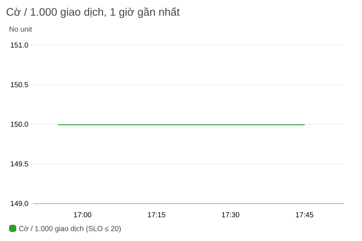
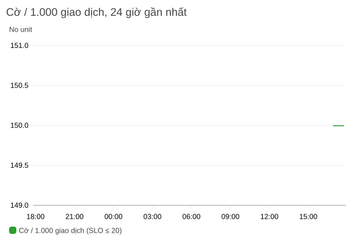
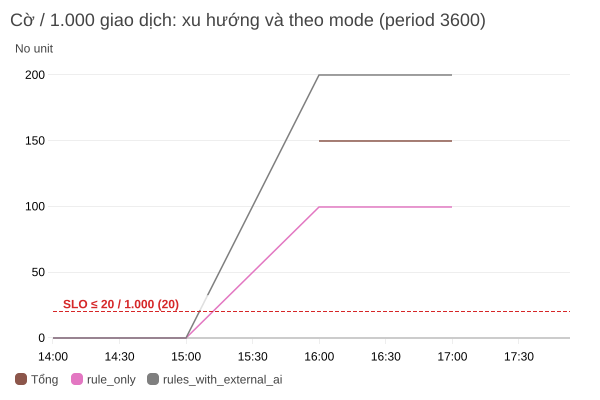
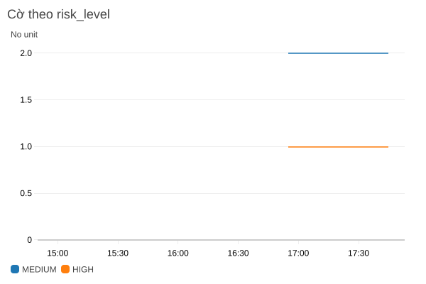
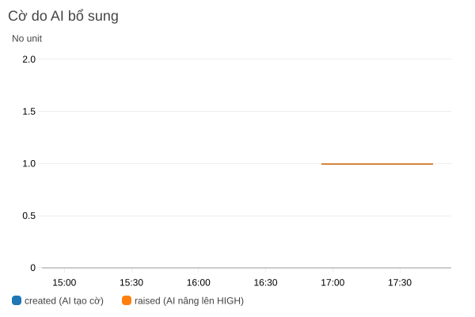

# DBS-187 · Metric số cờ trên 1.000 giao dịch

> **Status:** Implemented local (sau G4) · **Vai:** #4 Fraud (Dev làm thay) · **Cặp đôi review:** Dev khác · **Nhánh:** `feat/DBS-187-flag-rate-metric` (xếp trên nhánh PR #216) · **PR:** — · **Cập nhật:** 2026-11-21

## 1. Bối cảnh

- **Task trên board:** Task, Tuần 8, Ưu tiên Medium, Deliverable/Demo P4, Vai `#4 Fraud`, status To Do. **Expect:** «Phát hiện sớm khi luật báo nhầm hàng loạt.»
- **Thực trạng (chép từ board):** «Chưa theo dõi khối lượng cảnh báo trên hệ thống thật.»
- **DoD (chép nguyên văn từ board):**
  1. Metric flags_per_1000_transfers theo cửa sổ trượt (1 giờ và 24 giờ) và số cờ theo risk_level
  2. Hiển thị trên dashboard; không có dữ liệu cá nhân trong nhãn metric
  3. PR đã merge vào main (CI xanh); Dev review; bảng «Đối chiếu test case» trong PR điền đủ
  4. Tách metric theo mode (rule_only / rules_with_external_ai) và đếm cờ do AI bổ sung
- **Phụ thuộc:** DBS-111 (consumer chấm điểm) và DBS-144 (metric SLI) Done trên board và có trên `main`.
- **Thực trạng kiểm bằng code:** `risk_decision_total{ai_status}` đã có (một lần tăng mỗi quyết định thắng claim, `risk-scoring.consumer.ts:209`); **không có** counter đếm cờ (`fraud_flags`) theo `risk_level`, `mode` hay phần AI cộng thêm. Dashboard `session/dashboard.tf` không có widget cờ/1.000 giao dịch. docs/03 §14 (dòng 885) đã định SLO «≤ 20 cờ / 1.000 giao dịch, 24 giờ trượt, khi có ≥ 1.000 giao dịch»; `docs/components/observability/01-concept-brief.md` (dòng 139) và **BL-340** ghi đúng khoảng trống này.
- **Dòng BACKLOG cùng DoD:** **BL-340** (counter cờ trên tổng giao dịch, alarm SLO): DBS-187 làm counter, dashboard, công thức; DBS-188 làm alarm. BL-340 được **sửa** ở cuối (còn lại alarm), không xóa.
- **Baseline (2026-11-20, nhánh từ `main`, Node 24.22.2):** `lint:check` sạch; `typecheck` sạch; `npm test` 139 suite, 2.371 test đạt. `test:db`, `test:services` và `terraform test` chạy ở Phase 4b với cùng lệnh dùng để kiểm.
- **Ngoài phạm vi:** alarm (DBS-188); mở dashboard trên CloudWatch thật (máy này không có credential AWS: chỉ kiểm bằng `terraform test` và JSON dựng ra, **chưa** kiểm console, ghi BL); sửa luật hay ngưỡng; số liệu đánh giá (DBS-161, 169).
- **Quyết định ở G1 (agent tự quyết):**
  1. Nhánh xếp trên PR #216 (cùng sửa `docs/BACKLOG.md`, bảng tám cột).
  2. Counter EMF, **không** gauge đọc SQL: gauge đọc 24 giờ dữ liệu mỗi 60 giây (nhiều triệu dòng ở 120 RPS) và hai task worker phát trùng; counter là cách của repo (BL-204, 209, DBS-163).
  3. Không đổi dimension hiện có của `risk_decision_total`; chỉ thêm `roleTotal` để có mẫu số `Role`.
  4. Không có AWS: DoD «hiển thị trên dashboard» chỉ kiểm ở mức `terraform test` (BL mới).

## 2. Hành vi

### 2.1 Counter `risk_flag_total`

Tăng **1** sau commit, bởi lần giao message **thắng claim** của `risk_decisions` và có `result.level !== 'LOW'` (đúng điều kiện ghi `fraud_flags`; không dựa vào `flagLagMs` hữu hạn). LOW, lần giao trùng, `DEPOSIT` và lỗi (rollback) không tăng.

| Nhãn | Dimension | Giá trị | Nguồn |
|---|---|---|---|
| `risk_level` | `RiskLevel` | `MEDIUM`, `HIGH` | `result.level` |
| `mode` | `Mode` | `rule_only`, `rules_with_external_ai` | `result.mode` |
| `ai_added` | `AiAdded` | `none`, `created`, `raised` | so mức chỉ-luật với mức cuối (dưới) |

**`ai_added`** so mức chỉ có luật (`ruleLevel`, tính từ `ruleScore` và `ruleSet.thresholds` của chính rule set đã chấm) với mức cuối: `created` khi `ruleLevel = LOW` và mức cuối ≠ LOW (không có AI thì không có cờ); `raised` khi `ruleLevel = MEDIUM` và mức cuối = HIGH (AI nâng cờ có sẵn lên HIGH); còn lại `none`, gồm cả trường hợp AI cộng điểm mà mức không đổi (ví dụ luật đã HIGH). `aiAppliedWeight > 0` chỉ xảy ra khi `AiStatus = SUCCEEDED`; `CONFIG_INVALID` và mọi fallback cho `none`.

Giá trị ngoài các tập trên ghi `unknown`; không nhãn nào chứa dữ liệu cá nhân. EMF: dimension set `[Role, RiskLevel, Mode, AiAdded]` và `[Role]` (`roleTotal`); đơn vị `Count`; `writeCounters` chỉ phát khi delta > 0, nên series không có cờ thì không có điểm.

**Chi phí:** khoảng 8 series cờ (`rule_only` ≤ 2, `rules_with_external_ai` ≤ 6) cộng 2 series `[Role]` ≈ 10 metric tùy chỉnh, cỡ 3 USD/tháng nếu chạy cả tháng; ghi vào brief observability.

### 2.2 `risk_decision_total` thêm tổng `Role`

`roleTotal: true` cho `risk_decision_total`: mỗi dòng EMF thêm dimension set `[Role]` (mẫu số «giao dịch được chấm điểm»); set `[Role, AiStatus]` giữ nguyên, nên `dbs-dev-risk-ai-fallback-rate` (RSK-04) và `dbs-dev-risk-config-invalid` (BL-051, BL-188) không đổi.

### 2.3 Công thức

Mẫu số = số quyết định chấm điểm (một quyết định cho mỗi `TRANSFER`; nạp tiền không chấm); tử số = số cờ. Với `FILL` vì `writeCounters` không phát dòng khi delta = 0:

`flags_per_1000_transfers = IF(d > 0, 1000 * FILL(f, 0) / d, 0)` với `f = SUM(risk_flag_total)` bộ `[Role]` và `d = SUM(risk_decision_total)` bộ `[Role]`, cùng cửa sổ.

- **Theo mode:** `rule_only`: `f` = cờ `Mode=rule_only` (SEARCH), `d` = quyết định `AiStatus=DISABLED`; `rules_with_external_ai`: `f` = cờ `Mode=rules_with_external_ai`, `d = d_role − FILL(d_disabled, 0)`. **Bất biến dùng ở đây:** `rule_only` ⇔ `AiStatus = DISABLED` (một mode lạ quy về `rule_only`; một trả lời AI có status `DISABLED` bị đổi thành `CONFIG_INVALID`); có unit test giữ nó (TC-187-03).
- **Theo risk_level:** `SUM(SEARCH({Role,RiskLevel,Mode,AiAdded} … RiskLevel="MEDIUM"))` và `HIGH`.
- **Cờ do AI bổ sung (DoD 4):** `AiAdded=created`; `raised` ở một đường riêng của cùng widget.

### 2.4 Dashboard `dbs-dev-overview`

Thêm **năm** widget ở hàng y = 40 (sau `w_risk_health`, `w_flag`): hai `singleValue` và ba `timeSeries`:

1. `singleValue` «Cờ / 1.000 giao dịch, 1 giờ gần nhất» và `singleValue` «… 24 giờ gần nhất»: mỗi cái `setPeriodToTimeRange = true` và khoảng thời gian riêng của widget (`start = "-PT1H"`, `"-PT24H"`), nên là **tổng trượt thật tính đến lúc xem**. Có chú thích SLO 20.
2. `timeSeries` «Cờ / 1.000 giao dịch (xu hướng, period 3600)» tổng và theo mode.
3. `timeSeries` «Cờ theo risk_level (period 300)».
4. `timeSeries` «Cờ do AI bổ sung: created (và raised)».

Chú thích ở `dash_text` (dòng «Widget trống là chưa có nguồn») cập nhật: widget cờ trống khi worker không chạy; **0 cờ trong cửa sổ có quyết định hiển thị 0 nhờ `FILL`**. Các `assert` hiện có của `dashboard.tftest.hcl` được **sửa có chủ ý**: số widget (16 → 21) và số widget metric (15 → 20), danh sách dimension được phép thêm đúng `RiskLevel`, `Mode`, `AiAdded` (ba tên cố định, không chứa dữ liệu cá nhân), danh sách metric thêm `risk_flag_total`, regex SEARCH.

### 2.5 Giới hạn nói thẳng

- **Chưa kiểm trên console AWS:** `setPeriodToTimeRange` kèm `start` riêng của widget theo tài liệu CloudWatch Dashboard Body; `terraform test` chỉ kiểm JSON dựng ra, **không** chứng minh console chấp nhận và hiển thị đúng (BL mới).
- **Đường xu hướng** dùng `period` cố định (điểm cuối bucket), không phải trượt từng phút; CloudWatch metric math không dịch được thời gian. Số «trượt» là hai ô `singleValue`.
- **Alarm 24 giờ trượt đúng nghĩa của SLO** thuộc DBS-188 (alarm không dùng được `singleValue`/`SEARCH`; dùng bộ `[Role]` của hai counter). Alarm theo mức hay mode cần tham chiếu tới 8 series hoặc mở rộng `CounterSpec` để phát thêm bộ `[Role, RiskLevel]`, `[Role, Mode]`: bàn giao cho DBS-188.
- **Mẫu số nhỏ:** khi ít giao dịch tỉ lệ nhảy mạnh; «≥ 1.000 giao dịch» là điều kiện của alarm.
- **Hai task worker:** mỗi task phát counter riêng, CloudWatch cộng (`Sum`).
- **Khởi động lại:** `MetricsService` lấy baseline lúc start; counter về 0 sau restart không phát số âm (`delta ≤ 0` bỏ qua).

## 3. Kiến trúc

- **Vị trí:** worker (`APP_ROLE=worker`), module `risk`; `common/metrics`; Terraform `session`.
- **File sửa:** `backend/src/modules/risk/risk-scoring.metrics.ts` (thêm `FLAG_METRIC`, `countFlag`, `classifyAiAdded`); `scoring.service.ts` (xuất `levelOf`, dùng ở `applyAssessment`); `risk-scoring.consumer.ts` (giữ `thresholds` trong `Prepared`; `countFlag` trong `onCommitted`); `backend/src/common/metrics/emf.ts` (thêm ba tên dimension); `metrics.service.ts` (`risk_flag_total`; `roleTotal` cho `risk_decision_total`); `metrics.service.spec.ts` (sửa TC-204-01, thêm counter vào danh sách dọn); `infra/terraform/envs/dev/session/dashboard.tf` và `tests/dashboard.tftest.hcl` (sửa assert); `alarms.tf` (chỉ chú thích đầu file: counter nay còn có bộ `[Role]`); docs: docs/03 §14, `01-concept-brief.md`, BACKLOG BL-340, feature doc, README.
- **Interface:** `countFlag(level, mode, aiAdded)`; `classifyAiAdded(ruleScore, finalLevel, thresholds): 'none' | 'created' | 'raised'`; `levelOf(score, thresholds)`: hàm thuần; `levelOf` được **xuất từ `scoring.service.ts` và dùng chung** với `applyAssessment` (không chép lại phép tính mức), nên `ai_added` không lệch được với `fraud_flags.risk_level`. Người gọi của symbol đổi (grep): `countDecision` chỉ ở consumer; `EMF_DIMENSION_NAMES` chỉ ở `emf.ts`, `metrics.service.ts`. Ngưỡng lấy từ `ruleSet.thresholds` (`RuleSet` kế thừa `ScoringConfig`), đã đi kèm khi chấm.
- **Dữ liệu:** không chạm bảng nào; không migration.
- **Ranh giới transaction:** không đổi; counter tăng trong `onCommitted` (sau commit, không I/O); không phụ thuộc `flagLagMs`.
- **Thay đổi cấp hệ thống:** docs/03 §14 ghi metric, dashboard và giới hạn; không đổi ADR.

## 4. Test cases tự động

`U` = unit (`src/**/*.spec.ts`), `D` = `test/db/*.db-spec.ts` (Postgres thật, kiểm EMF theo từng quyết định như TC-204-07/09), `S` = `test/services` (Postgres + ElasticMQ), `T` = `terraform test`.

| ID | Truy vết | Lớp | Given · When · Then | Kết quả |
|---|---|---|---|---|
| TC-187-01 | DoD 1, 4 | U | `countFlag` với mỗi tổ hợp hợp lệ | tăng đúng series; ngoài tập → `unknown` |
| TC-187-02 | DoD 4 | U | `classifyAiAdded` với bảng ngưỡng 40/70: luật 30 → cuối MEDIUM `created`; luật 30 → cuối HIGH `created`; luật 50 → HIGH `raised`; luật 50 → MEDIUM `none`; luật 75 → HIGH `none`; luật 40 (= ngưỡng) → HIGH `raised`; và ở mọi ca `levelOf(ruleScore + aiAppliedWeight)` bằng `result.level` | đúng |
| TC-187-03 | DoD 4 (mẫu số theo mode) | U (`scoring.service`) | mọi kết quả `rule_only` có `aiStatus = DISABLED` và ngược lại, kể cả mode lạ và trả lời AI có status `DISABLED` | đúng |
| TC-187-04 | DoD 2 | U | `countFlag` với id, số tiền, chuỗi lạ | chỉ nhãn trong tập cố định hoặc `unknown` |
| TC-187-05 | DoD 1 | U (`metrics.service`) | flush sau khi tăng hai counter | dòng EMF có `[Role,RiskLevel,Mode,AiAdded]` và `[Role]`; `risk_decision_total` có `[Role,AiStatus]` và `[Role]` (TC-204-01 sửa) |
| TC-187-06 | DoD 1, 4 | D | chấm TRANSFER ra LOW, MEDIUM (R3+R6), HIGH (rule set có `high` thấp) | EMF `risk_flag_total` 1 cho MEDIUM, 1 cho HIGH, LOW không có |
| TC-187-07 | DoD 4 | D (AI giả) | AI cộng trọng số: luật dưới ngưỡng → `created`; luật MEDIUM → HIGH `raised`; AI thất bại → `none` | đúng nhãn |
| TC-187-08 | idempotency, rollback | D | cùng event giao hai lần; DEPOSIT; lần `apply` đầu ném `40P01` rồi chạy lại | counter tăng đúng một lần; DEPOSIT không tăng |
| TC-187-09 | đường đi đầu cuối | S | worker thật chấm một chuyển tiền ra MEDIUM | counter tăng một lần (so delta) |
| TC-187-10 | DoD 2 | T | năm widget mới có trong dashboard (số widget 21, số widget metric 20): hai `singleValue` với `setPeriodToTimeRange` và `start` `-PT1H`/`-PT24H`; biểu thức chứa `FILL` và `IF(d > 0`; tên metric và dimension đúng | đạt |
| TC-187-11 | DoD 2 (không dữ liệu cá nhân) | T | `dashboard_labels_are_safe` (sửa có chủ ý) chấp nhận đúng ba dimension mới | đạt; thêm nhãn lạ thì đỏ |
| TC-187-12 | quy trình | — | PR merge, CI xanh, Dev review, bảng đối chiếu | sau G4 |

## 5. Test thủ công

Điều kiện: Node 24, `docker compose up -d` (Postgres, Valkey, ElasticMQ), AWS CLI (chỉ với endpoint ElasticMQ). M-187-01..05 và M-187-08 chạy ứng dụng thật: `APP_ROLE=both`, `METRICS_EMF=true`, `METRICS_FLUSH_MS=5000`, `AUTH_MODE=local`, không driver giả cho counter. Chuyển tiền tạo bằng API thật theo kịch bản của [demo giữa kỳ](../demos/demo-midterm-end-to-end.md) (nạp, rồi chuyển lệnh lớn rút gần hết số dư: R3 + R6 = 65, MEDIUM) và các lệnh nhỏ (LOW). Đọc dòng EMF trên stdout của tiến trình, đối chiếu `SELECT` trên `fraud_flags` và `risk_decisions`. HIGH: chạy lại với rule set có `high` thấp (phiên bản mới, DBS-160).

| Bước | Việc làm | Kết quả mong đợi |
|---|---|---|
| M-187-01 | dựng hạ tầng và chạy app; nạp tiền; 3 lệnh nhỏ (LOW), 1 lệnh lớn (MEDIUM) | stdout có `risk_decision_total` tổng 4 (hai bộ dimension) và `risk_flag_total` tổng 1 (`MEDIUM`, `rule_only`, `none`); `SELECT count(*)`: 4 quyết định, 1 cờ |
| M-187-02 | tính tỉ lệ từ số đếm trong EMF như biểu thức §2.3 | 250 cờ/1.000 (1/4); khớp SQL |
| M-187-03 | lệnh đạt HIGH (rule set `high` thấp; chờ ≥ 60 giây sau khi thêm phiên bản vì `LATEST_TTL_SECONDS` cache phiên bản mới nhất) | `risk_flag_total` có thêm `RiskLevel=HIGH` |
| M-187-04 | lỗi/phục hồi: lấy payload của lệnh lớn từ `outbox_events` (`psql`) rồi gửi lại lên `risk-events`: `AWS_ACCESS_KEY_ID=local AWS_SECRET_ACCESS_KEY=local aws --endpoint-url http://localhost:9324 sqs send-message --queue-url <risk-events> --message-body "$PAYLOAD"`; sau đó khởi động lại worker và chuyển thêm một lệnh lớn | lần gửi lại: `processed_events` đã có dòng, **counter không tăng**, `SELECT count(*) FROM fraud_flags` không đổi; sau restart không có số âm, lệnh mới tăng đúng 1 |
| M-187-05 | rejection/biên: một cửa sổ flush chỉ có lệnh LOW; một cửa sổ chỉ có nạp tiền (DEPOSIT) | cửa sổ chỉ LOW: stdout có `risk_decision_total` mà **không** có dòng `risk_flag_total` (đúng lý do cần `FILL`); cửa sổ chỉ DEPOSIT: không có dòng nào. Biểu thức `IF(d > 0, …)` và `FILL` chỉ kiểm được trên console AWS: **chưa chạy** (BL) |
| M-187-06 | AI (**không** chạy trên app thật: app không có chỗ trỏ provider AI sang loopback, chỉ có chỗ cắm cho test): driver riêng `backend/test/manual/flag-rate-ai.manual.ts` (đi kèm PR), dựng từ `fraud-ai-flow.manual.ts` (consumer thật, DB tạm, ElasticMQ, AI giả trên loopback) và thêm `MetricsService` với bộ ghi EMF để in dòng | `AiAdded=created` khi AI đưa luật dưới ngưỡng lên MEDIUM; `raised` khi MEDIUM lên HIGH; `none` khi AI thất bại; `Mode` đúng |
| M-187-07 | `terraform fmt -check`, `validate`, `test` ở `session` | đạt; JSON dashboard có năm widget mới (21 widget, 20 metric) |
| M-187-08 | grep dòng EMF | không có id, số tiền hay chuỗi ngoài tập |
| M-187-09 | (thêm sau khi có credential `dbs`, được phép dựng) dựng riêng dashboard bằng `-target`, đẩy dòng EMF đúng dạng app vào log group tạm, vẽ năm widget bằng `get-metric-widget-image` rồi destroy | số trên widget khớp số tính tay (xem §8); dọn sạch |

Phần console AWS: sau này có credential `dbs`, đã kiểm một phần bằng API (M-187-09); giao diện ô số trên console còn lại là BL-404.

## 6. Domain review (AI)

**Reviewer:** subagent `opus`, effort `high`, hai lượt, 2026-11-20 · **Lượt 1:** 12 phát hiện (blocking 2, should-fix 3, minor 7), REVISE · **Lượt 2:** 5 phát hiện (should-fix 4, minor 1; hai blocking đã sửa đúng), **Verdict: APPROVE** · [trả lời nguyên văn](screenshots/DBS-187/domain-review.md)

| # | Mức | Phát hiện (rút gọn) | Xử lý |
|---|---|---|---|
| L1-1 | blocking | đường 24 giờ `period` 86400 trong dashboard 3 giờ không phải tổng 24 giờ; có cách làm trượt thật | đã sửa: hai `singleValue` `setPeriodToTimeRange` + `start` riêng (§2.4); §2.5 nói thẳng chưa kiểm console |
| L1-2 | blocking | test thủ công không chạy app thật, tự tính lại công thức | đã sửa: §5 chạy app thật, đối chiếu SQL, có bước lỗi/phục hồi |
| L1-3 | should-fix | thiếu `FILL` ở tử số; «widget trống = worker chưa chạy» sai | đã sửa: §2.3 |
| L1-4 | should-fix | test Terraform hiện có sẽ đỏ | đã sửa: §2.4 nêu rõ assert nào đổi có chủ ý |
| L1-5 | should-fix | `raised` gộp hai trường hợp, thổi phồng «cờ do AI bổ sung» | đã sửa: `ai_added` so mức chỉ-luật với mức cuối; widget chỉ vẽ `created` |
| L1-6..12 | minor | điều kiện đếm gắn `flagLagMs`; đường ngưỡng sai; tên alarm và `metrics.service.spec`; bất biến `rule_only` ⇔ `DISABLED`; bộ dimension cho alarm; chi phí; thiếu ca test | đã sửa từng mục (§2.1–§2.5, §3, §4) |
| L2-1..5 | should-fix, minor | số widget 21/20; M-187-06 không chạy được trên app thật; M-187-05 không kiểm được gì; M-187-04 thiếu lệnh; `levelOf` chép lại | đã sửa: §2.4, §5 (driver riêng, bước quan sát được, lệnh `aws sqs send-message`), §3 (`levelOf` dùng chung) |

### Quyết định ở G2 (agent tự quyết)

1. **Không mở rộng `CounterSpec`** để phát thêm bộ `[Role, RiskLevel]`, `[Role, Mode]` (bác ý #10 như thay đổi mặc định): ngoài DoD của DBS-187, bàn giao cho DBS-188 nếu cần alarm theo mức hay mode.
2. **Phần console AWS chưa chạy** (không có credential): ghi thành BL và nói ở §2.5, không giả «đạt».
3. **Mẫu số theo mode dựa vào `AiStatus = DISABLED`** thay vì thêm nhãn `Mode` vào `risk_decision_total` (giữ nguyên dimension của alarm RSK-04 và BL-051/188).

## 7. Kế hoạch triển khai

Lệnh: từ `backend/` với Node 24 (`export PATH="$APPDATA/fnm/node-versions/v24.22.2/installation:$PATH"`); unit `npx jest --config ./test/jest-unit.js <file>`; db `npm run test:db -- <file>`; services `npm run test:services -- --runInBand --runTestsByPath <file>`; Terraform `GOMAXPROCS=2 terraform test -parallelism=1` ở `infra/terraform/envs/dev/session`.

| Bước | File | Test viết trước | Kết quả đỏ (điền khi chạy) | Lệnh chứng minh | Commit |
|---|---|---|---|---|---|
| 1 | `scoring.service.ts` (xuất `levelOf`), `scoring.service.spec.ts` | TC-187-03 | (điền) | unit | `refactor(risk): xuất levelOf, giữ bất biến rule_only ⇔ DISABLED (DBS-187)` |
| 2 | `risk-scoring.metrics.ts`, `risk-scoring.metrics.spec.ts` | TC-187-01, 02, 04 | (điền) | unit | `feat(risk): counter risk_flag_total và classifyAiAdded (DBS-187)` |
| 3 | `emf.ts`, `metrics.service.ts`, `metrics.service.spec.ts` | TC-187-05 (và sửa TC-204-01) | (điền) | unit | `feat(metrics): risk_flag_total và tổng Role của risk_decision_total (DBS-187)` |
| 4 | `risk-scoring.consumer.ts`, `test/db/risk-scoring-consumer.db-spec.ts`, `test/db/risk-scoring-ai-mode.db-spec.ts`, `test/services/risk-scoring.services-spec.ts` | TC-187-06, 07, 08, 09 | (điền) | db, services | `feat(risk): đếm cờ theo mức, mode và phần AI sau commit (DBS-187)` |
| 5 | `session/dashboard.tf`, `session/tests/dashboard.tftest.hcl`, `session/alarms.tf` (chú thích) | TC-187-10, 11 | (điền) | `terraform test` | `infra(terraform): widget cờ/1.000 giao dịch trên dashboard (DBS-187)` |
| 6 | `backend/test/manual/flag-rate-ai.manual.ts` | M-187-06 (Phase 4c) | không áp dụng | xem §5 | `test(risk): driver thủ công AI cho metric cờ (DBS-187)` |
| 7 | docs/03 §14, `01-concept-brief.md`, BACKLOG (BL-340, BL mới), feature doc §8–§9, `docs/features/README.md`, ảnh/bằng chứng | TC-187 (doc) | `check-doc-links` | `check-doc-links.mjs`, `check-backlog.mjs` | `docs: DBS-187 …` |

**Quét kế hoạch:** DoD 1 (counter, dashboard hai ô trượt + xu hướng, theo `risk_level`) ⇒ bước 2–5; DoD 2 (dashboard, nhãn an toàn) ⇒ bước 5, TC-04, TC-11; DoD 4 (mode, AI bổ sung) ⇒ bước 2–4; DoD 3 quy trình; BL-340 ⇒ sửa ở bước 7 (còn alarm = DBS-188); hạn chế trong docs: cửa sổ trượt (§2.5), console AWS chưa kiểm (BL), mẫu số nhỏ (alarm DBS-188), bộ dimension cho alarm (DBS-188). BL-402/`check-backlog`: dòng BL mới phải đủ ba cột.

**Rủi ro và cách lùi:** counter mới là cộng thêm, không đổi dimension hiện có, nên lùi bằng `git revert`; rủi ro chính là `roleTotal` của `risk_decision_total` thêm một series `[Role]` (cùng alarm RSK-04 không đổi: đã kiểm trong review), và widget phụ thuộc cú pháp CloudWatch mà `terraform test` không chứng minh (chưa kiểm console).

**Quyết định ở G3 (agent tự quyết):** thứ tự bước 1→7; `levelOf` xuất khỏi `scoring.service.ts` trước (bước 1) để `ai_added` dùng đúng hàm đó.

## 8. Kết quả

**Lệnh kiểm tra** (Node 24.22.2, Postgres 17 và Valkey 8 tạm, 2026-11-20/21; SHA code cuối `0cff73f`):

| Lệnh | Kết quả |
|---|---|
| `npm run lint:check` | sạch |
| `npm run typecheck` | sạch |
| `npm test` | 139 suite, 2.378 test đạt (baseline 2.371: thêm 7), 0 skip |
| `npm run test:db -- test/db/risk-scoring-consumer.db-spec.ts` | 17 đạt |
| `npm run test:db -- test/db/risk-scoring-ai-mode.db-spec.ts` | 26 đạt |
| `npm run test:services -- --runInBand --runTestsByPath test/services/risk-scoring.services-spec.ts` | 2 đạt |
| `terraform fmt -check`, `validate`, `GOMAXPROCS=2 terraform test -parallelism=1` ở `session` | sạch; 94 đạt, 0 lỗi |
| `npm run test:db` (toàn bộ, một lần chạy) | lần 1: 9 suite đỏ (34 test), lần 2: 6 suite đỏ (7 test), đều là hết thời gian hoặc tiến trình con lỗi khi cả bộ chạy cùng lúc với app và container khác; không suite nào thuộc risk. Chạy lại riêng, tuần tự (`--runInBand`): `ai-gate`, `append-only`, `audit-search.http`, `outbox-writer-bootstrap`, `transfer-concurrency` 5 suite 99 test đạt; `reconciliation-migration-revert` 11 test đạt. Còn lại 78 suite đạt ở lần chạy đầy đủ. Chưa chạy lại cả bộ một lần xanh trên máy này; CI sẽ là bằng chứng cuối |

Kiểm chứng test bắt được lỗi (đột biến, rồi hoàn lại): bỏ điều kiện `level !== 'LOW'` làm hỏng test db; `classifyAiAdded` không bao giờ trả `created` làm TC-187-07 đỏ; đổi `start` của ô 1 giờ thành `-PT2H` và bỏ `FILL` ở ô 1 giờ làm `terraform test` đỏ.

**Đối chiếu test case:**

| ID | Test | Đạt? |
|---|---|---|
| TC-187-01 | `risk-scoring.metrics.spec.ts` › TC-187-01 | đạt |
| TC-187-02 | `risk-scoring.metrics.spec.ts` › TC-187-02 | đạt |
| TC-187-03 | `scoring.service.spec.ts` › TC-187-03 (ba test) | đạt |
| TC-187-04 | `risk-scoring.metrics.spec.ts` › TC-187-04 | đạt |
| TC-187-05 | `metrics.service.spec.ts` › TC-187-05 (và TC-204-01 sửa có chủ ý) | đạt |
| TC-187-06 | `risk-scoring-consumer.db-spec.ts` › TC-187-06 (MEDIUM đếm một lần, đúng ba nhãn và hai bộ dimension, không có UUID; LOW không đếm; lần giao trùng không đếm) | đơn giản hóa: HIGH không có ở file này vì `risk_rule_sets` chỉ thêm, đổi ngưỡng sẽ đổi phiên bản của mọi test cùng DB; HIGH được kiểm ở TC-187-07 (`raised`) và M-187-03; DEPOSIT chỉ kiểm thủ công (M-187-05) |
| TC-187-07 | `risk-scoring-ai-mode.db-spec.ts` › TC-187-07 (`raised`, `created`, `none` khi AI hỏng; LOW không có dòng cờ) | đạt |
| TC-187-08 | `risk-scoring-consumer.db-spec.ts` › TC-187-08 (`apply` đầu ném `40P01`, thử lại, đếm đúng một lần) | đạt; phần «cùng event giao hai lần» nằm trong TC-187-06 |
| TC-187-09 | `risk-scoring.services-spec.ts` › TC-111-13 (thêm `risk_flag_total`: nhãn cố định, tổng bằng số nguồn) | đạt |
| TC-187-10 | `dashboard.tftest.hcl` › `dashboard_shape`, `dashboard_has_every_metric`, `dashboard_flag_rate_widgets` | đạt (chỉ JSON dựng ra; xem BL-404) |
| TC-187-11 | `dashboard.tftest.hcl` › `dashboard_labels_are_safe` (allowlist thêm `RiskLevel`, `Mode`, `AiAdded`) | đạt |
| TC-187-12 | quy trình | sau khi merge |

**Test thủ công** (output thô: [manual-test.txt](screenshots/DBS-187/manual-test.txt), SHA `0cff73f`). App thật `node dist/main`, `APP_ROLE=both`, `METRICS_EMF=true`, `METRICS_FLUSH_MS=5000`, `AUTH_MODE=local`, API thật; không driver giả cho counter (trừ M-187-06).

| Bước | Kết quả |
|---|---|
| M-187-01 | **đạt.** Nạp 21 triệu, 3 lệnh 1.000 và 1 lệnh 20 triệu: SQL 4 quyết định, 1 cờ (`MEDIUM/65`). EMF: `risk_decision_total` 4 (`AiStatus=DISABLED`, hai bộ `[Role,AiStatus]` và `[Role]`); `risk_flag_total` 1 (`MEDIUM`, `rule_only`, `none`, hai bộ `[Role,RiskLevel,Mode,AiAdded]` và `[Role]`) |
| M-187-02 | **đạt một phần.** Từ số đếm EMF (1 cờ, 4 quyết định) tính tay 250 cờ/1.000, khớp SQL. Biểu thức CloudWatch `IF(d > 0, …)` và `FILL` **chưa chạy** (cần console, BL-404) |
| M-187-03 | **đạt.** Rule set v2 có `high` = 60: lệnh chạy ngay vẫn ra `MEDIUM/v1` vì phiên bản mới nhất được cache 60 giây (`LATEST_TTL_SECONDS`); sau 60 giây lệnh lớn ra `HIGH/65/v2` và EMF `RiskLevel=HIGH` |
| M-187-04 | **đạt.** Gửi lại payload đã xử lý lên `risk-events`: `risk_decisions` 5, `fraud_flags` 1, `processed_events` 8 trước và sau, queue về 0, **không có dòng EMF `risk_*` nào**. Khởi động lại app rồi chuyển thêm một lệnh lớn: `fraud_flags` 1 → 2, đúng một dòng `risk_flag_total` giá trị 1, không số âm |
| M-187-05 | **đạt phần quan sát được.** Cửa sổ chỉ có lệnh LOW: một dòng `risk_decision_total`, không có `risk_flag_total` (đúng lý do cần `FILL`); cửa sổ chỉ có nạp tiền: không có dòng `risk_*`. `FILL`/`IF` trên console: chưa chạy (BL-404) |
| M-187-06 | **đạt** bằng driver `test/manual/flag-rate-ai.manual.ts` (consumer thật, DB tạm, AI giả trên loopback): `raised` (HIGH), `created` (MEDIUM), `none` (AI hỏng), `Mode=rules_with_external_ai`; không chạy trên app thật vì app không có chỗ trỏ AI sang loopback |
| M-187-07 | **đạt.** `fmt -check`, `validate`, `terraform test` 94/94 |
| M-187-09 | **đạt một phần, trên CloudWatch thật** (có credential `dbs`, được phép dựng): dựng riêng dashboard (`-target`), đẩy dòng EMF đúng dạng app ghi qua log group tạm, CloudWatch trích metric; năm widget lấy từ dashboard thật vẽ bằng `get-metric-widget-image` cho đúng số (1 giờ 150, xu hướng tổng 150, `rule_only` 100, `rules_with_external_ai` 200, `created` 11, `raised` 11). **Chưa kiểm:** giao diện ô `singleValue` với `setPeriodToTimeRange` (API vẽ thành đường) và sự khác nhau 1 giờ / 24 giờ (không đẩy được khối dữ liệu cũ). Đã destroy dashboard và xóa log group |
| M-187-08 | **đạt.** 9 dòng EMF `risk_decision_total`/`risk_flag_total` của app: 0 vi phạm (không UUID, không số tiền, mọi giá trị nhãn trong tập cố định, số đếm là số nguyên dương). Bộ kiểm lần đầu báo nhầm vì coi các khóa của log pino (`level`, `time`, `role`, `correlationId`, `appRole`, `message`) là nhãn; đã sửa bộ kiểm cho bỏ qua phong bì log, không đổi code |

Quan sát khi chạy: trong `APP_ROLE=both` dòng EMF mang `Role=both` (không phải `worker`), nên năm widget mới (lọc `Role=worker`) sẽ trống nếu dùng chế độ này trên AWS; trên ECS worker chạy `APP_ROLE=worker`. Đã ghi ở `01-concept-brief.md`.

**Phạm vi so với §7** (`git diff --stat docs/DBS-141-post-demo-tech-debt...HEAD`, 16 file code/test + docs): khớp bước 1–6, thêm `backend/src/modules/risk/risk-level.ts` (xem lệch dưới).

**Ảnh chụp** (năm widget do CloudWatch vẽ qua `get-metric-widget-image`, không phải ảnh chụp console):     . Ảnh console thật chưa có (BL-404). Test M-187-01..08 là CLI, bằng chứng là `manual-test.txt` thô (dòng đầu là SHA, không token, không ARN).

**Lệch so với kế hoạch** (gate phụ, agent tự duyệt):
1. File mới `risk-level.ts` chứa `levelOf` và `RiskLevel`, không import gì: `risk-scoring.metrics.ts` cần `levelOf` mà `scoring.service.ts` import module metrics, nên đặt `levelOf` ở `scoring.service.ts` sẽ tạo vòng import. `scoring.service.ts` vẫn xuất lại `levelOf` và `RiskLevel`, nên mọi nơi gọi cũ không đổi.
2. TC-187-06 không có HIGH (lý do ở bảng trên).
3. Bộ kiểm M-187-08 sửa một lần (đã nêu).
4. `docs/03` §14 và `01-concept-brief.md` sửa thêm (bảng metric, hàng dashboard, ghi chú alarm) đúng kế hoạch bước 7.

**Bàn giao:**
- **BL-340** (sửa): còn alarm «> 20 cờ/1.000 giao dịch, ≥ 1.000 giao dịch, 24 giờ trượt» cho DBS-188; counter và dashboard xong ở đây. Alarm dùng bộ `[Role]` của `risk_flag_total` và `risk_decision_total`.
- **BL-404** (mới, đã thu hẹp sau M-187-09): còn xem trên console AWS ô `singleValue` với `setPeriodToTimeRange` + `start` (1 giờ khác 24 giờ khi có dữ liệu cũ hơn 1 giờ); biểu thức, `FILL`, `IF`, `SUM(SEARCH)` đã kiểm bằng CloudWatch thật. Giao #5 Platform & Ops, `Hoãn · H4`.

## 9. Tài liệu đã cập nhật

- `docs/03_HIGH_LEVEL_ARCHITECTURE.md` §14: bỏ câu «chưa có metric đếm cờ», nêu `risk_flag_total`, alarm còn lại cho DBS-188.
- `docs/components/observability/01-concept-brief.md`: bảng metric (`risk_flag_total`, `[Role]` của `risk_decision_total`), hàng dashboard 8–9 và cách tính, ghi chú bộ dimension `roleTotal`, ghi chú alarm.
- `infra/terraform/envs/dev/session/alarms.tf` (chú thích đầu file về `roleTotal`).
- `docs/BACKLOG.md`: BL-340 sửa, BL-404 thêm; không xóa dòng nào.
- `docs/features/README.md`: thêm dòng DBS-187.
