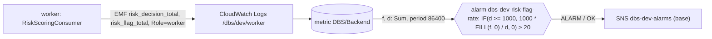
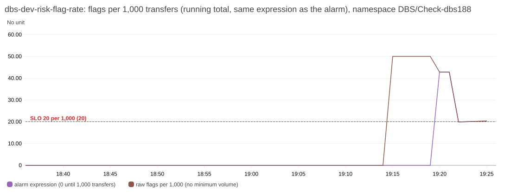

# DBS-188 · Alarm khi cảnh báo trên 1.000 giao dịch vượt mục tiêu

> **Status:** Implemented · **Vai:** #4 Fraud (Dev làm thay) · **Cặp đôi review:** Dev khác · **Nhánh:** `feat/DBS-188-flag-rate-alarm` · **PR:** [#220](https://github.com/Lawliet119/digital-banking-simulator/pull/220) · **Cập nhật:** 2026-11-21

## 1. Bối cảnh

- **Task trên board:** Task, Tuần 8, Ưu tiên Medium, Deliverable/Demo P4, Vai `#4 Fraud`, status To Do. **Expect:** «Luật báo nhầm hàng loạt được phát hiện tự động.»
- **Thực trạng (chép từ board):** «Chưa có alarm cho khối lượng cảnh báo. Ngưỡng lấy từ mục tiêu đã chốt ở DBS-29; metric lấy từ DBS-187. [Cập nhật 11/10] Ngưỡng đã chốt: 20 cảnh báo/1.000 giao dịch, cửa sổ 24 giờ, khi có ≥ 1.000 giao dịch.»
- **DoD (chép nguyên văn từ board):**
  1. Alarm khi vượt mục tiêu đã chốt (vd 20/1.000), kèm số giao dịch tối thiểu để tránh báo ảo
  2. Thử bằng cách bơm giao dịch giống kịch bản gian lận → alarm bật
  3. Ghi vào P5 làm bằng chứng vận hành
  4. PR đã merge vào main (CI xanh); Dev review; bảng «Đối chiếu test case» trong PR điền đủ
  5. Thêm alarm riêng cho ai_status = CONFIG_INVALID và tỉ lệ fallback AI vượt ngưỡng (BL-051); alarm DLQ risk-events-dlq theo DBS-163
- **Phụ thuộc:** DBS-187 (counter `risk_flag_total`, tổng `[Role]` của `risk_decision_total`, dashboard): trên board vẫn «To Do» nhưng đã merge vào `main` (#218, `9213899`); board chậm so với repo.
- **Thực trạng kiểm bằng code và lệnh (DoD 5 đã có phần lớn):**

| Phần của DoD | Đã có ở | Bằng chứng (đã chạy) |
|---|---|---|
| Alarm `ai_status = CONFIG_INVALID` | `session/alarms.tf` `risk_config_invalid` (`dbs-dev-risk-config-invalid`, BL-051, BL-188) | `alarms.tftest.hcl` › `config_invalid_alarm` đạt |
| Tỉ lệ fallback AI vượt ngưỡng | `session/alarms.tf` `risk_ai_fallback_rate` (`dbs-dev-risk-ai-fallback-rate`, RSK-04): `IF(total_ai >= 5, 100 * fb_sum / total_ai, 0)` > 10% | `risk_ai_fallback_rate_alarm` và hai test từ chối ngưỡng sai đạt |
| Alarm DLQ `risk-events-dlq` | `base/alarms.tf` `dlq_not_empty` (`dbs-dev-risk-dlq-not-empty`, DBS-163): **đang chạy trên tài khoản** (`aws cloudwatch describe-alarms` chỉ trả `dbs-dev-risk-dlq-not-empty` và `dbs-dev-notification-dlq-not-empty`). `dlq_oldest_age` (RSK-04) có trong code và test nhưng **chưa được apply** ở base | `base/tests/alarms.tftest.hcl` › `dlq_alarms`, `dlq_oldest_age_alarms` |
| **Alarm cờ/1.000 giao dịch (DoD 1, 2, 3)** | **chưa có** | không có `resource` hay `metric_query` nào đọc `risk_flag_total` trong `alarms.tf` (chỉ có chú thích đầu file) |

  Vậy task này **chỉ làm phần còn thiếu**: alarm cờ/1.000 giao dịch (DoD 1), bằng chứng bơm giao dịch (DoD 2), ghi P5 (DoD 3); DoD 5 không thêm alarm nào, chỉ ghi lại phần đã có và đối chiếu (TC-188-06).
- **Dòng BACKLOG cùng DoD:** **BL-340** (alarm còn lại của DBS-187): lấy vào phạm vi, **xóa** dòng ở PR này. BL-341 (kích hoạt thử alarm trên AWS, ghi «18 alarm» nhưng code đã có 21: 17 ở session và 4 ở base): task này kích hoạt thử đúng một alarm mới, không đủ để xóa BL-341; sửa nó thành «22 alarm, 1 đã kích hoạt thử (DBS-188)».
- **Baseline (2026-11-21, nhánh từ `origin/main` `9213899`, Terraform 1.16.6):** `terraform fmt -check -recursive` sạch; `terraform validate` đạt; `GOMAXPROCS=2 terraform test -parallelism=1` ở `envs/dev/session`: **94 đạt, 0 lỗi**.
- **Ngoài phạm vi:** đổi code backend hoặc counter (không cần: DBS-187 đã đủ bộ dimension `[Role]`); alarm theo mức (`RiskLevel`) hay theo mode (cần bộ dimension mới, xem §2.5, BL); đổi ngưỡng hay luật; đánh giá số liệu (DBS-161, 169); kích hoạt thử 17 alarm còn lại (BL-341).
- **Quyết định ở G1 (agent tự quyết, không có người để hỏi; không dùng subagent riêng cho quyết định vì không có chỗ kẹt: các lựa chọn dưới đều có bằng chứng chạy được, và domain review ở G2 kiểm lại từng cái):**
  1. DoD 5 **không thêm alarm trùng**: ba alarm đã có và đã có test; chỉ chạy lại và ghi.
  2. Cửa sổ 24 giờ = `period 86400` × 1 chu kỳ (lý do ở §2.1, đã thử trên một alarm thật một metric); loại «3600 × 24».
  3. Bằng chứng DoD 2 chạy trên AWS thật, key state tạm, namespace tạm `DBS/Check-dbs188` (không lẫn metric thật; `DBS/Backend` còn số tổng hợp của DBS-187 trong cửa sổ 24 giờ), alarm có action tới topic base (topic chưa có người đăng ký nên không gửi thư): task fraud không bị giới hạn kinh phí và alarm chạy vài phút là vài xu.
  4. Hai số SLO là `locals` có tên, không phải biến, vì đó là hợp đồng đã chốt (docs/03 §14), không phải núm vặn.

## 2. Hành vi

### 2.1 Alarm `dbs-dev-risk-flag-rate`

Một alarm mới ở `envs/dev/session/alarms.tf`, gửi ALARM và OK vào topic SNS của base như mọi alarm khác.

| Thuộc tính | Giá trị | Vì sao |
|---|---|---|
| Metric `f` | `risk_flag_total`, dimension `{Role = worker}`, `Sum`, period 86400 | bộ `[Role]` (tổng) của counter DBS-187; alarm không dùng được `SEARCH` |
| Metric `d` | `risk_decision_total`, dimension `{Role = worker}`, `Sum`, period 86400 | mẫu số: số quyết định chấm điểm = số `TRANSFER` được chấm (nạp tiền không chấm) |
| Biểu thức trả về | `IF(d >= 1000, 1000 * FILL(f, 0) / d, 0)` | `d >= 1000` là **số giao dịch tối thiểu** (DoD 1); `FILL(f, 0)` vì app chỉ phát dòng khi delta > 0 nên cửa sổ không có cờ thì `f` không có điểm |
| Ngưỡng | `> 20` (`GreaterThanThreshold`) | SLO «≤ 20» (docs/03 §14): đúng 20,0 chưa báo |
| Cửa sổ | `period = 86400`, `evaluation_periods = 1`, `datapoints_to_alarm = 1` | một bucket 24 giờ (xem dưới) |
| `treat_missing_data` | `notBreaching` | không có quyết định nào trong 24 giờ thì không có tỉ lệ; worker chết đã có `dbs-dev-outbox-age` |

**Cửa sổ «24 giờ trượt».** CloudWatch alarm không có hàm tổng trượt, nhưng với `period = 86400` và một chu kỳ, alarm lấy đúng một bucket **bắt đầu tại `bây giờ − 24 giờ`** (làm tròn phút) và đánh giá lại định kỳ, nên mỗi lần đánh giá là tổng thật của 24 giờ gần nhất tính đến lúc đó (bằng chứng: một alarm thử một metric, `period 86400`, có `StateReason` ghi mốc đầu bucket `19/11/26 18:45:00` khi đánh giá lúc `20/11/26 18:45` UTC; với alarm thật hai metric, mốc này và độ trễ đổi trạng thái được ghi lại ở M-188-06, §8). Không seed được dữ liệu cũ hơn vài giờ để chứng minh phía **rơi ra khỏi** cửa sổ (PutMetricData với mốc cũ 5 giờ và 20 giờ không truy vấn được), nên «dữ liệu cũ hơn 24 giờ không được tính» dựa trên mốc đầu bucket này, không phải một phép đo. Phương án «period 3600 × 24 chu kỳ» bị loại: mỗi chu kỳ là một tỉ lệ riêng của một giờ, không cộng được thành tổng 24 giờ, và điều kiện «≥ 1.000 giao dịch» sẽ áp cho từng giờ chứ không cho cả ngày.

**Hệ quả nói thẳng (không phải lỗi):**
- Alarm đo **tỉ lệ 24 giờ**, không phải phát hiện đợt bùng phát ngắn: một giờ báo nhầm hàng loạt chỉ kêu khi kéo tỉ lệ cả 24 giờ qua 20/1.000 (mẫu số lớn pha loãng). Đó chính là SLO của docs/03 §14.
- Alarm **giữ ALARM** cho tới khi đợt cờ ra khỏi cửa sổ 24 giờ hoặc khối lượng pha loãng tỉ lệ về ≤ 20. Thư OK nghĩa là «24 giờ qua đã về mức cho phép», không phải «đã xử lý».
- Mẫu số dưới 1.000 trong 24 giờ: không bao giờ báo, kể cả 100% giao dịch bị gắn cờ. Ở tải dev thấp alarm gần như luôn OK; đó là đánh đổi chủ ý của DoD (tránh báo ảo).
- Chỉ `Role=worker` (như dashboard). `APP_ROLE=both` (chạy local) phát `Role=both`, không được đếm; trên ECS worker chạy `APP_ROLE=worker`.
- Hai task worker phát counter riêng, CloudWatch cộng (`Sum`) cả tử và mẫu.
- Không có alarm theo mức (`RiskLevel`) hay mode: cần bộ dimension `[Role, RiskLevel]` / `[Role, Mode]` mà counter chưa phát, và DoD không đòi. Ghi BL (xem §8).
- **Chi phí:** alarm biểu thức metric tính theo số metric tham chiếu: 2 metric ≈ 0,20 USD/tháng nếu chạy cả tháng; tính theo giờ.

### 2.2 Phần DoD 5 đã có

`dbs-dev-risk-config-invalid`, `dbs-dev-risk-ai-fallback-rate` (session) và `dbs-dev-risk-dlq-not-empty` (base) giữ nguyên, không sửa, không thêm alarm trùng. Task chỉ thêm một test (TC-188-06) khóa việc hai alarm session còn tồn tại với đúng tên và metric, và ghi vào doc; alarm DLQ đã có test ở `base/tests/alarms.tftest.hcl`.

### 2.3 Bằng chứng «bơm giao dịch giống gian lận → alarm bật» (DoD 2)

Dùng **ứng dụng thật** để sinh dòng EMF, rồi đưa lên CloudWatch thật:
1. Driver `backend/test/manual/flag-rate-alarm.manual.ts` dùng consumer risk thật, DB tạm, API thật và `MetricsService` thật với `Role=worker`. Luồng gồm giao dịch thường (nhỏ, LOW) và **kịch bản chiếm đoạt tài khoản rút cạn** (ATO_DRAIN: nạp 21 triệu rồi chuyển 20 triệu sang tài khoản lạ: R3 + R6 = 65, MEDIUM). Mỗi người gửi thường có tài khoản riêng, nạp 5 triệu và chuyển 5 lệnh 100.000 đồng tới **một** người nhận cố định (một trong 10): không vượt R1 (5 lệnh/10 phút), không chạm R5 (5 người nhận mới/giờ), dưới 10 triệu (không R3) và dưới 90% số dư (không R6), nên mọi giao dịch thường ra LOW; mỗi vụ ATO_DRAIN dùng một nạn nhân riêng. Driver **tự kiểm** tổng quyết định và cờ trong chính các dòng EMF ở mỗi giai đoạn (600/0, 900/45, 1.050/45, 2.250/45, 2.251/46) và đối chiếu SQL (`risk_decisions`, `fraud_flags`) trước khi đẩy gì lên AWS. Mỗi giai đoạn ghi các dòng EMF thật ra file; chỉ hai metric alarm đọc (`risk_decision_total`, `risk_flag_total`) được đẩy lên.
2. Các dòng được đẩy qua `aws logs put-log-events` vào log group tạm (timestamp = lúc đẩy, namespace đổi sang `DBS/Check-dbs188` để không lẫn metric thật), CloudWatch trích thành metric.
3. Alarm dựng bằng `-target` với state tạm và `-var metrics_namespace=DBS/Check-dbs188`; theo dõi `describe-alarms` và `describe-alarm-history`.
4. Dọn: destroy, xóa log group, xóa state tạm.

Chỉ một bước là số tổng hợp: một dòng `risk_decision_total` lớn dùng để pha loãng tỉ lệ về đúng 20,0 (M-188-07), ghi rõ ở §8.

## 3. Kiến trúc

- **Vị trí:** Terraform `envs/dev/session` (dựng và xóa cùng phiên); không đổi code backend. Test: `tests/alarms.tftest.hcl` (mock provider, không cần credential).
- **File sửa:** `session/alarms.tf` (một `aws_cloudwatch_metric_alarm.risk_flag_rate`, chú thích đầu file: 18 alarm ở session, tổng 22 với 4 alarm DLQ); `session/tests/alarms.tftest.hcl` (thêm `run`, sửa assert đếm và danh sách alarm); `backend/test/manual/flag-rate-alarm.manual.ts` (driver mới, không chạy trong CI); docs.
- **Interface:** `local.alarm_role_worker`, `local.alarm_actions`, `var.metrics_namespace` đã có; không biến mới (20 và 1.000 là SLO đã chốt, đặt thành hai `locals` có tên `risk_flag_rate_threshold_per_1000`, `risk_flag_rate_min_transfers`).
- **Dữ liệu:** không đổi bảng; không migration.
- **Hợp đồng với ứng dụng:** tên metric `risk_flag_total`, `risk_decision_total` và bộ dimension `[Role]` (DBS-187, `roleTotal`). Nếu ứng dụng đổi bộ dimension, alarm không có dữ liệu và (vì `notBreaching`) **im lặng**: test `alarms.tftest.hcl` ghi bộ dimension mong đợi, và đây là rủi ro đã biết (§7).
- **Sơ đồ:**

- **Thay đổi cấp hệ thống:** docs/03 §14 (đã có alarm, số alarm), `01-concept-brief.md` (bảng alarm, bỏ câu «chưa có alarm cho > 20 cờ/1.000»), `FRAUD_DETECTION_GUIDE.md` §7 (hàng «Theo dõi báo nhầm», P5); không đổi ADR.

## 4. Test cases tự động

`T` = `terraform test` (mock provider) ở `envs/dev/session`.

| ID | Truy vết | Lớp | Given · When · Then |
|---|---|---|---|
| TC-188-01 | DoD 1 | T | plan: alarm `dbs-dev-risk-flag-rate` có biểu thức trả về đúng `IF(d >= 1000, 1000 * FILL(f, 0) / d, 0)`, ngưỡng 20, `GreaterThanThreshold`, `evaluation_periods = 1`, `datapoints_to_alarm = 1`, `treat_missing_data = notBreaching` |
| TC-188-02 | DoD 1 (tối thiểu) | T | plan: số giao dịch tối thiểu bằng 1.000 và nằm **trong điều kiện** của biểu thức (không chỉ trong mô tả): đổi 1.000 thành 1 hay bỏ `IF` thì test đỏ (kiểm đột biến) |
| TC-188-03 | DoD 1 (cửa sổ, metric) | T | plan: `f` = `risk_flag_total`, `d` = `risk_decision_total`; cả hai chỉ có dimension `Role = worker` (bộ `[Role]`), `stat = Sum`, `period = 86400`; không có metric thứ ba; `period × evaluation_periods = 86400` |
| TC-188-04 | thông báo | T | alarm mới nằm trong `all_alarms_notify_the_topic` (ALARM và OK vào topic base); số alarm session = 18 |
| TC-188-05 | namespace | T | plan với `metrics_namespace` khác: cả hai metric theo `metrics_namespace` |
| TC-188-06 | DoD 5 (đã có) | T | `config_invalid_alarm` và `risk_ai_fallback_rate_alarm` (sẵn có, kiểm đủ tên, metric, ngưỡng) và `base/tests/alarms.tftest.hcl` › `dlq_alarms` còn đạt; không thêm test mới vì đã có (chạy lại ở M-188-01) |
| TC-188-07 | mô tả | T | `alarm_description` nêu 20/1.000, 1.000 giao dịch, 24 giờ và chỗ xem (dashboard) |
| TC-188-08 | DoD 2 | thủ công | bơm giao dịch giống gian lận → alarm `ALARM` trên CloudWatch thật (M-188-03..08) |
| TC-188-09 | DoD 3 | docs | bằng chứng ghi vào P5 (`FRAUD_DETECTION_GUIDE.md` §7); `check-doc-links.mjs` sạch |
| TC-188-10 | DoD 4 | quy trình | PR merge, CI xanh, review, bảng đối chiếu |

## 5. Test thủ công

Điều kiện: Node 24, Docker (Postgres 17 tạm, cổng 55432), `AWS_PROFILE=dbs` ở `ap-southeast-1`, state S3 sẵn có (key tạm `dev/session-dbs188.tfstate`; không đụng `dev/session.tfstate`, `dev/base.tfstate`). Topic SNS `dbs-dev-alarms` của base chưa có người đăng ký (kiểm bằng `list-subscriptions-by-topic`), nên alarm đổi trạng thái không gửi thư.

Giai đoạn của driver (số liệu tích lũy): **A** 600 giao dịch thường, không cờ (600 quyết định, 0 cờ) · **B** thêm 300 giao dịch có 45 vụ ATO_DRAIN (900 quyết định, 45 cờ: 50/1.000 thô, nhưng dưới 1.000) · **C** thêm 150 giao dịch thường (1.050 quyết định, 45 cờ: 42,86/1.000) · **D** một dòng `risk_decision_total` tổng hợp +1.200 (2.250 quyết định, 45 cờ: đúng 20,00/1.000) · **E** thêm một vụ ATO_DRAIN thật (2.251 quyết định, 46 cờ: 20,44/1.000).

| Bước | Việc làm | Kết quả mong đợi |
|---|---|---|
| M-188-01 | `terraform fmt -check -recursive`, `validate`, `GOMAXPROCS=2 terraform test -parallelism=1` ở `session` | sạch; mọi `run` đạt (kể cả TC-188-01..07) |
| M-188-02 | chạy driver, giai đoạn A | dòng EMF `risk_decision_total` (`Role=worker`) và **không có** dòng `risk_flag_total`; số quyết định bằng số giao dịch |
| M-188-03 | trước hết kiểm `DBS/Backend` không có số tổng hợp trong 24 giờ qua (xem BL ở §8, vì alarm thật sẽ đọc nó); rồi `TF_DATA_DIR` riêng (ngoài repo), `terraform init -reconfigure -backend-config=key=dev/session-dbs188.tfstate`, `terraform apply -target=aws_cloudwatch_metric_alarm.risk_flag_rate -var metrics_namespace=DBS/Check-dbs188`, `describe-alarms` | thêm 1 tài nguyên; alarm có hai metric, biểu thức đúng, `period 86400`; chưa có dữ liệu thì `OK` hoặc `INSUFFICIENT_DATA` rồi `OK`; `.terraform` của thư mục `session` không đổi |
| M-188-04 | đẩy A; `get-metric-data` với biểu thức `1000 * FILL(f, 0) / d` (không `IF`) | alarm `OK`; giá trị 0: `FILL` điền 0 khi chưa từng có series cờ (đây là ca thường của production: có quyết định, chưa có cờ). Alarm vẫn `OK` vì `d` = 600 < 1.000 |
| M-188-05 | đẩy B | alarm **vẫn `OK`**: tỉ lệ thô 50/1.000 vượt 20 nhưng dưới 1.000 giao dịch (kiểm giao dịch tối thiểu); `get-metric-data` với biểu thức thật trả 0 |
| M-188-06 | đẩy C; ghi giờ đẩy và giờ đổi trạng thái | alarm **`ALARM`** sau vài phút (độ trễ là nạp EMF + đánh giá, không phải hàng giờ); `describe-alarm-history` có `StateUpdate` và `Action` thành công tới topic `dbs-dev-alarms`; biểu thức ≈ 42,86; `StateReason` ghi giá trị > 20 và mốc đầu bucket = bây giờ − 24 giờ |
| M-188-07 | đẩy D (số tổng hợp) | tỉ lệ đúng 20,00: alarm về **`OK`** (không `>`): ca biên của ngưỡng, đồng thời là đường phục hồi; `Action` OK tới topic |
| M-188-08 | đẩy E; ghi giờ | 20,44 > 20: alarm lại **`ALARM`**, `Action` thành công |
| M-188-09 | dọn: `terraform destroy -target`, xóa log group, xóa state tạm, liệt kê alarm, log group, state | còn lại đúng hai thứ không xóa được: metric trong `DBS/Check-dbs188` (hết hạn sau khoảng hai tuần) và các phiên bản cũ của object state (bucket bật versioning); alarm của base còn nguyên; `.terraform` của `session` không đổi |

## 6. Domain review (AI)

**Reviewer:** subagent `opus`, effort `high`, 2026-11-21 · **Kết quả:** 10 phát hiện (blocking 0, should-fix 6, minor 4), **Verdict: REVISE** (không có blocking; sáu should-fix đã sửa ở §1–§5 rồi) · [trả lời nguyên văn](screenshots/DBS-188/domain-review.md)

| # | Mức | Phát hiện (rút gọn) | Xử lý |
|---|---|---|---|
| 1 | should-fix | §2.3 không nói cách chọn người gửi/nhận; R5/R1/R6 có thể gắn cờ giao dịch thường làm lệch 20,00 | đã sửa §2.3: mỗi người gửi một người nhận cố định, 5 lệnh 100.000 đồng, driver tự kiểm tổng ở mỗi giai đoạn và đối chiếu SQL (đã chạy thử: lần đầu lệch 120 cờ vì chọn 5 người nhận khác nhau chạm R5, nay đúng 600/0, 900/45, 1.050/45, 2.250/45, 2.251/46) |
| 2 | should-fix | `dlq_oldest_age` không chạy trên tài khoản, chỉ `dlq_not_empty` | đã sửa §1; DoD 5 vẫn đạt nhờ `dlq-not-empty`; bàn giao việc apply base cho #5 (BL, §8) |
| 3 | should-fix | state key tạm mà không `TF_DATA_DIR` riêng sẽ ghi đè `.terraform` của `session` | đã sửa M-188-03, M-188-09 |
| 4 | should-fix | «không còn gì» sai: metric và phiên bản cũ của state còn | đã sửa M-188-09 |
| 5 | should-fix | số alarm đúng là 22 (18 session + 4 base), BL-341 và docs ghi 18 | đã sửa §1, §3; cập nhật docs/03, brief, README Terraform, BL-341 |
| 6 | should-fix | `DBS/Backend` có số tổng hợp 460 quyết định / 105 cờ của DBS-187 trong cửa sổ 24 giờ; alarm thật có thể kêu giả | không đổi thiết kế; M-188-03 kiểm trước; BL ghi cho #5 (hết hạn tự nhiên khoảng 22/11 01:00 +07) |
| 7 | minor | M-188-04 không kiểm được `FILL` vì `d` < 1.000 | đã sửa: kiểm riêng bằng biểu thức không có `IF` |
| 8 | minor | không có bằng chứng action SNS | đã sửa M-188-06..08: `describe-alarm-history` mục `Action` |
| 9 | minor | alarm hai metric chưa quan sát, độ trễ đánh giá | đã sửa: ghi giờ đẩy và giờ đổi trạng thái; §2.1 nói chưa quan sát phía rơi khỏi cửa sổ |
| 10 | minor | «grep không có» sai vì có chú thích | đã sửa §1 |

**Quyết định ở G2 (agent tự quyết):** (1) không chạy lượt review thứ hai: không có phát hiện blocking, mọi should-fix là sửa văn bản kế hoạch kiểm hoặc ghi BL, không đổi thiết kế; lượt kiểm lại nằm ở bằng chứng chạy thật (§8). (2) Phát hiện 6 không đổi thiết kế alarm (đòi bỏ cửa sổ hay đổi metric là phá SLO); chuyển thành BL và một bước kiểm trước khi apply.

## 7. Kế hoạch triển khai

Lệnh: Terraform ở `infra/terraform/envs/dev/session` (`GOMAXPROCS=2 terraform test -parallelism=1`, mỗi lần chạy vài phút); driver ở `backend/` với Node 24, `DATABASE_URL=postgres://banking:<mật khẩu local>@localhost:55432/postgres`.

| Bước | File | Test viết trước | Kết quả đỏ (điền khi chạy) | Lệnh chứng minh | Commit |
|---|---|---|---|---|---|
| 1 | `session/tests/alarms.tftest.hcl`, `session/alarms.tf` | TC-188-01..05, 07 (và sửa danh sách/đếm của TC-ALM-01, TC-ALM-11) | (điền) | `terraform test -filter=tests/alarms.tftest.hcl` rồi cả bộ | `infra(terraform): alarm cờ trên 1.000 giao dịch vượt 20 (DBS-188)` |
| 2 | `backend/test/manual/flag-rate-alarm.manual.ts` | M-188-02 (driver tự kiểm tổng) | không áp dụng (driver, không phải code chạy trong CI) | `npm run lint:check`, `npm run typecheck`, `generate` | `test(risk): driver bơm giao dịch kiểu gian lận cho alarm cờ (DBS-188)` |
| 3 | `docs/features/screenshots/DBS-188/*` | M-188-03..09 trên AWS thật | không áp dụng | xem §5 | `docs: bằng chứng bơm giao dịch alarm cờ (DBS-188)` |
| 4 | docs/03 §14, `01-concept-brief.md`, `FRAUD_DETECTION_GUIDE.md` §7, `infra/terraform/README.md`, header `alarms.tf` (đếm), BACKLOG (xóa BL-340, sửa BL-341, BL mới), `features/README.md`, feature doc §8–§9 | TC-188-09 | `check-doc-links`, `check-backlog` | `check-doc-links.mjs`, `check-backlog.mjs` | `docs: DBS-188 alarm cờ/1.000 giao dịch` |

**Kiểm đột biến (bước 1, sau khi xanh, rồi hoàn lại):** đổi `1000` trong biểu thức thành `1`, `>` thành `>=`, `20` thành `200`, bỏ `FILL`, đổi `Role = worker` thành `api`, `period` 86400 thành 3600: mỗi cái phải làm ít nhất một assert đỏ.

**Kế hoạch `terraform plan` dự kiến (G3):** thêm đúng 1 `aws_cloudwatch_metric_alarm.risk_flag_rate`, không đổi/xóa tài nguyên khác.

**Quét kế hoạch:** DoD 1 ⇒ bước 1; DoD 2 ⇒ bước 2–3; DoD 3 ⇒ bước 4 (`FRAUD_DETECTION_GUIDE.md` §7 là chỗ khung P5 §6.6 mục 5 trỏ tới); DoD 4 quy trình; DoD 5 ⇒ đã có, ghi §1, TC-188-06 và M-188-01; BL-340 ⇒ xóa ở bước 4; hạn chế trong docs: cửa sổ trượt (§2.1, kiểm ở M-188-06), mẫu số nhỏ (§2.1), alarm theo mức/mode (BL), `Role=both` (§2.1), console AWS cho ô số là BL-404 của DBS-187 (ngoài phạm vi). Dòng BACKLOG mới phải đủ tám cột.

**Rủi ro và cách lùi:** alarm im lặng nếu ứng dụng đổi bộ dimension `[Role]` (test ghi bộ dimension mong đợi; không có test liên kết hai phía: ghi vào BL); alarm giữ ALARM tới 24 giờ sau một đợt cờ (nói thẳng ở §2.1); `git revert` là đủ để lùi, alarm chỉ có ở session.

**Quyết định ở G3 (agent tự quyết):** gộp «test đỏ» và «resource» thành một commit (test chỉ có nghĩa cùng resource); driver là bước riêng vì chỉ phục vụ bằng chứng.

## 8. Kết quả

**Lệnh kiểm tra** (Node 24.22.2, Terraform 1.16.6, 2026-11-21; SHA code cuối `c80ee97`, alarm ở `3d7a595`):

| Lệnh | Kết quả |
|---|---|
| `terraform fmt -check -recursive`, `validate` ở `envs/dev/session` | sạch |
| `GOMAXPROCS=2 terraform test -parallelism=1` ở `session` | **97 đạt, 0 lỗi** (baseline 94: thêm ba `run` mới; `all_alarms_notify_the_topic` và `alarms_follow_metrics_namespace` mở rộng có chủ ý, các assert khác không đổi) |
| `terraform test -filter=tests\alarms.tftest.hcl` ở `base` | 5 đạt (gồm `dlq_alarms`, `dlq_oldest_age_alarms`; `base` không đổi) |
| `npm run lint:check`, `npm run typecheck`, `npm test` ở `backend` (Node 24.22.2; không đổi `src/`) | sạch; sạch; 139 suite, 2.378 test đạt (bằng baseline DBS-187), 0 skip. Lần chạy đầu vô tình dùng Node 18 (PATH sai) và có một suite đỏ do `crypto is not defined` của Node 18; chạy lại đúng Node 24 thì xanh. Driver chạy lại ở Node 24 cho đúng cùng số liệu |
| Kiểm đột biến `alarms.tf` (mỗi cái làm bộ alarms đỏ: 22 đạt, 1 lỗi) | `min_transfers` 1000→1, ngưỡng 20→200, `>`→`>=`, bỏ `FILL`, bỏ `IF` (điều kiện khối lượng), cửa sổ 86400→3600, `Role` worker→api, `notBreaching`→`breaching`; hoàn lại, `git diff` sạch |

**Đối chiếu test case:**

| ID | Test | Đạt? |
|---|---|---|
| TC-188-01 | `alarms.tftest.hcl` › `risk_flag_rate_alarm` (tên, ngưỡng 20, `GreaterThanThreshold`, 1 × 1, `notBreaching`, biểu thức đúng chuỗi, một chuỗi trả về) | đạt |
| TC-188-02 | cùng `run`: biểu thức chứa `d >= 1000`; đột biến 1000→1 và bỏ `IF` đều đỏ | đạt |
| TC-188-03 | `risk_flag_rate_alarm_metrics_and_window` (hai metric, bộ `[Role]` chỉ `Role=worker`, `Sum`, 86400, `period × evaluation_periods = 86400`) | đạt |
| TC-188-04 | `all_alarms_notify_the_topic` (thêm alarm mới; thông điệp «18 session alarms … 22») | đạt (kiểm đếm bằng thông điệp và danh sách tường minh; không có assert đếm tổng alarm vì `for_each` của `queue_age`) |
| TC-188-05 | `alarms_follow_metrics_namespace` (thêm `risk_flag_rate`) | đạt |
| TC-188-06 | `config_invalid_alarm`, `risk_ai_fallback_rate_alarm` (session) và `dlq_alarms` (base) sẵn có, chạy lại | đạt |
| TC-188-07 | `risk_flag_rate_alarm_description` (20, 1.000, 24 giờ, `dbs-dev-overview`) | đạt |
| TC-188-08 | M-188-03..08 trên CloudWatch thật | đạt (bảng dưới) |
| TC-188-09 | `check-doc-links.mjs`, `check-backlog.mjs` sạch; `FRAUD_DETECTION_GUIDE.md` §7 | đạt |
| TC-188-10 | quy trình | sau khi merge |

**Test thủ công** (output thô: [manual-test.txt](screenshots/DBS-188/manual-test.txt), SHA dòng đầu `c80ee97`; không token, không id tài khoản AWS):

| Bước | Kết quả |
|---|---|
| M-188-01 | **đạt.** `fmt`, `validate` sạch; `terraform test` 97/97 |
| M-188-02 | **đạt.** Driver (API, consumer, `MetricsService` thật với `Role=worker`, DB tạm): A 600 quyết định/0 cờ, B 900/45 (50 cờ/1.000), C 1.050/45 (42,86), D 2.250/45 (đúng 20,00), E 2.251/46 (20,44); tổng EMF khớp SQL (`risk_decisions` 1.051, `fraud_flags` 46; D không thêm dòng SQL). Lần chạy đầu của driver lệch (120 cờ trong giai đoạn A) vì dùng 5 người nhận khác nhau cho mỗi người gửi chạm R5: đã sửa thành một người nhận cố định |
| M-188-03 | **đạt.** Trước hết kiểm `DBS/Backend`: còn 940 quyết định và 249 cờ tổng hợp trong 24 giờ (BL-410). `plan -target`: 1 to add; `apply`: alarm `dbs-dev-risk-flag-rate` có hai metric `{Role=worker}` period 86400 và biểu thức đúng, action ALARM và OK tới topic `dbs-dev-alarms`; CloudWatch **nhận** alarm biểu thức metric với period 86400 |
| M-188-04 | **đạt.** Đẩy A: `get-metric-data` ra 600 quyết định, `FILL(f, 0)` = 0 **dù chưa từng có series cờ**, biểu thức thô 0; alarm `INSUFFICIENT_DATA` → `OK` sau ≈ 80 giây (`StateReason`: «[0.0 (19/11/26 19:13:00)]» khi đánh giá lúc 19:13:34 UTC: bucket bắt đầu đúng bây giờ − 24 giờ) |
| M-188-05 | **đạt.** Đẩy B (900 quyết định, 45 cờ): thô 50/1.000, **biểu thức của alarm 0**, alarm vẫn `OK` sau 4 phút (giao dịch tối thiểu có tác dụng) |
| M-188-06 | **đạt.** Đẩy C lúc 19:20:07 UTC (1.050/45): alarm `OK` → **`ALARM`** lúc 19:21:34 UTC, `StateReason` 42,857; Action SNS thành công. Độ trễ ≈ 1,5 phút = nạp EMF + một lần đánh giá |
| M-188-07 | **đạt.** Đẩy D lúc 19:22:17 (số tổng hợp, 2.250/45): thô và biểu thức đúng **20,0**; `ALARM` → **`OK`** lúc 19:23:34 (không `>`), Action OK thành công: ca biên và đường phục hồi |
| M-188-08 | **đạt.** Đẩy E lúc 19:24:25 (2.251/46): 20,435; `OK` → **`ALARM`** lúc 19:25:34, Action thành công |
| M-188-09 | **đạt.** `destroy -target` 1 destroyed; xóa log group và object state tạm; `describe-alarms` chỉ còn hai alarm `…-dlq-not-empty` của base; log group chỉ còn `/dbs/dev/api`, `/dbs/dev/worker`; state `dev/` còn đúng ba object cũ; `.terraform` của `session` không đổi (không có `terraform.tfstate`). **Còn lại, không xóa được:** metric trong `DBS/Check-dbs188` và `DBS188/Exp` (hết hạn sau ≈ 2 tuần) và các phiên bản cũ của object state (bucket bật versioning) |

**Chưa chạy / chưa chứng minh:** dữ liệu **rơi khỏi** cửa sổ 24 giờ (không seed được dữ liệu cũ hơn vài giờ: PutMetricData mốc 5 giờ và 20 giờ không truy vấn được; chỉ có mốc đầu bucket = bây giờ − 24 giờ làm bằng chứng gián tiếp); email SNS tới hộp thư (topic chưa có người đăng ký, chỉ có Action `Successfully executed` trong lịch sử); alarm trên phiên đầy đủ với worker ECS thật phát `Role=worker` (BL-341); thử chuỗi AI (không cần cho alarm).

**Phạm vi so với §7** (`git diff --stat origin/main...HEAD`): `backend/test/manual/flag-rate-alarm.manual.ts`, `session/alarms.tf`, `session/tests/alarms.tftest.hcl` đúng kế hoạch bước 1–2, cộng docs ở bước 3–4 (docs/03 §14, `01-concept-brief.md`, `FRAUD_DETECTION_GUIDE.md` §7, `infra/terraform/README.md`, `BACKLOG.md`, `features/README.md`, feature doc, `screenshots/DBS-188/`).

**Ảnh chụp:**  (do `GetMetricWidgetImage` vẽ, không phải màn hình console: tổng chạy của cùng biểu thức trong 50 phút; thô 50 ở 19:15 nhưng biểu thức alarm vẫn 0 tới 19:20, 42,86 rồi 20,00 và 20,44). `stage-A..E.jsonl` là các dòng EMF thật mà driver sinh.

**Lệch so với kế hoạch** (gate phụ, agent tự duyệt): (1) bản nháp đầu của driver cho số liệu lệch (120 cờ ở giai đoạn A) và được sửa (người nhận cố định) trước khi chạy bằng chứng, nhờ tự kiểm tổng ở mỗi giai đoạn; (2) driver chỉ đẩy hai counter alarm đọc, vì harness có Redis tắt nên còn phát `risk_config_redis_fallback_total` (không đẩy); (3) ảnh là ảnh render bằng API chứ không phải console; (4) không có lượt domain review thứ hai (G2, quyết định 1); (5) TC-188-06 không thêm `run` mới vì hai test sẵn có đã khóa đủ tên và metric; (6) số alarm: cập nhật cả BL-341 và các doc lệch (18 → 22).

**Bàn giao cho vai khác** (BL trong [`docs/BACKLOG.md`](../BACKLOG.md)):
- **BL-409** (#5): apply `base` để có hai alarm `…-dlq-oldest-age` (chưa có trên tài khoản). **Cập nhật 2026-11-22:** kế hoạch thật của `base` còn chứa phần RSK-03/RSK-04 chưa apply, nên giữ dòng, xem BACKLOG.
- **BL-410** (#5, **đã đóng 2026-11-22**, xem [01-concept-brief](../components/observability/01-concept-brief.md)): số tổng hợp trong `DBS/Backend` có thể làm alarm thật kêu giả tới ≈ 22/11 01:00 +07.
- **BL-411** (Dev #4): alarm theo `RiskLevel` / `Mode` (cần bộ dimension mới).
- **BL-412**: test hợp đồng giữa phát metric và alarm (đổi bộ dimension thì alarm im lặng).
- **BL-341** (sửa): còn 21 alarm chưa kích hoạt thử.
- Việc đã **hết** của task này: **BL-340** (xóa).
- DoD 5: không còn việc của DBS-188; `dlq-oldest-age` ở BL-409.

## 9. Tài liệu đã cập nhật

- `docs/03_HIGH_LEVEL_ARCHITECTURE.md` §14 (22 alarm, alarm cờ/1.000 giao dịch đã có và đã kích hoạt thử).
- `docs/components/observability/01-concept-brief.md` (hàng alarm mới, số alarm, chi phí, bỏ câu «chưa có alarm cho > 20 cờ/1.000», lưu ý số tổng hợp trong `DBS/Backend`).
- `docs/components/risk/FRAUD_DETECTION_GUIDE.md` §7 (hàng «Theo dõi báo nhầm», **P5**: bằng chứng vận hành).
- `infra/terraform/README.md` (số alarm base/session, chi phí), `infra/terraform/envs/dev/session/alarms.tf` (chú thích đầu file).
- `docs/BACKLOG.md`: **xóa BL-340**; sửa BL-341; thêm BL-409, BL-410, BL-411, BL-412.
- `docs/features/README.md`: thêm dòng DBS-188.
- Sau bàn giao (§10): `docs/BACKLOG.md` **xóa BL-411 và BL-412**; `infra/terraform/envs/dev/session/alarms.tf` thêm một dòng comment trỏ tới test hợp đồng.

## 10. Bổ sung sau bàn giao (BL-411, BL-412, 2026-11-21)

**BL-412 (đã làm): test hợp đồng giữa phát metric và alarm.** `backend/src/common/metrics/alarm-contract.spec.ts` đọc mọi `metric_name` kèm `dimensions` trong `infra/terraform/envs/dev/session/alarms.tf` và so với bộ dimension `MetricsService` thật sự phát (`emittedCounterDimensionSets()`, dùng chung hàm `counterDimensionSets` với đường ghi EMF). Một alarm đọc bộ dimension mà ứng dụng không phát (ví dụ `risk_flag_total` mất bộ tổng `[Role]`, hoặc `risk_decision_total` đổi `AiStatus` thành `Status`) làm test đỏ, thay vì im lặng vì `notBreaching`. Bằng chứng đỏ rồi xanh: [bl412-mutation.txt](screenshots/DBS-188/bl412-mutation.txt). Phạm vi và giới hạn: test so **tên dimension** (không so giá trị như `Role=worker`/`Role=api`) cho các counter trong danh sách `COUNTERS`; metric CloudWatch có sẵn, dòng HTTP, gauge và distribution (`risk_transfer_to_flag_ms`) nằm trong danh sách ngoại lệ `NOT_COUNTERS` và không bị so dimension; một metric mà alarm đọc nhưng không thuộc counter lẫn danh sách ngoại lệ (đổi tên hoặc bỏ counter, gõ sai tên) làm test đỏ (TC-412-05). Hợp đồng không phủ `dashboard.tf` (SEARCH theo `{Role,RiskLevel,Mode,AiAdded}`).

**BL-411 (quyết định không làm, opus high, 2026-11-21): alarm cờ/1.000 giao dịch theo `RiskLevel` và theo `Mode`.** SLO chỉ định ngưỡng cho tổng, và vì mỗi lúc thường chỉ có một mode hoạt động nên alarm theo mode gần như trùng alarm tổng; khi alarm tổng kêu, dashboard DBS-187 đã tách cờ theo mức, mode và phần AI để phân loại. Thêm bộ dimension `[Role, RiskLevel]`, `[Role, Mode]` sẽ tăng chi phí CloudWatch (khoảng 4 alarm tham chiếu 9 metric, cỡ 0,9 USD/tháng, cộng 4 custom metric mới cỡ 1,2 USD/tháng: tổng cỡ 2 USD/tháng, ước tính theo mô hình ở `infra/terraform/README.md`) và tăng rủi ro alarm im lặng khi đổi dimension (BL-412), trong khi điều kiện ≥ 1.000 giao dịch cho từng mode gần như không đạt ở dev. Mẫu số theo mode dựa vào `AiStatus = DISABLED` đã được kiểm là đúng (ràng buộc `risk_decisions_mode_metadata`, TC-187-03), nên nếu làm lại thì không cần đổi `risk_decision_total`. Chỉ nên làm lại khi docs/03 có SLO riêng cho cờ HIGH hoặc cho từng mode, hoặc khi hệ thống chạy song song hai mode (A/B, holdout) với khối lượng mỗi mode ≥ 1.000 giao dịch trong 24 giờ.
