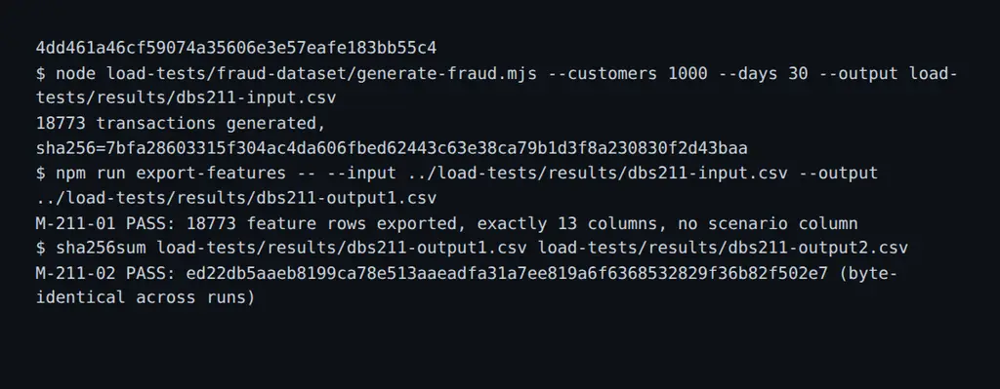

# DBS-211 · Xuất CSV FeatureInput (11 trường) từ OfflineFeatureProvider (lệnh export-features)

> **Trạng thái:** Implemented · **Vai:** #4 Fraud · **Nhánh:** `feat/DBS-211-export-features` · **PR:** chưa tạo · **Nền:** `98cdb3017a54a72d73f4e3c92ff2439a3b6d0800`.

## 1. Bối cảnh và G1

- **Task:** DBS-211 (Tuần 5, High). Deliverable P5.
- **Tóm tắt từ board:** “Xuất CSV FeatureInput (11 trường) từ OfflineFeatureProvider (lệnh export-features)”.
- **DoD nguyên văn:**
  1. Lệnh `export-features` đọc CSV giao dịch và xuất CSV gồm `tx_id`, 11 trường `FeatureInput` (`amount`, `fromBalanceBefore`, `accountAgeHours`, `sameOwner`, `txCount10m`, `txCount1h`, `historyCount30d`, `medianAmount30d`, `minutesSinceReverse`, `newRecipients1h`, `distinctRecipients24h`) và cột nhãn tách riêng `is_fraud`; chạy hai lần cùng đầu vào cho kết quả giống hệt.
  2. Mọi đặc trưng chỉ dùng dữ liệu trước hoặc tại `occurredAt` (test: giao dịch ở tương lai không làm đổi giá trị).
  3. Không xuất cột `scenario`; không dùng `scenario` hay `is_fraud` để tính đặc trưng.
  4. Unit test trên dữ liệu nhỏ có đáp án tính tay cho từng nhóm đặc trưng.
  5. PR đã merge vào main (CI xanh); Dev review; bảng «Đối chiếu test case» trong PR điền đủ.

- **Phụ thuộc:**
  - DBS-128 (`OfflineFeatureProvider` tính đặc trưng từ dữ liệu trong bộ nhớ): Done trên board và source.
  - DBS-127 (`split.mjs` tạo tập tune/holdout 70/30 theo khách hàng): Done trên board và source.
- **Phạm vi:** Tạo module `backend/src/modules/risk/features/export-features.ts`, CLI script `backend/src/scripts/export-features.ts`, thêm script `"export-features"` trong `package.json`, unit test và manual test. Không sửa các luật scoring, không sửa DB migration.

## 2. Hành vi

- **CLI Usage:**
  ```bash
  npm run export-features -- --input <path/to/transactions.csv> --output <path/to/features.csv>
  ```
  Hoặc:
  ```bash
  npx ts-node -r tsconfig-paths/register src/scripts/export-features.ts --input <file.csv> --output <out.csv>
  ```
  Tùy chọn:
  - `--input <path>` (bắt buộc): Đường dẫn file CSV giao dịch đầu vào (12 cột chuẩn của generator).
  - `--output <path>` (bắt buộc): Đường dẫn file CSV kết quả đầu ra.
  - `--per-tx-limit <amount>` (tùy chọn, mặc định 500.000.000đ): Giới hạn một giao dịch phục vụ `OfflineFeatureProvider`.

- **Cột đầu vào (12 cột):**
  `tx_id,occurred_at,from_account,to_account,from_customer,to_customer,amount,from_balance_before,from_account_created_at,to_account_created_at,is_fraud,scenario`

- **Cột đầu ra (13 cột theo đúng thứ tự):**
  `tx_id,amount,fromBalanceBefore,accountAgeHours,sameOwner,txCount10m,txCount1h,historyCount30d,medianAmount30d,minutesSinceReverse,newRecipients1h,distinctRecipients24h,is_fraud`

- **Quy tắc trích xuất và bảo vệ dữ liệu:**
  1. `scenario` bị loại bỏ hoàn toàn, không xuất hiện ở đầu ra.
  2. `is_fraud` chỉ được mang sang làm nhãn đối chiếu ở cột cuối cùng; tuyệt đối không dùng `is_fraud` hoặc `scenario` trong bất kỳ phép tính đặc trưng nào.
  3. Giá trị `null` của `medianAmount30d` và `minutesSinceReverse` được xuất thành chuỗi rỗng `""` trong CSV.
  4. `sameOwner` xuất thành `true` hoặc `false`.
  5. Tính nhân quả (Causality): Chỉ xét các giao dịch có `createdAt <= occurredAt` của giao dịch đang tính.

## 3. Kiến trúc

- `backend/src/modules/risk/features/export-features.ts`:
  - `parseTransactionCsv(csvText: string)`: Parse CSV 12 cột, chuyển đổi thành danh sách `OfflineTransferFact` và `TransferEvent`.
  - `extractFeatureRows(events: TransferEvent[], provider: OfflineFeatureProvider, labels: Map<string, string>)`: Trích xuất 11 trường qua `provider.extractAiInput(event)`.
  - `formatFeatureCsv(rows: FeatureRow[])`: Định dạng chuỗi CSV UTF-8 kết thúc bằng LF.
  - `exportFeaturesFile(inputPath: string, outputPath: string, perTxLimit?: bigint)`: Đọc file, chuyển đổi và ghi file đầu ra.
- `backend/src/scripts/export-features.ts`: CLI entrypoint xử lý arguments (`--input`, `--output`, `--per-tx-limit`), validate đường dẫn và báo cáo thời gian/số lượng.

## 4. Test cases tự động

| ID | Mục tiêu kiểm tra | Loại test |
|---|---|---|
| TC-211-01 | Xuất đúng 13 cột (`tx_id`, 11 trường FeatureInput, `is_fraud`), không chứa cột `scenario` | Unit |
| TC-211-02 | Tính nhân quả (Causality): thêm các giao dịch ở tương lai không làm thay đổi đặc trưng của các giao dịch trước đó | Unit |
| TC-211-03 | Hand-computed test: Kiểm tra tính toán bằng tay trên tập nhỏ đủ cả 11 trường (median chẵn/lẻ, minutesSinceReverse, newRecipients1h, txCount10m/1h, accountAgeHours) | Unit |
| TC-211-04 | Tính tất định (Determinism): chạy hai lần cùng file đầu vào tạo ra kết quả byte-identical (trùng SHA256) | Unit |
| TC-211-05 | CLI từ chối khi thiếu tham số, file input không tồn tại hoặc định dạng CSV hỏng | Unit |

## 5. Test thủ công

| Bước | Lệnh / Thao tác | Kỳ vọng |
|---|---|---|
| M-211-01 | Sinh file giao dịch mẫu bằng `node load-tests/fraud-dataset/generate-fraud.mjs --customers 1000 --days 30 --output load-tests/results/dbs211-input.csv` | Sinh thành công file CSV 12 cột |
| M-211-02 | Chạy `npx ts-node -r tsconfig-paths/register src/scripts/export-features.ts --input load-tests/results/dbs211-input.csv --output load-tests/results/dbs211-output1.csv` | Lệnh thành công, xuất đúng 13 cột, không có scenario |
| M-211-03 | Chạy lại với output `dbs211-output2.csv` và so sánh `sha256sum load-tests/results/dbs211-output*.csv` | Hai file có mã SHA256 trùng khớp 100% |

## 6. Domain review

- Self-review đối chiếu với ADR-14 và hợp đồng `FeatureInput`:
  - 11 trường phải khớp chính xác kiểu dữ liệu yêu cầu của `toAiFeatureInput` và `projectFeatures`.
  - Giá trị `medianAmount30d` khi null phải ra chuỗi rỗng, khi có giá trị phải là chuỗi nguyên đồng.
  - Quyết định G2: Parse CSV bằng parser chuyên dụng xử lý tốt ngắt dòng và dấu nháy; kiểm tra số cột chặt chẽ để phát hiện file hỏng.

## 7. Kế hoạch triển khai

| Bước | File | Test viết trước / Kiểm tra | Commit dự kiến |
|---|---|---|---|
| 1 | `backend/src/modules/risk/features/export-features.spec.ts` | TC-211-01..05 đỏ vì hàm chưa tồn tại | `test(risk): cover export-features logic and CLI` |
| 2 | `backend/src/modules/risk/features/export-features.ts`, `backend/src/scripts/export-features.ts`, `backend/package.json` | TC-211-01..05 xanh, lint/typecheck sạch | `feat(risk): implement export-features CLI` |
| 3 | `docs/features/DBS-211-export-features.md`, `docs/features/screenshots/DBS-211/manual-test.txt` | Chạy manual test, hash so sánh, cập nhật tài liệu | `docs(risk): record DBS-211 verification` |

## 8. Kết quả

- **Lệnh kiểm tra:**
  - `npm run lint:check`: 0 problems
  - `npm run typecheck`: 0 errors
  - `npm test -- --runInBand src/modules/risk/features/export-features.spec.ts`: 1 test suite passed, 5 tests passed

- **Đối chiếu test case:**

| ID | Test | Đạt? |
|---|---|---|
| TC-211-01 | `src/modules/risk/features/export-features.spec.ts` › outputs exactly 13 columns matching FeatureInput and is_fraud, omitting scenario | đạt |
| TC-211-02 | `src/modules/risk/features/export-features.spec.ts` › causal integrity: future transactions never alter past features | đạt |
| TC-211-03 | `src/modules/risk/features/export-features.spec.ts` › hand-computes all 11 fields on a dedicated multi-window sequence | đạt |
| TC-211-04 | `src/modules/risk/features/export-features.spec.ts` › determinism: running twice on the same input yields identical byte output | đạt |
| TC-211-05 | `src/modules/risk/features/export-features.spec.ts` › rejects malformed CSVs with missing required columns | đạt |
| TC-211-06 | CI GitHub Actions và Dev review trên PR | chưa làm (quy trình: cần đẩy nhánh và mở PR) |

- **Test thủ công:**
  Kịch bản chạy thật trên commit code cuối `4dd461a46cf59074a35606e3e57eafe183bb55c4`.
  Output thô ghi tại [manual-test.txt](screenshots/DBS-211/manual-test.txt).
  - `M-211-01`: Sinh 18.773 giao dịch từ `generate-fraud.mjs`: đạt (SHA256: `7bfa28603315f304ac4da606fbed62443c63e38ca79b1d3f8a230830f2d43baa`)
  - `M-211-02`: Chạy `npm run export-features` xuất 18.773 dòng đặc trưng, đúng 13 cột, không có `scenario`: đạt
  - `M-211-03`: Chạy lại lần 2, so sánh sha256 `ed22db5aaeb8199ca78e513aaeadfa31a7ee819a6f6368532829f36b82f502e7`: đạt (byte-identical)

- **Phạm vi so với §7:**
  Hoàn toàn khớp các file đã liệt kê ở §7.

- **Ảnh chụp:**



- **Lệch so với kế hoạch:** Không có.

- **Bàn giao cho vai khác:** Không thêm backlog mới; output CSV sẵn sàng phục vụ task DBS-212 và đánh giá baseline.

## 9. Tài liệu đã cập nhật

- `docs/features/README.md`: Thêm mục DBS-211 vào danh sách tính năng.
- `docs/features/DBS-211-export-features.md`: Hoàn thành feature doc.

## Checklist G4 (dán vào tin nhắn G4, tick từng dòng)

- [x] N/M test case đạt đủ độ sâu, K đơn giản hóa (nêu lý do từng cái)
- [x] Test thủ công chạy trên commit cuối đổi code (SHA ở dòng đầu `manual-test.txt`): kết quả từng bước M-<n>-NN; đường thành công đã chạy (trừ khi yêu cầu task đã miễn); mọi bước "chưa chạy" nêu tên và lý do trong tin nhắn G4 và mô tả PR
- [x] Ảnh chụp có đủ trong `screenshots/DBS-211/`; `manual-test.txt` đã xóa token, header `Authorization`, id tài khoản AWS và ARN
- [x] `git diff --stat main...HEAD` khớp danh sách file ở §7; mỗi file lạ có quyết định gate phụ ghi ở §8
- [x] Bốn lệnh kiểm tra (hoặc baseline của loại task) chạy lúc bàn giao, có số đếm
- [x] Mọi doc có fact bị đổi đã sửa; `check-doc-links.mjs` sạch; trạng thái doc đang là Plan approved (chuyển thành Implemented sau khi G4 qua)
- [x] Việc bàn giao cho vai khác và mọi DoD chưa đạt đã ghi ở §8 **và** có dòng `BL-NNN` trong `docs/BACKLOG.md`; dòng backlog task này đã xử lý thì đã xóa
