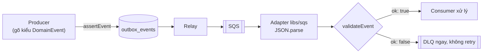

# DBS-24 · Type TypeScript dùng chung cho event trong common/events + test schema

> **Status:** Draft · **Vai:** Dev · **Nhánh:** `feat/DBS-24-common-events` · **PR:** — · **Cập nhật:** 2026-10-19

## 1. Bối cảnh

- **Task trên board:** Task, Tuần 1, ưu tiên High, Deliverable/Demo **P2**, Status "In Progress" (đã đặt sẵn). Role trên board `Dev`, khớp loại việc (thư viện dùng chung của backend).
- **Expect:** "Producer và consumer cùng một định nghĩa, sai khác bị phát hiện lúc build hoặc test."
- **DoD** (chép nguyên văn):
  1. backend/src/common/events/ có type/schema cho TransferCompleted và AccountStatusChanged (và TransferRejected nếu bật), export qua index
  2. Có hàm validate payload nhận message dạng unknown; test: payload mẫu hợp lệ qua, thiếu trường/sai kiểu bị từ chối với lỗi rõ
  3. Số tiền trong event là string (bigint), thời gian ISO-8601 UTC
  4. PR đã merge vào main (CI xanh); Dev review; bảng «Đối chiếu test case» trong PR điền đủ
- **Thực trạng (board):** "backend/src/common/events chưa tồn tại; mỗi module sẽ tự định nghĩa event nếu không có type chung." Đã kiểm: đúng. `backend/src/common/` chỉ có `app-role`, `errors`, `filters`, `middleware`, `money`, `utils`; `grep` không thấy `TransferCompleted`, `AccountStatusChanged` hay `TransferRejected` trong code `src/` và `test/`.
- **Phụ thuộc:** không có ("làm được ngay"). Task dùng được `@common/money` của DBS-22 (Done, PR #9 đã merge vào `main`): `parsePositiveMoney` cho `amount`, `parseBalance` cho số dư có dấu.
- **Đã có gì:**
  - Hợp đồng: [event-contract](../components/_shared/event-contract.md) (nguồn duy nhất cho hình dạng sự kiện; file này nói type TypeScript dùng chung nằm ở `backend/src/common/events`, task này), [docs/03 §10](../03_HIGH_LEVEL_ARCHITECTURE.md) (ví dụ JSON, bảng định tuyến), [ADR-03](../adr/0003-sync-transfer-async-outbox-sqs.md) (outbox, SQS, DLQ sau 5 lần nhận).
  - Quy tắc từ [module-notes](../../.claude/skills/dbs-delivering-task/references/module-notes.md) mục Async: message sai schema đi thẳng DLQ; consumer idempotent theo `eventId`; `correlationId` do server sinh.
  - README module [`outbox`](../../backend/src/modules/outbox/README.md) ("event contract định nghĩa ở một nơi và dùng chung") và [`notification`](../../backend/src/modules/notification/README.md). Chưa có code của outbox, relay hay consumer nào (task khác).
  - Code dùng lại được: [`RejectReason`](../../backend/src/common/errors/reject-reason.ts); [`@common/money`](../../backend/src/common/money/index.ts) (`parsePositiveMoney`, `parseBalance`); `joi` đã là dependency (dùng cho biến môi trường), nên không cần thêm gói nào. `eslint` cấm `common/` import module.
  - Mẫu cách làm: [DBS-22](DBS-22-common-money-type-dto-validator.md) (thư viện chưa có người gọi: test unit cạnh file, script lái cho test thủ công, bảng "Đối chiếu test case").
- **Baseline** (nhánh mới từ `origin/main` `4dae992`, 2026-10-19, từ `backend/`): `lint:check` sạch, `typecheck` sạch, `npm test` 19 suite / 201 test đạt, `npm run test:e2e` 4 suite / 25 test đạt. Không bật Docker: hai tầng test này không cần DB và task không chạm DB nên không chạy `test:db`.
- **Callers:** không có (module mới). Không đổi symbol nào đã export.
- **Backlog** (`docs/BACKLOG.md`): **BL-002** cùng DoD (nó nêu đích danh DBS-24 và event contract). Xử lý **một phần** trong task này (câu hỏi 1, 2): `fromUserId` của `DEPOSIT` và `fromBalanceBefore` có dấu. Phần còn lại (producer nạp tiền ghi `fromUserId: null`, thuộc task nạp tiền DBS-60) giữ lại trong BL-002, sửa lại lời cho khớp. BL-001 (chưa có CI) chặn DoD #4 như DBS-20, 21, 22, nên Phase 5 thêm DBS-24 vào nguồn. BL-003…009 không cùng module hay DoD.
- **Task khác đang mở:** trên `origin` không có nhánh nào của task này hay đụng `common/events`; chỉ có nhánh docs của skill. Không có `gh` nên chưa kiểm được danh sách PR đang mở, nhờ bạn nói nếu có.
- **Ngoài phạm vi:**
  - `OutboxWriter.add`, relay, bảng `outbox_events`, `processed_events`, consumer, hàng đợi SQS và việc **phát** sự kiện thật (DBS-25, DBS-57, DBS-90, các task consumer). Task này chỉ cho họ một định nghĩa chung và một hàm kiểm tra.
  - Bảng định tuyến (`TransferCompleted` → `risk-events`, `notification-events`; `AccountStatusChanged` → `notification-events`): thuộc relay. Có thể export hằng số tên sự kiện, không export hàng đợi.
  - `TransferRejected`: contract chốt "không phát ở v1" (DoD chỉ nói "nếu bật"), và `FraudFlagRaised`, `FraudFlagReviewed` cũng không phát. Contract đã ghi sẵn payload dự kiến của `TransferRejected` cho một PR riêng khi có bên tiêu thụ.
  - Sinh `eventId`, `correlationId`, lấy giờ `occurredAt` từ DB: việc của producer.
- **Câu hỏi mở** (mỗi câu có đề xuất):
  1. **Nạp tiền không có `fromUserId` (BL-002).** Contract khai `fromUserId` là `uuid` không null, nhưng với `type = DEPOSIT` nguồn là tài khoản SYSTEM `funding` không có chủ (`accounts_owner_matches_type`), nên trường này không có giá trị hợp lệ; `sameOwner` cũng chỉ có nghĩa khi cả hai tài khoản có chủ. Đổi contract là gate phụ. *Đề xuất:* `fromUserId: uuid | null` (null khi và chỉ khi `DEPOSIT`), `sameOwner = false` khi `DEPOSIT`; schema ép cả hai chiều (`DEPOSIT` mà có `fromUserId` là sai, `TRANSFER` mà thiếu là sai); sửa [event-contract](../components/_shared/event-contract.md) trong cùng PR như contract yêu cầu, và báo bên dùng (risk, notification) ở §8 Bàn giao.
  2. **`fromBalanceBefore` có dấu.** Với `DEPOSIT`, nguồn là `funding` nên số dư trước **âm** (ADR-09), mà contract chỉ ghi "string (đồng)". *Đề xuất:* ghi vào contract "có dấu; âm khi nguồn là `funding`", schema kiểm bằng `parseBalance` (chấp nhận âm); `amount` kiểm bằng `parsePositiveMoney` (> 0, ≤ 2^63−1). Dùng `@IsMoneyAmount` cho `fromBalanceBefore` là sai: mọi sự kiện `DEPOSIT` sẽ bị đẩy vào DLQ.
  3. **Công cụ kiểm tra.** Cần type TS (producer gõ kiểu lúc build) và hàm kiểm tra `unknown` (consumer, lúc chạy). *Đề xuất:* `joi` (đã là dependency, **không thêm gói**) cho phần kiểm tra, type TS viết tay là nguồn chuẩn; mỗi schema được khai theo kiểu `Record<keyof T, Joi.Schema>` nên thêm trường vào type mà quên schema là **lỗi biên dịch**, và test dùng payload mẫu gõ kiểu `T` nên sai lệch còn lại bị test bắt. Không suy type từ schema vì Joi không làm được việc đó. Không dùng `class-validator`: nó cần lớp và decorator, không hợp với message JSON thô.
  4. **Trường lạ.** Contract: "Chỉ **thêm** trường để giữ tương thích". Consumer cũ gặp trường mới không được coi là sai schema. *Đề xuất:* hàm kiểm tra **cho phép trường lạ** (giữ nguyên trong kết quả) và từ chối thiếu trường, sai kiểu, sai định dạng. Hệ quả: tên trường gõ sai ở producer không bị schema bắt, mà bị type TS bắt lúc build.
  5. **`TransferRejected`.** *Đề xuất:* không làm trong task này (contract "không phát ở v1"); ghi thành một dòng "ngoài phạm vi" ở feature doc. Thêm sau bằng PR riêng như contract đã nói.
  6. **Test thủ công khi chưa có người gọi.** Theo `task-kinds.md`, loại "thư viện chưa có người gọi" dùng script lái. *Đề xuất:* một script `ts-node` ở `backend/test/support/` (như DBS-22) đưa payload mẫu hợp lệ, thiếu trường, sai kiểu, `amount` sai định dạng, giờ có offset và `DEPOSIT` âm qua hàm kiểm tra rồi in kết quả; không cần Docker. Nếu bạn muốn một lần chạy qua hàng đợi thật thì phải chờ relay và consumer; mình không đề xuất.
  7. **DoD #4 "CI xanh"** không kiểm được (repo chưa có workflow, BL-001). *Đề xuất:* như DBS-20, 21, 22: dán kết quả chạy local vào PR và thêm DBS-24 vào nguồn của BL-001. Vì không có `gh`, bạn tạo PR từ nội dung mình soạn.

**Quyết định ở G1 (2026-10-19):** duyệt cả 7 đề xuất, không sửa. Hệ quả: đổi event contract trong cùng PR (câu 1, 2: `fromUserId` null khi `DEPOSIT`, `sameOwner = false`, `fromBalanceBefore` có dấu); dùng `joi` có sẵn, không thêm gói (câu 3); cho phép trường lạ (câu 4); không làm `TransferRejected` (câu 5); test thủ công bằng script lái (câu 6); DoD #4 xử lý như DBS-20…22 (câu 7); BL-002 sửa lời, không xóa.

## 2. Hành vi

Không có API. "Hành vi" là cách hàm kiểm tra phân loại một payload `unknown`. Test kiểm `path` và `code` của lỗi, không kiểm câu chữ.

**2.1 Hàm và kết quả**

```ts
validateEvent(payload: unknown): EventValidation
type EventValidation = { ok: true; event: DomainEvent } | { ok: false; issues: EventIssue[] }
interface EventIssue { path: string; code: EventIssueCode; message: string }
assertEvent(payload: unknown): DomainEvent   // validateEvent, rồi ném InvalidEventError (có issues) khi sai
```

- `ok: true`: `event` là **chính object đầu vào** (không sao chép, không sửa), kiểu `DomainEvent`; trường lạ giữ nguyên.
- `ok: false`: **mọi** lỗi cùng lúc, không dừng ở lỗi đầu. Mỗi lỗi có `path` (tên trường; `''` cho cả payload), `code` và `message` ngắn **không chép lại giá trị đã nhận** (giá trị có thể là rác dài từ queue và message lọt vào log hay DLQ).
- `assertEvent` cho producer (kiểm trước khi ghi outbox): lỗi của producer là lỗi lập trình nên ném. Consumer dùng `validateEvent` để tự quyết (sai schema thì vào DLQ ngay, ADR-03).
- Không có hàm đọc JSON: message SQS là chuỗi, adapter `libs/sqs` (task khác) tự `JSON.parse`. Chuỗi đưa vào đây bị từ chối `NOT_AN_OBJECT`.

**2.2 Mã lỗi**

| `code` | Khi nào | `path` ví dụ |
|---|---|---|
| `NOT_AN_OBJECT` | payload là `null`, `undefined`, chuỗi (kể cả chuỗi JSON thô), số, boolean, mảng | `''` |
| `UNKNOWN_EVENT_TYPE` | `eventType` là chuỗi nhưng không thuộc `TransferCompleted`, `AccountStatusChanged` (so khớp đúng chữ hoa, chữ thường) | `eventType` |
| `MISSING_FIELD` | thiếu trường bắt buộc (không có khóa, hoặc `undefined`) | `amount` |
| `WRONG_TYPE` | sai kiểu JSON: số thay chuỗi, chuỗi `"true"` thay boolean, `null` cho trường không cho null, object thay chuỗi | `amount` |
| `INVALID_FORMAT` | đúng là chuỗi nhưng sai định dạng: uuid, tiền, thời gian | `occurredAt` |
| `NOT_ALLOWED` | giá trị ngoài tập cho phép (`type`, `newStatus`), trường bị cấm, hoặc vi phạm luật `DEPOSIT` (2.4) | `type` |

`eventType` thiếu hoặc không phải chuỗi thì không chọn được schema: chỉ báo đúng một lỗi ở `eventType` (`MISSING_FIELD` hoặc `WRONG_TYPE`).

**2.3 `TransferCompleted`** (event-contract; mọi trường đều bắt buộc)

| Trường | Quy tắc |
|---|---|
| `eventId`, `correlationId`, `transferId`, `fromAccountId`, `toAccountId`, `toUserId` | uuid (8-4-4-4-12 chữ số hex, chữ hoa chữ thường đều được). Chấp nhận cả id cố định của tài khoản `funding`, `00000000-0000-4000-8000-000000000001` |
| `eventType` | đúng `TransferCompleted` |
| `occurredAt`, `fromAccountCreatedAt`, `toAccountCreatedAt` | thời gian ISO-8601 UTC (2.5) |
| `type` | `TRANSFER` hoặc `DEPOSIT` (đúng chữ hoa) |
| `amount` | **chuỗi** qua `parsePositiveMoney`: số nguyên đồng > 0, ≤ 2^63−1, dạng chuẩn (2.6) |
| `fromBalanceBefore` | **chuỗi** qua `parseBalance`: số nguyên có dấu trong [−2^63, 2^63−1]; **âm khi nguồn là `funding`** (ADR-09) |
| `sameOwner` | boolean |
| `fromUserId` | uuid, hoặc `null` khi `DEPOSIT` (2.4) |

**2.4 Nạp tiền và chuyển tiền** (BL-002, đã duyệt ở G1): nguồn của `DEPOSIT` là tài khoản SYSTEM không có chủ.

- `type = DEPOSIT`: `fromUserId` **phải là `null`** và `sameOwner` **phải là `false`**; có uuid hay `true` thì báo `NOT_ALLOWED` ở trường đó; thiếu khóa báo `MISSING_FIELD`.
- Mọi `type` khác (kể cả `TRANSFER` và giá trị sai): `fromUserId` phải là uuid (`null` báo `WRONG_TYPE`, thiếu báo `MISSING_FIELD`), `sameOwner` là boolean. Nên một `type` sai chỉ cho đúng một lỗi, ở `type`.
- Không kiểm các ràng buộc liên trường khác (ví dụ `fromAccountId` khác `toAccountId`): đó là việc của cơ sở dữ liệu (`transfers_distinct_accounts`) và của producer.

**2.5 Thời gian.** Chuỗi `YYYY-MM-DDTHH:mm:ss` + phần thập phân của giây (tùy chọn, 1 đến 9 chữ số) + `Z`. Ngày giờ phải **có thật**: tháng 1–12, ngày đúng theo tháng và năm nhuận, giờ 00–23, phút và giây 00–59. Từ chối: có offset (`+07:00`, cả `+00:00`), không có múi giờ, chỉ có ngày, dấu cách thay cho `T`, `2026-02-30T00:00:00Z`, `2026-10-17T24:00:00Z`, số epoch, đối tượng `Date`. Không dùng `Date.parse` để kiểm vì V8 chấp nhận `2026-02-30` (tự cuộn sang 2/3) và `24:00:00` (sang ngày sau). Producer tạo bằng `Date.prototype.toISOString()` (luôn có mili giây và `Z`); không nhét thẳng giá trị JSON của Postgres (`to_json` ra `+00:00`).

**2.6 Tiền** (cùng quy tắc với `@common/money`, DBS-22): luôn là **chuỗi**, vì `JSON.parse` làm tròn số trên 2^53 trước khi code của ta thấy.

| Giá trị | `amount` | `fromBalanceBefore` |
|---|---|---|
| `"9007199254740993"` (2^53+1), `"9223372036854775807"` | qua | qua |
| `"0"` | `INVALID_FORMAT` (phải > 0) | qua |
| `"-1000000"` | `INVALID_FORMAT` | qua |
| `"-0"`, `"01"`, `"1.5"`, `"1e3"`, `" 1"` | `INVALID_FORMAT` | `INVALID_FORMAT` |
| `"9223372036854775808"` | `INVALID_FORMAT` | `INVALID_FORMAT` |
| số JSON `500000` (kể cả chính xác) | `WRONG_TYPE` | `WRONG_TYPE` |

**2.7 `AccountStatusChanged`** (mọi trường bắt buộc): `eventId`, `correlationId`, `accountId`, `ownerUserId`, `changedByUserId` là uuid; `eventType` đúng `AccountStatusChanged`; `occurredAt` là thời gian ISO-8601 UTC; `newStatus` là `ACTIVE` hoặc `LOCKED`. Contract nói sự kiện **không mang lý do khóa** (lý do nằm ở `audit_log`, thông báo cho khách không bao giờ nêu lý do gian lận, BR-13): trường `reason`, nếu có, bị `NOT_ALLOWED`.

**2.8 Trường lạ.** Contract chỉ cho **thêm** trường để giữ tương thích, nên consumer cũ gặp trường mới không được coi là sai. Mọi trường ngoài danh sách trên (trừ `reason` ở 2.7) được phép và giữ nguyên trong `event`.

**2.9 Ví dụ.** Lệnh nạp 300.000đ vào một tài khoản khách (`funding` đang âm 1.000.000đ trước lệnh này); hợp lệ:

```json
{
  "eventId": "6b1e4a52-9c0d-4f7e-8a31-2d5c7e9f0a14",
  "eventType": "TransferCompleted",
  "occurredAt": "2026-10-19T03:15:42.123Z",
  "correlationId": "c0a8f3d2-5b61-4e0a-9f27-7d1b3a6c8e55",
  "transferId": "8f3c0a52-3b1e-4c9a-9d2e-5a7f1c0b6e11",
  "type": "DEPOSIT",
  "fromAccountId": "00000000-0000-4000-8000-000000000001",
  "toAccountId": "3d9e1b7a-4c25-4f08-b6a3-9e2f5d8c1a47",
  "amount": "300000",
  "fromBalanceBefore": "-1000000",
  "fromAccountCreatedAt": "2026-10-12T02:00:00.000Z",
  "toAccountCreatedAt": "2026-10-18T09:30:00.000Z",
  "sameOwner": false,
  "fromUserId": null,
  "toUserId": "a7c2e4f1-0b93-4d6a-8e15-3f9b1d7c5a02"
}
```

Cùng payload nhưng `"amount": 300000` (số), `"fromUserId": "a7c2e4f1-0b93-4d6a-8e15-3f9b1d7c5a02"` và `"occurredAt": "2026-10-19T10:15:42+07:00"` cho (thứ tự tùy ý; câu chữ `message` chỉ minh họa):

```json
{ "ok": false, "issues": [
  { "path": "amount", "code": "WRONG_TYPE", "message": "must be a string" },
  { "path": "fromUserId", "code": "NOT_ALLOWED", "message": "must be null when type is DEPOSIT" },
  { "path": "occurredAt", "code": "INVALID_FORMAT", "message": "must be an ISO-8601 UTC time ending in Z" } ] }
```

## 3. Kiến trúc

- **Vị trí:** thư viện dùng chung `backend/src/common/events/`, import qua `@common/events`. Chạy ở cả `api` (producer ghi outbox) lẫn `worker` (relay, consumer). Hàm thuần: không I/O, không DB, không transaction. `common/` không import module (eslint). Files: `event-types.ts` (kiểu, tên sự kiện), `event-schemas.ts` (schema `joi`, nội bộ), `validate-event.ts` (hàm, lỗi), `index.ts`; mỗi file có `*.spec.ts` cạnh. Dữ liệu mẫu dùng chung ở `backend/test/support/event-samples.ts` (ngoài `src/`, nên `nest build` không đưa vào `dist/`).
- **Cung cấp** (chữ ký sẽ có trong code):

```ts
export const EVENT_TYPES = { TransferCompleted: 'TransferCompleted', AccountStatusChanged: 'AccountStatusChanged' } as const;
export type EventType = keyof typeof EVENT_TYPES;
interface EventBase { eventId: string; eventType: EventType; occurredAt: string; correlationId: string }
export type TransferCompleted = TransferCompletedCommon & (
  | { type: 'TRANSFER'; fromUserId: string; sameOwner: boolean }
  | { type: 'DEPOSIT'; fromUserId: null; sameOwner: false });   // gõ sai luật DEPOSIT là lỗi biên dịch
export interface AccountStatusChanged extends EventBase { /* accountId, ownerUserId, newStatus, changedByUserId */ }
export type DomainEvent = TransferCompleted | AccountStatusChanged;
export type EventIssueCode = 'NOT_AN_OBJECT' | 'UNKNOWN_EVENT_TYPE' | 'MISSING_FIELD' | 'WRONG_TYPE' | 'INVALID_FORMAT' | 'NOT_ALLOWED';
export interface EventIssue { path: string; code: EventIssueCode; message: string }
export type EventValidation = { ok: true; event: DomainEvent } | { ok: false; issues: EventIssue[] };
export class InvalidEventError extends Error { readonly issues: EventIssue[] }
export function validateEvent(payload: unknown): EventValidation;
export function assertEvent(payload: unknown): DomainEvent;
```

- **Vì sao "sai khác bị phát hiện lúc build hoặc test" (Expect):** (1) producer gõ object với kiểu `TransferCompleted`, nên thiếu trường, sai kiểu, `amount` là số hay `DEPOSIT` mang `fromUserId` là **lỗi biên dịch**; (2) mỗi schema khai theo kiểu `Record<keyof T, Joi.Schema>`, nên thêm trường vào kiểu mà quên schema là lỗi biên dịch; (3) payload mẫu gõ kiểu `T` được đưa qua `validateEvent` trong test, nên schema chặt hơn hay lỏng hơn kiểu thì test đỏ. `joi` không suy ra kiểu từ schema, nên kiểu viết tay là nguồn chuẩn.
- **Dùng:** `joi` (đã là dependency) và `@common/money` (`parsePositiveMoney`, `parseBalance`); `joi` là chi tiết nội bộ, schema không được export. Người gọi hiện tại: không có. Sau này: `OutboxWriter.add` (DBS-57) nhận `DomainEvent` và gọi `assertEvent`; relay (DBS-90) đọc `event.eventType` để định tuyến; consumer risk và notification gọi `validateEvent`, sai thì DLQ.
- **Dữ liệu, transaction:** không chạm bảng nào, không có transaction.



- **Thay đổi cấp hệ thống:** [event-contract](../components/_shared/event-contract.md) trong cùng PR: `fromUserId` là `uuid` hoặc `null` (null khi `DEPOSIT`), `sameOwner = false` khi `DEPOSIT`, `fromBalanceBefore` có dấu (âm khi nguồn là `funding`), dạng thời gian (UTC có `Z`), consumer chấp nhận trường lạ, link tới `@common/events`. [threat-model](../security/threat-model.md) T9 (message giả hoặc hỏng): thêm DBS-24 vào cột bằng chứng, trạng thái giữ *Thiết kế* vì chưa có consumer. `docs/BACKLOG.md`: sửa BL-002 (bỏ phần task này đã làm, giữ phần producer nạp tiền), BL-001 thêm nguồn. `docs/features/README.md`. Không có ADR mới.

## 4. Test cases tự động

Tất cả **unit** (`npm test`, `*.spec.ts` cạnh file; không DB, không Docker). Mẫu hợp lệ và danh sách giá trị sai nằm ở `backend/test/support/event-samples.ts`, dùng chung cho spec và script lái. Ca "bỏ từng trường" và "sai kiểu từng trường" chạy trên **mọi trường của mỗi mẫu**, nên trường mới thêm vào mẫu tự được kiểm.

| ID | Truy vết | Given · When · Then | Mong đợi |
|---|---|---|---|
| TC-24-01 | DoD #1, #2 | mẫu `TRANSFER` hợp lệ · `validateEvent` · `ok: true`, `event` là chính object đầu vào, không bị sửa | — |
| TC-24-02 | DoD #2 | mẫu `DEPOSIT` (`fromUserId: null`, `sameOwner: false`, `fromBalanceBefore: "-1000000"`, `fromAccountId` của `funding`) · `ok: true` | — |
| TC-24-03 | DoD #1, #2 | `AccountStatusChanged` với `ACTIVE` và với `LOCKED` · `ok: true` | — |
| TC-24-04 | DoD #2 | bỏ lần lượt từng trường của mỗi mẫu (cả `fromUserId` của `DEPOSIT`) · đúng 1 lỗi tại trường đó | `MISSING_FIELD` |
| TC-24-05 | DoD #2 | đổi kiểu lần lượt từng trường (uuid thành số, tiền thành số, boolean thành `"true"`, thời gian thành số epoch, chuỗi thành `null`) · đúng 1 lỗi tại trường đó | `WRONG_TYPE` |
| TC-24-06 | DoD #2 | mọi trường uuid nhận `"abc"`, `""`, thiếu một nhóm, ký tự `g`, chuỗi 100000 ký tự · `INVALID_FORMAT`; chuỗi dài xong ngay, `message` không chứa chuỗi đó | `INVALID_FORMAT` |
| TC-24-07 | DoD #3 | `amount`: `"9007199254740993"`, `"9223372036854775807"` qua; `500000` (số) → `WRONG_TYPE`; `"0"`, `"-1"`, `"1.5"`, `"01"`, `" 1"`, `"9223372036854775808"` → `INVALID_FORMAT` | như cột |
| TC-24-08 | DoD #3 | `fromBalanceBefore`: `"-1000000"`, `"0"`, `"-9223372036854775808"` qua; `"-0"`, `"1e3"`, `"9223372036854775808"` → `INVALID_FORMAT`; số → `WRONG_TYPE` | như cột |
| TC-24-09 | DoD #3 | thời gian của cả ba trường: `…Z`, `….123Z`, `….123456Z`, `2028-02-29T00:00:00Z` qua; `+07:00`, `+00:00`, thiếu múi giờ, chỉ ngày, dấu cách, `2026-02-30T…Z`, `2026-02-29T…Z`, `2026-13-01T…Z`, `2026-10-17T24:00:00Z`, `…T10:60:00Z` → `INVALID_FORMAT` | `INVALID_FORMAT` |
| TC-24-10 | DoD #2 | `type: "WITHDRAWAL"`, `"transfer"`; `newStatus: "FROZEN"`, `"active"` · `NOT_ALLOWED` tại trường đó | `NOT_ALLOWED` |
| TC-24-11 | DoD #2, BL-002 | `DEPOSIT` mang `fromUserId` uuid, hoặc `sameOwner: true` → `NOT_ALLOWED`; `TRANSFER` với `fromUserId: null` → `WRONG_TYPE`, thiếu khóa → `MISSING_FIELD`; `type: "WITHDRAWAL"` (còn lại hợp lệ) → đúng 1 lỗi ở `type` | như mô tả |
| TC-24-12 | DoD #1 | thêm `riskScore` (số) và `futureField` (object) vào từng mẫu · `ok: true`, hai trường còn nguyên trong `event` | — |
| TC-24-13 | BR-13 | `AccountStatusChanged` có `reason` (bất kỳ giá trị) · lỗi tại `reason` | `NOT_ALLOWED` |
| TC-24-14 | DoD #2 | `eventType` thiếu → `MISSING_FIELD`; không phải chuỗi → `WRONG_TYPE`; `"FraudFlagRaised"`, `"transfercompleted"` → `UNKNOWN_EVENT_TYPE`; mỗi ca đúng 1 lỗi ở `eventType` | như mô tả |
| TC-24-15 | DoD #2 | payload là `null`, `undefined`, chuỗi JSON thô, `42`, `true`, `[]` · đúng 1 lỗi, `path ''` | `NOT_AN_OBJECT` |
| TC-24-16 | DoD #2 | payload có 3 trường hỏng cùng lúc · đủ 3 lỗi, mỗi `path` một lần (không dừng ở lỗi đầu) | — |
| TC-24-17 | bảo mật | payload từ `JSON.parse` có khóa `__proto__` · `Object.prototype` không bị ô nhiễm; input không bị sửa (so sâu trước và sau); `message` của mọi lỗi không chứa giá trị sai (chuỗi chứa `secret`) | — |
| TC-24-18 | DoD #1, #2 | `assertEvent`: payload đúng trả `event`; payload sai ném `InvalidEventError` có `issues` giống `validateEvent` | — |
| TC-24-19 | Expect (build) | `// @ts-expect-error -- <lý do>`: object thiếu trường, `amount: 500000`, `DEPOSIT` với `fromUserId: "…"`, `TRANSFER` với `fromUserId: null`, `eventType: "Other"` · `typecheck` báo lỗi đúng dòng; `switch` trên `DomainEvent['eventType']` có nhánh `never` cuối | — |
| TC-24-20 | Expect (đồng bộ) | khóa của mẫu đầy đủ gõ kiểu `T` bằng khóa schema nội bộ, cho cả hai sự kiện; schema khai `Record<keyof T, …>` nên `typecheck` đỏ khi thêm khóa vào kiểu mà quên schema | — |
| TC-24-21 | DoD #1 | `@common/events` export `validateEvent`, `assertEvent`, `InvalidEventError`, `EVENT_TYPES` và các kiểu; không export schema `joi` | — |
| TC-24-22 | DoD #4 | quy trình: PR merge, CI xanh, Dev review, bảng "Đối chiếu test case" | chưa kiểm được: BL-001 |

**Checklist bảo mật** (`testing.md`): *lỗi không lộ nội bộ* → TC-24-06, TC-24-17; *không để lý do khóa lọt vào sự kiện (BR-13)* → TC-24-13; *đầu vào bị làm giả hay hỏng (threat-model T9)* → TC-24-04…16. Các mục còn lại (role guard, kiểm sở hữu, `Idempotency-Key`, audit, SQL tham số hóa, TLS) **không áp dụng**: hàm thuần, không endpoint, không DB.

## 5. Test thủ công

Loại "thư viện chưa có người gọi" (`task-kinds.md`): một **script lái** `backend/test/support/events-driver.ts` (nằm trong PR, không trong `src/`). Chạy trong Git Bash, từ `backend/`, ghi `| tee -a ../docs/features/screenshots/DBS-24/manual-test.txt`. Không cần Docker.

| Bước | Việc làm | Kết quả mong đợi |
|---|---|---|
| M-24-01 (thành công) | `npx ts-node -r tsconfig-paths/register test/support/events-driver.ts` | ba mẫu (`TRANSFER`, `DEPOSIT` có `fromUserId: null` và `fromBalanceBefore` âm, `AccountStatusChanged`) đều `ok: true`; mỗi mẫu `JSON.stringify` rồi `JSON.parse` (dạng trên dây) vẫn `ok: true`, `amount` `"9007199254740993"` giữ nguyên chữ số |
| M-24-02 (từ chối) | cùng lệnh, mục `rejected` | mỗi payload sai (thiếu trường, `amount` là số, `amount` `"01"`, giờ có `+07:00`, `eventType` lạ, `DEPOSIT` mang `fromUserId`, chuỗi JSON thô, `null`) in danh sách `path` và `code` đúng như §2 |
| M-24-03 (tương thích tiến) | cùng lệnh, mục `forward-compat` | payload có trường lạ `riskScore` vẫn `ok: true` và trường đó còn trong `event`; `AccountStatusChanged` có `reason` bị `NOT_ALLOWED` |
| M-24-04 (phát hiện lúc build) | tệp tạm ngoài repo và `tsconfig` tạm (trong thư mục scratchpad) chứa 4 dòng cố ý sai: `amount: 500000`, thiếu trường, `DEPOSIT` với `fromUserId` chuỗi, `eventType: "Other"`; `npx tsc --noEmit -p <tsconfig tạm>` | `tsc` thoát mã khác 0 và báo lỗi đúng 4 dòng đó |
| M-24-05 (build) | `npm run build`; `node -e "const e=require('./dist/common/events');console.log(JSON.stringify(e.validateEvent({}).ok))"`; `grep -rnE "(require\(\|from )[\"']@(common\|config\|database\|libs\|modules)" dist/ \|\| echo none` | build sạch; in `false`; grep in `none` (alias đã được viết lại, gồm `@common/money` bên trong `events`) |

## 6. Domain review (AI)

(Phase 2: reviewer Opus 5.5, effort medium)

## 7. Kế hoạch triển khai

(Phase 3)

## 8. Kết quả

(Phase 4–5)

## 9. Tài liệu đã cập nhật

(Phase 5)
