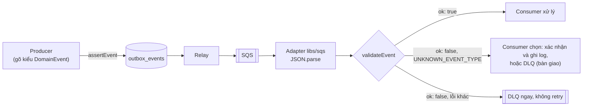
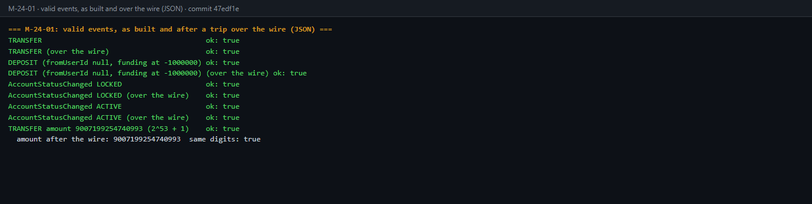
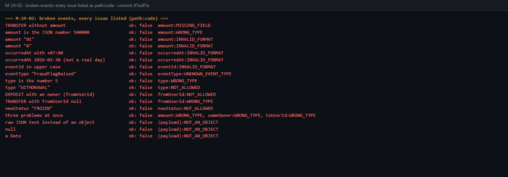
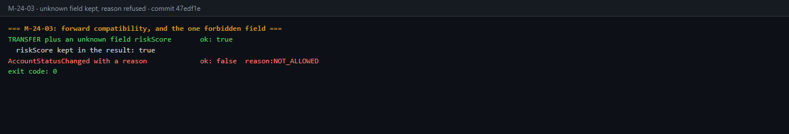
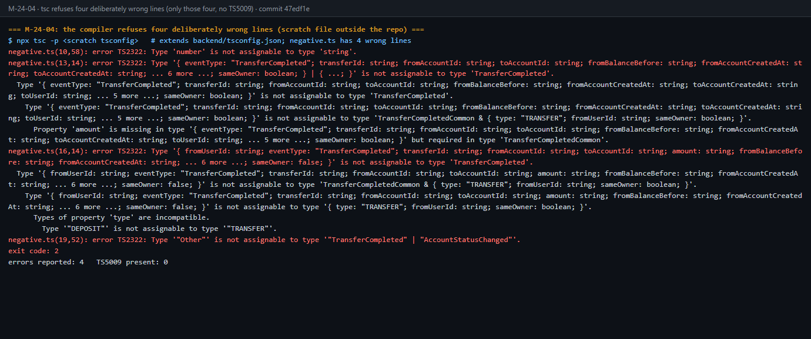
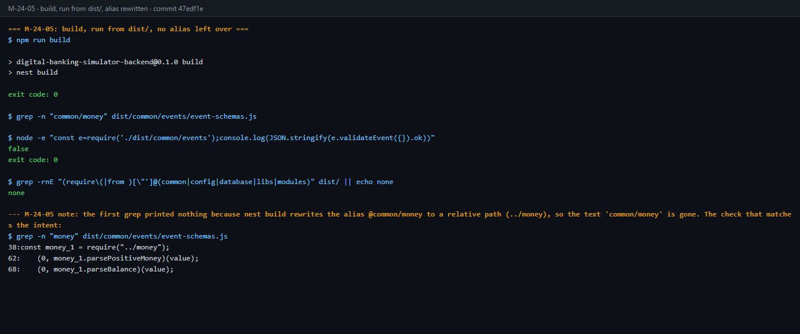
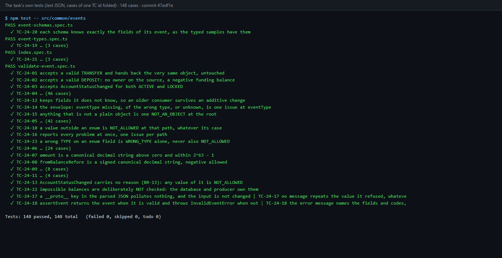

# DBS-24 · Type TypeScript dùng chung cho event trong common/events + test schema

> **Status:** Plan approved · **Vai:** Dev · **Nhánh:** `feat/DBS-24-common-events` · **PR:** — · **Cập nhật:** 2026-10-19

## 1. Bối cảnh

- **Task trên board:** Task, Tuần 1, ưu tiên High, Deliverable/Demo **P2**, Status "In Progress" (đã đặt sẵn). Role trên board `Dev`, khớp loại việc (thư viện dùng chung của backend).
- **Expect:** "Producer và consumer cùng một định nghĩa, sai khác bị phát hiện lúc build hoặc test."
- **DoD** (chép nguyên văn):
  1. backend/src/common/events/ có type/schema cho TransferCompleted và AccountStatusChanged (và TransferRejected nếu bật), export qua index
  2. Có hàm validate payload nhận message dạng unknown; test: payload mẫu hợp lệ qua, thiếu trường/sai kiểu bị từ chối với lỗi rõ
  3. Số tiền trong event là string (bigint), thời gian ISO-8601 UTC
  4. PR đã merge vào main (CI xanh); Dev review; bảng «Đối chiếu test case» trong PR điền đủ
- **Thực trạng (board):** "backend/src/common/events chưa tồn tại; mỗi module sẽ tự định nghĩa event nếu không có type chung." Đã kiểm: đúng. `backend/src/common/` chỉ có `app-role`, `errors`, `filters`, `middleware`, `money`, `utils`; `grep` không thấy `TransferCompleted`, `AccountStatusChanged` hay `TransferRejected` trong code `src/` và `test/`.
- **Phụ thuộc:** không có ("làm được ngay"). Task dùng được `@common/money` của DBS-22 (Done, PR #9 đã merge vào `main`): `parsePositiveMoney` cho `amount`, `parseBalance` cho số dư có dấu.
- **Đã có gì:**
  - Hợp đồng: [event-contract](../components/_shared/event-contract.md) (nguồn duy nhất cho hình dạng sự kiện; file này nói type TypeScript dùng chung nằm ở `backend/src/common/events`, task này), [docs/03 §10](../03_HIGH_LEVEL_ARCHITECTURE.md) (ví dụ JSON, bảng định tuyến), [ADR-03](../adr/0003-sync-transfer-async-outbox-sqs.md) (outbox, SQS, DLQ sau 5 lần nhận).
  - Quy tắc từ [module-notes](../../.claude/skills/dbs-delivering-task/references/module-notes.md) mục Async: message sai schema đi thẳng DLQ; consumer idempotent theo `eventId`; `correlationId` do server sinh.
  - README module [`outbox`](../../backend/src/modules/outbox/README.md) ("event contract định nghĩa ở một nơi và dùng chung") và [`notification`](../../backend/src/modules/notification/README.md). Chưa có code của outbox, relay hay consumer nào (task khác).
  - Code dùng lại được: [`RejectReason`](../../backend/src/common/errors/reject-reason.ts); [`@common/money`](../../backend/src/common/money/index.ts) (`parsePositiveMoney`, `parseBalance`); `joi` đã là dependency (dùng cho biến môi trường), nên không cần thêm gói nào. `eslint` cấm `common/` import module.
  - Mẫu cách làm: [DBS-22](DBS-22-common-money-type-dto-validator.md) (thư viện chưa có người gọi: test unit cạnh file, script lái cho test thủ công, bảng "Đối chiếu test case").
- **Baseline** (nhánh mới từ `origin/main` `4dae992`, 2026-10-19, từ `backend/`): `lint:check` sạch, `typecheck` sạch, `npm test` 19 suite / 201 test đạt, `npm run test:e2e` 4 suite / 25 test đạt. Không bật Docker: hai tầng test này không cần DB và task không chạm DB nên không chạy `test:db`.
- **Callers:** không có (module mới). Không đổi symbol nào đã export.
- **Backlog** (`docs/BACKLOG.md`): **BL-002** cùng DoD (nó nêu đích danh DBS-24 và event contract). Xử lý **một phần** trong task này (câu hỏi 1, 2): `fromUserId` của `DEPOSIT` và `fromBalanceBefore` có dấu. Phần còn lại (producer nạp tiền ghi `fromUserId: null`, thuộc task nạp tiền DBS-60) giữ lại trong BL-002, sửa lại lời cho khớp. BL-001 (chưa có CI) chặn DoD #4 như DBS-20, 21, 22, nên Phase 5 thêm DBS-24 vào nguồn. BL-003…009 không cùng module hay DoD.
- **Task khác đang mở:** trên `origin` không có nhánh nào của task này hay đụng `common/events`; chỉ có nhánh docs của skill. Không có `gh` nên chưa kiểm được danh sách PR đang mở, nhờ bạn nói nếu có.
- **Ngoài phạm vi:**
  - `OutboxWriter.add`, relay, bảng `outbox_events`, `processed_events`, consumer, hàng đợi SQS và việc **phát** sự kiện thật (DBS-25, DBS-57, DBS-90, các task consumer). Task này chỉ cho họ một định nghĩa chung và một hàm kiểm tra.
  - Bảng định tuyến (`TransferCompleted` → `risk-events`, `notification-events`; `AccountStatusChanged` → `notification-events`): thuộc relay. Có thể export hằng số tên sự kiện, không export hàng đợi.
  - `TransferRejected`: contract chốt "không phát ở v1" (DoD chỉ nói "nếu bật"), và `FraudFlagRaised`, `FraudFlagReviewed` cũng không phát. Contract đã ghi sẵn payload dự kiến của `TransferRejected` cho một PR riêng khi có bên tiêu thụ.
  - Sinh `eventId`, `correlationId`, lấy giờ `occurredAt` từ DB: việc của producer.
- **Câu hỏi mở** (mỗi câu có đề xuất):
  1. **Nạp tiền không có `fromUserId` (BL-002).** Contract khai `fromUserId` là `uuid` không null, nhưng với `type = DEPOSIT` nguồn là tài khoản SYSTEM `funding` không có chủ (`accounts_owner_matches_type`), nên trường này không có giá trị hợp lệ; `sameOwner` cũng chỉ có nghĩa khi cả hai tài khoản có chủ. Đổi contract là gate phụ. *Đề xuất:* `fromUserId: uuid | null` (null khi và chỉ khi `DEPOSIT`), `sameOwner = false` khi `DEPOSIT`; schema ép cả hai chiều (`DEPOSIT` mà có `fromUserId` là sai, `TRANSFER` mà thiếu là sai); sửa [event-contract](../components/_shared/event-contract.md) trong cùng PR như contract yêu cầu, và báo bên dùng (risk, notification) ở §8 Bàn giao.
  2. **`fromBalanceBefore` có dấu.** Với `DEPOSIT`, nguồn là `funding` nên số dư trước **âm** (ADR-09), mà contract chỉ ghi "string (đồng)". *Đề xuất:* ghi vào contract "có dấu; âm khi nguồn là `funding`", schema kiểm bằng `parseBalance` (chấp nhận âm); `amount` kiểm bằng `parsePositiveMoney` (> 0, ≤ 2^63−1). Dùng `@IsMoneyAmount` cho `fromBalanceBefore` là sai: mọi sự kiện `DEPOSIT` sẽ bị đẩy vào DLQ.
  3. **Công cụ kiểm tra.** Cần type TS (producer gõ kiểu lúc build) và hàm kiểm tra `unknown` (consumer, lúc chạy). *Đề xuất:* `joi` (đã là dependency, **không thêm gói**) cho phần kiểm tra, type TS viết tay là nguồn chuẩn; mỗi schema được khai theo kiểu `Record<keyof T, Joi.Schema>` nên thêm trường vào type mà quên schema là **lỗi biên dịch**, và test dùng payload mẫu gõ kiểu `T` nên sai lệch còn lại bị test bắt. Không suy type từ schema vì Joi không làm được việc đó. Không dùng `class-validator`: nó cần lớp và decorator, không hợp với message JSON thô.
  4. **Trường lạ.** Contract: "Chỉ **thêm** trường để giữ tương thích". Consumer cũ gặp trường mới không được coi là sai schema. *Đề xuất:* hàm kiểm tra **cho phép trường lạ** (giữ nguyên trong kết quả) và từ chối thiếu trường, sai kiểu, sai định dạng. Hệ quả: tên trường gõ sai ở producer không bị schema bắt, mà bị type TS bắt lúc build.
  5. **`TransferRejected`.** *Đề xuất:* không làm trong task này (contract "không phát ở v1"); ghi thành một dòng "ngoài phạm vi" ở feature doc. Thêm sau bằng PR riêng như contract đã nói.
  6. **Test thủ công khi chưa có người gọi.** Theo `task-kinds.md`, loại "thư viện chưa có người gọi" dùng script lái. *Đề xuất:* một script `ts-node` ở `backend/test/support/` (như DBS-22) đưa payload mẫu hợp lệ, thiếu trường, sai kiểu, `amount` sai định dạng, giờ có offset và `DEPOSIT` âm qua hàm kiểm tra rồi in kết quả; không cần Docker. Nếu bạn muốn một lần chạy qua hàng đợi thật thì phải chờ relay và consumer; mình không đề xuất.
  7. **DoD #4 "CI xanh"** không kiểm được (repo chưa có workflow, BL-001). *Đề xuất:* như DBS-20, 21, 22: dán kết quả chạy local vào PR và thêm DBS-24 vào nguồn của BL-001. Vì không có `gh`, bạn tạo PR từ nội dung mình soạn.

**Quyết định ở G1 (2026-10-19):** duyệt cả 7 đề xuất, không sửa. Hệ quả: đổi event contract trong cùng PR (câu 1, 2: `fromUserId` null khi `DEPOSIT`, `sameOwner = false`, `fromBalanceBefore` có dấu); dùng `joi` có sẵn, không thêm gói (câu 3); cho phép trường lạ (câu 4); không làm `TransferRejected` (câu 5); test thủ công bằng script lái (câu 6); DoD #4 xử lý như DBS-20…22 (câu 7); BL-002 sửa lời, không xóa.

## 2. Hành vi

Không có API. "Hành vi" là cách hàm kiểm tra phân loại một payload `unknown`. Test kiểm `path` và `code` của lỗi, không kiểm câu chữ.

**2.1 Hàm và kết quả**

```ts
validateEvent(payload: unknown): EventValidation
type EventValidation = { ok: true; event: DomainEvent } | { ok: false; issues: EventIssue[] }
interface EventIssue { path: string; code: EventIssueCode; message: string }
assertEvent(payload: unknown): DomainEvent   // validateEvent, rồi ném InvalidEventError (có issues) khi sai
```

- `ok: true`: `event` là **chính object đầu vào** (không sao chép, không sửa), kiểu `DomainEvent`; trường lạ giữ nguyên.
- `ok: false`: **mọi** lỗi cùng lúc, không dừng ở lỗi đầu, và mỗi `path` chỉ có **một** lỗi. Mỗi lỗi có `path` (tên trường; `''` cho cả payload), `code` và `message` ngắn **dựng từ `code`** (câu cố định): không chép lại giá trị đã nhận và không chuyển tiếp thông báo của `joi` (vài luật của `joi` chép lại giá trị; giá trị có thể là rác dài từ queue và message lọt vào log hay DLQ).
- **Thứ tự kiểm tra:** (1) payload phải là object thuần (`typeof` là `object`, khác `null`, `Object.prototype.toString` ra `[object Object]`, và prototype của nó là prototype gốc, tức không có prototype nào nữa, hoặc là `null`; mảng, `Date`, `Map` và instance của lớp bị từ chối. Không so với `Object.prototype` vì object tạo ở realm khác, như `structuredClone` trong Jest hay `vm`, có `Object.prototype` khác mà vẫn là object thuần; TC-24-15 ghim ca này), nếu không báo `NOT_AN_OBJECT` rồi dừng; (2) `eventType` chọn schema; (3) kiểm từng trường bằng `joi` với `convert: false` (không ép kiểu, nên `"true"` không thành boolean), `allowUnknown: true`, `abortEarly: false`; (4) luật liên trường của `DEPOSIT` (2.4), chỉ chạy khi `type` đã qua bước 3 (là `TRANSFER` hay `DEPOSIT`) và chỉ cho trường đã qua bước 3; (5) gộp mỗi `path` về một lỗi (2.2).
- `assertEvent` cho producer (kiểm trước khi ghi outbox): lỗi của producer là lỗi lập trình nên ném. Consumer dùng `validateEvent` để tự quyết (sai schema thì vào DLQ ngay, ADR-03).
- Không có hàm đọc JSON: message SQS là chuỗi, adapter `libs/sqs` (task khác) tự `JSON.parse`. Chuỗi đưa vào đây bị từ chối `NOT_AN_OBJECT`.

**2.2 Mã lỗi**

| `code` | Khi nào | `path` ví dụ |
|---|---|---|
| `NOT_AN_OBJECT` | payload là `null`, `undefined`, chuỗi (kể cả chuỗi JSON thô), số, boolean, mảng, `Date`, `Map` hay instance của lớp | `''` |
| `UNKNOWN_EVENT_TYPE` | `eventType` là chuỗi nhưng không thuộc `TransferCompleted`, `AccountStatusChanged` (so khớp đúng chữ hoa, chữ thường) | `eventType` |
| `MISSING_FIELD` | thiếu trường bắt buộc (không có khóa, hoặc `undefined`) | `amount` |
| `WRONG_TYPE` | sai kiểu JSON: số thay chuỗi, chuỗi `"true"` thay boolean, `null` cho trường không cho null, object thay chuỗi | `amount` |
| `INVALID_FORMAT` | đúng là chuỗi nhưng sai định dạng: uuid, tiền, thời gian | `occurredAt` |
| `NOT_ALLOWED` | giá trị ngoài tập cho phép (`type`, `newStatus`), trường bị cấm, hoặc vi phạm luật `DEPOSIT` (2.4) | `type` |

`eventType` thiếu hoặc không phải chuỗi thì không chọn được schema: chỉ báo đúng một lỗi ở `eventType` (`MISSING_FIELD` hoặc `WRONG_TYPE`).

**Ánh xạ từ `joi` sang `code`** (đã thử trên `joi` 18.2.9 với `convert: false`, `abortEarly: false`): `any.required` → `MISSING_FIELD`; `string.base`, `boolean.base` (kiểm kiểu cơ sở; so khớp đúng tên, **không** gồm `string.pattern.base`) → `WRONG_TYPE`; `string.empty`, `string.pattern.base`, `any.custom` → `INVALID_FORMAT`; `any.only`, `any.unknown` (khóa bị cấm, khai bằng `forbidden()`) → `NOT_ALLOWED`; loại lỗi `joi` nào chưa có trong bảng này rơi về `INVALID_FORMAT` (không bao giờ bị bỏ qua, cũng không làm hàm ném). `joi` có thể báo **hai** lỗi cho cùng một trường (ví dụ `type: 5` ra cả `any.only` lẫn `string.base`), nên mỗi `path` giữ một lỗi theo thứ tự ưu tiên `MISSING_FIELD`, `WRONG_TYPE`, `INVALID_FORMAT`, `NOT_ALLOWED`. Vậy `type: 5` hay `newStatus: null` cho đúng một lỗi `WRONG_TYPE`, không phải `NOT_ALLOWED`.

**Chính sách của consumer với `UNKNOWN_EVENT_TYPE`** không nằm ở thư viện: thư viện chỉ phân loại. Khi triển khai cuốn chiếu (ADR-13), worker cũ có thể nhận loại sự kiện mới; consumer phải chọn có chủ ý giữa "xác nhận và ghi log" và "đẩy DLQ" (bàn giao ở §8). Mọi lỗi còn lại là sai schema: DLQ ngay, không retry (ADR-03).

**2.3 `TransferCompleted`** (event-contract; mọi trường đều bắt buộc)

| Trường | Quy tắc |
|---|---|
| `eventId`, `correlationId`, `transferId`, `fromAccountId`, `toAccountId`, `toUserId` | uuid dạng chuẩn **chữ thường**, đúng `^[0-9a-f]{8}-[0-9a-f]{4}-[0-9a-f]{4}-[0-9a-f]{4}-[0-9a-f]{12}$` (không ngoặc nhọn, không bỏ dấu gạch, không chữ hoa). Lý do: Postgres và `randomUUID()` sinh chữ thường, còn khóa Redis của luật gian lận (`risk:vel:{accountId}`, `risk:fan:{accountId}`, docs/03 R-3) là chuỗi thường nên uuid chữ hoa làm tách bộ đếm. Chấp nhận cả id cố định của tài khoản `funding`, `00000000-0000-4000-8000-000000000001` |
| `eventType` | đúng `TransferCompleted` |
| `occurredAt`, `fromAccountCreatedAt`, `toAccountCreatedAt` | thời gian ISO-8601 UTC (2.5) |
| `type` | `TRANSFER` hoặc `DEPOSIT` (đúng chữ hoa) |
| `amount` | **chuỗi** qua `parsePositiveMoney`: số nguyên đồng > 0, ≤ 2^63−1, dạng chuẩn (2.6) |
| `fromBalanceBefore` | **chuỗi** qua `parseBalance`: số nguyên có dấu trong [−2^63, 2^63−1]; **âm khi nguồn là `funding`** (ADR-09) |
| `sameOwner` | boolean |
| `fromUserId` | uuid, hoặc `null` khi `DEPOSIT` (2.4) |

**2.4 Nạp tiền và chuyển tiền** (BL-002, đã duyệt ở G1): nguồn của `DEPOSIT` là tài khoản SYSTEM không có chủ.

- **Kiểm kiểu trước, cho mọi `type`:** `fromUserId` là uuid hoặc `null`, `sameOwner` là boolean. Schema khai `fromUserId: Joi.string().pattern(UUID).allow(null).required()` và `sameOwner: Joi.boolean().required()`; **không** dùng `Joi.alternatives()` cho `fromUserId`, vì nó phát `alternatives.types` (không nằm trong bảng ánh xạ ở 2.2) nên `fromUserId: 5` sẽ ra `INVALID_FORMAT` thay vì `WRONG_TYPE`. Sai kiểu thì báo như mọi trường (`fromUserId: 5` hay `sameOwner: "true"` là `WRONG_TYPE`; thiếu khóa là `MISSING_FIELD`), kể cả khi là `DEPOSIT`.
- **Luật liên trường** (chỉ chạy khi `type` đã hợp lệ, và chỉ cho trường đã đúng kiểu): `type = DEPOSIT` thì `fromUserId` phải là `null` và `sameOwner` phải là `false`, vi phạm báo `NOT_ALLOWED` ở trường đó; `type = TRANSFER` thì `fromUserId` không được `null`, vi phạm báo `WRONG_TYPE`. Khi `type` thiếu hay sai thì **bỏ qua** luật này, nên một `type` sai (ví dụ `"WITHDRAWAL"`, `5`, `null`) chỉ cho đúng một lỗi, ở `type`, dù phần còn lại có hình dạng `DEPOSIT` (`fromUserId: null`) hay `TRANSFER`.
- **Cố ý không kiểm:** (a) trạng thái bất khả như `TRANSFER` có `fromBalanceBefore` âm (BR-03, `accounts_balance_non_negative` giữ) hay `DEPOSIT` có `fromBalanceBefore` dương (ADR-09: `funding` luôn ≤ 0); contract không nói và đó là bất biến của dữ liệu, nên việc của producer và cơ sở dữ liệu. (b) Ràng buộc liên trường khác (ví dụ `fromAccountId` khác `toAccountId`, `transfers_distinct_accounts`).

**2.5 Thời gian.** Chuỗi `YYYY-MM-DDTHH:mm:ss` + phần thập phân của giây (tùy chọn, 1 đến 9 chữ số) + `Z`. Ngày giờ phải **có thật**: tháng 1–12, ngày đúng theo tháng và năm nhuận, giờ 00–23, phút và giây 00–59. Từ chối: có offset (`+07:00`, cả `+00:00`), không có múi giờ, chỉ có ngày, dấu cách thay cho `T`, `2026-02-30T00:00:00Z`, `2026-10-17T24:00:00Z`, số epoch, đối tượng `Date`. Không dùng `Date.parse` để kiểm vì V8 chấp nhận `2026-02-30` (tự cuộn sang 2/3) và `24:00:00` (sang ngày sau). Producer tạo bằng `Date.prototype.toISOString()` (luôn có mili giây và `Z`); không nhét thẳng giá trị JSON của Postgres (`to_json` ra `+00:00`). Quy tắc "UTC có `Z`" và "chữ thường" của uuid (2.3) **chặt hơn** chữ trong contract hiện nay (chỉ ghi "ISO-8601", "uuid"); đây là thay đổi contract cần chốt ở G2.

**2.6 Tiền** (cùng quy tắc với `@common/money`, DBS-22): luôn là **chuỗi**, vì `JSON.parse` làm tròn số trên 2^53 trước khi code của ta thấy.

| Giá trị | `amount` | `fromBalanceBefore` |
|---|---|---|
| `"9007199254740993"` (2^53+1), `"9223372036854775807"` | qua | qua |
| `"0"` | `INVALID_FORMAT` (phải > 0) | qua |
| `"-1000000"` | `INVALID_FORMAT` | qua |
| `"-0"`, `"01"`, `"1.5"`, `"1e3"`, `" 1"` | `INVALID_FORMAT` | `INVALID_FORMAT` |
| `"9223372036854775808"` | `INVALID_FORMAT` | `INVALID_FORMAT` |
| số JSON `500000` (kể cả chính xác) | `WRONG_TYPE` | `WRONG_TYPE` |

**2.7 `AccountStatusChanged`** (mọi trường bắt buộc): `eventId`, `correlationId`, `accountId`, `ownerUserId`, `changedByUserId` là uuid; `eventType` đúng `AccountStatusChanged`; `occurredAt` là thời gian ISO-8601 UTC; `newStatus` là `ACTIVE` hoặc `LOCKED`. Contract nói sự kiện **không mang lý do khóa** (lý do nằm ở `audit_log`, thông báo cho khách không bao giờ nêu lý do gian lận, BR-13): trường `reason`, nếu có, bị `NOT_ALLOWED`. Đây là **dây chăng (tripwire)** chứ không phải biện pháp kiểm soát BR-13: tên khác như `lockReason` vẫn lọt qua luật trường lạ (2.8); biện pháp thật là mẫu thông báo của consumer không bao giờ in lý do, còn phía producer thì kiểm tra thuộc tính thừa của TypeScript đã chặn `reason` trong object literal. Cần người duyệt chốt ở G2 vì contract chỉ nói "không mang lý do khóa".

**2.8 Trường lạ.** Contract chỉ cho **thêm** trường để giữ tương thích, nên consumer cũ gặp trường mới không được coi là sai. Mọi trường ngoài danh sách trên (trừ `reason` ở 2.7) được phép và giữ nguyên trong `event`.

**2.9 Ví dụ.** Lệnh nạp 300.000đ vào một tài khoản khách (`funding` đang âm 1.000.000đ trước lệnh này); hợp lệ:

```json
{
  "eventId": "6b1e4a52-9c0d-4f7e-8a31-2d5c7e9f0a14",
  "eventType": "TransferCompleted",
  "occurredAt": "2026-10-19T03:15:42.123Z",
  "correlationId": "c0a8f3d2-5b61-4e0a-9f27-7d1b3a6c8e55",
  "transferId": "8f3c0a52-3b1e-4c9a-9d2e-5a7f1c0b6e11",
  "type": "DEPOSIT",
  "fromAccountId": "00000000-0000-4000-8000-000000000001",
  "toAccountId": "3d9e1b7a-4c25-4f08-b6a3-9e2f5d8c1a47",
  "amount": "300000",
  "fromBalanceBefore": "-1000000",
  "fromAccountCreatedAt": "2026-10-12T02:00:00.000Z",
  "toAccountCreatedAt": "2026-10-18T09:30:00.000Z",
  "sameOwner": false,
  "fromUserId": null,
  "toUserId": "a7c2e4f1-0b93-4d6a-8e15-3f9b1d7c5a02"
}
```

Cùng payload nhưng `"amount": 300000` (số), `"fromUserId": "a7c2e4f1-0b93-4d6a-8e15-3f9b1d7c5a02"` và `"occurredAt": "2026-10-19T10:15:42+07:00"` cho (thứ tự tùy ý; câu chữ `message` chỉ minh họa):

```json
{ "ok": false, "issues": [
  { "path": "amount", "code": "WRONG_TYPE", "message": "must be a string" },
  { "path": "fromUserId", "code": "NOT_ALLOWED", "message": "must be null when type is DEPOSIT" },
  { "path": "occurredAt", "code": "INVALID_FORMAT", "message": "must be an ISO-8601 UTC time ending in Z" } ] }
```

## 3. Kiến trúc

- **Vị trí:** thư viện dùng chung `backend/src/common/events/`, import qua `@common/events`. Chạy ở cả `api` (producer ghi outbox) lẫn `worker` (relay, consumer). Hàm thuần: không I/O, không DB, không transaction. `common/` không import module (eslint). Files: `event-types.ts` (kiểu, tên sự kiện), `event-schemas.ts` (schema `joi`, nội bộ), `validate-event.ts` (hàm, lỗi), `index.ts`; mỗi file có `*.spec.ts` cạnh. Dữ liệu mẫu dùng chung ở `backend/test/support/event-samples.ts` (ngoài `src/`, nên `nest build` không đưa vào `dist/`).
- **Cung cấp** (chữ ký sẽ có trong code):

```ts
export const EVENT_TYPES = { TransferCompleted: 'TransferCompleted', AccountStatusChanged: 'AccountStatusChanged' } as const;
interface EventBase { eventId: string; occurredAt: string; correlationId: string }
interface TransferCompletedCommon extends EventBase {
  eventType: 'TransferCompleted';              // literal: DomainEvent phân biệt được theo eventType
  /* transferId, fromAccountId, toAccountId, amount, fromBalanceBefore,
     fromAccountCreatedAt, toAccountCreatedAt, toUserId */
}
export type TransferCompleted = TransferCompletedCommon & (
  | { type: 'TRANSFER'; fromUserId: string; sameOwner: boolean }
  | { type: 'DEPOSIT'; fromUserId: null; sameOwner: false });   // gõ sai luật DEPOSIT là lỗi biên dịch
export interface AccountStatusChanged extends EventBase {
  eventType: 'AccountStatusChanged';           // literal
  /* accountId, ownerUserId, newStatus: 'ACTIVE' | 'LOCKED', changedByUserId */
}
export type DomainEvent = TransferCompleted | AccountStatusChanged;
export type EventType = DomainEvent['eventType'];
export type EventIssueCode = 'NOT_AN_OBJECT' | 'UNKNOWN_EVENT_TYPE' | 'MISSING_FIELD' | 'WRONG_TYPE' | 'INVALID_FORMAT' | 'NOT_ALLOWED';
export interface EventIssue { path: string; code: EventIssueCode; message: string }
export type EventValidation = { ok: true; event: DomainEvent } | { ok: false; issues: EventIssue[] };
export class InvalidEventError extends Error { readonly issues: EventIssue[] }
export function validateEvent(payload: unknown): EventValidation;
export function assertEvent(payload: unknown): DomainEvent;
```

- **Vì sao "sai khác bị phát hiện lúc build hoặc test" (Expect):** (1) producer gõ object với kiểu `TransferCompleted`, nên thiếu trường, sai kiểu, `amount` là số hay `DEPOSIT` mang `fromUserId` là **lỗi biên dịch**; (2) mỗi schema khai theo kiểu `Record<keyof T, Joi.Schema>`, nên thêm trường vào kiểu mà quên schema là lỗi biên dịch (**giới hạn:** với `TransferCompleted`, `keyof` của hợp `A | B` chỉ thấy khóa chung của hai nhánh, nên **mọi trường mới phải đặt ở phần chung** `TransferCompletedCommon`; chỉ `type`, `fromUserId`, `sameOwner` được nằm riêng theo nhánh); (3) payload mẫu gõ kiểu `T` được đưa qua `validateEvent` trong test, nên schema chặt hơn hay lỏng hơn kiểu thì test đỏ. `joi` không suy ra kiểu từ schema, nên kiểu viết tay là nguồn chuẩn.
- **Dùng:** `joi` (đã là dependency) và `@common/money` (`parsePositiveMoney`, `parseBalance`); `joi` là chi tiết nội bộ, schema không được export. Người gọi hiện tại: không có. Sau này: `OutboxWriter.add` (DBS-57) nhận `DomainEvent` và gọi `assertEvent`; relay (DBS-90) đọc `event.eventType` để định tuyến; consumer risk và notification gọi `validateEvent`, sai thì DLQ.
- **Dữ liệu, transaction:** không chạm bảng nào, không có transaction.



- **Bàn giao cho người khác** (không sửa trong PR này, ghi ở §8): (1) task nạp tiền (DBS-60, phần còn lại của BL-002): phát `fromUserId: null` và `sameOwner: false`, dựng `fromBalanceBefore` bằng `formatBalance` (âm), dựng mọi thời gian bằng `Date#toISOString()`, không dùng đầu ra JSON của Postgres. (2) Chủ BL-003 (sync guard): chừng nào chuyển tiền vào hoặc ra tài khoản SYSTEM chưa bị từ chối bằng `ACCOUNT_NOT_ACTIVE`, một lệnh như vậy có `fromUserId` hoặc `toUserId` rỗng, và `assertEvent` trong `OutboxWriter.add` sẽ ném, rollback và trả 500 thay vì 422. (3) `OutboxWriter` (DBS-57): `assertEvent` ném **trong transaction nghiệp vụ**, nên một lỗi schema chặn mọi lệnh chuyển tiền (đóng khi lỗi, đúng chủ ý); cần ghi rõ ở đó. (4) Consumer risk và notification: chính sách cho `UNKNOWN_EVENT_TYPE`, xác nhận loại biết nhưng không xử lý, dùng `code` chứ không dùng `message`. (5) `libs/sqs`: `JSON.parse` lỗi đi thẳng DLQ, không bao giờ tới hàm kiểm tra.

- **Thay đổi cấp hệ thống:** [event-contract](../components/_shared/event-contract.md) trong cùng PR: `fromUserId` là `uuid` hoặc `null` (null khi `DEPOSIT`), `sameOwner = false` khi `DEPOSIT`, `fromBalanceBefore` có dấu (âm khi nguồn là `funding`), dạng thời gian (UTC có `Z`), uuid chữ thường dạng chuẩn, consumer chấp nhận trường lạ, `AccountStatusChanged` không có `reason`, link tới `@common/events`. BL-003 thêm một câu về `assertEvent` (xem bàn giao). [threat-model](../security/threat-model.md) T9 (message giả hoặc hỏng): thêm DBS-24 vào cột bằng chứng, trạng thái giữ *Thiết kế* vì chưa có consumer. `docs/BACKLOG.md`: sửa BL-002 (bỏ phần task này đã làm, giữ phần producer nạp tiền), BL-001 thêm nguồn. `docs/features/README.md`. Không có ADR mới.

## 4. Test cases tự động

Tất cả **unit** (`npm test`, `*.spec.ts` cạnh file; không DB, không Docker). Mẫu hợp lệ và danh sách giá trị sai nằm ở `backend/test/support/event-samples.ts`, dùng chung cho spec và script lái. Ca "bỏ từng trường" và "sai kiểu từng trường" chạy trên **mọi trường của mỗi mẫu**, nên trường mới thêm vào mẫu tự được kiểm.

| ID | Truy vết | Given · When · Then | Mong đợi |
|---|---|---|---|
| TC-24-01 | DoD #1, #2 | mẫu `TRANSFER` hợp lệ · `validateEvent` · `ok: true`, `event` là chính object đầu vào, không bị sửa | — |
| TC-24-02 | DoD #2 | mẫu `DEPOSIT` (`fromUserId: null`, `sameOwner: false`, `fromBalanceBefore: "-1000000"`, `fromAccountId` của `funding`) · `ok: true` | — |
| TC-24-03 | DoD #1, #2 | `AccountStatusChanged` với `ACTIVE` và với `LOCKED` · `ok: true` | — |
| TC-24-04 | DoD #2 | bỏ lần lượt từng trường của mỗi mẫu (cả `fromUserId` của `DEPOSIT`) · đúng 1 lỗi tại trường đó | `MISSING_FIELD` |
| TC-24-05 | DoD #2 | đổi kiểu lần lượt **từng trường của mọi mẫu, `DEPOSIT` gồm cả `fromUserId` và `sameOwner`** (uuid thành số, tiền thành số, boolean thành `"true"`, thời gian thành số epoch, chuỗi thành `null`) · đúng 1 lỗi tại trường đó | `WRONG_TYPE` |
| TC-24-06 | DoD #2 | mọi trường uuid nhận `"abc"`, `""`, thiếu một nhóm, ký tự `g`, **ngoặc nhọn quanh uuid hợp lệ, bỏ dấu gạch, chữ hoa** (biến thể chữ hoa chỉ chạy trên uuid có chữ `a` đến `f`: id `funding` toàn chữ số không đổi khi viết hoa; trường `null` bỏ qua), chuỗi 100000 ký tự · `INVALID_FORMAT`; chuỗi dài xong ngay, `message` không chứa chuỗi đó | `INVALID_FORMAT` |
| TC-24-07 | DoD #3 | `amount`: `"9007199254740993"`, `"9223372036854775807"` qua; `500000` (số) → `WRONG_TYPE`; `"0"`, `"-1"`, `"1.5"`, `"01"`, `" 1"`, `"9223372036854775808"` → `INVALID_FORMAT` | như cột |
| TC-24-08 | DoD #3 | `fromBalanceBefore`: `"-1000000"`, `"0"`, `"-9223372036854775808"` qua; `"-0"`, `"1e3"`, `"9223372036854775808"` → `INVALID_FORMAT`; số → `WRONG_TYPE` | như cột |
| TC-24-09 | DoD #3 | thời gian của cả ba trường: `…Z`, `….123Z`, `….123456Z`, `2028-02-29T00:00:00Z` qua; `+07:00`, `+00:00`, thiếu múi giờ, chỉ ngày, dấu cách, `2026-02-30T…Z`, `2026-02-29T…Z`, `2026-13-01T…Z`, `2026-10-17T24:00:00Z`, `…T10:60:00Z` → `INVALID_FORMAT` | `INVALID_FORMAT` |
| TC-24-10 | DoD #2 | `type: "WITHDRAWAL"`, `"transfer"`; `newStatus: "FROZEN"`, `"active"` · `NOT_ALLOWED` tại trường đó | `NOT_ALLOWED` |
| TC-24-11 | DoD #2, BL-002 | `DEPOSIT` mang `fromUserId` uuid, hoặc `sameOwner: true` → `NOT_ALLOWED`; `DEPOSIT` với `fromUserId: 5` hay `sameOwner: "true"` → `WRONG_TYPE` (không phải `NOT_ALLOWED`); `TRANSFER` với `fromUserId: null` → `WRONG_TYPE`, thiếu khóa → `MISSING_FIELD`; `type: "WITHDRAWAL"` hoặc `5`, trên **cả mẫu `TRANSFER` lẫn mẫu `DEPOSIT`** (còn lại hợp lệ) → đúng 1 lỗi ở `type` | như mô tả |
| TC-24-12 | DoD #1 | thêm `riskScore` (số) và `futureField` (object) vào từng mẫu · `ok: true`, hai trường còn nguyên trong `event` | — |
| TC-24-13 | BR-13 | `AccountStatusChanged` có `reason` (mọi giá trị JSON, kể cả `null`; không thử `undefined` vì `undefined` coi như vắng mặt) · lỗi tại `reason` | `NOT_ALLOWED` |
| TC-24-14 | DoD #2 | `eventType` thiếu → `MISSING_FIELD`; không phải chuỗi → `WRONG_TYPE`; `"FraudFlagRaised"`, `"transfercompleted"` → `UNKNOWN_EVENT_TYPE`; mỗi ca đúng 1 lỗi ở `eventType` | như mô tả |
| TC-24-15 | DoD #2 | payload là `null`, `undefined`, chuỗi JSON thô, `42`, `true`, `[]`, `new Date()`, `new Map()`, instance của một lớp · đúng 1 lỗi, `path ''` | `NOT_AN_OBJECT` |
| TC-24-16 | DoD #2 | payload có 3 trường hỏng cùng lúc · đủ 3 lỗi, mỗi `path` một lần (không dừng ở lỗi đầu) | — |
| TC-24-17 | bảo mật | payload từ `JSON.parse` có khóa `__proto__` · `Object.prototype` không bị ô nhiễm; input không bị sửa (so sâu trước và sau); `message` của mọi lỗi không chứa giá trị sai (chuỗi chứa `secret`, đưa vào trường uuid, tiền và thời gian, tức cả các luật theo mẫu mà `joi` hay chép lại giá trị) | — |
| TC-24-18 | DoD #1, #2 | `assertEvent`: payload đúng trả `event`; payload sai ném `InvalidEventError` có `issues` giống `validateEvent` | — |
| TC-24-19 | Expect (build) | `// @ts-expect-error -- <lý do>`: object thiếu trường, `amount: 500000`, `DEPOSIT` với `fromUserId: "…"`, `TRANSFER` với `fromUserId: null`, `eventType: "Other"` · `typecheck` báo lỗi đúng dòng; `switch` trên `DomainEvent['eventType']` thu hẹp đúng kiểu từng nhánh và có nhánh `never` cuối, và `eventType: "AccountStatusChanged"` trên một `TransferCompleted` là lỗi. Lỗi thiếu trường và lỗi nhánh `DEPOSIT`/`TRANSFER` (`fromUserId` chuỗi cho `DEPOSIT`, `null` cho `TRANSFER`) nằm ở dòng khai báo `const _x: T =`, còn `amount: 500000` và `eventType` sai (`"Other"`, hay `"AccountStatusChanged"` trên một `TransferCompleted`) nằm ở dòng thuộc tính, nên mỗi `@ts-expect-error` đặt trên đúng dòng đó (Prettier tách object literal nhiều dòng) và các biến mẫu có tiền tố `_` (eslint) | — |
| TC-24-20 | Expect (đồng bộ) | khóa của mẫu đầy đủ gõ kiểu `T` bằng khóa schema nội bộ, cho cả hai sự kiện; schema khai `Record<keyof T, …>` nên `typecheck` đỏ khi thêm khóa vào kiểu mà quên schema (chỉ với khóa chung của `TransferCompleted`; khóa đặt riêng ở một nhánh không được bắt, nên mọi trường mới phải ở phần chung, §3) | — |
| TC-24-21 | DoD #1 | `@common/events` export `validateEvent`, `assertEvent`, `InvalidEventError`, `EVENT_TYPES` và các kiểu; không export schema `joi` | — |
| TC-24-22 | 2.4 (ghim chủ ý) | `TRANSFER` với `fromBalanceBefore: "-5"` và `DEPOSIT` với `fromBalanceBefore: "100"` · `ok: true` (cố ý không kiểm trạng thái bất khả; ghim để ai đổi sau này thấy rõ) | — |
| TC-24-23 | DoD #2 | `type: 5`, `type: null` (trên cả mẫu `TRANSFER` và mẫu `DEPOSIT`), `newStatus: null` · đúng **một** lỗi `WRONG_TYPE` tại trường đó (không kèm `NOT_ALLOWED`, không kèm lỗi liên trường) | `WRONG_TYPE` |
| TC-24-24 | DoD #4 | quy trình: PR merge, CI xanh, Dev review, bảng "Đối chiếu test case" | chưa kiểm được: BL-001 |

**Checklist bảo mật** (`testing.md`): *lỗi không lộ nội bộ* → TC-24-06, TC-24-17; *không để lý do khóa lọt vào sự kiện (BR-13)* → TC-24-13; *đầu vào bị làm giả hay hỏng (threat-model T9)* → TC-24-04…16. Các mục còn lại (role guard, kiểm sở hữu, `Idempotency-Key`, audit, SQL tham số hóa, TLS) **không áp dụng**: hàm thuần, không endpoint, không DB.

## 5. Test thủ công

Loại "thư viện chưa có người gọi" (`task-kinds.md`): một **script lái** `backend/test/support/events-driver.ts` (nằm trong PR, không trong `src/`). Chạy trong Git Bash, từ `backend/`, ghi `| tee -a ../docs/features/screenshots/DBS-24/manual-test.txt`. Không cần Docker.

| Bước | Việc làm | Kết quả mong đợi |
|---|---|---|
| M-24-01 (thành công) | `npx ts-node -r tsconfig-paths/register test/support/events-driver.ts` | ba mẫu (`TRANSFER`, `DEPOSIT` có `fromUserId: null` và `fromBalanceBefore` âm, `AccountStatusChanged`) đều `ok: true`; mỗi mẫu `JSON.stringify` rồi `JSON.parse` (dạng trên dây) vẫn `ok: true`, `amount` `"9007199254740993"` giữ nguyên chữ số |
| M-24-02 (từ chối) | cùng lệnh, mục `rejected` | mỗi payload sai (thiếu trường, `amount` là số, `amount` `"01"`, giờ có `+07:00`, uuid chữ hoa, `eventType` lạ, `type: 5`, `DEPOSIT` mang `fromUserId`, chuỗi JSON thô, `null`, `new Date()`) in danh sách `path` và `code` đúng như §2, mỗi `path` một lỗi |
| M-24-03 (tương thích tiến) | cùng lệnh, mục `forward-compat` | payload có trường lạ `riskScore` vẫn `ok: true` và trường đó còn trong `event`; `AccountStatusChanged` có `reason` bị `NOT_ALLOWED` |
| M-24-04 (phát hiện lúc build) | trong thư mục scratchpad (ngoài repo): một tệp `.ts` tạm có đúng 4 dòng cố ý sai (`amount: 500000`; thiếu một trường; `DEPOSIT` với `fromUserId` là chuỗi; `eventType: "Other"`), **không dùng `console` hay biến Node** (không tìm thấy `@types/node` từ đó), và một `tsconfig.json` tạm: `extends` là **đường dẫn tuyệt đối** tới `backend/tsconfig.json`, `compilerOptions` đặt `"outDir": null`, `"incremental": false`, `"noEmit": true` (không thì `tsc` báo TS5009 vì scratchpad ở ổ `C:` còn repo ở `F:`), `include` chỉ tệp tạm. Chạy **từ `backend/`**: `npx tsc -p <tsconfig tạm>` | đúng 4 lỗi biên dịch (loại `TS2322`, `TS2741` hay `TS2353`), mỗi lỗi ở một trong 4 dòng cố ý sai (lỗi `eventType` sai ở dòng thuộc tính, lỗi thiếu trường và `fromUserId` ở dòng khai báo), và **không** có lỗi nào khác (đặc biệt không phải `TS5009`); thoát mã khác 0 |
| M-24-05 (build) | `npm run build`; `node -e "const e=require('./dist/common/events');console.log(JSON.stringify(e.validateEvent({}).ok))"`; `grep -rnE "(require\(\|from )[\"']@(common\|config\|database\|libs\|modules)" dist/ \|\| echo none` | build sạch; in `false`; grep in `none` (không `require` hay `import` alias nào còn sót). Thêm `grep -n "money" dist/common/events/event-schemas.js` phải thấy `require("../money")`: `nest build` viết lại alias `@common/money` thành đường dẫn tương đối, nên chữ `common/money` không còn trong `dist` |

## 6. Domain review (AI)

**Reviewer:** subagent Claude Opus 5.5, effort medium, 2026-10-19 · **Vòng 1:** 12 phát hiện (blocking 0, should-fix 5, minor 7), verdict **REVISE** · [trả lời nguyên văn](screenshots/DBS-24/domain-review.md)

| # | Mức | Phát hiện | Xử lý |
|---|---|---|---|
| 1 | should-fix | "Mỗi trường một lỗi" không đúng với `joi` 18: `type: 5` ra cả `any.only` lẫn `string.base`; `Joi.valid()` không có kiểu cơ sở ra `NOT_ALLOWED` thay vì `WRONG_TYPE`; nhánh `DEPOSIT` của `Joi.when` ra `any.only` cho `fromUserId: 5` | **đã sửa** (§2.1, §2.2, §2.4, TC-24-05, 11, 23): thêm bảng ánh xạ `joi` sang `code` và luật một lỗi mỗi `path` (ưu tiên `MISSING_FIELD`, `WRONG_TYPE`, `INVALID_FORMAT`, `NOT_ALLOWED`); kiểm kiểu trước rồi mới chạy luật liên trường, nên `DEPOSIT` với `fromUserId: 5` là `WRONG_TYPE` |
| 2 | should-fix | `EventBase.eventType: EventType` không phân biệt được `DomainEvent` theo `eventType` (TS2339, `never` hỏng, `TransferCompleted` mang `eventType` kia vẫn biên dịch được) | **đã sửa** §3: `eventType` là literal trên từng sự kiện, `EventType` suy ra từ `DomainEvent`; TC-24-19 thêm ca `switch` thu hẹp kiểu |
| 3 | should-fix | Thay đổi contract ngoài các câu đã duyệt ở G1: thời gian chỉ nhận UTC có `Z` (kể cả `fromAccountCreatedAt`), cấm `reason` trên `AccountStatusChanged` | **thành câu hỏi của G2** (đổi contract là gate phụ); §2.5, §2.7 ghi rõ đây là điểm cần chốt |
| 4 | should-fix | `Joi.string().uuid()` nhận ngoặc nhọn và uuid không dấu gạch; chữ hoa làm tách khóa Redis `risk:vel:{accountId}` (đã kiểm docs/03 R-3, ADR-12) | **đã sửa** §2.3 và TC-24-06: regex tường minh, chữ thường; thắt chặt contract này thêm vào câu hỏi chốt ở G2 |
| 5 | should-fix | M-24-04 sẽ "đạt" vì lý do sai (TS5009 do scratchpad ở ổ `C:`, repo ở `F:`) | **đã sửa** §5: `tsconfig` tạm với `extends` tuyệt đối, `outDir: null`, `incremental: false`, `noEmit`; tệp tạm không dùng Node global; mong đợi đúng 4 lỗi ở 4 dòng, không có TS5009 |
| 6 | minor | `message` của `joi` chép lại giá trị đã nhận (`string.pattern.base`) | **đã sửa** §2.1: `message` dựng từ `code`; TC-24-17 đưa chuỗi `secret` vào uuid, tiền, thời gian |
| 7 | minor | `Joi.object().validate(undefined)` trả OK; `Date`, `Map` qua kiểm object | **đã sửa** §2.1, §2.2: kiểm object thuần trước `joi`; TC-24-15 thêm `Date`, `Map`, instance của lớp |
| 8 | minor | Trạng thái bất khả (`TRANSFER` số dư âm, `DEPOSIT` số dư dương) lọt qua | **không sửa**: §2.4 ghi rõ là cố ý không kiểm (contract không nói; là bất biến của dữ liệu, BR-03 và ADR-09, do producer và DB giữ); TC-24-22 ghim quyết định |
| 9 | minor | Cấm riêng khóa `reason` là dây chăng theo tên, không phải kiểm soát BR-13 | **đã sửa** §2.7 nói rõ là tripwire; biện pháp thật nằm ở mẫu thông báo của consumer; chốt ở G2 |
| 10 | minor | `Record<keyof T>` trên `Common & (A \| B)` chỉ thấy khóa chung | **đã sửa** §3 và TC-24-20: mọi trường mới đặt ở phần chung |
| 11 | minor | `@ts-expect-error` phải đặt đúng dòng lỗi; biến mẫu cần tiền tố `_` | **đã sửa** TC-24-19 |
| 12 | minor | Chính sách của consumer với `UNKNOWN_EVENT_TYPE` (triển khai cuốn chiếu) chưa nêu | **chuyển sang §8 Bàn giao**; §2.2 và sơ đồ §3 tách riêng nhánh này |

**Vòng 2** (cùng reviewer, trên §1–§6 đã sửa; xác nhận đã sửa đúng #1 phía `joi`, #2, #4 đến #7, #10, #12 của vòng 1, và #3, #9 để G2): 4 phát hiện (blocking 0, should-fix 1, minor 3), verdict **REVISE**. Trả lời nguyên văn ở cuối [file trên](screenshots/DBS-24/domain-review.md).

| # | Mức | Phát hiện | Xử lý |
|---|---|---|---|
| 1 | should-fix | Lỗi mới do cách sửa vòng 1: luật liên trường chạy cả khi `type` sai, nên `type: 5` trên mẫu `DEPOSIT` (`fromUserId: null`) ra **hai** lỗi (ở `type` và `WRONG_TYPE` ở `fromUserId`); mâu thuẫn với bước (4) ở §2.1 và làm hỏng TC-24-04, 05, 10, 11, 23 | **đã sửa** §2.1 bước (4) và §2.4: luật liên trường chỉ chạy khi `type` đã hợp lệ, `type` sai chỉ cho một lỗi ở `type`; TC-24-11, 23 thêm ca trên mẫu `DEPOSIT` |
| 2 | minor | `joi` không bao giờ phát `object.unknown` khi `allowUnknown: true`; khóa bị cấm (`forbidden()`) ra `any.unknown`; `forbidden()` chấp nhận `undefined` | **đã sửa** §2.2: dùng `any.unknown`, và loại lỗi chưa có trong bảng rơi về `INVALID_FORMAT`; TC-24-13: mọi giá trị JSON kể cả `null`, không thử `undefined` |
| 3 | minor | TC-24-06 "chữ hoa" trên mọi uuid: id `funding` toàn chữ số không đổi khi viết hoa, `fromUserId: null` không viết hoa được | **đã sửa** TC-24-06: biến thể chữ hoa chỉ trên uuid có chữ `a` đến `f`, bỏ qua trường `null` |
| 4 | minor | TC-24-19 và M-24-04 mới phân loại ba kiểu dòng lỗi; `eventType` sai nằm ở dòng thuộc tính | **đã sửa** TC-24-19 và M-24-04 |

**Vòng 3** (cùng reviewer; xác nhận cả 4 phát hiện vòng 2 đã sửa đúng, chạy lại `joi` và `tsc`): 2 phát hiện, đều minor về độ chính xác của câu chữ, verdict **REVISE**. Trả lời nguyên văn ở cuối [file trên](screenshots/DBS-24/domain-review.md).

| # | Mức | Phát hiện | Xử lý |
|---|---|---|---|
| 1 | minor | Bảng ánh xạ tự mâu thuẫn: "mọi `*.base` → `WRONG_TYPE`" cũng khớp `string.pattern.base`, vốn được xếp vào `INVALID_FORMAT` | **đã sửa** §2.2: chỉ `string.base`, `boolean.base` là `WRONG_TYPE`, so khớp đúng tên, không gồm `string.pattern.base` |
| 2 | minor | Chưa nêu dạng schema của `fromUserId`; dùng `Joi.alternatives()` thì `fromUserId: 5` ra `alternatives.types` (chưa ánh xạ, rơi về `INVALID_FORMAT`) thay vì `WRONG_TYPE` | **đã sửa** §2.4: khai `Joi.string().pattern(UUID).allow(null).required()` và không dùng `Joi.alternatives()` |

**Vòng 4** (vòng xác nhận ngắn, cùng reviewer, chạy lại `joi` cho `fromAccountId`, `occurredAt`, `fromUserId` ở nhiều giá trị trên mẫu `TRANSFER` và `DEPOSIT`): không còn phát hiện, verdict **APPROVE**. Trả lời nguyên văn ở cuối [file trên](screenshots/DBS-24/domain-review.md).

**Tổng kết:** 4 vòng, 18 phát hiện (blocking 0, should-fix 6, minor 12). Đã sửa hoặc chuyển bàn giao hết, trừ #8 vòng 1 (cố ý không kiểm trạng thái bất khả, có TC-24-22 ghim) và hai điểm để G2 chốt (thắt chặt contract thời gian và uuid, cấm `reason`). Verdict cuối: **APPROVE**.

**Quyết định ở G2 (2026-10-19):** người duyệt trả lời «ok chốt 1-5». Mình hiểu là chấp nhận đề xuất của cả 5 câu (không có lựa chọn nào khác được nêu trong tin nhắn). Hệ quả: (1) siết contract: thời gian UTC có `Z`, uuid chữ thường dạng chuẩn, sửa `event-contract.md` trong cùng PR; (2) giữ luật cấm `reason` trên `AccountStatusChanged` như một dây chăng; (3) có `assertEvent` bên cạnh `validateEvent`; (4) `TransferCompleted` là kiểu hợp phân biệt theo `type`, mọi trường mới đặt ở phần chung; (5) chính sách của consumer với `UNKNOWN_EVENT_TYPE` là bàn giao, không quyết ở đây. Ghi chú môi trường: nhánh này làm trong git worktree riêng `F:\Cloud Application\digital-banking-simulator-dbs24` vì thư mục chính đã bị chuyển sang nhánh `infra/DBS-35-ci-github-actions` bởi một phiên khác.

## 7. Kế hoạch triển khai

Mọi bước theo thứ tự test trước: viết test, chạy, thấy **đỏ vì đúng lý do**, viết code tối thiểu, chạy xanh, dọn, commit (cuối commit có dòng `Co-Authored-By: Claude Sonnet 5.5 <noreply@anthropic.com>`). Task thuần thư viện nên không có migration, service, audit hay outbox. Lệnh chạy từ `backend/` của worktree DBS-24; `UT` = `npx jest --config ./test/jest-unit.js`. Các bước chia theo nhóm hành vi để mỗi nhóm test thật sự đỏ trước khi có code của nhóm đó: bước 2 chỉ cho phép trường có mặt và kiểu `any`, nên các ca về kiểu, định dạng và liên trường đỏ ở các bước sau.

| Bước | File | Test viết trước | Kết quả đỏ (điền khi chạy) | Lệnh chứng minh | Commit |
|---|---|---|---|---|---|
| 0. Môi trường | worktree DBS-24: nối `backend/node_modules` về `node_modules` của repo chính bằng junction (không chạy `npm ci`, không commit gì) | không có | không áp dụng | `npm run typecheck` chạy được trong worktree | không có |
| 1. Kiểu | mới: `src/common/events/event-types.ts`, `event-types.spec.ts`, `test/support/event-samples.ts` (mẫu `TRANSFER`, `DEPOSIT`, `AccountStatusChanged`) | TC-24-19 (kiểm biên dịch: `@ts-expect-error`, `switch` thu hẹp kiểu) | `TS2307 Cannot find module './event-types'`; 4 dòng `@ts-expect-error` báo `TS2578 Unused directive` vì kiểu chưa có | `UT src/common/events/event-types.spec.ts` rồi `npm run typecheck` | `feat(events): event types for TransferCompleted and AccountStatusChanged` (`b27f2c4`) |
| 2. Hợp lệ, phong bì, thiếu trường | mới: `validate-event.ts`, `event-schemas.ts` (schema `Record<keyof T, Joi.Schema>`, mới chỉ buộc có mặt), `validate-event.spec.ts` | TC-24-01, 02, 03, 04, 12, 14, 15 | `TS2307 Cannot find module './validate-event'`; sau khi có code, 3 ca "mẫu hợp lệ" và ca object khác realm đỏ vì kiểm tra "prototype là `Object.prototype`" từ chối nhầm object tạo ở realm khác (lỗi thật của cách kiểm object thuần, sửa trong bước này) | `UT src/common/events/validate-event.spec.ts` | `feat(events): validateEvent for valid events, envelope and missing fields` (`836a3c0`) |
| 3. Kiểu và một lỗi mỗi `path` | sửa: `event-schemas.ts`, `validate-event.ts` (kiểu cơ sở, ánh xạ `joi` sang `code`, gộp theo ưu tiên) | TC-24-05, 10, 16, 23 | 45 đỏ, 52 xanh: schema mới chỉ buộc có mặt nên mọi sai kiểu đều lọt | `UT src/common/events/validate-event.spec.ts` | `feat(events): type checks and one issue per path` (`7f0c8ca`) |
| 4. Định dạng | sửa: `event-schemas.ts` (uuid chữ thường, tiền qua `parsePositiveMoney` và `parseBalance`, thời gian UTC có `Z` kiểm lịch thật) | TC-24-06, 07, 08, 09 | 33 đỏ, 98 xanh: schema mới chỉ kiểm "là chuỗi" nên uuid, tiền, thời gian sai đều lọt | `UT src/common/events/validate-event.spec.ts` | `feat(events): uuid, money and UTC time formats` (`1e932b9`) |
| 5. Liên trường và cấm `reason` | sửa: `validate-event.ts` (bước (4) chỉ khi `type` hợp lệ), `event-schemas.ts` (`reason` bị cấm) | TC-24-11, 13, 22 | 3 đỏ, 134 xanh: lệnh `DEPOSIT` mang `fromUserId`, `TRANSFER` với `fromUserId: null`, `reason` đều lọt; 3 ca mới còn lại (kiểm kiểu trước, `type` sai chỉ một lỗi, TC-24-22) xanh sẵn vì là rào chắn chống hồi quy | `UT src/common/events/validate-event.spec.ts` | `feat(events): DEPOSIT rules and forbidden reason` (`87b2ede`) |
| 6. An toàn và `assertEvent` | sửa: `validate-event.ts` (`message` dựng từ `code`, `InvalidEventError`, `assertEvent`) | TC-24-17, 18 | `TS2305 Module has no exported member 'assertEvent'` và `'InvalidEventError'`; TC-24-17 (`message`, `__proto__`) sẽ xanh sẵn vì `message` đã dựng từ `code` từ bước 2 | `UT src/common/events/validate-event.spec.ts` | `feat(events): safe messages and assertEvent` (`a10cfba`) |
| 7. Cửa vào và đồng bộ kiểu, schema | mới: `index.ts`, `event-schemas.spec.ts`, `index.spec.ts` | TC-24-20, 21 | `TS2307 Cannot find module './index'` và `'@common/events'`; TC-24-20 xanh sẵn vì schema vốn đã khớp kiểu (rào chắn chống lệch về sau) | `UT src/common/events` | `feat(events): public index and type-schema sync check` (`6be4d49`) |
| 8. Script lái | mới: `test/support/events-driver.ts` (mục `table`) | không có TC; kiểm bằng M-24-01…03 | không áp dụng | `npx ts-node -r tsconfig-paths/register test/support/events-driver.ts` chạy được | `test(events): manual-test driver for @common/events` (`47edf1e`) |
| 9. Kiểm tra tự động toàn bộ | không sửa file | cả bộ | không áp dụng | `npm run lint:check && npm run typecheck && npm test && npm run test:e2e`; không có `.skip`, `.only`, `.todo`; phá code có chủ ý vài lần (bỏ ưu tiên gộp, cho `+00:00` qua, bỏ luật `DEPOSIT`) để chắc test đỏ | không phải sửa gì (lint sạch; các lỗi lint và kiểu nhỏ ở bước 2, 4, 5, 6 sửa trước khi commit từng bước) |
| 10. Test thủ công (4c) | `docs/features/screenshots/DBS-24/manual-test.txt` (dòng đầu là SHA commit cuối đổi code), ảnh `01…0N-*.png` | M-24-01…05 | không áp dụng | theo §5; không cần Docker | `docs(features): DBS-24 manual test evidence` (`9e1c7c5`) |
| 11. Tài liệu (Phase 5) | [`event-contract.md`](../components/_shared/event-contract.md) (5 chỗ ở §3); [`threat-model.md`](../security/threat-model.md) T9 (thêm DBS-24 vào bằng chứng, giữ *Thiết kế*); `docs/BACKLOG.md` (sửa BL-002, thêm một câu vào BL-003, thêm DBS-24 vào nguồn BL-001, thêm BL-010 và BL-011); `docs/features/README.md`; feature doc §8, §9 | TC-24-24 (quy trình), `check-doc-links.mjs` | không áp dụng | `node .claude/skills/dbs-delivering-task/scripts/check-doc-links.mjs` | `docs: DBS-24 event contract, threat model, backlog` |

**Sweep (đã chạy):** mỗi DoD bullet và mỗi giới hạn nêu trong tài liệu có một dòng kế hoạch hoặc một dòng "ngoài phạm vi".

| Nguồn | Xử lý |
|---|---|
| DoD #1 (kiểu cho `TransferCompleted`, `AccountStatusChanged`, export qua index) | bước 1, 7 (TC-24-19, 21) |
| DoD #1 "và `TransferRejected` nếu bật" | ngoài phạm vi: contract chốt không phát ở v1 (G1 câu 5) |
| DoD #2 (hàm kiểm tra `unknown`; mẫu hợp lệ qua, thiếu trường hay sai kiểu bị từ chối với lỗi rõ) | bước 2 đến 6 (TC-24-01…18, 22, 23) |
| DoD #3 (tiền là chuỗi, thời gian ISO-8601 UTC) | bước 4 (TC-24-07, 08, 09) |
| DoD #4 (merge, CI xanh, Dev review, bảng đối chiếu) | quy trình: chưa kiểm được "CI xanh" (BL-001); bảng đối chiếu điền ở PR |
| event-contract: `fromUserId` null khi `DEPOSIT`, `fromBalanceBefore` có dấu, thời gian UTC có `Z`, uuid chữ thường, trường lạ, không `reason` | bước 11 (sửa contract); schema ở bước 2 đến 5 |
| BL-002 (phần event contract) | xử lý một phần ở bước 11: sửa lời, giữ phần producer nạp tiền (DBS-60) |
| BL-003 (SYSTEM) | bước 11: thêm một câu về `assertEvent` trong transaction |
| BL-001 | bước 11: thêm DBS-24 vào nguồn |
| threat-model T9 (message giả hoặc hỏng) | bước 11: thêm DBS-24 vào bằng chứng, giữ *Thiết kế* vì chưa có consumer |
| Bàn giao: chính sách consumer với `UNKNOWN_EVENT_TYPE`, `JSON.parse` lỗi vào DLQ, dùng `code` không dùng `message` | bước 11: **BL-010** mới |
| Bàn giao: `OutboxWriter.add` gọi `assertEvent` trong transaction, đóng khi lỗi | bước 11: **BL-011** mới |
| Bàn giao: task nạp tiền (DBS-60) phát `fromUserId: null`, `fromBalanceBefore` bằng `formatBalance`, thời gian bằng `toISOString()` | giữ trong BL-002 (sửa lời) |
| docs/03 §10 (ví dụ JSON) | không sửa: ví dụ là `TRANSFER` và vẫn hợp lệ theo quy tắc mới |
| `CONTRIBUTING.md`, ADR, README module, `module-notes.md` | không sửa: quy tắc không đổi |

**Rủi ro và cách lùi:**
- *Siết contract (thời gian UTC có `Z`, uuid chữ thường) có thể làm một producer tương lai bị từ chối.* Chưa có producer hay consumer nào, nên không ảnh hưởng chạy thật; ghi rõ trong contract và BL-002. Lùi: nới regex trong `event-schemas.ts` và sửa lại contract.
- *`joi` phát nhiều lỗi cho cùng một trường, chính sách gộp theo ưu tiên.* Đã kiểm trên `joi` 18.2.9 qua 4 vòng review; test TC-24-04, 05, 11, 23 chạy trên mọi trường của mọi mẫu. Lùi: viết tay phần phân loại, thư viện vẫn giữ API.
- *Kiểu hợp phân biệt (`Record<keyof T>` chỉ thấy khóa chung) bỏ sót trường chỉ nằm ở một nhánh.* Quy ước: mọi trường mới đặt ở phần chung (ghi ở §3).
- *Worktree dùng chung `node_modules` của repo chính.* Nếu phiên DBS-35 đổi `package.json`, bản nối có thể lệch; mình báo ngay nếu thấy lỗi lạ khi chạy.
- *Thư mục chính bị phiên khác dùng.* Mọi lệnh của task này chạy trong `...-dbs24`; mình sẽ kiểm `git branch --show-current` trước mỗi commit.

**Quyết định ở G3 (2026-10-19):** duyệt «duyệt G3», không sửa. Kế hoạch 12 bước giữ nguyên; không có file ngoài danh sách.

## 8. Kết quả

- **Lệnh kiểm tra** (từ `backend/` của worktree DBS-24, trên commit cuối đổi code `47edf1e`, nhánh từ `origin/main` `4dae992`, 2026-10-19):

```text
npm run lint:check   sạch
npm run typecheck    sạch
npm test             Test Suites: 23 passed, 23 total · Tests: 349 passed, 349 total   (baseline 19/201: +4 suite, +148 test)
npm run test:e2e     Test Suites: 4 passed, 4 total · Tests: 25 passed, 25 total       (không đổi)
```

  Không chạy `test:db` và không bật Docker: task không chạm DB. 0 skipped, 0 todo; không có `.skip`, `.only`, `.todo` trong test của task (`grep` chỉ khớp chuỗi `'any.only'`, là tên lỗi của `joi`). Ngoài ra mình phá code có chủ ý tám lần: bỏ bước gộp một lỗi mỗi `path`, cho `+00:00` qua, bỏ luật `DEPOSIT`, bỏ cấm `reason`, nhận uuid chữ hoa, trả bản sao thay vì object đầu vào, chạy luật liên trường cả khi `type` sai, nhận tiền bằng `0`: cả tám lần test đều đỏ (6, 8, 3, 2, 22, 2, 5, 3 test), rồi hoàn nguyên. (Lần thử đầu của đột biến "bỏ luật `DEPOSIT`" làm bộ test không biên dịch nên không có giá trị; thử lại bằng cách bỏ lời gọi hàm.)
- **Đối chiếu test case** (23 test tự động đạt đủ độ sâu, 0 đơn giản hóa; 1 quy trình chưa kiểm được):

| ID | Test | Đạt? |
|---|---|---|
| TC-24-01, 02, 03 | `src/common/events/validate-event.spec.ts` › `TC-24-01`, `TC-24-02`, `TC-24-03` | đạt |
| TC-24-04 | `validate-event.spec.ts` › `TC-24-04 a missing field in the %s sample` (46 ca: mọi trường của bốn mẫu) | đạt |
| TC-24-05 | `validate-event.spec.ts` › `TC-24-05 a wrong JSON type in the %s sample` (42 ca) | đạt |
| TC-24-06 | `validate-event.spec.ts` › `TC-24-06 a malformed uuid in the %s sample` (24 ca) và ca id `funding` | đạt |
| TC-24-07, 08, 09 | `validate-event.spec.ts` › `TC-24-07`, `TC-24-08`, `TC-24-09 a time field of the %s sample` (8 ca) | đạt |
| TC-24-10 | `validate-event.spec.ts` › `TC-24-10 a value outside an enum…` | đạt |
| TC-24-11 | `validate-event.spec.ts` › bốn ca `TC-24-11` (`DEPOSIT`, kiểm kiểu trước, `TRANSFER`, `type` sai) | đạt |
| TC-24-12, 13, 14, 15, 16 | `validate-event.spec.ts` › `TC-24-12`, `TC-24-13`, `TC-24-14`, `TC-24-15` (gồm object khác realm), `TC-24-16` | đạt |
| TC-24-17, 18 | `validate-event.spec.ts` › hai ca `TC-24-17` (`__proto__`, `message` không lặp giá trị) và hai ca `TC-24-18` (`assertEvent`, `InvalidEventError`) | đạt |
| TC-24-19 | `src/common/events/event-types.spec.ts` (3 ca: kiểm biên dịch, `switch` thu hẹp kiểu, `EVENT_TYPES`) | đạt: mọi dòng `@ts-expect-error` đã được thấy là lỗi biên dịch thật |
| TC-24-20 | `src/common/events/event-schemas.spec.ts` | đạt (nửa biên dịch là `satisfies Record<keyof T, …>`, M-24-04 minh họa) |
| TC-24-21 | `src/common/events/index.spec.ts` (3 ca) | đạt |
| TC-24-22, 23 | `validate-event.spec.ts` › `TC-24-22`, `TC-24-23` | đạt |
| TC-24-24 | PR merge, CI xanh, Dev review, bảng "Đối chiếu test case" | **chưa kiểm được**: repo chưa có CI (BL-001); chờ Dev review |

- **Test thủ công** (trên `47edf1e`; SHA ở dòng đầu [manual-test.txt](screenshots/DBS-24/manual-test.txt); không có bước "chưa chạy"):

| Bước | Kết quả | Ghi chú |
|---|---|---|
| M-24-01 | **đạt** | bốn mẫu hợp lệ (`TRANSFER`, `DEPOSIT` có `fromUserId: null` và `fromBalanceBefore` âm, `AccountStatusChanged` `LOCKED` và `ACTIVE`) đều `ok: true`, cả khi đi một vòng `JSON.stringify` rồi `JSON.parse`; `amount` `"9007199254740993"` giữ nguyên chữ số |
| M-24-02 | **đạt** | 17 payload sai, mỗi `path` một lỗi đúng như §2: `amount` thiếu → `MISSING_FIELD`, số `500000` → `WRONG_TYPE`, `"01"` và `"0"` → `INVALID_FORMAT`; `+07:00`, `2026-02-30`, uuid chữ hoa → `INVALID_FORMAT`; `eventType` lạ → `UNKNOWN_EVENT_TYPE`; `type: 5` → `WRONG_TYPE`, `"WITHDRAWAL"` → `NOT_ALLOWED`; `DEPOSIT` có chủ → `NOT_ALLOWED`; `TRANSFER` với `fromUserId: null` → `WRONG_TYPE`; ba lỗi cùng lúc ra đủ ba; chuỗi JSON thô, `null`, `Date` → `NOT_AN_OBJECT` |
| M-24-03 | **đạt** | trường lạ `riskScore` qua và còn trong kết quả; `reason` trên `AccountStatusChanged` → `NOT_ALLOWED` |
| M-24-04 | **đạt** | `tsc` thoát mã 2 với đúng 4 lỗi `TS2322` ở dòng 10, 13, 16, 19 của tệp tạm (`amount` số, thiếu trường, `DEPOSIT` với `fromUserId` chuỗi, `eventType: "Other"`), `TS5009` có mặt: 0 |
| M-24-05 | **đạt** | build thoát 0; `require("../money")` trong `dist/common/events/event-schemas.js` (alias đã viết lại); `validateEvent({}).ok` in `false`; grep alias còn sót in `none`. Lệnh `grep -n "common/money"` đầu tiên không ra gì (xem Lệch) |

- **Phạm vi so với §7:** `git diff --stat origin/main...HEAD` (số liệu ở cuối mục này) khớp danh sách ở §7, không có file lạ.

DIFFSTAT_PLACEHOLDER

- **Ảnh chụp** (`docs/features/screenshots/DBS-24/`; kết quả Jest gộp các ca cùng `TC` thành một dòng, nêu ở tiêu đề ảnh):













- **Lệch so với kế hoạch** (cần người duyệt chấp nhận ở G4):
  1. **Cách kiểm "object thuần" (§2.1).** Bản đã duyệt nói "prototype là `Object.prototype` hoặc `null`". Bước 2 cho thấy cách đó từ chối nhầm object tạo ở realm khác (`structuredClone` trong Jest, `vm`, worker), vì `Object.prototype` của realm đó là một đối tượng khác. Đã đổi thành "prototype là prototype gốc (không còn prototype nào) hoặc `null`, và `Object.prototype.toString` ra `[object Object]`"; TC-24-15 thêm ca object khác realm; §2.1 đã sửa. Ý của quy tắc (chỉ nhận object thuần, từ chối `Date`, `Map`, mảng, instance của lớp) không đổi.
  2. **Lệnh `grep` của M-24-05.** Script có thêm `grep -n "common/money" dist/common/events/event-schemas.js` và nó không ra gì, vì `nest build` viết lại alias thành `../money`. Mình chạy thêm `grep -n "money"` cho thấy `require("../money")`; cả hai output giữ trong `manual-test.txt`, §5 đã sửa. Chỉ đổi cách kiểm, không bỏ ca nào, không đổi code.
  3. **Worktree riêng.** Task làm trong git worktree `F:\Cloud Application\digital-banking-simulator-dbs24` (`node_modules` nối bằng junction, không đưa vào repo), vì thư mục chính bị một phiên khác chuyển sang nhánh `infra/DBS-35-ci-github-actions`. Không ảnh hưởng code hay PR.
  4. Ngoài kế hoạch nhưng không thêm file: tám lần phá code có chủ ý (ở trên).
- **Bàn giao cho vai khác:** [BL-001](../BACKLOG.md) (thêm DBS-24 vào nguồn: DoD #4 "CI xanh" chưa kiểm được); **BL-002** sửa lời (contract và schema đã xong ở đây; còn việc của task nạp tiền: `fromUserId: null`, `formatBalance`, `toISOString()`, id chữ thường); **BL-003** thêm một câu (`assertEvent` ném khi chuyển vào hoặc ra SYSTEM chưa bị chặn); **BL-010** (chính sách consumer với `UNKNOWN_EVENT_TYPE`, JSON hỏng vào DLQ); **BL-011** (`OutboxWriter.add` gọi `assertEvent`, đóng khi lỗi).

## 9. Tài liệu đã cập nhật

- [`event-contract`](../components/_shared/event-contract.md): `fromUserId` là uuid hoặc `null` (null khi `DEPOSIT`), `sameOwner` `false` khi `DEPOSIT`, `fromBalanceBefore` có dấu (âm khi nguồn là `funding`), `amount` > 0, thời gian UTC có `Z`, uuid chữ thường, mục mới "Định dạng", consumer chấp nhận trường lạ, `AccountStatusChanged` không có `reason`, link tới `@common/events`; đầu file cập nhật.
- [`threat-model`](../security/threat-model.md): T9 thêm DBS-24 vào cột bằng chứng (trạng thái giữ *Thiết kế* vì chưa có consumer); đầu file cập nhật ngày.
- [`docs/BACKLOG.md`](../BACKLOG.md): **thêm** BL-010, BL-011; **sửa** BL-001 (thêm nguồn DBS-24), BL-002 (còn phần task nạp tiền), BL-003 (một câu về `assertEvent`). Không xóa dòng nào: BL-002 mới được xử lý một phần.
- [`docs/features/README.md`](README.md): thêm hàng DBS-24 (trạng thái chuyển thành *Implemented* sau khi G4 được duyệt).
- `check-doc-links.mjs`: sạch.
- Không sửa: docs/03 §10 (ví dụ JSON là `TRANSFER` và vẫn hợp lệ), ADR, `CONTRIBUTING.md`, README module, `module-notes.md`.
