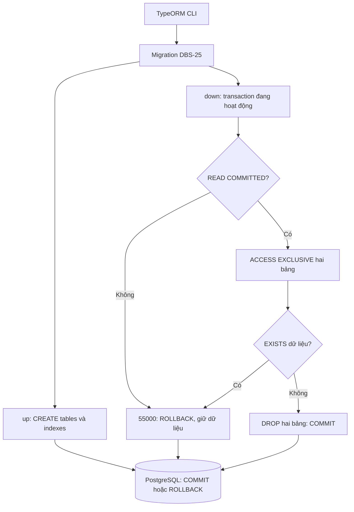
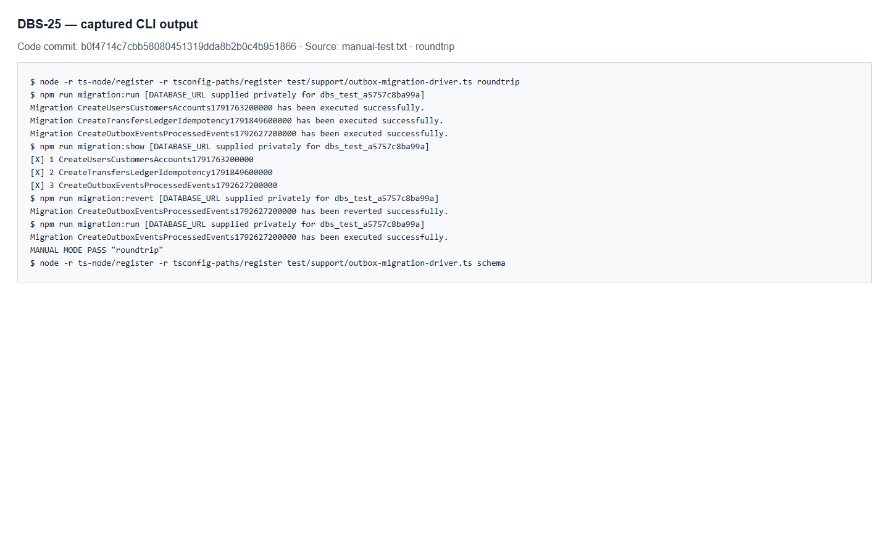
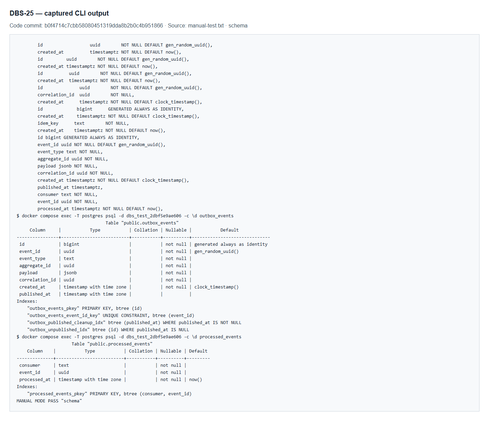
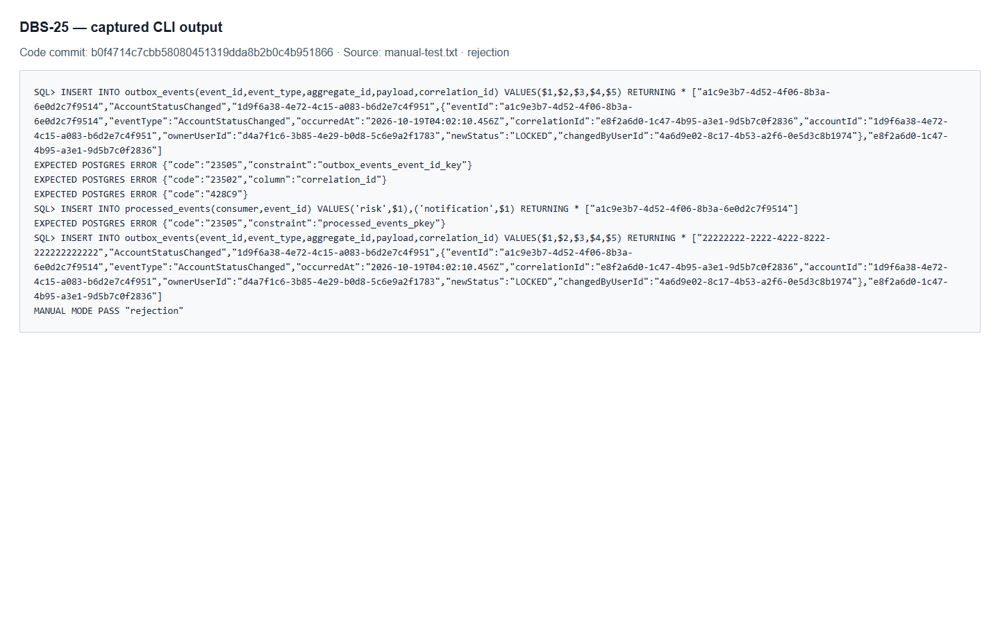
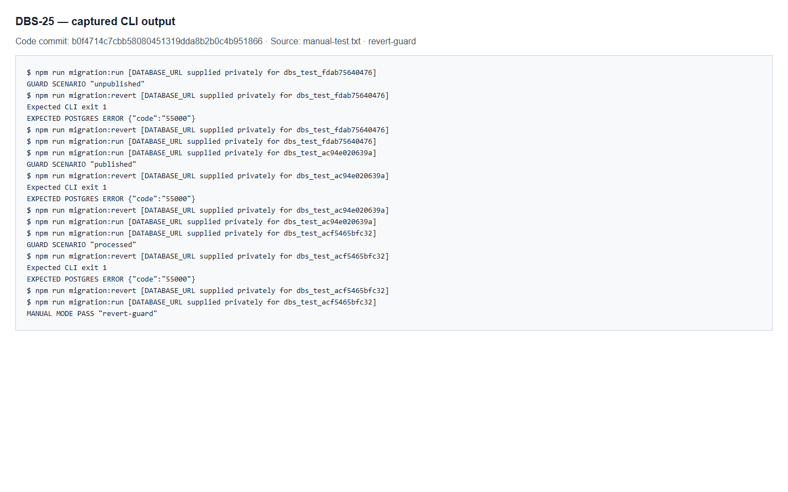
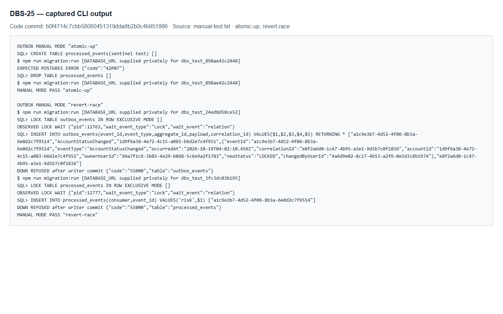
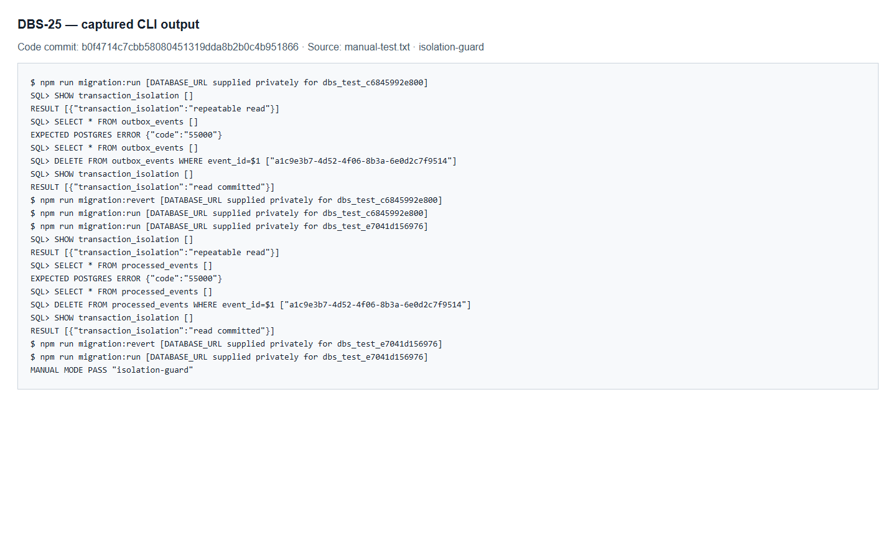

# DBS-25 · Migration: outbox_events và processed_events

> **Status:** Plan approved · **Vai:** Dev · **Reviewer:** Dev khác, chưa chỉ định · **Nhánh:** `feat/DBS-25-migration-outbox-events` · **PR:** — · **Cập nhật:** 2026-10-22

## 1. Bối cảnh

- **Nguồn yêu cầu:** workbook local `Jira chạy bằng cơm (1).xlsx`, tab `Tuần 1`, hàng 10, cột A–K. Workbook chỉ đọc, không đưa vào Git. Đã đối chiếu toàn bộ cột với `fetch-task.mjs DBS-25`; yêu cầu giống nhau, workbook ghi `To Do`, board trực tiếp ghi `In Progress`. Agent không đổi trạng thái board.
- **Task trên board:** Task, Tuần 1, ưu tiên High, assignee theo vai `Dev`, Deliverable/Demo `P2`. Vai Dev phù hợp migration backend; workbook không chỉ định cá nhân.
- **Expect:** Hạ tầng sự kiện có sẵn để ledger và accounts ghi cùng transaction.
- **DoD** (nguyên văn, đánh số):
  1. outbox_events: bigint identity, event_id uuid UNIQUE, event_type, aggregate_id, payload jsonb, correlation_id NOT NULL, created_at clock_timestamp(), published_at NULL = chưa gửi
  2. processed_events: PRIMARY KEY (consumer, event_id)
  3. Index một phần outbox_unpublished_idx (WHERE published_at IS NULL) và index dọn dẹp theo §6
  4. Migration tạo sau migration đã merge (timestamp lớn hơn); revert được
  5. PR đã merge vào main (CI xanh); Dev review; bảng «Đối chiếu test case» trong PR điền đủ
- **Phụ thuộc:** không có task phải hoàn thành trước theo workbook và board. Hai migration đã merge hiện tại có timestamp `1791763200000` và `1791849600000`; migration mới phải đứng sau chúng. Không sửa migration đã merge.
- **Đã có gì:** [schema §4.6, index §6, cleanup §10, migration §11–12](../components/_shared/database-design.md); [event contract](../components/_shared/event-contract.md); [ADR-03](../adr/0003-sync-transfer-async-outbox-sqs.md); [README outbox](../../backend/src/modules/outbox/README.md); [DBS-24](DBS-24-common-events-types-schema.md); [data source](../../backend/src/database/data-source.ts); [harness database tạm](../../backend/test/support/temp-database.ts). Module outbox hiện chỉ có README, chưa có writer/relay.
- **Thực trạng đã chạy kiểm tra:** chạy migration hiện tại qua data source thật trên database tạm rồi đọc catalog PostgreSQL: chỉ có hai migration nền; chưa có `outbox_events` hoặc `processed_events`. Database tạm được drop bằng helper sau kiểm tra; không chạy migration lên database `banking`.
- **Baseline:** nhánh tách từ `origin/main` commit `d158296be421cf7afb52b86703b631ecb2ab0b30`; Node `24.15.0`, npm `11.12.1`. `npm ci --no-audit --no-fund` thành công, lockfile không đổi. Docker Desktop ban đầu tắt, đã khởi động; `docker compose up -d` thành công; PostgreSQL `17.11`, timezone `UTC`, role local `banking` là superuser. Kết quả từ `backend/`:

  | Lệnh | Kết quả nền |
  |---|---|
  | `npm run lint:check` | Đạt |
  | `npm run typecheck` | Đạt |
  | `npm test -- --runInBand` | 23 suite, 349 test đạt; 0 bỏ qua |
  | `npm run test:e2e -- --runInBand` | 4 suite, 25 test đạt; 0 bỏ qua |
  | `npm run test:db -- --runInBand` | PostgreSQL thật: 3 suite, 49 test đạt; 0 bỏ qua |
  | `npm run build` | Đạt |
  | `node .claude/skills/dbs-delivering-task/scripts/check-doc-links.mjs` | Baseline: 83 file, 0 liên kết hỏng |

- **Phạm vi đề xuất:** một migration riêng cho hai bảng đúng §4.6, các constraint đặt tên tường minh, hai partial index của outbox đúng §6; test PostgreSQL thật; `down` từ chối trước mọi DROP nếu một trong hai bảng có dữ liệu; điều chỉnh regression CLI hiện tại đang giả định chỉ có hai migration; manual run → revert → run trên database tạm; tài liệu và bằng chứng riêng cho DBS-25. Cập nhật danh sách migration trong database-design theo việc tách ticket, không thay quyết định ADR.
- **Ngoài phạm vi:** writer DBS-57 và `assertEvent` (BL-011), relay, consumer và chính sách lỗi (BL-010), job cleanup, kiểm worker serialize bigint (BL-009), producer deposit/SYSTEM guard (BL-002/BL-003), DB roles/GRANT. §6 chưa chỉ định index `processed_at`; đề xuất giữ index này ngoài task migration hiện tại và bàn giao cho task cleanup, không tự thêm index ngoài thiết kế. Không đặt CHECK danh sách đóng cho `event_type`/`consumer`, không thêm FK cho aggregate/event ID, không đổi event contract. Outbox phải cập nhật `published_at` và cleanup được, nên không gắn trigger append-only của DBS-27 vào hai bảng này.
- **Câu hỏi / quyết định cần duyệt ở G1:**
  1. Đề xuất duyệt phạm vi migration, test hồi quy và `down` an toàn ở trên; giữ index cleanup `processed_events.processed_at` ngoài phạm vi cho tới task cleanup.
  2. Tách riêng nhánh, commit và phần thay đổi của DBS-25 theo yêu cầu người dùng; không gộp với DBS-26/27. Commit theo các bước xanh sau G3; push sau G4. Workbook đã được loại trừ tại `.git/info/exclude`, không sửa nội dung workbook.

**Quyết định ở G1 (2026-10-22):** người dùng trả lời «duyệt G1» cho DBS-25/26/27 và các đề xuất trên. DBS-25 chỉ tạo hai partial index của outbox; index `processed_at` giao cho task cleanup. Duyệt ba nhánh riêng (DBS-27 đặt trên nhánh DBS-26), sửa regression migration đúng phiên bản, `down` chống mất dữ liệu và seed SQL tạm cho test migration. Giữ workbook ngoài Git. Status vẫn **Draft** theo template đến G2. Chưa viết production code hoặc test mới, chưa commit/push.

## 2. Hành vi

**2.1 Sau `migration:run`.** Thêm đúng hai bảng rỗng; bảng nền, view `v_transfer_facts` và hàng `funding` giữ nguyên. Không tự seed sự kiện, không tạo entity, writer, relay hay worker. Schema theo database-design §4.6:

| Bảng | Cột và default | Constraint đặt tên |
|---|---|---|
| `outbox_events` | `id bigint GENERATED ALWAYS AS IDENTITY`; `event_id uuid DEFAULT gen_random_uuid()`; `event_type text`; `aggregate_id uuid`; `payload jsonb`; `correlation_id uuid`; `created_at timestamptz DEFAULT clock_timestamp()`; `published_at timestamptz NULL` không default | `outbox_events_pkey (id)`; `outbox_events_event_id_key UNIQUE (event_id)`; tất cả cột NOT NULL trừ `published_at` |
| `processed_events` | `consumer text`; `event_id uuid`; `processed_at timestamptz DEFAULT now()` | `processed_events_pkey (consumer, event_id)`; cả ba cột NOT NULL |

`id` do DB sinh, `pg` trả dạng chuỗi; ghi `id` tường minh khi không dùng `OVERRIDING SYSTEM VALUE` bị từ chối `428C9`. Không bảo đảm identity liên tiếp: rollback có thể tiêu thụ sequence. Bỏ `event_id` thì DB sinh UUID mới; truyền SQL NULL không kích hoạt default, bị từ chối `23502`. UUID sai hoặc JSON không hợp lệ bị từ chối `22P02`. Mỗi vi phạm chỉ đưa một dữ liệu sai để không phụ thuộc thứ tự constraint.

**2.2 Chống trùng và giữ tương thích.** Hai dòng outbox cùng `event_id` bị từ chối `23505 / outbox_events_event_id_key`; cùng aggregate nhưng khác event ID được chấp nhận. Cùng `(consumer,event_id)` bị từ chối `23505 / processed_events_pkey`; cùng event ID cho `risk` và `notification`, hoặc cùng consumer cho hai event khác nhau, đều hợp lệ. Không FK tới aggregate hay outbox: processed event vẫn có thể tồn tại sau khi outbox được dọn. Không CHECK đóng danh sách `event_type`/`consumer`, không ENUM. JSONB chỉ kiểm cú pháp và SQL NOT NULL; JSON `null` vẫn khác SQL NULL. Việc kiểm event object và contract thuộc `assertEvent` tại writer (DBS-57, BL-011), không được coi schema DB là bộ kiểm contract.

**2.3 Thời gian và partial indexes.** `created_at` dùng thời điểm ghi thật `clock_timestamp()`; `processed_at` giữ `now()` đúng thiết kế. DB UTC, cả ba cột thời gian là `timestamptz`. Không ghi `published_at` nghĩa là chưa gửi; relay được UPDATE nó, job được DELETE dòng đã gửi. Hai bảng này không append-only. Tạo đúng:

| Index | Truy vấn được hỗ trợ |
|---|---|
| `outbox_unpublished_idx ON outbox_events (id) WHERE published_at IS NULL` | Relay đọc `ORDER BY id LIMIT … FOR UPDATE SKIP LOCKED` |
| `outbox_published_cleanup_idx ON outbox_events (published_at) WHERE published_at IS NOT NULL` | Cleanup `WHERE published_at < now() - interval '7 days'` |

Không thêm index `processed_at`, GIN payload hay index aggregate. Chỉ xác minh cấu trúc/index predicate và sự chuyển dòng giữa hai tập khi publish; không tuyên bố planner dùng index trên bảng vài dòng hoặc đã đạt số liệu load test.

**2.4 Hoàn tác an toàn.** CLI chạy migration trong transaction. `down` yêu cầu `queryRunner.isTransactionActive`; nếu gọi ngoài transaction thì ném Error trước DDL. Tiếp theo kiểm `current_setting('transaction_isolation')`: chỉ chấp nhận **`read committed`**, phù hợp isolation nền của ADR-04. Bất kỳ isolation khác (`read uncommitted`, `repeatable read`, `serializable`) đều bị PostgreSQL từ chối bằng `55000` trước LOCK/EXISTS/DROP; không tự đổi isolation sau khi caller đã đọc snapshot. Sau đó: `LOCK TABLE outbox_events, processed_events IN ACCESS EXCLUSIVE MODE` → kiểm `EXISTS` cả hai bảng → nếu một bảng có dòng thì PostgreSQL ném `55000` (`object_not_in_prerequisite_state`), không có tên constraint → nếu cả hai rỗng thì DROP `processed_events`, rồi `outbox_events`. Index/identity sequence tự mất cùng bảng; các bảng nền và bản ghi migration trước vẫn còn. TypeORM chỉ xóa bản ghi của migration sau khi `down` thành công.

Khóa lấy **trước** kiểm dữ liệu và giữ đến COMMIT/ROLLBACK, nên INSERT không thể chen giữa kiểm và DROP. Ở READ COMMITTED, câu kiểm dữ liệu sau LOCK dùng snapshot mới: nếu transaction khác đã giữ khóa ghi và commit một dòng trong lúc revert đang chờ khóa, revert thấy dòng rồi từ chối. Khóa đơn thuần không làm mới snapshot của REPEATABLE READ; vì vậy guard isolation bắt buộc kể cả lúc caller đã đọc bảng rỗng trước khi một kết nối khác commit dòng. Refusal rollback toàn bộ transaction, giữ nguyên bảng, index, dữ liệu và lịch sử migration; đọc/ghi hợp lệ trở lại được ngay sau đó. Không cần `CASCADE`, tắt trigger, sửa quyền hoặc xóa dữ liệu tự động để revert.

**2.5 Ranh giới bảo mật/nghiệp vụ.** Không endpoint, role guard, ownership, HTTP ErrorCode, audit nghiệp vụ, số dư, ledger, Cognito hoặc SQS trong task này; các AC chuyển tiền/consumer là nhiệm vụ downstream, migration chỉ cung cấp schema. SQL DDL là literal cố định; SQL tham số hóa mọi giá trị UUID/type/payload/consumer trong driver/tests. Seed chỉ ghi hai bảng kỹ thuật trên DB tạm, không INSERT/UPDATE số dư. Không ghi DATABASE_URL/password vào output; không thay env var/dependency. Chưa có role production nên không tuyên bố least privilege/GRANT được kiểm chứng. BL-002/003/009/010/011 tiếp tục ngoài phạm vi; thiếu index cleanup processed được ghi bàn giao ở Phase 5.

## 3. Kiến trúc

**Vị trí và interface.** Migration hạ tầng dùng `MigrationInterface`/`QueryRunner` đang có; chạy qua CLI/pipeline, không khởi động ở role `api` hay `worker`.

| File/interface dự kiến | Trách nhiệm |
|---|---|
| `backend/src/database/migrations/1792627200000-CreateOutboxEventsProcessedEvents.ts` | `class CreateOutboxEventsProcessedEvents1792627200000 implements MigrationInterface`; `name = 'CreateOutboxEventsProcessedEvents1792627200000'`; `up(queryRunner: QueryRunner): Promise<void>`; `down(queryRunner: QueryRunner): Promise<void>` theo §2 |
| `createMigrationDataSource(url: string \| undefined): DataSource` (đã có) | Glob `migrations/*.{ts,js}` tự load file mới; không sửa cấu hình/export hoặc app startup |
| `backend/test/db/outbox-schema.db-spec.ts` (chưa có) | Test schema, constraints, transaction, lock và safe down trên PostgreSQL thật |
| `backend/test/support/temp-database.ts` và `backend/test/db/migration-revert.db-spec.ts` (đã có) | Thêm helper **test-only** `migrateThrough(url: string, migrationName: string): Promise<void>`: load các migration thật từ data source, kiểm target có tồn tại và lịch sử hiện tại là prefix phù hợp, chỉ chạy đến target. Nếu DB đã vượt target thì từ chối, không âm thầm revert. Regression DBS-20/21 chạy đúng tập migration của chúng; không hard-code toàn repo chỉ có hai migration. Giữ `migrate(url, direction?)` tương thích; không đổi production loader |
| `backend/test/db/accounts-schema.db-spec.ts`, `backend/test/db/ledger-schema.db-spec.ts` (đã có) | Schema/guard legacy dùng `migrateThrough` tới migration thật của mình: accounts → `CreateUsersCustomersAccounts1791763200000`; ledger → `CreateTransfersLedgerIdempotency1791849600000`. Giữ nguyên oracle TC-21-02 về đúng hai bản ghi migration và schema nền; không đổi expected count thành latest |
| `backend/test/support/outbox-migration-driver.ts` (chưa có) | Driver vận hành §5, viết sau G3; gọi CLI thật và SQL thật, không dùng Jest thay manual test |

Timestamp `1792627200000` lớn hơn hai migration đã merge `1791763200000`, `1791849600000`; khảo sát ngày 2026-10-22 chưa có file trùng. Trước G3/implementation kiểm lại main và danh sách migration; nếu xuất hiện timestamp mới hơn thì cập nhật thiết kế/kế hoạch trước khi viết code. DBS-26 dùng `1792627200001`, DBS-27 dùng `1792627200002` trên các nhánh tương ứng; không kéo chúng vào nhánh DBS-25.

**Transaction và rollback.** `up`: CREATE hai bảng → CREATE hai partial index → TypeORM ghi migrations → COMMIT trong `transaction: 'all'` (đúng CLI mặc định/harness hiện tại). Bảng mới rỗng nên không cần `CONCURRENTLY`. Nếu bước CREATE sau thất bại, toàn bộ DDL và migration record rollback. `down`: JavaScript guard transaction đang hoạt động → SQL guard isolation READ COMMITTED (khác thì `55000`) → khóa hai bảng → EXISTS guard (`55000` nếu có dữ liệu) → DROP nếu rỗng → TypeORM xóa migration record → COMMIT. Không dùng `TransactionService.run`, không retry deadlock, không Redis/HTTP/SQS. Không thay exported symbol production đang có nên không có caller production cần sửa; caller `migrate` test-only sẽ được rà trước §7.

**Regression CLI giữ nguyên đường production.** `migration-revert.db-spec.ts` vẫn gọi **`npm run migration:run` thật để lên latest** bằng data source production, đọc `SELECT name,timestamp FROM migrations ORDER BY timestamp`, rồi gọi **`npm run migration:revert` thật từng lần** cho các migration mới hơn target migration 2. Sau mỗi lần so catalog/history với prefix vừa đạt; không dùng helper thay CLI hoặc đổi glob/`-d` sang adapter test-only. Khi về target 2, giữ oracle CLI cũ **2 → 1 → 0 → latest**: revert migration 2 kiểm chỉ còn schema/funding migration 1; revert migration 1 kiểm hết schema nền; CLI run lần cuối kiểm đủ baseline và toàn bộ latest (có DBS-25), không đổi oracle 2 → 1 thành latest → 1. Các ca schema và guard DBS-20/21 chuẩn bị bằng `migrateThrough` đúng phiên bản riêng; đây là mục đích khác với kiểm CLI và không thay đường CLI.

**Luồng vận hành:** driver gọi CLI thật và quan sát catalog trên database tạm; migration là thành phần duy nhất viết DDL.



**Tài liệu có fact thay đổi:** database-design §6 ghi tên hai indexes; §11 tách nhóm outbox/processed (DBS-25) khỏi audit_log (DBS-26), giữ thứ tự và schema đã chốt. `notification_log` vẫn thuộc task khác, không đưa vào DBS-25 hoặc DBS-26. README outbox ghi schema đã có nhưng runtime vẫn chưa có; feature index và backlog cập nhật lúc bàn giao. Không đổi ADR hoặc event-contract.

## 4. Test cases tự động

Tất cả test hành vi dưới đây chạy PostgreSQL 17 thật bằng `npm run test:db -- --runInBand`; mỗi suite dùng DB tạm qua harness, không dùng mock, không `.skip/.only/.todo`. SQLSTATE và tên constraint được đọc từ `QueryFailedError.driverError`, không assert câu chữ lỗi DB. Trường hợp guard ngoài transaction là Error của migration, không có SQLSTATE. Mỗi ô liệt kê nhiều trường được triển khai thành các ca tham số hóa riêng, không chỉ kiểm một trường đại diện.

| ID | Truy vết | Lớp | Given · When · Then | SQLSTATE / constraint |
|---|---|---|---|---|
| TC-25-01 | DoD #1–2, database-design §4.6 | DB integration | Migrate DB trống; catalog có đúng 8 + 3 cột, kiểu, nullability, defaults theo §2.1; identity `ALWAYS`; tên/thứ tự PK và UNIQUE đúng; không ENUM, FK hay CHECK đóng; không có cột/index thừa | — |
| TC-25-02 | DoD #1 | DB integration | Bỏ id/event_id/created_at/published_at khi insert hai event hợp lệ; id tăng và trả string, event IDs là UUID khác nhau, `created_at` nằm giữa hai mốc wall-clock DB, `published_at` SQL NULL; catalog xác nhận `clock_timestamp()`, không `now()` | — |
| TC-25-03 | DoD #1 | DB integration | Ghi id tường minh không override → từ chối; riêng ca duplicate id dùng `OVERRIDING SYSTEM VALUE` để chỉ vi phạm PK | `428C9`; `23505 / outbox_events_pkey` |
| TC-25-04 | DoD #1 | DB integration | NULL từng cột bắt buộc outbox (`id` dùng override): id/event_id/event_type/aggregate_id/payload/correlation_id/created_at; mỗi lần chỉ một vi phạm; đọc `column` đúng cột | `23502`, column tương ứng |
| TC-25-05 | DoD #1 | DB integration | Duplicate event_id bị từ chối đúng UNIQUE; cùng aggregate_id với event_id mới thành công | `23505 / outbox_events_event_id_key` |
| TC-25-06 | DoD #1–2 | DB integration | UUID sai riêng từng event_id/aggregate_id/correlation_id của outbox và event_id processed; JSON payload sai cú pháp; mỗi row còn lại hợp lệ | `22P02`, không constraint |
| TC-25-07 | DoD #2 | DB integration | Cùng `(consumer,event_id)` từ chối; cùng ID ở risk/notification được chấp nhận; cùng consumer hai event IDs được chấp nhận | `23505 / processed_events_pkey` |
| TC-25-08 | DoD #2, §4.6 | DB integration | NULL riêng consumer/event_id/processed_at từ chối; bỏ processed_at thì bằng `transaction_timestamp()` của transaction insert, đúng default `now()` | `23502`, column tương ứng |
| TC-25-09 | DoD #1–2, tương thích | DB integration | UUID aggregate/event chưa có bảng cha, future event_type/consumer và JSON scalar/JSON null vẫn được chấp nhận ở DB; không nhầm với xác thực contract tại writer | — |
| TC-25-10 | DoD #3 | DB integration | Đọc `pg_index/pg_get_indexdef/pg_get_expr`: đúng key/predicate của hai indexes §2.3; ngoài PK và UNIQUE không còn index khác trên hai bảng; không index processed_at | — |
| TC-25-11 | DoD #1,3, ADR-03 | DB integration | Insert unpublished rồi UPDATE published_at; các truy vấn predicate thấy đúng hàng trước/sau, index metadata không đổi; DELETE event đã published và processed row được, không append-only trigger | — |
| TC-25-12 | Expect, transaction | DB integration | BEGIN, insert cả outbox và processed rồi ROLLBACK → không có hai dòng; lần COMMIT mới giữ hai dòng. Không ghi bảng tiền để giả lập nghiệp vụ chưa xây | — |
| TC-25-13 | DoD #4 | DB integration/CLI | CLI run → revert → run trên DB trống; mỗi bước chỉ tác động migration mới, bảng/index/identity biến mất rồi tạo lại; hai migration nền, view, funding không đổi | exit 0 |
| TC-25-14 | DoD #4, §11 an toàn | DB integration | Lần lượt chỉ outbox có dòng (cả unpublished và published) hoặc chỉ processed có dòng → revert từ chối; snapshot đầy đủ hai bảng/index/migrations không đổi, kết nối đọc/ghi lại được sau rollback | `55000`, không constraint |
| TC-25-15 | DoD #4, chống TOCTOU | DB concurrency | A BEGIN và giữ ROW EXCLUSIVE trên từng bảng (hai ca riêng); B bắt đầu undo ở READ COMMITTED; C đợi `pg_stat_activity/pg_locks` xác nhận B chờ khóa; A INSERT rồi COMMIT → B lấy khóa, thấy dòng, từ chối, dữ liệu/index/migration còn nguyên. Poll có deadline, không sleep cố định hoặc rerun đến xanh | `55000` |
| TC-25-16 | DoD #4, atomic up | DB integration | Chạy xong đúng hai migration nền bằng `migrateThrough` **trước** khi tạo sentinel `processed_events`; baseline không tạo/đọc bảng này nên sentinel không cản nền. Chạy migration mới trong transaction để CREATE thứ hai thất bại → không còn outbox/index vừa tạo, sentinel và lịch sử hai nền nguyên vẹn, migration mới chưa ghi; bỏ sentinel rồi CLI run hồi phục | `42P07`; sau recovery exit 0 |
| TC-25-17 | DoD #4, tiền điều kiện down | DB integration | Gọi `down` bằng QueryRunner thật chưa BEGIN → Error trước DDL, không bảng/index/dòng nào bị mất. Từ transaction đúng, bảng rỗng revert được | Error (không SQLSTATE) |
| TC-25-18 | Regression DBS-20/21, DoD #4 | DB integration/CLI | CLI production run lên latest; đọc history rồi CLI revert từng migration mới về target 2; giữ đầy đủ oracle CLI 2 → 1 → 0 → latest và assert catalog/history tương ứng, lần cuối gồm baseline + DBS-25. Schema/guard accounts dùng prefix 1, ledger dùng prefix 2 (giữ TC-21-02 assert đúng hai migration) bằng helper thật. Không đổi production glob, không helper/adapter thay CLI, không giảm assertion legacy | SQLSTATE của ca legacy giữ nguyên; CLI exit 0 |
| TC-25-19 | Regression helper test-only | DB integration | `migrateThrough` chạy từ DB trống tới target 1 rồi target 2, gọi lại cùng target không đổi; target không tồn tại, lịch sử có gap/không phải prefix, hoặc DB đã vượt target đều từ chối trước DDL; không tự undo dữ liệu. Migrate bằng class thật, không bản sao SQL | Error của helper; catalog/history giữ nguyên khi từ chối |
| TC-25-20 | DoD #4, isolation/snapshot | DB concurrency | B BEGIN ISOLATION LEVEL REPEATABLE READ và SELECT xác nhận outbox rỗng để cố định snapshot; A INSERT outbox rồi COMMIT; B gọi `down` → guard isolation từ chối **trước LOCK/EXISTS/DROP**. ROLLBACK B, kết nối mới đọc thấy row A, schema/index/history nguyên vẹn. Lặp với processed_events; ca riêng READ UNCOMMITTED/SERIALIZABLE cũng từ chối trước DDL; READ COMMITTED rỗng revert thành công | `55000`, không constraint |
| Quy trình | DoD #5 | Quy trình | Dev khác review, CI xanh, PR merge và bảng đối chiếu điền đủ. Local pass chưa chứng minh CI/merge; thiếu bước nào ghi backlog ở Phase 5, agent không merge | — |

Checklist bảo mật §2.5: guards/ownership/HTTP/PII DTO/audit nghiệp vụ/money invariants không áp dụng vì không có API hay tác động tiền; không claim AC-9.2 đã đạt (TC-25-07 chỉ chứng minh khóa chống trùng). Tham số hóa SQL có review và một consumer chứa dấu nháy được roundtrip nguyên văn trong TC-25-09; TLS/env/production roles không thay đổi. Không in credentials trong output manual hoặc evidence.

## 5. Test thủ công

**Điều kiện:** docker compose PostgreSQL 17 đang healthy, timezone UTC; local user `banking` như baseline có quyền CREATE/DROP database tạm. `DATABASE_URL` phải đặt trong môi trường nhưng không echo/ghi vào evidence. Không cần API, Cognito, Redis hoặc SQS; không sửa file `.env`. Chạy trên commit cuối thay code bằng **Git Bash**, không dùng PowerShell ghi transcript.

**Driver:** [outbox-migration-driver.ts](../../backend/test/support/outbox-migration-driver.ts) đã triển khai theo G3. Mỗi mode bên dưới tạo một DB ngẫu nhiên theo `createTempDatabase()`, gọi npm CLI thật bằng `execFileSync(process.execPath, [process.env.npm_execpath, 'run', script], …)` hoặc resolve npm CLI path khi chạy từ npx; không giả định npx luôn đặt `npm_execpath`. Driver ghi rõ command đã chạy (ẩn URL/password), SQL có tham số, row IDs/correlationId, SQLSTATE, kết quả trước/sau. Trong `finally` đóng kết nối rồi drop **chính DB tạm vừa tạo**, giữ regex `dbs_test_[0-9a-f]{12}`; không chạm DB `banking`. Lỗi unexpected trả exit khác 0; rejection dự kiến được ghi nhận rồi tiếp tục recovery, không nuốt mọi lỗi để cho xanh.

Khởi tạo transcript từ repo root, rồi chuyển vào backend (các file evidence chỉ tạo ở Phase 4):

```bash
set -o pipefail
OUT="$PWD/docs/features/screenshots/DBS-25/manual-test.txt"
mkdir -p "$(dirname "$OUT")"
git rev-parse HEAD > "$OUT"
docker compose ps 2>&1 | tee -a "$OUT"
cd backend
DRIVER=(npx --no-install ts-node -r tsconfig-paths/register test/support/outbox-migration-driver.ts)
```

Driver dùng payload `AccountStatusChanged` từ `test/support/event-samples.ts`, đồng nhất event_id/correlation_id/payload, chỉ IDs/code, không PII. Seed SQL đã được duyệt tại G1; đây là input cho schema, không phải sự kiện do accounts phát và không tạo dữ liệu tiền. Khi thử NULL/duplicate, chỉ sửa trường đang kiểm.

| Bước | Lệnh Git Bash và hành động thật của driver | Kết quả mong đợi |
|---|---|---|
| M-25-01 | `"${DRIVER[@]}" roundtrip 2>&1 \| tee -a "$OUT"`: tạo DB rỗng, `npm run migration:run`, `migration:show`, `migration:revert`, rồi `migration:run`; in `SELECT name FROM migrations ORDER BY timestamp` và object catalog sau mỗi bước | 3 migration → 2 → 3; outbox/processed chỉ mất trong trạng thái reverted; users/customers/accounts/transfers/ledger/idempotency/view/funding không đổi; mọi CLI exit 0 |
| M-25-02 | `"${DRIVER[@]}" schema 2>&1 \| tee -a "$OUT"`: CLI run; từ repo root gọi `docker compose exec -T postgres psql -X -v ON_ERROR_STOP=1 -U banking -d <tên_DB_tạm> -c '\d outbox_events'` và tương tự `processed_events`; đọc defaults/index catalog, timezone | Hai schema đúng §2.1, hai partial indexes đúng §2.3, UTC; không index processed_at, không trigger append-only; tên DB thực tế được in để cặp đôi kiểm lại |
| M-25-03 | `"${DRIVER[@]}" rejection 2>&1 \| tee -a "$OUT"`: CLI run, seed SQL 1 event chưa gửi; in RETURNING id/event_id/correlation_id/created_at/published_at; chèn lại event_id; NULL correlation_id; explicit identity; ghi risk/notification cùng event rồi ghi trùng risk; mỗi lỗi ở transaction/savepoint riêng; cuối cùng insert event hợp lệ mới | `23505/outbox_events_event_id_key`, `23502` column correlation_id, `428C9`, `23505/processed_events_pkey`; hai consumer khác nhau thành công; event mới thành công, chứng minh recovery sau rejection |
| M-25-04 | `"${DRIVER[@]}" lifecycle 2>&1 \| tee -a "$OUT"`: seed SQL event; SELECT unpublished ORDER BY id; UPDATE published_at = clock_timestamp(); SELECT hai predicates; BEGIN insert cả hai bảng rồi ROLLBACK; DELETE published seed và processed seed | Trước publish chỉ tập chưa gửi có hàng, sau publish chỉ tập đã gửi có hàng; hai rows rollback không còn; UPDATE/DELETE hợp lệ. Không dùng row cũ của app |
| M-25-05 | `"${DRIVER[@]}" revert-guard 2>&1 \| tee -a "$OUT"`: mỗi tình huống DB tạm riêng, seed chỉ outbox unpublished, chỉ outbox published, chỉ processed; gọi `npm run migration:revert`, giữ raw CLI refusal và đọc lại cả catalog/data/migrations; xóa **seed SQL** đúng IDs trên DB tạm, gọi revert rồi run | Mỗi CLI refusal exit khác 0, SQLSTATE `55000` được đọc bằng QueryRunner riêng nếu CLI không in code; dữ liệu và 3 migration giữ nguyên. Sau bỏ seed: revert/run exit 0, schema hồi phục. Không xóa dữ liệu để giả vờ bước refusal thành công |
| M-25-06 | `"${DRIVER[@]}" atomic-up 2>&1 \| tee -a "$OUT"`: migrate prefix 2, tạo sentinel processed_events rồi CLI run; in lỗi/catalog; DROP sentinel đúng DB tạm, CLI run lại | Lần đầu `42P07`, không có outbox/index hoặc migration record dở dang; hai nền/sentinel nguyên vẹn. Lần sau 3 migrations, hai bảng đúng schema |
| M-25-07 | `"${DRIVER[@]}" revert-race 2>&1 \| tee -a "$OUT"`: hai phiên PG thật như TC-25-15; in PID/lock wait, A INSERT/COMMIT, B refusal; chạy riêng trường hợp outbox và processed | Có bằng chứng B chờ ACCESS EXCLUSIVE trước A commit; mỗi ca trả `55000`, giữ row vừa commit và migration record, không mất dữ liệu |
| M-25-08 | `"${DRIVER[@]}" isolation-guard 2>&1 \| tee -a "$OUT"`: CLI run DB tạm; B BEGIN ISOLATION LEVEL REPEATABLE READ, `SHOW transaction_isolation`, SELECT outbox rỗng; A seed SQL event rồi COMMIT; B gọi down trực tiếp bằng QueryRunner thật trong transaction của B; ghi `55000`, ROLLBACK; kết nối mới SELECT row/catalog/history. Lặp với processed; bỏ seed đúng IDs rồi CLI revert/run ở READ COMMITTED | Snapshot B cũ không dẫn tới DROP: guard isolation từ chối trước lock/DDL, row A và 3 migration/index giữ nguyên. `SHOW` xác nhận CLI recovery READ COMMITTED; revert/run exit 0. Không tự thay isolation trên transaction đã có snapshot |

Ảnh dự kiến lấy **từ output thật**: `01-run-revert-run.png` (M-25-01), `02-schema-indexes.png` (M-25-02), `03-rejections-recovery.png` (M-25-03), `04-safe-revert.png` (M-25-05), `05-transaction-race.png` (M-25-06/07), `06-isolation-guard.png` (M-25-08). §8 ghi kết quả thực từng M; driver, transcript và sáu ảnh đã có sau thực thi. Trước commit evidence rà và redact password/token/Authorization/AWS ID/ARN; giữ event IDs/correlationId kỹ thuật cho đối chiếu.

## 6. Domain review (AI)

**Reviewer:** subagent độc lập `review_outbox_g2`, model **GPT-6 Astra**, reasoning `xhigh`, ngày 2026-10-22; chỉ đọc và đối chiếu §1–§5 với nguồn trong repository.

**Vòng 1:** 2 phát hiện (blocking 0, should-fix 2, minor 0), verdict REVISE; [trả lời nguyên văn](screenshots/DBS-25/domain-review-round-1.txt). **Vòng 2:** đã review lại toàn bộ §2–§5 sau chỉnh sửa, 0 phát hiện còn lại; [trả lời nguyên văn](screenshots/DBS-25/domain-review.md).

| # | Mức | Phát hiện | Xử lý trong thiết kế |
|---|---|---|---|
| 1 | should-fix | Snapshot REPEATABLE READ có thể không thấy dòng đã commit dù đã lấy ACCESS EXCLUSIVE | Đã sửa §2.4 và §3: chỉ cho down trong READ COMMITTED, kiểm trước LOCK/DDL; TC-25-20 và M-25-08 chứng minh từ chối snapshot cũ, giữ dữ liệu/history |
| 2 | should-fix | Helper prefix chưa giải quyết CLI roundtrip và suite ledger còn giả định hai migration | Đã sửa §3, TC-25-18: CLI production latest → history thực → revert về 2 → 1 → 0 → latest; schema/guard cũ chạy prefix 1/2, giữ đầy đủ assertions |

`Verdict: APPROVE`

Mermaid ở §3 đã render thành công bằng mermaid-cli 12.0.0 sau lần chỉnh sửa cuối. Kiểm tra này chỉ xác minh sơ đồ thiết kế; migration/test/driver mới chưa được triển khai.

**Quyết định ở G2 (2026-10-22):** người dùng trả lời «duyệt G2» cho cả ba task, chấp nhận thiết kế §2–§5 và kết quả review §6. Status chuyển thành **Design approved**. Chưa viết production code, test hoặc driver mới; chưa commit/push.

## 7. Kế hoạch triển khai

**Base và phạm vi file.** Nhánh `feat/DBS-25-migration-outbox-events` từ `origin/main` `d158296`, kiểm lại 2026-10-22. Các timestamp mới 1792627200000/1/2 chưa tồn tại trong main; DBS-25 chỉ thêm file 1792627200000. Không mang migration/doc DBS-26/27 vào commit nhánh này.

**Quy tắc thực thi.** Mọi đường dẫn dưới đây tính từ repo root; lệnh npm chạy tại `backend/`. Viết test trước từng hành vi, chạy và ghi đúng một dòng lỗi đỏ thực tế, rồi mới viết code tối thiểu cho xanh. Cột đỏ ghi lỗi thực đã quan sát và kết quả sau sửa; chi tiết tại §8. Chỉ commit khi bước hoàn chỉnh xanh, không bỏ test hoặc dùng `--no-verify`. Mỗi commit chỉ stage allowlist của task; trước commit kiểm `git diff --cached --name-only` và nội dung staged, tuyệt đối không có workbook, secret hoặc file task khác.

**Kiểm tra bàn giao:** `npm run lint:check`, `npm run typecheck`, `npm test -- --runInBand`, `npm run test:e2e -- --runInBand`, `npm run test:db -- --runInBand`, `npm run build`; đọc toàn bộ output và số skip. DB thật qua docker compose, thiếu DB phải fail. Sau commit cuối đổi code, chạy toàn bộ §5 bằng Git Bash, SHA ở dòng đầu transcript, ảnh từ output thật. Nếu sửa code sau manual phải chạy lại toàn bộ §5. Tài liệu/evidence commit sau manual không làm thay SHA code. Không nhận local pass là CI/merge; agent không sửa board hoặc tự merge.

| Bước | File được phép sửa/tạo | Test viết trước / mục tiêu | Kết quả đỏ thực tế | Lệnh chứng minh | Commit dự kiến |
|---|---|---|---|---|---|
| 1 | `backend/test/support/temp-database.ts`; `backend/test/db/outbox-schema.db-spec.ts`; `backend/test/db/accounts-schema.db-spec.ts`; `backend/test/db/ledger-schema.db-spec.ts`; `backend/test/db/migration-revert.db-spec.ts` | TC-25-19: target thật, prefix, gọi lặp, unknown/gap/vượt target từ chối trước DDL; TC-25-18: legacy chuẩn bị đúng prefix, CLI production đọc history và revert về mốc 2 rồi 1/0/latest; giữ nguyên độ sâu TC-20-18, TC-21-02/21/23/24 | TS2305: thiếu migrateThrough; sau helper 50 DB test đạt | `npm run test:db -- --runInBand`; lint/typecheck | `test(database): support explicit migration prefixes` |
| 2 | `backend/src/database/migrations/1792627200000-CreateOutboxEventsProcessedEvents.ts`; `backend/test/db/outbox-schema.db-spec.ts` | TC-25-01…18 và 20: schema/default/constraint, hai partial index, dedupe, transaction, up atomic/recovery, CLI lifecycle, safe down/no transaction, isolation/race; từng nhóm test có lượt đỏ trước phần code tương ứng | 37 ca đỏ do thiếu outbox/processed (42P01); sau migration 87 DB test đạt | `npm run test:db -- --runInBand outbox-schema` rồi toàn bộ bộ DB và các lệnh baseline | `feat(outbox): add event storage migrations` |
| 3 | `backend/test/support/outbox-migration-driver.ts` | Dùng oracle TC đã viết ở bước 2 và kịch bản M-25-01…08 trước khi viết driver; CLI thật, lỗi dự kiến phân loại rõ, lỗi bất ngờ exit khác 0, cleanup DB do run tạo; không dùng Jest thay manual | Oracle migration đã đỏ ở bước 2; driver lint/typecheck đạt | lint/typecheck/build và các suite liên quan; kiểm đủ tám mode của §5 ở bước 4 | `test(outbox): add migration operator driver` |
| 4 | Feature doc này; `docs/features/screenshots/DBS-25/` gồm raw review hiện có, transcript và sáu ảnh đúng tên §5; `docs/components/_shared/database-design.md`; `backend/src/modules/outbox/README.md`; `backend/README.md`; `docs/features/README.md`; `docs/BACKLOG.md` | Toàn baseline; M-25-01…08 trên SHA code bước 3; đối chiếu TC từng test, update trạng thái schema và hướng dẫn migration; thêm nguồn/bàn giao thiếu index cleanup processed và DoD quy trình còn chờ | Sáu baseline và M-25-01…08 đạt; xem kết quả thực §8 | Sáu lệnh baseline; tám mode §5; `node .claude/skills/dbs-delivering-task/scripts/check-doc-links.mjs`; `git diff --check`; kiểm allowlist branch diff | `docs(outbox): record migration verification and handoffs` |

**Plan sweep đã thực hiện (2026-10-22):**

| Nguồn / điều kiện | Được xử lý ở |
|---|---|
| DoD #1 outbox schema và #2 processed PK/default | Bước 2, TC-25-01…09/11/12; M-25-02…04 |
| DoD #3 partial unpublished + published cleanup index | Bước 2, TC-25-10/11; M-25-02/04; cập nhật tên index §6 tại bước 4 |
| DoD #4 timestamp, reversible, dữ liệu/race/isolation/atomicity | Bước 2, TC-25-13…17/20; M-25-01/05…08; timestamp kiểm lại trước viết migration |
| DoD #5 review/CI/merge/đối chiếu | Bước 4 ghi bảng TC; CI/Dev review/merge còn chờ có backlog, không tuyên bố đạt |
| Legacy callers `migrate()`: accounts-schema, ledger-schema, migration-revert; production factory không đổi | Bước 1, TC-25-18/19; cả ba caller đã grep và có trong allowlist |
| database-design §11/12: bigint identity/string, timestamptz/default, named constraints, lý do index, down an toàn, no startup migration | Bước 2; bước 4 cập nhật reference docs. Không tiền domain, không FK mới; không ENUM hay CHECK danh sách đóng |
| §6.2 tránh index thừa/GIN; §10 cleanup processed_at; worker/consumer/runtime | Không thêm index ngoài hai index G2 duyệt; processed_at index và cleanup job bàn giao backlog bước 4. BL-002/003/009/010/011 ngoài scope theo G1 |
| Index CONCURRENTLY, production roles, service/API, event contract/ADR | CONCURRENTLY không áp dụng bảng mới rỗng; phần còn lại ngoài phạm vi G1, không đổi dependency/env/quy tắc tiền |

**Rủi ro và cách lùi.** Hai nhánh độc lập 25/26 cùng chạm helper, regression và reference docs: dùng cùng chữ ký/logic prefix và CLI history, đối chiếu patch khi tích hợp, không cherry-pick cả task khác. Mỗi nhánh có đủ helper/test của chính nó. Không gọi `down` trên DB đã có sự kiện; production rollback ưu tiên quay image cũ, giữ schema mở rộng. Chỉ revert trên DB tạm/rỗng qua guard READ COMMITTED + lock; không xóa sự kiện để ép qua. Lock/race test có deadline, luôn rollback/đóng kết nối trong finally, không ngừng suite khác hoặc thao tác DB banking. File ngoài allowlist hoặc thay đổi thiết kế G2 cần báo gate phụ trước khi sửa.

**Quyết định ở G3 (2026-10-22):** người dùng trả lời «duyệt G3» cho cả ba task. Kế hoạch §7 được duyệt; triển khai test-first, commit riêng theo bước xanh và trình G4 trước khi push. Status: Plan approved.

## 8. Kết quả

**Trạng thái:** hoàn tất triển khai local, chờ G4; chưa push, PR/CI/Dev review/merge chưa có. Code cuối: `b0f4714c7cbb58080451319dda8b2b0c4b951866` (dòng đầu transcript). Nhánh `feat/DBS-25-migration-outbox-events`, thực hiện trong worktree riêng để không bị checkout bên ngoài làm đổi source khi kiểm CLI.

**Kiểm tra bàn giao:** xem [output đầy đủ](screenshots/DBS-25/verification.txt): lint/typecheck/build đạt; unit **23 suite / 349 test**, e2e **4 suite / 25 test**, PostgreSQL **4 suite / 87 test** đạt; 0 skip. Bộ DB gồm 49 test cũ và 38 lượt mới trong outbox-schema. Không có mock DB.

**TDD:** helper đỏ TS2305 thiếu `migrateThrough`, rồi 50 test DB xanh. Test migration đỏ vì chưa có cột/bảng (`42P01`, 37 ca đỏ), sau migration 87 test DB xanh. Hai lỗi lint assertion dư đã sửa trước snapshot commit helper cuối `977a986`; commit migration `b2ece08`, driver `100b717`. Không bịa lỗi đỏ cho verification/docs.

Kiểm tương thích ba task trong bản sao tạm phát hiện 13 lượt đỏ ở suite audit/outbox do giả định migration đích luôn là latest và đếm cứng history. Commit `b0f4714` chọn prefix outbox cho schema test; TC-25-13 vẫn chạy CLI production latest, đọc history rồi revert successor trước khi kiểm migration đích, không thay CLI bằng adapter. Sau sửa cả hai suite, [kiểm tra tương thích](screenshots/DBS-25/integration-verification.txt) đạt **7 suite / 150 test**, 0 skip; không tạo nhánh bàn giao gộp. Đã chạy lại toàn bộ manual sau commit đổi test.

| ID | Test / chứng cứ | Kết quả |
|---|---|---|
| TC-25-01 | `outbox-schema.db-spec.ts` TC-25-01 | đạt |
| TC-25-02 | `outbox-schema.db-spec.ts` TC-25-02 | đạt |
| TC-25-03 | `outbox-schema.db-spec.ts` TC-25-03 | đạt |
| TC-25-04 | `outbox-schema.db-spec.ts` TC-25-04 | đạt |
| TC-25-05 | `outbox-schema.db-spec.ts` TC-25-05 | đạt |
| TC-25-06 | `outbox-schema.db-spec.ts` TC-25-06 | đạt |
| TC-25-07 | `outbox-schema.db-spec.ts` TC-25-07 | đạt |
| TC-25-08 | `outbox-schema.db-spec.ts` TC-25-08 | đạt |
| TC-25-09 | `outbox-schema.db-spec.ts` TC-25-09 | đạt |
| TC-25-10 | `outbox-schema.db-spec.ts` TC-25-10 | đạt |
| TC-25-11 | `outbox-schema.db-spec.ts` TC-25-11 | đạt |
| TC-25-12 | `outbox-schema.db-spec.ts` TC-25-12 | đạt |
| TC-25-13 | `outbox-schema.db-spec.ts` TC-25-13 + legacy CLI TC-21-23; M-25-01 chạy full CLI | đạt |
| TC-25-14 | `outbox-schema.db-spec.ts` TC-25-14 | đạt |
| TC-25-15 | `outbox-schema.db-spec.ts` TC-25-15 | đạt |
| TC-25-16 | `outbox-schema.db-spec.ts` TC-25-16 | đạt |
| TC-25-17 | `outbox-schema.db-spec.ts` TC-25-17 | đạt |
| TC-25-18 | `migration-revert.db-spec.ts` TC-21-23/24, TC-20-18 + accounts/ledger schema prefix; production CLI latest → 2 → 1 → 0 → latest | đạt |
| TC-25-19 | `outbox-schema.db-spec.ts` TC-25-19 | đạt |
| TC-25-20 | `outbox-schema.db-spec.ts` TC-25-20 | đạt |

**Manual:** [transcript nguyên văn](screenshots/DBS-25/manual-test.txt), Git Bash, seed SQL chỉ trên DB tạm do helper tạo, không ghi banking hoặc accounts.balance.

| Bước | Lệnh driver / phản hồi thực | Kết quả |
|---|---|---|
| M-25-01 | `node -r ts-node/register -r tsconfig-paths/register test/support/outbox-migration-driver.ts roundtrip` — CLI run/show/revert/run; history 3 → 2 → 3, funding không đổi | đạt |
| M-25-02 | `node -r ts-node/register -r tsconfig-paths/register test/support/outbox-migration-driver.ts schema` — PostgreSQL 17.11/UTC; psql mô tả 8+3 cột và đúng 5 index kể cả PK/UNIQUE | đạt |
| M-25-03 | `node -r ts-node/register -r tsconfig-paths/register test/support/outbox-migration-driver.ts rejection` — 23505 event UNIQUE; 23502 correlation; 428C9 identity; 23505 processed PK; INSERT hợp lệ phục hồi | đạt |
| M-25-04 | `node -r ts-node/register -r tsconfig-paths/register test/support/outbox-migration-driver.ts lifecycle` — publish chuyển tập pending/sent; rollback mất cả hai row mới; DELETE seed đã published/processed được phép | đạt |
| M-25-05 | `node -r ts-node/register -r tsconfig-paths/register test/support/outbox-migration-driver.ts revert-guard` — cả unpublished/published/processed riêng đều 55000; catalog/data/history không đổi; sau xóa seed tạm revert/run được | đạt |
| M-25-06 | `node -r ts-node/register -r tsconfig-paths/register test/support/outbox-migration-driver.ts atomic-up` — sentinel làm CREATE lỗi 42P07; không outbox dở dang; bỏ sentinel rồi run hồi phục | đạt |
| M-25-07 | `node -r ts-node/register -r tsconfig-paths/register test/support/outbox-migration-driver.ts revert-race` — quan sát từng PID chờ relation Lock trong transcript; writer commit, down 55000 cho từng bảng; row còn nguyên | đạt |
| M-25-08 | `node -r ts-node/register -r tsconfig-paths/register test/support/outbox-migration-driver.ts isolation-guard` — RR snapshot rỗng cũ, writer commit; down 55000, row/history giữ nguyên; CLI READ COMMITTED phục hồi | đạt |

**Whitespace:** giữ nguyên trailing spaces/newline của output CLI thô; diff whitespace kiểm source/docs, loại riêng transcript .txt để không biên tập bằng chứng.

**Phạm vi:** toàn bộ file code, test, driver và docs thuộc allowlist §7; `git diff --stat main...HEAD` được đối chiếu trước bàn giao. Không đổi ADR/event contract/env/dependency. Lượt manual tại checkout chính đã bị gián đoạn do chuyển nhánh bên ngoài; không dùng làm evidence. Đã chạy lại đủ tám mode trong worktree trên SHA code nêu trên.

**Ảnh:** bản chụp trình duyệt hiển thị các đoạn output CLI thật lấy từ transcript, không phải ảnh terminal hệ điều hành; không thay dữ liệu kết quả. Đã kiểm ảnh đọc được và không cắt thông tin.













**Bàn giao/giới hạn:** BL-015 index và cleanup processed_events; BL-016 Dev review/CI/merge. BL-002/003/009/010/011 vẫn ngoài scope G1. Writer/relay/consumer, quyền production và kiểm at-least-once chưa được chứng minh bởi migration này. Transcript không có token, Authorization, password, AWS ID/ARN; UUID kỹ thuật tổng hợp được giữ.


## 9. Tài liệu đã cập nhật

Feature doc này, raw review và evidence trong screenshots/DBS-25; database-design §6/§11 và phạm vi schema đã triển khai; README outbox, backend/README, feature index; BACKLOG thêm BL-015/016. Không xóa backlog cũ chưa giải quyết.

## Checklist G4

- [x] 20/20 TC đủ độ sâu, 0 đơn giản hóa; 38 lượt test mới thực chạy.
- [x] M-25-01…08 đạt trên SHA code ở dòng đầu manual-test.txt; đường thành công đã chạy.
- [x] Sáu ảnh output thật, transcript đã rà secret; UUID kỹ thuật được giữ.
- [x] Diff main...HEAD chỉ có allowlist §7; không workbook hoặc source task khác.
- [x] Sáu lệnh kiểm tra bàn giao đạt, 0 test skip.
- [x] Reference docs và feature index đã cập nhật; link checker 85 file / 0 lỗi; status Plan approved chờ G4.
- [x] Handoff và DoD quy trình chưa hoàn thành có BL-015/016; backlog cũ ngoài scope giữ nguyên.
