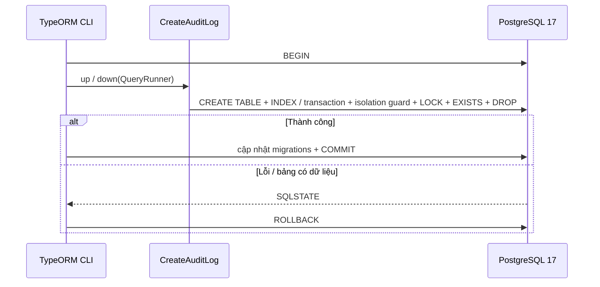
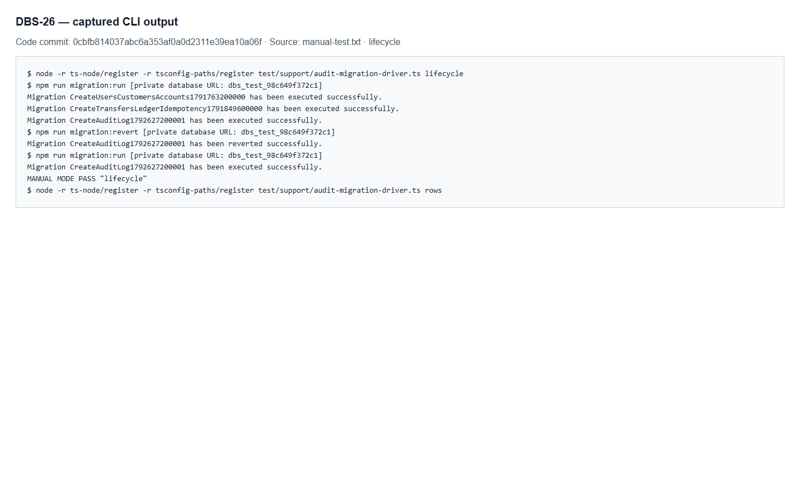
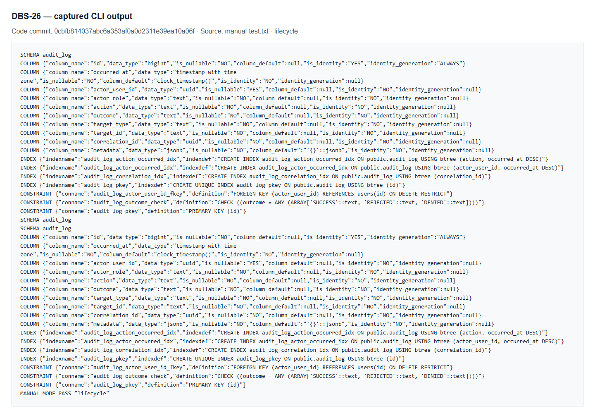
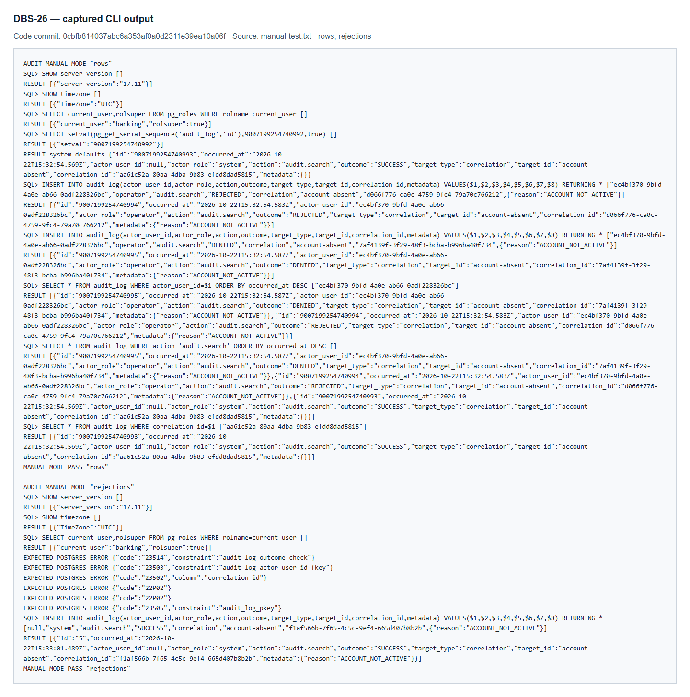
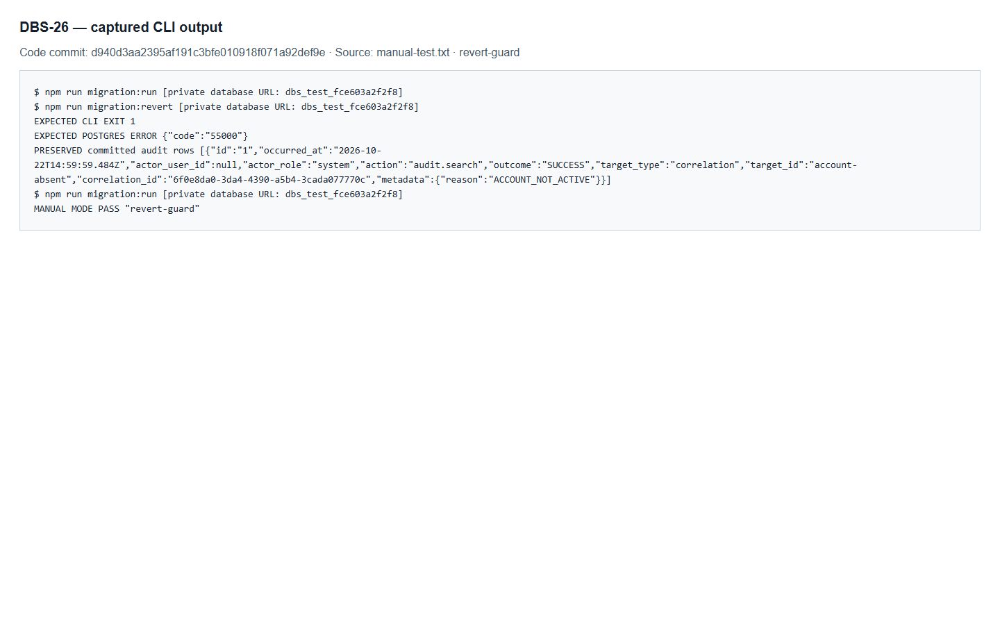
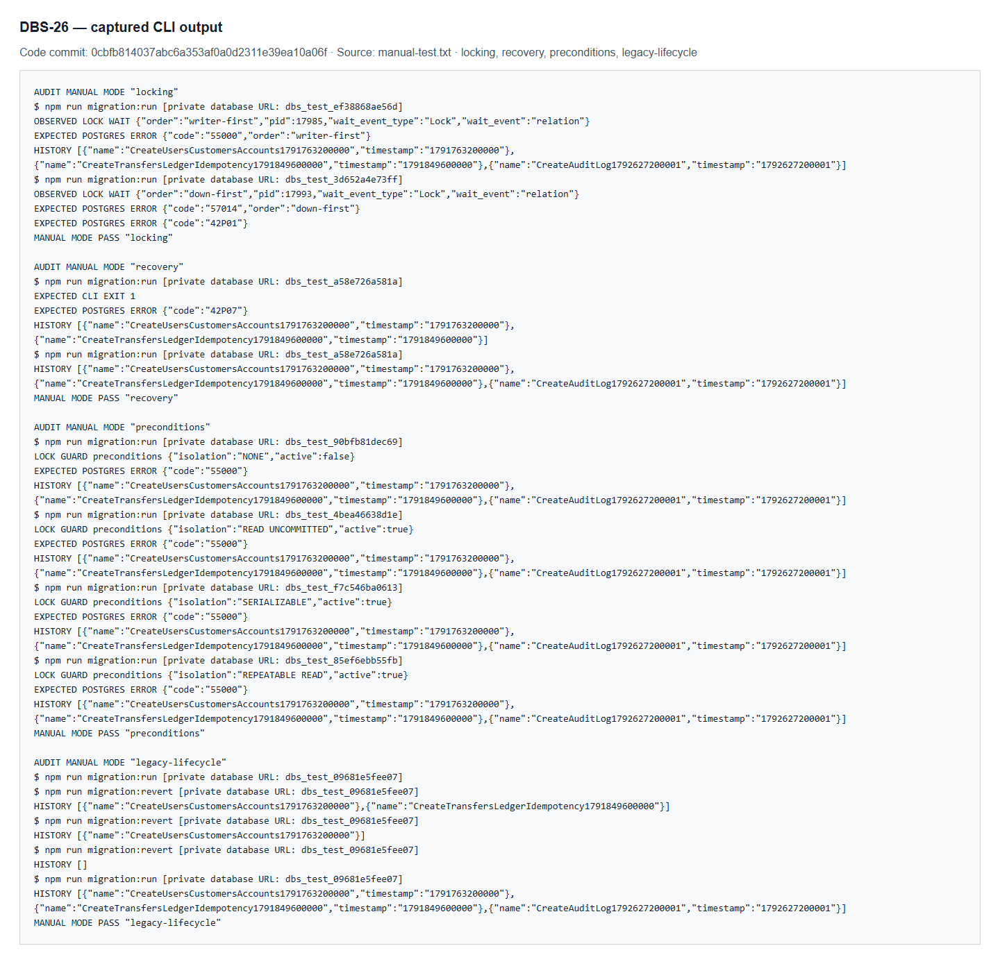

# DBS-26 · Migration: audit_log

> **Status:** Implemented · **Vai:** Dev · **Reviewer:** Dev khác, chưa chỉ định · **Nhánh:** `feat/DBS-26-migration-audit-log` · **PR:** [PR](https://github.com/Lawliet119/digital-banking-simulator/pull/13) · **Cập nhật:** 2026-10-24

## 1. Bối cảnh

- **Nguồn yêu cầu:** workbook local `Jira chạy bằng cơm (1).xlsx`, tab `Tuần 1`, hàng 11, cột A–K; workbook chỉ đọc và không đưa vào Git. Đã chạy `fetch-task.mjs DBS-26` đối chiếu: yêu cầu giống nhau, workbook ghi `To Do`, board trực tiếp ghi `In Progress`. Agent không đổi trạng thái board.
- **Task trên board:** Task, Tuần 1, ưu tiên High, assignee theo vai `Dev`, Deliverable/Demo `P2`; không có cá nhân được chỉ định trong workbook. Vai Dev phù hợp migration backend.
- **Expect:** Nhật ký có chỗ lưu với đủ cột để tra theo người, hành động và correlationId.
- **DoD** (nguyên văn, đánh số):
  1. audit_log: bigint identity, occurred_at clock_timestamp(), actor_user_id (NULL = hệ thống), actor_role, action, outcome CHECK (SUCCESS|REJECTED|DENIED), target_type, target_id (text), correlation_id, metadata jsonb DEFAULT {}
  2. Index: (correlation_id), (actor_user_id, occurred_at DESC), (action, occurred_at DESC) đúng §6
  3. Migration revert được
  4. PR đã merge vào main (CI xanh); Dev review; bảng «Đối chiếu test case» trong PR điền đủ
- **Phụ thuộc:** DBS-20 `Done` trong workbook và board; [migration users/customers/accounts](../../backend/src/database/migrations/1791763200000-CreateUsersCustomersAccounts.ts) đã có trong `main`. FK `actor_user_id` có bảng `users` để tham chiếu. DBS-26 không phụ thuộc DBS-25; mỗi task tạo migration riêng, timestamp riêng, không sửa migration đã merge.
- **Đã có gì:** [database-design §4.7, §6, §11–12](../components/_shared/database-design.md); [README audit](../../backend/src/modules/audit/README.md); [concept audit](../components/audit/01-concept-brief.md); [DBS-20](DBS-20-migration-users-customers-accounts.md); [DBS-21](DBS-21-migration-transfers-ledger-idempotency.md); [ADR-02](../adr/0002-postgresql-ledger.md); [yêu cầu AC-8.1/AC-8.2](../02_REQUIREMENTS_AND_DOMAIN_MODEL.md); [harness database tạm](../../backend/test/support/temp-database.ts). Audit hiện chỉ có README; chưa có service/controller.
- **Thực trạng đã chạy kiểm tra:** chạy hai migration nền trên PostgreSQL thật trong database tạm; catalog không có bảng `audit_log`. Database tạm đã được helper drop. Không có schema audit mới để kiểm trước khi triển khai; không coi việc đọc source là bằng chứng audit đã hoạt động.
- **Baseline:** cùng commit `origin/main` `d158296be421cf7afb52b86703b631ecb2ab0b30` với DBS-25, được kiểm trước mọi sửa đổi. Node `24.15.0`, npm `11.12.1`, PostgreSQL Docker `17.11`, timezone `UTC`, role local `banking` là superuser; `docker compose up -d` thành công. Từ `backend/`: `lint:check`, `typecheck`, `build` đạt; unit 23 suite / 349 test đạt; e2e 4 suite / 25 test đạt; database thật 3 suite / 49 test đạt; tất cả 0 bỏ qua. Link checker nền: 83 file / 0 liên kết hỏng. Đây là baseline của code đã merge, không phải kết quả DBS-26.
- **Phạm vi đề xuất:** migration riêng tạo `audit_log` đúng schema; `actor_user_id` nullable, FK `users` với `ON DELETE RESTRICT`; `target_id` giữ `text`; outcome CHECK đúng ba giá trị; các cột bắt buộc và default đúng thiết kế; ba index; `down` từ chối nếu bảng chứa dữ liệu; test PostgreSQL thật và manual run → revert → run; cập nhật regression CLI để hoàn tác đúng migration đích sau khi có nhiều migration.
- **Ngoài phạm vi:** AuditService, API audit/search, kiểm transaction nghiệp vụ fail-closed, lọc PII trong metadata, production DB roles/GRANT, S3 Object Lock. Schema JSONB không tự đảm bảo metadata không chứa PII. Chặn UPDATE/DELETE/TRUNCATE thuộc DBS-27 ([database-design §8.3](../components/_shared/database-design.md)), không tạo trigger trong migration DBS-26. BL-005 phần quyền DB/chủ view thuộc task roles. Không nhận AC-8.1/AC-8.2 toàn hệ thống đã đạt chỉ vì tạo bảng/index. Không bổ sung CHECK cho actor_role/action/target_type ngoài thiết kế đã chốt.
- **Câu hỏi / quyết định cần duyệt ở G1:** đề xuất duyệt phạm vi migration, rollback an toàn, test hồi quy và các giới hạn trên. Nhánh `feat/DBS-26-migration-audit-log` độc lập từ `origin/main`, không gộp commit thay đổi của DBS-25; nội dung audit sẽ là dependency thật cho DBS-27.

**Quyết định ở G1 (2026-10-22):** người dùng trả lời «duyệt G1» cho DBS-25/26/27, duyệt phạm vi và giới hạn trên, seed SQL chỉ trong database tạm, DBS-26 độc lập từ `origin/main`, DBS-27 xếp trên nhánh DBS-26. Chưa viết production code hoặc test mới, chưa commit/push. Status giữ `Draft` đến khi G2 được duyệt.

## 2. Hành vi

**2.1 Tạo bảng.** `1792627200001-CreateAuditLog.ts`, class `CreateAuditLog1792627200001`, tạo đúng schema [database-design §4.7](../components/_shared/database-design.md). Migration không seed audit hoặc thay đổi các bảng hiện hữu.

| Cột | Kiểu, null và default | Ràng buộc / ý nghĩa |
|---|---|---|
| `id` | `bigint GENERATED ALWAYS AS IDENTITY`, NOT NULL | PK `audit_log_pkey`; driver `pg` trả string, không ép thành `number` |
| `occurred_at` | `timestamptz NOT NULL DEFAULT clock_timestamp()` | Thời điểm thực thi, không dùng thời điểm bắt đầu transaction `now()` |
| `actor_user_id` | `uuid`, nullable, không default | FK `audit_log_actor_user_id_fkey` → `users(id) ON DELETE RESTRICT`; thiếu/NULL = hệ thống |
| `actor_role` | `text NOT NULL` | Vai trò tại thời điểm thao tác; không thêm CHECK danh sách vai |
| `action` | `text NOT NULL` | Mã hành động, không CHECK danh sách |
| `outcome` | `text NOT NULL` | `audit_log_outcome_check`: chỉ `SUCCESS`, `REJECTED`, `DENIED`, phân biệt hoa/thường |
| `target_type` | `text NOT NULL` | Loại đối tượng, không CHECK danh sách |
| `target_id` | `text NOT NULL` | Không FK/ép UUID; có thể là ID đối tượng không tồn tại |
| `correlation_id` | `uuid NOT NULL`, không default | ID do server sinh; migration không tạo request context |
| `metadata` | `jsonb NOT NULL DEFAULT '{}'::jsonb` | SQL NULL bị từ chối; JSON hợp lệ được giữ, không tự thêm CHECK kiểu object hoặc lọc PII |

Không có API, HTTP `errorCode` hoặc tiền trong task này. Các lỗi dữ liệu dùng SQLSTATE: `23502` NOT NULL, `23503` FK, `23505` PK, `23514` outcome, `22P02` UUID/JSON hỏng; cố gán identity bình thường trả `428C9`. Mỗi ca lỗi chỉ vi phạm một quy tắc. FK/PK/CHECK có tên để assertion không dựa vào lời lỗi.

Ví dụ seed SQL hợp lệ trên database tạm (tham số hóa khi gọi từ TypeScript):

```sql
INSERT INTO audit_log (actor_role, action, outcome, target_type, target_id, correlation_id)
VALUES ('system', 'audit.search', 'SUCCESS', 'correlation',
        '819fbb34-3d5a-4dd2-875c-2d61920462c2',
        '819fbb34-3d5a-4dd2-875c-2d61920462c2')
RETURNING id, occurred_at, actor_user_id, metadata;
```

Kết quả có `id` dạng chuỗi số tăng, thời gian UTC, `actor_user_id = NULL`, `metadata = {}`. Với user tồn tại, `actor_user_id` nhận ID đó; xóa user đang được audit tham chiếu bị `23503`. `DENIED` với `target_id = 'account-requested-but-absent'` và metadata `{"reason":"ACCOUNT_NOT_ACTIVE"}` được lưu; không cần tài khoản đích tồn tại. Quy tắc cấm PII vẫn thuộc bên ghi `AuditService`, ngoài scope; JSONB chấp nhận dữ liệu không đồng nghĩa dữ liệu đó phù hợp nghiệp vụ.

**2.2 Index.** Ba index B-tree không unique: `audit_log_correlation_idx (correlation_id)` phục vụ truy vết; `audit_log_actor_occurred_idx (actor_user_id, occurred_at DESC)` phục vụ tra theo người mới nhất trước; `audit_log_action_occurred_idx (action, occurred_at DESC)` phục vụ tra theo hành động mới nhất trước. Ngoài PK chỉ có ba index này. Bảng mới rỗng nên không dùng `CONCURRENTLY`; chưa cam kết planner chọn index hoặc đạt ngưỡng hiệu năng với dữ liệu nhỏ.

**2.3 Revert an toàn.** `down` yêu cầu `QueryRunner.isTransactionActive = true` và isolation đúng **READ COMMITTED**. Kiểm tra active transaction trước, rồi đọc `current_setting('transaction_isolation')` bằng câu SQL riêng **trước mọi LOCK/EXISTS/DROP**. Không có transaction hoặc isolation `repeatable read`, `serializable`, `read uncommitted` → từ chối với code `55000`, chưa thay schema; caller rollback nếu transaction đang mở. CLI TypeORM thông thường dùng transaction READ COMMITTED mặc định; không đổi env hay [quyết định ADR-04](../adr/0004-row-locking-read-committed.md).

Đủ điều kiện → lấy `ACCESS EXCLUSIVE` trên `audit_log`, giữ đến commit/rollback; câu kiểm tra dữ liệu chạy **sau LOCK trong câu SQL riêng**, lấy snapshot mới ở READ COMMITTED. Rỗng → drop bảng cùng index/identity sequence phụ thuộc, xóa đúng migration record. Có bất kỳ dòng nào → SQLSTATE `55000`, rollback, giữ nguyên toàn bộ dòng, schema, index và bảng `migrations`. Không `CASCADE`, không xóa dữ liệu để ép revert qua. Lock ngăn INSERT lọt giữa kiểm tra và DROP: writer commit trước khi `down` lấy được lock phải được thấy và làm revert từ chối. Isolation guard còn ngăn snapshot REPEATABLE READ đã đọc bảng rỗng che mất dòng writer khác vừa commit; lock một mình không sửa được snapshot cũ. Nếu `down` giữ lock trước, writer không được ghi thành công vào bảng đã bị drop. `up` và mọi DDL/index của nó cũng atomic: lỗi giữa chừng không để lại bảng hoặc migration record nửa vời; sửa nguyên nhân rồi chạy lại thành công.

**2.4 Giới hạn đã duyệt.** Chưa có append-only trigger (DBS-27), production roles/GRANT, service fail-closed hoặc API tìm kiếm. Chỉ chứng minh các giá trị outcome lưu được, chưa chứng minh nghiệp vụ tự ghi REJECTED/DENIED. Không nhận đủ BR-09/AC-8.1/AC-8.2 đã hoàn thành. Các phần quyền DB của BL-005 tiếp tục bàn giao task roles; không xóa backlog này trong DBS-26.

## 3. Kiến trúc

| Thành phần | Vai trò / interface |
|---|---|
| Migration mới | `backend/src/database/migrations/1792627200001-CreateAuditLog.ts`; `up(queryRunner: QueryRunner): Promise<void>`, `down(queryRunner: QueryRunner): Promise<void>`, implement `MigrationInterface` |
| CLI hiện hữu | `createMigrationDataSource(url: string \| undefined): DataSource`, `backend/src/database/data-source.ts`; discovery glob tự nhận migration mới; `npm run migration:run`, `migration:revert`, `migration:run:prod` giữ nguyên |
| Database thật | PostgreSQL 17, UTC; không Redis/SQS/HTTP, không `TransactionService.run`; CLI chạy riêng, app không chạy migration lúc khởi động |
| Tests đã triển khai | `backend/test/db/audit-schema.db-spec.ts`, `backend/test/db/audit-migration-revert.db-spec.ts`; tái sử dụng `createTempDatabase(): Promise<TempDatabase>`, `attempt<T>(runner, sql, params): Promise<T[]>` từ `test/support/temp-database.ts` |
| Regression migration 1/2 | `backend/test/db/migration-revert.db-spec.ts` hiện giả định chỉ có hai migration; sửa CLI regression đọc history thật và revert migration mới về mốc DBS-21. `backend/test/db/accounts-schema.db-spec.ts` dùng nền DBS-20; `backend/test/db/ledger-schema.db-spec.ts` dùng nền DBS-21, kể cả assertion đúng hai record của TC-21-02. Thêm helper **test-only** trong `test/support/temp-database.ts`; không sửa migration hoặc DataSource production đã merge |
| Manual driver dự kiến | [audit-migration-driver.ts](../../backend/test/support/audit-migration-driver.ts), đã triển khai sau G3; gọi CLI thật và SQL thật, in kết quả cho người vận hành, không gọi Jest/mocks |

Helper dự kiến `migrateThrough(url: string, migrationName: string): Promise<void>` nhận tên mốc rõ ràng, chỉ load migration thật trong prefix timestamp đến mốc đó, từ chối mốc không tồn tại hoặc history không khớp prefix; giữ `migrate(url, direction)` latest/undo như hiện có. Helper chỉ import dưới `test/`, dùng cho schema/guard legacy: accounts/guard20 chọn `CreateUsersCustomersAccounts1791763200000`, ledger/guard21 chọn `CreateTransfersLedgerIdempotency1791849600000`. Chưa đổi exported symbol production nên không có caller production cần sửa; caller test hiện hữu là ba suite nói trên.

**CLI regression đi đường production:** `npm run migration:run` dùng DataSource/glob production để lên latest, đọc `migrations ORDER BY timestamp`, rồi gọi `npm run migration:revert` từng migration mới cho đến khi latest còn DBS-21; xác nhận mỗi lần chỉ mất record/schema migration vừa revert, các bảng nền/funding không đổi. Sau đó giữ lifecycle thật **2 → 1 → 0 → latest**: CLI revert21, revert20, runlatest; giữ assertions schema/funding và lịch sử 1/2 ở từng mốc, expected cuối là history latest thực tế chứa prefix20/21, không chỉ đúng hai record. Guard20/21 và TC-21-02 dùng helper prefix để giữ nguyên độ sâu assertion ban đầu. Không dùng adapter `-d` dành cho test, không tạo `migration-prefix.data-source.ts`, không sửa production `data-source.ts` để phục vụ test.

`up` tạo bảng → ba index trong cùng transaction; `down` active-transaction guard → isolation guard → lock → kiểm tra rỗng → drop trong cùng transaction. Kiểm tra SQLSTATE/code `55000`, không so sánh message. Test race/isolation dùng QueryRunner PostgreSQL thật với các kết nối độc lập, quan sát backend PID/`pg_stat_activity`/`pg_locks`, polling có deadline; không sleep dựa vào thời gian may rủi, không bắt lỗi DB rồi tiếp tục transaction đã abort. Test snapshot mở REPEATABLE READ và đọc audit rỗng, kết nối khác commit audit, rồi gọi down trên chính QueryRunner giữ snapshot cũ: phải bị isolation guard từ chối trước LOCK/DDL. Rollback kết nối cũ trước khi kiểm từ kết nối fresh. Test dữ liệu thường dùng transaction/savepoint rồi rollback, không DELETE audit để dọn. Driver/suite chỉ drop **cả database tạm** có tên do helper sinh và đã kiểm tra; không chạm DB dùng chung.



DBS-26 độc lập DBS-25 (`1792627200000-CreateOutboxEventsProcessedEvents.ts`), không import hoặc gọi migration đó; timestamp kế tiếp `1792627200002-AddAppendOnlyTriggers.ts` thuộc DBS-27. Cập nhật fact đã triển khai của schema/index trong database-design và README audit lúc Phase 5; chưa đổi quyết định ADR/event contract/env/dependency. Khẳng định transaction nghiệp vụ và quyền production tiếp tục thuộc các task sau.

## 4. Test cases tự động

Tất cả case dưới đây là **integration PostgreSQL thật**, không mock. DB không truy cập được phải fail, không skip. SQLSTATE kèm `constraint` khi PostgreSQL có trường này; NOT NULL kèm tên `column`. Mỗi dữ liệu lỗi chạy riêng trong savepoint; case revert/race dùng DB riêng. Đây là thiết kế, chưa có kết quả chạy.

| ID | Truy vết | Given · When · Then | SQLSTATE / constraint |
|---|---|---|---|
| TC-26-01 | DoD #1 | Chạy migration trên DB tạm từ nền 20/21; catalog có đúng 10 cột, kiểu/null/default/identity và toàn bộ constraint đúng §2.1; schema nền không đổi | — |
| TC-26-02 | DoD #1 identity | Hai INSERT bỏ ID sinh ID tăng, không đòi liên tục; sequence trong DB tạm đặt trên 2^53, INSERT trả nguyên chuỗi `9007199254740993`, không làm tròn | — |
| TC-26-03 | DoD #1 PK/identity | Gán ID bình thường bị từ chối; `OVERRIDING SYSTEM VALUE` trùng PK bị từ chối; explicit NULL identity với override bị NOT NULL | `428C9`; `23505/audit_log_pkey`; `23502/id` |
| TC-26-04 | DoD #1 timestamp/default | Không truyền occurred_at: UTC và giữa hai mốc `clock_timestamp()` SQL bao quanh INSERT; catalog default đúng clock, không now; truyền timestamptz có offset được chuẩn hóa cùng instant | — |
| TC-26-05 | DoD #1 actor | Bỏ actor_user_id, explicit NULL, user tồn tại đều được; user không tồn tại bị FK chặn; user đã được tham chiếu không xóa được | `23503/audit_log_actor_user_id_fkey` cho từng nhánh lỗi |
| TC-26-06 | DoD #1 NOT NULL | Parameterized từng cột occurred_at, actor_role, action, outcome, target_type, target_id, correlation_id, metadata = SQL NULL; các trường còn lại hợp lệ | `23502` + đúng column |
| TC-26-07 | DoD #1 outcome | Lần lượt lưu và đọc lại SUCCESS, REJECTED, DENIED; actor nullable và user hợp lệ đều dùng được | — |
| TC-26-08 | DoD #1 outcome CHECK | Từng lần `FAILED`, `success`, `''` bị từ chối; không gộp với NULL | `23514/audit_log_outcome_check` |
| TC-26-09 | DoD #1 text/metadata | target_id không phải UUID vẫn được; actor_role/action/target_type không bị enum/CHECK mới; metadata mặc định `{}`, object có reason round-trip, JSONB hợp lệ không bị ép object | — |
| TC-26-10 | DoD #1 kiểu dữ liệu | UUID actor hỏng, UUID correlation hỏng, JSON hỏng: mỗi lần một lỗi, bảng còn dùng được sau rollback savepoint | `22P02` |
| TC-26-11 | DoD #2 | Catalog có đúng ba index tên/keys/order/B-tree/non-unique §2.2 ngoài PK; không có index dư | — |
| TC-26-12 | DoD #2 | Seed dòng có user/action/correlation và timestamp khác nhau; truy vấn ba dạng filter trả đúng tập dòng, sort occurred_at DESC đúng; không ép planner chọn index trên fixture nhỏ | — |
| TC-26-13 | DoD #3 | CLI thật run → revert → run trên DB rỗng; sau revert audit/index/identity sequence biến mất, nền 20/21 còn nguyên, migrations chỉ bỏ record26; run lại đủ schema/index | Exit 0 |
| TC-26-14 | DoD #3 bảo toàn dữ liệu | Commit một dòng audit hệ thống rồi user audit trong từng DB riêng; CLI revert từ chối từng trường hợp; schema/index, mọi giá trị dòng và toàn bộ migrations records giữ nguyên | `55000`; CLI exit khác0 |
| TC-26-15 | DoD #3 concurrency | A INSERT chưa commit giữ lock; B chạy down đợi ACCESS EXCLUSIVE, xác nhận wait bằng PID; A commit; B thấy dòng và từ chối, giữ dòng và migration record | `55000` |
| TC-26-16 | DoD #3 concurrency | A down giữ lock trước, transaction chưa commit; B INSERT chờ lock, xác nhận wait rồi chủ động cancel B và rollback nó; A commit revert, B thử INSERT mới thì bảng không còn. Không có INSERT thành công bị xóa | `57014` khi cancel; `42P01` khi thử lại sau drop |
| TC-26-17 | DoD #1/3 atomic/recovery | Trên DB đã có nền, tạo fixture index trùng tên index26; up lỗi khi tạo index, rollback cả bảng/DDL và không thêm migrations record26; bỏ fixture trong DB tạm rồi run lại thành công | `42P07`, sau phục hồi exit0 |
| TC-26-18 | DoD #3 regression20/21 | TC-21-23 chạy production CLI lên latest, đọc history/revert từng migration mới về21 rồi CLI2→1→0→latest; từng mốc giữ assertions nền/funding/history. Guard TC-20-18/TC-21-24 dùng helper prefix20/21; không đổi sang CLI adapter hay nới assertions | CLI exit0; giữ guard assertions cũ; 0 skip |
| TC-26-19 | DoD #1 an toàn SQL | Gửi action/target_id chứa dấu nháy và chuỗi `'; DROP TABLE users; --` qua `$1…`; lưu nguyên chuỗi, users/audit vẫn tồn tại | — |
| TC-26-20 | DoD #3 helper regression | `migrateThrough` chọn đúng prefix20/21 cho accounts-schema/ledger-schema và guard legacy; TC-21-02 vẫn assert đúng hai record ở nền21. Target không tồn tại hoặc history đã vượt/sai prefix bị từ chối trước DDL, history/schema giữ nguyên; `migrate()` mặc định và CLI production vẫn chạy latest | Lỗi helper có code ổn định, không so message |
| TC-26-21 | DoD #3 precondition | QueryRunner thật không mở transaction, hoặc mở từng isolation REPEATABLE READ/SERIALIZABLE/READ UNCOMMITTED; gọi down bị từ chối trước LOCK/DDL. Rollback nếu cần rồi kiểm rows/catalog/index/history không đổi | `55000` |
| TC-26-22 | DoD #3 snapshot concurrency | A mở REPEATABLE READ, SELECT audit thấy rỗng để chốt snapshot; B INSERT audit rồi commit; A gọi down phải bị isolation guard từ chối. Rollback A, fresh connection thấy nguyên dòng đã commit, catalog/index/history không đổi; không bỏ qua bằng mock isolation | `55000` |
| Quy trình | DoD #4 | Dev review, bảng đối chiếu case và CI xanh/PR merge là bước bàn giao sau; chưa đạt vì mới thiết kế, agent không merge | — |

**Checklist bảo mật:**

| Yêu cầu | Áp dụng / chứng minh |
|---|---|
| Role guard endpoint | Không áp dụng: task không có endpoint |
| Ownership/404 | Không áp dụng: không có query tài khoản theo caller |
| Idempotency theo user | Không áp dụng: không tạo lệnh tiền hoặc idempotency |
| Audit REJECTED/DENIED đúng transaction nghiệp vụ | Chưa thuộc task26; TC-26-07 chỉ chứng minh schema lưu được, bàn giao AuditService/caller |
| Ẩn fraud flag BR-13 | Không áp dụng: không response khách hàng |
| ProblemDetails không lộ SQL/PII, correlationId | Không áp dụng: CLI migration, không HTTP; dữ liệu test chỉ ID/mã tổng hợp |
| SQL tham số hóa | TC-26-19; DDL/identifier cố định, input driver dùng `$1…` |
| TLS/secret | Không đổi config TLS, dùng config hiện hữu; không đưa URL/password vào output/git; kiểm diff và redaction evidence tại G4; chưa chứng minh TLS production |

Append-only/role test AC-8.1 chuyển DBS-27/task roles, không bỏ qua ngầm; không có money test nên invariants.sql, deposit API, midnight/amount không áp dụng. Threat-model giữ đúng phạm vi: schema không thay thế kiểm quyền, metadata policy hay fail-closed service.

## 5. Test thủ công

**Điều kiện:** Docker Compose PostgreSQL17 đang chạy, timezone UTC, Node24/dependencies sẵn, `DATABASE_URL` local đã có trong môi trường và có quyền CREATE DATABASE; không echo giá trị. CLI mặc định READ COMMITTED; driver phải in `current_setting('transaction_isolation')`, không đổi env hoặc ADR-04 để qua guard. Không sửa `.env`. Không cần token, HTTP server hay AWS. File [audit-migration-driver.ts](../../backend/test/support/audit-migration-driver.ts) đã triển khai theo G3, là công cụ vận hành migration/SQL thật theo các mode dưới đây, không phải test Jest. Mỗi mode tạo database `dbs_test_<12hex>` qua helper, truyền URL chỉ qua env của child, `finally` đóng kết nối và drop đúng DB đó; không xóa dòng audit hoặc ghi số dư/sổ cái. Seed SQL chỉ tạo user/audit fixture, đã duyệt G1.

Chạy từ `backend/` bằng **Git Bash**, sau commit cuối đổi code. Driver `lifecycle` và `revert-guard` in đầy đủ output CLI `npm run migration:run`, `migration:revert`, `migration:run`, tên database an toàn, lệnh SQL/cột catalog và JSON dòng trả về; expected failure được ghi rõ SQLSTATE/exit rồi tiếp tục, failure ngoài dự kiến làm driver exit khác0. Dùng `set -o pipefail`; output UTF-8, không dùng PowerShell `tee`.

```bash
set -o pipefail
EVIDENCE=../docs/features/screenshots/DBS-26/manual-test.txt
mkdir -p "$(dirname "$EVIDENCE")"
git rev-parse HEAD | tee "$EVIDENCE"
```

| Bước | Việc làm từ `backend/` | Kết quả mong đợi |
|---|---|---|
| M-26-01 | `docker compose -f ../docker-compose.yml ps 2>&1 \| tee -a "$EVIDENCE"`; driver các bước sau in `SHOW server_version`, `SHOW timezone`, current_user và boolean superuser (không URL) | PostgreSQL healthy, 17.x, UTC; xác nhận môi trường, không coi role local superuser là bằng chứng production roles |
| M-26-02 | `npx ts-node -r tsconfig-paths/register test/support/audit-migration-driver.ts lifecycle 2>&1 \| tee -a "$EVIDENCE"` | DB tạm rỗng: CLI production runlatest, đọc history/revert successor nếu có đến26, CLI revert26 rồi runlatest exit0; in migrations mỗi lần, catalog cột/default/constraints/index/sequence, so sánh không mất bảng nền; audit biến mất khi revert và trở lại khi run |
| M-26-03 | Cùng lệnh driver, mode `rows` | **Seed SQL:** SUCCESS hệ thống, REJECTED/DENIED có user; in id/correlationId/metadata/time; đúng default và các filter theo actor/action/correlation; target text không tồn tại vẫn được, ID >2^53 giữ đủ chữ số |
| M-26-04 | Cùng lệnh driver, mode `rejections` | **Seed SQL:** lần lượt outcome sai, FK sai, NULL bắt buộc, UUID/JSON hỏng, identity trùng; in SQLSTATE và constraint/column đúng §4; rollback savepoint rồi INSERT hợp lệ thành công, chứng minh kết nối phục hồi |
| M-26-05 | Cùng lệnh driver, mode `revert-guard` | **Seed SQL:** một audit đã commit; CLI revert lỗi55000/exit khác0; in trước/sau toàn dòng, schema/index/migrations không đổi; CLI run lại là no-op thành công; không DELETE audit để ép rollback |
| M-26-06 | Cùng lệnh driver, mode `locking` | Hai kết nối thật: in PID/lock wait; writer commit trước lock down làm down từ chối và giữ dòng; reverse order xác nhận writer chờ, cancel57014, commit down rồi INSERT mới lỗi42P01; không mất INSERT đã thành công, mỗi nhánh DB riêng |
| M-26-07 | Cùng lệnh driver, mode `recovery` | Fixture index gây up lỗi42P07; in catalog không audit/migration26 nửa vời; bỏ fixture riêng và chạy CLI run lại thành công |
| M-26-08 | Cùng lệnh driver, mode `preconditions` | In active/isolation cho QueryRunner thật: không transaction, RR/SERIALIZABLE/RU đều bị55000 trướcLOCK/DDL. Riêng RR đọc audit rỗng, writer khác commit audit rồi down vẫn từ chối; rollback RR, fresh SELECT in nguyên row/catalog/history. NhánhRC bình thường vẫn được kiểm ở M-26-02/05/06 |
| M-26-09 | Cùng lệnh driver, mode `legacy-lifecycle` | CLI production latest→đọc history→revert từng migration mới về21→1→0→latest; in tên migration thực sau mỗi lượt, bảng nền/funding ở từng mốc; không adapter `-d` hay hardcode chỉ hai migration khi runlatest |

Các mode thay `lifecycle` trong lệnh M-26-02 bằng tên mode tương ứng. Ảnh dự kiến lấy **từ output thật**: `01-cli-run-revert-run.png`, `02-schema-indexes.png`, `03-defaults-rejections.png`, `04-revert-data-guard.png`, `05-locking-recovery.png`. Dòng đầu `manual-test.txt` là SHA cuối thay code; §8 ghi lệnh/response/kết quả từng M đã chạy trên SHA code cuối. Redact token/password/Authorization/AWS IDs/ARN nếu xuất hiện trước commit; giữ row IDs và correlation IDs tổng hợp để reviewer đối chiếu. Không thêm PII vào audit fixture.

## 6. Domain review (AI)

**Reviewer:** vòng 1 `review_auditlog_g2`, vòng 2 `auditlog_design_final_review`; các subagent độc lập dùng model **GPT-6 Astra**, reasoning `xhigh`, ngày 2026-10-22, không có lịch sử tác giả; chỉ đọc và đối chiếu nguồn repository.

**Vòng 1:** 0 phát hiện, APPROVE; [trả lời nguyên văn](screenshots/DBS-26/domain-review-round-1.txt). Sau đó áp dụng hai chỉnh sửa dùng chung được phát hiện ở review DBS-25: guard READ COMMITTED chống snapshot cũ và regression CLI latest → target 2 → 1 → 0 → latest. Cập nhật §2–§5, TC-26-18/20/21/22 và M-26-08/09 trước khi review lại.

**Vòng 2:** reviewer mới kiểm lại toàn bộ §1–§5 sau chỉnh sửa, 0 phát hiện (blocking 0, should-fix 0, minor 0); [trả lời nguyên văn](screenshots/DBS-26/domain-review.md).

`Verdict: APPROVE`

Mermaid ở §3 đã render thành công bằng mermaid-cli 12.0.0 sau chỉnh sửa. Đây là kiểm tra thiết kế; chưa có kết quả cho migration/test/driver mới.

**Quyết định ở G2 (2026-10-22):** người dùng trả lời «duyệt G2» cho cả ba task, chấp nhận thiết kế §2–§5 và kết quả review §6. Status chuyển thành **Design approved**. Chưa viết production code, test hoặc driver mới; chưa commit/push.

## 7. Kế hoạch triển khai

**Base và phạm vi file.** Nhánh `feat/DBS-26-migration-audit-log` độc lập từ `origin/main` `d158296`; không chứa DBS-25. Migration `1792627200001` chưa trùng main khi kiểm ngày 2026-10-22. Không cần outbox hoặc trigger để triển khai DBS-26.

**Quy tắc thực thi.** Mọi đường dẫn dưới đây tính từ repo root; lệnh npm chạy tại `backend/`. Viết test trước từng hành vi, chạy và ghi đúng một dòng lỗi đỏ thực tế, rồi mới viết code tối thiểu cho xanh. Cột đỏ ghi lỗi thực đã quan sát và kết quả sau sửa; chi tiết tại §8. Chỉ commit khi bước hoàn chỉnh xanh, không bỏ test hoặc dùng `--no-verify`. Mỗi commit chỉ stage allowlist của task; trước commit kiểm `git diff --cached --name-only` và nội dung staged, tuyệt đối không có workbook, secret hoặc file task khác.

**Kiểm tra bàn giao (SHA `8c79baf`, sau merge `main`):** [output đầy đủ](screenshots/DBS-26/verification.txt): lint/typecheck/build đạt; unit **25 suite / 367 test**, e2e **4 suite / 25 test**, PostgreSQL **7 suite / 129 test** đạt, 0 skip. Trước khi merge, riêng nhánh DBS-26 đạt unit 23 / 349, e2e 4 / 25, DB 5 / 87 (49 test nền và 38 lượt mới audit/helper); phần tăng thêm là test của DBS-25 và DBS-39 từ `main`. Không có mock database.

| Bước | File được phép sửa/tạo | Test viết trước / mục tiêu | Kết quả đỏ thực tế | Lệnh chứng minh | Commit dự kiến |
|---|---|---|---|---|---|
| 1 | `backend/test/support/temp-database.ts`; `backend/test/db/audit-migration-revert.db-spec.ts`; `backend/test/db/accounts-schema.db-spec.ts`; `backend/test/db/ledger-schema.db-spec.ts`; `backend/test/db/migration-revert.db-spec.ts` | TC-26-18/20: helper prefix thật, target/history sai từ chối trước DDL; schema/guard legacy chọn 1/2, CLI production latest → actual history → mốc 2 → 1 → 0 → latest. Giữ TC-21-02 và mọi FK/guard cũ | TS2305: thiếu migrateThrough; sau helper regression prefix đạt | `npm run test:db -- --runInBand`; lint/typecheck | `test(database): support explicit migration prefixes` |
| 2 | `backend/src/database/migrations/1792627200001-CreateAuditLog.ts`; `backend/test/db/audit-schema.db-spec.ts`; `backend/test/db/audit-migration-revert.db-spec.ts` | TC-26-01…17/19/21/22: schema, string bigint >2^53, FK/NOT NULL/CHECK, JSONB/text mở, ba index, parameterization, lifecycle/data guard/atomic recovery, hai thứ tự lock, transaction/isolation; test từng hành vi đỏ trước code tương ứng | 42P01: audit_log chưa tồn tại; sau migration 87 DB test đạt | `npm run test:db -- --runInBand audit-` rồi toàn bộ DB và baseline | `feat(audit): add audit log storage migration` |
| 3 | `backend/test/support/audit-migration-driver.ts` | TC bước 2 làm oracle, kịch bản §5 đã viết trước: tám mode CLI/SQL thật và bước kiểm môi trường, in dữ liệu kỹ thuật, classify error/recovery và cleanup an toàn; không Jest thay manual | Oracle migration đã đỏ ở bước 2; driver lint/typecheck đạt | lint/typecheck/build và suites liên quan; chín bước §5 thực hiện bước 4 | `test(audit): add migration operator driver` |
| 4 | Feature doc này; `docs/features/screenshots/DBS-26/` gồm raw review, transcript và năm ảnh đúng tên §5; `docs/components/_shared/database-design.md`; `backend/src/modules/audit/README.md`; `backend/README.md`; `docs/features/README.md`; `docs/BACKLOG.md` | Baseline và M-26-01…09 trên SHA code bước 3; case table; cập nhật schema/index, hướng dẫn migration; mọi DoD quy trình và handoff chưa đạt ghi backlog | Sáu baseline và M-26-01…09 đạt; xem kết quả thực §8 | Sáu lệnh baseline; chín bước §5; link checker; `git diff --check`; staged/branch allowlist | `docs(audit): record migration verification and handoffs` |

**Plan sweep đã thực hiện (2026-10-22):**

| Nguồn / điều kiện | Được xử lý ở |
|---|---|
| DoD #1 đầy đủ cột/default, actor nullable/FK, outcome, target text, metadata | Bước 2 TC-26-01…10/19; M-26-03/04; không ép JSON object hoặc CHECK role/action/target ngoài schema |
| DoD #2 ba index đúng §6, truy vấn filter/order | Bước 2 TC-26-11/12; M-26-02/03; bước 4 cập nhật tên index trong reference |
| DoD #3 reversible và bảo toàn dữ liệu | Bước 2 TC-26-13…17/21/22; M-26-02/05…08. Bước 1 TC-26-18/20, M-26-09 giữ legacy CLI/guard |
| DoD #4 review/CI/merge/đối chiếu | Bước 4; merge/CI/Dev review chờ quy trình và có backlog. Không tự merge hoặc đổi board |
| database-design §11/12 và callers của migrate | Bước 1/2: prefix helper, ba legacy suites; named constraints, FK RESTRICT, clock_timestamp/timestamptz, identity string, down lock sau guard RC; giữ production loader/startup/env |
| AC-8.1/8.2, BR-09, BL-005 grants/view ownership, AuditService và HTTP | Ngoài scope G1/G2: DBS-27 cung cấp trigger, task roles cung cấp quyền, service/API cung cấp fail-closed và truy vết; bước 4 ghi handoff phù hợp, không nhận đủ AC |
| CONCURRENTLY, PII policy, S3 Object Lock, tiền/đối soát | CONCURRENTLY không áp dụng bảng mới rỗng; schema không lọc PII, không thêm runtime các phần này; không chỉnh ADR hoặc rule tiền |

**Rủi ro và cách lùi.** Giữ logic helper/CLI dùng chung tương thích với nhánh 25 nhưng commit riêng; chỉ stage scope 26. CLI test latest dùng history thực, không đổi glob để che lỗi. Down phải từ chối khi audit có dữ liệu hoặc isolation sai; không DELETE audit để rollback. Rollback production ưu tiên image cũ và giữ bảng, chỉ thử down trên DB tạm/rỗng. QueryRunner cho ca isolation dùng `startTransaction(isolation)` và `rollbackTransaction()` để cờ active phản ánh đúng; race test dùng PID/lock wait có deadline, cleanup finally. Không mở rộng schema hoặc dependency ngoài thiết kế G2; phát sinh ngoài allowlist cần gate phụ.

**Quyết định ở G3 (2026-10-22):** người dùng trả lời «duyệt G3» cho cả ba task. Kế hoạch §7 được duyệt; triển khai test-first, commit riêng theo bước xanh và trình G4 trước khi push. Status: Plan approved.

## 8. Kết quả

**Trạng thái:** G4 được duyệt ngày 2026-10-22 và **duyệt lại ngày 2026-10-24** sau khi nhánh merge `origin/main` (DBS-25, DBS-39) và chạy lại toàn bộ bằng chứng (xem "Sau G4" và "Duyệt lại G4"). Code cuối: `8c79baf58b86c46643fe9d28b4570128cec4dad8` (dòng đầu `manual-test.txt` và `verification.txt`), nhánh `feat/DBS-26-migration-audit-log`. Dev review/CI/merge theo trạng thái PR.

**Kiểm tra bàn giao:** [output đầy đủ](screenshots/DBS-26/verification.txt): lint/typecheck/build đạt; unit **23 suite / 349 test**, e2e **4 suite / 25 test**, PostgreSQL **5 suite / 87 test** đạt, 0 skip. Có 49 test nền và 38 lượt mới audit/helper. Không có mock database.

**TDD và commit:** helper đỏ do thiếu export `migrateThrough` (TS2305), migration đỏ do thiếu `audit_log` (`42P01`) trước khi viết production migration; sau đó toàn bộ test DB xanh. Helper commit `b991fba`, schema `76fb216`, driver `1310dfd`. Driver dùng SQL/CLI thật, không chạy Jest để thay manual. Chỉnh typing QueryRunner trước commit driver để lint/typecheck xanh.

Kiểm chuỗi với trigger27 phát hiện sáu regression đỏ do audit không còn là latest; sửa ở `e36d50b` bằng prefix audit và CLI đọc/revert successor thật. Kiểm thêm cả outbox25 phát hiện history có thêm migration hợp lệ; commit `d940d3a` so toàn bộ history trước/sau thay vì đếm cứng 2/3. [Bản sao kiểm tương thích](screenshots/DBS-26/integration-verification.txt) (150 test, giữ làm lịch sử) đã được thay bằng kiểm thật sau khi DBS-25 vào `main`: nhánh đã merge đạt 7 suite / 129 test.

| ID | Test / chứng cứ | Kết quả |
|---|---|---|
| TC-26-01 | `audit-schema.db-spec.ts` TC-26-01 | đạt |
| TC-26-02 | `audit-schema.db-spec.ts` TC-26-02 | đạt |
| TC-26-03 | `audit-schema.db-spec.ts` TC-26-03 | đạt |
| TC-26-04 | `audit-schema.db-spec.ts` TC-26-04 | đạt |
| TC-26-05 | `audit-schema.db-spec.ts` TC-26-05 | đạt |
| TC-26-06 | `audit-schema.db-spec.ts` TC-26-06 | đạt |
| TC-26-07 | `audit-schema.db-spec.ts` TC-26-07 | đạt |
| TC-26-08 | `audit-schema.db-spec.ts` TC-26-08 | đạt |
| TC-26-09 | `audit-schema.db-spec.ts` TC-26-09 | đạt |
| TC-26-10 | `audit-schema.db-spec.ts` TC-26-10 | đạt |
| TC-26-11 | `audit-schema.db-spec.ts` TC-26-11 | đạt |
| TC-26-12 | `audit-schema.db-spec.ts` TC-26-12 | đạt |
| TC-26-13 | `audit-schema.db-spec.ts` TC-26-13 | đạt |
| TC-26-14 | `audit-schema.db-spec.ts` TC-26-14 | đạt |
| TC-26-15 | `audit-schema.db-spec.ts` TC-26-15 | đạt |
| TC-26-16 | `audit-schema.db-spec.ts` TC-26-16 | đạt |
| TC-26-17 | `audit-schema.db-spec.ts` TC-26-17 | đạt |
| TC-26-18 | `migration-revert.db-spec.ts` TC-20-18/TC-21-23/24 và accounts/ledger prefix; M-26-09 | đạt |
| TC-26-19 | `audit-schema.db-spec.ts` TC-26-19 | đạt |
| TC-26-20 | `audit-migration-revert.db-spec.ts` TC-26-20 | đạt |
| TC-26-21 | `audit-schema.db-spec.ts` TC-26-21 | đạt |
| TC-26-22 | `audit-schema.db-spec.ts` TC-26-22 | đạt |

**Manual:** [transcript Git Bash nguyên văn](screenshots/DBS-26/manual-test.txt). Driver chạy từ `backend/` bằng `node -r ts-node/register -r tsconfig-paths/register test/support/audit-migration-driver.ts <mode>`; chỉ seed SQL trên database tạm do helper tạo, không ghi banking, ledger hoặc accounts.balance.

| Bước | Lệnh / phản hồi thực | Kết quả |
|---|---|---|
| M-26-01 | `docker compose -f ../docker-compose.yml ps` (stack compose Up); driver in PostgreSQL 17 / UTC và context superuser. **Lưu ý:** lần chạy này `DATABASE_URL` trỏ tới Postgres 17 tạm (container riêng, cổng 55432, `timezone=UTC`, user `banking` là superuser) vì volume compose có mật khẩu riêng của người dùng; compose chỉ chứng minh Docker/stack lên được | đạt |
| M-26-02 | Mode `lifecycle`: CLI run → revert26 → run; history 4 → 3 → 4 (thêm migration outbox của DBS-25); in đủ catalog cột/default/constraint/ba index/sequence, bảng nền giữ nguyên | đạt |
| M-26-03 | Mode `rows`: SUCCESS hệ thống, REJECTED/DENIED có actor; metadata mặc định {}, các filter đúng; identity `9007199254740993` giữ đủ chữ số | đạt |
| M-26-04 | Mode `rejections`: outcome23514, FK23503, NULL23502, UUID/JSON22P02, PK23505; rollback savepoint rồi INSERT hợp lệ được | đạt |
| M-26-05 | Mode `revert-guard`: audit đã commit làm CLI revert exit1, direct down55000; snapshot/catalog/history nguyên, run no-op thành công | đạt |
| M-26-06 | Mode `locking`: writer-first quan sát PID chờ relation lock rồi down55000 giữ row; down-first quan sát PID chờ, cancel57014, sau down thử INSERT42P01; PID cụ thể nằm trong transcript | đạt |
| M-26-07 | Mode `recovery`: index sentinel làm up42P07, không bảng/history nửa vời; bỏ sentinel fixture rồi run thành công | đạt |
| M-26-08 | Mode `preconditions`: NONE/RU/SERIALIZABLE/RR đều55000 trước DDL; RR snapshot cũ vẫn không thể xóa row writer đã commit; fresh SELECT/history/catalog nguyên | đạt |
| M-26-09 | Mode `legacy-lifecycle`: production CLI latest4 → 3 → 2 → 1 → 0 → latest4, đọc tên migration thật; giữ funding/bảng nền ở từng mốc | đạt |

**Sau G4 (2026-10-24): merge `main`.** `origin/main` đã nhận DBS-25 (#12) và DBS-39 (#15) sau khi nhánh tách ra. Merge commit `a95c9a3` giải ba conflict tài liệu (`backend/README.md`, `docs/BACKLOG.md`, `database-design.md`), giữ cả khối outbox lẫn audit; code tự merge sạch. Hệ quả:
- **BL đổi số:** `main` đã dùng BL-017/018 cho nội dung khác, nên hai dòng của DBS-26 thành **BL-019** (AuditService/API/roles) và **BL-020** (Dev review/CI/merge); §8, §9 và checklist cập nhật theo.
- **Lỗi của công cụ manual:** lần chạy §5 đầu trên merge commit đỏ ở `lifecycle` vì driver gán cứng "còn 2 migration sau revert" (`3 !== 2`). Sửa ở `8c79baf` (`audit-migration-driver.ts`, nằm trong allowlist §7 bước 3): so với lịch sử chụp trước revert, `before.history.slice(0, -1)`. Vì vậy SHA code là `8c79baf` và toàn bộ baseline lẫn §5 được chạy lại từ đầu.
- **Môi trường kiểm lại:** `npm ci` lại sau merge (`main` thêm `testcontainers`); lần đầu dùng `node_modules` cũ cho lỗi `TS2307`, không phải lỗi code. Test DB chạy trên Postgres 17 tạm như ghi ở M-26-01, và trên worktree merge thử còn chạy đường Testcontainers của DBS-39 (7 suite / 129 test).
- **Ảnh:** năm ảnh được dựng lại từ `manual-test.txt` mới (các dòng nguyên văn, bỏ mã màu ANSI) bằng Edge headless; mỗi ảnh ghi SHA `8c79baf`.
- **Chưa xác minh được:** CI xanh của PR #13 trên SHA này (chưa push, `gh` chưa đăng nhập); do đó vẫn thuộc BL-020.
- **Duyệt lại G4:** commit `0cbfb81`/`d0af33b` (sửa timezone sau CI) và merge này đổi SHA cùng bằng chứng đã duyệt ngày 2026-10-22; bằng chứng mới đã được duyệt lại ngày 2026-10-24.

**Phạm vi và cách vận hành:** allowlist §7 được giữ; không đổi dependency, ADR, ErrorCode, env hoặc quy tắc tiền. Dùng worktree độc lập để source CLI không đổi khi checkout chính chuyển nhánh. Output thô có trailing spaces/newline của npm, được giữ nguyên; whitespace check loại riêng các file .txt trong evidence.

**Ảnh:** bản chụp trình duyệt hiển thị các đoạn output CLI thật từ transcript, không phải ảnh terminal hệ điều hành; không sửa dữ liệu kết quả. Đã kiểm ảnh đọc được và không cắt kết quả.











**Bàn giao:** BL-019 AuditService/API/metadata/fail-closed/production roles, trigger do DBS-27 cung cấp; BL-020 Dev review/CI/merge. BL-005 quyền/chủ view còn nguyên; task26 không nhận AC-8.1 production roles hoặc AC-8.2 HTTP đã đạt. Fixture chỉ có UUID/mã kỹ thuật tổng hợp; transcript đã rà không có token, Authorization, password, AWS ID/ARN.

**Quyết định ở G4 (2026-10-22):** người dùng trả lời «duyệt g4», chấp nhận kết quả, tài liệu và bằng chứng bàn giao; trạng thái chuyển Implemented. Được phép push nhánh riêng và mở PR theo template. Agent không sửa board hoặc merge PR; Dev khác review.

**Duyệt lại G4 (2026-10-24):** người dùng trả lời «duyệt» cho bộ bằng chứng trên SHA `8c79baf` (sau merge `main`, driver đã sửa, chạy trên Postgres tạm như ghi ở M-26-01). Được phép push nhánh riêng để cập nhật PR #13. Domain review độc lập cho code và test chưa được yêu cầu, giữ làm đề xuất cho Dev review. Agent không merge PR hay sửa board.

**CI sau G4:** [job DB đầu của PR13](https://github.com/Lawliet119/digital-banking-simulator/actions/runs/39804974688/job/119915640569) phát hiện TC-26-04 so tên timezone quá chặt: PostgreSQL Debian trả `Etc/UTC`, local trả `UTC`; [trích output lỗi](screenshots/DBS-26/ci-timezone-failure.txt). Đã tái hiện đỏ bằng session options trên DB tạm, rồi sửa test nhận hai tên UTC tương đương và kiểm offset mùa đông/mùa hè đều bằng 0. Toàn bộ 87 test DB với `Etc/UTC` đã xanh trước commit `0cbfb81`; production migration, env và schema không đổi. Sau commit đó đã chạy lại manual và baseline (SHA khi ấy `0cbfb81`); các bằng chứng này được thay bằng bộ chạy trên `8c79baf` ở mục "Sau G4" phía trên. CI của commit bàn giao được xác nhận riêng trên PR.

## 9. Tài liệu đã cập nhật

Feature doc này, raw reviews và evidence screenshots/DBS-26; database-design §4.7/§11 (schema/index/revert và migration riêng), README audit, backend/README, feature index; BACKLOG thêm BL-019/020 (đánh số lại từ BL-017/018 sau khi `main` dùng hai số đó); `database-design.md` giữ mốc "chốt 2026-10-11" và thêm §4.7 vào phần đã kiểm với code; `backend/README.md` §6 thêm khối "Schema audit" cạnh "Schema outbox". Không xóa backlog chưa giải quyết.

## Checklist G4

- [x] 22/22 TC đủ độ sâu, 0 đơn giản hóa; 38 lượt test mới thực chạy.
- [x] M-26-01…09 đạt trên SHA code ở dòng đầu manual-test.txt (`8c79baf`), gồm đường thành công; chạy trên Postgres tạm như ghi ở M-26-01.
- [x] Năm ảnh output thật và transcript đã rà secret; giữ UUID kỹ thuật.
- [x] Diff `origin/main...HEAD` chỉ thuộc allowlist §7; không workbook; DBS-25/39 đến từ `main`, không phải từ diff của nhánh.
- [x] Sáu lệnh kiểm tra bàn giao đạt trên `8c79baf`, 0 skip (25/367 unit, 4/25 e2e, 7/129 DB).
- [x] Reference docs/feature index cập nhật; link checker được chạy trước commit tài liệu, status Implemented sau G4.
- [x] Handoff và DoD quy trình chưa đạt có BL-019/020; backlog cũ ngoài scope giữ nguyên.
