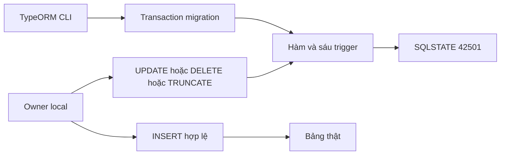
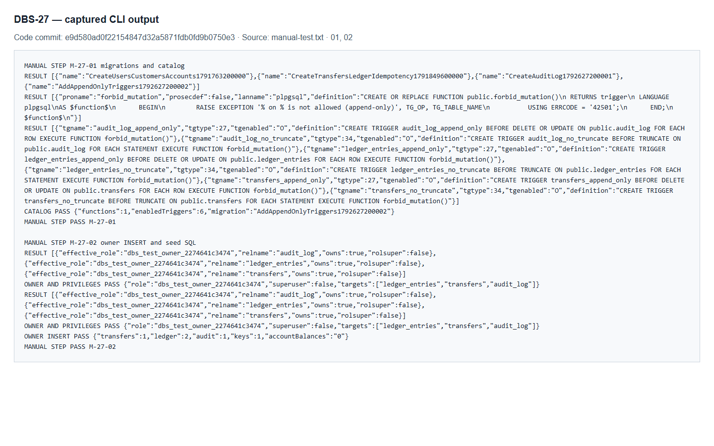
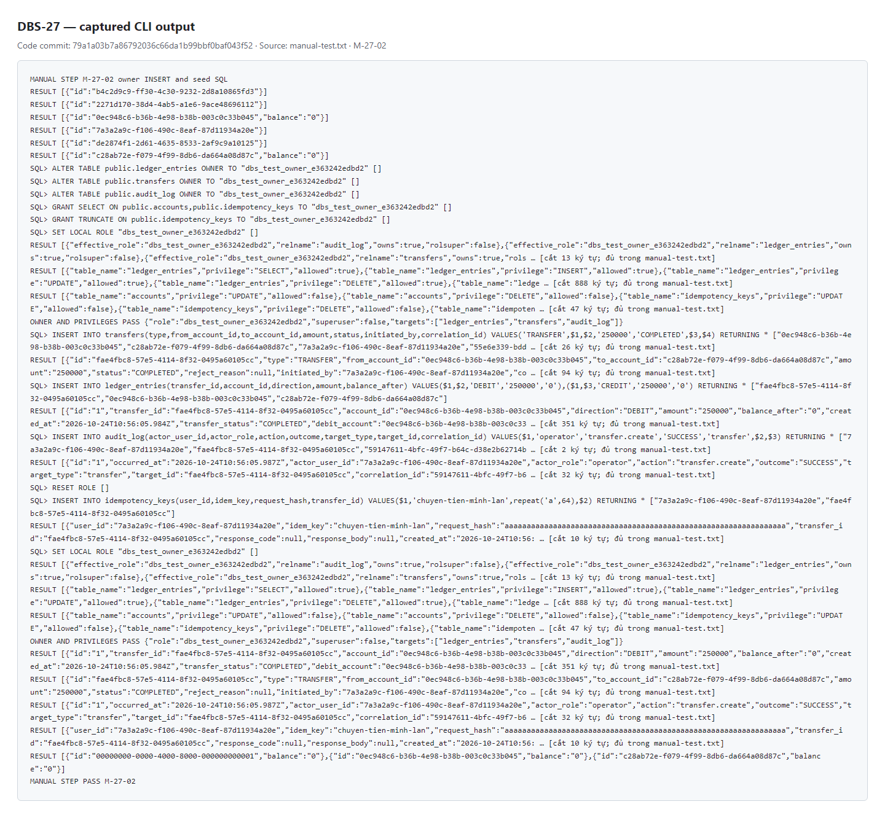
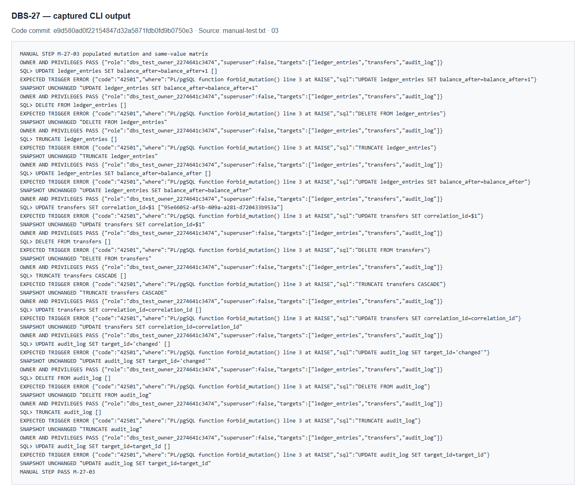
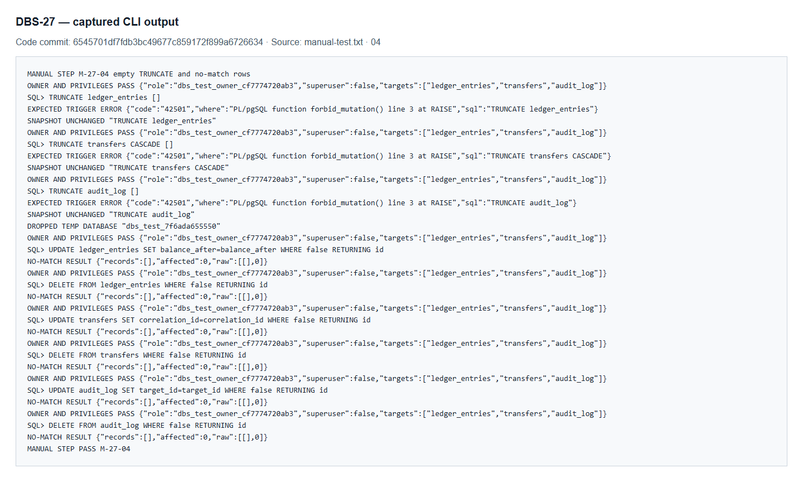
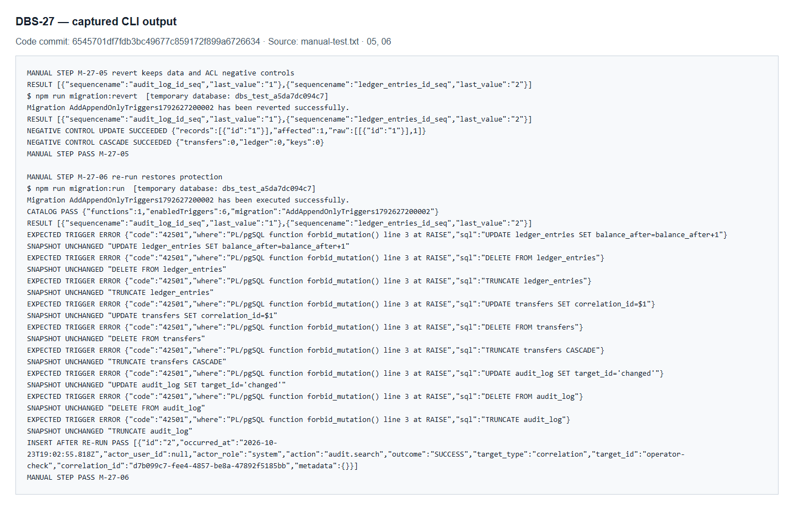
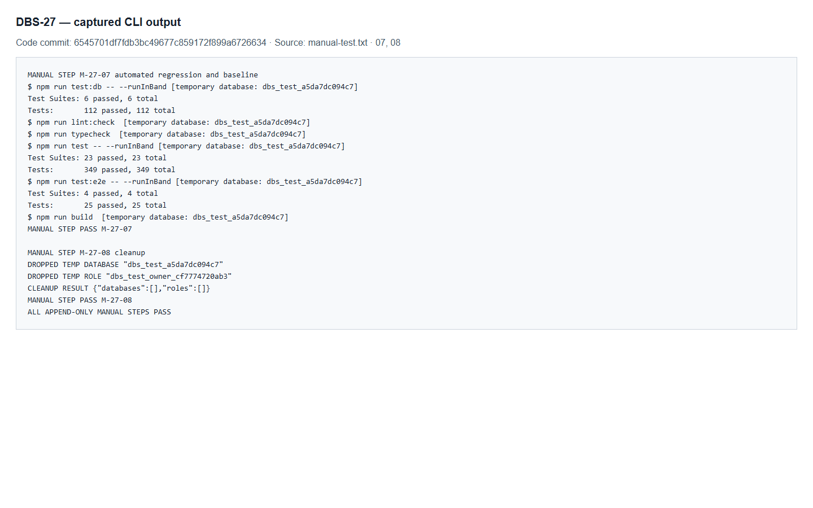

# DBS-27 · Hàm forbid_mutation và trigger chặn sửa/xóa các bảng chỉ-thêm

> **Status:** Implemented · **Vai:** Dev · **Reviewer:** Dev khác, chưa chỉ định · **Nhánh:** `feat/DBS-27-append-only-triggers` · **PR:** [PR](https://github.com/Lawliet119/digital-banking-simulator/pull/14) · **Cập nhật:** 2026-10-22

## 1. Bối cảnh

- **Nguồn yêu cầu:** workbook local `Jira chạy bằng cơm (1).xlsx`, tab `Tuần 1`, hàng 12, cột A–K; workbook chỉ đọc và không đưa vào Git. Đã chạy `fetch-task.mjs DBS-27`: yêu cầu giống workbook; board trực tiếp ghi `In Progress`, workbook ghi `To Do`. Agent không đổi trạng thái board.
- **Task trên board:** Task, Tuần 1, ưu tiên Highest, assignee theo vai `Dev`, Deliverable/Demo `P2`; không có cá nhân được chỉ định trong workbook. Vai Dev phù hợp migration backend.
- **Expect:** Dù code có lỗi hay ai đó có quyền, sổ cái và nhật ký không bị sửa hoặc xóa.
- **DoD** (nguyên văn, đánh số):
  1. Hàm forbid_mutation() và trigger BEFORE UPDATE, DELETE, TRUNCATE trên ledger_entries, transfers, audit_log
  2. Test trên Postgres thật bằng role chủ bảng: UPDATE, DELETE, TRUNCATE đều lỗi; INSERT thành công
  3. Ghi chú cách thêm risk_rule_sets vào danh sách khi bảng đó có (task fraud)
  4. Migration revert được (gỡ trigger rồi gỡ hàm)
  5. PR đã merge vào main (CI xanh); Dev review; bảng «Đối chiếu test case» trong PR điền đủ
- **Phụ thuộc và trình tự:**

  | Dependency | Workbook | Board trực tiếp / repository | Hệ quả |
  |---|---|---|---|
  | DBS-21 | To Do | Done; migration `1791849600000` đã có và chạy thành công | Đủ `transfers`, `ledger_entries`; workbook chậm hơn code |
  | DBS-26 | To Do | In Progress; `audit_log` chưa tồn tại | Chỉ triển khai/kiểm hoàn chỉnh DBS-27 sau khi có migration thật của DBS-26; không tạo bảng hoặc service giả |

- **Đã có gì:** [database-design §8.3, §11–12](../components/_shared/database-design.md); [ADR-02](../adr/0002-postgresql-ledger.md); [DBS-21](DBS-21-migration-transfers-ledger-idempotency.md); [DBS-26](DBS-26-migration-audit-log.md); [backlog BL-005/BL-006](../BACKLOG.md); [threat model](../security/threat-model.md); [test ledger hiện tại](../../backend/test/db/ledger-schema.db-spec.ts); [test rollback hiện tại](../../backend/test/db/migration-revert.db-spec.ts); [harness database tạm](../../backend/test/support/temp-database.ts).
- **Thực trạng đã chạy kiểm tra:** sau khi chạy hai migration nền trên database tạm bằng data source thật, catalog có `transfers`/`ledger_entries`, không có `audit_log`; số hàm `public.forbid_mutation` = 0 và số user trigger trong schema public = 0. Đã drop database tạm sau kiểm. Chưa có production roles `dbs_api`/`dbs_migrator` từ migration quyền; không dùng stub để nhận đủ production-role coverage.
- **Baseline:** cùng commit `origin/main` `d158296be421cf7afb52b86703b631ecb2ab0b30`, trước mọi sửa đổi. Node `24.15.0`, npm `11.12.1`, PostgreSQL Docker `17.11`, timezone `UTC`; role local `banking` là superuser. `docker compose up -d` thành công. Từ `backend/`: lint, typecheck, build đạt; unit 23 suite / 349 test đạt, e2e 4 suite / 25 test đạt, database thật 3 suite / 49 test đạt; tất cả 0 bỏ qua. Link checker nền: 83 file / 0 liên kết hỏng. Chưa có test hành vi DBS-27 vì chưa triển khai.
- **Phạm vi đề xuất:** migration riêng sau migration audit thật; hàm `forbid_mutation()` SQLSTATE `42501`; cho mỗi bảng `ledger_entries`, `transfers`, `audit_log`: trigger BEFORE UPDATE OR DELETE FOR EACH ROW và BEFORE TRUNCATE FOR EACH STATEMENT; test bằng role thực sở hữu bảng với trigger bật, INSERT hợp lệ thành công và hàng giữ nguyên sau thao tác bị chặn; revert gỡ trigger rồi hàm, giữ nguyên bảng/dữ liệu; manual test trên database tạm và hướng dẫn thêm `risk_rule_sets` khi task fraud tạo bảng.
- **Test cũ liên quan:** BL-005 đã cảnh báo TC-21-21 và đường dọn dữ liệu TC-21-24; test rollback còn hardcode hai migration. Phạm vi phải cập nhật các regression bị tác động, bảo toàn chứng cứ FK của DBS-21 bằng schema đúng phiên bản hoặc kiểm cấu trúc/hành vi phù hợp, không chỉ đổi mọi kỳ vọng FK thành `42501`. Harness hiện tạo/drop database riêng và dùng BEGIN/ROLLBACK nên không cần thêm Testcontainers dependency hoặc đổi sang TRUNCATE.
- **Ngoài phạm vi:** production DB roles/GRANT và chủ view `v_transfer_facts` (phần còn lại BL-005); complete-pair/balance_after constraint trigger (BL-006, ADR-02 giao code/đối soát); bảng fraud/risk_rule_sets; chống chủ DB cố tình tắt trigger hoặc sửa DDL. Không đổi ADR hay quy tắc tiền. Không tuyên bố AC-8.1 production-role coverage hoặc toàn bộ threat model đã kiểm chỉ với test owner local. Không gắn trigger vào outbox/processed vì relay/cleanup cần sửa/xóa chúng.
- **Câu hỏi / quyết định cần duyệt ở G1:**
  1. **Fixture SQL:** theo skill, mặc định không dùng SQL tạo ledger entries. Luồng nạp tiền chưa tồn tại, nhưng test trigger cần hàng thật. Đề xuất cho phép fixture ghi rõ `seed SQL` chỉ trong database tạm của test hoặc manual, rollback/drop sau chạy; không sửa `accounts.balance`, không tạo dữ liệu demo hoặc ghi lên `banking`. Nếu không duyệt, các ca INSERT/mutation ledger sẽ chờ task nạp tiền và không thể nhận DoD #2 đã đạt.
  2. **Phạm vi regression/backlog:** đề xuất nhận phần trigger/test của BL-005; giữ phần quyền/chủ view và BL-006 ngoài task, không xóa cả dòng khi chưa xử lý hết điều kiện đóng.
  3. **Nhánh phụ thuộc:** ba task luôn dùng ba tên nhánh và commit riêng. Đề xuất DBS-27 dựa trên nhánh DBS-26 sau khi DBS-26 có commit migration hoàn chỉnh; phần diff của DBS-27 chỉ chứa trigger/test/tài liệu DBS-27 so với base DBS-26. Khi DBS-26 được Dev merge vào main mới chuyển base DBS-27 sang main. Nếu chỉ cho phép base main, DBS-27 cần chờ DBS-26 được merge; agent không tự merge.

**Quyết định ở G1 (2026-10-22):** người dùng trả lời «duyệt G1», chấp nhận cả ba đề xuất: fixture `seed SQL` chỉ trong database tạm, không sửa `accounts.balance`; nhận phần trigger/test của BL-005, giữ phần quyền/chủ view và BL-006 ngoài phạm vi; ba nhánh riêng, DBS-27 dựa trên DBS-26 sau khi migration audit hoàn chỉnh. Chưa viết production code hoặc test mới, chưa commit/push. Status giữ `Draft` đến khi G2 được duyệt.

## 2. Hành vi

Không thêm API, HTTP `errorCode` hay thay đổi luồng chuyển tiền. Hành vi ở PostgreSQL thật, theo [database-design §8.3](../components/_shared/database-design.md).

| Điều kiện / thao tác | Kết quả |
|---|---|
| `INSERT` hợp lệ vào `transfers`, `ledger_entries`, `audit_log` | Thành công; default, identity, CHECK/FK/UNIQUE hiện có vẫn áp dụng. Fixture ledger chỉ theo ngoại lệ G1, không chứng minh nghiệp vụ đã cân bằng |
| `UPDATE` khớp ít nhất một hàng, kể cả gán lại cùng giá trị | `forbid_mutation()` ném SQLSTATE `42501`; không cột nào của hàng bị sửa |
| `DELETE` khớp ít nhất một hàng | `42501`; hàng và các tham chiếu được giữ nguyên; trigger chạy trước kiểm FK do xóa |
| `UPDATE`/`DELETE` không khớp hàng nào | Thành công với 0 hàng tác động: trigger `FOR EACH ROW` không chạy. Không diễn giải thành từ chối mọi câu lệnh SQL |
| `TRUNCATE`, kể cả bảng rỗng | `42501` từ trigger `FOR EACH STATEMENT`; không mất hàng. Với `transfers`, dùng `TRUNCATE transfers CASCADE` trên database tạm để FK không trả `0A000` trước trigger; owner thử nghiệm phải có quyền TRUNCATE cả `ledger_entries` và `idempotency_keys` trong tập CASCADE trước khi chạy |
| Role thực sở hữu cả ba bảng, `rolsuper = false`, trigger bật | Vẫn bị chặn như trên dù owner có quyền DML; kiểm `current_user = pg_get_userbyid(relowner)` cho từng bảng |
| Migration `up` trên schema/dữ liệu thật của DBS-26 | Thêm một hàm và sáu trigger; giữ nguyên bảng, dữ liệu, index, FK và sequence |
| Migration `down` khi đã có dữ liệu | Gỡ đủ sáu trigger trước, sau đó gỡ hàm; không `DROP TABLE`, không xóa dữ liệu. Trong khoảng rollback, các thao tác vốn được phép bởi quyền DB có thể sửa dữ liệu |
| Chạy lại `up` sau `down` | Khôi phục sáu trigger; dữ liệu trước rollback còn nguyên, mutation lại nhận `42501` |

Hàm có chữ ký `public.forbid_mutation() RETURNS trigger LANGUAGE plpgsql`, `RAISE EXCEPTION ... USING ERRCODE = '42501'`; thông báo chỉ có `TG_OP` và `TG_TABLE_NAME`, không chứa nội dung hàng. Không dùng `SECURITY DEFINER`, migration không cấp quyền mới. Không thay đổi code xử lý lỗi HTTP. Owner cố tình tắt trigger, dùng `session_replication_role = replica`, hoặc thay DDL nằm ngoài bảo đảm này; test không tắt trigger hoặc đổi replication role để nhận kết quả xanh.

**Oracle bắt buộc cho mọi mutation bị chặn:** ngay trước từng thao tác, xác nhận effective owner non-superuser, trigger đang bật và đủ quyền DML của thao tác; riêng TRUNCATE kiểm `has_table_privilege(..., 'TRUNCATE')` riêng từng bảng trong tập CASCADE. Chỉ nhận đạt khi `pg` trả **cả** `code = '42501'` và `where` xác nhận `PL/pgSQL function [public.]forbid_mutation() line <số> at RAISE`. Catalog phải xác nhận trigger trỏ OID `public.forbid_mutation()`; PostgreSQL có thể lược schema trong `where`, không cố định số dòng. TypeORM lấy context từ `QueryFailedError.driverError.where`. Lỗi ACL `42501` với `where` thiếu hoặc không thuộc RAISE của hàm này là test thất bại. Áp dụng cùng oracle cho bảng có hàng, bảng rỗng, UPDATE cùng giá trị, test tự động/manual và lần up sau revert; không kiểm chỉ message hoặc SQLSTATE.

**Security checklist:** kiểm quyền owner và SQLSTATE bằng TC-27-02…09; snapshot đầy đủ hàng trước/sau chứng minh không mất/sửa dữ liệu. Fixture dùng bind parameters; tên database/role sinh nội bộ được kiểm mẫu tên trước khi chèn vào DDL. Không in URL có mật khẩu. Guard, ownership HTTP/404, idempotency, outbox transaction, PII filtering và customer fraud DTO không áp dụng vì task chỉ thêm DB trigger; không nhận AC-8.1 toàn hệ thống đã đạt. Production `dbs_api`/`dbs_migrator` và grants vẫn bàn giao cho task roles.

## 3. Kiến trúc

**Vị trí và dependency.** File dự kiến `backend/src/database/migrations/1792627200002-AddAppendOnlyTriggers.ts`, class `AddAppendOnlyTriggers1792627200002 implements MigrationInterface`; `name` cùng tên class. Thứ tự đã thống nhất: DBS-25 `1792627200000-CreateOutboxEventsProcessedEvents`, DBS-26 `1792627200001-CreateAuditLog`, DBS-27 `1792627200002-AddAppendOnlyTriggers`. Nhánh DBS-26 độc lập với DBS-25 nên DBS-27 chỉ yêu cầu schema thật DBS-20/21/26, không chờ hay tạo outbox giả.

**Interface.** Migration cung cấp `up(queryRunner: QueryRunner): Promise<void>` và `down(queryRunner: QueryRunner): Promise<void>`, do TypeORM gọi qua [data source thật](../../backend/src/database/data-source.ts). Hàm SQL chỉ được sáu trigger gọi. Không đổi exported symbol production hiện có; grep hiện tại không có caller `forbid_mutation`. Giữ API hiện có `migrate(url: string, direction: 'up' | 'undoLast' = 'up'): Promise<void>`; thêm helper **test-only** dự kiến `migrateThrough(url: string, migrationName: string): Promise<void>` tại [temp-database.ts](../../backend/test/support/temp-database.ts) để load prefix migration thật trên database mới. Helper từ chối target không có thật hoặc lịch sử không phù hợp; không substitute class, không dựng bảng giả và không được ứng dụng production gọi.

| Bảng | Trigger mutation | Trigger truncate |
|---|---|---|
| `public.ledger_entries` | `ledger_entries_append_only` | `ledger_entries_no_truncate` |
| `public.transfers` | `transfers_append_only` | `transfers_no_truncate` |
| `public.audit_log` | `audit_log_append_only` | `audit_log_no_truncate` |

Mỗi trigger mutation là `BEFORE UPDATE OR DELETE ... FOR EACH ROW`; mỗi trigger truncate là `BEFORE TRUNCATE ... FOR EACH STATEMENT`; đều gọi `public.forbid_mutation()`, trạng thái `tgenabled = 'O'`. `up`: tạo hàm rồi từng cặp trigger. `down`: gỡ sáu trigger theo tên/bảng tường minh, sau đó `DROP FUNCTION public.forbid_mutation()` **không `CASCADE`**, để dependency ngoài dự kiến làm rollback thất bại an toàn. Không đổi cột, FK, index, default hay DML quyền. Không gắn trigger vào outbox/processed.

**Transaction.** TypeORM migration chạy trong transaction (`transaction: 'all'` hiện có); DDL lỗi thì không để lại nửa bộ trigger. Trigger ném lỗi làm câu mutation thất bại trong transaction của caller; test dùng savepoint để lấy lỗi rồi rollback savepoint, tiếp tục đọc snapshot. Không tạo transaction retry, không gọi Redis/HTTP/SQS, không thay `TransactionService`.



**Owner test thật.** Sau khi migrate database tạm, connection quản trị local tạo role riêng `dbs_test_owner_<12hex> NOLOGIN NOSUPERUSER NOCREATEDB NOCREATEROLE`; chỉ `ALTER TABLE ... OWNER TO` ba bảng trong database ấy. Dùng `SET LOCAL ROLE` và kiểm catalog owner/effective user, sequence gắn bảng, `rolsuper = false` **trước từng** INSERT/mutation; đây là effective role thật, không phải đăng nhập production `dbs_migrator`.

Chọn một cơ chế snapshot: giữ effective owner trên cùng connection để đọc, cấp đúng `GRANT SELECT ON public.accounts, public.idempotency_keys TO <owner>` và `GRANT TRUNCATE ON public.idempotency_keys TO <owner>` **chỉ trong database tạm**. Owner đã có SELECT/INSERT/UPDATE/DELETE/TRUNCATE trên ba bảng đích; kiểm từng quyền bằng `has_table_privilege` với từng privilege riêng, không gộp chuỗi quyền thành phép OR. Trước `TRUNCATE transfers CASCADE`, kiểm quyền TRUNCATE trên `transfers`, `ledger_entries`, `idempotency_keys`; trước snapshot kiểm quyền SELECT trên cả năm bảng. Không cấp INSERT/UPDATE/DELETE cho owner trên `idempotency_keys`, không cấp UPDATE/DELETE trên `accounts`; kiểm các quyền này vẫn false. Quyền phụ trợ fixture không phải production grants và không thuộc migration production.

Admin seed users/customers/accounts trước. Owner INSERT ba bảng đích; admin thêm một idempotency fixture tham chiếu id transfer thật sau đó, trên **cùng connection/transaction**: `RESET ROLE`, INSERT key với `request_hash` đúng 64 ký tự hex, rồi `SET LOCAL ROLE <owner>` và xác nhận lại owner/quyền trước mọi thao tác tiếp theo. Snapshot chạy dưới owner đã có SELECT, không reset role giữa các mutation để che thiếu quyền và không dùng connection khác có thể không thấy fixture chưa commit. Dọn theo thứ tự rollback/reset role → giải phóng connection → drop đúng database tạm → drop đúng role do run tạo, có kiểm mẫu tên; không `DROP OWNED` hoặc sửa role có sẵn.

**Regression BL-005.** TC-21-21 và TC-21-24 chạy lại trên database tạo bằng prefix kết thúc `CreateTransfersLedgerIdempotency1791849600000`: vẫn kiểm đủ FK với `23503` và guard từ chối rollback khi còn dữ liệu, không bị trigger tương lai che mất. Suite latest riêng kiểm toàn chuỗi migration, việc revert đúng migration đích và trigger `42501`. Không bỏ test cũ, không dùng `DISABLE TRIGGER` hay `session_replication_role` để né trigger trong chứng cứ DBS-27. Case ledger orphan cũ, nếu vẫn cần để kiểm down DBS-21, chỉ giữ trong database prefix và được ghi rõ là fixture của regression cũ, không dùng chứng minh append-only.

**Bàn giao `risk_rule_sets` (DoD #3).** Khi migration fraud tạo bảng này, tái sử dụng hàm thật: tạo `risk_rule_sets_append_only BEFORE UPDATE OR DELETE FOR EACH ROW` và `risk_rule_sets_no_truncate BEFORE TRUNCATE FOR EACH STATEMENT`, cùng gọi `public.forbid_mutation()`; test INSERT và ba mutation bằng owner thật. Migration fraud phải có dependency DBS-27; `down` fraud gỡ hai trigger của mình trước khi bỏ bảng. Nếu trigger fraud vẫn tồn tại, revert DBS-27 phải bị dependency từ chối thay vì dùng `CASCADE` âm thầm gỡ bảo vệ. Không tạo bảng fraud trong task này.

Reference docs dự kiến cập nhật tại Phase 5: database-design mục migration/§8.3, README audit/ledger khi fact thay đổi, feature index và BL-005 giữ phần grants/view owner. Không đổi ADR, event contract hoặc money rule; BL-006 giữ ngoài phạm vi theo G1.

## 4. Test cases tự động

Các case DB chạy trên PostgreSQL 17 thật qua `npm run test:db`; dự kiến file `backend/test/db/append-only.db-spec.ts`, mỗi suite có database riêng. Không mock database; PostgreSQL hoặc quyền tạo role/database thiếu thì fail rõ, không skip. `attempt()` dùng savepoint; trước **mỗi** mutation kiểm effective owner và đủ quyền theo §2–§3, sau lỗi kiểm đồng thời `code = '42501'` và `driverError.where` xác nhận RAISE trong hàm `public.forbid_mutation()`, rồi đối chiếu toàn bộ snapshot hàng ba bảng, key tham chiếu transfer thật và mọi `accounts.balance`. Thiếu quyền hoặc thiếu đúng context lỗi là thất bại, không nhận là chứng cứ trigger. Snapshot dưới effective owner đã được GRANT SELECT chỉ trong database tạm: ba bảng đích `ORDER BY id`, `idempotency_keys ORDER BY user_id, idem_key`, accounts `ORDER BY id`. Fixture ledger luôn khớp transfer về amount, direction/account và status theo composite FK; không khẳng định fixture chứng minh bất biến số dư nghiệp vụ.

| ID | Truy vết | Lớp | Given · When · Then | SQLSTATE |
|---|---|---|---|---|
| TC-27-01 | DoD #1 | DB integration | Catalog có đúng hàm signature `() → trigger`, PL/pgSQL, sáu trigger enabled đúng bảng/thời điểm/event/row-vs-statement; không có trigger gọi hàm trên bảng ngoài scope | — |
| TC-27-02 | DoD #2 | DB/security | Trước từng mutation: effective owner của cả ba bảng đúng `current_user`, `rolsuper=false`, trigger bật, đủ quyền DML và SELECT snapshot; trước CASCADE có TRUNCATE trên transfer/ledger/idem. Quyền phụ trợ chỉ SELECT accounts/idem và TRUNCATE idem; không có UPDATE/DELETE ngoài scope. Thiếu bất kỳ điều kiện nào thì fail | — |
| TC-27-03 | DoD #2 | DB integration | Owner INSERT một transfer hợp lệ, hai dòng DEBIT/CREDIT cùng transfer và một audit hợp lệ; admin thêm key tham chiếu transfer, hash64hex; đặt lại owner và đọc đủ hàng với thứ tự đúng khóa chính, identity/default còn hoạt động | thành công |
| TC-27-04 | DoD #1–2, FR-AUD-04 | DB/security, 3 bảng | Với hàng thật, UPDATE trường không bị constraint khác che: ledger `balance_after + 1`, transfer `correlation_id` mới, audit `target_id` khác; từng thao tác bị chặn và snapshot giữ nguyên | `42501` |
| TC-27-05 | DoD #1–2 | DB/security, 3 bảng | UPDATE gán lại giá trị hiện có của cột không phải identity; từng thao tác vẫn bị chặn, hàng không đổi | `42501` |
| TC-27-06 | DoD #1–2, FR-AUD-04 | DB/security, 3 bảng | DELETE hàng có thật; kể cả transfer đang được ledger tham chiếu, trigger chặn trước FK; giữ nguyên tất cả hàng | `42501` |
| TC-27-07 | DoD #1–2 | DB/security, 3 bảng | TRUNCATE bảng có dữ liệu, kể cả key tham chiếu transfer thật; kiểm đủ quyền từng bảng cascade trước `TRUNCATE transfers CASCADE`; lỗi có đúng context RAISE, snapshot ba bảng/key/accounts không đổi | `42501` + `where` của hàm |
| TC-27-08 | DoD #1–2 | DB/security, 3 bảng | Database mới migrate chưa seed, có cùng test-only grants và kiểm quyền/owner như ca có dữ liệu: TRUNCATE từng bảng rỗng, transfer dùng CASCADE; statement trigger vẫn chặn với đúng context | `42501` + `where` của hàm |
| TC-27-09 | DoD #1 | DB integration, 3 bảng | UPDATE/DELETE có `WHERE` không khớp hàng nào; hoàn thành với 0 affected rows, snapshot không đổi; chứng minh giới hạn row trigger | thành công |
| TC-27-10 | DoD #1, #4 | DB integration | Migrate prefix qua DBS-26, seed dữ liệu thật trong database tạm; migrate lên DBS-27; snapshot hàng/sequence và bảng/index/FK giữ nguyên, trigger có đủ | — |
| TC-27-11 | DoD #4 | DB integration/CLI | Với dữ liệu còn tồn tại, `migration:revert` đúng DBS-27 thành công; sáu trigger/hàm biến mất, bảng/hàng/sequence còn nguyên. Sau down kiểm owner/quyền, UPDATE audit và `TRUNCATE transfers CASCADE` trong savepoint đều thành công rồi rollback, chứng minh ACL không chặn giả | thành công |
| TC-27-12 | DoD #1, #4 | DB integration/CLI | `migration:run` lại sau TC-27-11; dữ liệu giữ nguyên, đủ sáu trigger, INSERT mới hợp lệ. Trước từng UPDATE/DELETE/TRUNCATE xác nhận owner/quyền kể cả cascade; cả ba bảng lại bị đúng RAISE chặn, snapshot giữ nguyên | `42501` + `where` của hàm |
| TC-27-13 | DoD #4, BL-005 | Regression DB | TC-21-21 trên schema prefix DBS-21 vẫn giữ đủ bảy FK RESTRICT và từng lỗi delete đúng `code + constraint`; không đổi thành trigger error | `23503` + tên FK |
| TC-27-14 | DoD #4, BL-005 | Regression DB/CLI | TC-20-18/TC-21-24 và run→revert→run chọn schema/đích migration thật, không hardcode latest là DBS-21; guard cũ vẫn từ chối mất dữ liệu, latest suite vẫn revert DBS-27 khi có dữ liệu | lỗi guard cũ / thành công ở đích phù hợp |
| DOC-27-01 | DoD #3 | rà tài liệu | §3 mô tả chính xác hai trigger risk_rule_sets, dependency và rollback; Phase 5 ghi bàn giao vào backlog, không tạo bảng giả | không áp dụng |
| Quy trình | DoD #5 | quy trình | Điền đối chiếu TC và bằng chứng sau chạy; CI xanh, Dev khác review, người có quyền merge. Agent không tự merge hoặc nhận đã merge | chưa xác minh |

AC-8.1 và threat-model T4 chỉ được hỗ trợ ở lớp DB owner trong phạm vi này; test quyền API/worker và kiểm toán viên HTTP thuộc task security/roles. Không có test concurrency/time/money parsing mới vì trigger không thay các hành vi đó.

## 5. Test thủ công

**Điều kiện:** PostgreSQL 17 Docker đang chạy, Node/npm đã có, `DATABASE_URL` của server local có quyền tạo/drop database và role; không cần token hay service API. Dùng Git Bash theo [manual-testing.md](../../.claude/skills/dbs-delivering-task/references/manual-testing.md), không log URL/credentials. Không thay `.env`. Toàn bộ thao tác ghi nằm trong database tạm `dbs_test_<12hex>` do run tạo; role owner riêng, không dùng `banking` làm database dữ liệu thử. Thiếu điều kiện thì ghi **chưa chạy**, không dùng unit output thay chứng cứ.

**Driver:** [append-only.manual.ts](../../backend/test/manual/append-only.manual.ts) đã triển khai theo G3; là operator driver chạy SQL và các npm migration CLI thật, không import Jest/test assertions để giả manual test. Driver in từng lệnh SQL với bind values không bí mật, effective owner/quyền trước mỗi mutation, response, SQLSTATE và `pg.where`; kiểm đủ oracle §2, thoát khác 0 nếu sai, cleanup trong `finally`. `42501` thiếu context RAISE không được nhận đạt. Không tạo link giả đến file chưa có. Lệnh chạy trên commit cuối thay đổi code, từ root trong Git Bash:

```bash
docker compose up -d
mkdir -p docs/features/screenshots/DBS-27
git rev-parse HEAD > docs/features/screenshots/DBS-27/manual-test.txt
set -o pipefail
cd backend
NODE_ENV=test node -r ts-node/register -r tsconfig-paths/register \
  test/manual/append-only.manual.ts 2>&1 | tee -a ../docs/features/screenshots/DBS-27/manual-test.txt
```

`DATABASE_URL` đã được đặt trong môi trường trước lệnh trên; không dán mật khẩu vào bằng chứng. Driver truyền URL database tạm vào child process bằng `env`, không in nó. Mỗi bước sau in chính command/SQL, hàng và kết quả thực để người vận hành kiểm độc lập:

| Bước | Lệnh / thao tác thật trong driver | Kết quả mong đợi |
|---|---|---|
| M-27-01 | Tạo database/owner mới; chạy `npm run migration:run` bằng config CLI thật; `SELECT name FROM migrations ORDER BY timestamp`; `SELECT pg_get_functiondef('public.forbid_mutation()'::regprocedure)` và `pg_get_triggerdef(oid)` của sáu trigger; mô tả ba bảng bằng catalog tương đương `psql \\d` | Chuỗi schema có migration audit và append-only đúng tên; một hàm, sáu trigger enabled; ba bảng và constraint cũ còn đủ |
| M-27-02 | `BEGIN`; admin seed users/customers/accounts không UPDATE balance, đổi owner ba bảng và cấp đúng hai GRANT bên dưới; `SET LOCAL ROLE <owner>`; truy vấn owner/quyền rồi INSERT ba bảng đích; `RESET ROLE`, admin INSERT key tham chiếu transfer thật/hash64hex; `SET LOCAL ROLE <owner>`, xác nhận lại và đọc snapshot; `COMMIT` | Owner non-superuser đúng cả ba bảng, đủ quyền thao tác/snapshot/cascade; INSERT 1 transfer/2 ledger/1 audit và fixture 1 key thành công. Đây là **seed SQL** đã được G1 duyệt trong DB tạm, không phải giao dịch ngân hàng qua API |
| M-27-03 | `BEGIN; SET LOCAL ROLE <owner>`; trước từng mutation in/check owner và quyền, rồi SAVEPOINT, thực thi, in `code` và `where`, rollback savepoint; dưới owner đọc đủ snapshot bằng SQL đúng khóa chính bên dưới; cuối bước `ROLLBACK` | Chín thao tác có hàng thật đều `42501` + context RAISE của `forbid_mutation()`; số hàng/giá trị/key/accounts giữ nguyên. UPDATE cùng giá trị thêm ba lần vẫn đúng oracle; thiếu quyền hay context là thất bại |
| M-27-04 | Database tạm thứ hai migrate thật, chuyển owner, cấp đúng grants test-only như M-27-02 nhưng không seed; kiểm quyền/owner rồi TRUNCATE từng bảng như M-27-03. Ở database có fixture kiểm quyền/owner rồi UPDATE/DELETE `WHERE false` | Bảng rỗng vẫn chặn truncate bằng `42501` + đúng context; no-match row mutation tác động 0 hàng, không lỗi. Không thiếu quyền TRUNCATE idem; drop database thứ hai sau bước |
| M-27-05 | Lưu snapshot đã commit; `npm run migration:revert` khi migration mới nhất đúng `AddAppendOnlyTriggers1792627200002`; đọc catalog/rows. `BEGIN; SET LOCAL ROLE <owner>`; kiểm quyền rồi UPDATE audit và `TRUNCATE transfers CASCADE` trong savepoint riêng, rollback mỗi savepoint, `ROLLBACK` | Revert thành công có dữ liệu; sáu trigger/hàm không còn, bảng/hàng/key/sequence còn nguyên. UPDATE và TRUNCATE CASCADE khi down đều thành công: ACL không gây false positive; rollback hoàn fixture |
| M-27-06 | `npm run migration:run`; đọc catalog/snapshot; lặp chín mutation M-27-03, trước từng thao tác kiểm owner/quyền/cascade và sau lỗi kiểm code/where/snapshot; thêm INSERT audit hợp lệ rồi rollback | Bảo vệ phục hồi đủ ba bảng, mọi mutation lại `42501` + đúng context RAISE; snapshot và accounts.balance giữ nguyên, INSERT vẫn được phép |
| M-27-07 | `npm run test:db -- --runInBand`; `npm run lint:check`; `npm run typecheck`; `npm test -- --runInBand`; `npm run test:e2e -- --runInBand`; đọc toàn bộ output | Suite task mới và regressions cũ đều đạt, không skip; ghi số đếm thật vào §8. Đây là bổ sung automated verification, không thay các bước manual SQL |
| M-27-08 | `finally`: rollback/reset owner, đóng connection, drop đúng các database vừa tạo rồi drop đúng owner role; kiểm `pg_database`/`pg_roles` không còn tên đã tạo; kiểm output không có credential | Cleanup hoàn tất, không đụng database `banking` hoặc role có sẵn; bằng chứng không chứa mật khẩu/token |

**SQL cụ thể cho M-27-02.** Bind `$1…` được driver điền bằng id thật và in ra; subjects `minh-local`/`lan-local`, tên khách `Nguyễn Minh`/`Trần Lan`, hai tài khoản CHECKING mặc định balance 0. INSERT transfer/ledger là fixture kiểm DB, không dùng làm demo hay chứng minh bất biến số dư. Chỉ trong database tạm, admin cấp `GRANT SELECT ON public.accounts, public.idempotency_keys TO <owner>` và `GRANT TRUNCATE ON public.idempotency_keys TO <owner>`; `<owner>` phải khớp mẫu tên role của run và được quote như identifier, không nhận tên SQL tùy ý. Không thêm production grants:

```sql
SELECT current_user, c.relname, pg_get_userbyid(c.relowner) AS table_owner,
       r.rolsuper, c.relowner = (SELECT oid FROM pg_roles WHERE rolname = current_user) AS owns_table
FROM pg_class c JOIN pg_namespace n ON n.oid = c.relnamespace
JOIN pg_roles r ON r.rolname = current_user
WHERE n.nspname = 'public' AND c.relname IN ('transfers', 'ledger_entries', 'audit_log');

-- Chạy dưới effective owner trước từng mutation; mỗi privilege kiểm riêng.
SELECT table_name, privilege,
       has_table_privilege(current_user, table_name, privilege) AS allowed
FROM (VALUES
  ('public.transfers', 'TRUNCATE'), ('public.ledger_entries', 'TRUNCATE'),
  ('public.audit_log', 'TRUNCATE'),
  ('public.idempotency_keys', 'TRUNCATE'),
  ('public.transfers', 'SELECT'), ('public.ledger_entries', 'SELECT'),
  ('public.audit_log', 'SELECT'), ('public.accounts', 'SELECT'),
  ('public.idempotency_keys', 'SELECT')
) AS required(table_name, privilege);
-- Tất cả allowed phải true; với UPDATE/DELETE/INSERT còn kiểm riêng quyền
-- tương ứng trên bảng đích.
SELECT table_name,
       has_table_privilege(current_user, table_name, 'UPDATE') AS can_update,
       has_table_privilege(current_user, table_name, 'DELETE') AS can_delete
FROM (VALUES ('public.accounts'), ('public.idempotency_keys')) AS outside_target(table_name);
-- Cả bốn kết quả phải false; idem INSERT cũng phải false.

INSERT INTO transfers (type, from_account_id, to_account_id, amount, status, initiated_by, correlation_id)
VALUES ('TRANSFER', $1, $2, '250000', 'COMPLETED', $3, $4) RETURNING *;
INSERT INTO ledger_entries (transfer_id, account_id, direction, amount, balance_after)
VALUES ($1, $2, 'DEBIT', '250000', '0'), ($1, $3, 'CREDIT', '250000', '0') RETURNING *;
INSERT INTO audit_log (actor_user_id, actor_role, action, outcome, target_type, target_id, correlation_id)
VALUES ($1, 'operator', 'transfer.create', 'SUCCESS', 'transfer', $2, $3) RETURNING *;

-- Sau ba INSERT trên: RESET ROLE để admin seed key trên cùng transaction,
-- rồi SET LOCAL ROLE owner và xác nhận lại trước bước tiếp theo.
INSERT INTO idempotency_keys (user_id, idem_key, request_hash, transfer_id)
VALUES ($1, 'chuyen-tien-minh-lan', repeat('a', 64), $2) RETURNING *;
```

**SQL M-27-03**, mỗi statement chạy trong savepoint riêng và effective owner đã kiểm quyền; điều kiện id luôn khớp fixture thật, không coi UPDATE/DELETE 0 hàng là từ chối. Sau mỗi lỗi lấy `code` và `where` theo oracle §2, không nhận lỗi ACL cùng SQLSTATE là lỗi trigger:

```sql
UPDATE ledger_entries SET balance_after = balance_after + 1 WHERE id = $1;
UPDATE transfers SET correlation_id = $2 WHERE id = $1;
UPDATE audit_log SET target_id = 'changed' WHERE id = $1;
DELETE FROM ledger_entries WHERE id = $1;
DELETE FROM transfers WHERE id = $1;
DELETE FROM audit_log WHERE id = $1;
TRUNCATE ledger_entries;
TRUNCATE transfers CASCADE;
TRUNCATE audit_log;
```

Snapshot đọc trên cùng connection dưới effective owner đã có SELECT; dùng cùng các truy vấn ổn định trong automated test và manual driver:

```sql
SELECT * FROM public.transfers ORDER BY id;
SELECT * FROM public.ledger_entries ORDER BY id;
SELECT * FROM public.audit_log ORDER BY id;
SELECT * FROM public.idempotency_keys ORDER BY user_id, idem_key;
SELECT id, balance FROM public.accounts ORDER BY id;
```

Ghi snapshot sau khi seed đủ fixture rồi so lại sau từng rollback savepoint và mỗi bước: mọi hàng/giá trị, key thực nằm trong CASCADE và balance giữ nguyên, không chỉ so count. Sequence được đối chiếu ngay trước/sau DDL up/down; INSERT thử có thể tiêu thụ identity dù transaction rollback, không coi sequence gap là mutation hàng hoặc rollback lỗi. Ảnh dự kiến: `01-migrations-owner.png`, `02-insert-rows.png`, `03-mutations-42501.png`, `04-empty-truncate.png`, `05-revert-rerun-preserves-data.png`, `06-regression-results.png`; chụp từ output thực sau triển khai G3. Tất cả bước đã chạy, kết quả và SHA code ở §8.

## 6. Domain review (AI)

**Reviewer:** vòng 1 `review_appendonly_g2`, vòng 2 `appendonly_design_final_review`; các subagent độc lập dùng model **GPT-6 Astra**, reasoning `xhigh`, ngày 2026-10-22; chỉ đọc và đối chiếu §1–§5 với nguồn trong repository.

**Vòng 1:** 3 phát hiện (blocking 1, should-fix 2, minor 0), REVISE; [trả lời nguyên văn](screenshots/DBS-27/domain-review-round-1.txt). Đã sửa toàn bộ phần liên quan trong §2–§5 rồi giao reviewer mới kiểm lại.

| # | Mức | Phát hiện | Xử lý trong thiết kế |
|---|---|---|---|
| 1 | blocking | TRUNCATE CASCADE có thể trả 42501 vì thiếu quyền trên idempotency_keys, che việc thiếu trigger | Đã sửa §2–§5: GRANT TRUNCATE chỉ trong DB tạm, kiểm quyền trên mọi bảng CASCADE và error context RAISE của forbid_mutation; TC-27-07/08/11/12 và manual dùng cùng oracle. Sau down phải TRUNCATE CASCADE thành công rồi rollback |
| 2 | should-fix | Owner thử nghiệm thiếu SELECT để đọc accounts và idempotency_keys sau mutation | Đã sửa §3–§5: SELECT tối thiểu chỉ trong DB tạm, kiểm từng privilege; snapshot chạy cùng connection dưới owner đã xác nhận, không lẫn quyền admin vào mutation |
| 3 | should-fix | Snapshot idempotency_keys dùng ORDER BY id dù bảng có khóa (user_id, idem_key) | Đã sửa §4–§5: truy vấn riêng ORDER BY user_id, idem_key; fixture key tham chiếu transfer thật để kiểm bảo toàn dữ liệu CASCADE có hàng |

**Vòng 2:** 0 phát hiện còn lại (blocking 0, should-fix 0, minor 0); [trả lời nguyên văn](screenshots/DBS-27/domain-review.md).

`Verdict: APPROVE`

Mermaid §3 đã render thành công bằng mermaid-cli 12.0.0; nội dung sơ đồ không đổi trong lần sửa oracle/quyền fixture. Đây là thiết kế đã review, chưa phải bằng chứng trigger/migration/tests mới đã chạy.

**Quyết định ở G2 (2026-10-22):** người dùng trả lời «duyệt G2» cho cả ba task, chấp nhận thiết kế §2–§5 và kết quả review §6. Status chuyển thành **Design approved**. Chưa viết production code, test hoặc driver mới; chưa commit/push.

## 7. Kế hoạch triển khai

**Base và phạm vi file.** Nhánh `feat/DBS-27-append-only-triggers` sẽ đặt trên commit code đã hoàn chỉnh của nhánh DBS-26 theo G1. Chốt SHA base đó vào §8 trước khi viết code; không stub audit. Diff riêng DBS-27 so với base 26 chỉ có scope dưới đây. `main...HEAD` sẽ bao gồm dependency 26: báo riêng dependency và diff task, không coi code 26 là phần triển khai 27. Agent không tự merge nhánh 26 vào main.

**Quy tắc thực thi.** Mọi đường dẫn dưới đây tính từ repo root; lệnh npm chạy tại `backend/`. Viết test trước từng hành vi, chạy và ghi đúng một dòng lỗi đỏ thực tế, rồi mới viết code tối thiểu cho xanh. Cột đỏ ghi lỗi thực đã quan sát và kết quả sau sửa; chi tiết tại §8. Chỉ commit khi bước hoàn chỉnh xanh, không bỏ test hoặc dùng `--no-verify`. Mỗi commit chỉ stage allowlist của task; trước commit kiểm `git diff --cached --name-only` và nội dung staged, tuyệt đối không có workbook, secret hoặc file task khác.

**Kiểm tra bàn giao:** `npm run lint:check`, `npm run typecheck`, `npm test -- --runInBand`, `npm run test:e2e -- --runInBand`, `npm run test:db -- --runInBand`, `npm run build`; đọc toàn bộ output và số skip. DB thật qua docker compose, thiếu DB phải fail. Sau commit cuối đổi code, chạy toàn bộ §5 bằng Git Bash, SHA ở dòng đầu transcript, ảnh từ output thật. Nếu sửa code sau manual phải chạy lại toàn bộ §5. Tài liệu/evidence commit sau manual không làm thay SHA code. Không nhận local pass là CI/merge; agent không sửa board hoặc tự merge.

| Bước | File được phép sửa/tạo | Test viết trước / mục tiêu | Kết quả đỏ thực tế | Lệnh chứng minh | Commit dự kiến |
|---|---|---|---|---|---|
| 1 | `backend/test/db/append-only.db-spec.ts`; `backend/src/database/migrations/1792627200002-AddAppendOnlyTriggers.ts` | TC-27-01…12: catalog function/sáu trigger, INSERT bằng owner thật, mọi mutation có hàng/empty/no-match, SQLSTATE + context hàm, snapshots với grant fixture đúng; up/down/up có dữ liệu, CASCADE sau down thực sự thành công rồi rollback | 22 đỏ / 3 xanh khi chưa có function/trigger; sửa harness structured result và triển khai rồi 25/25 test task xanh | `npm run test:db -- --runInBand append-only` rồi toàn bộ DB và baseline | `feat(database): enforce append-only history tables` |
| 2 | `backend/test/db/append-only.db-spec.ts`; chỉ nếu cần điều chỉnh phù hợp G2: `backend/test/support/temp-database.ts`, `backend/test/db/accounts-schema.db-spec.ts`, `backend/test/db/ledger-schema.db-spec.ts`, `backend/test/db/migration-revert.db-spec.ts` | TC-27-13/14 giữ đủ các FK/guard/CLI legacy trên prefix thật; kế thừa helper từ26, không tạo phiên bản copy. Toàn chain có audit+trigger hoạt động; test cũ không chạy DELETE vào schema latest để thay việc kiểm FK | Regression prefix/CLI kế thừa26; cả 112 DB test xanh, giữ đầy đủ oracle FK/guard | Toàn bộ `npm run test:db -- --runInBand`; TC-21-02/21/23/24, TC-20-18 còn nguyên oracle | `test(database): verify append-only migration regressions` |
| 3 | `backend/test/manual/append-only.manual.ts` | Oracle TC bước1/2 và M-27-01…08 viết trước driver: role NOSUPERUSER, grant chỉ DBtạm, context error/seed key/snapshot đúng khóa, down/rerun, cleanup role sau DB; không thay bằng Jest | Manual đỏ do UPDATE id=id ở identity; TC-27-09 tái hiện 2 đỏ rồi sửa SQL driver, toàn bộ 112 test xanh | lint/typecheck/build và DB suites; §5 chạy sau commit code cuối | `test(database): add append-only operator checks` |
| 4 | Feature doc này; `docs/features/screenshots/DBS-27/` gồm raw reviews, transcript và sáu ảnh §5; `docs/components/_shared/database-design.md`; `backend/src/modules/audit/README.md`; `backend/src/modules/ledger/README.md`; `backend/README.md`; `docs/security/threat-model.md`; `docs/features/README.md`; `docs/BACKLOG.md` | DOC-27-01: hướng dẫn hai trigger risk_rule_sets và dependency/down; baseline; M-27-01…08 trên SHA code bước3; case table và phạm vi diff; threat-model T4 chỉ ghi evidence owner, vẫn chờ production grants | Sáu baseline, M-27-01…08 và compatibility 150 test đạt; xem §8 | Sáu lệnh baseline; §5 manual; link checker; `git diff --check`; đối chiếu diff so base26 và main | `docs(database): record append-only evidence and handoffs` |

**Plan sweep đã thực hiện (2026-10-22):**

| Nguồn / điều kiện | Được xử lý ở |
|---|---|
| DoD #1 function + mutation/truncate triggers ba bảng | Bước 1 TC-27-01/04…09/10/12; kiểm đúng function OID, schema, event, timing, row/statement; không thêm trigger vào outbox |
| DoD #2 owner INSERT pass, UPDATE/DELETE/TRUNCATE fail | Bước 1 TC-27-02…08/12; M-27-02…04/06. Quyền fixture + pg.where loại false positive ACL, có key thật trong CASCADE; snapshot accounts không đổi |
| DoD #3 risk_rule_sets thêm sau | Bước 4 DOC-27-01, database-design và backlog; chỉ hướng dẫn/bàn giao, không tạo bảng fraud |
| DoD #4 reversible, gỡ triggers rồi function | Bước 1 TC-27-10…12; M-27-05/06; giữ data/sequence, không DROP CASCADE; không nhận production rollback an toàn khi đã tắt bảo vệ |
| DoD #5 đối chiếu case/review/CI/merge | Bước 4; Dev review/CI/merge còn chờ quy trình ghi backlog; agent không merge |
| BL-005 legacy deletes và migrations hardcode, callers helper | Bước 2 TC-27-13/14; phần trigger/test được xử lý, giữ dòng backlog cho grants/chủ view; helper dùng thực từ26 |
| BL-006 complete pair/balance_after và ADR-02 | Ngoài scope đã duyệt; giữ backlog, không thêm deferred constraint hoặc đổi ADR |
| §8.3 production dbs_api/dbs_migrator; threat-model T4; audit/ledger README | Bước 4 ghi evidence owner và giới hạn rõ, production-role coverage chờ task roles; không nâng T4 thành đã kiểm toàn bộ |
| database-design §12: FK/index/schema/transaction/money | Trigger không đổi cột/FK/index/default hoặc tiền. Production không thêm grant/SECURITY DEFINER; test-only grants ở DBtạm; G1 cho seed SQL, không UPDATE accounts.balance; không CONCURRENTLY |
| Safe rollback và dependency function khi fraud trigger tồn tại | Bước 1 down không CASCADE; bước 4 hướng dẫn fraud down gỡ triggers của mình trước, không âm thầm tháo bảo vệ ngoài scope |

**Rủi ro và cách lùi.** Revert27 gỡ lớp bảo vệ, dù dữ liệu giữ nguyên; chỉ kiểm trong DBtạm, production ưu tiên giữ migration và quay image nếu cần. Nếu function còn dependency ngoài sáu trigger thì DROP FUNCTION không CASCADE phải thất bại và transaction hồi phục. Không đổi owner/grants production để làm test qua. Test owner role sinh tên nội bộ, validate/quote identifier, snapshot dưới đúng effective owner; cuối run rollback/reset role, đóng kết nối, drop đúng DB trước rồi role do run tạo. Nếu26 chưa có commit hoàn chỉnh thì chưa chạy27, không chép SQL giả. Ngoài allowlist/thiết kế cần gate phụ.

**Quyết định ở G3 (2026-10-22):** người dùng trả lời «duyệt G3» cho cả ba task. Kế hoạch §7 được duyệt; triển khai test-first, commit riêng theo bước xanh và trình G4 trước khi push. Status: Plan approved.

## 8. Kết quả

**Trạng thái:** đã được người dùng duyệt G4; triển khai local hoàn tất, bàn giao qua PR. Dev review/CI/merge theo trạng thái PR. Code cuối `e9d580ad0f22154847d32a5871fdb0fd9b0750e3` ở dòng đầu transcript; nhánh `feat/DBS-27-append-only-triggers`. Bắt đầu từ code audit thật `1310dfd`, sau đó fast-forward dependency đến `0b8ebd418bef253c5038198fc875c6a8138e4d7a` (HEAD nhánh26 khi bàn giao). Diff riêng task là `feat/DBS-26-migration-audit-log...HEAD`; diff so main chứa dependency26 đã duyệt ở G1. Không có source25 trên nhánh27 và không có bảng audit giả.

**Automated:** lint/typecheck/build đạt; unit **23 suite / 349 test**, e2e **4 suite / 25 test**, PostgreSQL **6 suite / 112 test**, 0 skip. Có 25 lượt append-only mới, 87 lượt audit/helper/legacy kế thừa. [verification.txt](screenshots/DBS-27/verification.txt) trích nguyên bước M-27-07 từ transcript cùng SHA, không phải lần chạy khác. Toàn bộ test dùng PostgreSQL thật cho migration/owner/constraint, không mock database. [Kiểm tương thích ba task trong bản sao tạm](screenshots/DBS-27/integration-verification.txt) được ghi riêng; không tạo nhánh bàn giao gộp.

**TDD/commit:** lượt đầu 22 đỏ / 3 xanh: thiếu function/trigger làm mutation được phép và down chưa có đích27; ba no-match còn lộ khác biệt raw QueryRunner `[[],0]`, đã dùng structured result `records/affected`. Sau triển khai, 25 test task và toàn bộ DB xanh. Commit `ee07327` chứa migration + TC, `c275957` driver. TC-27-13/14 dùng prefix/helper thật đã kế thừa26; không cần sửa lại legacy hoặc tạo commit rỗng cho bước2.

Lượt manual đầu dừng M-27-04 vì driver dùng `UPDATE ... SET id=id WHERE false` trên identity ALWAYS. [Output thất bại nguyên văn](screenshots/DBS-27/manual-test-failed-no-match.txt) được giữ, không dùng làm evidence PASS. Đã nối TC-27-09 với chính hàm dựng SQL của driver: chạy đỏ 2 ca ledger/audit vì identity, sửa sang balance_after/correlation_id/target_id rồi chạy toàn bộ 112 test xanh. Commit `e9d580a` sửa driver + regression; sau đó chạy lại **toàn bộ** M-27-01…08, không chỉ bước lỗi. `unmatchedMutationSql` chỉ dùng trong test/manual; hai caller là M-27-04 và TC-27-09, không có export production mới.

| ID | Test / chứng cứ | Kết quả |
|---|---|---|
| TC-27-01 | `append-only.db-spec.ts` TC-27-01 | đạt |
| TC-27-02 | `append-only.db-spec.ts` TC-27-02 | đạt |
| TC-27-03 | `append-only.db-spec.ts` TC-27-03 | đạt |
| TC-27-04 | `append-only.db-spec.ts` TC-27-04 | đạt |
| TC-27-05 | `append-only.db-spec.ts` TC-27-05 | đạt |
| TC-27-06 | `append-only.db-spec.ts` TC-27-06 | đạt |
| TC-27-07 | `append-only.db-spec.ts` TC-27-07 | đạt |
| TC-27-08 | `append-only.db-spec.ts` TC-27-08 | đạt |
| TC-27-09 | `append-only.db-spec.ts` TC-27-09 | đạt |
| TC-27-10 | `append-only.db-spec.ts` TC-27-10 | đạt |
| TC-27-11 | `append-only.db-spec.ts` TC-27-11 | đạt |
| TC-27-12 | `append-only.db-spec.ts` TC-27-12 | đạt |
| TC-27-13 | `ledger-schema.db-spec.ts` TC-21-21 (bảy FK + lỗi code/constraint); append-only TC-27-13/14 | đạt |
| TC-27-14 | `migration-revert.db-spec.ts` TC-20-18/TC-21-23/24; append-only TC-27-13/14, CLI latest4 → 2 → 1 → 0 → latest4 | đạt |
| DOC-27-01 | database-design §8.3 và hướng dẫn dependency/down/owner tests cho risk_rule_sets; BL-019 | đạt |

**Manual:** [manual-test.txt](screenshots/DBS-27/manual-test.txt), Git Bash UTF-8, command `node -r ts-node/register -r tsconfig-paths/register test/manual/append-only.manual.ts` từ backend. Seed SQL chỉ trong database tạm theo ngoại lệ G1, không UPDATE accounts.balance. Fixture transfer/ledger không phải lệnh tiền qua API và không chứng minh complete-pair/balance_after invariants nghiệp vụ.

| Bước | Lệnh / response thực | Kết quả |
|---|---|---|
| M-27-01 | Compose up; CLI migration:run thật; history4, function PL/pgSQL security invoker, sáu trigger enabled tgtype27/34; catalog ba bảng/constraint/index | đạt |
| M-27-02 | Owner `dbs_test_owner_2274641c3474` NOSUPERUSER sở hữu đúng ba bảng; kiểm đủ DML/SELECT/TRUNCATE và cascade/ngoài scope; INSERT transfer1/ledger2/audit1 dưới owner, admin seed idem key1 trong cùng transaction rồi kiểm lại owner | đạt |
| M-27-03 | 9 UPDATE/DELETE/TRUNCATE có hàng + 3 UPDATE cùng giá trị; từng lần owner/quyền đủ, lỗi42501 và `forbid_mutation() line 3 at RAISE`; rollback savepoint và snapshot toàn hàng/key/balance giữ nguyên | đạt |
| M-27-04 | DB rỗng thứ hai: 3 TRUNCATE vẫn đúng context42501; trên DB fixture, 6 UPDATE/DELETE WHERE false trả records[]/affected0; có quyền cascade idem, không lỗi ACL | đạt |
| M-27-05 | CLI revert27 khi có dữ liệu; function/sáu trigger mất, history chỉ bỏ27, rows và domain sequences giữ nguyên. Đối chứng owner UPDATE audit affected1, TRUNCATE transfers CASCADE làm transfers/ledger/keys rỗng trong savepoint, rollback phục hồi snapshot | đạt |
| M-27-06 | CLI run khôi phục function/sáu trigger; snapshot/sequence nguyên trước DML; 9 mutation lại42501 đúng context, INSERT audit mới thành công rồi rollback; balance giữ0 | đạt |
| M-27-07 | `test:db`, `lint:check`, `typecheck`, `test`, `test:e2e`, `build` qua npm thật, exit0; DB112/unit349/e2e25, 0 skip | đạt |
| M-27-08 | Drop đúng hai DB driver đã tạo, rồi DROP đúng owner của run; truy vấn chính các tên đã tạo trả `databases:[],roles:[]`. Không nhận đã dọn các database/role ngoài run | đạt |

Có **24** expected trigger errors trong transcript (12 populated/same-value + 3 empty + 9 rerun), đều kiểm context, không nhận `42501` đơn lẻ. Không bước manual nào bị bỏ. Bằng chứng giữ UUID kỹ thuật và dữ liệu tổng hợp; đã rà credential, không có password/token/Authorization/AWS ID/ARN.

**Ảnh:** bản chụp trình duyệt hiển thị đoạn output CLI thật lấy từ transcript, không phải ảnh terminal hệ điều hành; không sửa dữ liệu kết quả. Sáu ảnh đã kiểm đọc được, không cắt kết quả.













**Phạm vi:** mọi thay đổi riêng27 nằm trong allowlist §7. Tách SQL no-match nội bộ để regression dùng đúng command driver, giữ nguyên thiết kế G2 và tất cả case. Không đổi ADR, schema cột/FK/index, money rule, dependency, env, production grants hoặc event contract. Giữ nguyên raw output .txt kể cả whitespace; diff whitespace kiểm source/docs và loại file .txt evidence.

**Bàn giao/giới hạn:** thu hẹp BL-005 còn production grants/chủ view; giữ BL-006 complete-pair/balance_after và BL-017 service/API/metadata/fail-closed/production roles. BL-019 giao cặp trigger risk_rule_sets cho task fraud; BL-020 Dev review/CI/merge. T4 chỉ kiểm lớp trigger owner local, không nhận production-role coverage, chống owner cố ý sửa DDL hoặc toàn bộ AC-8.1 đã đạt. Agent không sửa board hoặc merge main.

**Quyết định ở G4 (2026-10-22):** người dùng trả lời «duyệt g4», chấp nhận kết quả, tài liệu và bằng chứng bàn giao; trạng thái chuyển Implemented. Được phép push nhánh riêng và mở PR theo template. Agent không sửa board hoặc merge PR; Dev khác review.

## 9. Tài liệu đã cập nhật

Feature doc và raw review/transcript/ảnh trong screenshots/DBS-27; database-design §4.7/§8.3/§11 (thực trạng trigger và hướng dẫn risk_rule_sets); README audit/ledger, backend/README, threat-model T4, feature index; BACKLOG thu hẹp BL-005, cập nhật phần còn thiếu BL-017, thêm BL-019/020. Không xóa ID backlog nào vì BL-005 còn việc; BL-006 giữ nguyên.

## Checklist G4

- [x] 14/14 TC và DOC-27-01 đủ độ sâu, 0 đơn giản hóa; 25 lượt test task mới thực chạy.
- [x] M-27-01…08 đạt trên SHA code dòng đầu transcript; chạy lại đủ sau lỗi driver và commit sửa.
- [x] Sáu ảnh output thật, raw transcript và lượt manual lỗi được giữ riêng, đã rà secret.
- [x] Diff so base26 đúng allowlist §7, diff main ghi rõ dependency26; không source25/workbook.
- [x] Sáu baseline đạt, unit349/e2e25/DB112, 0 skip; integration có evidence riêng.
- [x] Docs/feature index cập nhật, status Implemented sau G4; link checker 87 file / 0 lỗi.
- [x] Handoff/DoD quy trình chưa đạt ghi BL-005/006/017/019/020; không nhận CI/Dev review/merge đã xong.
