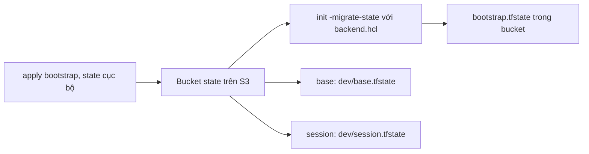

# DBS-31 · Terraform bootstrap: S3 backend có versioning, mã hóa và khóa state

> **Status:** Implemented · **Vai:** #5 Platform & Ops · **Cặp đôi review:** Dev · **Nhánh:** `chore/DBS-31-terraform-bootstrap` · **PR:** (điền sau khi mở) · **Cập nhật:** 2026-10-25

## 1. Bối cảnh

- **Task trên board:** Task, Tuần 1. **Deliverable/Demo:** `infra/terraform` chỉ có README, chưa có file `.tf`; `infra/local` có `elasticmq.conf` cho môi trường local.
- **Expect (nguyên văn):**
  - Stack bootstrap tạo S3 bucket state: versioning, mã hóa, chặn public; có cơ chế khóa state (DynamoDB hoặc lockfile S3)
  - `terraform init` với backend chạy được trên máy của ít nhất 2 người khác nhau
  - Quy ước thư mục (bootstrap, modules, envs/dev, envs/prod) và tag bắt buộc ghi ở `infra/terraform/README`
  - `terraform fmt -check` và `terraform validate` sạch
  - PR đã merge vào main (CI xanh); Dev review; bảng «Đối chiếu test case» trong PR điền đủ
- **DoD:** cột DoD trên board là «—». Dùng năm gạch đầu dòng Expect ở trên làm DoD, đánh số D1–D5 theo thứ tự.
- **Phụ thuộc:** DBS-3 (tài khoản AWS, IAM user + MFA) và DBS-4 (Budget, tag) đều **Done** theo board; quyền S3 của IAM user chưa kiểm, xem rủi ro ở §3. Không phụ thuộc task Dev nào.
- **Đã có gì:** [infra/terraform/README.md](../../infra/terraform/README.md) (cấu trúc dự kiến `envs/dev`, `envs/prod`, quy tắc tag), [ADR-11](../adr/0011-aws-managed-session-based.md), [ADR-10](../adr/0010-fargate-egress-public-subnet.md), `.gitignore` đã có mục Terraform và giữ `.terraform.lock.hcl`. Không có ADR nào bị đổi.
- **Baseline:** loại task Terraform nên baseline là `terraform fmt -check && terraform validate`; chưa có file `.tf` nên chưa chạy được. Terraform 1.16.6 đã cài ở `.tools/bin` (ngoài git).
- **Ngoài phạm vi:** VPC, ECR, KMS, logs, SNS (DBS-33); ECS, ALB (DBS-34); role OIDC (DBS-36). Bucket state dùng SSE-S3, **không dùng KMS CMK**, để tránh phụ thuộc vòng với KMS ở `base`.
- **Câu hỏi mở:**
  1. Tên bucket chứa account id (`dbs-tfstate-<account-id>-ap-southeast-1`). Chỉ `bucket` nằm trong `backend.hcl` (không commit, thêm đúng dòng `backend.hcl` vào `.gitignore`); `key`, `region`, `encrypt`, `use_lockfile` cố định trong `backend.tf` đã commit. Commit `backend.hcl.example` làm mẫu. **Đề xuất:** có.
  2. Thêm lifecycle xóa phiên bản state cũ (noncurrent) sau 90 ngày để bucket không phình? **Đề xuất:** có.
  3. Bucket dùng chung cho `dev` và `prod` nên mang `env=dev`. **Đề xuất:** giữ `env=dev` (ADR-11 chỉ cho `dev|prod`, bucket là hạ tầng dùng chung do dev dựng) và ghi chú ở README.
  4. Thứ tự thư mục trong README đổi từ `envs/dev` + `envs/prod` sang `envs/dev/base`, `envs/dev/session`, `envs/prod/session` (đã duyệt ở G1 câu 1). Ghi lại ở §3.
- **Quyết định ở G1:** tách `base`/`session` và KMS ở `base`: **có** (người dùng duyệt 2026-10-19). Làm riêng từng task từ G2 (câu 4).

## 2. Hành vi

Task không có API. Stack `bootstrap` **chấp nhận** và **từ chối** như sau.

| # | Điều kiện | Kết quả |
|---|---|---|
| B1 | `terraform apply` ở `infra/terraform/bootstrap` lần đầu (`backend.tf` tạm đặt sang bên, state cục bộ) | Tạo đúng 1 bucket `dbs-tfstate-<account-id>-ap-southeast-1` ở `ap-southeast-1` |
| B2 | Bucket vừa tạo | Versioning `Enabled`; SSE `AES256` (bucket key bật); 4 cờ block public access `true`; ownership `BucketOwnerEnforced` |
| B3 | Request ký hợp lệ tới bucket qua HTTP (không TLS) | Bị policy `Deny` (`aws:SecureTransport = false`), cùng request qua HTTPS thì thành công |
| B4 | `terraform destroy` | Bị chặn bởi `prevent_destroy = true`; `force_destroy = false`. Muốn xóa phải sửa code có chủ đích (DBS-208) |
| B5 | Trả `backend.tf` về chỗ cũ, `init -migrate-state -backend-config=backend.hcl` | State bootstrap nằm ở `bootstrap.tfstate` trong chính bucket; xóa được `terraform.tfstate*` cục bộ |
| B6 | Hai tiến trình `terraform apply/plan` cùng một stack | Tiến trình thứ hai báo `Error acquiring the state lock` (file `bootstrap.tfstate.tflock`) |
| B7 | Người thứ hai có IAM user đủ quyền (xem §3), tạo `backend.hcl` từ mẫu | `init -backend-config=backend.hcl` chạy được, `plan` ra "No changes" |
| B8 | Mọi tài nguyên **hỗ trợ tag** (chỉ `aws_s3_bucket`) | Mang `project=dbs`, `env=dev`, `owner=platform` |
| B9 | Chạy bằng profile của account khác `var.account_id` | Provider từ chối (`allowed_account_ids`), không tạo gì |
| B10 | Khóa state xong | Mỗi lần giải phóng khóa xóa `.tflock`, tạo delete marker; lifecycle dọn marker và phiên bản cũ |

Quy ước ghi vào README: bố cục `bootstrap/`, `modules/`, `envs/dev/base`, `envs/dev/session`, `envs/prod/session` (viết lại cây hiện có, không chỉ thêm), tag, tên (`dbs-<env>-…`), key state (`bootstrap.tfstate`, `dev/base.tfstate`, `dev/session.tfstate`, `prod/session.tfstate`), cách cấp credential (IAM user + MFA, **không dán key vào chat/commit**), `required_version >= 1.11`, provider `hashicorp/aws ~> 6.0`, commit `.terraform.lock.hcl`, và ghi chú: **state sẽ chứa bí mật (RDS, Cognito) và chỉ được bảo vệ bằng IAM, nên chỉ cấp quyền tối thiểu**.

## 3. Kiến trúc

- **Vị trí:** `infra/terraform/bootstrap/` (chạy tay một lần), không thuộc role `api`/`worker`. File: `versions.tf` (`required_version >= 1.11`, provider `~> 6.0`, `allowed_account_ids = [var.account_id]`, `default_tags`), `main.tf`, `variables.tf` (`account_id` bắt buộc, 12 chữ số), `outputs.tf`, `backend.tf` (`backend "s3" { key = "bootstrap.tfstate", region, encrypt = true, use_lockfile = true }`), `backend.hcl.example` (chỉ `bucket`), `tests/bootstrap.tftest.hcl`. Sửa [infra/terraform/README.md](../../infra/terraform/README.md) và `.gitignore` (thêm đúng dòng `backend.hcl`, không dùng `*.hcl` vì sẽ nuốt `.terraform.lock.hcl`).
- **Luồng chạy lần đầu (một lần, chủ task):** `mv backend.tf backend.tf.off` → `terraform init` → `apply -var account_id=…` → `mv backend.tf.off backend.tf` → `terraform init -migrate-state -backend-config=backend.hcl` → xóa `terraform.tfstate*`. Người khác chỉ cần `init -backend-config=backend.hcl`.
- **Interface:** đầu ra `state_bucket_name`, `state_bucket_arn`, `region`. Stack `base` và `session` dùng cùng bucket, mỗi stack có `backend.tf` và key riêng, đọc output của nhau bằng `terraform_remote_state`.
- **Tài nguyên:** `aws_s3_bucket` (`prevent_destroy`, `force_destroy = false`, `tags = local.tags`), `aws_s3_bucket_versioning`, `aws_s3_bucket_server_side_encryption_configuration` (AES256, bucket key), `aws_s3_bucket_public_access_block`, `aws_s3_bucket_ownership_controls`, `aws_s3_bucket_policy` (deny non-TLS, `jsonencode`, `depends_on` public access block), `aws_s3_bucket_lifecycle_configuration` (rule `filter {}`: noncurrent expire 90 ngày, `expired_object_delete_marker`, hủy multipart dở sau 7 ngày). Không NAT, không endpoint.
- **IAM tối thiểu cho người dùng state** (bàn giao hướng dẫn cho chủ tài khoản): `s3:ListBucket`, `s3:GetBucketVersioning` trên bucket; `s3:GetObject`, `PutObject`, `DeleteObject` trên `bucket/*`. Người `apply` bootstrap mới cần thêm quyền quản trị bucket (policy, lifecycle, public access, ownership, versioning, encryption).
- **Ranh giới transaction:** không áp dụng; an toàn nhờ khóa state.
- **Sơ đồ:**

- **Rủi ro:** quyền S3 của IAM user chưa kiểm (có bước kiểm ở M-31-00); tên bucket trùng toàn cầu (đổi hậu tố); Terraform >= 1.11 trên mọi máy (`use_lockfile` mới GA từ 1.11).
- **Bàn giao (đưa vào BACKLOG ở G4):** (a) DBS-37 phải chạy `init -backend=false`, `fmt -check -recursive`, `validate`, `terraform test` cho từng thư mục Terraform thì D5 "CI xanh" mới bao phủ Terraform; (b) DBS-33/34 mỗi stack có `backend.tf` và `backend.hcl.example` riêng; (c) DBS-208 teardown: `init -migrate-state` về local, xóa sạch version, delete marker, `.tflock`, bỏ `prevent_destroy`; (d) state nhạy cảm, chỉ cấp quyền tối thiểu.
- **Thay đổi cấp hệ thống:** README `infra/terraform`; `.gitignore`. Không đổi ADR, docs/03.

## 4. Test cases tự động

`terraform test` với `mock_provider "aws"` (không cần credential). Dùng `var.account_id` cố định thay vì data source nên tên bucket xác định được. Mock không tính `tags_all`, nên tag được assert trên thuộc tính cấu hình `tags` (không phải `tags_all`); `default_tags` kiểm bằng M-31-02. Lệnh: `cd infra/terraform/bootstrap && terraform init -backend=false && terraform test`.

| ID | Truy vết | Lớp | Given · When · Then |
|---|---|---|---|
| TC-31-01 | D1 (B2) | terraform test | Versioning `status = "Enabled"` |
| TC-31-02 | D1 (B2) | terraform test | SSE `AES256`, `bucket_key_enabled = true` |
| TC-31-03 | D1 (B2) | terraform test | Public access block đủ 4 cờ `true` |
| TC-31-04 | D1 (B3) | terraform test | `jsondecode(policy)` có statement `Deny`, `Action = "s3:*"`, điều kiện `aws:SecureTransport = "false"`, cả bucket và `bucket/*` |
| TC-31-05 | D1 (B2) | terraform test | Ownership `BucketOwnerEnforced` |
| TC-31-06 | D1 (B1, B8) | terraform test | Đúng 1 bucket; tên `dbs-tfstate-123456789012-ap-southeast-1`; `tags` có `project=dbs`, `env=dev`, `owner=platform` |
| TC-31-07 | D1 (B10) | terraform test | Lifecycle: noncurrent 90 ngày, hủy multipart 7 ngày, `expired_object_delete_marker = true` |
| TC-31-08 | D1 | terraform test | Output `state_bucket_name`, `state_bucket_arn`, `region` có giá trị đúng |
| TC-31-09 | D1 (B6, B5) | tĩnh | `grep -n 'use_lockfile *= *true' backend.tf` và `grep -n 'encrypt *= *true' backend.tf` có kết quả |
| TC-31-10 | D1 (B4) | tĩnh | `grep -n 'prevent_destroy *= *true' main.tf` và `force_destroy = false`; bằng chứng thật ở M-31-07 |
| TC-31-11 | D1 (B9) | tĩnh | `allowed_account_ids` có trong `versions.tf`; `var.account_id` có validation 12 chữ số (TC thử giá trị sai trong terraform test, `expect_failures`) |
| TC-31-12 | D3 | tĩnh | `grep` README có: `bootstrap`, `base`, `session`, `project=dbs`, `env=`, `owner=`, `dev/base.tfstate`, `prod/session.tfstate`, `>= 1.11` |
| TC-31-13 | D4 | tĩnh | `terraform fmt -check -recursive` và `terraform validate` sạch |
| TC-31-14 | D2, D5 | quy trình | `init` trên 2 máy (M-31-05); PR merge, CI xanh, Dev review |

Mọi D1–D5 có ít nhất một dòng. Giới hạn: terraform test dưới mock chỉ chứng minh cấu hình, không chứng minh trạng thái trên AWS; phần đó là §5.

## 5. Test thủ công

Điều kiện: IAM user có MFA, credential tạm (`aws sts get-session-token`), `AWS_PROFILE` trỏ vào đó, region `ap-southeast-1`. Người chạy: chủ task (#5); M-31-05 cần người thứ hai.

| Bước | Việc làm | Kết quả mong đợi |
|---|---|---|
| M-31-00 | `aws sts get-caller-identity`; `aws s3 ls` | Account đúng; không `AccessDenied`. Nếu thiếu quyền thì dừng, bổ sung IAM theo §3 |
| M-31-01 | `mv backend.tf backend.tf.off`, `terraform init`, `terraform plan -var account_id=<id>` | Plan chỉ thêm tài nguyên S3 (không NAT, không endpoint); profile account sai thì provider từ chối (B9) |
| M-31-02 | `terraform apply`; `aws s3api get-bucket-versioning`, `get-bucket-encryption`, `get-public-access-block`, `get-bucket-ownership-controls`, `aws s3api get-bucket-tagging` | `Enabled`, `AES256`, 4 cờ `true`, `BucketOwnerEnforced`, 3 tag |
| M-31-03 | `aws s3api put-object --bucket <b> --key probe --body /dev/null --endpoint-url http://s3.ap-southeast-1.amazonaws.com`, rồi cùng lệnh qua HTTPS, rồi xóa `probe` | HTTP: `AccessDenied` do explicit deny; HTTPS: thành công |
| M-31-04 | `mv backend.tf.off backend.tf`, tạo `backend.hcl` từ mẫu, `terraform init -migrate-state -force-copy -backend-config=backend.hcl`; `aws s3 ls s3://<b>/`; xóa `terraform.tfstate*`; `terraform plan` | Thấy `bootstrap.tfstate`; "No changes" |
| M-31-05 | Người thứ hai clone repo, tạo `backend.hcl`, `terraform init -backend-config=backend.hcl && terraform plan` | `init` thành công, "No changes" |
| M-31-06 | Terminal A: `terraform apply` dừng ở prompt (giữ khóa); terminal B: `terraform plan`; trả lời `no` ở A | B báo `Error acquiring the state lock`; sau khi A xong B chạy được |
| M-31-07 | `terraform destroy` (trả lời `no` nếu hỏi) | Bị chặn bởi `prevent_destroy`; bucket còn nguyên |
| M-31-08 | Đổi giá trị một tag (hoặc thêm output), `apply`, `aws s3api list-object-versions --prefix bootstrap.tfstate` | ≥ 2 phiên bản; sau M-31-06 còn delete marker của `.tflock` |

Ảnh chụp cần có: console S3 (Properties: versioning, encryption; Permissions: block public access) và terminal M-31-06 báo lỗi khóa. Xóa account id, ARN trước khi commit `manual-test.txt`.

## 6. Domain review (AI)

**Reviewer:** subagent general-purpose, 2026-10-19 · **Kết quả:** 16 phát hiện (blocking 3, should-fix 11, minor 2), verdict REVISE; đã sửa hết trong bản này.

| # | Mức | Phát hiện | Xử lý |
|---|---|---|---|
| 1 | blocking | `tags_all` và account id của data source không assert được dưới mock | Đã sửa §3–§4: `var.account_id`, assert `tags` cấu hình, policy bằng `jsonencode`; M-31-02 kiểm `default_tags` thật |
| 2 | blocking | `backend.tf` rỗng làm luồng chạy lần đầu tự mâu thuẫn | Đã sửa §3: luồng 5 bước tạm đặt `backend.tf` sang bên |
| 3 | blocking | `use_lockfile` mới GA từ Terraform 1.11 | Đã sửa: `>= 1.11` (runbook local cũng cần sửa, tệp ngoài git) |
| 4 | should-fix | grep lock trên file mẫu | Đã sửa: cấu hình tĩnh trong `backend.tf`, TC-31-09 là kiểm tĩnh |
| 5 | should-fix | M-31-03 dùng curl là dương tính giả | Đã sửa: dùng lệnh ký, so sánh HTTP/HTTPS |
| 6 | should-fix | Hai lần apply không tạo phiên bản thứ hai | Đã sửa M-31-08: đổi tag rồi apply |
| 7 | should-fix | `-migrate-state` hỏi tương tác | Đã sửa M-31-04: `-force-copy`, kiểm `aws s3 ls` trước khi xóa |
| 8 | should-fix | Quyền IAM chưa xác định | Đã sửa §3: policy tối thiểu, M-31-00 kiểm quyền |
| 9 | should-fix | Lifecycle thiếu `filter {}` và dọn delete marker | Đã sửa; thêm TC-31-07 |
| 10 | should-fix | Thiếu TC cho ownership, output, số bucket | Đã sửa: TC-31-05, -06, -08, -10 |
| 11 | should-fix | B8 "mọi tài nguyên" không đúng; `env=dev` | Đã sửa B8, hỏi G1 câu 3 |
| 12 | should-fix | Không chặn apply nhầm account | Đã sửa: `allowed_account_ids`, B9, TC-31-11 |
| 13 | should-fix | Thiếu mục bàn giao | Đã sửa §3 "Bàn giao"; thêm vào BACKLOG ở G4 |
| 14 | minor | TC README không có lệnh | Đã sửa TC-31-12 |
| 15 | minor | `.gitignore` đúng dòng `backend.hcl` | Đã sửa §3 |
| 16 | minor | Race giữa policy và public access block | Đã sửa: `depends_on` |

**Quyết định ở G2:** duyệt G2 (2026-10-19), đồng ý cả 4 câu: `backend.hcl` chỉ chứa `bucket`; lifecycle 90 ngày; `env=dev` cho bucket dùng chung; M-31-00 kiểm quyền S3 trước khi apply.

## 7. Kế hoạch triển khai

**Plan dự kiến (`terraform plan`, điền số thật ở 4b):** `Plan: 7 to add, 0 to change, 0 to destroy` gồm bucket, versioning, SSE, public access block, ownership controls, bucket policy, lifecycle configuration. Không có `aws_nat_gateway`, `aws_vpc_endpoint`, `aws_dynamodb_table`.

Mỗi bước: viết test trước, chạy thấy đỏ đúng lý do, viết tối thiểu cho xanh, commit. Lệnh test chung: `cd infra/terraform/bootstrap && ../../../.tools/bin/terraform test`.

| Bước | File | Test viết trước | Kết quả đỏ (điền khi chạy) | Lệnh chứng minh | Commit |
|---|---|---|---|---|---|
| 1 | `bootstrap/versions.tf`, `variables.tf` (`account_id` + validation 12 chữ số), `tests/bootstrap.tftest.hcl` (khung) | TC-31-11 | `unknown provider aws` (chưa có cấu hình), 0 passed | `terraform test -filter=tests/bootstrap.tftest.hcl` | `chore(infra): bootstrap terraform scaffold` |
| 2 | `bootstrap/main.tf` (bucket, versioning, SSE, public access block, ownership), `outputs.tf` | TC-31-01, 02, 03, 05, 06, 08 | `aws_s3_bucket.state` chưa khai báo: 1 passed, 1 failed, 5 skipped | `terraform test` | `chore(infra): s3 state bucket with versioning, encryption, access block` |
| 3 | `main.tf` (policy deny non-TLS, lifecycle) | TC-31-04, 07 | `aws_s3_bucket_policy.state` chưa khai báo: 7 passed, 1 failed, 1 skipped | `terraform test` | `chore(infra): deny insecure transport and lifecycle for state bucket` |
| 4 | `bootstrap/backend.tf`, `backend.hcl.example`, `.gitignore` (`backend.hcl`) | TC-31-09, 10 (script grep) | grep `backend.tf` exit 2 (file chưa có) | `grep` theo TC; `terraform init -backend=false && terraform validate` | `chore(infra): s3 backend with native lockfile` |
| 5 | `infra/terraform/README.md` (cây thư mục, tag, key state, quy trình bootstrap, ghi chú bảo mật) | TC-31-12 (grep) | 6 từ khóa thiếu trong README | grep theo TC-31-12 | `docs(infra): terraform conventions and bootstrap runbook` |
| 6 | `.terraform.lock.hcl` (bootstrap), `fmt` | TC-31-13 | không đỏ (kiểm tra tĩnh); thêm hash 5 nền tảng cho lock file | `terraform fmt -check -recursive && terraform validate && terraform test` | `chore(infra): commit provider lock file` |
| 7 | Chỉ khi bạn báo xong: chạy M-31-00…08 trên AWS cùng bạn, ảnh chụp, §8, `docs/features/README.md`, BACKLOG, `check-doc-links.mjs` | M-31-xx | | theo §5 | `docs(features): DBS-31 results` |

**Rủi ro và cách lùi:** mọi bước 1–6 là file cục bộ, `git revert` được. Bước 7 tạo bucket thật nhưng có `prevent_destroy`; nếu lỗi giữa chừng trước khi migrate thì xóa bucket bằng tay (còn rỗng) rồi làm lại. Không có chi phí đáng kể (S3 vài MB).

**Ghi nhớ:** `apply` chỉ chạy khi bạn nói đồng ý trong hội thoại và có credential của bạn trên máy; mình hướng dẫn từng lệnh ở bước 7 thay vì tự chạy.

**Quyết định ở G3:** duyệt G3 (2026-10-19), không có thay đổi.

## 8. Kết quả

- **Lệnh kiểm tra** (2026-10-25): `terraform fmt -check -recursive` sạch; `terraform validate` "configuration is valid"; `terraform test`: 9 passed, 0 failed, 0 skipped.
- **Đối chiếu test case:** TC-31-01…08 đạt (9 run trong `tests/bootstrap.tftest.hcl`, mock provider); TC-31-09…12 đạt (grep tĩnh theo §4); TC-31-11 đạt cả phần `expect_failures`; TC-31-13 đạt (lệnh trên); TC-31-14 **một phần**: D2 chưa kiểm trên máy thứ hai (M-31-05), D5 chờ PR, CI và Dev review.
- **Test thủ công** (output thô: [manual-test.txt](screenshots/DBS-31/manual-test.txt)):

| Bước | Kết quả |
|---|---|
| M-31-00 | đạt |
| M-31-01 | đạt: 7 tài nguyên; account sai bị từ chối (B9) |
| M-31-02 | đạt: Enabled, AES256, 4 cờ true, BucketOwnerEnforced, 3 tag |
| M-31-03 | đạt: HTTP `AccessDenied` (explicit deny), HTTPS thành công |
| M-31-04 | đạt: `bootstrap.tfstate` trong bucket, plan "No changes" |
| M-31-05 | **chưa chạy**: cần người thứ hai và IAM tối thiểu (xem BL-010) |
| M-31-06 | đạt (cách khác §5): hai `plan` chồng nhau, tiến trình sau báo `Error acquiring the state lock` |
| M-31-07 | đạt: `prevent_destroy` chặn, bucket còn |
| M-31-08 | đạt: 3 phiên bản `bootstrap.tfstate`, tag trả về `platform` |

- **Phạm vi so với §7:** `git diff --stat ad940da^..HEAD` gồm 11 file: `.gitignore`, feature doc, README, `bootstrap/*` (lock, backend, main, outputs, test, variables, versions) đúng danh sách §7. (`git diff main...HEAD` hiện dài hơn vì `main` cục bộ cũ so với `origin/main`.)
- **Ảnh chụp:** **thiếu** ảnh console S3 (Properties, Permissions) và ảnh lỗi khóa M-31-06; thay bằng output thô ở `manual-test.txt`. Người duyệt đã chấp nhận thiếu hai ảnh này ở G4 (2026-10-25).
- **Lệch so với kế hoạch:**
  1. M-31-03: `--body /dev/null` bị AWS CLI 2.38 từ chối, dùng tệp rỗng.
  2. M-31-06: `terraform console` không giữ khóa nên dùng hai `plan` chồng nhau; không cần `apply` dừng ở prompt vì không có thay đổi.
  3. M-31-08: đổi tạm tag trong working tree rồi `git checkout`, không commit.
  4. Quyền S3 của `faker`: user thuộc group `dbs-admin` (AdministratorAccess); policy `dbs-require-mfa` đã bị chủ tài khoản gỡ khỏi group (2026-10-25) vì không cần cho dự án cá nhân, nên README mục credential (IAM user có MFA, `get-session-token`) không còn khớp thực tế. README mục credential đã sửa theo thực tế (G4, 2026-10-25).
- **Bàn giao cho vai khác:** BL-010 (M-31-05 và IAM tối thiểu), BL-011 (DBS-37: kiểm tra Terraform trong CI), BL-012 (DBS-208: teardown bucket state).

## 9. Tài liệu đã cập nhật

`docs/features/README.md` (thêm dòng DBS-31), `docs/BACKLOG.md` (thêm BL-010, BL-011, BL-012; không xóa dòng nào).
