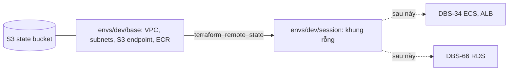

# DBS-33 · Terraform: VPC (≥ 2 AZ) và ECR

> **Status:** Draft · **Vai:** #5 Platform & Ops · **Cặp đôi review:** Dev · **Nhánh:** `chore/DBS-33-terraform-vpc-ecr` · **PR:** — · **Cập nhật:** 2026-10-25

## 1. Bối cảnh

- **Task trên board:** Task, Tuần 1, Deliverable P3, Ưu tiên Highest, board đang "In Progress". **Expect:** Nền mạng và registry dựng và xóa bằng code.
- **DoD** (nguyên văn, đánh số):
  1. VPC ≥ 2 AZ, subnet theo ADR-10; ECR repo có scan on push và lifecycle xóa image cũ
  2. Phần giữ lại (state, ECR, VPC, Cognito) tách khỏi phần xóa hằng ngày (RDS, ElastiCache, ALB, WAF, ECS service) thành stack/module riêng
  3. terraform apply thành công; terraform destroy phần xóa hằng ngày về chi phí ≈ 0 (xác nhận trong Cost Explorer ngày hôm sau)
  4. README hướng dẫn thứ tự dựng/xóa và biến cần có
  5. PR đã merge vào main (CI xanh); Dev review; bảng «Đối chiếu test case» trong PR điền đủ
- **Phụ thuộc:** DBS-31 (S3 state) board **In Review**; PR [#22](https://github.com/Lawliet119/digital-banking-simulator/pull/22) chưa merge. Trong repo: code bootstrap nằm ở nhánh `chore/DBS-31-terraform-bootstrap`; trên AWS bucket `dbs-tfstate-<account-id>-ap-southeast-1` đã dựng và dùng được. DBS-3 và DBS-4 Done theo board (Budget thật chưa xác nhận có ngưỡng 50/100/150 USD).
- **Đã có gì:** [infra/terraform/README.md](../../infra/terraform/README.md) (cấu trúc `envs/dev/base`, `envs/dev/session`, `envs/prod/session`, quy ước tag, key state `dev/base.tfstate`), [ADR-10](../adr/0010-fargate-egress-public-subnet.md) (2 AZ, mỗi AZ 1 public + 1 private subnet, private không route ra internet, gateway endpoint S3, không NAT, không interface endpoint), [ADR-11](../adr/0011-aws-managed-session-based.md), docs/03 §13. Chưa có `.tf` nào ngoài `bootstrap/`. `.github/workflows/ci.yml` (DBS-35) chưa có job Terraform (BL-028).
- **Baseline:** loại Terraform: `terraform fmt -check -recursive` sạch; `bootstrap`: `validate` sạch, `terraform test` 9 passed, 0 failed.
- **Ngoài phạm vi:** KMS, Cognito, logs, SNS, OIDC (các task khác của #5: DBS-54, DBS-36…); ECS và ALB (DBS-34); RDS (DBS-66); ElastiCache; WAF; security group của ECS/RDS (đi cùng task tạo ra tài nguyên đó).
- **Câu hỏi mở:**
  1. **Nhánh xuất phát.** DBS-33 cần mẫu `backend.tf` và README của DBS-31 chưa có trên `main`. Đề xuất: tách nhánh từ `chore/DBS-31-terraform-bootstrap` (PR xếp chồng), đổi base của PR về `main` sau khi #22 merge. Cách khác: chờ #22 merge rồi mới bắt đầu.
  2. **Phần "xóa hằng ngày" (DoD 2).** Task này chưa có tài nguyên nào thuộc nhóm đó (ALB ở DBS-34, RDS ở DBS-66). Đề xuất: tạo `envs/dev/base` thật (VPC, subnet, route, gateway endpoint S3, ECR) và `envs/dev/session` chỉ gồm khung (`backend.tf`, `versions.tf`, đọc `terraform_remote_state` của `base`, README, chưa có tài nguyên), để DBS-34/66 thêm vào mà không đổi cấu trúc. `prod/session` làm ở task production.
  3. **DoD 3 "destroy về chi phí ≈ 0 + Cost Explorer ngày hôm sau".** Với phạm vi này mọi tài nguyên đều miễn phí hoặc cực rẻ (VPC, subnet, gateway endpoint S3; ECR vài MB). Đề xuất: chứng minh bằng `apply` → kiểm tra bằng CLI → `destroy` → CLI không còn VPC/NAT/EIP/ENI; ghi Cost Explorer ngày hôm sau vào BACKLOG vì không kiểm được trong ngày (billing trễ). Theo quy tắc chi phí của bạn (2026-10-25), VPC/ECR giữ lại sau khi kiểm vì miễn phí; nếu bạn muốn xóa hết sau khi test thì nói.
  4. **CIDR và AZ.** Đề xuất VPC `10.20.0.0/16`, public `10.20.0.0/24` và `10.20.1.0/24`, private `10.20.10.0/24` và `10.20.11.0/24`, hai AZ đầu của `ap-southeast-1`.
  5. **ECR.** Một repo `dbs-api` (một image dùng chung cho `api` và `worker`, docs/03 §13), scan on push, tag SHA bất biến (`IMMUTABLE`), lifecycle giữ 20 image mới nhất và xóa image không tag sau 7 ngày, mã hóa AES256. Đồng ý không?
- **Quyết định ở G1:** duyệt G1 (2026-10-25), đồng ý cả 5 đề xuất: nhánh xếp chồng từ DBS-31; `base` thật + khung `session`; chứng minh chi phí bằng CLI, ghi Cost Explorer vào BACKLOG; CIDR như trên; ECR `dbs-api` như trên. Không có `docker` trên máy nên không đẩy image thật: tag bất biến kiểm bằng cấu hình (`describe-repositories`).

## 2. Hành vi

Task không có API. Hai stack chấp nhận và từ chối như sau.

| # | Điều kiện | Kết quả |
|---|---|---|
| B1 | `apply` `envs/dev/base` (state key `dev/base.tfstate`) | Tạo 1 VPC `10.20.0.0/16` (DNS support và hostnames bật), 1 internet gateway, 2 public subnet và 2 private subnet ở `ap-southeast-1a`, `ap-southeast-1b` |
| B2 | Route | Route table public: `0.0.0.0/0` → internet gateway, gắn 2 public subnet. Route table private: **chỉ** route local và gateway endpoint S3, **không** có `0.0.0.0/0`, gắn 2 private subnet |
| B3 | Endpoint | 1 `aws_vpc_endpoint` kiểu `Gateway`, service `com.amazonaws.ap-southeast-1.s3`, gắn route table public và private. Không có interface endpoint, không NAT gateway, không EIP |
| B4 | Default security group của VPC | Bị xóa hết rule (`aws_default_security_group` không có ingress/egress) để không ai gắn nhầm |
| B5 | Subnet public | `map_public_ip_on_launch = false` (task ECS tự xin IP công khai qua `assignPublicIp`, ADR-10) |
| B6 | ECR | 1 repo `dbs-api`: `scan_on_push = true`, `image_tag_mutability = IMMUTABLE`, mã hóa `AES256`, `force_delete = false` |
| B7 | Lifecycle ECR | `rulePriority 1`: `tagStatus = untagged`, `countType = sinceImagePushed`, `countUnit = days`, `countNumber = 7`, hành động `expire`. `rulePriority 2`: `tagStatus = any`, `countType = imageCountMoreThan`, `countNumber = 20`, `expire` (giữ 20 image mới nhất, kể cả không tag; `any` phải có số ưu tiên lớn nhất) |
| B8 | Tag | Mọi tài nguyên hỗ trợ tag mang `project=dbs`, `env=dev`, `owner=platform` (qua `default_tags`) và `Name = dbs-dev-…` |
| B9 | Chạy bằng profile của account khác `var.account_id` | Provider từ chối (`allowed_account_ids`) |
| B10 | `envs/dev/session` (key `dev/session.tfstate`) | `init` và `plan` chạy được, đọc `terraform_remote_state` của `base`, **không có tài nguyên nào** (0 khối `resource`); lần `plan` đầu chỉ báo "Changes to Outputs", sau `apply` rỗng và `plan` lại báo "No changes"; xuất lại `vpc_id`, `public_subnet_ids`, `private_subnet_ids` cho DBS-34, 66 dùng |
| B11 | `destroy` `base` | Xóa sạch VPC, subnet, route, endpoint, IGW; ECR rỗng thì xóa được; ECR còn image thì lỗi `RepositoryNotEmptyException` (có chủ đích, không `force_delete`); chứng minh bằng `aws ecr delete-repository` không `--force`, không bằng `terraform destroy` (destroy song song sẽ xóa dở `base`) |
| B12 | Đẩy một image **khác** (digest khác) dưới một tag đã có lên `dbs-api` | `ImageTagAlreadyExistsException` (IMMUTABLE; đẩy lại cùng manifest cho `ImageAlreadyExistsException`, không phải ca này); CI (DBS-36) phải bỏ qua khi tag SHA đã tồn tại và không dùng `latest` |

Tên: repo `dbs-api` **không** theo tiền tố `dbs-<env>-` vì một repo dùng chung cho dev và prod (`prod/session` dùng lại `base` của dev); ngoại lệ này ghi vào README. `dbs-dev-vpc`, `dbs-dev-public-a`, `dbs-dev-public-b`, `dbs-dev-private-a`, `dbs-dev-private-b`, `dbs-dev-public-rt`, `dbs-dev-private-rt`, `dbs-dev-igw`, `dbs-dev-s3`, repo `dbs-api`.

## 3. Kiến trúc

- **Vị trí:** `infra/terraform/envs/dev/base/` (`versions.tf`, `variables.tf`, `network.tf`, `ecr.tf`, `outputs.tf`, `backend.tf`, `backend.hcl.example`, `.terraform.lock.hcl`, `tests/base.tftest.hcl`) và `infra/terraform/envs/dev/session/` (`versions.tf`, `variables.tf`, `remote_state.tf`, `outputs.tf`, `backend.tf`, `backend.hcl.example`, `tests/session.tftest.hcl`; `session` không khai báo provider `aws` nên không có lock file và không dùng `mock_provider`, chỉ `override_data`). Không dùng thư mục `modules/` ở task này: chỉ một môi trường dùng, tách module khi `prod/session` cần (YAGNI). Sửa `infra/terraform/README.md` (thứ tự dựng/xóa, biến; security group và subnet group nằm ở `base`; ngoại lệ tên repo `dbs-api`) và `.gitignore` (thêm `*.tfplan`).
- **Biến:** `account_id` (bắt buộc, 12 chữ số, validation như bootstrap), `azs` (mặc định `["ap-southeast-1a","ap-southeast-1b"]`), `vpc_cidr` (mặc định `10.20.0.0/16`). `session` **chỉ** khai báo `state_bucket` (tên bucket, truyền qua `-var`; không đoán từ account id; không có `account_id` vì không có provider).
- **Interface cung cấp (output của `base`):** `vpc_id`, `vpc_cidr`, `public_subnet_ids`, `private_subnet_ids` (list theo thứ tự AZ), `public_route_table_id`, `private_route_table_id`, `ecr_repository_url`, `ecr_repository_arn`. `session` dùng `data.terraform_remote_state.base` và xuất lại các giá trị mạng.
- **Chi phí:** VPC, subnet, route table, IGW, gateway endpoint S3 miễn phí; ECR 0,10 USD/GB/tháng (vài MB). Không có tài nguyên tính theo giờ, nên "để quên" không tốn tiền. Không NAT, không EIP, không interface endpoint (ADR-10). Giữ `base` sau khi kiểm.
- **IAM cho người dùng:** `apply` `base` cần quyền `ec2:*` trên VPC và `ecr:*` trên repo; người chỉ đọc state cần quyền state tối thiểu như DBS-31. Hiện user `faker` là AdministratorAccess (chỉ cho dự án cá nhân; nêu ở bàn giao, không đổi trong task này).
- **Sơ đồ:**

- **Thay đổi cấp hệ thống:** README `infra/terraform` (cây thư mục đã đúng; thêm mục "Thứ tự dựng/xóa" và bảng biến). Không đổi ADR, docs/03.

## 4. Test cases tự động

`terraform test` với `mock_provider "aws"` (không cần credential). Chạy: `cd infra/terraform/envs/dev/base && terraform init -backend=false && terraform test` ; `session`: `terraform init -backend=false && terraform test` (không cần mock, dùng `override_data`).

| ID | Truy vết | Lớp | Given · When · Then |
|---|---|---|---|
| TC-33-01 | D1 (B1) | terraform test | 1 VPC `10.20.0.0/16`, DNS support và hostnames `true` |
| TC-33-02 | D1 (B1) | terraform test | 2 public và 2 private subnet, 4 AZ-CIDR đúng, hai AZ khác nhau |
| TC-33-03 | D1 (B2) | terraform test (`command = apply`, vì so sánh tham chiếu) | Route table public có route `0.0.0.0/0` tới IGW; không có `aws_route` nào gắn vào route table private và route table private không có `route` inline (chỉ cấu hình, mock trả rỗng; bằng chứng thật ở M-33-02); 4 association đúng subnet |
| TC-33-04 | D1 (B3) | terraform test (`command = apply`) | Endpoint khai báo duy nhất có `vpc_endpoint_type = "Gateway"`, service `com.amazonaws.ap-southeast-1.s3`, gắn cả hai route table |
| TC-33-04b | D1 (B3) | tĩnh | `! grep -nE 'aws_nat_gateway\|aws_eip\|"Interface"' envs/dev/base/*.tf`; M-33-01 ghi `terraform show -json base.tfplan \| python3 -c '…'` (in loại tài nguyên và `vpc_endpoint_type` của từng `aws_vpc_endpoint`) và danh sách không có `aws_nat_gateway`, `aws_eip` |
| TC-33-05 | D1 (B4, B5) | terraform test | `map_public_ip_on_launch = false` ở public subnet; phần default security group chỉ kiểm **cấu hình** (mock trả rỗng nên không chứng minh gì), bằng chứng thật ở M-33-02 |
| TC-33-06 | D1 (B6) | terraform test | ECR `scan_on_push = true`, `IMMUTABLE`, `AES256`, `force_delete = false`, tên `dbs-api` |
| TC-33-07 | D1 (B7) | terraform test | `jsondecode(policy)`: rule 1 `rulePriority=1`, `untagged`, `sinceImagePushed`, `days`, 7; rule 2 `rulePriority=2`, `any`, `imageCountMoreThan`, 20 |
| TC-33-08 | D1 (B8) | terraform test | Tag cấu hình trên VPC, subnet, ECR có `Name` và (qua `default_tags` kiểm thật ở M-33-02) `project/env/owner` |
| TC-33-09 | D1 (B9) | terraform test | `account_id` sai định dạng bị `expect_failures`; `allowed_account_ids` có trong `versions.tf` (grep) |
| TC-33-10 | D2 (B10) | terraform test + tĩnh | `session` với `override_data` cho remote state: output `vpc_id`, `public_subnet_ids`, `private_subnet_ids` bằng giá trị đã override; `! grep -q '^resource ' envs/dev/session/*.tf` |
| TC-33-11 | D2 | tĩnh | `grep` hai `backend.tf`: key `dev/base.tfstate`, `dev/session.tfstate`, `use_lockfile = true`, `encrypt = true`; hai stack riêng thư mục, không dùng chung state |
| TC-33-12 | D4 | tĩnh | README có: `dev/base`, `dev/session`, `account_id`, `state_bucket`, "thứ tự" dựng (base trước session) và xóa (session trước base), security group và subnet group ở `base`, ngoại lệ tên `dbs-api` |
| TC-33-13 | D1, D4 | tĩnh | `terraform fmt -check -recursive` và `validate` sạch cho `bootstrap`, `base`, `session` |
| TC-33-14 | D3, D5 | quy trình | `apply` thật và `destroy` (M-33-02, M-33-06, M-33-08); Cost Explorer ngày hôm sau (BACKLOG); PR merge, CI xanh, Dev review |

Giới hạn: `terraform test` dưới mock chỉ chứng minh cấu hình; trạng thái thật trên AWS là §5.

## 5. Test thủ công

Điều kiện: `AWS_PROFILE=dbs-admin`, `.tools/bin` trong `PATH`, region `ap-southeast-1`, bucket state đã có (DBS-31). Chuẩn bị: tạo `backend.hcl` cho `base` và `session` từ mẫu (không commit). Các bước `apply` và `destroy` là **cần go-ahead** của bạn trong hội thoại; khi xin go-ahead `apply` (M-33-02) tôi xin luôn phép tắt cuối phiên (M-33-08).

| Bước | Việc làm | Kết quả mong đợi |
|---|---|---|
| M-33-00 | `aws sts get-caller-identity`; `aws budgets describe-budgets --account-id <id>` rồi `aws budgets describe-notifications-for-budget --account-id <id> --budget-name <tên>` cho từng budget; `aws ec2 describe-vpcs --filters Name=tag:project,Values=dbs` | Account đúng; các ngưỡng cảnh báo 50, 100, 150 USD (gộp các budget; thiếu thì dừng và báo) (thiếu thì dừng và báo); chưa có VPC `dbs` |
| M-33-01 | `init -backend-config=backend.hcl`; `plan -out=base.tfplan -var account_id=<id>` ở `base`; `terraform show -json base.tfplan \| python3 -c '…'` (in danh sách loại tài nguyên); plan với account sai | Danh sách loại tài nguyên chỉ gồm VPC, subnet, route table, association, route, IGW, endpoint, default SG, ECR (repo + policy), không `aws_nat_gateway`/`aws_eip`; account sai bị từ chối (B9) |
| M-33-02 (cần go-ahead) | `apply base.tfplan`; `aws ec2 describe-vpcs`, `describe-subnets`, `describe-route-tables`, `describe-vpc-endpoints` (đọc `RouteTableIds`), `describe-nat-gateways`, `describe-addresses --filters Name=domain,Values=vpc`, `describe-security-groups --filters Name=vpc-id,Values=<id> Name=group-name,Values=default` | VPC `10.20.0.0/16`; 4 subnet ở 2 AZ; route table private không có `0.0.0.0/0`; 1 endpoint Gateway S3 có `RouteTableIds` gồm cả hai route table; route table private chỉ có route `local` và prefix list S3 (`pl-…`); 0 NAT; 0 EIP; default SG có `IpPermissions` và `IpPermissionsEgress` rỗng; VPC, subnet, route table có 3 tag `project/env/owner` |
| M-33-03 | `aws ecr describe-repositories`; `aws ecr get-lifecycle-policy --repository-name dbs-api`; `aws ecr list-tags-for-resource --resource-arn <arn>` | `scanOnPush true`, `IMMUTABLE`, `AES256`; policy có hai rule với priority 1, 2; ECR có 3 tag |
| M-33-04 | Đẩy image không docker: `ecr initiate-layer-upload`, `upload-layer-part --layer-part-blob fileb://…`, `complete-layer-upload` cho một blob cấu hình, rồi `ecr put-image --image-tag t1` với manifest; sau đó đẩy một image **khác** (blob cấu hình khác) dưới `t1`; `ecr start-lifecycle-policy-preview` rồi `get-lifecycle-policy-preview`; chỉ khi `aws ecr list-images --repository-name dbs-api` có `t1` (repo rỗng thì **không** chạy, vì lệnh sẽ xóa thật repo): `aws ecr delete-repository --repository-name dbs-api` (không `--force`) — **cần go-ahead** | Lần đầu thành công; lần hai: `ImageTagAlreadyExistsException`; preview `COMPLETE`, `previewResults` rỗng; `delete-repository` lỗi `RepositoryNotEmptyException` (B11). Nếu ECR từ chối manifest không layer thì dùng một layer gzip rất nhỏ; scan zero-layer có thể báo unsupported (chấp nhận). Bước không chạy được ghi "chưa chạy" kèm lý do |
| M-33-05 | `ecr batch-delete-image --image-ids imageTag=t1`; `plan` ở `base` | Repo rỗng; plan "No changes" (phục hồi sau ca lỗi, không dùng `terraform destroy`) |
| M-33-06 | `init -backend-config=backend.hcl` và `plan -var state_bucket=<bucket>` ở `session` (chỉ biến này); (cần go-ahead) `apply`; `terraform output -json` và so **ba khóa** `vpc_id`, `public_subnet_ids`, `private_subnet_ids` với `output -json` của `base` (một dòng `python3` đọc hai file JSON); `plan` lại | Plan đầu "Changes to Outputs" không có thay đổi tài nguyên; sau `apply` output khớp `base`; plan sau "No changes" |
| M-33-07 (cần go-ahead) | Giữ khóa chắc chắn, chạy `apply` trong tab terminal riêng (có TTY): một terminal `terraform apply` ở `base` với một thay đổi tag tạm dừng ở prompt; terminal khác `plan -lock-timeout=0` | Terminal hai báo `Error acquiring the state lock`; trả `no` ở terminal một; xóa thay đổi tạm và kiểm `git diff --exit-code` sạch |
| M-33-08 (cần go-ahead) | Ghi `vpc-id` hiện tại; `terraform destroy` ở `session` rồi ở `base`; `describe-vpcs`, `describe-nat-gateways`, `describe-network-interfaces --filters Name=vpc-id,Values=<id cũ>`, `describe-addresses`, `ecr describe-repositories` | Không còn VPC/ECR `dbs`; không NAT, ENI, EIP. Sau đó `apply` lại `base` và `session` để giữ cho DBS-34/66 (VPC id mới), `plan` "No changes" |

Ghi id tài nguyên trong `manual-test.txt` đã ẩn account id và ARN. Chi phí cả kịch bản: 0 USD (ECR vài KB).

## 6. Domain review (AI)

**Reviewer:** subagent general-purpose, model opus, 2026-10-25 · **Kết quả:** 13 phát hiện (blocking 0, should-fix 8, minor 5), verdict REVISE · [trả lời nguyên văn](screenshots/DBS-33/domain-review.md)

| # | Mức | Phát hiện | Xử lý |
|---|---|---|---|
| 1 | should-fix | Không thể đếm tài nguyên vắng mặt trong `terraform test` | Đã sửa §4: TC-33-04 chỉ assert endpoint Gateway; TC-33-04b (tĩnh + `python3` trên plan JSON, vòng 2) |
| 2 | should-fix | `session` lần đầu báo "Changes to Outputs", không phải "No changes" | Đã sửa B10, M-33-06 |
| 3 | should-fix | Default SG không kiểm thật trên AWS | Đã sửa M-33-02, TC-33-05 ghi "chỉ cấu hình" |
| 4 | should-fix | Thiếu ca từ chối B11 | Đã sửa: M-33-04, 05 đẩy image bằng CLI |
| 5 | should-fix | Chưa kiểm Budget | Đã sửa M-33-00 |
| 6 | should-fix | Thiếu danh sách bàn giao | Đã sửa: xem "Bàn giao" dưới đây |
| 7 | should-fix | Thiếu `rulePriority`, `any` đếm cả image không tag | Đã sửa B7, TC-33-07 |
| 8 | should-fix | So sánh tham chiếu cần `command = apply` | Đã sửa TC-33-03, 04 |
| 9 | minor | Tên `dbs-api` lệch quy ước tiền tố | Đã sửa §2; README cập nhật ở bước README (§7) |
| 10 | minor | `destroy` `session` và go-ahead | Đã sửa M-33-06, 08 |
| 11 | minor | Bộ lọc ENI/EIP theo VPC | Đã sửa M-33-08 |
| 12 | minor | Khóa state không tái hiện chắc chắn | Đã sửa M-33-07 |
| 13 | minor | Tag ECR | Đã sửa M-33-03 |

**Bàn giao (đưa vào BACKLOG ở G4):** DBS-34 và DBS-66 tạo security group và subnet group **trong `base`** theo ADR-11 (bảng "giữ lại" liệt kê security group; miễn phí, ALB/RDS ở `session` tham chiếu qua remote state). DBS-36: IAM role OIDC chỉ được push vào `ecr_repository_arn`, bỏ qua push khi tag SHA đã tồn tại, không dùng `latest`. DBS-54: Cognito đặt trong `envs/dev/base`. Quyền IAM của người `apply` đang là AdministratorAccess (cá nhân), nêu ở §3.

**Vòng 3:** 7 phát hiện (blocking 0, should-fix 1, minor 6), verdict REVISE. Đã sửa hết: `list-images` trước `delete-repository` và go-ahead; M-33-07 cần go-ahead, terminal có TTY, `git diff --exit-code`; escape `|` và `!` trong grep; in `vpc_endpoint_type` và kiểm `RouteTableIds`, route private; so ba khóa output; bỏ placeholder; xin phép tắt cùng lúc go-ahead. **Thay đổi so với G1:** M-33-04 đẩy image thật bằng CLI thay cho cách kiểm tag bất biến chỉ bằng cấu hình đã chốt ở G1, cần bạn duyệt lại ở G2. Không chạy vòng 4 vì các sửa là chữ trong kịch bản, không thêm hành vi; nếu bạn muốn thì chạy thêm.

**Vòng 2 (review lại bản đã sửa):** 12 phát hiện (blocking 1, should-fix 5, minor 6), verdict REVISE, nguyên văn ở cùng file. Đã sửa hết: ca B11 chứng minh bằng `delete-repository` không `--force` (không `terraform destroy`); B12 đẩy image khác digest; `session` không dùng `mock_provider`, không có lock file, chỉ khai báo `state_bucket`; grep giới hạn `*.tf`; `python3` thay `jq`; `describe-notifications-for-budget`; preview lifecycle bất đồng bộ, `fileb://`, phương án một layer; assert route private ghi "chỉ cấu hình"; `*.tfplan` vào `.gitignore`; README ghi security group ở `base` và ngoại lệ `dbs-api`; `! grep -q` cho `session`.

**Quyết định ở G2:** (chờ duyệt)
