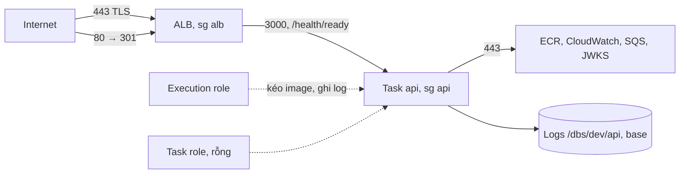

# DBS-34 · Terraform: ECS Fargate cluster, service api và ALB (môi trường dev)

> **Status:** Implemented · **Vai:** #5 Platform & Ops · **Cặp đôi review:** Dev · **Nhánh:** `chore/DBS-34-ecs-alb` (xếp chồng trên `chore/DBS-36-ci-ecr-oidc`) · **PR:** [#25](https://github.com/Lawliet119/digital-banking-simulator/pull/25) · **Cập nhật:** 2026-10-26

## 1. Bối cảnh

- **Task trên board:** Task, Tuần 1, Deliverable P3, Ưu tiên High, board đang "In Progress". **Expect:** Có chỗ để image chạy trên cloud và ALB kiểm /health/ready.
- **DoD** (nguyên văn, đánh số):
  1. Cluster, task definition (APP_ROLE=api), service và ALB (health check /health/ready) bằng Terraform, thuộc nhóm «xóa hằng ngày»
  2. TRUST_PROXY_HOPS=1 trong cấu hình task (ALB); không secret trong biến môi trường viết thẳng
  3. Log task đẩy về CloudWatch Logs; task execution role tách khỏi task role
  4. apply rồi destroy trong một lệnh, không còn tài nguyên tính tiền
  5. PR đã merge vào main (CI xanh); Dev review; bảng «Đối chiếu test case» trong PR điền đủ
- **Thực trạng trên board (cập nhật 11/10):** health check `/health/ready` mỗi 15 s, timeout 5 s, healthy 2, unhealthy 3; `healthCheckGracePeriodSeconds 60`; task api 0,5 vCPU / 1 GB (docs/03 §13.1, §13.3).
- **Phụ thuộc:** DBS-33 (VPC, ECR): board In Review; mã ở [PR #23](https://github.com/Lawliet119/digital-banking-simulator/pull/23), `base` đã dựng thật trên AWS. Nhánh này xếp chồng: `main` ← #22 (DBS-31) ← #23 (DBS-33) ← #24 (DBS-36) ← nhánh này.
- **Đã có gì:**
  - `envs/dev/base`: VPC 10.20.0.0/16, 2 public + 2 private subnet, S3 gateway endpoint, ECR `dbs-api` (+ OIDC từ DBS-36).
  - `envs/dev/session`: khung rỗng (chỉ `terraform_remote_state` của `base`, chưa có provider).
  - Ứng dụng: `backend/Dockerfile` (port 3000, user `node`, không HEALTHCHECK); `GET /health/ready` kiểm PostgreSQL (timeout 1,5 s), `GET /health/live` không kiểm gì; `TRUST_PROXY_HOPS` bắt buộc 1–5 khi `NODE_ENV` là `staging`/`production`.
  - ADR-10 (task ở public subnet, SG chỉ nhận từ ALB, không NAT), ADR-11 (dựng/xóa theo phiên), ADR-13 (một image, `APP_ROLE`).
  - Image trên ECR: **chưa có** (ECR rỗng; `image.yml` chỉ chạy sau merge).
- **Baseline:** `terraform test`: bootstrap 9/9, `base` 13/13, `session` 1/1; `fmt` và `validate` sạch (chạy lúc bàn giao DBS-36).
- **Ngoài phạm vi:**
  - Service `worker`, WAF, tên miền và chứng chỉ ACM công khai (câu 3).
  - Security group và subnet group của RDS/Redis (DBS-66, BL-031), DB secrets và TLS (DBS-67), Cognito (DBS-54).
  - Chạy task thật: cần image trên ECR (sau merge DBS-36 và biến `AWS_ROLE_ARN`), DB (DBS-66) và secrets (DBS-67). Task chưa thể `healthy` khi chưa có các thứ này.
  - Deploy tự động và rollback (DBS-38).
- **Câu hỏi mở** (kèm đề xuất):
  1. **Vị trí.** Security group `alb` và `api` và **log group** `/dbs/dev/api` đặt trong `envs/dev/base` (SG: BL-031; log group: README và ADR-11 xếp logs vào phần giữ lại, và log là bằng chứng cho P4; cả hai gần như miễn phí); cluster, task definition, service, ALB, target group, listener, chứng chỉ, IAM role đặt trong `envs/dev/session` (nhóm xóa hằng ngày). Đề xuất: đúng như vậy.
  2. **Task chưa chạy được thật.** Task cần DB, Redis, Cognito, SQS mà các task khác mới tạo. Đề xuất: task definition chỉ có biến môi trường không bí mật (`NODE_ENV`, `APP_ROLE=api`, `TRUST_PROXY_HOPS=1`, `PORT`, `AWS_REGION`, `LOG_LEVEL`); `secrets` và các biến còn lại do DBS-66/67/54 thêm. `desired_count` là biến, **mặc định 0** (task chưa thể khởi động: thiếu `DATABASE_URL`, `DATABASE_SSL`, `REDIS_URL` dạng `rediss`, `COGNITO_*`; để 1 sẽ chết lặp lại và tốn tiền) cho tới khi DBS-66, DBS-67, DBS-54 và task ElastiCache xong; ghi "chưa chạy" cho việc task healthy thật (BACKLOG).
  3. **HTTPS.** NFR-SEC-03 và docs/03 §12 yêu cầu mã hóa ở ALB; chưa có tên miền nên chưa có chứng chỉ ACM công khai. Domain review vòng 1 chặn phương án HTTP-only. Đề xuất đã chọn: chứng chỉ **self-signed** do Terraform tạo (provider `hashicorp/tls`, ghim version, khóa nằm trong state đã mã hóa) và import vào ACM (miễn phí); listener 443 (`ELBSecurityPolicy-TLS13-1-2-2021-06`), listener 80 chuyển hướng 301 sang 443; kiểm bằng `curl -k`. Chứng chỉ công khai thật (domain + ACM) và WAF: BACKLOG, giao một dòng BACKLOG riêng cho việc WAF/ALB tuần 6–8 (không phải DBS-38, vì DBS-38 chỉ là pipeline deploy). Thêm provider `tls` là phụ thuộc mới của Terraform: ghi ở đây và ở BACKLOG.
  4. **`NODE_ENV` của task.** Đề xuất: biến `node_env` mặc định `staging` (dev trên AWS chạy `staging` theo `platform.md`, bắt buộc TLS DB/Redis và `TRUST_PROXY_HOPS`).
  5. **Log group** `/dbs/dev/api`, giữ 7 ngày, nằm trong `base` (không mất khi `destroy session`).
  6. **`apply`** lên AWS thật (ALB tính ≈ 0,03 USD/giờ, cộng LCU): cần bạn đồng ý, và tôi `destroy` ngay sau khi kiểm.
  7. **Provider trong `session`:** thêm `required_providers` (`aws ~> 6.0`, `tls ~> 4.0`), provider `aws` (cùng `allowed_account_ids`, `default_tags`), commit `.terraform.lock.hcl` 5 nền tảng, và đổi test `session` sang `mock_provider`.
  8. **Hợp đồng với DBS-38 (image):** `image_tag` là biến; mỗi lần `apply` truyền `-var image_tag=<sha>`. DBS-38 quyết định giữ cách này hoặc thêm `ignore_changes = [task_definition]` khi deploy cập nhật task definition ngoài Terraform (BACKLOG).

**Quyết định ở G1** (tự duyệt theo `CLAUDE_local.md`, 2026-10-26): chọn đề xuất 1, 2, 4 đến 8. **Sửa lại sau domain review:** câu 3 ban đầu tự duyệt HTTP-only là sai (NFR-SEC-03; câu hỏi đụng NFR thì phải hỏi), nay đổi thành HTTPS self-signed để đúng NFR, không còn lệch yêu cầu. Câu 6 (`apply`): người dùng đã đồng ý ngày 2026-10-26 («đồng ý apply cho tuần 1–2, destroy phần tính tiền cuối mỗi bước»).

## 2. Hành vi

Hệ thống chấp nhận và từ chối như sau (dev, `ap-southeast-1`).

| Luồng | Điều kiện | Kết quả |
|---|---|---|
| Internet → ALB :443 | TCP 443 từ `0.0.0.0/0` (TLS, chứng chỉ self-signed) | ALB nhận; client phải chấp nhận chứng chỉ (`curl -k`) |
| Internet → ALB :80 | TCP 80 | `301` chuyển sang `https://<host>:443` |
| Internet → task | trực tiếp tới IP công khai của task, port 3000 | **bị chặn** (SG `api` chỉ nhận từ SG `alb`): kết nối timeout |
| ALB → task | TCP 3000 (HTTP, trong VPC) | cho phép, chỉ từ SG `alb` |
| ALB không có target healthy | request tới ALB | `503` do ALB trả |
| Health check | `GET /health/ready`, mỗi 15 s, timeout 5 s, 2 lần đạt = healthy, 3 lần trượt = unhealthy, matcher `200` | theo docs/03 §13.3 |
| Khởi động task | ECS bỏ qua health check 60 s đầu | task có thời gian chạy |
| Task → ra ngoài | TCP 443 tới `0.0.0.0/0` (kéo image ECR qua IP công khai và S3 gateway endpoint, CloudWatch Logs, JWKS Cognito, SQS, Secrets Manager) | cho phép; luật khác do task sau thêm theo SG-to-SG: 5432 (DBS-66), 6379 (task ElastiCache) |
| Execution role | kéo image `dbs-api`, ghi log vào `/dbs/dev/api` | inline policy theo ARN repo và ARN log group (`ecr:GetAuthorizationToken` trên `*`; `BatchGetImage`, `GetDownloadUrlForLayer`, `BatchCheckLayerAvailability` trên ARN repo; `logs:CreateLogStream`, `logs:PutLogEvents` trên `<ARN log group>:*` vì provider 6 trả ARN log group không có `:*`); trust có `aws:SourceAccount` |
| Task role | mã ứng dụng gọi dịch vụ AWS | role riêng, **không có policy nào** (SQS, Cognito do task khác thêm) |

**Rủi ro còn lại:** chứng chỉ self-signed nên client thật phải dùng `-k` hoặc tin chứng chỉ; ALB mở `0.0.0.0/0` trên 443 và chưa có WAF (tuần 6–8); mọi lưu lượng ALB → task trong VPC là HTTP (ADR-10 và NFR cho phép mã hóa tại ALB). Ghi ở BACKLOG (dòng riêng cho WAF/ALB tuần 6–8).

**Cấu hình task** (`family = dbs-api`, Fargate, `awsvpc`, `runtime_platform` `X86_64` vì image build ở runner `ubuntu-24.04`): 512 CPU / 1024 MiB. Một container `api`, image `<ecr_repository_url>:<image_tag>` (biến `image_tag` bắt buộc, 40 ký tự hex, không nhận `latest`), `portMappings 3000`. Biến môi trường không bí mật: `NODE_ENV` (biến, mặc định `staging`), `APP_ROLE=api`, `TRUST_PROXY_HOPS=1`, `PORT=3000`, `AWS_REGION`, `LOG_LEVEL=log`. Không viết thẳng secret; `secrets` thêm ở DBS-67 (khi đó execution role cần thêm `secretsmanager:GetSecretValue` và `kms:Decrypt`).

**Biến môi trường còn thiếu để task `staging` chạy được** (app từ chối khởi động nếu thiếu; `validation.schema.ts`):

| Biến | Task lo |
|---|---|
| `DATABASE_URL`, `DATABASE_SSL=true`, `DATABASE_SSL_CA_PATH` | DBS-66, DBS-67 |
| `REDIS_URL` (`rediss://`) | task ElastiCache (chưa có ID trên board cho tuần 1–2) |
| `COGNITO_USER_POOL_ID`, `COGNITO_CLIENT_ID`, `COGNITO_ISSUER` | DBS-54 |

Log: driver `awslogs`, group `/dbs/dev/api` (ở `base`, 7 ngày), stream prefix `api`.

**Ca biên:**
- `image_tag` rỗng, `latest` hoặc không đủ 40 hex: Terraform từ chối.
- `desired_count = 0` (mặc định): cluster, service, ALB dựng đủ; ALB trả 503.
- Task không healthy sau grace period: ECS thay task; deployment circuit breaker bật (`rollback = true`).
- `destroy session`: xóa ALB, target group, listener, chứng chỉ, service, cluster, task definition, role. SG và log group ở `base` ở lại. `deregistration_delay = 30` để `destroy` không chờ 300 s.
- ALB: `drop_invalid_header_fields = true`, `enable_deletion_protection = false`; cluster đặt `containerInsights = disabled` (tránh phí).
- Chi phí khi để quên: ALB ≈ 0,03 USD/giờ (ADR-11), một task 0,5 vCPU/1 GB ≈ 0,03 USD/giờ, IPv4 công khai ≈ 0,005 USD/giờ mỗi địa chỉ (ALB có 2).

## 3. Kiến trúc

- **Vị trí:**
  - `envs/dev/base`: `security_groups.tf` (mới: SG `alb`, `api`; luật bằng `aws_vpc_security_group_ingress_rule`/`egress_rule`), `logs.tf` (log group), `outputs.tf` (thêm `alb_security_group_id`, `api_security_group_id`, `api_log_group_name`, `api_log_group_arn`), `tests/ecs_network.tftest.hcl`.
  - `envs/dev/session`: `versions.tf` (`required_providers`, provider `aws` với `allowed_account_ids`, `default_tags`), `variables.tf` (thêm `account_id`, `region`, `image_tag`, `desired_count`, `node_env`), `ecs.tf` (cluster, task definition, service với `depends_on = [aws_lb_listener.https]`), `iam.tf` (execution role + task role, `jsonencode`), `alb.tf` (ALB, target group, listener 443 và 80), `tls.tf` (`tls_private_key` RSA 2048; `tls_self_signed_cert` với `common_name = dbs-dev.local`, `allowed_uses = [key_encipherment, digital_signature, server_auth]`, `validity_period_hours = 720`; `aws_acm_certificate` import), `outputs.tf` (thêm `alb_dns_name`, `cluster_name`, `service_name`, `target_group_arn`, `task_definition_arn`), `.terraform.lock.hcl`, `tests/session.tftest.hcl` (viết lại với `mock_provider`).
  - `infra/terraform/README.md`: bỏ câu "stack này không có provider…", thêm biến mới và lệnh dựng/xóa đầy đủ.
- **Dữ liệu chạm tới:** `dev/base.tfstate` (2 SG, luật, log group) và `dev/session.tfstate`. Khóa riêng của chứng chỉ self-signed nằm trong state (bucket đã mã hóa, chặn public); chỉ dùng cho dev.
- **Sơ đồ:**

- **Độ lệch và hệ quả:** docs/03 §12 "TLS ở ALB" được đáp ứng bằng chứng chỉ self-signed ở dev; chứng chỉ công khai là việc sau (BACKLOG). Không đổi ADR.
- **Hợp đồng với task khác:** DBS-38 (cách đổi `image_tag`/task definition), DBS-66/67 (egress 5432, `secrets` và quyền execution role), DBS-54 (`COGNITO_*`), task ElastiCache (egress 6379, `REDIS_URL`).

## 4. Test cases tự động

`terraform test` với `mock_provider "aws"` và `mock_provider "tls"`; trust và policy viết bằng `jsonencode` (không dùng data source) và ARN managed viết thẳng để assert được dưới mock; `session` dùng `override_data` cho remote state với **đủ** output của base và `account_id`.

| ID | Truy vết | Lớp | Given · When · Then | Mong đợi |
|---|---|---|---|---|
| TC-34-01 | DoD 1, ADR-10 | tf test (base) | SG `api`: ingress chỉ 3000 từ SG `alb`, không CIDR; egress chỉ 443 | đúng |
| TC-34-02 | DoD 1 | tf test (base) | SG `alb`: ingress 443 và 80 từ `0.0.0.0/0`; egress chỉ 3000 tới SG `api` | đúng |
| TC-34-03 | DoD 1 | tf test (session) | Cluster; service `api` Fargate, `desired_count` theo biến (mặc định 0), `assign_public_ip = true`, subnet public, SG `api`, `health_check_grace_period_seconds = 60`, circuit breaker bật, `depends_on` listener 443 (kiểm bằng `terraform graph` hoặc grep tĩnh) | đúng |
| TC-34-04 | DoD 1 | tf test (session) | Target group: `ip`, 3000, `/health/ready`, 15/5/2/3, matcher `200`, `deregistration_delay = 30` | đúng |
| TC-34-05 | DoD 1 | tf test (session) | ALB `internet-facing`, `application`, 2 public subnet, SG `alb`, `enable_deletion_protection = false`, `drop_invalid_header_fields = true`; listener 443 (`ssl_policy = ELBSecurityPolicy-TLS13-1-2-2021-06`, `certificate_arn` là chứng chỉ ACM của stack, forward) và listener 80 (redirect 301 sang 443) | đúng |
| TC-34-06 | DoD 2 | tf test (session) | Task definition: `family dbs-api`, `cpu 512`, `memory 1024`, `awsvpc`, `FARGATE`, `X86_64`; env có `APP_ROLE=api`, `TRUST_PROXY_HOPS=1`, `PORT=3000` | đúng |
| TC-34-07 | DoD 2 (security) | tf test (session) | Tên biến môi trường không thuộc danh sách cấm (`DATABASE_URL`, `REDIS_URL`, `*PASSWORD*`, `*_SECRET*`, `AWS_SECRET_ACCESS_KEY`, `AWS_ACCESS_KEY_ID`); container không có `secrets` chứa giá trị viết thẳng | đúng |
| TC-34-08 | DoD 3 | tf test (base + session) | Log group `/dbs/dev/api`, `retention_in_days = 7` ở base; container dùng `awslogs` với group đó | đúng |
| TC-34-09 | DoD 3 (security) | tf test (session) + grep tĩnh | `execution_role_arn` ≠ `task_role_arn`; trust của cả hai chỉ `ecs-tasks.amazonaws.com` với `aws:SourceAccount`; execution policy: `ecr:GetAuthorizationToken` trên `*`; ECR (`BatchGetImage`, `GetDownloadUrlForLayer`, `BatchCheckLayerAvailability`) đúng ARN repo; Logs (`CreateLogStream`, `PutLogEvents`) đúng chuỗi `<log group ARN>:*`; không có `aws_iam_role_policy*` hay attachment nào trỏ tới `aws_iam_role.task` (kiểm bằng grep trong script) | đúng |
| TC-34-10 | an toàn | tf test (session) | `image_tag = latest` hoặc không phải 40 hex bị từ chối | validation lỗi |
| TC-34-11 | DoD 1 | thủ công | Mọi tài nguyên có tag `project/env/owner` (qua `default_tags`; mock không kiểm được): `terraform plan` thật ở M-34-02 | thủ công |
| TC-34-12 | hồi quy | tf test | Các run cũ của `base` (13) và `session` (đã viết lại) đạt | đúng |
| TC-34-13 | DoD 4 | thủ công | M-34-03, M-34-08, M-34-09 (apply, destroy, không còn tài nguyên tính tiền) | thủ công |
| TC-34-14 | DoD 5 | quy trình | PR merge, CI xanh, Dev review, bảng đối chiếu | quy trình |

## 5. Test thủ công

Điều kiện chạy: `AWS_PROFILE=dbs-admin`, `.tools/bin` trong PATH; người dùng đã đồng ý `apply` và `destroy` ngày 2026-10-26; `destroy` ngay sau khi kiểm. `<tag>` = 40 chữ `0` (giữ chỗ, vì chưa có image); `desired_count = 0`. Biến chung cho session: `-var account_id=<id> -var state_bucket=dbs-tfstate-<id>-ap-southeast-1 -var image_tag=<tag>`.

| Bước | Việc làm | Kết quả mong đợi |
|---|---|---|
| M-34-00 | `terraform plan -out=base.tfplan -var account_id=<id>` ở `envs/dev/base` | chỉ thêm 2 SG, các luật và log group; `0 to destroy` |
| M-34-01 | `terraform apply base.tfplan`; `aws ec2 describe-security-groups` | SG `api`: chỉ nhận 3000 từ SG `alb`; SG `alb`: 443 và 80 từ `0.0.0.0/0`; `aws logs describe-log-groups --log-group-name-prefix /dbs/dev` có `/dbs/dev/api`, retention 7 |
| M-34-02 | `terraform plan` ở `envs/dev/session` với biến trên | tóm tắt khớp §7; tag `project/env/owner` trên mọi tài nguyên |
| M-34-03 | `apply` session; ghi giờ bắt đầu | `Apply complete` |
| M-34-04 | `curl -sk -o /dev/null -w '%{http_code}' https://<alb_dns_name>/health/ready` (thử lại tới 5 lần cách 30 s vì DNS ALB mới có thể chưa phân giải) | `503` (không có target healthy) |
| M-34-04b | `curl -s -o /dev/null -w '%{http_code} %{redirect_url}' http://<alb_dns_name>/` | `301` và `redirect_url` bắt đầu bằng `https://` |
| M-34-05 | `aws elbv2 describe-target-groups --target-group-arns <output>` và `describe-target-health` | health check `/health/ready` 15/5/2/3, `200`; `0` target |
| M-34-06 | `aws ecs describe-task-definition --task-definition <output>` | `APP_ROLE=api`, `TRUST_PROXY_HOPS=1`; execution role khác task role; log group `/dbs/dev/api` |
| M-34-07 | Task tạm, family `dbs-probe` (không phải `dbs-api`), image `public.ecr.aws/docker/library/python:3-alpine`, lệnh `sh -c "mkdir -p /srv/health && echo ok > /srv/health/ready && python -m http.server 3000 --directory /srv"` (chỉ phục vụ `/srv`, không lộ filesystem), đăng ký bằng `aws ecs register-task-definition --requires-compatibilities FARGATE --network-mode awsvpc --cpu 256 --memory 512` (không cần execution role hay logConfiguration cho image công khai); `aws ecs run-task --cluster dbs-dev --launch-type FARGATE --network-configuration "awsvpcConfiguration={subnets=[<pub-a>],securityGroups=[<sg-api>],assignPublicIp=ENABLED}"`; `aws ecs wait tasks-running --cluster dbs-dev --tasks <arn>` và `describe-tasks` có `lastStatus = RUNNING`; lấy IP riêng và IP công khai của task | task RUNNING, có IP công khai |
| M-34-07b | **Đối chứng dương:** `aws elbv2 register-targets` IP riêng của task vào target group; chờ `describe-target-health` = `healthy` (2 lần × 15 s); `curl -sk https://<alb_dns_name>/health/ready` | `healthy`, rồi `200` và body `ok` (khớp ADR-10 "Qua ALB → 200") |
| M-34-07a | **Ca bị từ chối:** `curl -m 10 http://<ip công khai>:3000/health/ready` | **timeout** (SG `api` chỉ nhận từ SG `alb`); chạy **sau M-34-07b** (khi task đã được chứng minh có tiến trình lắng nghe port 3000 qua ALB), nên timeout chỉ có thể do SG |
| M-34-07c | Dọn: `deregister-targets`, `aws ecs stop-task --cluster dbs-dev --task <arn>`, `deregister-task-definition` rồi `aws ecs delete-task-definitions --task-definitions dbs-probe:1` | không còn task, target hay task definition tạm (revision ở trạng thái INACTIVE/DELETE_IN_PROGRESS) |
| M-34-08 | `terraform destroy` session với đủ biến; ghi giờ kết thúc | `Destroy complete` |
| M-34-09 | Kiểm sạch (chạy lại sau 5 phút nếu còn): `aws elbv2 describe-load-balancers`, `describe-target-groups`, `aws ecs describe-clusters --clusters dbs-dev` (kỳ vọng `status INACTIVE` hoặc `failures`), `aws ecs list-tasks --cluster dbs-dev`, `aws ec2 describe-addresses`, `aws ec2 describe-network-interfaces --filters Name=vpc-id,Values=<vpc>` (mọi trạng thái), `aws acm list-certificates` | không còn tài nguyên của session; ENI trong VPC rỗng |
| M-34-10 | Task chạy thật, ALB healthy, `GET /health/ready` = 200 | **chưa chạy (chờ image sau merge DBS-36, DBS-66, DBS-67, DBS-54, task ElastiCache)**: BACKLOG |

Thời gian dựng ALB khoảng 2–3 phút; tổng thời gian tính tiền dưới 20 phút (≈ 0,01 USD).

## 6. Domain review (AI)

**Reviewer:** subagent, model opus, 2026-10-26 · [trả lời nguyên văn của ba vòng](screenshots/DBS-34/domain-review.md)

| Vòng | Phát hiện | Verdict |
|---|---|---|
| 1 | 16 (blocking 1, should-fix 7, minor 8) | REVISE |
| 2 | 6 phát hiện mới (should-fix 2, minor 4) | REVISE (không blocking) |
| 3 | 4 minor (đều ở bước probe M-34-07) | APPROVE |

| # | Mức | Phát hiện | Xử lý |
|---|---|---|---|
| V1-1 | blocking | listener HTTP-only lệch NFR-SEC-03 | đã sửa: HTTPS self-signed, 80 → 301; ghi lại quyết định G1 sai; rủi ro ở §2; BL cho chứng chỉ công khai/WAF |
| V1-2 | should-fix | thiếu `depends_on` listener | đã sửa §3, TC-34-03 |
| V1-3 | should-fix | `desired_count` mặc định 1 | đã sửa: mặc định 0 + bảng biến còn thiếu |
| V1-4 | should-fix | hợp đồng `image_tag` với DBS-38, quyền execution role cho DBS-67 | đã sửa §1 câu 8; BL cho DBS-38/67 |
| V1-5 | should-fix | log group trong `session` | đã sửa: chuyển sang `base` |
| V1-6 | should-fix | test không assert được dưới mock | đã sửa: `jsonencode`, override đủ output, grep tĩnh cho task role |
| V1-7 | should-fix | lệnh thiếu biến | đã sửa §5 và README (khi code) |
| V1-8 | should-fix | kiểm sạch chưa đủ (ENI, cluster) | đã sửa M-34-09 |
| V1-9..16 | minor | probe timeout, dereg delay, inline policy, egress 6379, chi phí, đánh số, file provider/lock, denylist | đã sửa |
| V2-1 | should-fix | ARN log group thiếu `:*` | đã sửa §2 và TC-34-09 |
| V2-2 | should-fix | probe có thể đạt giả (public IP, RUNNING) | đã sửa M-34-07/07a/07b/07c |
| V2-3..6 | minor | đặc tả tls, chi phí, `-var account_id`, chủ BACKLOG | đã sửa |
| V3-1..4 | minor | `--cluster`, thư mục phục vụ, thứ tự 07a, xóa task definition | đã sửa §5 |

**Quyết định ở G2** (tự duyệt theo `CLAUDE_local.md`, 2026-10-26): chấp nhận mọi xử lý; câu hỏi blocking duy nhất (HTTPS) đã được giải quyết bằng thiết kế đúng NFR, không còn câu hỏi mở.

## 7. Kế hoạch triển khai

Gate: G2 tự duyệt (ba vòng review, verdict cuối APPROVE). Rà soát kế hoạch: mọi file ở §3, mọi DoD và mọi giới hạn ở §1/§2 có hàng bên dưới hoặc nằm ngoài phạm vi.

**Tóm tắt `plan` dự kiến:** `base`: thêm 2 SG, các luật ingress/egress và 1 log group, `0 to change`, `0 to destroy`. `session` (tạo mới): cluster, task definition, service, ALB, target group, 2 listener, khóa riêng + chứng chỉ self-signed + ACM, 2 role và 2 inline policy (13 tài nguyên), `0 to destroy`.

| Bước | File | Test viết trước | Kết quả đỏ | Lệnh chứng minh | Commit |
|---|---|---|---|---|---|
| 1 | `base/{security_groups,logs}.tf`, `outputs.tf` | `base/tests/ecs_network.tftest.hcl` (TC-34-01, 02, 08 phần base) | điền khi chạy | `cd infra/terraform/envs/dev/base && terraform test` | `feat(infra): ecs and alb security groups and api log group` |
| 2 | `session/{versions,variables,iam,tls,alb,ecs,outputs}.tf`, `.terraform.lock.hcl`, `tests/session.tftest.hcl` (viết lại) | TC-34-03..10, 12 | điền khi chạy | `cd infra/terraform/envs/dev/session && terraform init -backend=false && terraform test` | `feat(infra): ecs fargate service, alb and https for dev session` |
| 3 | `infra/terraform/README.md`, `docs/BACKLOG.md` | `check-doc-links.mjs` | n/a | `node .claude/skills/dbs-delivering-task/scripts/check-doc-links.mjs` | `docs(infra): ecs alb build order and handoffs` |
| 4 | (không file) | M-34-00..10 trên AWS thật, rồi `destroy` session | n/a | theo §5, output vào `screenshots/DBS-34/manual-test.txt` | `docs(features): DBS-34 results` |

Rủi ro và cách lùi: `terraform destroy` session xóa ALB và mọi thứ tính tiền; SG và log group ở `base` miễn phí nên để lại. Nếu `destroy` kẹt vì ENI của ALB nhả chậm: đợi 5 phút rồi chạy lại. Nếu ACM không nhận chứng chỉ: đổi sang ECDSA P-256. Không để ALB chạy qua đêm (quy tắc chi phí).

**Quyết định ở G3** (tự duyệt theo `CLAUDE_local.md`): kế hoạch như trên; người dùng đã đồng ý `apply` và `destroy` ngày 2026-10-26 cho tuần 1–2.

## 8. Kết quả

- **Lệnh kiểm tra** (lúc bàn giao): `terraform fmt -check -recursive` sạch; `validate` sạch ở 3 thư mục; `terraform test`: bootstrap 9/9, `envs/dev/base` **17/17** (13 cũ + 4 mới), `envs/dev/session` **9/9** (viết lại với `mock_provider`); `python3 .github/scripts/check-image-workflow.py` → `OK`. Không có `.skip`/`.only`. Đã thử làm hỏng một chỗ (`/health/ready` thành `/health/live`): `target_group` đỏ.
- **Đối chiếu test case:**

| ID | Test | Đạt? |
|---|---|---|
| TC-34-01 | `base/tests/ecs_network.tftest.hcl` › `api_security_group` | đạt |
| TC-34-02 | › `alb_security_group` | đạt |
| TC-34-03 | `session.tftest.hcl` › `service`, `service_desired_count_variable` | đạt phần cấu hình; `depends_on` listener được chứng minh bằng `apply` thật thành công (mock không chứng minh thứ tự) |
| TC-34-04 | › `target_group` | đạt |
| TC-34-05 | › `alb` (listener 443, chính sách TLS, chứng chỉ, redirect 301, RSA 2048, 720 giờ) | đạt |
| TC-34-06 | › `task_definition` | đạt |
| TC-34-07 | › `task_definition` (không có biến bí mật) | đạt |
| TC-34-08 | `base` › `api_log_group` + `session` › `task_definition` (awslogs) | đạt |
| TC-34-09 | › `iam` + grep tĩnh M-34-02b (task role không gắn policy) | đạt |
| TC-34-10 | › `rejects_latest_tag`, `rejects_short_tag` | đạt |
| TC-34-11 | M-34-06 (tag `project/env/owner` trên cluster và ALB) | đạt (thủ công) |
| TC-34-12 | các run cũ của base (13) và `reexports_base_network` | đạt |
| TC-34-13 | M-34-03, 08, 09 | đạt (thủ công) |
| TC-34-14 | quy trình | chưa làm (chờ review và merge) |

14 test case: 12 đạt đủ độ sâu, 1 đạt có ghi chú (TC-34-03), 1 quy trình.

- **Test thủ công** (SHA `a4c645486c74b3ac097793cf2d6fb80e92436e5d` ở dòng đầu [manual-test.txt](screenshots/DBS-34/manual-test.txt); đã thay id tài khoản, DNS ALB và id SG; `apply` và `destroy` theo đồng ý của người dùng ngày 2026-10-26):

| Bước | Kết quả |
|---|---|
| M-34-00 | đạt: `8 to add, 0 to change, 0 to destroy` (2 SG, 5 luật, 1 log group) |
| M-34-01 | đạt: SG `alb` nhận 80 và 443 từ `0.0.0.0/0`, đi ra 3000 tới SG `api`; SG `api` nhận 3000 từ SG `alb`, đi ra 443; log group `/dbs/dev/api`, giữ 7 ngày |
| M-34-02 | đạt: `13 to add, 0 to change, 0 to destroy`; M-34-02b: không policy nào gắn vào task role |
| M-34-03 | đạt: `Apply complete! 13 added` (17:24:31Z) |
| M-34-04, 04b | đạt: HTTPS không target trả `503`; HTTP trả `301` tới `https://<alb>:443/` |
| M-34-05 | đạt: `/health/ready`, 15 s, 5 s, 2, 3, `200`, port 3000, `ip`; 0 target |
| M-34-06 | đạt: `dbs-api`, 512/1024, execution role khác task role, env `APP_ROLE=api`, `TRUST_PROXY_HOPS=1`, `NODE_ENV=staging`; log group `/dbs/dev/api`; tag `project=dbs`, `env=dev`, `owner=platform` |
| M-34-07 | đạt: task `dbs-probe` RUNNING, có IP công khai |
| M-34-07b | đạt: target `healthy`, `https://<alb>/health/ready` trả `ok`, `200` (khớp ADR-10 "Qua ALB → 200") |
| M-34-07a | đạt: `curl` thẳng IP công khai của task bị timeout (`exit 28`), SG `api` chặn |
| M-34-07c | đạt: bỏ target, dừng task, task definition tạm `INACTIVE` rồi `DELETE_IN_PROGRESS` |
| M-34-08 | đạt: `Destroy complete! 13 destroyed` (17:30:32Z); ALB và mọi thứ tính tiền tồn tại khoảng 6 phút |
| M-34-09 | đạt: sau 60 giây ALB 0, target group 0, cluster `INACTIVE`, task 0, EIP 0, ENI trong VPC 0, ACM 0 |
| M-34-10 | **chưa chạy (chờ image sau merge DBS-36, DBS-66, DBS-67, DBS-54, task ElastiCache)**: BL-037 |

- **Phạm vi so với §7:** `git diff --stat` khớp: các file `.tf` của `base` (SG, log group, outputs) và test; các file `.tf` của `session` (versions, variables, tls, iam, alb, ecs, outputs), lock file, test; README, BACKLOG, doc. Thêm `session/locals.tf` (chỉ gom `local.base` và tag), không có trong §7; không có file lạ nào khác.
- **Ảnh chụp:** không áp dụng (người dùng bỏ qua ảnh console, 2026-10-25).
- **Lệch so với kế hoạch:** (1) quyết định G1 câu 3 (HTTP-only) tự duyệt sai, đã sửa thành HTTPS sau domain review vòng 1, trước G2; (2) §7 ghi "khoảng 18 tài nguyên", thực tế 13, đã sửa; (3) thêm `locals.tf`. Không lệch nào cần gate phụ.
- **Bàn giao:** BL-036 (chứng chỉ công khai, WAF tuần 6–8), BL-037 (task chạy thật, M-34-10), BL-038 (DBS-38 cách đổi `image_tag`; DBS-67 quyền execution role; DBS-66 và task ElastiCache thêm egress SG-to-SG). `terraform test` của `session` cần chạy trong CI chung (BL-028).
- **Chi phí:** ALB và task tạm tồn tại khoảng 6 phút (≈ 0,005 USD); sau `destroy` kiểm không còn gì tính tiền. SG và log group ở `base` miễn phí và được giữ.

## 9. Tài liệu đã cập nhật

`infra/terraform/README.md` (provider `tls`, biến `session`, lệnh dựng và xóa, ghi chú HTTPS self-signed), `docs/BACKLOG.md` (thêm BL-036, BL-037, BL-038), `docs/features/README.md` (hàng DBS-34). Không xóa dòng BACKLOG nào: BL-031 còn phần DBS-66/54.
