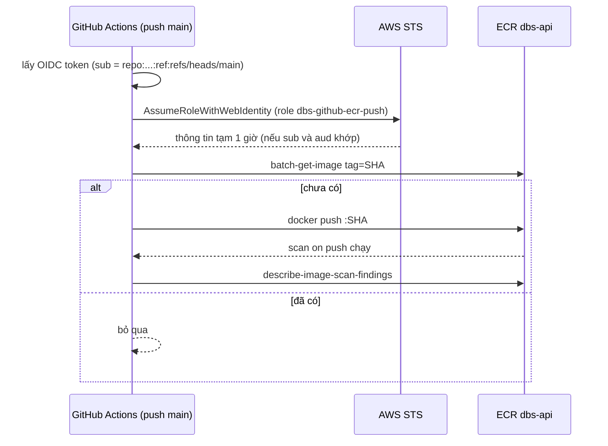

# DBS-36 · CI: build image, đẩy ECR với tag SHA bằng OIDC

> **Status:** Draft (đang làm, đến G2) · **Vai:** #5 Platform & Ops · **Cặp đôi review:** Dev · **Nhánh:** `chore/DBS-36-ci-ecr-oidc` (xếp chồng trên `chore/DBS-33-terraform-vpc-ecr`) · **PR:** — · **Cập nhật:** 2026-10-25

## 1. Bối cảnh

- **Task trên board:** Task, Tuần 1, Deliverable P3, Ưu tiên High, board đang "In Progress". **Expect:** Mỗi commit trên main có một image truy được về SHA.
- **DoD** (nguyên văn, đánh số):
  1. Role IAM cho GitHub OIDC chỉ tin repo Lawliet119/digital-banking-simulator và nhánh main (điều kiện sub trong trust policy)
  2. Push main: build image từ backend/Dockerfile, quét scan on push, đẩy ECR với tag = SHA (không dùng latest để deploy)
  3. Không có access key nào trong GitHub Secrets (kiểm bằng danh sách Secrets)
  4. PR đã merge vào main (CI xanh); Dev review; bảng «Đối chiếu test case» trong PR điền đủ
- **Phụ thuộc:**
  - DBS-35 (CI sáu job): Done trên board, `.github/workflows/ci.yml` có trong repo.
  - DBS-33 (VPC và ECR): board In Review; ECR `dbs-api` đã dựng thật trên AWS, mã ở [PR #23](https://github.com/Lawliet119/digital-banking-simulator/pull/23) chưa merge. Vì vậy nhánh này xếp chồng trên nhánh DBS-33 (mã Terraform của role cần `ecr_repository_arn` từ `envs/dev/base`).
- **Đã có gì:**
  - `backend/Dockerfile` (ba stage, chạy bằng user `node`) và `backend/.dockerignore`.
  - `.github/workflows/ci.yml`: sáu job `lint`, `typecheck`, `unit`, `e2e`, `db`, `build`; tên job là hợp đồng (DBS-37, BL-012/BL-013), workflow khác không được dùng lại các tên này; `permissions: contents: read` toàn cục.
  - AWS: chưa có IAM OIDC provider nào; ECR `dbs-api` IMMUTABLE, scan on push, lifecycle (DBS-33).
  - GitHub Secrets: 0 mục (đã đếm).
  - Máy này không có docker nên không build thử image cục bộ; runner GitHub có docker.
  - Handoff từ DBS-33 (BL-031): role OIDC chỉ được push vào `ecr_repository_arn`; bỏ qua push nếu tag SHA đã tồn tại (repo IMMUTABLE); không dùng `latest`.
- **Baseline:** Terraform `fmt` sạch; `terraform test` bootstrap 9/9, `envs/dev/base` 8/8, `envs/dev/session` 1/1 (chạy lúc kết thúc DBS-33). Task này không đổi mã backend nên không chạy bốn lệnh backend.
- **Giới hạn đã biết:** lifecycle ECR giữ 20 image mới nhất nên "mỗi commit có một image" chỉ đúng với 20 commit gần nhất; rollback của DBS-38 chỉ quay lại trong phạm vi đó (bàn giao DBS-38).
- **Ngoài phạm vi:**
  - Deploy lên ECS và gọi `/health/ready` là DBS-38; role deploy riêng sẽ thêm ở đó.
  - Required status check cho `main` và job Terraform trong CI là DBS-37 (BL-028).
  - Quét lỗ hổng image bằng công cụ ngoài (Trivy) và quét secret: ngoài DoD của task này.
  - Mọi thay đổi `backend/Dockerfile` (DBS-67 thêm bundle CA RDS).
- **Câu hỏi mở** (kèm đề xuất):
  1. **Vị trí Terraform của OIDC provider và role.** Đề xuất: `envs/dev/base` (giữ lại gần như miễn phí, nằm cạnh ECR). Provider là tài nguyên duy nhất toàn tài khoản; role `dbs-github-ecr-push`.
  2. **Điều kiện `sub`.** Đề xuất: đúng `repo:Lawliet119@168917377/digital-banking-simulator@1398975427:ref:refs/heads/main` (repo bật immutable subject, đã kiểm bằng API `actions/oidc/customization/sub`; so khớp `StringEquals`, không wildcard) và `aud = sts.amazonaws.com`. PR hay nhánh khác không assume được role.
  3. **Quyền của role.** Đề xuất: `ecr:GetAuthorizationToken` (Resource `*`, bắt buộc theo AWS) và nhóm push (`BatchCheckLayerAvailability`, `InitiateLayerUpload`, `UploadLayerPart`, `CompleteLayerUpload`, `PutImage`, `BatchGetImage` để kiểm tag đã có, `DescribeImageScanFindings` cho bước scan) giới hạn vào ARN `dbs-api`; không `ecr:*`, không xóa image.
  4. **Workflow mới.** Đề xuất: file riêng `.github/workflows/image.yml`, trigger `push` vào `main`, một job tên `image-push` (khác sáu tên hợp đồng), `permissions: id-token: write, contents: read`, action `aws-actions/configure-aws-credentials` và `amazon-ecr-login` ghim theo SHA như `ci.yml`. Tag duy nhất là `${{ github.sha }}`, không `latest`; nếu tag đã tồn tại thì bỏ qua push (đánh dấu thành công). Role ARN và region truyền qua biến `vars` của repo (không phải secret).
  5. **Có chờ CI xanh trước khi push không?** Hiện ruleset `protect-main` chỉ có `deletion`, `non_fast_forward`, `pull_request` (0 approval), chưa có required status checks (DBS-37/BL-012 chưa xong). Đề xuất: chấp nhận rủi ro tạm thời, không phụ thuộc workflow `CI`; image của commit đỏ có thể lên ECR nhưng DBS-38 chưa deploy; ghi BACKLOG phụ thuộc BL-012.
  6. **Cách chứng minh khi chưa merge.** Role chỉ tin nhánh `main` nên đường thành công chỉ chạy được sau khi PR merge; `workflow_dispatch` cũng chỉ dùng được sau khi file có trên `main`. Đề xuất: trước merge chỉ có kiểm tĩnh/Terraform, đọc trust policy thật và `simulate-principal-policy`; đường thành công ghi "chưa chạy, chạy sau merge" và mở BL-NNN, đóng bằng lần push `main` đầu tiên (bạn hoặc Dev merge, tôi kiểm ECR sau đó).
  7. **`apply` trên AWS thật** (OIDC provider, role, policy: miễn phí): cần bạn đồng ý ở G3 như hai task trước.
  8. **Biến repo (`vars`)**: `AWS_ROLE_ARN` (và tùy chọn `AWS_REGION`) phải do **chủ repo Lawliet119** tạo (tài khoản của bạn chỉ có quyền push, đã kiểm `admin:false`), sau khi tôi `apply` và **trước khi merge**; nếu thiếu thì lần push đầu bị bỏ qua và chạy lại bằng `gh workflow run image.yml --ref main`.

**Quyết định ở G1** (tự duyệt theo `CLAUDE_local.md`, 2026-10-25, theo lệnh «cho phép tự duyệt gate»): chọn đúng đề xuất 1 đến 8. Riêng câu 8 thêm điều kiện `if: vars.AWS_ROLE_ARN != ''` trên job để workflow không đỏ khi biến chưa tạo. Câu 7 (`apply`) không nằm trong quyền tự duyệt: hỏi lại người dùng ở G3.

## 2. Hành vi

Hệ thống chấp nhận và từ chối như sau.

| Tác nhân | Yêu cầu | Kết quả |
|---|---|---|
| Workflow `image-push` chạy do `push` vào `main` của `Lawliet119/digital-banking-simulator` | `AssumeRoleWithWebIdentity`, `sub = repo:Lawliet119@168917377/digital-banking-simulator@1398975427:ref:refs/heads/main` (có id owner và id repo), `aud = sts.amazonaws.com` | Cấp thông tin tạm (1 giờ), không access key |
| Workflow của PR, nhánh khác, tag, fork, `environment:`; repo khác | cùng yêu cầu, `sub` khác | `AccessDenied` (không khớp `StringEquals`) |
| Role đã assume | `ecr:GetAuthorizationToken` | Cho phép (Resource `*`, AWS không cho thu hẹp) |
| Role đã assume | push layer, `PutImage`, `BatchGetImage`, `DescribeImageScanFindings` trên ARN `dbs-api` | Cho phép |
| Role đã assume | xóa image, xóa/sửa repo, mọi thao tác ECR trên repo khác, mọi dịch vụ khác | Từ chối (không có trong policy, implicit deny) |

**Luồng của workflow `image.yml`** (job `image-push`, chỉ `push` vào `main`, thêm `workflow_dispatch` để chứng minh ca từ chối sau merge):

1. Điều kiện chạy: `vars.AWS_ROLE_ARN` khác rỗng; thiếu thì job bị bỏ qua (không đỏ).
2. Checkout, cấu hình thông tin AWS qua OIDC (`id-token: write` chỉ cho job này, `contents: read`).
3. Đăng nhập ECR; tag = `${{ github.sha }}` đầy đủ 40 ký tự, không `latest`.
4. Nếu `aws ecr batch-get-image --query 'length(images)'` khác `0` (lệnh luôn thoát mã 0, chỉ đọc mảng `images`): ghi "đã tồn tại, bỏ qua" và kết thúc thành công (repo IMMUTABLE, build lại sẽ lỗi `ImageTagAlreadyExistsException`).
5. Ngược lại: `docker build --provenance=false --sbom=false` (ép ra image đơn mà scan cơ bản đọc được; Docker mới gắn attestation mặc định) từ `backend/Dockerfile` (context `backend/`), `docker push`.
6. Đợi `aws ecr wait image-scan-complete`, in số phát hiện theo mức nghiêm trọng vào log. Lỗi scan chỉ in cảnh báo, không làm hỏng job (chặn theo mức nghiêm trọng và quét secret: BACKLOG, docs/03 §13.3).

**Ca biên:**
- Chạy lại cùng commit: bước 4 bỏ qua, không lỗi.
- `AWS_REGION` không đặt: dùng `ap-southeast-1` mặc định trong workflow.
- Hai lần push liên tiếp: `concurrency` theo SHA, không hủy lần nào.
- `github_oidc_sub_prefix` sai định dạng khi `apply`: Terraform từ chối (validation `^repo:[A-Za-z0-9_.-]+@[0-9]+/[A-Za-z0-9_.-]+@[0-9]+$`). Giá trị lấy từ `gh api repos/<owner>/<repo>/actions/oidc/customization/sub`.
- Chỉ `image.yml` được xin `id-token: write` (mọi workflow trên `main` có quyền này đều assume được role); script kiểm quy tắc.
- Chi phí: image ~100–300 MB, tối đa 20 image, dưới 1 USD/tháng. `terraform destroy base` sẽ lỗi `RepositoryNotEmptyException` khi repo còn image (`force_delete=false`, có chủ đích): xóa image trước.
- Chưa có OIDC provider thứ hai trong tài khoản: provider chỉ tạo một lần (URL là duy nhất toàn tài khoản); nếu sau này nơi khác cũng cần thì dùng `data` thay vì tạo mới.

## 3. Kiến trúc

- **Vị trí:** `infra/terraform/envs/dev/base/oidc.tf` (mới), `variables.tf` (thêm `github_oidc_sub_prefix` mặc định bằng prefix đã kiểm bằng API, và `github_branch` mặc định `main`; có default nên 8 run cũ của `tests/base.tftest.hcl` và mọi `plan` base sau này không phải truyền thêm biến), `outputs.tf` (thêm `github_ecr_push_role_arn`); `.github/workflows/image.yml` (mới); `infra/terraform/README.md` (thêm biến và bước tạo `vars`). Không đổi `ci.yml`, không đổi `backend/`.
- **Tài nguyên:**
  - `aws_iam_openid_connect_provider.github`: `url = https://token.actions.githubusercontent.com`, `client_id_list = ["sts.amazonaws.com"]`. Từ năm 2023 AWS xác thực chuỗi chứng chỉ của GitHub bằng CA tin cậy, không cần `thumbprint_list` (provider AWS 6 cho bỏ trống).
  - `aws_iam_role.github_ecr_push` tên `dbs-github-ecr-push`, `max_session_duration = 3600`, trust policy dựng bằng `jsonencode` trong `locals` (không dùng data source để test được với mock).
  - `aws_iam_role_policy.ecr_push` (inline): hai statement, `GetAuthorizationToken` trên `*`; nhóm `BatchCheckLayerAvailability`, `InitiateLayerUpload`, `UploadLayerPart`, `CompleteLayerUpload`, `PutImage`, `BatchGetImage`, `DescribeImageScanFindings` trên `aws_ecr_repository.api.arn`.
- **Dữ liệu chạm tới:** IAM (miễn phí) trong state `dev/base.tfstate`; Terraform không đổi ECR/VPC. Workflow thì ghi image vào ECR (xem chi phí ở §2).
- **Sơ đồ:**

- **Thay đổi cấp hệ thống:** README của Terraform thêm biến mới; docs/03 §13.3 (Deploy và rollback; bảng Build) đã mô tả build/push và OIDC ở `CONTRIBUTING.md` §6, không đổi. Không đổi ADR.

## 4. Test cases tự động

Terraform: `envs/dev/base/tests/oidc.tftest.hcl` (`mock_provider "aws"`, `command = apply` khi so sánh tham chiếu). Workflow: kiểm tĩnh bằng `.github/scripts/check-image-workflow.py` (Python 3 + PyYAML, xử lý khóa `on` bị đọc thành `True`; chạy cục bộ, không cần mạng; cũng chạy ở bước đầu của `image.yml` sau `pip install pyyaml==6.0.2` ghim phiên bản. Bước này chỉ chạy sau merge và bị bỏ qua khi thiếu `vars.AWS_ROLE_ARN`, nên độ phủ trước merge là thủ công (M-36-06) cho đến khi BL-028 đưa script và `terraform test` vào CI chung).

| ID | Truy vết | Lớp | Given · When · Then | Mong đợi |
|---|---|---|---|---|
| TC-36-01 | DoD 1 | tf test | When plan: provider OIDC có URL GitHub và `client_id_list = [sts.amazonaws.com]` | khớp |
| TC-36-02 | DoD 1 | tf test | When đọc trust policy: một statement, `Action = sts:AssumeRoleWithWebIdentity`, `StringEquals` trên `...:aud` và `...:sub`, `sub = repo:Lawliet119@168917377/digital-banking-simulator@1398975427:ref:refs/heads/main`, Principal là ARN provider | khớp |
| TC-36-03 | DoD 1 | tf test (security) | Trust policy không có `StringLike`, không có `*` trong `sub`, không có `Principal: "*"` | đúng |
| TC-36-04 | DoD 1 | tf test | Đổi `github_branch` hoặc `github_oidc_sub_prefix` thì `sub` đổi theo; prefix `repo:abc/def` (thiếu id) bị từ chối | validation lỗi |
| TC-36-05 | DoD 2 | tf test (security) | Policy: `GetAuthorizationToken` Resource `*`; mọi action còn lại có Resource đúng ARN repo; không có `ecr:*`, không action `Delete*`, `BatchDeleteImage`, `SetRepositoryPolicy`, `PutLifecyclePolicy` | đúng |
| TC-36-06 | DoD 2 | script | Workflow chỉ trigger `push` (branches `[main]`) và `workflow_dispatch`; không `pull_request`, không `pull_request_target` | đúng |
| TC-36-07 | DoD 1, 2 | script | Job tên `image-push`, khác sáu tên hợp đồng của `ci.yml`; `permissions` mức workflow là `contents: read`, `id-token: write` chỉ ở job; không workflow nào khác trong `.github/workflows/` có `id-token` | đúng |
| TC-36-08 | DoD 2 | script | Tag là `${{ github.sha }}`; chuỗi `latest` không xuất hiện; có bước bỏ qua khi tag đã tồn tại và điều kiện đọc `length(images)` (không dựa vào mã thoát); lệnh build có `--provenance=false --sbom=false` | đúng |
| TC-36-09 | DoD 3 | script | Workflow không có `secrets.` và không có `aws-access-key-id`, `aws-secret-access-key`; mọi `uses:` ghim SHA 40 ký tự | đúng |
| TC-36-10 | DoD 3 | thủ công (API GitHub) | `gh api .../actions/secrets` trả `total_count = 0` | M-36-05 |
| TC-36-12 | hồi quy | tf test | 8 run cũ của `tests/base.tftest.hcl` vẫn đạt không cần biến mới (`terraform test` base: 8 + các run mới) | đúng |
| TC-36-11 | DoD 4 | quy trình | PR merge, CI xanh, Dev review, bảng đối chiếu | quy trình |

Ghi chú: ca thành công thật (assume role và đẩy image) không thể có test tự động trước merge; xem §5.

## 5. Test thủ công

Điều kiện chạy: `AWS_PROFILE=dbs-admin`, `terraform` ở `.tools/bin`, `gh` đã đăng nhập; `apply` chỉ chạy khi người dùng đồng ý trong hội thoại. Tài nguyên IAM miễn phí nên không cần `destroy` sau khi kiểm.

| Bước | Việc làm | Kết quả mong đợi |
|---|---|---|
| M-36-00 | `gh api repos/Lawliet119/digital-banking-simulator/actions/oidc/customization/sub` và so `sub_claim_prefix` với biến | khớp từng ký tự |
| M-36-01 | `terraform plan -out=base.tfplan -var account_id=<id>` (prefix lấy từ default) trong `envs/dev/base` | `3 to add` (provider, role, policy), `0 to change`, `0 to destroy` |
| M-36-02 | `terraform apply` rồi `aws iam get-role --role-name dbs-github-ecr-push --query Role.AssumeRolePolicyDocument` | trust policy đúng TC-36-02 (rút ARN khi lưu) |
| M-36-03 | `aws iam simulate-principal-policy` với `ecr:PutImage`, `ecr:BatchGetImage` trên ARN `dbs-api` | `allowed` |
| M-36-04 | Cũng simulate: `ecr:BatchDeleteImage` trên `dbs-api`, `ecr:PutImage` trên repo khác (`dbs-other`), `s3:ListBucket` | `implicitDeny` |
| M-36-05 | `gh api repos/Lawliet119/digital-banking-simulator/actions/secrets --jq .total_count` | `0` |
| M-36-06 | `python3 .github/scripts/check-image-workflow.py` | in `OK`, mã thoát 0 |
| M-36-07 | Lần `apply` thứ hai ngay sau đó (idempotent) | `No changes` |
| M-36-08 | **Chưa chạy trước merge, chạy sau merge (sau khi chủ repo tạo `AWS_ROLE_ARN`):** push `main` đầu tiên (nếu job bị bỏ qua vì thiếu biến: `gh workflow run image.yml --ref main`); xem `gh run list --workflow image.yml`, `aws ecr describe-images` có tag = SHA | job xanh, image có tag SHA, scan `COMPLETE` |
| M-36-09 | **Sau merge:** `gh workflow run image.yml --ref <nhánh khác>` | job đỏ ở bước assume role (`Not authorized to perform sts:AssumeRoleWithWebIdentity`) |

M-36-08 và M-36-09 cần workflow có trên `main` và biến `AWS_ROLE_ARN`, nên ghi "chưa chạy (chờ merge)" ở G4 và mở một dòng BACKLOG.

## 6. Domain review (AI)

**Reviewer:** subagent, model opus, 2026-10-25 · **Kết quả:** 13 phát hiện (blocking 1, should-fix 6, minor 6), verdict REVISE (vòng 1) · [trả lời nguyên văn](screenshots/DBS-36/domain-review.md)

| # | Mức | Phát hiện | Xử lý |
|---|---|---|---|
| 1 | blocking | `sub` thật có id owner/repo (immutable subject) | đã sửa §1–§5; đã tự kiểm bằng API, đúng; thêm biến `github_oidc_sub_prefix` và M-36-00 |
| 2 | should-fix | `main` chưa có required checks | đã sửa §1 câu 5; BL mới phụ thuộc BL-012 |
| 3 | should-fix | câu 6 mâu thuẫn §5 | đã sửa §1 câu 6 |
| 4 | should-fix | `batch-get-image` thoát 0 khi không thấy tag | đã sửa §2 bước 4, TC-36-08 |
| 5 | should-fix | người dùng không phải admin repo | đã sửa §1 câu 8; bàn giao cho chủ repo (BL mới) |
| 6 | should-fix | PyYAML/khóa `on`; script không chạy trong CI | đã sửa §4; chạy script trong `image.yml`; phần còn lại vào BL-028 |
| 7 | should-fix | lifecycle 20 image | đã ghi §1 "Giới hạn đã biết"; bàn giao DBS-38 (BL mới) |
| 8 | minor | `-var-file` không tồn tại | đã sửa M-36-01 |
| 9 | minor | chi phí ECR và `destroy base` | đã sửa §2 ca biên |
| 10 | minor | tham chiếu docs/03 sai | đã sửa §3; quét theo mức + quét secret thành BL |
| 11 | minor | thiếu action ở câu 3 | đã sửa |
| 12 | minor | provenance/index và waiter | đã sửa §2 bước 5–6 |
| 13 | minor | mọi workflow trên main có `id-token` đều assume được | đã sửa §2 ca biên, TC-36-07 |

**Vòng 2** (subagent opus): 13/13 đã sửa; thêm 3 phát hiện (1 should-fix, 2 minor), verdict APPROVE, đã sửa cả ba: biến có default + TC-36-12 hồi quy; cờ `--provenance=false --sbom=false`; ghim `pyyaml==6.0.2` và nói rõ độ phủ trước merge là thủ công.

**Quyết định ở G2** (tự duyệt theo `CLAUDE_local.md`, 2026-10-25): chấp nhận mọi xử lý trên, không còn câu hỏi blocking.

## 7. Kế hoạch triển khai

Gate: tóm tắt G2 đã tự duyệt (13 + 3 phát hiện đã xử lý, verdict APPROVE vòng 2). Rà soát kế hoạch: mọi file ở §3, mọi DoD và mọi giới hạn ở §1/§2 đều có hàng bên dưới hoặc nằm ngoài phạm vi.

**Tóm tắt `plan` dự kiến:** `3 to add` (OIDC provider, role, role policy), `0 to change`, `0 to destroy`.

| Bước | File | Test viết trước | Kết quả đỏ | Lệnh chứng minh | Commit |
|---|---|---|---|---|---|
| 1 | `envs/dev/base/{variables,oidc,outputs}.tf` | `tests/oidc.tftest.hcl` (TC-36-01…05, 12) | điền khi chạy | `cd infra/terraform/envs/dev/base && terraform init -backend=false && terraform test` | `feat(infra): github oidc role to push ecr` |
| 2 | `.github/workflows/image.yml`, `.github/scripts/check-image-workflow.py` | script viết trước (TC-36-06…09) | điền khi chạy | `python3 .github/scripts/check-image-workflow.py` | `ci: build and push image to ecr on main` |
| 3 | `infra/terraform/README.md`, `docs/BACKLOG.md` | `check-doc-links.mjs` | n/a | `node .claude/skills/dbs-delivering-task/scripts/check-doc-links.mjs` | `docs(infra): oidc variables and handoffs` |
| 4 | (không file) | M-36-00…07 trên AWS thật | n/a | theo §5, output vào `screenshots/DBS-36/manual-test.txt` | `docs(features): DBS-36 results` |

Rủi ro và cách lùi: `terraform destroy -target` cho ba tài nguyên IAM (miễn phí, không ảnh hưởng ECR/VPC); xóa `image.yml` nếu cần. Role chưa dùng được đến khi chủ repo tạo `AWS_ROLE_ARN`. `apply` cần bạn đồng ý trong hội thoại (không nằm trong quyền tự duyệt).

**Quyết định ở G3** (tự duyệt theo `CLAUDE_local.md`): kế hoạch như trên; bước 4 chờ đồng ý `apply`.

## 8. Kết quả

(Điền ở Phase 4–5.)

## 9. Tài liệu đã cập nhật

(Điền ở Phase 5.)
