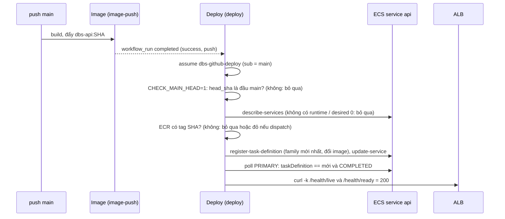

# DBS-38 · Deploy tự động: push main → image mới → ECS → /health/ready trên cloud

> **Status:** Implemented (G4 duyệt 2026-10-29: chấp nhận M-38-00..09 chưa chạy, BL-104, và không có ảnh chụp) · **Vai:** #5 Platform & Ops · **Cặp đôi review:** Dev · **Nhánh:** `chore/DBS-38-auto-deploy` (xếp chồng trên `chore/DBS-66-terraform-rds`) · **PR:** — · **Cập nhật:** 2026-10-29

## 1. Bối cảnh

- **Task trên board:** Task, Tuần 1, Deliverable P3, Ưu tiên High, board "In Progress". **Expect:** Push lên main thì phiên bản mới tự chạy trên cloud và có bằng chứng sống.
- **DoD** (nguyên văn, đánh số):
  1. deploy.yml (hoặc job trong ci.yml) cập nhật task definition với image SHA vừa build và chờ service ổn định
  2. curl tới ALB: /health/live và /health/ready trả 200; ghi lại URL/lệnh kiểm trong README
  3. Rollback thủ công về task definition cũ được mô tả trong README (diễn tập chính thức ở tuần 6)
  4. PR đã merge vào main (CI xanh); Dev review; bảng «Đối chiếu test case» trong PR điền đủ
- **Thực trạng trên board:** chưa có luồng deploy; cổng ra tuần 1 yêu cầu «push → tự lên cloud».
- **Phụ thuộc:** DBS-36 (PR #24) và DBS-34 (PR #25): đều In Review, mã đã có trên các nhánh xếp chồng. Chuỗi PR: `main` ← #22 ← #23 ← #24 ← #25 ← #26 ← #27 ← nhánh này.
- **Đã có gì:** `image.yml` (DBS-36) đẩy `dbs-api:<SHA>` sau mỗi push `main` (job `image-push`, role `dbs-github-ecr-push`, biến repo `AWS_ROLE_ARN`); `session` có cluster `dbs-dev`, service `api` (circuit breaker `rollback = true`, grace 60 s), ALB `dbs-dev` (HTTPS self-signed, 80 → 301), target group health `/health/ready`; docs/03 §13.3 (rolling update, rollback bằng task definition trước); BL-036 (ECR giữ 20 image), BL-039 (cách đổi image).
- **Baseline:** `terraform test`: bootstrap 9/9, `base` 27/27, `session` 13/13; `check-image-workflow.py` OK (lúc bàn giao DBS-66).
- **Điều kiện bên ngoài (chưa có trong tuần 1–2):** image trên ECR chỉ có sau khi Dev merge #22–#27 và chủ repo tạo `AWS_ROLE_ARN`; app `staging` cần DB, Redis (`rediss://`), Cognito mà service `api` mặc định `desired_count = 0`; chưa có task ElastiCache. Vì vậy **đường deploy thật chưa chạy được**: phần được chứng minh trước merge là mã và các lời gọi AWS thật lên service `desired_count = 0`; xem §5.
- **Ngoài phạm vi:** service `worker`; rollback tự động ngoài circuit breaker và diễn tập rollback chính thức (tuần 6, DBS-156); migration (DBS-68); deploy lên prod; WAF, HTTPS công khai (BL-037).
- **Câu hỏi mở** (kèm đề xuất):
  1. **Vị trí:** workflow riêng `.github/workflows/deploy.yml` kích hoạt bằng `workflow_run` (workflow `Image`, nhánh `main`, `completed`) và `workflow_dispatch`, với `if:` chặt (kết luận `success`, `head_branch == main`, cùng repo, sự kiện gốc là `push` hoặc `workflow_dispatch`); job `deploy` (khác sáu tên hợp đồng của `ci.yml`). Logic nằm trong `.github/scripts/deploy.sh` và `.github/scripts/render-task-definition.py` (chạy được bằng tay và test được).
  2. **Role riêng cho deploy:** `dbs-github-deploy` ở `base` (cùng điều kiện `sub` = `main`; biến repo `AWS_DEPLOY_ROLE_ARN` do chủ repo tạo). Quyền tối thiểu: `ecs:DescribeServices`, `ecs:UpdateService` trên service `api`; `ecs:DescribeTaskDefinition`, `ecs:RegisterTaskDefinition` trên `*` (AWS không hỗ trợ giới hạn theo tài nguyên); `ecs:TagResource` trên `task-definition/dbs-api:*` với `ecs:CreateAction = RegisterTaskDefinition` (giữ tag chi phí); `iam:PassRole` chỉ cho `dbs-dev-api-execution` và `dbs-dev-api-task` với `iam:PassedToService = ecs-tasks.amazonaws.com`; `ecr:BatchGetImage` trên repo `dbs-api`; `elasticloadbalancing:DescribeLoadBalancers` trên `*`. Không dùng chung role đẩy image. **Rủi ro còn lại:** hai role OIDC tin cùng `sub`, nên trên `main` mỗi job assume được cả hai role; thêm `environment:` vào job sau này đổi `sub` và làm assume hỏng (ghi ở comment `deploy.yml` và README).
  3. **Bỏ qua khi không có runtime:** cluster không tồn tại (`ClusterNotFoundException`) hoặc service không có/`INACTIVE`: thoát 0 với lý do; `desiredCount == 0`: thoát 0 kèm `::warning::` (tránh Deploy đỏ nhiều tuần khi chưa có DB/Redis); tag SHA chưa có trên ECR: bỏ qua kèm cảnh báo khi chạy do `workflow_run`, nhưng **đỏ** khi do `workflow_dispatch`. Thiếu biến `AWS_DEPLOY_ROLE_ARN` thì job bị bỏ qua. Không deploy khi `head_sha` không còn là đầu `main` (chống `Image` kết thúc sai thứ tự làm hạ cấp image).
  4. **Kiểm rollout đúng:** ghi ARN task definition mới; vòng poll riêng (không dùng `wait services-stable`, chỉ chờ 10 phút) tới deadline 20 phút: đạt khi deployment PRIMARY có `taskDefinition` bằng ARN mới và `rolloutState = COMPLETED`; đỏ nếu PRIMARY ở ARN khác (circuit breaker đã rollback) hoặc `FAILED`; in 5 sự kiện mới nhất khi đỏ. Sau đó `curl -k` `/health/live` và `/health/ready` qua ALB đều 200, có thử lại.
  5. **Task definition và Terraform (BL-039):** deploy render từ revision `ACTIVE` mới nhất của family `dbs-api` (không phải revision hiện hành của service), chỉ đổi image của container `api`, nên thay đổi task definition của Terraform (DBS-67 `secrets`, biến môi trường, CPU/memory) có hiệu lực ở lần deploy kế tiếp; `lifecycle { ignore_changes = [task_definition] }` cho service để `terraform apply` không trả image về `var.image_tag` (`image_tag` lúc apply session phải là SHA đang có trên ECR). Input `register-task-definition` dựng từ allowlist khóa, kèm `tags`.
  6. **Hướng tiếp:** người dùng chưa chọn (hỏi nhiều lần); áp dụng phương án đã đề xuất: làm mã và kiểm tĩnh, bước chạy thật ghi "chưa chạy" (BACKLOG).
  7. **`apply`** lên AWS thật: role IAM miễn phí; để chạy các lời gọi thật dùng `-target` cho cluster, service, ALB và phần phụ thuộc (tránh dựng RDS ≈ 0,025 USD/giờ và 10–15 phút tạo, vì task này không cần DB); người dùng đã đồng ý `apply` và `destroy` ngày 2026-10-26.

**Quyết định ở G1** (tự duyệt theo `CLAUDE_local.md`, 2026-10-26): chọn đề xuất 1 đến 7 sau domain review (câu 1 đến 5 sửa theo review); không đổi ADR hay NFR.

## 2. Hành vi

| Điều kiện | Kết quả |
|---|---|
| `Image` hoàn tất `success` trên `main` do `push` hoặc `workflow_dispatch` (cùng repo), biến `AWS_DEPLOY_ROLE_ARN` có | job `deploy` chạy với `IMAGE_TAG` = `head_sha` |
| `Image` thất bại, không phải `main`, từ fork, hoặc loại sự kiện gốc khác | `deploy` không chạy |
| `workflow_dispatch` trên `main` | chạy với SHA của commit đang chọn |
| `workflow_dispatch` từ nhánh khác | không assume được role (`sub` không phải `main`): đỏ ở bước cấu hình AWS |
| `head_sha` không còn là đầu `main` (chỉ kiểm khi `CHECK_MAIN_HEAD=1`, do `deploy.yml` đặt cho sự kiện `workflow_run`; chạy tay không đặt biến nên bỏ qua kiểm này và không cần `gh`) | thoát 0 "đã có commit mới hơn, bỏ qua" |
| Cluster không tồn tại (`ClusterNotFoundException`), hoặc service không có/`INACTIVE` | thoát 0 "runtime stack không tồn tại, bỏ qua" |
| Service `desiredCount == 0` | thoát 0 với `::warning::` "không có task, không kiểm health" |
| Tag SHA chưa có trên ECR | `workflow_run`: thoát 0 kèm cảnh báo; `workflow_dispatch`: **đỏ** |
| Tag không phải 40 hex hoặc là `latest` | từ chối trước mọi lời gọi `aws` |
| Bình thường | render từ revision ACTIVE mới nhất của family `dbs-api`, chỉ đổi image container `api` (giữ `environment`, `secrets`, `logConfiguration`, tag), đăng ký, `update-service`, poll PRIMARY, rồi `curl -k` `/health/live` và `/health/ready` = 200 |
| Revision ACTIVE mới nhất đã dùng đúng image SHA | không đăng ký lại; vẫn `update-service` nếu service chưa dùng nó, vẫn poll và kiểm health (idempotent) |
| PRIMARY ở task definition khác ARN mới (circuit breaker đã rollback), hoặc `rolloutState = FAILED` | **đỏ**, in 5 sự kiện mới nhất |
| Quá 20 phút chưa `COMPLETED` | đỏ với thông báo hết hạn |
| Health trả khác 200 sau khi thử lại | đỏ |

**Rollback thủ công** (README): lấy revision cũ bằng `aws ecs list-task-definitions --family-prefix dbs-api --sort DESC`, rồi `aws ecs update-service --cluster dbs-dev --service api --task-definition dbs-api:<revision>` và theo dõi bằng `aws ecs describe-services` (PRIMARY `COMPLETED`). Giới hạn: chỉ quay lại được các image còn trong ECR (20 image, BL-036). Thay đổi task definition của Terraform có hiệu lực ở lần deploy kế tiếp (hoặc chạy tay `deploy.sh`).

**URL và lệnh kiểm** (README): `ALB=$(aws elbv2 describe-load-balancers --names dbs-dev --query 'LoadBalancers[0].DNSName' --output text)`; `curl -sk -o /dev/null -w '%{http_code}\n' https://$ALB/health/live` và `.../health/ready` (chứng chỉ self-signed nên cần `-k`).

**Ca biên:** hai push liên tiếp: concurrency nhóm `deploy-dev` giữ một run đang chạy và một run chờ (run chờ mới thay run chờ cũ); `head_sha` cũ bị bỏ qua nên không hạ cấp; `Image` chạy lại bằng `gh workflow run image.yml --ref main` (event `workflow_dispatch`) vẫn kích hoạt deploy.

## 3. Kiến trúc

- **Vị trí:**
  - `.github/workflows/deploy.yml` (mới): `workflow_run` (workflow `Image`, nhánh `main`, `completed`) + `workflow_dispatch`; `permissions: contents: read` mức workflow; job `deploy` (khác sáu tên của `ci.yml`) khai lại đúng `{contents: read, id-token: write}` ở mức job (mức job thay toàn bộ mức workflow) và có `if:` như §2; `GH_TOKEN: ${{ github.token }}` và `CHECK_MAIN_HEAD=1` qua `env:`; `concurrency` nhóm `deploy-dev` (không hủy run đang chạy); `timeout-minutes: 30`; checkout mặc định (đầu `main`) với `persist-credentials: false`; `head_sha`, `github.repository`, token chỉ qua `env:`; không `actions/cache`; mọi action ghim SHA; comment nêu rủi ro dùng chung trust và lưu ý `environment:`.
  - `.github/scripts/deploy.sh` (mới: bash + `aws` + `curl`, python chỉ cho JSON qua stdin) và `.github/scripts/render-task-definition.py` (mới: JSON `describe-task-definition --include TAGS` từ stdin, `--image`; lấy `taskDefinition` lọc qua allowlist khóa và `tags` từ **gốc** phản hồi (cạnh `taskDefinition`), in input `register-task-definition`).
  - `.github/scripts/check-image-workflow.py`: tách thành spec theo workflow (`image.yml` giữ nguyên; `deploy.yml` có trigger, job, `if:`, `id-token` mức job, không `${{ github.event` trong `run:`, không `actions/cache`/`cache:` của setup action), vẫn kiểm "không workflow nào khác có id-token", thêm fixture âm; vẫn được `image.yml` chạy trước khi đẩy.
  - `envs/dev/base/deploy_role.tf` (mới: role `dbs-github-deploy` và policy), `outputs.tf` (thêm `github_deploy_role_arn`), `tests/deploy_role.tftest.hcl`.
  - `envs/dev/session/ecs.tf`: `lifecycle { ignore_changes = [task_definition] }` cho service `api`.
  - `infra/terraform/README.md`: mục Deploy (biến repo `AWS_DEPLOY_ROLE_ARN`, lệnh kiểm health, rollback, `image_tag` lúc apply session phải tồn tại).
- **Dữ liệu chạm tới:** `dev/base.tfstate` (role IAM, miễn phí).
- **Sơ đồ:**

- **Thay đổi cấp hệ thống:** README Terraform; docs/03 §13.3 đã khớp (rolling update, rollback bằng task definition trước). Không đổi ADR.
- **Hợp đồng với task khác:** DBS-67 thêm `secrets` ở Terraform và deploy lấy theo family mới nhất nên không đè; DBS-68 chạy migration trước `deploy`; BL-036 giới hạn rollback; chủ repo tạo `AWS_DEPLOY_ROLE_ARN`.

## 4. Test cases tự động

`terraform test` (`mock_provider`, trust và policy bằng `jsonencode`); `render-task-definition.py` và `deploy.sh` bằng `unittest` với `aws`, `curl` và `gh` giả (stdlib); kiểm tĩnh workflow bằng `check-image-workflow.py` (spec theo workflow).

| ID | Truy vết | Lớp | Given · When · Then | Mong đợi |
|---|---|---|---|---|
| TC-38-01 | DoD 1 | unit (render) | Đầu ra chỉ có khóa trong allowlist (`family`, `taskRoleArn`, `executionRoleArn`, `networkMode`, `containerDefinitions`, `volumes`, `placementConstraints`, `requiresCompatibilities`, `cpu`, `memory`, `runtimePlatform`, `ephemeralStorage`, `tags`...); mọi trường chỉ-đọc (`taskDefinitionArn`, `revision`, `status`, `requiresAttributes`, `compatibilities`, `registeredAt`, `registeredBy`, `deregisteredAt`) và trường lạ bị loại | đúng |
| TC-38-02 | DoD 1 | unit (render) | Fixture đúng dạng phản hồi API (`taskDefinition` + `tags` ở cấp trên cùng). Chỉ image của container `api` đổi sang `<repo>:<SHA>`; `environment`, `secrets`, `logConfiguration`, container khác và `tags` giữ nguyên | đúng |
| TC-38-03 | an toàn | unit (render) | Thiếu container `api`, tag `latest` hoặc không 40 hex: lỗi và không in gì ra stdout | đúng |
| TC-38-04 | DoD 1 | unit (deploy, giả) | Bình thường: `describe-services` → ECR `batch-get-image` → `describe-task-definition` (family `dbs-api`) → `register-task-definition` → `update-service` → poll `describe-services` → `describe-load-balancers` → hai `curl`; mã 0 | đúng |
| TC-38-05 | DoD 1 | unit (deploy) | `ClusterNotFoundException`, `MISSING` hoặc `INACTIVE`: thoát 0, không đăng ký, không `update-service` | đúng |
| TC-38-06 | DoD 1 | unit (deploy) | `desiredCount = 0`: thoát 0 kèm cảnh báo, không đăng ký | đúng |
| TC-38-07 | DoD 1 | unit (deploy) | Tag SHA không có trên ECR (`batch-get-image` thoát 0 với `failures`: script đếm `length(images)`): `workflow_run` thoát 0 kèm cảnh báo; `workflow_dispatch` thoát khác 0; không đăng ký | đúng |
| TC-38-08 | DoD 1 | unit (deploy) | Revision ACTIVE mới nhất đã có đúng image: không `register-task-definition`; vẫn `update-service` nếu service dùng revision khác; vẫn poll và kiểm health | đúng |
| TC-38-09 | DoD 1, 2 | unit (deploy) | PRIMARY `COMPLETED` nhưng ở ARN **cũ** (circuit breaker rollback): thoát khác 0; PRIMARY `FAILED`: thoát khác 0; quá deadline: thoát khác 0 kèm sự kiện | đúng |
| TC-38-10 | DoD 2 | unit (deploy) | `/health/ready` 503 sau khi thử lại hết: thoát khác 0; 503 rồi 200: thoát 0; `/health/live` 200 | đúng |
| TC-38-11 | an toàn | unit (deploy) | `IMAGE_TAG` rỗng, `latest`, không 40 hex: từ chối trước mọi lời gọi `aws` | đúng |
| TC-38-12 | DoD 1 | unit (deploy) | Với `CHECK_MAIN_HEAD=1`, `head_sha` khác đầu `main` (giả `gh api`): thoát 0 "bỏ qua", không đăng ký; không có biến thì không gọi `gh` | đúng |
| TC-38-13 | DoD 1 | unit (deploy) | Family-latest có `secrets`, revision hiện hành của service không có: đầu ra register có `secrets` (không bị đè) | đúng |
| TC-38-14 | DoD 1 | tf test (base) | Role `dbs-github-deploy`: trust một statement, `AssumeRoleWithWebIdentity`, `aud` và `sub` đúng `main` (cùng biến với role đẩy image), không wildcard, 1 giờ | đúng |
| TC-38-15 | DoD 1 (security) | tf test (base) | Policy: `ecs:UpdateService`, `ecs:DescribeServices` chỉ ARN service `dbs-dev/api`; `ecs:TagResource` chỉ `task-definition/dbs-api:*` với điều kiện `ecs:CreateAction = RegisterTaskDefinition`; `iam:PassRole` chỉ hai role ARN với `iam:PassedToService = ecs-tasks.amazonaws.com`; `ecr:BatchGetImage` chỉ ARN repo; hành động trên `*` chỉ `ecs:RegisterTaskDefinition`, `ecs:DescribeTaskDefinition`, `elasticloadbalancing:DescribeLoadBalancers`; không `ecs:*`, `iam:*`, `Delete*` | đúng |
| TC-38-16 | DoD 1 | tĩnh (script) | `deploy.yml`: trigger `workflow_run`(Image, `main`, `completed`) + `workflow_dispatch`; job `deploy` khác sáu tên của `ci.yml`; `if:` chứa đủ các điều kiện §2; `permissions` mức job đúng `{contents: read, id-token: write}`; mọi `uses:` ghim SHA; không `secrets.`; không `${{ github.event` trong `run:`; không cache; fixture âm cho từng điều kiện | đúng |
| TC-38-17 | DoD 1 | tĩnh | `ignore_changes = [task_definition]` có trong `session/ecs.tf` | đúng |
| TC-38-18 | hồi quy | tf test | Các test cũ của `base` (27) và `session` (13) vẫn đạt; `check-image-workflow.py` vẫn `OK` cho `image.yml` | đúng |
| TC-38-19 | DoD 2, 3 | thủ công | M-38-02…M-38-08 (lời gọi thật), README có lệnh kiểm và rollback | thủ công |
| TC-38-20 | DoD 4 | quy trình | PR merge, CI xanh, Dev review, bảng đối chiếu | quy trình |

## 5. Test thủ công

Điều kiện chạy: `AWS_PROFILE=dbs-admin`, `.tools/bin` trong PATH; người dùng đã đồng ý `apply` và `destroy` ngày 2026-10-26; destroy ngay sau khi kiểm. **Đường deploy đầy đủ (push `main` → image → service chạy → `/health/ready` 200) chưa chạy được trước merge** (xem §1). Các bước dưới chạy `deploy.sh` thật bằng `dbs-admin` lên service `desired_count = 0` và `desired_count = 1` (task không lên được vì chưa có DB/Redis và image giả). Dựng bằng `-target=aws_ecs_service.api -target=aws_iam_role_policy.execution -target=aws_lb_listener.http` (kéo theo cluster, task definition, role, ALB, listener, target group, ACM; không dựng RDS ≈ 0,025 USD/giờ, 10–15 phút tạo). Chạy tay `deploy.sh` không đặt `CHECK_MAIN_HEAD` nên không cần `gh`.

| Bước | Việc làm | Kết quả mong đợi |
|---|---|---|
| M-38-00 | `terraform plan` ở `base` | thêm role và policy deploy, `0 to destroy` |
| M-38-01 | `apply` base; `aws iam simulate-principal-policy` cho role `dbs-github-deploy` với **mọi** action script gọi: `ecs:DescribeServices`, `ecs:UpdateService` (service `api`), `ecs:DescribeTaskDefinition`, `ecs:RegisterTaskDefinition`, `ecs:TagResource` (có `--context-entries` `ecs:CreateAction=RegisterTaskDefinition`), `ecr:BatchGetImage` (repo), `elasticloadbalancing:DescribeLoadBalancers`, `iam:PassRole` cho hai role (`iam:PassedToService=ecs-tasks.amazonaws.com`); âm: `UpdateService` service khác, `DeleteService`, `PassRole` role khác, `PassRole` với `PassedToService=lambda.amazonaws.com`, `ecr:PutImage` | tất cả `allowed`, các ca âm `implicitDeny` (chạy OIDC thật vẫn "chưa chạy") |
| M-38-02 | **Bỏ qua khi không có runtime:** `IMAGE_TAG=<40 chữ a> bash .github/scripts/deploy.sh` khi `session` chưa dựng | "runtime stack không tồn tại, bỏ qua" (xử lý `ClusterNotFoundException`), mã 0 |
| M-38-03 | `apply -target=aws_ecs_service.api` với `desired_count = 0`, `image_tag` giữ chỗ; chạy `deploy.sh` với tag chưa có trên ECR | `desiredCount == 0`: cảnh báo "không có task", mã 0; không đăng ký task definition |
| M-38-04 | Đẩy một image tối thiểu lên ECR bằng API (không docker; kỹ thuật DBS-33) với tag SHA giả 40 hex; đặt `desired-count 1` bằng `aws ecs update-service`; chạy `deploy.sh` | **đăng ký task definition mới (revision tăng), `update-service` thật**; poll PRIMARY tới khi circuit breaker rollback hoặc hết hạn; task không lên được (image giả, DB/Redis chưa có) nên kỳ vọng **đỏ** đúng thiết kế (PRIMARY `FAILED` hoặc ở ARN cũ; ghi `stoppedReason` thực tế) |
| M-38-05 | Chạy lại với cùng tag | không đăng ký lại revision (image đã khớp); vẫn đỏ vì không có task |
| M-38-06 | Rollback thủ công theo README bằng `update-service` về revision trước | service dùng revision cũ (`describe-services`) |
| M-38-07 | `terraform destroy` **không** `-target` (state chỉ chứa phần đã dựng; RDS chưa từng tạo); kiểm sạch: `terraform state list` rỗng, ALB, target group, cluster, ENI, ACM, **không có RDS**; `deregister-task-definition` các revision test; `batch-delete-image` xóa image thử | sạch; không còn revision ACTIVE do test |
| M-38-08 | Push `main` thật rồi xem `Image` → `Deploy` chạy, `/health/ready` 200 | **chưa chạy** (chờ merge #22–#27, `AWS_ROLE_ARN`, `AWS_DEPLOY_ROLE_ARN`, Redis, DBS-66/67/54 cho task api chạy thật): BACKLOG |
| M-38-09 | `workflow_dispatch` từ nhánh khác bị từ chối ở bước assume role | **chưa chạy** (chờ merge): BACKLOG |

Thời gian: ALB và service sống khoảng 10–25 phút (tùy hết hạn poll); chi phí ≈ 0,02 USD (không RDS).

## 6. Domain review (AI)

**Reviewer:** subagent, model opus, 2026-10-26 · [trả lời nguyên văn](screenshots/DBS-38/domain-review.md)

| Vòng | Phát hiện | Verdict |
|---|---|---|
| 1 | 14 (blocking 2, should-fix 7, minor 5) | REVISE |
| 2 | 6 mới (should-fix 2, minor 4); 14/14 phát hiện vòng 1 đã sửa đúng | REVISE, đã sửa; không chạy vòng 3 (xem dưới) |

| # | Mức | Phát hiện | Xử lý |
|---|---|---|---|
| V1-1 | blocking | kiểm rollout vẫn đạt sau khi circuit breaker rollback | đã sửa: PRIMARY phải ở ARN mới và `COMPLETED`; TC-38-09 |
| V1-2 | blocking | `ignore_changes` + sao chép revision của service làm mất thay đổi của Terraform | đã sửa: render từ revision ACTIVE mới nhất của family; TC-38-13 |
| V1-3 | should-fix | chạy sai thứ tự gây hạ cấp image | đã sửa: bỏ qua nếu `head_sha` không còn là đầu `main`; TC-38-12 |
| V1-4 | should-fix | `if:` của `workflow_run` chưa đặc tả | đã sửa §1 câu 1, §3, TC-38-16 |
| V1-5 | should-fix | `ClusterNotFoundException` | đã sửa §2, TC-38-05 |
| V1-6 | should-fix | `wait services-stable` chỉ 10 phút | đã sửa: vòng poll 20 phút |
| V1-7 | should-fix | chi phí và thời gian có RDS | đã sửa: `-target`, không dựng RDS |
| V1-8 | should-fix | M-38-01 chưa chứng minh đường được phép | đã sửa: mô phỏng đủ action và ca âm |
| V1-9, 10 | should-fix | tag của revision, checker theo workflow | đã sửa: `--include TAGS`, `ecs:TagResource`; spec theo workflow |
| V1-11..14 | minor | trust dùng chung, Deploy đỏ khi `desired = 0`, dọn revision, dispatch thiếu tag | đã sửa |
| V2-1 | should-fix | `destroy -target` để lại ALB | đã sửa M-38-07: `destroy` không `-target` |
| V2-2 | should-fix | kiểm đầu `main` chặn chạy tay | đã sửa: chỉ khi `CHECK_MAIN_HEAD=1` |
| V2-3..6 | minor | thiếu `execution` policy trong `-target`, permissions mức job, đếm `images`, `tags` ở gốc phản hồi | đã sửa |

Vòng 3 không chạy: sáu phát hiện vòng 2 là chi tiết lệnh và cấu hình, không đổi thiết kế; việc chứng minh thật nằm ở test đơn vị và các bước M-38 chạy trên AWS.

**Quyết định ở G2** (tự duyệt theo `CLAUDE_local.md`, 2026-10-26): chấp nhận mọi xử lý; không còn câu hỏi blocking.

## 7. Kế hoạch triển khai

Gate: G2 tự duyệt (hai vòng review, không còn phát hiện chưa xử lý). Rà soát kế hoạch: mọi file ở §3, mọi DoD và mọi giới hạn ở §1/§2 có hàng bên dưới hoặc nằm ngoài phạm vi.

**Tóm tắt `plan` dự kiến:** `base`: `+` role `dbs-github-deploy` và policy (`2 to add`), `0 to destroy`. `session`: không thêm tài nguyên (chỉ `lifecycle`).

| Bước | File | Test viết trước | Kết quả đỏ | Lệnh chứng minh | Commit |
|---|---|---|---|---|---|
| 1 | `base/{deploy_role.tf,outputs.tf}` | `base/tests/deploy_role.tftest.hcl` (TC-38-14, 15) | điền khi chạy | `cd infra/terraform/envs/dev/base && terraform test` | `feat(infra): github oidc role to deploy to ecs` |
| 2 | `.github/scripts/render-task-definition.py` | `.github/scripts/tests/test_render_task_definition.py` (TC-38-01..03) | điền khi chạy | `python3 .github/scripts/tests/test_render_task_definition.py` | `ci: render task definition with a new image` |
| 3 | `.github/scripts/deploy.sh` | `.github/scripts/tests/test_deploy.py` (TC-38-04..13) | điền khi chạy | `python3 .github/scripts/tests/test_deploy.py` | `ci: deploy script for the ecs service` |
| 4 | `.github/workflows/deploy.yml`, `.github/scripts/check-image-workflow.py`, `session/ecs.tf` | TC-38-16, 17 (check script có fixture âm) | điền khi chạy | `python3 .github/scripts/check-image-workflow.py` và `cd infra/terraform/envs/dev/session && terraform test` | `ci: deploy workflow after the image is pushed` |
| 5 | `infra/terraform/README.md`, `docs/BACKLOG.md` | `check-doc-links.mjs` | n/a | `node .claude/skills/dbs-delivering-task/scripts/check-doc-links.mjs` | `docs(infra): deploy, health checks and rollback` |
| 6 | (không file) | M-38-00..09 trên AWS thật (phần chạy được), rồi `destroy` | n/a | theo §5, output vào `screenshots/DBS-38/manual-test.txt` | `docs(features): DBS-38 results` |

Rủi ro và cách lùi: role deploy ghi vào ECS: `deploy.yml` chỉ chạy trên `main`, role tin đúng `sub` của `main`; lùi bằng xóa `deploy.yml` hoặc đặt lại biến `AWS_DEPLOY_ROLE_ARN` rỗng (job bị bỏ qua). Test thủ công dựng ALB và service ≈ 0,02 USD, `destroy` ngay. Image thử xóa khỏi ECR sau khi kiểm.

**Quyết định ở G3** (tự duyệt theo `CLAUDE_local.md`): kế hoạch như trên; người dùng đã đồng ý `apply` và `destroy` ngày 2026-10-26 cho tuần 1–2.

## 8. Kết quả

- **Lệnh kiểm tra** (SHA code cuối `46c5943`): `terraform test`: `base` **29/29** (27 cũ + 2 mới), `session` **13/13**, `fmt -check` sạch; `test_render_task_definition.py` 6 OK; `test_deploy.py` 17 OK; `check-image-workflow.py` OK (kèm 4 fixture âm của `deploy.yml`); `check-doc-links.mjs` 0 link hỏng. Không có `.skip`, `.only`, `.todo` (0 skipped).
- **Đối chiếu test case:**

| ID | Test | Đạt? |
|---|---|---|
| TC-38-01..03 | `test_render_task_definition.py` | đạt |
| TC-38-04..13 | `test_deploy.py` (aws, curl, gh giả) | đạt |
| TC-38-14, 15 | `base/tests/deploy_role.tftest.hcl` | đạt |
| TC-38-16, 17 | `check-image-workflow.py` (fixture âm: thiếu `head_branch`, thiếu cùng repo, thêm `secrets.`, action không ghim SHA) | đạt |
| TC-38-18 | test cũ của `base`, `session`, `image.yml` | đạt |
| TC-38-19 | M-38-02…08 | **chưa làm**: toàn bộ cần AWS thật; người dùng yêu cầu ghi "chưa chạy" kèm BACKLOG |
| TC-38-20 | quy trình | chưa làm (chờ review và merge) |

20 test case: 18 đạt, 2 chưa làm (TC-38-19 thủ công trên AWS, TC-38-20 quy trình).

- **Test thủ công** ([manual-test.txt](screenshots/DBS-38/manual-test.txt), SHA code cuối `46c5943`): chỉ chạy phần không cần AWS: `deploy.sh` thật với `IMAGE_TAG=latest` và `IMAGE_TAG=abc` bị từ chối trước mọi lời gọi `aws` (đạt, mã 1); các bộ test ở trên chạy lại.

| Bước | Kết quả |
|---|---|
| M-38-00..M-38-07 | **chưa chạy** (cần `apply`/`destroy` AWS thật; người dùng bảo ghi chưa chạy): BL-104 |
| M-38-08, M-38-09 | **chưa chạy** (chờ merge và biến repo): BL-104 |

Chưa có ảnh chụp màn hình (không có bước thật nào chạy); G4 nêu rõ thiếu này.
- **Chưa chứng minh bằng chạy thật:** quyền IAM của role deploy (chưa `simulate-principal-policy`), đường `register-task-definition` và `update-service` trên ECS thật, OIDC từ GitHub. Test đơn vị dùng `aws` giả nên chỉ chứng minh logic script.
- **Phạm vi so với §7:** khớp; thêm vào `check-image-workflow.py` việc kiểm `ignore_changes` của `ecs.tf`.
- **Handoff / BACKLOG:** BL-104 (chạy thật và biến repo), BL-105 (OIDC thật, `environment:`); đã xóa BL-036 (giới hạn rollback ghi ở README) và rút phần DBS-38 khỏi BL-039.

## 9. Tài liệu đã cập nhật

- `infra/terraform/README.md`: mục "Deploy tự động lên ECS (DBS-38)" (biến repo, kiểm sống, rollback).
- `docs/BACKLOG.md`: thêm BL-104, BL-105; xóa BL-036; sửa BL-039.
- `docs/features/README.md`: thêm dòng DBS-38.

