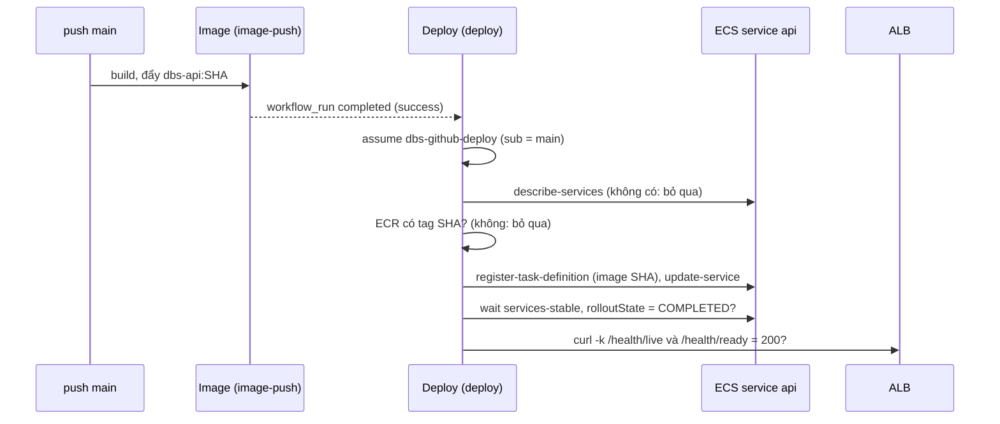

# DBS-38 · Deploy tự động: push main → image mới → ECS → /health/ready trên cloud

> **Status:** Draft (đang làm, đến G2) · **Vai:** #5 Platform & Ops · **Cặp đôi review:** Dev · **Nhánh:** `chore/DBS-38-auto-deploy` (xếp chồng trên `chore/DBS-66-terraform-rds`) · **PR:** — · **Cập nhật:** 2026-10-26

## 1. Bối cảnh

- **Task trên board:** Task, Tuần 1, Deliverable P3, Ưu tiên High, board "In Progress". **Expect:** Push lên main thì phiên bản mới tự chạy trên cloud và có bằng chứng sống.
- **DoD** (nguyên văn, đánh số):
  1. deploy.yml (hoặc job trong ci.yml) cập nhật task definition với image SHA vừa build và chờ service ổn định
  2. curl tới ALB: /health/live và /health/ready trả 200; ghi lại URL/lệnh kiểm trong README
  3. Rollback thủ công về task definition cũ được mô tả trong README (diễn tập chính thức ở tuần 6)
  4. PR đã merge vào main (CI xanh); Dev review; bảng «Đối chiếu test case» trong PR điền đủ
- **Thực trạng trên board:** chưa có luồng deploy; cổng ra tuần 1 yêu cầu «push → tự lên cloud».
- **Phụ thuộc:** DBS-36 (PR #24) và DBS-34 (PR #25): đều In Review, mã đã có trên các nhánh xếp chồng. Chuỗi PR: `main` ← #22 ← #23 ← #24 ← #25 ← #26 ← #27 ← nhánh này.
- **Đã có gì:** `image.yml` (DBS-36) đẩy `dbs-api:<SHA>` sau mỗi push `main` (job `image-push`, role `dbs-github-ecr-push`, biến repo `AWS_ROLE_ARN`); `session` có cluster `dbs-dev`, service `api` (circuit breaker `rollback = true`, grace 60 s), ALB `dbs-dev` (HTTPS self-signed, 80 → 301), target group health `/health/ready`; docs/03 §13.3 (rolling update, rollback bằng task definition trước); BL-036 (ECR giữ 20 image), BL-039 (cách đổi image).
- **Baseline:** `terraform test`: bootstrap 9/9, `base` 27/27, `session` 13/13; `check-image-workflow.py` OK (lúc bàn giao DBS-66).
- **Điều kiện bên ngoài (chưa có trong tuần 1–2):** image trên ECR chỉ có sau khi Dev merge #22–#27 và chủ repo tạo `AWS_ROLE_ARN`; app `staging` cần DB, Redis (`rediss://`), Cognito mà service `api` mặc định `desired_count = 0`; chưa có task ElastiCache. Vì vậy **đường deploy thật chưa chạy được**: phần được chứng minh trước merge là mã và các lời gọi AWS thật lên service `desired_count = 0`; xem §5.
- **Ngoài phạm vi:** service `worker`; rollback tự động ngoài circuit breaker và diễn tập rollback chính thức (tuần 6, DBS-156); migration (DBS-68); deploy lên prod; WAF, HTTPS công khai (BL-037).
- **Câu hỏi mở** (kèm đề xuất):
  1. **Vị trí:** workflow riêng `.github/workflows/deploy.yml` kích hoạt bằng `workflow_run` (hoàn tất workflow `Image` thành công trên `main`) và `workflow_dispatch`; job `deploy` (khác sáu tên hợp đồng của `ci.yml`). Logic nằm trong `.github/scripts/deploy.sh` và `.github/scripts/render-task-definition.py` (chạy được bằng tay và test được).
  2. **Role riêng cho deploy:** `dbs-github-deploy` ở `base` (cùng điều kiện `sub` = `main` của repo; biến repo `AWS_DEPLOY_ROLE_ARN` do chủ repo tạo). Quyền tối thiểu: `ecs:DescribeServices`, `ecs:UpdateService` trên service `api`; `ecs:DescribeTaskDefinition`, `ecs:RegisterTaskDefinition` trên `*` (AWS không hỗ trợ giới hạn theo tài nguyên); `iam:PassRole` chỉ cho hai role `dbs-dev-api-execution` và `dbs-dev-api-task` với điều kiện `iam:PassedToService = ecs-tasks.amazonaws.com`; `ecr:BatchGetImage` trên repo `dbs-api` (kiểm tag SHA tồn tại); `elasticloadbalancing:DescribeLoadBalancers` trên `*`. Không dùng chung role đẩy image (nguyên tắc quyền tối thiểu, NFR-SEC-06).
  3. **Bỏ qua khi không có runtime:** nếu service `api` không tồn tại hoặc `INACTIVE` (stack `session` đã `destroy`) thì job kết thúc thành công và in lý do; nếu image tag SHA chưa có trên ECR thì bỏ qua với cảnh báo (tránh deploy image không có). Thiếu biến `AWS_DEPLOY_ROLE_ARN` thì job bị bỏ qua (như `image.yml`).
  4. **Chống rollout hỏng:** sau `wait services-stable` kiểm `rolloutState = COMPLETED` của deployment chính (circuit breaker đã rollback thì `FAILED`: job đỏ); sau đó `curl` `/health/live` và `/health/ready` qua ALB (HTTPS, `-k` vì chứng chỉ self-signed) phải trả 200, có thử lại.
  5. **Cách đổi image so với Terraform (BL-039):** deploy cập nhật task definition ngoài Terraform; thêm `lifecycle { ignore_changes = [task_definition] }` cho service `api` để `terraform apply` sau đó không trả image về `var.image_tag`. Đổi này làm `image_tag` chỉ còn tác dụng lúc tạo service mới (session dựng mới mỗi phiên) và nằm ở `session/ecs.tf`.
  6. **Quyết định hướng tiếp:** vì điều kiện bên ngoài ở trên, người dùng chưa chọn hướng (hỏi ở lượt trước, lặp lại nhiều lần); tôi áp dụng phương án đã đề xuất: làm mã và kiểm tĩnh, ghi bước chạy thật là "chưa chạy" (BACKLOG).
  7. **`apply`** lên AWS thật (role IAM miễn phí; ALB và service ≈ 0,03 USD/giờ vài phút để chạy các lời gọi thật): người dùng đã đồng ý ngày 2026-10-26.

**Quyết định ở G1** (tự duyệt theo `CLAUDE_local.md`, 2026-10-26): chọn đúng đề xuất 1 đến 7. Câu 2 (role mới) và 5 (`ignore_changes`) không đổi ADR hay NFR; câu 6: áp dụng phương án "làm tiếp, bước chạy thật ghi chưa chạy".

## 2. Hành vi

| Điều kiện | Kết quả |
|---|---|
| `Image` hoàn tất thành công trên `main` (`push`), biến `AWS_DEPLOY_ROLE_ARN` có | job `deploy` chạy với `IMAGE_TAG` = SHA của commit đó |
| `Image` thất bại, hoặc chạy từ nhánh khác, hoặc không phải `push` | `deploy` không chạy |
| `workflow_dispatch` trên `main` | chạy với SHA của commit đang chọn (chạy lại, hoặc deploy tay) |
| `workflow_dispatch` từ nhánh khác | không assume được role (`sub` không phải `main`): job đỏ ở bước cấu hình AWS |
| Service `api` không tồn tại hoặc `INACTIVE` | thoát mã 0 với "runtime stack không tồn tại, bỏ qua" |
| Tag SHA chưa có trên ECR | thoát mã 0 với cảnh báo, không đăng ký task definition |
| Image của service đã bằng SHA mới | không đăng ký lại task definition; vẫn đợi ổn định và kiểm health (idempotent) |
| Bình thường | đọc task definition hiện hành của service; thay image của container `api` bằng `<repo>:<SHA>`; đăng ký bản mới; `update-service`; `wait services-stable`; kiểm `rolloutState = COMPLETED`; `curl` `/health/live` và `/health/ready` qua ALB đều 200 |
| Circuit breaker rollback (task mới không healthy) | `rolloutState = FAILED`: job đỏ, service đã về task definition cũ |
| Health trả khác 200 sau khi thử lại | job đỏ |
| Tag không phải 40 ký tự hex hoặc là `latest` | từ chối ngay, không gọi AWS |

**Rollback thủ công** (README): `aws ecs update-service --cluster dbs-dev --service api --task-definition dbs-api:<revision cũ>` rồi `aws ecs wait services-stable`; lấy revision cũ bằng `aws ecs list-task-definitions --family-prefix dbs-api --sort DESC`. Giới hạn: chỉ quay lại được các image còn trong ECR (20 image, BL-036).

**URL và lệnh kiểm** (README): `ALB=$(aws elbv2 describe-load-balancers --names dbs-dev --query 'LoadBalancers[0].DNSName' --output text)`; `curl -sk -o /dev/null -w '%{http_code}\n' https://$ALB/health/live` và `.../health/ready` (chứng chỉ self-signed nên cần `-k`).

**Ca biên:** `desired_count = 0` (mặc định hiện nay): `wait services-stable` đạt ngay nhưng `/health/ready` trả 503 do ALB không có target, nên job đỏ đúng như mong đợi (không có phiên bản nào "sống"); hai lần push liên tiếp: `concurrency` nhóm `deploy-dev` không hủy lần nào; workflow_run chạy trên commit mới nhất của `main` khi `Image` kết thúc muộn: deploy luôn dùng SHA của lần `Image` đã kích hoạt nó, không phải đầu nhánh.

## 3. Kiến trúc

- **Vị trí:**
  - `.github/workflows/deploy.yml` (mới): `workflow_run` (workflow `Image`, nhánh `main`, loại `completed`) và `workflow_dispatch`; `permissions: contents: read`; job `deploy` xin thêm `id-token: write`; `concurrency` nhóm `deploy-dev`; biến `AWS_DEPLOY_ROLE_ARN`, `AWS_REGION`; mọi action ghim SHA; dữ liệu từ sự kiện chỉ đi qua biến môi trường (không nội suy vào script).
  - `.github/scripts/deploy.sh` (mới, bash + `aws` + `curl`; python chỉ cho JSON qua stdin) và `.github/scripts/render-task-definition.py` (mới: đọc JSON của `describe-task-definition` từ stdin, tham số `--image`, in input hợp lệ cho `register-task-definition`).
  - `.github/scripts/check-image-workflow.py`: mở rộng kiểm cả `deploy.yml` (trigger, tên job `deploy`, quyền, ghim SHA, không `secrets.`/access key, `id-token` chỉ ở `image.yml` và `deploy.yml`).
  - `envs/dev/base/deploy_role.tf` (mới: role `dbs-github-deploy` và policy), `outputs.tf` (thêm `github_deploy_role_arn`), `tests/deploy_role.tftest.hcl`.
  - `envs/dev/session/ecs.tf`: `lifecycle { ignore_changes = [task_definition] }` cho service `api`.
  - `infra/terraform/README.md`: mục Deploy (lệnh kiểm health, rollback, biến repo `AWS_DEPLOY_ROLE_ARN`).
- **Dữ liệu chạm tới:** `dev/base.tfstate` (role IAM, miễn phí). Không có dữ liệu nghiệp vụ.
- **Sơ đồ:**

- **Thay đổi cấp hệ thống:** README Terraform; docs/03 §13.3 đã mô tả rolling update và rollback bằng task definition trước (không đổi). Không đổi ADR.
- **Hợp đồng với task khác:** DBS-67 thêm `secrets` vào task definition (deploy giữ nguyên mọi trường, chỉ đổi image, nên không đè `secrets`); DBS-68 chạy migration trước bước `deploy` (thêm `needs` hoặc bước trong cùng workflow); BL-036 giới hạn rollback; chủ repo tạo `AWS_DEPLOY_ROLE_ARN`.

## 4. Test cases tự động

`terraform test` (`mock_provider`, trust và policy bằng `jsonencode`); `render-task-definition.py` và `deploy.sh` bằng `unittest` với `aws` và `curl` giả (stdlib); kiểm tĩnh workflow bằng `check-image-workflow.py`.

| ID | Truy vết | Lớp | Given · When · Then | Mong đợi |
|---|---|---|---|---|
| TC-38-01 | DoD 1 | unit (render) | JSON `describe-task-definition` có trường chỉ-đọc (`taskDefinitionArn`, `revision`, `status`, `requiresAttributes`, `compatibilities`, `registeredAt`, `registeredBy`): đầu ra không còn các trường đó, giữ `family`, `taskRoleArn`, `executionRoleArn`, `networkMode`, `cpu`, `memory`, `requiresCompatibilities`, `runtimePlatform`, `volumes`, `containerDefinitions` | đúng |
| TC-38-02 | DoD 1 | unit (render) | Chỉ image của container `api` đổi sang `<repo>:<SHA>`; `environment`, `secrets`, `logConfiguration`, container khác giữ nguyên | đúng |
| TC-38-03 | an toàn | unit (render) | Thiếu container `api`, image tag `latest` hoặc không phải 40 hex: lỗi, không in gì ra stdout | đúng |
| TC-38-04 | DoD 1 | unit (deploy, `aws` giả) | Bình thường: thứ tự lời gọi `describe-services` → `ecr batch-get-image` → `describe-task-definition` → `register-task-definition` → `update-service` → `wait services-stable` → `describe-services` (rollout) → `elbv2 describe-load-balancers` → hai `curl`; mã thoát 0 | đúng |
| TC-38-05 | DoD 1 | unit (deploy) | Service không tồn tại hoặc `INACTIVE`: thoát 0, không đăng ký, không `update-service` | đúng |
| TC-38-06 | DoD 1 | unit (deploy) | Tag SHA không có trên ECR: thoát 0 kèm cảnh báo, không đăng ký | đúng |
| TC-38-07 | DoD 1 | unit (deploy) | Image của service đã bằng SHA mới: không `register-task-definition`; vẫn đợi ổn định và kiểm health | đúng |
| TC-38-08 | DoD 1, 2 | unit (deploy) | `rolloutState = FAILED` (circuit breaker rollback): thoát khác 0 | đúng |
| TC-38-09 | DoD 2 | unit (deploy) | `/health/ready` trả 503 sau khi thử lại hết: thoát khác 0; `/health/live` 200 và `/health/ready` 200 sau một lần thử lại: thoát 0 | đúng |
| TC-38-10 | an toàn | unit (deploy) | `IMAGE_TAG` rỗng, `latest` hoặc không 40 hex: từ chối trước mọi lời gọi `aws` | đúng |
| TC-38-11 | DoD 1 | tf test (base) | Role `dbs-github-deploy`: trust một statement, `AssumeRoleWithWebIdentity`, `aud` và `sub` đúng `main` của repo (cùng biến với role đẩy image), không wildcard, 1 giờ | đúng |
| TC-38-12 | DoD 1 (security) | tf test (base) | Policy: `ecs:UpdateService`, `ecs:DescribeServices` chỉ trên ARN service `dbs-dev/api`; `iam:PassRole` chỉ cho hai role ARN với điều kiện `iam:PassedToService = ecs-tasks.amazonaws.com`; `ecr:BatchGetImage` chỉ trên ARN repo; hành động trên `*` chỉ là `ecs:RegisterTaskDefinition`, `ecs:DescribeTaskDefinition`, `elasticloadbalancing:DescribeLoadBalancers`; không `ecs:*`, không `iam:*`, không `Delete*` | đúng |
| TC-38-13 | DoD 1 | tĩnh (script) | `deploy.yml`: trigger `workflow_run`(Image, `main`) và `workflow_dispatch`; job `deploy` không trùng sáu tên của `ci.yml`; `id-token: write` chỉ ở job; mọi `uses:` ghim SHA; không `secrets.`; không nội suy `${{ github.event... }}` trong `run:` | đúng |
| TC-38-14 | DoD 1 | tĩnh (script) | `ignore_changes = [task_definition]` có trong `session/ecs.tf` | đúng |
| TC-38-15 | hồi quy | tf test | Các test cũ của `base` (27) và `session` (13) vẫn đạt | đúng |
| TC-38-16 | DoD 2, 3 | thủ công | M-38-02…M-38-07 (lời gọi thật), README có lệnh kiểm và rollback | thủ công |
| TC-38-17 | DoD 4 | quy trình | PR merge, CI xanh, Dev review, bảng đối chiếu | quy trình |

## 5. Test thủ công

Điều kiện chạy: `AWS_PROFILE=dbs-admin`, `.tools/bin` trong PATH; người dùng đã đồng ý `apply` và `destroy` ngày 2026-10-26; destroy ngay sau khi kiểm. **Đường deploy đầy đủ (push `main` → image → service chạy → `/health/ready` 200) chưa chạy được trước merge** (xem §1): các bước dưới chạy `deploy.sh` thật từ máy bằng `dbs-admin` lên một service `desired_count = 0`.

| Bước | Việc làm | Kết quả mong đợi |
|---|---|---|
| M-38-00 | `terraform plan` ở `base` | thêm role và policy deploy (`2 to add`), `0 to destroy` |
| M-38-01 | `apply` base; `aws iam simulate-principal-policy` với role `dbs-github-deploy`: `ecs:UpdateService` trên service `api` (allowed), trên service khác (implicitDeny), `ecs:DeleteService` (implicitDeny), `iam:PassRole` role khác (implicitDeny), `ecr:PutImage` (implicitDeny) | allowed/implicitDeny đúng |
| M-38-02 | **Bỏ qua khi không có runtime:** chạy `IMAGE_TAG=<40 chữ a> bash .github/scripts/deploy.sh` khi `session` chưa dựng | "runtime stack không tồn tại, bỏ qua", mã 0 |
| M-38-03 | `apply` session (`desired_count = 0`, `image_tag` giữ chỗ); chạy lại `deploy.sh` với tag chưa có trên ECR | "tag chưa có trên ECR, bỏ qua", mã 0, không đăng ký task definition |
| M-38-04 | Đẩy một image tối thiểu lên ECR bằng API (không docker; kỹ thuật `initiate-layer-upload` đã dùng ở DBS-33) với tag SHA giả 40 hex, rồi chạy `deploy.sh` với tag đó | **đăng ký task definition mới (revision tăng), `update-service` thật, `wait services-stable` đạt** (`desired_count = 0`), `rolloutState = COMPLETED`, rồi `/health/live` và `/health/ready` trả **503** (không có target): `deploy.sh` thoát khác 0 đúng thiết kế (không có phiên bản sống) |
| M-38-05 | Chạy lại với cùng tag | không đăng ký lại (image đã bằng SHA mới), vẫn thoát khác 0 vì 503 |
| M-38-06 | Rollback thủ công theo README: `update-service` về revision trước; `wait services-stable` | service dùng revision cũ |
| M-38-07 | `destroy` session; kiểm sạch (ALB, target group, cluster, ENI, ACM) | sạch; image thử xóa khỏi ECR (`batch-delete-image`) |
| M-38-08 | Push `main` thật rồi xem `Image` → `Deploy` chạy, `/health/ready` 200 | **chưa chạy** (chờ merge #22–#27, `AWS_ROLE_ARN`, `AWS_DEPLOY_ROLE_ARN`, Redis, DBS-66/67/54 cho task api chạy thật): BACKLOG |
| M-38-09 | `workflow_dispatch` từ nhánh khác bị từ chối ở bước assume role | **chưa chạy** (chờ merge): BACKLOG |

Thời gian: vài phút; chi phí ALB và service ≈ 0,01 USD.

## 6. Domain review (AI)

(Chạy ở Phase 2.)

## 7. Kế hoạch triển khai

(Điền ở Phase 3.)

## 8. Kết quả

(Điền ở Phase 4–5.)

## 9. Tài liệu đã cập nhật

(Điền ở Phase 4–5.)
