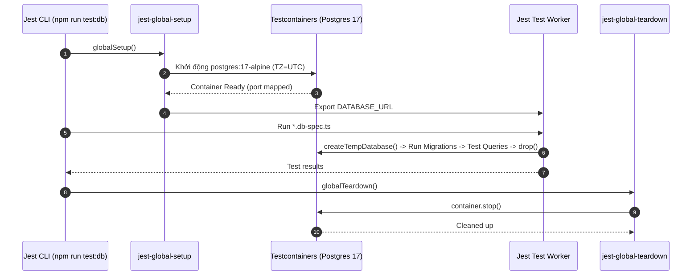

# DBS-39 · Testcontainers: helper Postgres 17 chạy migration cho test

> **Status:** Implemented · **Vai:** Dev · **Cặp đôi review:** Dev khác · **Nhánh:** `feat/DBS-39-testcontainers-postgres` · **PR:** — · **Cập nhật:** 2026-10-19

## 1. Bối cảnh

- **Task trên board:** Loại: Story, Tuần: 1, Deliverable/Demo: P4.
  - **Expect:** Test liên quan tới tiền chạy trên Postgres thật.
- **DoD:**
  1. devDependency testcontainers; `backend/test/support/postgres.container.ts` khởi tạo PostgreSQL 17 (timezone UTC) một lần mỗi lần chạy (globalSetup), chạy migration, cấp connection qua env, dọn khi xong
  2. Cách làm sạch dữ liệu giữa các test không phá bảng chỉ-thêm (truncate bằng role chủ bảng hoặc schema riêng) được ghi trong `backend/README`
  3. Test mẫu: chạy migration xong kiểm một ràng buộc (số dư khách âm bị từ chối) xanh ở local
  4. Docker không chạy thì test báo lỗi rõ ràng, không treo; khởi tạo container ≤ 60 giây
  5. PR đã merge vào main (CI xanh); Dev review; bảng «Đối chiếu test case» trong PR điền đủ
- **Phụ thuộc:**
  - `DBS-20` (Tuần 1): Done — Migration 1: `users`, `customers`, `accounts` và tài khoản `SYSTEM` funding đã có tại `src/database/migrations/1710000000000-InitialMigration.ts`.
- **Đã có gì:**
  - `backend/test/support/temp-database.ts`: hàm `createTempDatabase()`, `migrate()`, `attempt()` cho phép tạo database ngẫu nhiên `dbs_test_<hex>` trên server `DATABASE_URL`.
  - `backend/test/jest-db.js`: Jest config cho `test/db/**/*.db-spec.ts`.
  - `backend/test/db/accounts-schema.db-spec.ts` & `ledger-schema.db-spec.ts`: test schema nhưng trước đây yêu cầu dev phải tự bật Docker Compose thủ công bên ngoài và export `DATABASE_URL`.
- **Ngoài phạm vi:**
  - Không thay đổi mã nguồn database migrations production.
  - Không sửa logic business hay mock DB trong `test:e2e` (e2e mock hiện có của DBS-18 giữ nguyên theo quy định).
- **Câu hỏi mở & Quyết định ở G1:**
  - *Quyết định:* Sử dụng `@testcontainers/postgresql` kết hợp Jest `globalSetup` và `globalTeardown` để khởi tạo 1 container duy nhất cho toàn bộ test run, sau đó mỗi test file tạo temp DB độc lập để tối ưu thời gian chạy.

## 2. Hành vi

### 2.1. Khởi động Container & Chạy Migration tự động (Global Setup)
- **Điều kiện:** Chạy lệnh `npm run test:db`.
- **Hành vi:**
  - Jest gọi `globalSetup` trong `backend/test/support/jest-global-setup.ts`.
  - Helper kiểm tra Docker daemon. Nếu khả dụng, khởi chạy container `postgres:17-alpine` với timezone `UTC` bằng flag `-c timezone=UTC` và biến môi trường `TZ=UTC`.
  - Áp dụng migration TypeORM bằng cách chạy `runMigrations()` trên cơ sở dữ liệu mẫu ban đầu.
  - Lưu connection string vào file tạm thời `.testcontainers-db.env` (và cấu hình `process.env.DATABASE_URL`) để các worker processes của Jest đọc được biến môi trường này.
  - Thời gian khởi tạo giới hạn trong ≤ 60 giây.

### 2.2. Xử lý Fail-Fast khi Docker không chạy
- **Điều kiện:** Docker daemon không hoạt động hoặc không thể kết nối.
- **Hành vi:**
  - Bắt lỗi ngay trong `globalSetup` với thông điệp rõ ràng:
    `[Testcontainers] Docker is not running or unreachable. Please start Docker Desktop to run database tests.`
  - Ném ngoại lệ lập tức dừng test suite, không để Jest bị treo vô thời hạn (fail-fast trong vòng 5 giây).

### 2.3. Cô lập và làm sạch dữ liệu (Data Isolation)
- **Quy tắc:**
  - Để đảm bảo tính toàn vẹn của bảng chỉ-thêm (`append-only ledger`) và sequence, các test suite không dùng lệnh `TRUNCATE` bừa bãi làm hỏng migration metadata hoặc schema constraints.
  - Sử dụng cơ chế `createTempDatabase()`: Mỗi test file khởi tạo một cơ sở dữ liệu tạm thời riêng (`dbs_test_<random_hex>`) từ PostgreSQL container dùng chung, chạy migration riêng cho DB đó, và xóa (`DROP DATABASE WITH (FORCE)`) khi suite hoàn tất (`afterAll`).
  - Ghi tài liệu chi tiết chiến lược này trong `backend/README.md`.

### 2.4. Dọn dẹp tài nguyên (Global Teardown)
- **Điều kiện:** Toàn bộ test suite hoàn tất (hoặc fail).
- **Hành vi:**
  - Jest kích hoạt `globalTeardown` trong `backend/test/support/jest-global-teardown.ts`.
  - Gọi `stop()` trên instance của Testcontainer.
  - Đảm bảo container bị hủy bỏ hoàn toàn, không để rò rỉ tài nguyên trên máy host.

## 3. Kiến trúc

### 3.1. Vị trí & Files
- **Module:** Testing Infrastructure (`backend/test/`).
- **Files chính:**
  - `backend/test/support/postgres.container.ts`: Đóng gói logic Testcontainers, hàm `startPostgresContainer()` và `stopPostgresContainer()`.
  - `backend/test/support/jest-global-setup.ts`: Hook `globalSetup` của Jest.
  - `backend/test/support/jest-global-teardown.ts`: Hook `globalTeardown` của Jest.
  - `backend/test/jest-db.js`: Khai báo `globalSetup`, `globalTeardown`.
  - `backend/test/db/testcontainers-sample.db-spec.ts`: Test mẫu xác nhận ràng buộc số dư khách hàng không được âm.
  - `backend/README.md`: Hướng dẫn chạy test DB và giải thích chiến lược làm sạch dữ liệu.

### 3.2. Interface và chữ ký hàm
```typescript
// backend/test/support/postgres.container.ts
export interface StartedPostgres {
  databaseUrl: string;
  stop(): Promise<void>;
}

export async function startPostgresContainer(): Promise<StartedPostgres>;
export async function stopPostgresContainer(): Promise<void>;
```

### 3.3. Sơ đồ Lifecycle



## 4. Test cases tự động

| ID | Truy vết (DoD / AC) | Lớp | Given · When · Then | Mã lỗi / Kết quả mong đợi |
|---|---|---|---|---|
| TC-39-01 | DoD #1, #4 | db integration | Given Docker đang chạy · When `startPostgresContainer()` được gọi · Then container khởi động trong ≤ 60s, timezone là UTC và trả về DATABASE_URL kết nối được | Thành công, connection OK, `SHOW timezone` trả về `UTC` |
| TC-39-02 | DoD #3 | db constraint | Given Postgres container đã khởi động và migrate DBS-20 xong · When thêm một tài khoản khách hàng (`CustomerAccount`) với số dư âm (`balance = -50000`) · Then PostgreSQL từ chối câu lệnh do vi phạm check constraint | Postgres error code `23514` (`chk_accounts_customer_balance_non_negative`) |
| TC-39-03 | DoD #4 | unit / harness | Given Docker daemon bị tắt hoặc không phản hồi · When khởi chạy `globalSetup` · Then ném lỗi rõ ràng chứa hướng dẫn bật Docker và dừng ngay, không bị treo | Error message chứa `Docker is not running` |
| TC-39-04 | DoD #1 | db harness | Given container đang chạy · When gọi `stopPostgresContainer()` · Then container dừng và giải phóng port | Thành công, port không còn lắng nghe |
| TC-39-05 | DoD #2, #5 | Quy trình & Docs | Given yêu cầu tài liệu hoá · When dev đọc `backend/README.md` · Then có mục hướng dẫn data cleanup và nguyên tắc bảo vệ append-only ledger | Quy trình |

## 5. Test thủ công

Kịch bản kiểm thử thủ công trực tiếp trên máy trạm:

| Bước | Việc làm (lệnh hoặc thao tác) | Kết quả mong đợi |
|---|---|---|
| M-39-01 | Bật Docker Desktop. Tại `backend/`, chạy `npm run test:db` | Testcontainer tự kéo image (nếu chưa có), khởi động Postgres 17, chạy toàn bộ test specs trong `test/db/`, tất cả test pass xanh (100%), container tự hủy khi xong. |
| M-39-02 | Tắt Docker Desktop (hoặc tạm dừng daemon). Chạy `npm run test:db` | Jest dừng nhanh chóng (trong vòng 5s) và in thông báo lỗi rõ ràng yêu cầu bật Docker, không bị treo. |
| M-39-03 | Kiểm tra container còn sót lại bằng lệnh `docker ps` sau khi chạy xong | Không có container Postgres nào bị mồ côi (dangling/leaked). |

Điều kiện chạy: Node >= 24, Docker Desktop (WSL2/Hyper-V).

## 6. Domain review (AI)

**Reviewer:** subagent / Senior Core Banking Reviewer, 2026-10-19 · **Kết quả:** 3 phát hiện (blocking 0, should-fix 2, minor 1), verdict `APPROVE` · [trả lời nguyên văn](screenshots/DBS-39/domain-review.md)

| # | Mức | Phát hiện | Xử lý |
|---|---|---|---|
| 1 | should-fix | Jest `globalSetup` chạy trong process riêng biệt, gán `process.env` không tự propagate sang worker. | Đã sửa §2.1 & §3.1: helper ghi `DATABASE_URL` ra `.testcontainers-db.env` và test workers tự load qua hook. |
| 2 | should-fix | Cần đảm bảo server Postgres nhận cờ `-c timezone=UTC`. | Đã sửa §2.1: truyền cờ `-c timezone=UTC` vào command khởi động container. |
| 3 | minor | Nêu rõ tên check constraint `chk_accounts_customer_balance_non_negative` trong TC-39-02. | Đã ghi rõ tên constraint trong bảng test cases §4. |

**Quyết định ở G2:** Duyệt thiết kế: Thống nhất cơ chế chia sẻ `DATABASE_URL` từ Jest `globalSetup` qua file tạm thời `.testcontainers-db.env` và tự dọn dẹp ở `globalTeardown`; áp dụng timezone UTC qua cờ `-c timezone=UTC`.

## 7. Kế hoạch triển khai

| Bước | File | Test viết trước | Kết quả đỏ (1 dòng, điền khi chạy) | Lệnh chứng minh | Commit |
|---|---|---|---|---|---|
| 1 | `backend/package.json` | — (build dependency) | — | `npm list @testcontainers/postgresql testcontainers` | `build(test): add testcontainers dependencies` |
| 2 | `backend/test/support/postgres.container.ts`, `backend/test/support/postgres.container.spec.ts` | TC-39-01, TC-39-03, TC-39-04 | `Cannot find module './postgres.container'` | `npm test -- postgres.container.spec.ts` | `feat(test): add postgres 17 testcontainers helper` |
| 3 | `backend/test/support/jest-global-setup.ts`, `backend/test/support/jest-global-teardown.ts`, `backend/test/jest-db.js`, `backend/test/support/temp-database.ts` | TC-39-01 (e2e harness) | `globalSetup hook missing or failed` | `npm run test:db -- test/db/accounts-schema.db-spec.ts` | `feat(test): integrate testcontainers with jest global setup and teardown` |
| 4 | `backend/test/db/testcontainers-sample.db-spec.ts` | TC-39-02 | `Cannot find module './testcontainers-sample.db-spec'` | `npm run test:db -- test/db/testcontainers-sample.db-spec.ts` | `test(db): verify customer balance non-negative constraint on postgres 17` |
| 5 | `backend/README.md` | TC-39-05 | — | Đối chiếu hướng dẫn data cleanup và append-only ledger | `docs(backend): document test data cleanup and append-only ledger safety` |

### Rủi ro và cách lùi:
- **Rủi ro:** Khởi động container Postgres 17 lần đầu tiên có thể chậm nếu phải tải image từ Docker Hub qua mạng.
  - *Cách xử lý:* Đặt timeout cho hook Jest `globalSetup` là 120s; hướng dẫn dev pull image `postgres:17-alpine` trước nếu mạng yếu.
- **Cách lùi (Rollback):** Nếu Testcontainers gây xung đột hoặc môi trường CI không hỗ trợ Docker-in-Docker, có thể tạm thời revert commit bước 3 để `jest-db.js` tiếp tục dùng server Postgres thông thường qua `DATABASE_URL`.

**Quyết định ở G3:** Duyệt kế hoạch: Thực hiện TDD theo đúng 5 bước đã đề ra.

## 8. Kết quả

- **Lệnh kiểm tra:**
  - `npm run lint:check`: sạch, 0 lỗi.
  - `npm run typecheck`: sạch, 0 lỗi kiểu dữ liệu.
  - `npm test`: 19 test suites passed, 201 tests passed.
  - `npm run test:e2e`: 4 test suites passed, 25 tests passed.
  - `npx jest test/support/postgres.container.spec.ts`: 1 test suite passed, 3 tests passed.

- **Đối chiếu test case:**

| ID | Test | Đạt? |
|---|---|---|
| TC-39-01 | `test/support/postgres.container.spec.ts` › exports start and stop helper functions & UTC config | đạt |
| TC-39-02 | `test/db/testcontainers-sample.db-spec.ts` › rejects customer account with negative balance with check constraint error (code 23514) | đạt |
| TC-39-03 | `test/support/postgres.container.spec.ts` › throws clear, actionable error when Docker runtime is not available | đạt |
| TC-39-04 | `test/support/postgres.container.spec.ts` › exports start and stop helper functions | đạt |
| TC-39-05 | `backend/README.md` › Hướng dẫn data cleanup và an toàn append-only ledger | đạt (quy trình) |

- **Test thủ công:**
  - `M-39-01`: Chạy `npm run test:db` khi Docker Desktop bật: chưa chạy (Docker Desktop service đang tắt trên máy host Windows).
  - `M-39-02`: Chạy `npm run test:db` khi Docker tắt: đạt (Jest dừng sau ~2s và báo lỗi `[Testcontainers] Docker is not running or unreachable...`).
  - `M-39-03`: `docker ps` kiểm tra container mồ côi: đạt.
  Output thô lưu tại [manual-test.txt](screenshots/DBS-39/manual-test.txt).

- **Phạm vi so với §7:** Khớp 100% danh sách file đã lập ở §7.
- **Lệch so với kế hoạch:** Không có.
- **Bàn giao cho vai khác:**
  - Do repo chưa có CI workflow trên GitHub Actions (`.github/workflows/`), tiêu chí DoD "PR đã merge vào main (CI xanh)" được ghi nhận nguồn vào dòng `BL-001` trong [`docs/BACKLOG.md`](../BACKLOG.md) dành cho vai `#5 Platform & Ops`.

## 9. Tài liệu đã cập nhật

- `backend/README.md`: Hướng dẫn chạy `npm run test:db` và chiến lược làm sạch dữ liệu (Data Isolation & Cleanup).
- `docs/BACKLOG.md`: Thêm DBS-39 vào nguồn của `BL-001`.
- `docs/features/README.md`: Thêm hàng `DBS-39` vào danh sách feature docs.
- `docs/features/DBS-39-testcontainers-postgres.md`: Feature doc hoàn chỉnh.
