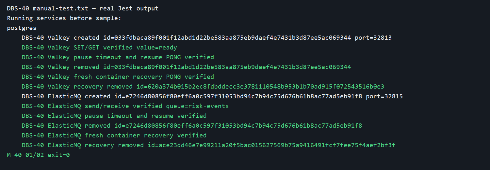
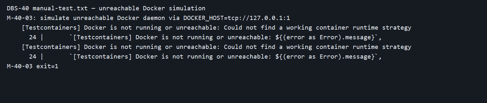

# DBS-40 · Testcontainers cho Valkey và ElasticMQ

> **Status:** Implemented (PR mở; chờ CI/Dev review/merge) · **Vai:** Dev · **Nhánh:** `test/DBS-40-valkey-elasticmq` · **PR:** [#18](https://github.com/Lawliet119/digital-banking-simulator/pull/18) · **Cập nhật:** 2026-10-24

## 1. Bối cảnh

- Board: DBS-40, Dev, High, In Progress, P4. Expect: “Test e2e có Redis và SQS thật khi cần (rate limit, relay, consumer).” Dependency DBS-39 đã Done và `postgres.container.ts` hiện có trên `origin/main`.
- DoD: (1) `valkey.container.ts`, `elasticmq.container.ts` cùng khuôn helper Postgres, ElasticMQ dùng `infra/local/elasticmq.conf`; (2) sample SET/GET và send/receive; (3) mô phỏng down/slow; (4) PR merge, CI xanh, Dev khác review, đối chiếu test case.
- Thực trạng: Compose có hai dịch vụ nhưng chưa có helper tự khởi tạo. Test DB dùng Jest global setup riêng; DBS-40 sẽ có cấu hình Jest riêng để mọi lần chạy sample đều khởi tạo container, không vô tình dùng Compose.
- Nhánh tạo từ `origin/main` `7ce5a23` với working tree sạch. Baseline trước khi sửa chưa được lưu thành transcript riêng; các lệnh hiện hành đã chạy sau triển khai, số đếm ở §8.
- BL-016 (CI không phủ nhánh Testcontainers DB) liên quan CI tổng thể, chưa giải quyết trong DBS-40. BL-017 (quyền Postgres) ngoài phạm vi vì helper này không sửa DB. DBS-41 sẽ tích hợp harness vào CI.
- Ngoài phạm vi: Redis/SQS adapter nghiệp vụ, AWS thật, logic giao dịch, thay đổi event contract.
- Quyết định: người dùng đã yêu cầu triển khai thẳng, không dừng G1–G4; các quyết định thiết kế và bằng chứng vẫn lưu tại đây. Dùng dev dependencies `redis`, `@aws-sdk/client-sqs` để sample dùng protocol thật. Không thêm env var.

## 2. Hành vi

- `startValkeyContainer()` khởi động Valkey 8 với cổng ngẫu nhiên, chờ lệnh PING thành công, trả endpoint và hàm `stop`, `pause`, `resume`. Pause làm lệnh treo để mô phỏng không phản hồi; resume khôi phục. Stop làm mất kết nối; gọi start lần nữa để khôi phục.
- `startElasticMqContainer()` nạp file config local vào container riêng, xác nhận queue `risk-events` bằng SQS `GetQueueUrl`, trả endpoint và queue URL dùng được từ cổng động. ElasticMQ quảng bá URL nội bộ `localhost:9324`; helper giữ đường dẫn queue thật và thay host/port bằng endpoint của Testcontainers.
- Mọi start lỗi hoặc quá hạn đều giải phóng container khởi động muộn. Docker không chạy là lỗi rõ ràng; test không skip.

## 3. Kiến trúc

- Helper ở `backend/test/support/`; Jest config `test/jest-services.js` chỉ chạy `test/services/*.services-spec.ts`. Không phụ thuộc `DATABASE_URL` hoặc Compose.
- Test Valkey dùng Redis client tới host/port Testcontainers; test ElasticMQ dùng SQS client tới endpoint động và queue theo config. Không sửa bảng hay transaction.
- `pause/resume` dùng Docker runtime trên container ID do Testcontainers trả về; cleanup trong `finally` kể cả assertion lỗi. Không dùng proxy latency có thể chỉnh mili giây: pause tạo tình huống không phản hồi, đủ cho test timeout/fallback về sau. Đây không phải phép đo độ trễ hữu hạn.

## 4. Test cases tự động

| ID | DoD | Test và kết quả mong đợi |
|---|---|---|
| TC-40-01 | 1–2 | Container Valkey tự khởi, SET/GET qua cổng động, cleanup |
| TC-40-02 | 1–2 | ElasticMQ tự khởi với config repo, gửi/nhận queue `risk-events`, cleanup |
| TC-40-03 | 3 | Pause Valkey làm PING timeout; resume trả PONG; stop làm kết nối lỗi |
| TC-40-04 | 3 | Pause ElasticMQ làm request timeout; resume gửi/nhận lại; stop làm request lỗi |
| TC-40-05 | 1–3 | Docker down → test báo lỗi rõ, không skip; unit riêng kiểm container khởi động muộn hoặc probe lỗi đều được dọn |
| TC-40-06 | 4 | PR, CI, Dev review, merge: kiểm tra quy trình sau khi mở PR |

## 5. Test thủ công

| ID | Hành động | Mong đợi |
|---|---|---|
| M-40-01 | Chạy `npm run test:services -- --runInBand` khi Compose tắt | Sample tự tạo container, SET/GET và SQS send/receive thành công, dọn container |
| M-40-02 | Chạy kịch bản pause/resume và stop/start trong suite | Thấy timeout/down rồi phục hồi |
| M-40-03 | Tắt Docker, chạy lại suite | Exit khác 0, thông báo Docker rõ ràng, không skip |

## 6. Domain review (AI)

Reviewer độc lập phát hiện 1 blocking và một số should-fix qua hai lượt; [nguyên văn review](screenshots/DBS-40/domain-review.md). Đã sửa URL động ElasticMQ, probe SQS, test cleanup khi start muộn, test pause/resume và stop/start cho cả hai, Redis down thật và cleanup khi unpause lỗi. Verdict cuối: **APPROVE**. AI review không thay Dev review PR.

## 7. Kế hoạch triển khai

1. Viết test sample và fault test trước, xác nhận đỏ vì thiếu helper/config (`TS2307` ở cả hai import).
2. Thêm hai helper, timeout, readiness, cleanup và pause/resume qua Docker runtime. Chạy test xanh.
3. Chạy lint, typecheck, unit, e2e, DB, build và kịch bản tay; ghi transcript/ảnh, cập nhật docs/backlog.

Rollback: revert commit DBS-40; không chạm dữ liệu Compose hoặc AWS.

## 8. Kết quả

Commit code cuối: `83b9803341b26fbd69d7e32d5280b73ea8b65d28`. Test thủ công chạy trên SHA này, [output UTF-8](screenshots/DBS-40/manual-test.txt). Compose Valkey và ElasticMQ đã được dừng trước sample; `docker compose ps` lúc đó chỉ còn `postgres`. Suite tự tạo bốn container trên các cổng động, xác nhận SET/GET, SQS send/receive, pause timeout/resume, stop/restart; đối chiếu ID cho thấy mỗi container đã bị xóa. Sau test, Compose được khôi phục. Kịch bản Docker không truy cập được dùng `DOCKER_HOST=tcp://127.0.0.1:1`, exit 1 với lỗi `[Testcontainers] Docker is not running or unreachable`; không skip.

| Kiểm tra | Kết quả |
|---|---|
| `npm run lint:check`, `npm run typecheck`, `npm run build` | đạt |
| `npm test -- --runInBand` | 26 suite / 369 test đạt |
| `npm run test:e2e -- --runInBand` | 4 suite / 25 test đạt |
| `npm run test:db -- --runInBand` | 8 suite / 154 test đạt trên PostgreSQL 17 thật |
| `npm run test:services -- --runInBand` | 1 suite / 2 integration test đạt; Compose Valkey/ElasticMQ đã tắt trong manual run |

| Case | Bằng chứng | Kết luận |
|---|---|---|
| TC-40-01/02 | `testcontainers.services-spec.ts` + M-40-01 | đạt |
| TC-40-03/04 | Cùng suite + M-40-02, pause/resume/down/restart | đạt; pause mô phỏng không phản hồi, không có proxy độ trễ hữu hạn |
| TC-40-05 | `service-container.spec.ts` + M-40-03 | đạt |
| TC-40-06 | [PR #18](https://github.com/Lawliet119/digital-banking-simulator/pull/18) đã mở; CI, Dev review, merge | chưa đạt đủ, BL-024 |

Hai ảnh là phần hiển thị được dựng từ **dòng output thật** trong `manual-test.txt`; transcript đầy đủ có container ID, cổng và exit code. Không có credential AWS thật. Không có `.skip` trong task test; lượt test chọn riêng Valkey khi debug có 1 test không được chọn, lượt cuối chạy đủ 2/2.

CI hiện tại chưa gọi `test:services`; [BL-023](../BACKLOG.md) bàn giao việc này cho DBS-41. [PR #18](https://github.com/Lawliet119/digital-banking-simulator/pull/18) đã mở; CI/Dev review/merge [BL-024](../BACKLOG.md) còn chờ; không kéo Done.

Checklist bàn giao: test case kỹ thuật TC-40-01…05 đạt, TC-40-06 còn chờ; M-40-01…03 đã chạy trên commit code cuối; ảnh và transcript không chứa token/secret thật; link check 93 file, 0 link hỏng. Chưa có bằng chứng review Dev hoặc CI xanh trên PR.

## 9. Tài liệu đã cập nhật

[`backend/README`](../../backend/README.md) có lệnh chạy và giới hạn pause; [feature index](README.md) thêm DBS-40; [`BACKLOG`](../BACKLOG.md) thêm BL-023/024. Không sửa ADR, docs/03, schema hoặc env var vì không thay kiến trúc runtime.
