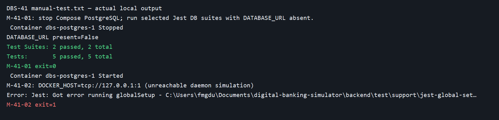
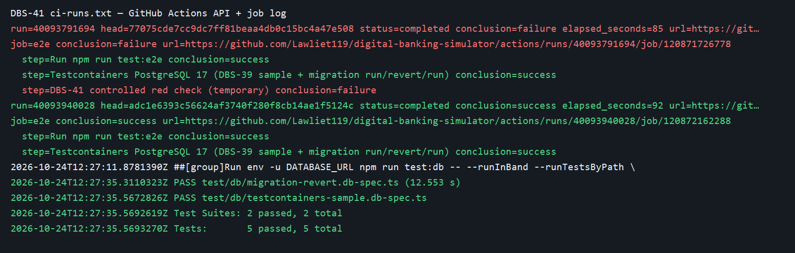

# DBS-41 · Testcontainers trong CI và migration run → revert → run

> **Status:** Implemented (PR Ready for review; vừa rebase theo `main`, chờ CI chạy lại và Dev review/merge) · **Vai:** Dev · **Nhánh:** `infra/DBS-41-testcontainers-ci` · **PR:** [#19](https://github.com/Lawliet119/digital-banking-simulator/pull/19) · **Cập nhật:** 2026-10-27

## 1. Bối cảnh

- Board: DBS-41, Dev, Highest, In Progress, P4. Expect: “CI chứng minh test trên Postgres thật và migration revert được ở mỗi PR.” Dependency DBS-39, DBS-35, DBS-21 đều **Done** và code của cả ba có trên `origin/main` `7ce5a23`.
- DoD: (1) `ci.yml` có bước `test:e2e` dùng Docker runner, tổng CI mục tiêu ≤10–12 phút; (2) migration run → revert → run trên DB trống, fail nếu lỗi; (3) sample DBS-39 xanh trong CI; (4) PR merge main, CI xanh, Dev khác review, bảng đối chiếu TC đầy đủ.
- Hiện tại job `e2e` chỉ chạy `test/*.e2e-spec.ts` (không DB), job `db` chạy `test/db/*.db-spec.ts` trên service PostgreSQL 17 với `DATABASE_URL` có sẵn. `jest-global-setup.ts` chỉ gọi `startPostgresContainer()` khi biến này rỗng. Vì vậy CI xanh trước task không chứng minh đường tự tạo container.
- `migration-revert.db-spec.ts` đã có TC-21-23: tạo database `dbs_test_*` mới, chạy CLI `migration:run`, revert lần lượt qua các migration mới hơn, revert migration 2 và 1, kiểm bảng migration 1/2 và funding, sau đó `migration:run` lại. Migration mới hơn được kiểm lịch sử chạy/revert/run, chưa có assert đầy đủ mọi object của từng migration. `temp-database.ts` chỉ drop tên hợp regex `dbs_test_*`; không revert DB chia sẻ.
- BL-016 được nhận vào scope: CI sẽ thực sự chạy nhánh Testcontainers. BL-017 về quyền production role không thuộc CI migration này; DBS-40 PR #18 còn mở và BL-023 (đưa `test:services` vào CI) nằm ở nhánh đó, chưa thể chạy từ `main` vì các file chưa merge.
- Không sửa tên required checks (`lint`, `typecheck`, `unit`, `e2e`, `db`, `build`), schema, migration hay lệnh production. Không thêm dependency. Nâng timeout riêng job `e2e` từ 10 lên 15 phút để không cắt mất phép đo mục tiêu 10–12 phút; đạt mục tiêu hay không chỉ kết luận theo run thật.
- Quyết định người dùng: triển khai liên tục, không dừng G1–G4; vẫn ghi thiết kế, review, test và bằng chứng. Không tự merge hoặc thay board.

## 2. Hành vi

- Job `e2e` tiếp tục chạy `npm run test:e2e`, sau đó chạy **hai** suite DB trên Docker của `ubuntu-24.04`: `testcontainers-sample.db-spec.ts` và `migration-revert.db-spec.ts`. Bước mới bỏ `DATABASE_URL` từ môi trường lệnh; Jest global setup bắt buộc tự khởi tạo PostgreSQL 17, teardown dừng nó. Một failure ở suite, setup hay teardown làm job đỏ.
- Job `db` hiện tại tiếp tục chạy toàn bộ DB suite bằng service Postgres riêng; không thay tên check. Hai đường CI có chủ ý: Testcontainers tự khởi ở `e2e`, DB service ở `db`.
- Không tuyên bố đạt 10–12 phút bằng ước lượng; đo `created_at` → `updated_at` của workflow run thật và ghi từng job/URL.

## 3. Kiến trúc

- Chỉ sửa `.github/workflows/ci.yml` và tài liệu. `test:e2e` và `test:db` vẫn tách Jest config; không đổi matcher hay global setup. Job `e2e` không cấp service/database URL. Lệnh `env -u DATABASE_URL` xác nhận đường tự tạo; sample DBS-39 và migration spec hiện có là caller thực tế.
- Database tạm do `createTempDatabase()` tạo trên Testcontainers, đặt tên `dbs_test_<12 hex>`; CLI migration chỉ nhận URL này trong spec. Runner service ở job `db` là một máy job khác nên không thể bị revert bởi bước `e2e`.
- Ranh giới CI: một PR/commit kích hoạt sáu check song song; job `e2e` chạy thêm test DB thật, job `db` vẫn là test suite đầy đủ trên service.

## 4. Test cases tự động

| ID | DoD | Chứng minh |
|---|---|---|
| TC-41-01 | #1, #3 | Job `e2e` chạy `test:e2e`, rồi `test:db --runTestsByPath` với `env -u DATABASE_URL`. Kết hợp điều kiện trong `jest-global-setup.ts` và sample DBS-39 xanh là bằng chứng đường tự khởi container; không giả định log có startup marker |
| TC-41-02 | #2 | `migration-revert.db-spec.ts` TC-21-23 chạy trong job `e2e`, database tạm mới, kiểm bảng/migration trước và sau revert/run; step fail nếu test fail |
| TC-41-03 | #1 | Tên sáu job không đổi; đo thời gian workflow CI thật từ GitHub Actions, kết luận đạt/chưa đạt theo kết quả |
| TC-41-04 | #4 | PR có bảng đối chiếu, CI trên head cuối xanh, Dev khác review và merge mới là Done |

## 5. Test thủ công

| ID | Hành động | Mong đợi |
|---|---|---|
| M-41-01 | Ở local xóa `DATABASE_URL` cho đúng một lệnh `test:db --runTestsByPath` hai file | Docker tự khởi PostgreSQL; cả hai suite xanh; container được dọn |
| M-41-02 | Đặt `DOCKER_HOST` giả rồi chạy lại lệnh | Lỗi rõ ở global setup, exit khác 0, không skip |
| M-41-03 | Mở PR và đọc Actions trên head cuối | Sáu check; `e2e` log hai suite DB và `db` service suite; ghi run URL và thời lượng thật |

## 6. Domain review (AI)

Reviewer độc lập nêu 2 should-fix và một giới hạn độ sâu migration; đã sửa §1–§4 và kế hoạch. [Nguyên văn review](screenshots/DBS-41/domain-review.md). Re-review kết luận **APPROVE**, không còn blocking.

## 7. Kế hoạch triển khai

1. Kiểm tra local hai suite với `DATABASE_URL` rỗng và Docker giả lỗi để có baseline chính xác; xác nhận suite migration có thể dùng lại, không viết test lặp.
2. Sửa **chỉ job `e2e`** trong `.github/workflows/ci.yml`: giữ bước hiện có, thêm step Testcontainers với `env -u DATABASE_URL npm run test:db -- --runInBand --runTestsByPath ...`; nâng timeout job `e2e` lên 15 phút, giữ sáu job/check, không đụng job `db`.
3. Chạy YAML syntax, local e2e + DB selected, lint/typecheck/unit/build; manual script và transcript trên commit code cuối. Viết docs, cập nhật BL-016. Mở Draft PR, thêm một bước `exit 1` tạm thời **sau** hai suite Testcontainers để chứng minh CI bắt lỗi, lưu run đỏ, rồi xóa bước đó và xác nhận run xanh trên head cuối. Đo thời gian CI thật; không tự merge.

Rollback: revert commit workflow. Không có migration/data của môi trường chia sẻ bị sửa.

## 8. Kết quả

Commit workflow cuối: `adc1e6393c56624af3740f280f8cb14ae1f5124c`. [PR #19 Ready for review](https://github.com/Lawliet119/digital-banking-simulator/pull/19) có bảng đối chiếu test case. Local sau thay đổi: lint, typecheck, build đạt; 25 suite / 367 unit, 4 suite / 25 e2e, 8 suite / 154 DB test đạt. Riêng hai suite của step mới đạt 2 suite / 5 test với `DATABASE_URL` rỗng. YAML parse được và sáu job name giữ nguyên; `actionlint` chưa cài local, bằng chứng thực thi là GitHub Actions.

**CI thật:** [run đỏ chủ ý #40093791694](https://github.com/Lawliet119/digital-banking-simulator/actions/runs/40093791694) trên `77075cd` hoàn tất trong 85 giây. `test:e2e` và bước Testcontainers đều **success**, bước `exit 1` tạm sau đó làm `e2e` failure. Sau khi xóa bước tạm, [run xanh #40093940028](https://github.com/Lawliet119/digital-banking-simulator/actions/runs/40093940028) trên `adc1e63` có cả sáu job **success**. Run xanh từ `run_started_at` đến `updated_at` là **92 giây** (hai timestamp `created_at`/`run_started_at` trùng nhau ở run này); job `e2e` 61 giây, step Testcontainers 24 giây, job `db` 87 giây. Run này đạt mục tiêu ≤10–12 phút; đây là một phép đo thực, không khẳng định mọi run tương lai đều như vậy. [Metadata và trích log](screenshots/DBS-41/ci-runs.txt) ghi `env -u DATABASE_URL`, `PASS migration-revert`, `PASS testcontainers-sample`, 2 suite/5 test.

[Run #40094209631](https://github.com/Lawliet119/digital-banking-simulator/actions/runs/40094209631) trên commit tài liệu `240c530` cũng xanh 6/6 job, **113 giây**. PR đã chuyển từ Draft sang Ready for review sau run này.

| Case | Bằng chứng | Kết luận |
|---|---|---|
| TC-41-01 | Job `e2e` trên run xanh; lệnh `env -u DATABASE_URL`, setup chỉ có đường tự tạo container khi biến rỗng, sample DBS-39 PASS | đạt; không có startup marker/ID riêng trong Actions log |
| TC-41-02 | `migration-revert.db-spec.ts` PASS trong cùng step; TC-21-23 tạo `dbs_test_*`, chạy CLI run/revert/run và kiểm lịch sử/bảng/funding | đạt theo smoke requirement; migration mới hơn chưa assert mọi object |
| TC-41-03 | Sáu job name nguyên vẹn; run xanh 92 giây | đạt trên run này |
| TC-41-04 | [PR #19](https://github.com/Lawliet119/digital-banking-simulator/pull/19) có bảng đối chiếu, CI xanh; Dev review/merge | chưa đạt đủ, BL-052 |

**Test thủ công:** [manual-test.txt](screenshots/DBS-41/manual-test.txt) bắt đầu bằng SHA workflow cuối. M-41-01: dừng Compose PostgreSQL, `docker compose ps` chỉ còn Valkey/ElasticMQ; xóa `DATABASE_URL` và chạy hai suite, 2/2 suite, 5/5 test, exit 0; Compose PostgreSQL được khôi phục. M-41-02: `DOCKER_HOST=tcp://127.0.0.1:1` làm global setup báo Docker unreachable, exit 1, không skip. M-41-03: hai Actions run nêu trên, run cuối xanh và đã đo thời gian.

Hai ảnh hiển thị trích đoạn **output thật** từ transcript local và Actions API/job log; bản text đầy đủ giữ bên cạnh. Không có AWS credential hoặc token thật.

BL-016 được giải quyết bởi step Testcontainers trên Actions và đã xóa khỏi BACKLOG trong PR. BL-017 (test production DB role) vẫn ngoài scope. `test:services` của [DBS-40 PR #18](https://github.com/Lawliet119/digital-banking-simulator/pull/18) chưa có trên `main` của nhánh này; việc tích hợp suite đó thuộc BL-023 của PR #18 sau khi nó merge. Dev review và merge cho DBS-41 là BL-052 (đổi số từ BL-025: `main` đã dùng BL-025 cho DBS-42 kể từ khi nhánh này rẽ ra). Không kéo Done trước các bước này.

**Rebase 2026-10-27:** `main` đã có commit `3de623e` *fix(ci): add postgres service to e2e job (BUG-20261027)* thêm `services.postgres`/`env.DATABASE_URL` vào job `e2e` cho `app-guard.e2e-spec.ts` (DBS-50, boot `AppModule` thật). Merge `origin/main` vào nhánh này xung đột ở `.github/workflows/ci.yml` và `docs/BACKLOG.md`; đã giải quyết bằng cách **giữ cả hai**: job `e2e` tiếp tục có `services.postgres`/`env.DATABASE_URL` (cho bước `npm run test:e2e`) và vẫn giữ `timeout-minutes: 15` cùng step Testcontainers với `env -u DATABASE_URL` riêng cho lệnh đó — hai yêu cầu không loại trừ nhau vì `env -u` chỉ gỡ biến cho đúng một lệnh con. `docs/BACKLOG.md` đổi `BL-025` (DBS-41) thành `BL-052` để không trùng `BL-025` đã dùng cho DBS-42 trên `main`. Cần chạy lại CI thật trên commit merge này để đo lại thời gian và xác nhận cả hai job `e2e`/`db` xanh trước khi coi TC-41-01…03 là "đạt" trên head mới.

Checklist G4: TC-41-01…03 đạt trên CI thật, TC-41-04 chờ Dev review/merge; M-41-01…03 đã chạy; ảnh và transcript không có secret thật; code diff chỉ workflow theo §7; link check và diff check ghi ở §9; sáu kiểm tra local đã chạy, CI xanh trên commit workflow cuối.

## 9. Tài liệu đã cập nhật

[`backend/README`](../../backend/README.md) mô tả hai đường CI; [feature index](README.md) thêm DBS-41; [`BACKLOG`](../BACKLOG.md) xóa BL-016, thêm BL-052 (đổi từ BL-025 khi rebase 2026-10-27). Không sửa ADR, schema, migration hoặc env var production. Link check: đang chạy ở bước bàn giao.
