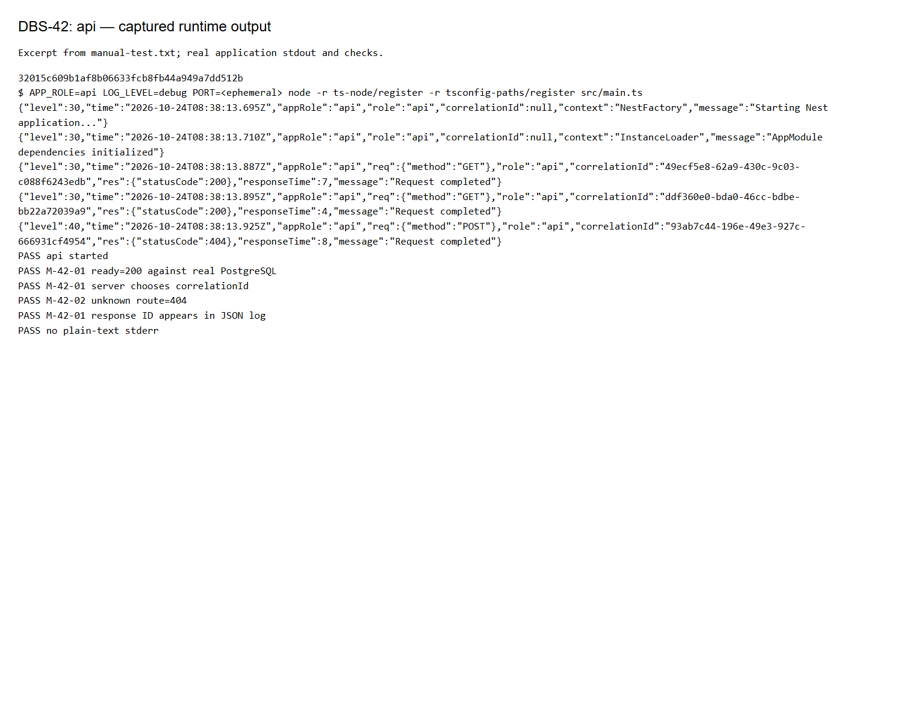
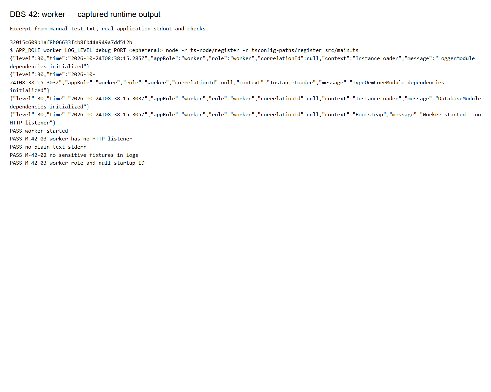

# DBS-42 · Logger JSON bằng nestjs-pino với trường chuẩn

> **Status:** Implemented (local, chờ PR/CI/Dev review) · **Vai:** Dev · **Review:** Dev khác, chưa xác nhận người review · **Nhánh:** `feat/DBS-42-json-logger` · **PR:** chưa có · **Cập nhật:** 2026-10-24

## 1. Bối cảnh

### Nguồn task và DoD

- **Nguồn chính:** đã đọc và chạy `node .claude/skills/dbs-delivering-task/scripts/fetch-task.mjs DBS-42`; lấy được task từ sheet ngày 2026-10-24. Mô tả người dùng khớp dữ liệu lấy được; không cần dùng nguồn dự phòng.
- **Task trên board:** loại Task; Tuần 1; vai Dev; ưu tiên High; Status **In Progress**; Deliverable/Demo **P4**. Vai Dev khớp loại việc nền tảng backend. Agent không đổi board; người dùng giữ task ở In Progress trong quá trình thực hiện.
- **Expect (nguyên văn):** Mọi dòng log là một object JSON máy đọc được.
- **Thực trạng (nguyên văn):** Log hiện là text của NestJS Logger; package.json chưa có thư viện logger JSON. correlation-id.middleware.ts đã sinh correlationId cho mỗi request nhưng log chưa mang theo.
- **DoD (nguyên văn, đánh số để truy vết):**
  1. Logger JSON mỗi dòng có level, time (ISO UTC), message, role (api|worker), correlationId
  2. Redact Authorization, token, mật khẩu; không log body có số tài khoản đầy đủ
  3. Log level theo env (log-levels.ts hiện có); test cấu hình
  4. backend/README ghi quy ước log (trường chuẩn, điều không được log)
  5. PR đã merge vào main (CI xanh); Dev review; bảng «Đối chiếu test case» trong PR điền đủ
- **Phụ thuộc của DBS-42:** sheet ghi `— (làm được ngay)`. Không có dependency cần stub.
- **Task liên quan:** đã chạy fetch-task cho **DBS-43**: Dev, High, In Progress, phụ thuộc DBS-42. Expect của DBS-43 là lấy correlationId ở mọi tầng mà không phải truyền tay; DoD gồm provider/hàm ALS chung, context worker/consumer từ message và test request song song không lẫn ID. Không coi DBS-43 đã triển khai hoặc đã phối hợp chỉ vì board ghi In Progress.
- **Quy trình:** [skill](../../.claude/skills/dbs-delivering-task/SKILL.md), [team](../../.claude/skills/dbs-delivering-task/references/team.md), [task-kinds](../../.claude/skills/dbs-delivering-task/references/task-kinds.md), [module-notes](../../.claude/skills/dbs-delivering-task/references/module-notes.md), [testing](../../.claude/skills/dbs-delivering-task/references/testing.md), [manual-testing](../../.claude/skills/dbs-delivering-task/references/manual-testing.md), [docs-style](../../.claude/skills/dbs-delivering-task/references/docs-style.md) và [CONTRIBUTING](../../CONTRIBUTING.md). Không tìm thấy AGENTS.md trong repo hoặc các thư mục cha đã kiểm tra. `docs/plan/TEAM_ROLES_PLAYBOOK.md` của phiên làm việc trước không còn trên main hiện tại; dùng quy ước Dev trong team reference và CONTRIBUTING hiện có.

### Repo, tài liệu và thực trạng đã kiểm tra

- **Git:** bắt đầu trên main, working tree sạch; đã `git fetch origin`, main và origin/main cùng `3b81c55`, số commit lệch `0 0`. Đã tạo nhánh task từ main này. Chưa commit, push hay gọi gh/GitHub API; chưa kiểm danh sách PR đang mở.
- **Tài liệu:** [docs/README](../README.md), [docs/02](../02_REQUIREMENTS_AND_DOMAIN_MODEL.md) NFR-OBS-01, NFR-SEC-04; [docs/03](../03_HIGH_LEVEL_ARCHITECTURE.md) §7 (lỗi), §12 (bảo mật), §14 (log/quan sát), §19 (công cụ); [observability concept](../components/observability/01-concept-brief.md); [threat-model T15](../security/threat-model.md); [ADR-01](../adr/0001-modular-monolith-worker.md) và [ADR-13](../adr/0013-one-app-app-role.md). Log vận hành không thay thế audit log trong transaction.
- **Task trước:** [DBS-22](DBS-22-common-money-type-dto-validator.md) đặt bootstrap JSON bigint ở mọi role; [DBS-39](DBS-39-testcontainers-postgres.md) có harness DB; [DBS-35](DBS-35-ci-github-actions.md) quy định sáu check CI. Không thay đổi các hành vi đó trong DBS-42.
- **Code hiện có:** [main.ts](../../backend/src/main.ts) dùng `logLevels(...)` cho Nest Logger và ba chỗ `console.log`; [AppModule](../../backend/src/app.module.ts) chưa có logger JSON; [app.setup.ts](../../backend/src/app.setup.ts) gắn correlation middleware; [middleware](../../backend/src/common/middleware/correlation-id.middleware.ts) sinh UUID mới bằng randomUUID, không lấy X-Correlation-Id từ client. X-Request-Id của client được kiểm UUID và echo riêng.
- [log-levels.ts](../../backend/src/common/utils/log-levels.ts) có thứ tự `fatal > error > warn > log > debug > verbose`, mặc định/fallback `log`, đã có ba test. [app.config.ts](../../backend/src/config/app.config.ts) có logLevel; [schema](../../backend/src/config/validation.schema.ts) chấp nhận sáu mức đó; [env example](../../backend/env/.env.example) đặt LOG_LEVEL=debug cho local. Đề xuất giữ biến và các giá trị hiện có, không thêm env var.
- [ProblemDetailsFilter](../../backend/src/common/filters/problem-details.filter.ts) và [TransactionService](../../backend/src/database/transaction.service.ts) dùng Nest Logger; filter hiện nối raw request.url và error message/stack vào chuỗi. Đã gọi filter thật bằng driver với fixture HTTP host và token/password giả: giá trị giả xuất hiện trong log warn. Đây là tái hiện ở cấp filter, không phải request lỗi đi qua ứng dụng thật; [output đã che giá trị giả](screenshots/DBS-42/security-before.txt). Vì vậy chỉ cấu hình redact theo key sẽ chưa đủ cho các chuỗi log hiện có; đưa việc làm sạch các điểm log này vào phạm vi thiết kế.
- **Đã chạy ứng dụng nguồn thật:** hai tiến trình riêng APP_ROLE=api và worker bằng ts-node; env lấy từ tệp example, API dùng port 33042; API live/ready đều 200 với PostgreSQL thật. Hai request gửi cùng client ID nhận hai server correlationId khác nhau, khác client ID. API có 16 dòng startup, worker có 9 dòng, **0 dòng JSON object** ở mỗi role. [Output trước thay đổi](screenshots/DBS-42/runtime-before.txt); đây là quan sát Phase 1, chưa phải manual-test.txt trên commit cuối. Hai tiến trình thử đã dừng; Compose vẫn chạy.
- **Export/callers đã grep để chuẩn bị thiết kế:** logLevels gọi ở main.ts và log-levels.spec.ts; correlationIdMiddleware đăng ký trong app.setup.ts, kiểm ở correlation-id.middleware.spec.ts; configureHttpApp gọi từ main.ts, health.e2e-spec.ts, error-handling.e2e-spec.ts, money.e2e-spec.ts và test/support/money-driver.ts. Logger hiện có ở filter và TransactionService; error-handling.e2e-spec.ts kiểm lời gọi Logger. Nếu đổi exported symbol khác ở G2/G3 sẽ grep bổ sung.

### Baseline

Node 24.19.0, npm 11.17.0. Ban đầu chưa có node_modules, env local hoặc Docker daemon. Đã npm ci theo lockfile, khởi động Docker Desktop; lần pull image đầu lỗi mạng EOF, lần thử lại thành công. Không thêm dependency hoặc sửa manifest/lockfile. Compose dùng giá trị local mặc định; các lần chạy app và test DB lấy env từ tệp example trong tiến trình, không tạo env file hoặc dùng credential thật.

| Lệnh | Kết quả thực tế trước thay đổi |
|---|---|
| docker compose up -d | Đạt sau lần thử lại; PostgreSQL 17, Valkey, ElasticMQ đã chạy |
| npm run lint:check | Exit 0 |
| npm run typecheck | Exit 0 |
| npm test | 25 suite / 367 test đạt; 0 bỏ qua |
| npm run test:e2e | 4 suite / 25 test đạt; 0 bỏ qua; suite hiện có dùng DB mock, không gọi đây là bằng chứng DB thật |
| npm run test:db | 5 suite / 91 test đạt; 0 bỏ qua; PostgreSQL 17 Compose thật qua DATABASE_URL, không phải đường tự tạo container của helper |
| npm run build | Exit 0 |
| node .claude/skills/dbs-delivering-task/scripts/check-doc-links.mjs | Trước khi thêm feature doc: 87 file, 0 link hỏng |

[Output baseline](screenshots/DBS-42/baseline-phase1.txt). Đây là baseline local của mã nguồn main, không phải kết quả CI hoặc kết quả implementation DBS-42.

### Phạm vi đề xuất ở G1

- Tích hợp nestjs-pino cho log runtime của Nest và bootstrap ở API/worker; chuẩn hóa năm trường DoD, timestamp UTC, mức log và bảo vệ dữ liệu nhạy cảm. Log HTTP dùng chính correlationId middleware server đã sinh; bảo toàn kiểm soát client ID.
- Quy ước không log request/response body; kiểm soát headers, URL/query, lỗi/stack và structured metadata ở các đường log hiện có, không chỉ thêm danh sách key redact. Thiết kế và test chính xác ở G2.
- Tận dụng log-levels.ts và LOG_LEVEL hiện có; thêm test JSON đầu ra, trường/timestamp, role, mức log và che dữ liệu; chạy API/worker thật để đọc JSON, lưu transcript và ảnh thật ở Phase 4–5. Không miễn đường test tay thành công.
- Cập nhật backend/README, phần log hệ thống/threat model nếu fact thay đổi, feature doc/index/backlog theo skill. DoD #5 là quy trình: ghi rõ review/CI/merge còn thiếu, không tự merge hoặc sửa board.

**Backlog đã đối chiếu:** [BACKLOG](../BACKLOG.md) hiện không có dòng triển khai JSON logger/redaction phải đóng trong DBS-42. BL-007 (config tiền), BL-008 (lint tiền), BL-009 (worker serialize payload bigint thật), BL-010 (consumer unknown event) liên quan code nền tảng/worker nhưng ngoài phạm vi này. BL-012/013/014/016 liên quan ruleset, workflow và bằng chứng CI của task trước, không giải quyết bằng việc chạy test local của DBS-42. BL-015 là test DB lệch giờ đã ghi nhận ở DBS-21; baseline lần này đạt, chưa đủ để đóng dòng đó. Các dòng schema/ledger/outbox còn lại không cùng DoD, giữ nguyên. Không xóa backlog chỉ vì baseline xanh.

**Ngoài phạm vi:**

- DBS-43: provider/hàm AsyncLocalStorage chung của dự án, truyền context qua các tầng nghiệp vụ, consumer/worker lấy correlationId từ message, chứng minh hai request song song không lẫn context ở service con. nestjs-pino có thể dùng context nội bộ thư viện; DBS-42 không triển khai provider ALS của DBS-43 và không giả lập consumer chưa có.
- Không thay schema, transaction, nghiệp vụ tiền, ErrorCode, event contract hay quyết định ADR; không đổi APP_ROLE hoặc LOG_LEVEL thành tập giá trị khác. Không triển khai dashboard/metric, CloudWatch, audit hay pipeline mới.
- Không sửa log console của driver test/CLI thành log vận hành. Quy tắc JSON áp dụng output log của ứng dụng, không phải thông báo npm, compiler/watch hoặc Docker.

### Câu hỏi / quyết định cần duyệt ở G1

1. **Dependency mới:** đề xuất thêm runtime dependencies `nestjs-pino` (tích hợp Nest), `pino` (ghi JSON/timestamp/redaction) và `pino-http` (request logger/serializer). Chỉ trong backend/package.json và lockfile; chọn phiên bản tương thích Nest 11/Node 24 ở G2, chưa cài trước khi phạm vi/thiết kế/kế hoạch được duyệt. Không thêm pino-pretty hoặc dịch vụ ngoài. Có đồng ý phạm vi dependency này không?
2. **Log ngoài request/message:** đề xuất vẫn luôn có trường `correlationId`, giá trị `null` khi chưa có context, như log khởi động; không tạo UUID giả làm ID của một request. Log HTTP phải có UUID server thật. DBS-43 bổ sung context xuyên worker/message và service con. Có đồng ý ý nghĩa `null` cho log ngoài context không?
3. **APP_ROLE=both:** ADR-13 cho phép both nhưng DoD chỉ cho role api|worker. Đề xuất role log theo nguồn: HTTP=api, tác vụ nền=worker; bootstrap/generic của tiến trình both mặc định api (có thể thêm appRole=both để giữ thông tin tiến trình). Không đổi ý nghĩa APP_ROLE. Có đồng ý ranh giới này để thiết kế ở G2 không?
4. **Tích hợp DBS-43 đang In Progress:** đề xuất DBS-42 sở hữu cấu hình/logger output và HTTP binding; DBS-43 dùng interface logger được công bố ở G2/G3 để gắn context nghiệp vụ/message. Chưa xác nhận người làm, interface hay PR xung đột với đồng đội; remote branches fetch được chưa có nhánh DBS-43. Nếu đang có thay đổi cùng bootstrap/middleware, cần người dùng cung cấp interface hoặc diff để đối chiếu. Không tự gửi tin nhắn hay coi đã thống nhất. Có đồng ý tách phạm vi như vậy không?

**Quyết định của người dùng:** Người dùng phụ trách cả DBS-40–43 và trực tiếp yêu cầu tiến thẳng tới code, không thực hiện review G1–G4. Áp dụng chỉ dẫn trực tiếp này thay cho các điểm chờ duyệt trong skill; vẫn thực hiện thiết kế, domain review, test và ghi bằng chứng. Không coi đây là Dev review của PR hoặc xác nhận CI/merge. Chấp nhận các lựa chọn kỹ thuật đề xuất ở trên trong phạm vi DBS-42; không mở rộng sang triển khai DBS-43.

## 2. Hành vi

- Mọi dòng log runtime là JSON: `level` là số theo Pino (trace=10, debug=20, info=30, warn=40, error=50, fatal=60); `time` là ISO UTC có `Z`; `message` là chuỗi; `role` thuộc `api|worker`; `correlationId` là UUID của request hoặc `null` ngoài context. Có thêm `appRole` để phân biệt tiến trình `both`.
- Giữ nguyên LOG_LEVEL hiện có: verbose→trace, log→info, các mức khác cùng tên; mức đang chọn và các mức nghiêm trọng hơn được ghi. Dùng `logLevels()` hiện có làm nguồn ánh xạ/fallback. Không thêm hoặc đổi env var.
- HTTP dùng UUID do correlation middleware sinh, không lấy X-Correlation-Id của client. Request log chỉ có method; response chỉ có statusCode; không log URL/path/query, headers, cookies, request/response body hoặc địa chỉ mạng.
- Redaction theo key cho token, mật khẩu, Authorization, cookie và số tài khoản; Error serializer chỉ giữ loại lỗi và mã kỹ thuật được kiểm định, không giữ message/stack/cause/query/parameters. Chuỗi log nghiệp vụ phải là thông điệp cố định, không nội suy dữ liệu người dùng hoặc exception message.
- Filter lỗi giữ nguyên HTTP contract, nhưng log thông điệp cố định và metadata an toàn thay cho URL, message/stack thô. TransactionService giữ hành vi retry, chỉ log số lần retry và mã lỗi đã kiểm định.
- Worker-only có role=worker; tiến trình both có role mặc định api. HTTP luôn role=api. DBS-43 sẽ bổ sung context cho tác vụ worker trong both; DBS-42 không giả lập worker/consumer chưa có.
- Không đổi schema, errorCode API, transaction, audit, event contract. Không log SQL hay dữ liệu thật để test redaction.

## 3. Kiến trúc

- `common/logging/logging.options.ts`: `createLoggingOptions(settings, stream?)` tạo cấu hình Pino HTTP; `safeErrorMetadata(error)` lọc lỗi; serializer và structured redaction không phụ thuộc module nghiệp vụ.
- `common/logging/logging.module.ts`: LoggerModule của nestjs-pino được cấu hình từ appConfig và export qua module hạ tầng. AppModule import module này cho mọi APP_ROLE.
- `main.ts`: tạo logger JSON an toàn trước khi nạp động AppModule trong try/catch; đưa logger trực tiếp cho NestFactory với abortOnError=false, không buffer hoặc tự flush qua ConsoleLogger. Log bootstrap và lỗi khởi động bằng cùng logger; lỗi có exit code khác 0. Không còn console.log runtime.
- `configureHttpApp()` nhận request logger tùy chọn làm đối số thứ ba, cài ngay sau correlation middleware, trước CORS và body parser. `createHttpLogging()` dùng API công khai PinoLogger.runInContext cho HTTP binding và pino-http để ghi completion; LoggerModule đặt forRoutes=[] tránh đăng ký trùng. HTTP context dùng nội bộ thư viện, không tạo provider ALS chung của DBS-43. Test cả preflight và JSON hỏng để chứng minh đường trả lời sớm cũng có đúng một completion record.
- Root logger ngoài request có correlationId=null; request child logger có UUID. Không tạo provider ALS chung. Điểm tích hợp DBS-43 là child/bindings của PinoLogger và cấu hình HTTP; sẽ quyết định provider context ở task đó.
- Dependencies tương thích registry tại lúc kiểm tra: nestjs-pino 5.3.1 yêu cầu Nest ^11.0.8 và pino ^10 / pino-http ^11; repo dùng Nest 11.2.7. Chọn pino 10.4.0 và pino-http 11.0.0. Không pino-pretty, transport bên ngoài hay cloud credential.
- Đối chiếu API tích hợp và request logging với tài liệu chính thức [nestjs-pino](https://github.com/iamolegga/nestjs-pino) và [pino-http](https://github.com/pinojs/pino-http), sau đó kiểm kiểu/source đúng bản đã cài và chạy test đầu ra thực tế.
- Gọi `logLevels()` hiện có tại main.ts và log-levels.spec.ts; thêm caller ở logging options, giữ API cũ. Filter đang gọi từ configureHttpApp; TransactionService từ DatabaseModule; kiểm tra HTTP error-handling test để thay kỳ vọng đang đòi log mật khẩu thô.
- Không có thay đổi dữ liệu hay transaction boundary. API→middleware ID→request logger→filter/service Nest Logger→JSON stdout; worker→Nest context logger→JSON stdout.

## 4. Test cases tự động

| Case | Layer | Kiểm chứng | DoD |
|---|---|---|---|
| TC-42-01 | Unit, ghi Pino thật vào stream | Mỗi dòng parse được JSON, đủ trường, ISO UTC; APP_ROLE api→role api, worker→worker, both→api + appRole both; không có role=both | 1 |
| TC-42-02 | Unit | Sáu LOG_LEVEL lọc đúng các mức; fallback khớp logLevels | 3 |
| TC-42-03 | Unit | Structured metadata lồng nhau/array che token, Authorization, mật khẩu, body và số tài khoản; giữ metadata an toàn | 2 |
| TC-42-04 | Unit | Error/cause chứa SQL, URI credential, token không xuất hiện trong JSON; giữ mã kỹ thuật hợp lệ | 2 |
| TC-42-05 | HTTP e2e không DB | Response ID trùng log completion và Nest Logger trong handler; header client không chọn được ID | 1 |
| TC-42-06 | HTTP e2e không DB | Hai request cùng client ID có hai server ID; HTTP method/status được log, URL/query/headers/body không xuất hiện | 1, 2 |
| TC-42-07 | HTTP e2e không DB | Lỗi 500/503 vẫn giữ HTTP contract; filter không log message/stack/query nhạy cảm | 2 |
| TC-42-08 | Unit TransactionService | Retry log không có exception text; timeout/retry behavior vẫn giữ | 2 |
| TC-42-10 | HTTP e2e | Preflight OPTIONS và malformed/oversized JSON đều có đúng một completion log, đúng response correlationId, không log body | 1, 2 |
| TC-42-11 | Subprocess/runtime | API/worker cấu hình sai, role sai và kết nối DB thất bại: JSON-only, nonzero exit, không lộ synthetic secret hoặc stack; retry log qua sanitizer | 1, 2 |
| TC-42-09 | Quy trình | Dev review, CI xanh và merge main phải có link thật | 5 |

Không áp dụng ownership, idempotency, role guard hay invariant tiền vì không thêm endpoint nghiệp vụ hoặc sửa xử lý tiền. Không dùng test logger để kết luận DB/audit/consumer đã hoạt động.

## 5. Test thủ công

Driver test tay được giữ tại `backend/test/support/logging-driver.ts`, chạy bằng Node/ts-node theo lệnh ghi ở §8; khởi động ứng dụng thật ở cổng tạm và dùng env ví dụ, không cloud credential. Dùng Git Bash để lưu transcript UTF-8 hoặc driver chủ động ghi UTF-8.

| Case | Hành động | Kết quả mong đợi |
|---|---|---|
| M-42-01 | Chạy API thật trên PostgreSQL Compose; gọi live/ready, gửi ID client giả | 200, ID server khác ID client; startup/completion JSON đủ trường, ID log trùng header |
| M-42-02 | Gọi URL không tồn tại kèm query/header/body dữ liệu giả | 404 có correlationId; không có dữ liệu giả trong stdout/stderr |
| M-42-03 | Chạy APP_ROLE=worker thật | Bootstrap JSON role=worker, correlationId=null, không mở HTTP |
| M-42-04 | Chạy APP_ROLE=both, sau đó API LOG_LEVEL=error | both giữ appRole; mức error không ghi startup info, health 200 hoặc route 404; lỗi error được kiểm riêng qua unit/e2e |
| M-42-05 | Chạy unit/e2e mới kiểm đầu ra thật và test retry lỗi | Metadata nhạy cảm không xuất hiện; mã lỗi/HTTP contract giữ nguyên |

M-42-04 có phần harness HTTP riêng cho đường lỗi vì ứng dụng production chỉ có health endpoint; driver không thêm endpoint debug vào AppModule. Ghi rõ bằng chứng runtime AppModule và bằng chứng harness riêng.

## 6. Domain review (AI)

Reviewer độc lập **gpt-6-astra**: vòng thiết kế đầu có 1 blocking (bootstrap failure), 1 should-fix (request trả lời trước middleware logger), 1 minor (diễn đạt role both). Đã sửa thiết kế ở §3/§4, thêm TC-42-10/11 và review lại: **Verdict: APPROVE**. Nguyên văn: [vòng đầu](screenshots/DBS-42/domain-review.md), [vòng cuối](screenshots/DBS-42/domain-review-final.md).

Review implementation phát hiện 3 lỗi privacy (interpolation, toJSON, serialized Error) và 1 lỗi envelope cho serialized Error ở root. Mỗi lỗi đều được tái hiện bằng test đỏ trước khi sửa, sau đó xanh. Hook hiện lọc tham số trước format và chuỗi cuối sau format; sanitizer loại function/symbol và giảm Error/plain error về allowlist; root error được bọc trước mixin. [Nguyên văn review implementation](screenshots/DBS-42/implementation-review.md), kết luận cuối **Verdict: APPROVE**. AI review không thay Dev review PR.

## 7. Kế hoạch triển khai

| Bước | File / scope | Test viết trước và lệnh chứng minh |
|---|---|---|
| 1 | Thêm logging.options.spec.ts, logging.e2e-spec.ts; đổi test error-handling đòi log mật khẩu; thêm test retry an toàn | Chạy các spec này và giữ lỗi đỏ vì logger chưa có / filter còn log thô |
| 2 | package.json + lockfile; common/logging/logging.options.ts, logging.module.ts | npm install ba dependency đã nêu; unit options và HTTP e2e xanh |
| 3 | AppModule, main.ts; filter và TransactionService | Baseline unit/e2e/build, driver API/worker thật; không console.log runtime |
| 4 | test/support/logging-driver.ts, evidence UTF-8 | Chạy M-42-01…05, ghi output/số đếm thật; chụp từ kết quả thật nếu công cụ có sẵn |
| 5 | backend/README, docs/03 §7/14/19, threat-model T15, feature doc/index/BACKLOG | check-doc-links, diff scope, bảng TC và handoff đầy đủ |

Đã sweep các DoD và giới hạn: redaction key lẫn chuỗi log, HTTP ID, log level, both/worker, startup, process CI/review, DBS-43 ngoài scope đều có dòng thiết kế/test/plan. Nếu phát hiện thiếu quan trọng sẽ cập nhật plan và ghi quyết định theo ủy quyền tự triển khai của người dùng. Rollback: revert đúng commit task, không chạm dữ liệu DB hoặc thay đổi cũ ngoài task.

## 8. Kết quả

### Code và kiểm tra tự động

Commit cuối thay đổi code: **32015c609b1af8b06633fcb8fb44a949a7dd512b** (`feat(logging): add safe JSON application logging (DBS-42)`). Các commit sau chỉ hoàn tất docs/evidence.

| Kiểm tra | Kết quả đã chạy |
|---|---|
| npm run lint:check | Exit 0 |
| npm run typecheck | Exit 0 |
| npm run build | Exit 0 |
| npm test -- --runInBand | 26 suite / **385 test đạt**, 0 bỏ qua |
| npm run test:e2e -- --runInBand | 6 suite / **36 test đạt**, 0 bỏ qua |
| npm run test:db -- --runInBand | 5 suite / **91 test đạt**, 0 bỏ qua; Docker/PostgreSQL thật |

Red/green: spec logger đầu tiên lỗi vì thiếu dependency/module; test filter tái hiện raw credential trong stack; review regression tái hiện interpolation/toJSON/plain Error, rồi root envelope bị mất. Các lỗi đều được sửa và test xanh. Test bigint bootstrap của DBS-22 được cập nhật để nhận nạp AppModule động trong try/catch, vẫn kiểm bootstrap bigint chạy sau env và trước AppModule. Không xóa/skip test cũ để làm xanh.

| Case | Test hiện thực | Độ sâu |
|---|---|---|
| TC-42-01 | logging.options.spec.ts: required fields, worker/api/both mapping, child bindings, serialized root error envelope | Đạt |
| TC-42-02 | logging.options.spec.ts: 6 mức và invalid fallback | Đạt |
| TC-42-03 | logging.options.spec.ts: nested/array secrets, interpolation, serialization hooks | Đạt |
| TC-42-04 | logging.options.spec.ts: Error/cause, plain/nested/root error, allowlisted code | Đạt |
| TC-42-05/06 | logging.e2e-spec.ts: handler/completion IDs, client header không chọn ID, headers/query/body không có trong log | Đạt; HTTP thật trong harness không DB |
| TC-42-07 | logging.e2e-spec.ts + error-handling.e2e-spec.ts: 500/503 contract và không log dữ liệu lỗi thô | Đạt |
| TC-42-08 | transaction.service.spec.ts: retry 2 lần gọi, code 40P01, không có raw error text | Đạt; fake DB chỉ kiểm hành vi retry/log, không chứng minh khóa DB |
| TC-42-10 | logging.e2e-spec.ts: preflight, malformed JSON, oversized JSON đúng một completion record | Đạt; oversized giữ hành vi cũ 500, xem BL-019 |
| TC-42-11 | logging-bootstrap.e2e-spec.ts: subprocess API/worker cấu hình sai, role sai, DB không kết nối | Đạt; exit khác 0, JSON-only, không có synthetic secret |
| TC-42-09 | Dev review, CI, PR merge | **Chưa đạt**, xem BL-021 |

### Chạy runtime thực tế

Chạy từ backend:

```bash
node -r ts-node/register -r tsconfig-paths/register test/support/logging-driver.ts
```

[manual-test.txt](screenshots/DBS-42/manual-test.txt) là output UTF-8 thật sau commit code nêu trên, dòng đầu là SHA. Driver khởi động AppModule thật ở cổng tạm, lấy env ví dụ trong tiến trình, gọi HTTP thật và dừng đúng các process do nó tạo. PostgreSQL Compose được giữ nguyên; không dùng cloud credential. Driver kết thúc exit 0 với **80 assertion đạt**.

- **M-42-01:** API và both khởi động, `/health/ready` 200 trên PostgreSQL thật; UUID server khác client, xuất hiện trong JSON log; mọi dòng ứng dụng có trường chuẩn.
- **M-42-02:** request có synthetic header/query/body đến route không tồn tại trả 404; stdout ứng dụng không có fixture nhạy cảm, số tài khoản, URL hoặc body. Transcript chỉ hiển thị status/correlationId của problem response để không sao chép dữ liệu fixture từ detail.
- **M-42-03:** worker khởi động, không mở HTTP tại cổng được cấp, log role=worker và correlationId=null ngoài context.
- **M-42-04:** both có appRole=both và HTTP role=api. API LOG_LEVEL=error trả 200/404 đúng nhưng không phát info/warn. Hành vi error-level riêng được kiểm qua unit và subprocess/e2e.
- **M-42-05:** các test ở bảng TC thực sự chạy; không gọi harness lỗi là AppModule production có endpoint lỗi.

Ảnh dưới là ảnh chụp trình duyệt **hiển thị trích đoạn transcript đã chạy**, không phải ảnh terminal tương tác hoặc dữ liệu mô phỏng lại. Output đầy đủ và correlationId vẫn nằm ở manual-test.txt.





### Giới hạn, quyết định và bàn giao

- Người dùng yêu cầu bỏ điểm chờ duyệt G1–G4 và tự triển khai; đã giữ thiết kế, independent AI review, TDD, test tự động và runtime. Đây không phải Dev review PR. Không tự push, mở PR, merge hay sửa board vì yêu cầu hiện tại là code local.
- **BL-019:** phát hiện filter hiện có trả 500 cho body vượt giới hạn, trong khi malformed JSON được Nest đổi thành 400. DBS-42 bảo toàn HTTP contract và chứng minh không lộ body trong log; việc chuẩn hóa 413 được tách riêng.
- **BL-020:** DBS-43 triển khai provider context chung, worker/message và role worker trong tiến trình both. HTTP logger dùng API công khai `PinoLogger.runInContext`; không import storage nội bộ thư viện. Gợi ý dùng cùng API làm adapter, nhưng thiết kế DBS-43 sẽ tự chốt.
- **BL-021:** cần PR, CI trên GitHub, review Dev khác và merge; chưa có URL/bằng chứng cho các bước này. Không kéo Done.
- `npm audit` báo 13 advisory trong dependency tree (7 moderate, 5 high, 1 critical); danh sách package advisory không có pino/nestjs-pino/pino-http. Không chạy audit fix làm đổi các dependency ngoài task.

## 9. Tài liệu đã cập nhật

- [backend/README](../../backend/README.md): quy ước JSON, trường log, mức log, dữ liệu không được ghi và giới hạn DBS-43.
- [docs/03](../03_HIGH_LEVEL_ARCHITECTURE.md) §7/14/19: logger hiện có, trường dữ liệu và safe error diagnostics.
- [threat model](../security/threat-model.md) T15: bằng chứng logger/HTTP/bootstrap, không tuyên bố phần Redis đã kiểm.
- [feature index](README.md), feature doc này và các evidence liên kết ở §1/§6/§8.
- [BACKLOG](../BACKLOG.md): thêm BL-019/020/021; không xóa backlog của task khác.
- Kiểm cuối: `check-doc-links.mjs` kiểm **91 file, 0 link hỏng**; `git diff --check` không lỗi khoảng trắng.

## Checklist G4

- [x] Test cases và bảng đối chiếu có độ sâu/giới hạn thật, TC quy trình còn thiếu ghi riêng.
- [x] Runtime chạy trên commit cuối đổi code; SHA ở đầu manual-test.txt; output đầy đủ.
- [x] Có ảnh chụp hiển thị output thật; transcript không có credential thật hoặc dữ liệu fixture nhạy cảm từ HTTP detail.
- [x] Diff khớp plan đã cập nhật; bootstrap/middleware, error sanitizer và wiring test được ghi trong §3/§7/§8 theo chỉ dẫn tự triển khai.
- [x] Baseline và test task đã chạy, có số đếm thật.
- [x] Docs có fact thay đổi đã cập nhật; trạng thái Implemented chỉ cho local, điểm chờ G4 được người dùng bỏ.
- [x] Bàn giao/DoD chưa đạt có BL-019/020/021; không xóa dòng chưa xử lý.
- [ ] Dev review, CI và merge main; chưa đủ điều kiện Done.
