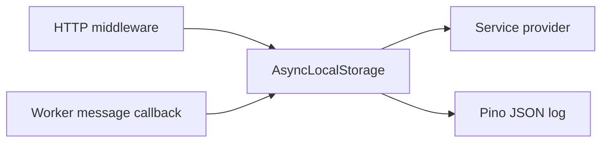
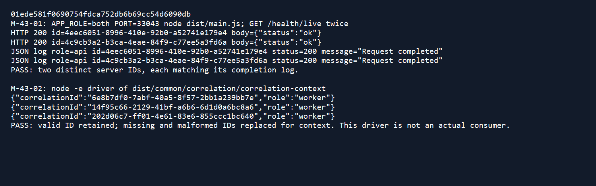

# DBS-43 · AsyncLocalStorage cho correlationId

> **Status:** Implemented trên nhánh, chờ Dev review và merge · **Vai:** Dev · **Nhánh:** `feat/DBS-43-correlation-context` · **PR:** [#21 Draft](https://github.com/Lawliet119/digital-banking-simulator/pull/21) · **Base:** `feat/DBS-42-json-logger` · **Ngày:** 2026-10-25

## 1. Bối cảnh

Board: Task Dev, High, In Progress, P4. Expect: lấy `correlationId` ở mọi tầng mà không truyền tay. DBS-42 là dependency, đã có code logger JSON trên PR riêng nhưng chưa có trên `main`; vì vậy nhánh này xếp trên nhánh DBS-42. `main` và nhánh DBS-42 hiện chưa có worker consumer chạy thật (`modules/index.ts` chỉ có placeholder), nên không thể tuyên bố tích hợp queue runtime đã đạt.

DoD: (1) ALS và provider/hàm chung; (2) worker/consumer lấy ID từ message hoặc sinh nếu thiếu; (3) log service con đúng ID request và hai request song song không lẫn; (4) PR merge main, CI xanh, Dev review, bảng đối chiếu test case đủ. Phần (2) hiện có wrapper dùng được ở điểm nhận message nhưng chưa có consumer để nối vào. Phần (4) chờ quy trình nhóm.

## 2. Hành vi

- HTTP tiếp tục sinh UUID trên server; header client không được chọn ID. Middleware mở context ALS trước logger và Nest handler.
- Service inject `CorrelationContext` và gọi `getCorrelationId()`; kết quả `undefined` ngoài context.
- Consumer tương lai gọi `runForMessage(decodedMessage, () => validateEvent(decodedMessage) rồi xử lý)`. UUID hợp lệ trong message được giữ; thiếu hoặc sai định dạng thì sinh UUID cho trace. Event sai vẫn bị `validateEvent` từ chối, payload không được tự sửa.
- Trong `APP_ROLE=both`, log bên callback message có `role=worker`; ngoài context dùng mặc định của DBS-42.

## 3. Kiến trúc

`common/correlation/correlation-context.ts` sở hữu một `AsyncLocalStorage` duy nhất; `CorrelationModule` là global module để service inject provider. Middleware HTTP, provider và Pino mixin cùng đọc storage này. Không đổi schema, event contract, env var, dependency hoặc transaction.

## 4. Test cases tự động

| ID | DoD | Test | Kết quả |
|---|---|---|---|
| TC-43-01 | 1 | Provider đọc ID qua `await`, ngoài context trống | Đạt |
| TC-43-02 | 2 | Hai callback message song song, một ID có sẵn và một ID sinh mới | Đạt ở wrapper; consumer runtime chưa có |
| TC-43-03 | 2 | ID message độc hại bị bỏ; log `role=worker` ở both | Đạt |
| TC-43-04 | 3 | Hai HTTP request chồng lấp, service con và JSON log giữ đúng từng ID | Đạt |
| TC-43-05 | 2 | Message thiếu ID có trace nhưng validator vẫn từ chối, payload không đổi | Đạt |
| Quy trình | 4 | CI, Dev review, merge | Chưa đạt lúc viết; xem backlog |

## 5. Test thủ công

| Bước | Thao tác | Kỳ vọng |
|---|---|---|
| M-43-01 | Khởi động API thật và gọi `/health/live` hai lần | Hai header ID khác nhau, mỗi log JSON cùng ID với response |
| M-43-02 | Chạy wrapper callback trên mã build với message có ID, thiếu ID và ID sai | ID hợp lệ giữ nguyên; hai trường hợp còn lại sinh mới; role worker |
| M-43-03 | Gửi message vào consumer thật | Chưa thể chạy vì consumer chưa tồn tại; bàn giao backlog |

## 6. Domain review

[Review độc lập](screenshots/DBS-43/domain-review.md) tìm 1 blocking và 4 should-fix. Đã xử lý: context trước validation; không sửa event; role worker trong both; một storage dùng chung; HTTP e2e song song. Blocking về consumer thật được ghi rõ là chưa đạt và bàn giao. Review lại: **APPROVE cho phạm vi code hiện có**, DoD đầy đủ vẫn chờ consumer thật.

## 7. Kế hoạch triển khai

| Bước | File | Test viết trước | Chứng minh |
|---|---|---|---|
| 1 | `common/correlation/*` | TC-43-01/02/03/05 đỏ vì module chưa có | Unit |
| 2 | `middleware`, `logging.options`, `app.module` | TC-43-04 | E2E HTTP |
| 3 | README, kiến trúc, feature doc, backlog | Đối chiếu DoD | Link check |

Lùi thay đổi bằng revert commit của nhánh; không có migration hoặc dữ liệu cần khôi phục.

## 8. Kết quả

`lint:check`, `typecheck` và `build` đạt; unit 27 suite/389 test, e2e 6 suite/37 test, DB 5 suite/91 test đạt, không skip. Test đỏ ban đầu của TC-43-01..03: thiếu `correlation-context.ts` (`TS2307`); sau implementation toàn bộ xanh.

[Manual transcript](screenshots/DBS-43/manual-test.txt) trên code SHA `01ede58`: M-43-01 đạt với API thật, hai HTTP 200 có ID khác nhau và log cùng ID; M-43-02 đạt với callback chạy từ mã build, ID hợp lệ được giữ, thiếu/sai sinh mới; M-43-03 **chưa chạy** vì chưa có consumer runtime. TC-43-01..05 đạt trong phạm vi code hiện hữu. Ảnh dưới đây dựng từ chính transcript để dễ đọc; transcript là nguồn gốc kết quả. Consumer runtime, Dev review và merge còn chờ; xem BL-026 và BL-027. PR phải nhắm nhánh DBS-42 trước, rồi đổi base sang `main` sau khi DBS-42 merge.

## 9. Tài liệu đã cập nhật

`backend/README.md`, `docs/03_HIGH_LEVEL_ARCHITECTURE.md`, `docs/features/README.md`, `docs/BACKLOG.md`.
