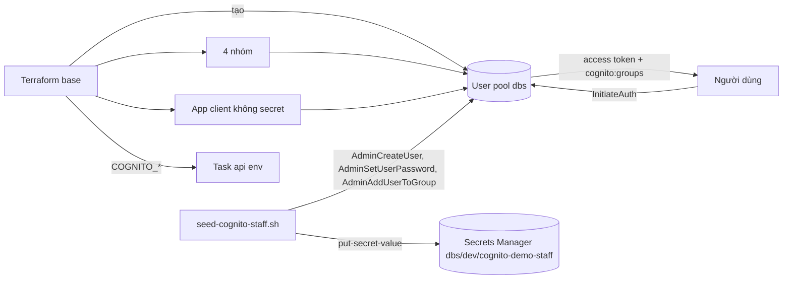

# DBS-54 · Terraform: Cognito user pool, 4 nhóm, app client và script seed tài khoản nhân viên demo

> **Status:** Draft (đang làm, đến G2) · **Vai:** #5 Platform & Ops · **Cặp đôi review:** Dev · **Nhánh:** `chore/DBS-54-terraform-cognito` (xếp chồng trên `chore/DBS-34-ecs-alb`) · **PR:** — · **Cập nhật:** 2026-10-26

## 1. Bối cảnh

- **Task trên board:** Task, Tuần 1/2, Deliverable P3, Ưu tiên High, board "To Do" (sẽ đặt In Progress). **Expect:** Có user pool thật và tài khoản operator/auditor/admin demo để chạy trên cloud.
- **DoD** (nguyên văn, đánh số):
  1. User pool, nhóm customer/operator/auditor/admin và app client (không secret) theo quyết định ở DBS-16, thuộc nhóm «giữ lại»
  2. Script seed tạo operator, auditor, admin demo; thông tin đăng nhập demo nằm ngoài repo (Secrets Manager hoặc chia sẻ riêng), không nằm trong lịch sử git
  3. Ghi COGNITO_USER_POOL_ID, COGNITO_CLIENT_ID, COGNITO_ISSUER vào biến môi trường task ECS (không phải secret)
  4. Đăng nhập thật bằng một tài khoản demo và gọi thử /health hoặc endpoint bảo vệ trên cloud
  5. PR đã merge vào main (CI xanh); Dev review; bảng «Đối chiếu test case» trong PR điền đủ
- **Thực trạng trên board:** chưa có Cognito; tài khoản nhân viên do Terraform và script seed tạo, chưa có giao diện quản lý. ADR-06: app client không secret; luồng `USER_SRP_AUTH`, `REFRESH_TOKEN_AUTH`, `USER_PASSWORD_AUTH`; access và ID token 15 phút, refresh 1 ngày; mật khẩu demo ở Secrets Manager.
- **Phụ thuộc:** DBS-33 (board In Review, mã ở PR #23; `base` đã dựng thật). Nhánh xếp chồng trên DBS-34 (PR #25).
- **Đã có gì:** ADR-06 (bảng "Quyết định" nêu giá trị chốt); `backend/src/config/validation.schema.ts` đòi `COGNITO_USER_POOL_ID`, `COGNITO_CLIENT_ID`, `COGNITO_ISSUER` (URI) khi `NODE_ENV` là `staging`/`production`; `TTL access token` qua `ACCESS_TOKEN_TTL_SECONDS` (mặc định 900); `infra/scripts/` đang trống; `session/ecs.tf` (DBS-34) có env của task nhưng chưa có ba biến Cognito (đã ghi ở bảng "biến còn thiếu").
- **Baseline:** `terraform test`: bootstrap 9/9, `base` 17/17, `session` 9/9 (lúc bàn giao DBS-34).
- **Ngoài phạm vi:** giao diện quản lý nhân viên (ADR-06); Lambda trigger; MFA cho nhân viên (ADR-06 "xem lại khi"); nội dung `DATABASE_URL`, `REDIS_URL` (DBS-66, 67, task ElastiCache); chạy task thật trên cloud (BL-037).
- **Câu hỏi mở** (kèm đề xuất):
  1. **Vị trí:** user pool, 4 nhóm, app client ở `envs/dev/base` (nhóm giữ lại, BL-031); script seed ở `infra/scripts/seed-cognito-staff.sh`; ba biến `COGNITO_*` vào `session/ecs.tf` lấy từ output của `base`.
  2. **Tự đăng ký (UC-1):** bật tự đăng ký (`allow_admin_create_user_only = false`), tên đăng nhập là email, xác minh email bằng email mặc định của Cognito (giới hạn 50 email/ngày, đủ cho dev). Chính sách mật khẩu: tối thiểu 12 ký tự, đủ 4 loại ký tự. Không MFA (ADR-06).
  3. **Mật khẩu demo:** script sinh ngẫu nhiên (`secrets` của Python hoặc `openssl rand`), đặt vĩnh viễn bằng `AdminSetUserPassword`, lưu một secret JSON `dbs/dev/cognito-demo-staff` trong Secrets Manager (mã hóa mặc định) bằng script, **không** bằng Terraform (mật khẩu không được vào state). Secret ≈ 0,40 USD/tháng, nằm ở phần giữ lại; script không in mật khẩu ra màn hình hay log. Lấy lại bằng `aws secretsmanager get-secret-value`.
  4. **Script idempotent:** chạy lại không tạo trùng và không đổi mật khẩu trừ khi có `--rotate`. Có `--dry-run` (in kế hoạch, không gọi AWS).
  5. **Email nhân viên demo:** `operator.demo@dbs.invalid`, `auditor.demo@dbs.invalid`, `admin.demo@dbs.invalid` (tên miền `.invalid` không bao giờ gửi được thư; `email_verified = true` đặt bằng script nên không cần gửi).
  6. **Token 15 phút/1 ngày** đặt ở app client; `prevent_user_existence_errors = ENABLED`; `enable_token_revocation = true`.
  7. **Gọi endpoint bảo vệ trên cloud (DoD 4):** task api chưa chạy được (BL-037). Đề xuất: chứng minh được phần Cognito (đăng nhập thật, access token có `cognito:groups`, `iss`, `client_id`, `token_use = access`, khóa ký có trong JWKS công khai), ghi "chưa chạy" cho việc gọi endpoint qua ALB, đóng cùng BL-037.
  8. **`apply` và dùng tài khoản demo** trên AWS thật: người dùng đã đồng ý ngày 2026-10-26 (tuần 1–2). Cognito và Secrets Manager gần như miễn phí nên giữ lại, không `destroy`.

**Quyết định ở G1** (tự duyệt theo `CLAUDE_local.md`, 2026-10-26): chọn đúng đề xuất 1 đến 8; không có câu hỏi đụng ADR hay NFR (mọi giá trị theo ADR-06).

## 2. Hành vi

| Tác nhân | Hành động | Kết quả |
|---|---|---|
| Khách hàng | tự đăng ký bằng email và mật khẩu hợp lệ | tạo user chưa xác minh; Cognito gửi mã xác minh email; sau khi xác nhận, đăng nhập được; token **không có** `cognito:groups` (ứng dụng coi là `customer`, ADR-06) |
| Mật khẩu yếu (dưới 12 ký tự hoặc thiếu loại ký tự) | đăng ký hoặc đặt mật khẩu | `InvalidPasswordException` |
| Nhân viên demo | `USER_PASSWORD_AUTH` bằng email và mật khẩu từ Secrets Manager | trả access, ID, refresh token; access token có `cognito:groups = ["operator"]` (hoặc `auditor`, `admin`), `token_use = access`, `client_id` = app client, `iss` = issuer của pool |
| Sai mật khẩu hoặc email không tồn tại | `USER_PASSWORD_AUTH` | `NotAuthorizedException` giống nhau cho cả hai ca (`prevent_user_existence_errors`) |
| Bất kỳ ai | `InitiateAuth` với `AuthFlow = ADMIN_USER_PASSWORD_AUTH` hoặc `CLIENT_CREDENTIALS` | từ chối (flow không bật trên app client) |
| Token | access token | hết hạn sau 15 phút; ID token 15 phút; refresh token 1 ngày |
| Script seed (người có quyền admin Cognito) | tạo `operator.demo`, `auditor.demo`, `admin.demo` (nhóm tương ứng) | 3 user trạng thái `CONFIRMED`, `email_verified = true`, mỗi user đúng một nhóm; một secret `dbs/dev/cognito-demo-staff` chứa email và mật khẩu của cả ba |
| Script chạy lại | không `--rotate` | không tạo trùng, không đổi mật khẩu, không ghi đè secret |
| Script `--rotate` | đặt mật khẩu mới cho cả ba và cập nhật secret | mật khẩu cũ không còn đăng nhập được |
| Script `--dry-run` | in kế hoạch | không gọi AWS, không in mật khẩu |
| Script | không có `AWS_PROFILE`/region hoặc thiếu `COGNITO_USER_POOL_ID` | thoát mã khác 0 kèm thông báo rõ |

**Ca biên:** mật khẩu sinh ra luôn thỏa chính sách (24 ký tự ngẫu nhiên có đủ chữ hoa, chữ thường, số, ký hiệu); email trùng thì `UsernameExistsException` được script xử lý như "đã tồn tại"; `AdminSetUserPassword` lỗi giữa chừng thì secret không được ghi (ghi secret sau khi cả ba user đã có mật khẩu); xóa pool bằng Terraform bị chặn bởi `deletion_protection = ACTIVE` (kiểm thử riêng) vì pool chứa tài khoản thật.

## 3. Kiến trúc

- **Vị trí:**
  - `envs/dev/base/cognito.tf` (mới): `aws_cognito_user_pool.main` (tên `dbs`), 4 `aws_cognito_user_group` (`customer`, `operator`, `auditor`, `admin`), `aws_cognito_user_pool_client.app` (không secret, flows `ALLOW_USER_SRP_AUTH`, `ALLOW_REFRESH_TOKEN_AUTH`, `ALLOW_USER_PASSWORD_AUTH`; access/ID 15 phút, refresh 1 ngày), `outputs.tf` (thêm `cognito_user_pool_id`, `cognito_client_id`, `cognito_issuer`).
  - `envs/dev/session/ecs.tf`: thêm ba biến `COGNITO_*` vào `environment` của container (lấy từ remote state của `base`), `tests/session.tftest.hcl` cập nhật override.
  - `infra/scripts/seed-cognito-staff.sh` (mới) và `infra/scripts/tests/seed-cognito-staff.test.sh` (mới, dùng `aws` giả trong PATH để ghi lại lời gọi).
  - `infra/terraform/README.md`: cách chạy script seed.
- **Pool dùng chung dev/prod:** `base` của dev; `prod/session` dùng lại như ECR (README, ADR-11). `deletion_protection = ACTIVE`.
- **Dữ liệu chạm tới:** `dev/base.tfstate` (không chứa mật khẩu). Secrets Manager `dbs/dev/cognito-demo-staff` tạo bằng script, không nằm trong state.
- **Sơ đồ:**

- **Thay đổi cấp hệ thống:** README Terraform; docs/03 §12 và ADR-06 đã mô tả đúng, không đổi.
- **Hợp đồng với task khác:** DBS-67 dùng Secrets Manager cho `DATABASE_URL`: secret mật khẩu demo của task này là secret riêng, không đụng. Execution role chưa cần đọc secret này (app không đọc mật khẩu demo).

## 4. Test cases tự động

`terraform test` (`mock_provider "aws"`) cho `base`; script có test shell dùng `aws` giả.

| ID | Truy vết | Lớp | Given · When · Then | Mong đợi |
|---|---|---|---|---|
| TC-54-01 | DoD 1 | tf test | Pool: tên `dbs`, đăng nhập bằng email, tự xác minh email, `allow_admin_create_user_only = false`, `deletion_protection = ACTIVE`, MFA tắt | đúng |
| TC-54-02 | DoD 1 | tf test | Chính sách mật khẩu: tối thiểu 12, yêu cầu chữ hoa, thường, số, ký hiệu | đúng |
| TC-54-03 | DoD 1 | tf test | Có đúng 4 nhóm `customer`, `operator`, `auditor`, `admin` gắn vào pool | đúng |
| TC-54-04 | DoD 1 (security) | tf test | App client: `generate_secret = false`; `explicit_auth_flows` chỉ gồm `ALLOW_USER_SRP_AUTH`, `ALLOW_REFRESH_TOKEN_AUTH`, `ALLOW_USER_PASSWORD_AUTH`; `prevent_user_existence_errors = ENABLED`; `enable_token_revocation = true` | đúng |
| TC-54-05 | DoD 1 | tf test | Thời gian sống: access 15, ID 15, đơn vị `minutes`; refresh 1, đơn vị `days` | đúng |
| TC-54-06 | DoD 3 | tf test (session) | Env của task chứa `COGNITO_USER_POOL_ID`, `COGNITO_CLIENT_ID`, `COGNITO_ISSUER`; `COGNITO_ISSUER` bằng `https://cognito-idp.<region>.amazonaws.com/<pool id>`; không có giá trị bí mật | đúng |
| TC-54-07 | DoD 2 | script test | Script gọi đúng thứ tự `admin-create-user`, `admin-set-user-password --permanent`, `admin-add-user-to-group` cho từng nhân viên đúng nhóm, rồi mới ghi secret | đúng |
| TC-54-08 | DoD 2 (security) | script test | Mật khẩu không xuất hiện ở stdout hay stderr của script; secret JSON chỉ ghi qua `--secret-string` từ biến, không ghi tệp tạm trên đĩa | đúng |
| TC-54-09 | DoD 2 | script test | Chạy lần hai (user đã tồn tại): không gọi `admin-set-user-password`, không ghi đè secret; có `--rotate` thì có | đúng |
| TC-54-10 | DoD 2 | script test | `--dry-run` không gọi `aws` lần nào; thiếu `COGNITO_USER_POOL_ID` thoát khác 0 | đúng |
| TC-54-11 | DoD 2 (security) | grep tĩnh | Không có mật khẩu, khóa hay token viết thẳng trong script và test (`rg -n "password\s*=\s*['\"]"`) | đúng |
| TC-54-12 | hồi quy | tf test | Các test cũ của `base` (17) và `session` (9) vẫn đạt (session test cập nhật override mới) | đúng |
| TC-54-13 | DoD 5 | quy trình | PR merge, CI xanh, Dev review, bảng đối chiếu | quy trình |

DoD 4 (đăng nhập thật) chứng minh bằng M-54-04…M-54-08, không có test tự động.

## 5. Test thủ công

Điều kiện chạy: `AWS_PROFILE=dbs-admin`, `.tools/bin` trong PATH, `python3`; người dùng đã đồng ý `apply` ngày 2026-10-26. Cognito và Secrets Manager gần như miễn phí nên giữ lại sau khi kiểm. Không in mật khẩu ra output: các lệnh dưới đây đọc mật khẩu vào biến shell và không echo.

| Bước | Việc làm | Kết quả mong đợi |
|---|---|---|
| M-54-00 | `terraform plan -out=base.tfplan -var account_id=<id>` ở `envs/dev/base` | chỉ thêm pool, 4 nhóm, app client; `0 to destroy` |
| M-54-01 | `apply`; `aws cognito-idp describe-user-pool` và `describe-user-pool-client` | cấu hình khớp TC-54-01..05 (tên, chính sách mật khẩu, `GenerateSecret` không có, flows, TTL) |
| M-54-02 | `bash infra/scripts/seed-cognito-staff.sh --dry-run` | in kế hoạch, không gọi AWS |
| M-54-03 | `bash infra/scripts/seed-cognito-staff.sh` rồi `aws cognito-idp list-users`, `admin-list-groups-for-user` cho từng user | 3 user `CONFIRMED`, mỗi user đúng một nhóm; `aws secretsmanager describe-secret` có secret (không đọc giá trị ra output) |
| M-54-04 | **Đăng nhập thật (thành công):** `initiate-auth --auth-flow USER_PASSWORD_AUTH` bằng operator demo (mật khẩu đọc từ Secrets Manager vào biến); giải mã access token bằng python và in `token_use`, `client_id`, `cognito:groups`, `iss` đã rút gọn pool id, `exp - iat` | `access`, đúng client, `["operator"]`, issuer khớp output, 900 giây |
| M-54-05 | Lặp M-54-04 cho auditor và admin | nhóm `auditor` và `admin` |
| M-54-06 | **Bị từ chối:** `initiate-auth` với mật khẩu sai; với email không tồn tại; với `ADMIN_USER_PASSWORD_AUTH` | `NotAuthorizedException` (hai ca đầu giống nhau), flow thứ ba bị từ chối |
| M-54-07 | Chữ ký: lấy JWKS công khai `https://cognito-idp.<region>.amazonaws.com/<pool id>/.well-known/jwks.json`, kiểm `kid` của token có trong JWKS và xác minh chữ ký RS256 bằng `cryptography` | chữ ký hợp lệ |
| M-54-08 | Chạy lại script seed lần hai | không tạo trùng, mật khẩu cũ vẫn đăng nhập được (kiểm M-54-04 lại) |
| M-54-09 | Tự đăng ký khách hàng thử: `sign-up` với email `.invalid` và mật khẩu yếu | `InvalidPasswordException`; (đăng ký thành công cần email thật, **chưa chạy**) |
| M-54-10 | Gọi `/health` hoặc endpoint bảo vệ qua ALB với access token | **chưa chạy (chờ BL-037: task api chạy thật)** |

Thời gian: vài phút; chi phí gần 0 (Secrets Manager 0,40 USD/tháng).

## 6. Domain review (AI)

(Chạy ở Phase 2.)

## 7. Kế hoạch triển khai

(Điền ở Phase 3.)

## 8. Kết quả

(Điền ở Phase 4–5.)

## 9. Tài liệu đã cập nhật

(Điền ở Phase 4–5.)
