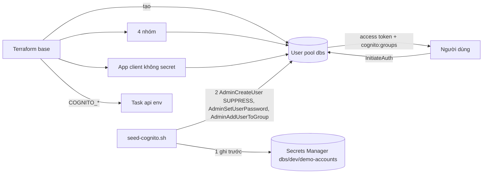

# DBS-54 · Terraform: Cognito user pool, 4 nhóm, app client và script seed tài khoản nhân viên demo

> **Status:** Implemented · **Vai:** #5 Platform & Ops · **Cặp đôi review:** Dev · **Nhánh:** `chore/DBS-54-terraform-cognito` (xếp chồng trên `chore/DBS-34-ecs-alb`) · **PR:** [#39](https://github.com/Lawliet119/digital-banking-simulator/pull/39) (thay [#26](https://github.com/Lawliet119/digital-banking-simulator/pull/26), bị đóng khi nhánh base bị xóa) · **Cập nhật:** 2026-10-26

## 1. Bối cảnh

- **Task trên board:** Task, Tuần 1/2, Deliverable P3, Ưu tiên High, board "To Do" (sẽ đặt In Progress). **Expect:** Có user pool thật và tài khoản operator/auditor/admin demo để chạy trên cloud.
- **DoD** (nguyên văn, đánh số):
  1. User pool, nhóm customer/operator/auditor/admin và app client (không secret) theo quyết định ở DBS-16, thuộc nhóm «giữ lại»
  2. Script seed tạo operator, auditor, admin demo; thông tin đăng nhập demo nằm ngoài repo (Secrets Manager hoặc chia sẻ riêng), không nằm trong lịch sử git
  3. Ghi COGNITO_USER_POOL_ID, COGNITO_CLIENT_ID, COGNITO_ISSUER vào biến môi trường task ECS (không phải secret)
  4. Đăng nhập thật bằng một tài khoản demo và gọi thử /health hoặc endpoint bảo vệ trên cloud
  5. PR đã merge vào main (CI xanh); Dev review; bảng «Đối chiếu test case» trong PR điền đủ
- **Thực trạng trên board:** chưa có Cognito; tài khoản nhân viên do Terraform và script seed tạo, chưa có giao diện quản lý. ADR-06: app client không secret; luồng `USER_SRP_AUTH`, `REFRESH_TOKEN_AUTH`, `USER_PASSWORD_AUTH`; access và ID token 15 phút, refresh 1 ngày; mật khẩu demo ở Secrets Manager.
- **Phụ thuộc:** DBS-33 (board In Review, mã ở PR #23; `base` đã dựng thật). Nhánh xếp chồng trên DBS-34 (PR #25).
- **Đã có gì:** ADR-06 (bảng "Quyết định" nêu giá trị chốt); `backend/src/config/validation.schema.ts` đòi `COGNITO_USER_POOL_ID`, `COGNITO_CLIENT_ID`, `COGNITO_ISSUER` (URI) khi `NODE_ENV` là `staging`/`production`; `TTL access token` qua `ACCESS_TOKEN_TTL_SECONDS` (mặc định 900); `infra/scripts/` đang trống; `session/ecs.tf` (DBS-34) có env của task nhưng chưa có ba biến Cognito (đã ghi ở bảng "biến còn thiếu").
- **Baseline:** `terraform test`: bootstrap 9/9, `base` 17/17, `session` 9/9 (lúc bàn giao DBS-34).
- **Ngoài phạm vi:** giao diện quản lý nhân viên (ADR-06); Lambda trigger; MFA cho nhân viên (ADR-06 "xem lại khi"); nội dung `DATABASE_URL`, `REDIS_URL` (DBS-66, 67, task ElastiCache); chạy task thật trên cloud (BL-038).
- **Câu hỏi mở** (kèm đề xuất):
  1. **Vị trí:** user pool, 4 nhóm, app client ở `envs/dev/base` (nhóm giữ lại, BL-032); script seed ở `infra/scripts/seed-cognito.sh`; ba biến `COGNITO_*` vào `session/ecs.tf` lấy từ output của `base`.
  2. **Tự đăng ký (UC-1):** bật (`allow_admin_create_user_only = false`), tên đăng nhập là email **không phân biệt hoa thường** (`username_configuration.case_sensitive = false`, không đổi được sau khi tạo), xác minh email bằng email mặc định của Cognito (50 email/ngày), `attributes_require_verification_before_update = ["email"]`, khôi phục tài khoản chỉ qua email đã xác minh. Mật khẩu tối thiểu 12 ký tự, đủ 4 loại ký tự. Không MFA (ADR-06). `user_pool_tier = "ESSENTIALS"` (free tier MAU).
  3. **Mật khẩu demo và Secrets Manager:** secret `dbs/dev/demo-accounts` (tên theo runbook #5) là **nguồn sự thật** của mật khẩu demo; script tạo bằng `create-secret` có tag `project/env/owner`, không bằng Terraform (mật khẩu không vào state). Mật khẩu **không bao giờ nằm trên argv của bất kỳ tiến trình nào** (cả `aws` lẫn `python3`): đi qua stdin (`file:///dev/stdin`, hoặc pipe từ `get-secret-value --query SecretString --output text` vào python); không `set -x`, không `--debug`/`AWS_DEBUG` (CLI in mật khẩu ra stderr); không ghi tệp tạm. Đăng nhập thật dùng `initiate-auth --auth-flow USER_PASSWORD_AUTH --client-id … --auth-parameters file:///dev/stdin` với stdin là JSON map do python dựng (`--cli-input-json` từ pipe không chạy trong AWS CLI v2). ≈ 0,40 USD/tháng; lấy lại bằng `aws secretsmanager get-secret-value`.
  4. **Script idempotent theo secret:** (a) đọc secret (chỉ coi là "chưa có" khi stderr chứa `ResourceNotFoundException`; lỗi khác như AccessDenied, throttling, secret chờ xóa thì thoát khác 0 **trước khi đụng Cognito**); (b) user nào thiếu trong secret thì sinh mật khẩu và **ghi secret trước**; (c) rồi mới tạo user (`--message-action SUPPRESS`, `email_verified = true`) nếu chưa có, đặt mật khẩu **đúng giá trị trong secret** (`--permanent`) và gán nhóm. `create-secret` gặp `ResourceExistsException` (chạy song song) thì đọc lại và làm lại từ (a), không ghi đè, tối đa 3 lần; quá 3 lần, hoặc secret đã tồn tại mà chưa có phiên bản `AWSCURRENT` (`describe-secret` phân biệt được; `get-secret-value` báo `ResourceNotFoundException`), thì thoát khác 0 và in hướng dẫn (không lặp vô hạn); sau khi ghi luôn đọc lại `AWSCURRENT` và đặt mật khẩu theo giá trị đọc lại. Chạy lại thì không đổi giá trị, nên lỗi giữa chừng không làm mất mật khẩu. User có sẵn (tạo tay) mà secret chưa có sẽ bị đặt mật khẩu mới; nhóm thừa của user có sẵn bị gỡ và `email_verified = true` được đặt, nên mỗi user kết thúc với đúng một nhóm. `--rotate`: sinh mật khẩu mới, ghi secret trước, đặt cho user, `admin-user-global-sign-out`; trạng thái "đang rotate" (`pending_signout`, danh sách user chưa sign-out) được ghi vào secret trước khi đặt mật khẩu, nên rotate lỗi giữa chừng thì chạy lại không `--rotate` vẫn đặt mật khẩu theo secret **và** sign-out các user còn tồn rồi xóa cờ. `--dry-run`: in kế hoạch, không gọi AWS. Tên script: `infra/scripts/seed-cognito.sh` (theo runbook #5).
  5. **Email nhân viên demo:** `operator.demo@dbs.invalid`, `auditor.demo@dbs.invalid`, `admin.demo@dbs.invalid` (`.invalid` không bao giờ gửi được thư; không cần gửi vì `SUPPRESS`).
  6. **Token 15 phút/1 ngày** ở app client; `prevent_user_existence_errors = ENABLED`; `enable_token_revocation = true`.
  7. **Gọi endpoint bảo vệ trên cloud (DoD 4) chỉ đạt một phần:** backend hiện chưa có guard JWT (không có jwt/jwks/AuthGuard trong `backend/src`; `/health` không cần token) và task api chưa chạy được. Đề xuất: chứng minh phần Cognito (đăng nhập thật, `cognito:groups`, `iss`, `client_id`, `token_use = access`, chữ ký khớp JWKS công khai); phần "gọi endpoint bảo vệ qua ALB" ghi "chưa chạy", mở BACKLOG phụ thuộc task guard JWT (DBS-50/51) và BL-038; báo board DoD 4 đạt một phần.
  8. **`deletion_protection` bằng biến** `cognito_deletion_protection` mặc định `INACTIVE` (dev; teardown DBS-208 cần, theo runbook #5); đặt `ACTIVE` khi pool chứa tài khoản thật. Pool nằm ở `base`, dùng chung dev/prod.
  9. **Quyền tối thiểu của người chạy script:** `cognito-idp:AdminGetUser`, `AdminCreateUser`, `AdminSetUserPassword`, `AdminAddUserToGroup`, `AdminRemoveUserFromGroup`, `AdminUpdateUserAttributes`, `AdminListGroupsForUser`, `AdminUserGlobalSignOut` trên ARN pool; `secretsmanager:DescribeSecret`, `GetSecretValue`, `CreateSecret`, `PutSecretValue`, `TagResource` trên `dbs/dev/demo-accounts-*`. Hiện chạy bằng `dbs-admin`; tách role riêng là việc sau (BACKLOG).
  10. **`apply` và dùng tài khoản demo** trên AWS thật: người dùng đã đồng ý ngày 2026-10-26. Cognito và secret gần như miễn phí nên giữ lại, không `destroy`.

**Quyết định ở G1** (tự duyệt theo `CLAUDE_local.md`, 2026-10-26): chọn đề xuất 1 đến 10 sau domain review (câu 2, 3, 4, 7, 8, 9 sửa theo review); không có câu hỏi đụng ADR hay NFR (mọi giá trị theo ADR-06).

## 2. Hành vi

| Tác nhân | Hành động | Kết quả |
|---|---|---|
| Khách hàng | tự đăng ký bằng email và mật khẩu hợp lệ | user chưa xác minh; Cognito gửi mã xác minh email; sau khi xác nhận đăng nhập được; token **không có** `cognito:groups` (ứng dụng coi là `customer`, ADR-06) |
| Mật khẩu yếu (dưới 12 ký tự hoặc thiếu loại ký tự) | đăng ký hoặc đặt mật khẩu | `InvalidPasswordException` |
| Email viết khác hoa thường | đăng nhập `Operator.Demo@…` | cùng một tài khoản với `operator.demo@…` (không phân biệt hoa thường) |
| Nhân viên demo | `InitiateAuth` `USER_PASSWORD_AUTH` bằng email và mật khẩu từ Secrets Manager | trả access, ID, refresh token; access token có `cognito:groups = ["operator"]` (hoặc `auditor`, `admin`), `token_use = access`, `client_id` = app client, `iss` = issuer của pool, `exp - iat = 900` |
| Sai mật khẩu hoặc email không tồn tại | `InitiateAuth` | `NotAuthorizedException` giống nhau cho cả hai ca |
| Flow không bật trên app client | `admin-initiate-auth --auth-flow ADMIN_USER_PASSWORD_AUTH` (cần IAM admin) | `InvalidParameterException` "Auth flow not enabled for this client". `CLIENT_CREDENTIALS` là OAuth `/oauth2/token`, pool không có domain nên không áp dụng |
| Token | access / ID / refresh | 15 phút / 15 phút / 1 ngày |
| Script seed | lần đầu | secret `dbs/dev/demo-accounts` có tag `project/env/owner` chứa email và mật khẩu của 3 nhân viên; 3 user `CONFIRMED`, `email_verified = true`, mỗi user đúng một nhóm; không có thư nào được gửi |
| Script chạy lại | không `--rotate` (kể cả sau một lần `--rotate` lỗi giữa chừng: user còn tồn vẫn được sign-out) | không tạo trùng, **mật khẩu và secret không đổi**, các user vẫn đăng nhập được |
| Script lỗi giữa chừng | (ví dụ sau user thứ hai) rồi chạy lại | secret đã có đủ mật khẩu từ trước khi tạo user, nên lần chạy lại hoàn tất mà không mất mật khẩu nào |
| Script `--rotate` | đặt mật khẩu mới cho cả ba | secret ghi trước, rồi đặt mật khẩu, rồi `admin-user-global-sign-out`: mật khẩu cũ và refresh token cũ bị từ chối |
| Script `--dry-run` | in kế hoạch | không gọi AWS, không in mật khẩu |
| Script | thiếu `COGNITO_USER_POOL_ID` hoặc không có credential | thoát mã khác 0 với thông báo rõ |
| `terraform destroy` pool | khi `cognito_deletion_protection = ACTIVE` | bị chặn; mặc định `INACTIVE` cho dev (teardown DBS-208) |

**Ca biên:** mật khẩu sinh ra có 24 ký tự, đủ chữ hoa, chữ thường, số, ký hiệu từ bộ an toàn `-_.!@#%^*+` (không có `,` `=` `[` `"` làm vỡ shorthand); mật khẩu chỉ đi qua stdin, không bao giờ trên argv; `UsernameExistsException` được xử lý như "đã tồn tại"; user ở `FORCE_CHANGE_PASSWORD` luôn được đặt lại mật khẩu từ secret.

## 3. Kiến trúc

- **Vị trí:**
  - `envs/dev/base/cognito.tf` (mới): `aws_cognito_user_pool.main` (tên `dbs`, `username_attributes = ["email"]`, `username_configuration { case_sensitive = false }`, `auto_verified_attributes = ["email"]`, `mfa_configuration = "OFF"`, `user_pool_tier = "ESSENTIALS"`, `deletion_protection = var.cognito_deletion_protection`, `admin_create_user_config { allow_admin_create_user_only = false }`, `account_recovery_setting` chỉ `verified_email`, `user_attribute_update_settings { attributes_require_verification_before_update = ["email"] }`, `password_policy` 12 ký tự đủ bốn loại), 4 `aws_cognito_user_group`, `aws_cognito_user_pool_client.app` (không secret; flows `ALLOW_USER_SRP_AUTH`, `ALLOW_REFRESH_TOKEN_AUTH`, `ALLOW_USER_PASSWORD_AUTH`; access/ID 15 `minutes`, refresh 1 `days`; `prevent_user_existence_errors = "ENABLED"`; `enable_token_revocation = true`). `variables.tf` (thêm `cognito_deletion_protection`, mặc định `INACTIVE`, validation `ACTIVE|INACTIVE`). `outputs.tf` (thêm `cognito_user_pool_id`, `cognito_client_id`, `cognito_issuer` dựng từ `var.region` và id pool). `tests/cognito.tftest.hcl`.
  - `envs/dev/session/ecs.tf`: thêm ba biến `COGNITO_*` vào `environment`, lấy nguyên giá trị từ `local.base`; sửa comment (ba biến này không bí mật); `tests/session.tftest.hcl` thêm ba output vào `override_data`.
  - `infra/scripts/seed-cognito.sh` và `infra/scripts/tests/seed-cognito.test.sh`: `aws` giả trong PATH giữ trạng thái (secret, user, mật khẩu, nhóm) trong một thư mục riêng của test (loại khỏi phép kiểm tệp tạm), đọc stdin **nguyên byte, không cắt** khi gặp `file:///dev/stdin`, ghi lại argv và stdin, trả lỗi đúng định dạng CLI (`An error occurred (ResourceNotFoundException) when calling …`, mã 254) và tiêm lỗi bằng `FAKE_AWS_FAIL_ON=<lệnh>:<lần gọi thứ n>`; `python3` bọc trong PATH ghi lại argv.
  - `infra/terraform/README.md`: cách chạy script, quyền tối thiểu, tắt `deletion_protection` khi teardown, xóa secret (`--force-delete-without-recovery` chỉ khi teardown).
- **Dữ liệu chạm tới:** `dev/base.tfstate` (không có mật khẩu). Secrets Manager `dbs/dev/demo-accounts` do script tạo, ngoài state, có tag.
- **Sơ đồ:**

- **Thay đổi cấp hệ thống:** README Terraform; docs/03 §12 và ADR-06 đã mô tả đúng, không đổi.
- **Hợp đồng với task khác:** DBS-67 dùng Secrets Manager cho `DATABASE_URL` (secret riêng, không đụng); task guard JWT của Dev (DBS-50/51) cần để chứng minh DoD 4; DBS-208 teardown đặt `cognito_deletion_protection = INACTIVE`.

## 4. Test cases tự động

`terraform test` (`mock_provider "aws"`, mọi giá trị được assert đều viết tường minh trong HCL vì mock trả null/ngẫu nhiên cho thuộc tính không đặt); test shell dùng `aws` giả ghi `"$@"` và stdin.

| ID | Truy vết | Lớp | Given · When · Then | Mong đợi |
|---|---|---|---|---|
| TC-54-01 | DoD 1 | tf test | Pool: tên `dbs`, `username_attributes = [email]`, `case_sensitive = false`, tự xác minh email, `mfa_configuration = OFF`, `user_pool_tier = ESSENTIALS`, `allow_admin_create_user_only = false`, `deletion_protection` theo biến (mặc định `INACTIVE`, `ACTIVE` khi biến đặt `ACTIVE`), email phải xác minh trước khi đổi | đúng |
| TC-54-02 | DoD 1 | tf test | Mật khẩu: tối thiểu 12, yêu cầu chữ hoa, thường, số, ký hiệu | đúng |
| TC-54-03 | DoD 1 | tf test (`apply`) | Đúng 4 nhóm `customer`, `operator`, `auditor`, `admin`, `user_pool_id` là id của pool | đúng |
| TC-54-04 | DoD 1 (security) | tf test | App client: `generate_secret = false`; `explicit_auth_flows` đúng ba flow; `prevent_user_existence_errors = ENABLED`; `enable_token_revocation = true` | đúng |
| TC-54-05 | DoD 1 | tf test | Access/ID 15 `minutes`, refresh 1 `days` | đúng |
| TC-54-06 | DoD 1 | tf test (`apply`) | Output `cognito_issuer` == `https://cognito-idp.${var.region}.amazonaws.com/${aws_cognito_user_pool.main.id}`; biến `cognito_deletion_protection` ngoài `ACTIVE|INACTIVE` bị từ chối | đúng |
| TC-54-07 | DoD 3 | tf test (session) | Env của task chứa ba biến `COGNITO_*` đúng giá trị truyền từ `base`, không có giá trị bí mật | đúng |
| TC-54-08 | DoD 2 | script test | Lần đầu: secret được tạo (`create-secret` có tag `project/env/owner`) **trước** mọi `admin-create-user`; với mỗi nhân viên: `admin-create-user --message-action SUPPRESS`, `admin-set-user-password --permanent`, `admin-add-user-to-group` đúng nhóm | đúng |
| TC-54-09 | DoD 2 (security) | script test | Mật khẩu **không** có trong argv của bất kỳ lời gọi `aws` nào (chỉ ở stdin), không có trong stdout/stderr của script; `python3` bọc trong PATH ghi lại argv rồi gọi python thật và argv của mọi tiến trình con cũng không chứa mật khẩu; không có `--debug` trong argv; stdin gửi cho `aws` khớp từng byte với giá trị trong secret, **không có `\n` cuối** (script ghi mật khẩu bằng `sys.stdout.write`); script chạy với `TMPDIR` trỏ thư mục rỗng và thư mục đó vẫn rỗng sau khi chạy | đúng |
| TC-54-10 | DoD 2 | script test | Chạy lần hai: không tạo trùng, mật khẩu và secret không đổi (`put-secret-value` không được gọi) | đúng |
| TC-54-11 | DoD 2 | script test | Lỗi ở user thứ hai rồi chạy lại: hoàn tất, mọi user có mật khẩu bằng đúng giá trị trong secret | đúng |
| TC-54-12 | DoD 2 | script test | `--rotate`: secret ghi trước, rồi đặt mật khẩu, rồi `admin-user-global-sign-out` cho từng user; rotate lỗi ở user thứ hai rồi chạy lại không `--rotate` thì mọi user khớp secret **và** user hai, ba có `admin-user-global-sign-out`, cờ `pending_signout` được xóa | đúng |
| TC-54-12b | DoD 2 | script test | `get-secret-value` lỗi `AccessDenied` thì script thoát khác 0 và không gọi lệnh Cognito nào; `create-secret` gặp `ResourceExistsException` thì đọc lại thay vì ghi đè; user có sẵn thừa nhóm bị gỡ; `create-secret` gặp `ResourceExistsException` mà không có `AWSCURRENT` thì thoát khác 0 sau tối đa 3 lần | đúng |
| TC-54-13 | DoD 2 | script test | `--dry-run` không gọi `aws` lần nào; thiếu `COGNITO_USER_POOL_ID` thoát khác 0 | đúng |
| TC-54-14 | DoD 2 (security) | grep tĩnh | Không bí mật viết thẳng trong script, test và docs của task, bằng `rg -n -P -i` với các mẫu: gán `password`/`passwd`/`secret` bằng chuỗi literal không bắt đầu bằng `$`, `dbs/`, `arn:`; `--password` theo sau bởi giá trị không phải `file://` hay `$`; `AKIA[0-9A-Z]{16}`; JWT `eyJ…\.…`. Mật khẩu giả trong test shell đặt theo mẫu cố định `FAKE-PW-…` và loại trừ tường minh | 0 dòng ngoài danh sách loại trừ |
| TC-54-15 | hồi quy | tf test | Các test cũ của `base` (17) và `session` (9) vẫn đạt | đúng |
| TC-54-16 | DoD 5 | quy trình | PR merge, CI xanh, Dev review, bảng đối chiếu | quy trình |

CI chưa chạy `terraform test` và test shell (BL-028), nên "CI xanh" không phủ TC-54-01..15: kết quả chạy cục bộ được dán vào §8 và PR. DoD 4 chứng minh bằng M-54-04…M-54-09, không có test tự động.

## 5. Test thủ công

Điều kiện chạy: `AWS_PROFILE=dbs-admin`, `.tools/bin` trong PATH, `python3` có `cryptography`; người dùng đã đồng ý `apply` ngày 2026-10-26. Cognito và secret gần như miễn phí nên giữ lại. **Không in mật khẩu**: lệnh đọc mật khẩu từ Secrets Manager bằng pipe vào python (stdin), python dựng JSON map `{"USERNAME":…,"PASSWORD":…}` và đẩy qua stdin cho `initiate-auth --auth-parameters file:///dev/stdin`; không biến shell giữ mật khẩu lâu, không `set -x`, không `--debug`.

| Bước | Việc làm | Kết quả mong đợi |
|---|---|---|
| M-54-00 | `terraform plan -out=base.tfplan -var account_id=<id>` ở `envs/dev/base` | chỉ thêm pool, 4 nhóm, app client; `0 to destroy` |
| M-54-01 | `apply`; `aws cognito-idp describe-user-pool` và `describe-user-pool-client` | khớp TC-54-01..05 (tên, `CaseSensitive false`, chính sách mật khẩu, MFA `OFF`, không `ClientSecret`, flows, TTL) |
| M-54-02 | `bash infra/scripts/seed-cognito.sh --dry-run` | in kế hoạch, không gọi AWS |
| M-54-03 | `bash infra/scripts/seed-cognito.sh` rồi `list-users`, `admin-list-groups-for-user` từng user; `describe-secret` có tag | 3 user `CONFIRMED`, mỗi user đúng một nhóm; secret có tag `project/env/owner`; không đọc giá trị ra output |
| M-54-04 | **Đăng nhập thật (thành công)** bằng operator demo (`USER_PASSWORD_AUTH`); giải mã access token bằng python, in `token_use`, `client_id`, `cognito:groups`, kiểm `iss` khớp output, `exp - iat` | `access`, đúng client, `["operator"]`, issuer khớp, 900 |
| M-54-05 | Lặp M-54-04 cho auditor và admin; thử đăng nhập operator bằng email viết hoa khác | nhóm `auditor` và `admin`; email viết hoa khác vẫn vào được cùng tài khoản |
| M-54-06 | **Bị từ chối:** mật khẩu sai; email không tồn tại; `admin-initiate-auth --auth-flow ADMIN_USER_PASSWORD_AUTH` | hai ca đầu `NotAuthorizedException` giống nhau; ca ba `InvalidParameterException` "Auth flow not enabled" |
| M-54-07 | Chữ ký: lấy JWKS công khai `https://cognito-idp.<region>.amazonaws.com/<pool id>/.well-known/jwks.json`, kiểm `kid` của token và xác minh chữ ký RS256 bằng `cryptography` | chữ ký hợp lệ |
| M-54-08 | Chạy lại script lần hai; lặp M-54-04 | không tạo trùng; mật khẩu cũ vẫn đăng nhập được |
| M-54-09 | `--rotate` cho cả ba; thử đăng nhập bằng mật khẩu cũ (lấy bằng `get-secret-value --version-stage AWSPREVIOUS`, qua pipe) và refresh token cũ (đăng nhập, rotate và thử refresh trong **cùng một tiến trình python**: refresh token chỉ nằm trong bộ nhớ, đẩy qua stdin cho `initiate-auth --auth-flow REFRESH_TOKEN_AUTH --auth-parameters file:///dev/stdin`, không in token); rồi đăng nhập bằng mật khẩu mới | mật khẩu cũ `NotAuthorizedException`; refresh token cũ bị từ chối; mật khẩu mới vào được |
| M-54-10 | `sign-up` với mật khẩu yếu | `InvalidPasswordException` (đăng ký thành công cần email thật: **chưa chạy**) |
| M-54-11 | `terraform plan -destroy -var cognito_deletion_protection=ACTIVE` (chỉ plan, kiểm tài nguyên) | pool có `deletion_protection = ACTIVE` trong kế hoạch; **chưa kiểm thật việc chặn xóa** (phải `apply` ACTIVE rồi `destroy`, bỏ qua để không rủi ro mất pool) |
| M-54-12 | Gọi endpoint bảo vệ qua ALB bằng access token operator (200) và không token (401) | **chưa chạy**: task api chưa chạy (BL-038); guard JWT đã có trên `main` (DBS-50): BACKLOG |

Thời gian vài phút; chi phí gần 0 (secret ≈ 0,40 USD/tháng).

## 6. Domain review (AI)

**Reviewer:** subagent, model opus, 2026-10-26 · [trả lời nguyên văn](screenshots/DBS-54/domain-review.md)

| Vòng | Phát hiện | Verdict |
|---|---|---|
| 1 | 17 (blocking 1, should-fix 8, minor 8) | REVISE |
| 2 | 9 mới (should-fix 1, minor 8) | REVISE |
| 3 | 4 mới (should-fix 1, minor 3), không blocking | REVISE, đã sửa; không chạy vòng 4 |

| # | Mức | Phát hiện | Xử lý |
|---|---|---|---|
| 1 | blocking | idempotent làm mất mật khẩu khi lỗi giữa chừng | đã sửa: secret là nguồn sự thật, ghi trước; TC-54-08, 10, 11 |
| 2 | should-fix | mật khẩu trên argv | đã sửa: stdin; TC-54-09 |
| 3 | should-fix | shorthand `--auth-parameters` vỡ | đã sửa: JSON qua stdin, bộ ký hiệu an toàn |
| 4 | should-fix | thiếu `--message-action SUPPRESS` | đã sửa §1 câu 4, TC-54-08 |
| 5 | should-fix | thiếu `case_sensitive = false` | đã sửa §3, TC-54-01, M-54-05 |
| 6 | should-fix | M-54-06 kỳ vọng sai | đã sửa: `admin-initiate-auth`, bỏ CLIENT_CREDENTIALS |
| 7 | should-fix | DoD 4 phụ thuộc guard JWT (backend chưa có) | đã ghi §1 câu 7, M-54-12; BACKLOG; báo board đạt một phần |
| 8 | should-fix | regex quét bí mật sai | đã sửa TC-54-14 |
| 9 | should-fix | secret thiếu tag | đã sửa: `create-secret --tags` |
| 10..17 | minor | mock_provider, tier, deletion protection bằng biến + tên theo runbook, global sign-out khi rotate, xác minh email trước khi đổi, issuer ở base, CI không chạy test, quyền tối thiểu | đã sửa (§1 câu 8, 9; §3; §4; M-54-09) |

**Vòng 2** (subagent opus): 15/17 đã sửa trọn; thêm 9 phát hiện (1 should-fix mới về `--cli-input-json` không chạy từ pipe, 8 minor), verdict REVISE; đã sửa cả chín: `--auth-parameters file:///dev/stdin`, regex loại trừ `file://`/`dbs/`/`arn:`, python cũng không nhận bí mật qua argv, cấm `--debug`, phân loại lỗi `get-secret-value` và `ResourceExistsException`, phục hồi rotate, gỡ nhóm thừa và `email_verified`, `apply` cho test issuer, đặc tả `aws` giả.

**Vòng 3** (subagent opus): 9/9 đã sửa; thêm 4 phát hiện (1 should-fix, 3 minor), không có blocking, verdict REVISE; đã sửa cả bốn (giới hạn thử lại và nhánh thiếu `AWSCURRENT`, cờ `pending_signout`, stdin đúng từng byte không `\n` cuối, refresh token trong cùng một tiến trình python). Không chạy vòng 4: các sửa chỉ làm chặt thêm chi tiết của script và test, không đổi thiết kế; việc kiểm chứng thật nằm ở test shell và M-54-09.

**Quyết định ở G2** (tự duyệt theo `CLAUDE_local.md`, 2026-10-26): chấp nhận mọi xử lý.

## 7. Kế hoạch triển khai

Gate: G2 tự duyệt (ba vòng review, không còn phát hiện blocking). Rà soát kế hoạch: mọi file ở §3, mọi DoD và mọi giới hạn ở §1/§2 có hàng bên dưới hoặc nằm ngoài phạm vi.

**Tóm tắt `plan` dự kiến:** `base`: pool, 4 nhóm, app client (`6 to add`), `0 to change`, `0 to destroy`.

| Bước | File | Test viết trước | Kết quả đỏ | Lệnh chứng minh | Commit |
|---|---|---|---|---|---|
| 1 | `base/{cognito.tf,variables.tf,outputs.tf}` | `base/tests/cognito.tftest.hcl` (TC-54-01..06) | điền khi chạy | `cd infra/terraform/envs/dev/base && terraform test` | `feat(infra): cognito user pool, groups and app client` |
| 2 | `session/ecs.tf`, `session/tests/session.tftest.hcl` | TC-54-07 | điền khi chạy | `cd ../session && terraform test` | `feat(infra): cognito settings in api task environment` |
| 3 | `infra/scripts/seed-cognito.sh` | `infra/scripts/tests/seed-cognito.test.sh` (TC-54-08..14) | điền khi chạy | `bash infra/scripts/tests/seed-cognito.test.sh` | `feat(infra): seed demo staff accounts in cognito` |
| 4 | `infra/terraform/README.md`, `docs/BACKLOG.md` | `check-doc-links.mjs` | n/a | `node .claude/skills/dbs-delivering-task/scripts/check-doc-links.mjs` | `docs(infra): cognito seed and handoffs` |
| 5 | (không file) | M-54-00..12 trên AWS thật (giữ lại pool và secret) | n/a | theo §5, output vào `screenshots/DBS-54/manual-test.txt` | `docs(features): DBS-54 results` |

Rủi ro và cách lùi: pool có tài khoản thật sau khi khách đăng ký; `cognito_deletion_protection` mặc định `INACTIVE` để teardown (DBS-208), nên đặt `ACTIVE` khi có người dùng thật. Lùi: `terraform destroy -target` cho pool, nhóm, client (mất mọi user). Script có thể chạy lại an toàn. Không có tài nguyên nào tính tiền đáng kể.

**Quyết định ở G3** (tự duyệt theo `CLAUDE_local.md`): kế hoạch như trên; người dùng đã đồng ý `apply` ngày 2026-10-26 cho tuần 1–2.

## 8. Kết quả

- **Lệnh kiểm tra** (lúc bàn giao): `terraform fmt -check -recursive` sạch; `validate` sạch ở 3 thư mục; `terraform test`: bootstrap 9/9, `envs/dev/base` **24/24** (17 cũ + 7 mới), `envs/dev/session` 9/9 (thêm một assert Cognito); `python3 infra/scripts/tests/test_seed_cognito.py` **12/12**; `python3 .github/scripts/check-image-workflow.py` → `OK`; `check-doc-links.mjs` 0 link hỏng. Không có `.skip`/`.only`. Test script bắt được một lỗi thật khi viết: vài hàm nháp truyền JSON secret làm đối số của `python3` (lộ qua argv); đã xóa, test xanh.
- **Đối chiếu test case:**

| ID | Test | Đạt? |
|---|---|---|
| TC-54-01 | `base/tests/cognito.tftest.hcl` › `user_pool`, `deletion_protection_follows_variable` | đạt |
| TC-54-02 | › `password_policy` | đạt |
| TC-54-03 | › `groups` | đạt |
| TC-54-04 | › `app_client` (không secret, ba flow, user existence, revocation) | đạt |
| TC-54-05 | › `app_client` (15/15 phút, 1 ngày) | đạt |
| TC-54-06 | › `issuer_output`, `rejects_bad_deletion_protection` | đạt |
| TC-54-07 | `session.tftest.hcl` › `task_definition` (ba biến `COGNITO_*`) | đạt |
| TC-54-08 | `test_seed_cognito.py` › `test_first_run_orders_secret_before_users` | đạt |
| TC-54-09 | › `test_passwords_never_leak` (argv của `aws` và `python3`, stdout/stderr, byte stdin không `\n`, TMPDIR rỗng, không `--debug`) | đạt |
| TC-54-10 | › `test_second_run_is_idempotent` | đạt |
| TC-54-11 | › `test_failure_midway_then_rerun` | đạt |
| TC-54-12 | › `test_rotate_order_and_signout`, `test_rotate_failure_then_plain_rerun_signs_out_remaining` | đạt |
| TC-54-12b | › `test_access_denied_stops_before_cognito`, `test_secret_without_current_version_does_not_loop`, `test_existing_user_extra_group_removed` | đạt |
| TC-54-13 | › `test_dry_run_calls_nothing`, `test_missing_pool_id_fails` | đạt |
| TC-54-14 | › `StaticChecks.test_no_hardcoded_secrets` (`rg -P` đổi thành regex Python tương đương, cùng loại trừ) | đạt (đơn giản hóa: regex Python thay cho `rg`, không đổi phạm vi) |
| TC-54-15 | các test cũ của `base` (17) và `session` (9) | đạt |
| TC-54-16 | quy trình | chưa làm (chờ review và merge) |

16 test case: 15 đạt đủ độ sâu (TC-54-14 ghi chú công cụ), 1 quy trình.

- **Test thủ công** (SHA `d6ef68dd0d3ad843d0d853a9178d2cda5b31995c` ở dòng đầu [manual-test.txt](screenshots/DBS-54/manual-test.txt); đã thay id tài khoản và pool; `apply` theo đồng ý của người dùng ngày 2026-10-26; mật khẩu không bao giờ in ra):

| Bước | Kết quả |
|---|---|
| M-54-00 | đạt: `6 to add, 0 to change, 0 to destroy` (pool, 4 nhóm, app client) |
| M-54-01 | đạt: `Apply complete! 6 added`; pool `dbs`, MFA `OFF`, tier `ESSENTIALS`, `CaseSensitive False`, `AllowAdminCreateUserOnly False`, mật khẩu tối thiểu 12; client không secret, ba flow, 15/15 phút, 1 ngày, `ENABLED`, revocation `true`; 4 nhóm |
| M-54-02 | đạt: dry-run in kế hoạch, không gọi AWS |
| M-54-03 | đạt: 3 user `CONFIRMED`, mỗi user đúng một nhóm; secret `dbs/dev/demo-accounts` có tag `project/env/owner` |
| M-54-04, 05 | đạt: operator, auditor, admin đăng nhập thật; access token `token_use=access`, đúng `client_id`, `cognito:groups` đúng vai, `iss` khớp, `exp - iat = 900`; email viết hoa đăng nhập được cùng tài khoản |
| M-54-06 | đạt: sai mật khẩu và email không tồn tại cùng `NotAuthorizedException`; `ADMIN_USER_PASSWORD_AUTH` `InvalidParameterException` "flow not enabled" |
| M-54-07 | đạt: chữ ký RS256 xác minh bằng JWKS công khai |
| M-54-08 | đạt: chạy lại không đổi secret, vẫn 3 user, mật khẩu cũ vẫn đăng nhập được |
| M-54-09 | đạt: rotate xong secret đổi, cờ `pending_signout` được xóa, `AWSPREVIOUS` giữ mật khẩu cũ; mật khẩu cũ và refresh token cũ bị `NotAuthorizedException`; mật khẩu mới đăng nhập được |
| M-54-10 | đạt phần mật khẩu yếu (`InvalidPasswordException`); **đăng ký thành công cần email thật: chưa chạy** |
| M-54-11 | đạt phần plan: `INACTIVE -> ACTIVE` là `1 to change`; **việc chặn xóa thật chưa kiểm** (cần `apply` ACTIVE rồi `destroy`, bỏ qua để không rủi ro mất pool) |
| M-54-12 | **chưa chạy**: task api chưa chạy (BL-038); guard JWT đã có trên `main` (DBS-50): BL-100 |

- **DoD 4 chỉ đạt một phần:** đăng nhập thật bằng tài khoản demo và token hợp lệ đã chứng minh; "gọi endpoint bảo vệ trên cloud" chưa làm được. Người duyệt cần chấp nhận từng ý này ở G4 (và Dev biết trên board).
- **Phạm vi so với §7:** `git diff --stat` khớp: `base/{cognito.tf,variables.tf,outputs.tf}` + `tests/cognito.tftest.hcl` + mock id pool trong các test cũ của `base`; `session/ecs.tf` + test; `infra/scripts/{seed-cognito.sh,tests/test_seed_cognito.py,tests/fake_aws.py}`; README, BACKLOG, doc. `fake_aws.py` là một file test thuộc kế hoạch bước 3 nhưng không ghi tên riêng ở §7. Không có file lạ.
- **Ảnh chụp:** không áp dụng (người dùng bỏ qua ảnh console).
- **Lệch so với kế hoạch:** (1) `fake_aws.py` là file riêng; (2) TC-54-14 dùng regex Python thay `rg -P`; (3) các test cũ của `base` cần mock id pool Cognito hợp lệ (provider kiểm định dạng khi `apply`). Không lệch nào cần gate phụ.
- **Bàn giao:** BL-100 (DoD 4: gọi endpoint bảo vệ, cần BL-038; guard JWT đã có trên `main` từ DBS-50), BL-101 (role IAM tối thiểu cho script seed, CI chạy test script). BL-028 nhận thêm nguồn: `terraform test` và test script cần chạy trong CI.
- **Chi phí:** Cognito (ESSENTIALS, dưới 10.000 MAU miễn phí) và secret ≈ 0,40 USD/tháng; không có gì tính tiền theo giờ nên giữ lại, không `destroy`.

## 9. Tài liệu đã cập nhật

`infra/terraform/README.md` (mục Cognito và tài khoản nhân viên demo: lệnh seed, quyền tối thiểu, teardown), `docs/BACKLOG.md` (thêm BL-100, BL-101), `docs/features/README.md` (hàng DBS-54). Không xóa dòng BACKLOG nào: BL-032 hết phần DBS-54 nhưng còn phần DBS-66.
