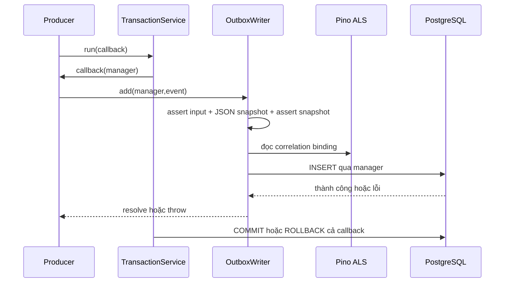
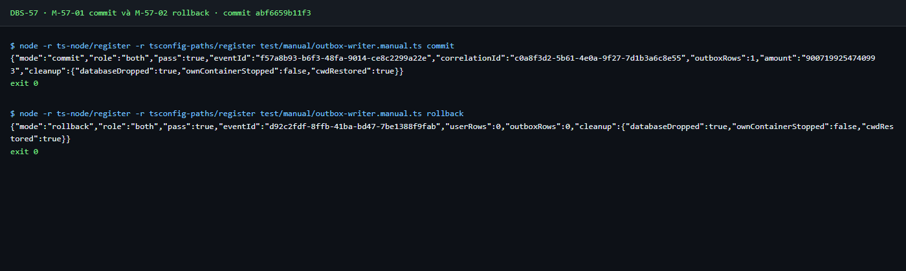
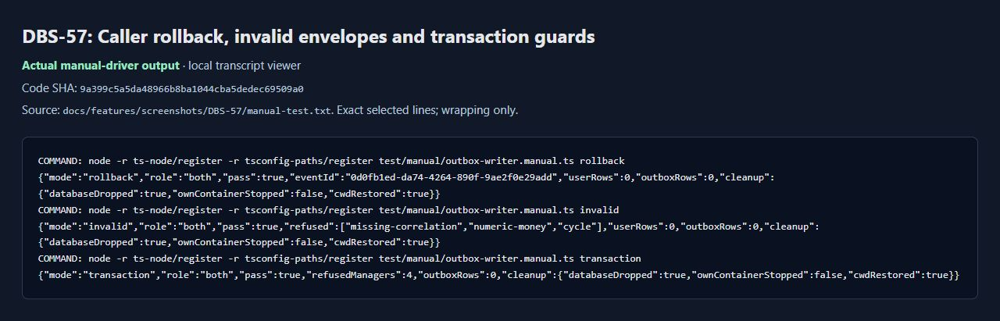
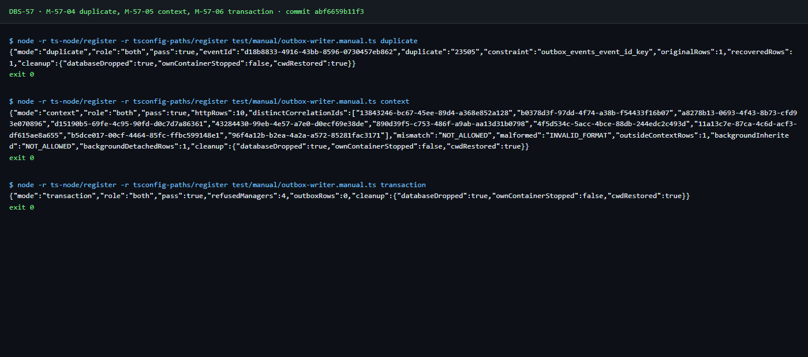
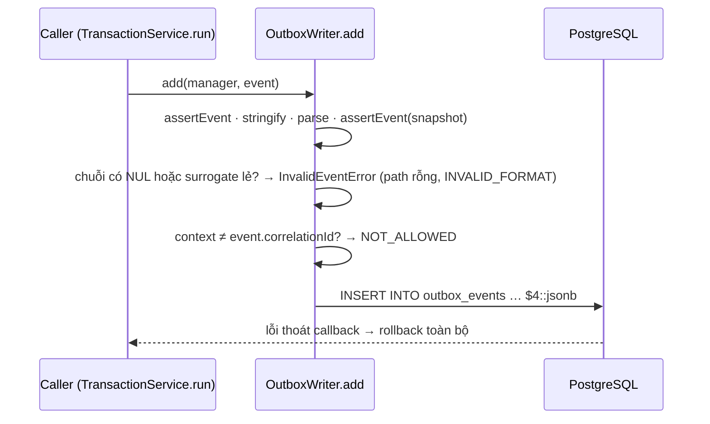

# DBS-57 · OutboxWriter.add: ghi sự kiện trong transaction của người gọi

> **Status:** Implemented (G4 đã duyệt; giữ hạn chế full DB local, chờ Dev review và merge) · **Vai:** Dev · **Dev review:** Chưa chỉ định · **Nhánh:** `feat/DBS-57-outbox-writer` · **PR:** [#34 · Draft](https://github.com/Lawliet119/digital-banking-simulator/pull/34) · **Cập nhật:** 2026-10-28

## 1. Bối cảnh

**Board:** Task, Tuần 2, High, Dev, In Progress, P2; đọc bằng `fetch-task.mjs DBS-57` ngày 2026-10-27. **Thực trạng nguyên văn:** Bảng outbox_events có từ DBS-25; chưa có writer. Ledger và accounts đều ghi vào outbox (bảng thuộc module outbox).

**Expect nguyên văn:** Sự kiện được lưu cùng transaction với thay đổi nghiệp vụ, không thể mất hay ghi nửa chừng.

**DoD nguyên văn:**

1. OutboxWriter.add(manager, event) chỉ INSERT; validate payload bằng type chung ở common/events trước khi ghi
2. correlation_id bắt buộc (lấy từ AsyncLocalStorage nếu có)
3. Test: transaction rollback thì không có dòng outbox; commit thì có đúng 1 dòng
4. Không gọi SQS/Redis/HTTP trong writer
5. PR đã merge vào main (CI xanh); Dev review; bảng «Đối chiếu test case» trong PR điền đủ

| Phụ thuộc | Board | Source tại base `ab53152` |
|---|---|---|
| DBS-25 | Done | [Migration outbox](../../backend/src/database/migrations/1792627200000-CreateOutboxEventsProcessedEvents.ts), [test schema](../../backend/test/db/outbox-schema.db-spec.ts), [hồ sơ](DBS-25-migration-outbox-events.md). |
| DBS-24 | Done | [Public types/validator](../../backend/src/common/events/index.ts), [assertEvent](../../backend/src/common/events/validate-event.ts), [hồ sơ](DBS-24-common-events-types-schema.md). |

**Đã có:** schema, [TransactionService](../../backend/src/database/transaction.service.ts), [DB harness](../../backend/test/support/temp-database.ts), [HTTP logging context](../../backend/src/common/logging/http-logging.ts). Outbox chỉ có [README](../../backend/src/modules/outbox/README.md), chưa writer/module/caller runtime; [registry](../../backend/src/modules/index.ts) chưa nạp Outbox. Nguồn: [docs/03 §10–11](../03_HIGH_LEVEL_ARCHITECTURE.md), [ADR-03](../adr/0003-sync-transfer-async-outbox-sqs.md), [schema §4.6](../components/_shared/database-design.md), [event contract](../components/_shared/event-contract.md).

**Baseline trên `ab53152`, 2026-10-27:** Docker Desktop đã khôi phục lỗi socket `dockerInference`, giữ container/volume; compose đạt, PostgreSQL/Valkey healthy, ElasticMQ running.

| Lệnh trong backend | Kết quả |
|---|---|
| `npm run lint:check` / `npm run typecheck` | Exit 0. |
| `npm test -- --runInBand` | 30 suites, 495 tests, 0 skipped. |
| `npm run test:e2e -- --runInBand` | 8 suites, 57 tests, 0 skipped; ban đầu ECONNREFUSED trước khi PostgreSQL sẵn sàng. |
| `npm run test:db -- --runInBand` | 8 suites, 154 tests, 0 skipped; PostgreSQL 17 thật/Testcontainers. |

Đây là baseline, chưa chứng minh writer mới. Link checker trước Phase 2: 132 files, 0 broken links.

**G1 đã duyệt:** Người dùng trả lời «duyệt g1» cho cả DBS-55/57 ngày 2026-10-27: writer/export/wiring cho producer API+worker, nhận **BL-011**, manual driver PostgreSQL thật, không miễn đường thành công. Chưa cho phép commit/push/PR.

**Ngoài phạm vi:** relay/SQS/consumer/cleanup; **BL-002/003** producer deposit/SYSTEM guard, **BL-009** worker serialization downstream, **BL-010** consumer/DLQ, **BL-018** cleanup/index, **BL-019** audit/production roles, **BL-024** provider context DBS-43 ([BACKLOG](../BACKLOG.md)). Không stub ledger/audit/context; không nhận E2E tiền, AC-8.2 hoặc quyền production; không đổi schema/contract/env/dependency/board. Câu hỏi G1 đã đóng.

## 2. Hành vi

**2.1 Thứ tự.** Guard `manager.queryRunner` tồn tại, `isTransactionActive=true`, `isReleased=false`; sai thì ném `Error` cố định trước SQL. Tiếp theo `assertEvent(input)` → snapshot JSON đồng bộ → parse và `assertEvent(snapshot)` → đối chiếu context → một INSERT tham số hóa. Snapshot hoàn tất trước `await` đầu, không sửa input. Validate hai lần giữ contract đầu vào và kiểm chính envelope sẽ lưu, tránh `toJSON` tạo event sai. Lưu toàn event, không phải `event.payload`.

**2.2 Contract giữ nguyên.** Dùng `DomainEvent`/`assertEvent` qua `@common/events`: plain object; UUID chuẩn chữ thường; thời gian UTC có `Z`, ngày thật; tiền chuỗi đồng trong bigint; TRANSFER/DEPOSIT và ACTIVE/LOCKED. DEPOSIT có `fromUserId=null`, `sameOwner=false`; AccountStatusChanged cấm `reason`. Extension tương thích JSON được giữ. `JSON.stringify`/`JSON.parse` không hứa giữ function/undefined; serialization ném thì rollback. Không tự sinh eventId/thời gian/correlation, không đổi tiền sang number.

Mọi event bắt buộc `eventId/eventType/occurredAt/correlationId`. TransferCompleted còn `transferId/type/fromAccountId/toAccountId/amount/fromBalanceBefore/fromAccountCreatedAt/toAccountCreatedAt/fromUserId/toUserId/sameOwner`; branch TRANSFER yêu cầu fromUserId UUID. Ví dụ AccountStatusChanged hợp lệ, ngoài ALS:

```json
{
  "eventId": "a1c9e3b7-4d52-4f06-8b3a-6e0d2c7f9514",
  "eventType": "AccountStatusChanged",
  "occurredAt": "2026-10-27T03:15:42.123Z",
  "correlationId": "e8f2a6d0-1c47-4b95-a3e1-9d5b7c0f2836",
  "accountId": "1d9f6a38-4e72-4c15-a083-b6d2e7c4f951",
  "ownerUserId": "d4a7f1c6-3b85-4e29-b0d8-5c6e9a2f1783",
  "newStatus": "LOCKED",
  "changedByUserId": "4a6d9e02-8c17-4b53-a2f6-0e5d3c8b1974"
}
```

**2.3 Correlation.** Input luôn cần correlationId hợp lệ; không dùng ALS che payload thiếu/sai. Đọc `PinoLogger.logger.bindings().correlationId`: public getter lấy logger từ ALS sẵn có của nestjs-pino; không import sâu storage hay tạo provider DBS-43.

| Context | Hành vi trước INSERT |
|---|---|
| Thiếu/null | Dùng ID hợp lệ của snapshot. |
| UUID hợp lệ bằng ID snapshot | Dùng ID context, giữ cùng ID trong payload. |
| UUID hợp lệ khác ID snapshot | InvalidEventError, path correlationId, code NOT_ALLOWED. |
| Có giá trị sai kiểu/định dạng | InvalidEventError, path correlationId, code INVALID_FORMAT; không fallback. |
| Input thiếu/sai dù context tốt | Giữ lỗi assertEvent: MISSING_FIELD/WRONG_TYPE/INVALID_FORMAT. |

Không chọn header client; middleware sinh ID server. Context chỉ ưu tiên khi nhất quán, không ghi cột khác payload.

**2.4 Transaction/lỗi/trùng.** Writer không commit/rollback/retry/nuốt lỗi. Caller để lỗi thoát callback TransactionService.run: lỗi schema/serialization/DB rollback toàn bộ, kể cả thay đổi trước đó (**BL-011 fail-closed chủ ý**). Caller tự bắt lỗi validation rồi commit vi phạm contract; writer không điều khiển transaction thay caller. Một lần thành công INSERT một row; eventId trùng ném `23505/outbox_events_event_id_key`, không upsert/no-op. ID khác cùng aggregate vẫn thêm row. Không SQS/Redis/HTTP, không log payload/SQL/credential. Filter hiện tại trả 500 chung cho lỗi nội bộ, không thêm HTTP ErrorCode.

## 3. Kiến trúc

**API đề xuất, chưa code:**

```ts
class OutboxWriter {
  constructor(private readonly logger: PinoLogger) {}
  add(manager: EntityManager, event: DomainEvent): Promise<void>;
}
// @modules/outbox exports OutboxWriter, OutboxModule
```

**Có sẵn:** `TransactionService.run<T>(fn:(manager:EntityManager)=>Promise<T>, options:TransactionOptions={}):Promise<T>`; `assertEvent(payload:unknown):DomainEvent`. Chưa caller runtime; ledger/accounts tương lai dùng public index. Nest OutboxModule cung cấp/export writer, dùng LoggingModule hiện có; registry sharedModules nạp cho api/worker/both, không controller/poller. Module producer phải import OutboxModule để inject, không dựa global tình cờ. Không DataSource/transaction/retry riêng.

| Cột | Nguồn snapshot đã validate |
|---|---|
| event_id/event_type | eventId/eventType |
| aggregate_id | transferId cho TransferCompleted; accountId cho AccountStatusChanged |
| payload | JSON toàn envelope, cast jsonb |
| correlation_id | ID đối chiếu §2.3 |

id/created_at default DB, published_at NULL. Writer giữ nguyên occurredAt đã validate. Riêng TransferCompleted, producer **phải lấy transfers.created_at do PostgreSQL trả về (clock_timestamp()), chuyển UTC bằng Date#toISOString()**; không lấy giờ ứng dụng. Writer không SELECT để kiểm nguồn thời gian; fixture hiện tại chỉ chứng minh bảo toàn giá trị. Trách nhiệm tích hợp producer ghi bàn giao §8. Literal SQL cố định, `$1…$5`; một manager.query, không SELECT/UPDATE/DELETE. Không đổi migration/index/ADR; cập nhật README outbox và module docs khi triển khai.



## 4. Test cases tự động

DB specs đề xuất `test/db/outbox-writer.db-spec.ts`, `outbox-writer-context.db-spec.ts`; wiring/lint trong unit spec. Atomicity/context dùng PostgreSQL 17 thật. Fixture chỉ user không tiền và envelope tổng hợp, không tạo account/ledger/balance. Dùng TransactionService hoặc runner.startTransaction(), không SQL BEGIN để bỏ qua trạng thái TypeORM; không sleep/skip. Assert code/path hoặc SQLSTATE/constraint.

| ID | DoD | Lớp | Given → When → Then; mã mong đợi |
|---|---|---|---|
| TC-57-01 | 1/3 | DB | TRANSFER/DEPOSIT/LOCKED/ACTIVE trong transaction → commit đúng 1 row từng mẫu, các cột/whole payload khớp. |
| TC-57-02 | 3 | DB | INSERT user + add → caller ném sau add → user/outbox 0 từ connection khác. |
| TC-57-03 | 1/BL011 | DB | INSERT user, event sai object/type/field/tiền/reason → InvalidEventError đúng code/path, rollback user/outbox; capture SQL chứng minh writer chưa INSERT. |
| TC-57-04 | 2 | DB | Correlation input thiếu/sai, có/không ALS tốt → validator từ chối trước SQL, đúng MISSING_FIELD/WRONG_TYPE/INVALID_FORMAT. |
| TC-57-05 | 2 | DB+HTTP | Nest thật + configureHttpApp/createHttpLogging, controller probe riêng test → header/row/payload trùng ID server, bỏ ID client giả. |
| TC-57-06 | 2 | DB+HTTP | 10 request đồng thời qua middleware thật, Promise.all/barrier → 10 ID riêng, từng header/row/payload đúng request. |
| TC-57-07 | 2 | DB | Ngoài ALS dùng `event.correlationId`; context khác → NOT_ALLOWED, sai kiểu/UUID → INVALID_FORMAT, không row; dùng runInContext thật. |
| TC-57-08 | 1/3 | DB | ID đã commit; transaction mới user + cùng ID → 23505 đúng constraint, user rollback, row cũ nguyên; ID khác cùng aggregate thêm được. |
| TC-57-09 | 1/3 | DB | dataSource.manager, runner chưa begin/đã commit/released → Error guard, không SQL/row/autocommit. |
| TC-57-10 | 1 | DB | amount="9007199254740993", balance âm DEPOSIT, UUID chữ thường giữ chính xác string; uppercase UUID/money number bị từ chối. |
| TC-57-11 | 1/BL011 | DB | Extension JSON giữ; cycle ném/rollback user; toJSON làm mất required field bị assert snapshot chặn; đổi input ngay sau add không đổi row. |
| TC-57-12 | 1/4 | DB+unit | Capture writer chỉ 1 INSERT toàn parameter, extension chuỗi SQL không thực thi; không external client. Public import/DI api/worker/both; deep import ESLint chặn. |
| TC-57-13 | 1/3/4 | Process+DB | Shell sạch không env dự án/.env/DATABASE_URL → driver commit từng role api/worker/both: tựstart PostgreSQL, cấu hình thật hợp lệ, đúng 1 row, cleanup; không mở client Redis/SQS. |
| Quy trình | 5 | PR/CI | Đối chiếu TC trong PR; CI, Dev review, merge cần bằng chứng riêng. |

**Security checklist:** parameter/hostile input TC12; context TC04–07; lỗi không lộ input TC03/07/11, filter 500 chung. Role/ownership/idempotency nghiệp vụ/audit DENIED/DTO fraud không áp dụng: không endpoint nghiệp vụ. TLS/secret config giữ nguyên, không chứng minh production. Không invariant tiền vì không thay đổi tiền.

## 5. Test thủ công

Đề xuất `backend/test/manual/outbox-writer.manual.ts`: Nest probe tối thiểu với ConfigModule/LoggingModule/DatabaseModule/OutboxModule và TransactionService thật; mode HTTP dùng probe riêng driver với middleware/logger thật, không stub/sửa auth production. Không account/balance/ledger; SQL seed chỉ user tổng hợp cho rollback, event aggregate không FK. Cần Docker/dependency, không token/client Redis/SQS.

**Bootstrap trước mọi side-effect import, kể cả harness:** đầu driver chỉ import node builtins/import type; lưu cwd/env gốc và DATABASE_URL đầu vào thành `baseUrl` riêng. Dựng env test riêng, giữ biến OS/Docker runtime cần thiết, không kế thừa config dự án; `NODE_ENV=test`, `APP_ROLE` từ tham số (mặc định both), `DATABASE_SSL=false`, `REDIS_URL=redis://127.0.0.1:6379`, hai `SQS_*_QUEUE_URL=http://127.0.0.1:9324/000000000000/{risk-events|notification-events}`. Redis/SQS URL chỉ để validation factory thật cho mọi role, không tạo client/kết nối. Chuyển cwd sang thư mục tạm rỗng không có env/ để env.bootstrap không đọc cả .env.development lẫn .env.test; module/migration vẫn resolve theo đường dẫn source. Không ghi/sửa env file hoặc in URL/credential.

Sau setup mới dynamic import `postgres.container`: thiếu baseUrl thì gọi startPostgresContainer (ts-node không có Jest globalSetup). Gán DATABASE_URL=baseUrl trước dynamic import harness, tạo DB tạm, migrate(temp.url); gán DATABASE_URL=temp.url **trước** dynamic import ConfigModule/probe Nest. `finally`: đóng Nest/connections → khôi phục DATABASE_URL=baseUrl cho temp.drop() (helper đọc biến này để kết nối server) → stopPostgresContainer chỉ nếu driver tạo → khôi phục env/cwd, dọn riêng thư mục tạm. URL ngoài chỉ là server tạo/drop DB tạm, không stop server ngoài.

Git Bash tại backend: mỗi mode chạy `node -r ts-node/register -r tsconfig-paths/register test/manual/outbox-writer.manual.ts <mode>`; driver tự migrate DB riêng.

| Bước | Mode | Mong đợi |
|---|---|---|
| M-57-01 | commit | 1 row pending đúng envelope/ID; extension JSON, tiền lớn giữ string. |
| M-57-02 | rollback | Seed SQL user + writer, caller lỗi: user/outbox 0, connection khác kiểm. |
| M-57-03 | invalid | Correlation thiếu/payload sai/cycle: code/path hoặc loại lỗi, user/outbox rollback; ALS không che lỗi. |
| M-57-04 | duplicate | Lần đầu commit; trùng ID 23505 đúng constraint, row cũ giữ nguyên; ID mới commit phục hồi. |
| M-57-05 | context | 10 HTTP request thật song song, header/row/payload đúng ID; mismatch/sai/ngoài context theo §2.3. |
| M-57-06 | transaction | Manager ngoài transaction bị chặn, không autocommit. |
| M-57-07 | commit --role=api, worker, both trong ba process shell sạch | Không .env/biến dự án/DATABASE_URL: tự start, validation thật đạt, mỗi process đúng 1 row và tự dọn; in role/count, không URL/secret. |

Trước chạy trong Git Bash:

```bash
set -euo pipefail
mkdir -p ../docs/features/screenshots/DBS-57
git rev-parse HEAD > ../docs/features/screenshots/DBS-57/manual-test.txt
```

Mỗi lệnh `… 2>&1 | tee -a ../docs/features/screenshots/DBS-57/manual-test.txt`; pipefail không che exit lỗi của driver. Driver exit khác 0 khi assertion sai và luôn chạy cleanup trong finally. Ảnh: `01-commit.png`, `02-rollback-validation.png`, `03-duplicate-context.png`. Kết quả thực đã ghi ở §8; không nhận demo deposit/transfer.

## 6. Domain review (AI)

**Reviewer:** subagent gpt-6-astra, 2026-10-27. Vòng 1: 0 blocking, 2 should-fix, 0 minor; [raw review](screenshots/DBS-57/domain-review-round-1.md), **Verdict: REVISE**.

| # | Phát hiện | Xử lý |
|---|---|---|
| 1 | Bootstrap driver thiếu config đầy đủ, harness có thể nạp env trước setup | Đã sửa §5: test env đủ Redis/SQS cho mọi role, cwd rỗng, dynamic imports, tách base/temp URL và cleanup; thêm TC13/M07 shell sạch ở §4–5. |
| 2 | occurredAt có thể bị hiểu là đồng hồ ứng dụng | Đã sửa §3: TransferCompleted lấy transfers.created_at DB rồi ISO Z; §8 ghi handoff producer chưa triển khai. |

**Đối chiếu chéo:** Agent chính chuyển finding shell manual từ review DBS-55: tee có thể che exit code, thư mục transcript chưa tồn tại. Đã sửa §5 bằng set -euo pipefail, mkdir trước SHA/tee và finally cleanup; không sửa raw review DBS-57. Yêu cầu reviewer kiểm lại cùng §§3–5.

[Phản hồi nguyên văn sau sửa](screenshots/DBS-57/domain-review.md): **Verdict: APPROVE**, 0 phát hiện còn mở. Reviewer đã kiểm lại §§3–6/8 và tính nhất quán với §1–2; đây là review thiết kế, chưa xác nhận implementation/runtime. **Quyết định G2:** Người dùng trả lời «duyệt g2» cho cả DBS-55/57 ngày 2026-10-27; chấp nhận §§2–5 sau review. Chưa duyệt implementation hoặc local commit.

## 7. Kế hoạch triển khai

**Kế hoạch đã duyệt tại G3.** Làm lần lượt test → chạy đỏ đúng nguyên nhân → code tối thiểu → chạy xanh; kết quả thực đã cập nhật bên dưới và ở §8/[verification.txt](screenshots/DBS-57/verification.txt). Không tạo lỗi giả để có red. Giữ nguyên §§2–5 đã duyệt.

**Bước 0 — chuẩn bị worktree đã thực hiện:** Node 24.15.0, npm 11.12.1 và `npm ci` theo `package-lock.json` hiện có, không sửa manifest/lock hoặc thêm dependency. Compose PostgreSQL/Valkey healthy, ElasticMQ running trước lượt e2e cuối. Dùng migration/harness có sẵn, không reset dữ liệu hoặc volume. Đây là setup local, không thay test tính năng; không tạo commit cho dependency được cài.

**File được phép, đường dẫn từ root repo:**

| Nhóm | Danh sách chính xác |
|---|---|
| Production | `backend/src/modules/outbox/outbox-writer.ts`; `backend/src/modules/outbox/outbox.module.ts`; `backend/src/modules/outbox/index.ts`; `backend/src/modules/index.ts` |
| Automated tests | `backend/test/db/outbox-writer.db-spec.ts`; `backend/test/db/outbox-writer-context.db-spec.ts`; `backend/test/db/outbox-writer-bootstrap.db-spec.ts`; `backend/src/modules/outbox/outbox.module.spec.ts`; `backend/test/support/outbox-boundaries.spec.ts`; `backend/src/modules/modules.spec.ts` |
| Driver/probe | `backend/test/manual/outbox-writer.manual.ts`; `backend/test/support/outbox-writer-probe.ts` (Nest probe thật, không stub nghiệp vụ) |
| Docs | `backend/src/modules/outbox/README.md`; `backend/src/modules/README.md`; `backend/README.md`; `docs/components/outbox/01-concept-brief.md`; `docs/features/README.md`; `docs/BACKLOG.md`; `docs/features/DBS-57-outbox-writer.md` |
| Evidence | `docs/features/screenshots/DBS-57/domain-review-round-1.md`; `docs/features/screenshots/DBS-57/domain-review.md` (raw review hiện có, giữ nguyên); `docs/features/screenshots/DBS-57/verification.txt`; `docs/features/screenshots/DBS-57/manual-test.txt`; `docs/features/screenshots/DBS-57/01-commit.png`; `docs/features/screenshots/DBS-57/02-rollback-validation.png`; `docs/features/screenshots/DBS-57/03-duplicate-context.png` |

Đọc/dùng nhưng không sửa: `test/support/event-samples.ts`, harness temp-database/postgres.container, Config/Logging/TransactionService, common/events/money, ESLint/package/lock/migration, docs/03/ADR/event-contract/schema. Không thêm helper ngoài hai file driver/probe đã kê; phát sinh file khác cần gate phụ. Backend paths trong bảng bước dưới là tương đối với `backend/`.

| Bước | File trong danh sách trên | Test viết trước | Kết quả đỏ thực tế | Lệnh chứng minh từ backend | Commit local |
|---|---|---|---|---|---|
| 1. Writer cơ bản, snapshot, atomicity | outbox-writer.ts; outbox-writer.db-spec.ts | TC01–03/08–11, phần SQL TC12; dùng class trực tiếp trong test đến bước 2 | Đỏ TS2307 thiếu writer trước code; sau sửa core xanh 18 tests | `npm run test:db -- --runInBand outbox-writer.db-spec.ts` | `9143ca1` feat(outbox): insert validated events in caller transactions |
| 2. Public API, DI, role registry, import boundaries | outbox.module.ts; outbox/index.ts; modules/index.ts; outbox.module.spec.ts; modules.spec.ts; outbox-boundaries.spec.ts; đổi core spec dùng public API | Phần export/DI/ESLint TC12: api/worker/both; snippet deep import bị bắt qua ESLint API hiện hành, không ghi probe file | Đỏ TS2307 thiếu public API trước code; ESM loader của test lint sửa bằng subprocess Node, không đổi config; xanh 14 tests | `npm test -- --runInBand outbox.module.spec.ts modules.spec.ts outbox-boundaries.spec.ts`; `npm run lint:check` | `6d67084` feat(outbox): expose writer through shared module |
| 3. Correlation và HTTP isolation | outbox-writer.ts; outbox-writer-context.db-spec.ts; outbox-writer-probe.ts | TC04–07: raw required trước ALS, context mismatch/sai, HTTP10parallel, client ID giả | Đỏ 5 fail/7 pass vì context mismatch/sai vẫn resolve; sau enforcement core/context xanh 30 tests | `npm run test:db -- --runInBand outbox-writer-context.db-spec.ts outbox-writer.db-spec.ts` | `34c1511` feat(outbox): enforce correlation context consistency |
| 4. Manual bootstrap và clean shell | outbox-writer-bootstrap.db-spec.ts; outbox-writer.manual.ts; outbox-writer-probe.ts | TC13 process thật không env/.env/DB URL; từng role commit/cleanup; script có đầy đủ mode M01–07 | Đỏ 3 MODULE_NOT_FOUND trước driver; regression late-arrival đỏ 1 fail/12 pass trước fix; targeted trước final SHA xanh 34 tests. Thêm bounded exit metadata sau child worker output trống; đây là chẩn đoán, không nhận đã sửa nguyên nhân. Manual cuối M01–07 đạt qua 9 process | `npm run test:db -- --runInBand outbox-writer-bootstrap.db-spec.ts`; từng mode bằng lệnh §5 | `b3418b6`; `9a399c5` |
| 5. Docs, full checks, SHA/manual/evidence | Tất cả docs/evidence đã kê; chỉ sửa code/test ở bước 1–4 khi test chứng minh lỗi | Đối chiếu TC01–13, M01–07, DoD1–5; kiểm link/diff và không skip/only/todo | Non-DB final đạt; full DB final process exit 3221226505 trước count, chưa xanh. Targeted final 3 suites/34 tests đạt, không thay full DB. Manual transcript và đủ ba ảnh đã commit local | Full checks và lệnh G4 bên dưới | `9527a1f` và `3cd810c` |

**Verification cuối, chạy riêng từng lệnh và đọc toàn output:** `npm run lint:check`, `npm run typecheck`, `npm test -- --runInBand`, `npm run test:e2e -- --runInBand`, `npm run test:db -- --runInBand`, `npm run build`. Compose PostgreSQL phải healthy trước e2e (app-guard dùng DB); test:db dùng PostgreSQL thật/Testcontainers. Chạy các suite DB nặng và hai nhánh tuần tự, không tranh môi trường. TC13 đặt ở `test/db/outbox-writer-bootstrap.db-spec.ts`, khớp regex jest-db hiện có; unit boundaries ở test/support khớp jest-unit, không sửa config test/harness.

Tại root chạy `node .claude/skills/dbs-delivering-task/scripts/check-doc-links.mjs`, `git diff --check`; ghi số test/skipped và red→green thật trong verification.txt/§8. Quét task tests không có skip/only/todo. Render Mermaid §3 bằng mermaid-cli tạm (`npx --yes --package @mermaid-js/mermaid-cli mmdc -i <temp>/dbs57.mmd -o <temp>/dbs57.svg`), kiểm ảnh kết quả; input/output/cache công cụ ngoài repo, không sửa package/lock hay thêm production dependency. Suite tiền hiện hữu vẫn chạy, nhưng task writer không tạo tiền và không nhận coverage nghiệp vụ downstream.

**Local commit/SHA:** G3 đã cho phép local commits sau bước xanh. Đã stage đúng inventory, không git add .; mỗi commit kiểm staged paths/tree không có `.xls`/`.xlsx` hay biến thể workbook Jira, không stage secret/env. SHA cuối đổi code/test/driver là `9a399c5a5da48966b8ba1044cba5dedec69509a0`, thêm chẩn đoán bounded cho bootstrap spec; production writer không đổi. Đã chạy toàn §5 qua 9 process trên SHA này, dòng đầu manual-test.txt ghi đúng SHA. Ba ảnh lấy từ output thật. Sửa code sau đó phải commit và chạy lại toàn §5. Chỉ commit docs/evidence sau manual, không đổi mã được chứng minh. Không push/PR trước G4 và ủy quyền xuất bản.

**Sweep đã chạy (2026-10-27):** đối chiếu toàn DoD, TC, M, backlog/giới hạn và finding §§1–6/8; kết quả mọi mục có bước hoặc handoff ngoài scope, không bỏ case.

| Yêu cầu/giới hạn | Bao phủ trong kế hoạch |
|---|---|
| DoD1 INSERT/contract; DoD3 atomicity; TC01–03/08–11 | Bước 1; SQL/static TC12 bước 1–2; M01–04/06 bước 4–5 |
| DoD2 correlation; TC04–07; HTTP10parallel; strict input/ALS, malformed/mismatch | Bước 3; M03/05 bước 4–5; không provider giả |
| DoD4 no external; public DI/lint TC12; clean-shell TC13/M07 | Bước 2–4; placeholders Redis/SQS chỉ validation; real PG không mock |
| DoD5, bảng đối chiếu PR/CI/review/merge | Bước 5 điền evidence; dự kiến BL-053 riêng DBS-57 cho CI/review/merge chưa đạt (BL-052 dành DBS-55); kiểm ID còn trống khi viết, không tự merge/board |
| M01–07 success/reject/recovery/transaction/clean shell; SHA/ảnh/transcript | Bước 4 viết đủ modes, bước 5 chạy toàn bộ; không miễn manual |
| BL-011 fail-closed, JSON extension/cycle/toJSON/mutation, rollback user trước writer | Bước 1/3/4, chứng minh rồi bước 5 xóa BL-011 và ghi ID §9 |
| BL-002/003, producer occurredAt DB→ISOZ; không fixture tiền/ledger | Ngoài scope; bước 5 thêm nguồn/handoff vào BL-002 tương ứng; fixture chỉ chứng minh preserve, không sửa producer |
| BL-009/010/018/019/024; TLS/role production, E2E audit/tiền; caller không nuốt validation | Ngoài scope theo G1; bước 5 ghi giới hạn/handoff, giữ backlog; thêm nguồn task vào BL-002/019/024 tương ứng, không tạo dòng trùng hoặc service giả |
| Raw review/findings §§6/8, bootstrap env/cwd/import/base–temp cleanup, shell pipefail | Giữ raw review nguyên văn; bước 4/5 kiểm TC13/M07 và script; docs đánh dấu đúng evidence thực |
| Mọi fact writer đã làm; README/brief worker-only và n/a cũ | Bước 5 sửa README outbox/modules và concept brief: writer API+worker, relay worker/chưa triển khai; chỉ mark verified phần đã chạy; backend public API/index đồng bộ, không sửa ADR/schema/contract/env/dependency |

**Rủi ro/cách lùi:** strict correlation có thể chặn producer sai: cố ý fail-closed, không tự overwrite; snapshot/toJSON phải kiểm trước await. Bootstrap phải gán env/cwd trước dynamic import, restore base URL trước drop, đóng connections rồi cleanup đúng DB/container do driver tạo; lỗi không giấu exit code. Chỉ thay đổi additive, không migration/down/data deletion. Nếu cần lùi, bỏ registration/import và revert các commit task được phép, không reset/xóa nhánh hoặc xóa dữ liệu. DBS-55 ở nhánh riêng cũng chạm shared registry/docs: giữ diff DBS-57 nhỏ, không tự merge/cherry-pick nhánh kia; gỡ xung đột sau theo source hiện tại, không ghi đè thay đổi người dùng. Bất kỳ file/quy tắc ngoài inventory hoặc bỏ TC đều cần gate phụ.

**Quyết định G3:** Người dùng trả lời «Duyệt G3» ngày 2026-10-27, chấp nhận §7 và local commits sau bước xanh. Chưa cho phép push/PR/board. TDD/manual đã thực hiện; kết quả và giới hạn full verification ghi trong verification.txt và §8, chờ G4.

## 8. Kết quả

**Quyết định G4 (2026-10-28):** Người dùng trả lời «duyệt G4», chấp nhận kết quả và các giới hạn đã trình, cho phép push nhánh và tạo Draft PR. BL-055 về full DB local vẫn mở; agent không sửa board hoặc merge PR. Status chuyển Implemented cho phạm vi đã bàn giao; CI remote, Dev review và merge được theo dõi riêng ở BL-053.

**Xuất bản:** Nhánh đã push lên origin và mở [Draft PR #34](https://github.com/Lawliet119/digital-banking-simulator/pull/34), base `main`. Kết quả CI gắn với HEAD hiện hành được ghi tại Checks và phần validation của PR; Dev review/merge còn mở ở BL-053. Workbook `.xls`/`.xlsx` không có trong staged paths, commit tree hoặc lịch sử nhánh trước push.

**Đồng bộ trước xuất bản:** `origin/main` tiến tới `b8742a3` với DBS-41 (CI và tài liệu). Merge giữ workflow/ảnh/tài liệu upstream, giữ BL-052 của DBS-41 và BL-053/055 của task này; BL-016 đã được upstream đóng. Code và tests TypeScript không thay đổi so với SHA đã kiểm chứng, nên SHA manual vẫn là `9a399c5`. Phạm vi PR được đối chiếu với `origin/main`, gồm 26 file trong §7.

**Đã triển khai và đóng băng code:** `9a399c5a5da48966b8ba1044cba5dedec69509a0`, đã xuất bản qua Draft PR #34. Writer chỉ INSERT bằng caller manager, snapshot/contract và correlation đã có test PostgreSQL thật; module/API roles có test DI/lint. Manual M01–07 đạt trên SHA cuối. **Full DB trên SHA cuối chưa xanh:** process thoát native trước khi in số đếm. [Verification raw](screenshots/DBS-57/verification.txt) giữ từng lượt, phân biệt working tree chẩn đoán với commit cuối.

| Kiểm tra đã chạy | Kết quả thực |
|---|---|
| Node/npm và npm ci theo lock hiện có | Node 24.15.0, npm 11.12.1; npm ci exit 0, không sửa manifest/lock |
| `npm run lint:check`; `npm run typecheck`; `npm run build` trên SHA 9a399c5 | Từng lệnh exit 0 |
| `npm test -- --runInBand` trên SHA 9a399c5 | 32/32 suites, 505/505 tests đạt, 0 skipped, exit 0 |
| `npm run test:e2e -- --runInBand` trên SHA 9a399c5 | 8/8 suites, 57/57 tests đạt, 0 skipped, exit 0 |
| `npm run test:db -- --runInBand` trên SHA 9a399c5 | **Không đạt:** process exit 3221226505 (`0xC0000409`), không có count/stack từ Jest; không nhận 188 tests xanh ở SHA cuối |
| Targeted core/context/bootstrap trước SHA cuối | 3 suites, 34 tests đạt, 0 skipped, PostgreSQL 17 thật; core 18/context 13/bootstrap 3. Đây là lượt trước final commit |
| Full DB ở working tree chẩn đoán trước commit | HEAD b3418b6 cộng instrumentation chưa commit: 11/11 suites, 188/188 tests đạt, exit 0. TS source sau đó được commit tại 9a399c5; lượt này vẫn không nhận là bằng chứng đã chạy trên final SHA |
| `npm run test:db -- --runInBand outbox-writer.db-spec.ts outbox-writer-context.db-spec.ts outbox-writer-bootstrap.db-spec.ts` trên SHA 9a399c5 | 3/3 suites, 34/34 tests đạt, 0 skipped, 55.768 giây, exit 0. Đây là command chọn riêng task, không thay full DB thất bại |
| Unit subset module/roles/boundaries | 3 suites, 14 tests đạt, 0 skipped; đã được full unit cuối bao phủ |
| Mermaid §3 | Mermaid CLI 12.0.0 render bằng Chrome cài sẵn, exit 0; PNG 41123 bytes đã xem; công cụ/output tạm ngoài repo |
| Link checker và diff whitespace | `check-doc-links.mjs`: 134 files checked, 0 broken link(s); `git diff --check`: exit 0 |

**Đối chiếu TC:** đường dẫn dưới đây tương đối backend; mọi ca tiền trong envelope chỉ kiểm string, không tạo số dư hoặc ledger. **TC01–13 đạt đủ độ sâu**, 0 ca đơn giản hóa, dựa trên targeted DB 3 suites/34 tests và full unit cuối tại SHA 9a399c5. Đây là bằng chứng task-specific; full DB final vẫn thất bại ở process và không có count.

| ID | Test/chứng cứ thực | Kết quả |
|---|---|---|
| TC-57-01 | outbox-writer.db-spec.ts: commits one complete envelope, 4 mẫu | Đạt tại final targeted |
| TC-57-02 | core: caller fails, user/outbox rollback từ connection khác | Đạt tại final targeted |
| TC-57-03 | core: refuses invalid object/type/field/money/reason trước query | Đạt tại final targeted |
| TC-57-04 | context: missing/wrong/invalid raw correlation, có và không ALS | Đạt tại final targeted |
| TC-57-05 | context: HTTP header/row/payload cùng ID server, khác cả hai ID client | Đạt tại final targeted |
| TC-57-06 | context: 10 request có barrier; regression deadline và late arrival bằng fake clock của helper | Đạt tại final targeted |
| TC-57-07 | context: thiếu/null/matching/mismatch/malformed ALS | Đạt tại final targeted |
| TC-57-08 | core: duplicate 23505 đúng constraint, user rollback, ID mới phục hồi | Đạt tại final targeted |
| TC-57-09 | core: 4 loại manager không active, không autocommit | Đạt tại final targeted |
| TC-57-10 | core: tiền trên 2^53 và snapshot âm giữ string; number/UUID hoa bị chặn | Đạt tại final targeted |
| TC-57-11 | core: extension/snapshot mutation, cycle, toJSON sai | Đạt tại final targeted |
| TC-57-12 | core SQL tham số/hostile text; module/registry/boundaries 14 unit; source review writer không external client | Đạt tại final targeted/full unit; không external client là rà soát tĩnh source |
| TC-57-13 | bootstrap process: api/worker/both shell sạch, tự PostgreSQL, row 1 và cleanup | Đạt tại final targeted; manual ba role cuối đạt |
| DoD #5 quy trình | Draft PR #34; CI remote tại Checks/validation của PR; review Dev/merge | PR đã mở; review/merge còn chờ, BL-053 |

### Full DB failure và phạm vi giữ nguyên

Các lỗi được giữ riêng trong raw verification, không gộp thành một nguyên nhân:

- Full DB ở b3418b6: 10/11 suites, 187/188 tests đạt, worker bootstrap child thoát với stdout/stderr trống; chưa xác định nguyên nhân.
- Lượt kế tiếp dừng globalSetup do Docker unreachable, chưa vào test; đây là lỗi môi trường riêng. Sau khôi phục Docker không reset volume/cấu hình, working tree chẩn đoán đạt 11 suites/188 tests như bảng trên, không chứng minh lỗi worker cũ đã được sửa.
- Full DB final 9a399c5: process exit `0xC0000409` trước count/stack. Read-only Application Error 1000/WER không có bằng chứng node crash tương ứng; Docker vẫn reachable và PostgreSQL/Valkey healthy sau lệnh. Snapshot RAM/pagefile **sau** lỗi không chứng minh hoặc loại trừ memory spike/OOM, không có module/FASTFAIL parameter để kết luận loader hay nguyên nhân cụ thể. Không sửa Node/system hoặc rerun cùng full command để lấy xanh. Targeted task chạy bằng command khác đạt không đóng BL-055.

Ngày 2026-10-28, người dùng trả lời **«Giữ phạm vi cũ, ghi rõ lỗi/hạn chế»** cho đề nghị gate phụ sửa hai file test inherited JWKS/logging trên cả hai nhánh. Không sửa các file ngoài §7; full unit/E2E của nhánh này đạt như bảng, không suy ra đã sửa tính phụ thuộc timing quan sát ở nhánh DBS-55.

### Test thủ công trên SHA cuối

Dòng đầu [manual-test.txt](screenshots/DBS-57/manual-test.txt) là `9a399c5a5da48966b8ba1044cba5dedec69509a0`. Git Bash tại `backend/`, `set -euo pipefail`; mỗi lệnh bên dưới ghi raw output bằng `2>&1 | tee -a ../docs/features/screenshots/DBS-57/manual-test.txt`. Prefix `node -r ts-node/register -r tsconfig-paths/register test/manual/outbox-writer.manual.ts` được giữ nguyên; sáu mode đầu dùng base PostgreSQL Compose cấp ngoài transcript.

| Bước | Lệnh sau prefix và phản hồi thật rút gọn | Kết quả |
|---|---|---|
| M-57-01 | `commit` › pass=true; eventId=0426d8b9-5f03-4735-8765-45ee4545f8e9; outboxRows=1; amount `"9007199254740993"` | Đạt, exit 0 |
| M-57-02 | `rollback` › userRows=0/outboxRows=0 từ connection khác | Đạt, exit 0 |
| M-57-03 | `invalid` › refused missing-correlation/numeric-money/cycle; userRows=0/outboxRows=0 | Đạt, exit 0 |
| M-57-04 | `duplicate` › 23505/outbox_events_event_id_key; originalRows=1/recoveredRows=1 | Đạt, exit 0 |
| M-57-05 | `context` › httpRows=10, 10 correlationId khác nhau (đầu f849219d-489c-4ac2-b398-2682030f3dfb); mismatch NOT_ALLOWED, malformed INVALID_FORMAT, outsideContextRows=1 | Đạt, exit 0 |
| M-57-06 | `transaction` › refusedManagers=4/outboxRows=0 | Đạt, exit 0 |
| M-57-07 | Ba lệnh `env -u DATABASE_URL` + prefix + `commit --role=api`, `worker`, `both`; driver lọc env/cwd trước import; từng role pass=true, outboxRows=1, databaseDropped/ownContainerStopped/cwdRestored đều true | Đạt cả ba process, exit 0 |

Tổng 9 invocation, M01–07 đều đạt; không có bước manual chưa chạy. Sáu mode dùng server ngoài có databaseDropped=true, ownContainerStopped=false và cwdRestored=true: chỉ drop DB tạm của driver, không stop Compose. Ba role tự tạo container có cả ba cleanup flags=true. Không nhận cleanup toàn server hoặc E2E nghiệp vụ ledger/relay. Transcript không chứa URL DB/credential/token/Authorization/AWS account ID/ARN.

Ba ảnh là CUA chụp trang local hiển thị raw transcript, wrap dòng cho dễ đọc; CUA JPEG được serialize thành PNG không thay ngữ nghĩa nội dung. Đây là viewer output thật, không phải ảnh terminal/Swagger.







**Review trong implementation, phạm vi không đổi:** deadline của barrier cần từ chối cả late arrival sau hết hạn; đã viết test đỏ rồi sửa trong helper có sẵn. Test HTTP được tăng kiểm hai ID client không được chọn. Không sửa middleware/config/harness/schema hoặc tạo business stub. Không có test được bỏ; mọi DB command được scheduler cấp trước khi chạy.

**Backlog:** đã xóa **BL-011** vì validation trước INSERT, event đúng commit và schema sai rollback caller có test PostgreSQL thật và manual cuối; thêm **BL-053** cho PR/CI/review/merge và **BL-055** cho worker output trống/full DB native exit chưa rõ nguyên nhân. BL-002/019/024 thêm nguồn DBS-57; BL-003/009/010/018 giữ ngoài scope. Chưa nhận E2E chuyển/nạp tiền, relay/consumer, provider DBS-43 hoặc quyền production đạt.

**Bàn giao producer, chưa thực hiện:** Dev ledger/deposit phải tạo occurredAt của TransferCompleted từ transfers.created_at do DB trả về, Date#toISOString(); writer chỉ validate/bảo toàn. Test envelope tổng hợp không chứng minh nguồn thời gian nghiệp vụ. Handoff đã bổ sung vào BL-002; không nhận integration downstream đạt. Audit/roles vẫn BL-019; context worker/message chung và log binding vẫn BL-024.

## 9. Tài liệu đã cập nhật

Đã cập nhật hồ sơ này, README backend/outbox/modules, concept brief outbox, feature index và BACKLOG; lưu nguyên văn hai domain review, verification/manual transcript và ảnh trong inventory §7. BACKLOG xóa BL-011, thêm BL-053/055, thêm nguồn vào BL-002/019/024; BL-041 không còn tham chiếu BL-011 đã đóng. Sau commit docs/evidence `9527a1f`, diff có đúng 26 file khớp inventory §7. Staged paths, commit tree và lịch sử nhánh đã kiểm không có workbook `.xls`/`.xlsx` hoặc `.env`. G4 đã cho phép xuất bản; thông tin Draft PR được ghi tại §8. Không sửa board hoặc merge.

## Checklist G4 (đã được người dùng duyệt)

- [x] TC01–13 đạt đủ độ sâu trên final targeted/full unit, 0 ca đơn giản hóa; targeted không thay full DB failure
- [x] Manual trên SHA code cuối, SHA đầu transcript; M01–07 đạt qua 9 invocation, đường thành công/rejection/recovery đã chạy
- [x] Đủ ba ảnh đúng path, đã mở kiểm viewer thật; transcript không có token/Authorization/password/AWS account ID/ARN
- [x] Diff PR với `origin/main`: 26 file khớp §7 sau đồng bộ DBS-41; không sửa file inherited ngoài phạm vi hoặc workbook được bảo vệ
- [x] Sáu lệnh baseline đã chạy; unit 32 suites/505 tests và E2E 8 suites/57 tests đạt, full DB final process exit trước count: **chưa xanh**, BL-055
- [x] Link checker 134 files/0 broken links tại G4, diff whitespace sạch; chuyển Implemented sau khi G4 được duyệt
- [x] Handoff/DoD chưa đạt có BL-002/019/024/053/055; BL-011 đã xử lý được xóa, không nhận downstream/process đạt

## Vòng 2 · Sửa sau review PR #34

> **Status vòng 2:** Design approved (sau G2) · **Nguồn:** review code PR #34 ngày 2026-10-31, các phát hiện chấm 2 điểm trở lên trên thang "mức độ phải audit lại" (0–5) · **Nhánh:** `feat/DBS-57-outbox-writer` (sửa trực tiếp theo yêu cầu người dùng) · **Cập nhật:** 2026-10-31

### R1. Bối cảnh

| ID | Điểm | Vị trí | Vấn đề | Hướng sửa đề xuất |
|---|---|---|---|---|
| R-1 | 2 | `outbox-writer.ts:22-35` | `correlationId` lấy từ context của logger; event có id khác context thì bị từ chối. Producer chạy nền (relay, consumer) ở role `both`, nếu khởi động từ trong một request HTTP, sẽ thừa kế context của request đó và mọi event đúng đều bị từ chối | Không đổi code. Ghi hợp đồng vào README outbox và một dòng BACKLOG cho #3 (relay/consumer): chạy ngoài context của request. Thêm một TC chứng minh hành vi hiện có |
| R-2 | 2 | `outbox-writer.ts:21` | Chuỗi chứa ký tự NUL (`\u0000`) qua validation (`allowUnknown: true`) nhưng PostgreSQL từ chối `::jsonb` (22P05): cả giao dịch tiền rollback, caller nhận 500 chung | Duyệt object đã `JSON.parse`, từ chối chuỗi hoặc khóa có NUL bằng `InvalidEventError` trước INSERT, không in giá trị |
| R-3 | 2 | `outbox-writer-bootstrap.db-spec.ts:49` | Test lọc bỏ `DATABASE_URL` nên mỗi role dựng một container PostgreSQL riêng, trong khi `globalSetup` đã dựng sẵn một cái | Xem câu hỏi G1 #2 |

**Baseline 2026-10-31** trên `b54b7f9` (đầu nhánh PR): `lint:check` exit 0; `typecheck` exit 0; unit 32 suites/505 tests đạt; DB 11 suites/188 tests đạt (167,8 s); E2E 8 suites/57 tests đạt, 0 skipped; `build` exit 0. E2E chạy trên container `postgres:17` ở cổng 55432 vì máy có PostgreSQL 18 native chiếm cổng 5432.

**Người gọi các symbol bị đổi:** `OutboxWriter.add` chỉ được gọi trong `test/db/outbox-writer*.db-spec.ts`, `test/support/outbox-writer-probe.ts`, `test/manual/outbox-writer.manual.ts`. Chưa có caller production (DBS-60/61 chưa bắt đầu).

**Tích hợp với `main`:** PR #33 (DBS-55) đã merge nên `main` tiến tới `5562884`. Nhánh này xung đột ở `backend/src/modules/index.ts`, `modules.spec.ts`, `docs/BACKLOG.md`, `docs/features/README.md`. Phải giữ cả `OutboxModule` (ở `sharedModules`) và `AccountsModule` (ở `apiModules`, kèm comment mới) và kiểm lại ID backlog, vì `main` đã dùng tới BL-122.

**Ngoài phạm vi:** các mục 0–1 điểm của review (`switch` với `never` cho `aggregateId`, ba lần Joi, tên test theo role, mã lỗi `INVALID_FORMAT` cho context sai kiểu, tham chiếu BL-011 treo ở `outbox-writer.ts:16` và `validate-event.ts:177`); relay/consumer/cleanup (task #3); BL-002/003/009/010/018/019/024/053/055 giữ nguyên.

**Câu hỏi mở:** xem tin nhắn G1.

**Quyết định ở G1 (vòng 2):** người dùng trả lời «duyet» ngày 2026-10-31, chấp nhận cả năm đề xuất: (1) R-1 không đổi code, ghi hợp đồng và BACKLOG cho #3, thêm TC khóa hành vi; (2) R-2 từ chối chuỗi NUL trước INSERT; (3) R-3 truyền URL của `globalSetup` qua biến không thuộc dự án; (4) merge `main` ở cuối vòng; (5) push thường, không force.

### R2. Hành vi thay đổi

Không có API HTTP. Phần không ghi ở đây giữ nguyên như §2.

| Hành vi | Trước | Sau |
|---|---|---|
| R-2 · chuỗi chứa NUL (`U+0000`) hoặc surrogate lẻ, ở **giá trị hoặc khóa** của mọi tầng, kể cả trong mảng và object lồng | qua `assertEvent` (vì `allowUnknown: true`), rồi `::jsonb` ném 22P05 hoặc 22P02, caller nhận 500 chung | `InvalidEventError` với đúng một issue `{ path: '', code: 'INVALID_FORMAT', message: 'has an invalid format' }`, **trước** INSERT. Thông điệp và issue không chứa giá trị. Cặp surrogate hợp lệ (emoji) vẫn được ghi. Caller rollback như mọi `InvalidEventError` khác |
| R-1 · producer chạy nền thừa kế context của request | event bị `NOT_ALLOWED` nếu id của event khác id của context | **Không đổi.** Hợp đồng được viết ra: producer chạy nền phải tách khỏi context của request bằng **`logger.runInContext(callback)` không truyền `bindings`** (mặc định `inherit: false` tạo store mới từ logger gốc, nên không còn `correlationId`), hoặc mang đúng id của context. Khởi động "ngoài request" không phải là cách một producer đang chạy trong request có thể làm được. Khóa bằng TC-57-15, kể cả cơ chế tách này (review v2-1 #2) |
| R-3 · test bootstrap ba role | mỗi role tự dựng một container PostgreSQL | dùng lại server của `globalSetup` qua biến `DBS57_BASE_DATABASE_URL`; driver vẫn tạo và xóa DB tạm riêng. Môi trường của child vẫn không có biến cấu hình dự án. **Quy tắc chọn URL của driver:** `baseUrl = DBS57_BASE_DATABASE_URL || DATABASE_URL` (toán tử `||`, để biến đặt nhưng rỗng không che `DATABASE_URL` và không âm thầm bật container tự dựng; review v2-2 #3), đọc từ env gốc **trước** bộ lọc `runtimeKeys` (hai biến này không thuộc `runtimeKeys`, nên child không thừa kế chúng sau lọc). Spec dựng env của child là `{ ...envĐãLọc, DBS57_BASE_DATABASE_URL: requireDatabaseUrl() }`, nên thiếu URL thì fail rõ ràng (review v2-1 #1). Các mode M-57-01…06 vẫn dùng `DATABASE_URL` đặt ngoài transcript như vòng 1 |

**R-2: phạm vi kiểm.** PostgreSQL 17 từ chối `\u0000` (22P05, `unsupported Unicode escape sequence`) **và** surrogate lẻ như `\ud800` (22P02, `invalid input syntax for type json`), cả ở giá trị lẫn khóa. Đã chạy trên server thật, và reviewer kiểm thêm: cặp surrogate hợp lệ, U+FFFF, ký tự điều khiển, `__proto__`, khóa trùng, `1e999`, `-0` đều được chấp nhận (và `JSON.stringify` không bao giờ sinh khóa trùng, Infinity hay -0). Vậy "NUL và surrogate lẻ" là toàn bộ tập từ chối ở mức ký tự. Review gốc chỉ nêu NUL; vì lỗi cùng hậu quả (rollback cả giao dịch tiền, 500) nên cùng được chặn. `JSON.stringify` ghi surrogate lẻ ở dạng escape `\udXXX`, và `JSON.parse` trả lại đúng ký tự đó, nên kiểm trên snapshot đã parse là đúng chỗ. Cách kiểm mỗi chuỗi (giá trị **và** khóa, mọi tầng): biểu thức chính quy `/\0|[\uD800-\uDBFF](?![\uDC00-\uDFFF])|(?<![\uD800-\uDBFF])[\uDC00-\uDFFF]/`. Không dùng `String.prototype.isWellFormed`: nó chỉ có trong `lib.es2024` còn dự án build với `lib: ["ES2022"]`, nên `typecheck` và `build` sẽ đỏ (TS2550, đã tái hiện), và mình không đổi `lib` của cả dự án cho một kiểm tra này. Đã chạy biểu thức với 7 mẫu trên Node 24 và so với `isWellFormed`: NUL, surrogate cao lẻ, surrogate thấp lẻ, thứ tự đảo (thấp rồi cao) và surrogate cao đứng trước ASCII đều bị bắt; cặp hợp lệ (😀) và tiếng Việt có dấu đi qua (review v2-2 #1).

**R-2: ngoài phạm vi.** PostgreSQL còn từ chối một chuỗi jsonb dài hơn 268 435 455 byte (54000, `string too long to represent as jsonb string`) mà `JSON.parse` chấp nhận; lỗi này vẫn rollback và ra 500 chung. Giới hạn kích thước payload là một quyết định riêng (cần số liệu từ SQS: tin nhắn tối đa 256 KiB), nên mình giữ ngoài task này và ghi vào cùng dòng BACKLOG bàn giao cho #3. Độ sâu lồng không cần xử lý riêng: `JSON.stringify` và `JSON.parse` của Node đã ném `RangeError` ở độ sâu khoảng 6000, trước khi bước kiểm chạy, và `RangeError` đó đã được TC-57-11 (`cycle`) bao phủ về mặt rollback.

**R-3: giới hạn được chấp nhận.** TC-57-13 tự động trước đây còn chứng minh "tự dựng PostgreSQL khi không có `DATABASE_URL`". Sau khi dùng lại server chung, phần đó chỉ còn được chứng minh bằng **M-57-07 chạy tay** (shell sạch, không có `DBS57_BASE_DATABASE_URL`, tự dựng container cho cả ba role). Điều này sẽ được ghi rõ ở §R8 (Kết quả) khi bàn giao.

### R3. Kiến trúc

- **Vị trí:** `backend/src/modules/outbox/outbox-writer.ts` (R-2); `outbox/README.md` (R-1, R-2). Test và harness: `test/db/outbox-writer.db-spec.ts`, `outbox-writer-context.db-spec.ts`, `outbox-writer-bootstrap.db-spec.ts`, `test/manual/outbox-writer.manual.ts`. Tài liệu: `docs/BACKLOG.md` (một dòng bàn giao cho #3), feature doc, `docs/features/README.md`.
- **Interface:** `OutboxWriter.add(manager, event): Promise<void>` giữ nguyên. Không export mới, không `ErrorCode` mới, không env của ứng dụng mới (`DBS57_BASE_DATABASE_URL` chỉ test đọc).
- **Thứ tự trong `add`:** transaction đang chạy → `assertEvent(event)` → stringify → parse → `assertEvent(snapshot)` → **kiểm chuỗi không hợp lệ cho JSONB (mới)** → kiểm context → INSERT. Việc kiểm mới chạy trên snapshot đã parse, bằng một vòng lặp có ngăn xếp tường minh (chỉ để code đơn giản, không phải để chịu độ sâu: Node đã ném `RangeError` ở độ sâu khoảng 6000 trước bước này).
- **Dữ liệu:** `outbox_events` không đổi. Không migration.
- **Ranh giới transaction:** của caller, như cũ. Không Redis/HTTP/SQS.
- **Thay đổi cấp hệ thống:** không có. `docs/components/_shared/event-contract.md` không đổi: đây là hành vi của writer với trường mở rộng, không phải trường của contract.



### R4. Test cases tự động (thêm hoặc đổi)

PostgreSQL 17 thật, `test/db/`.

| ID | Truy vết | Given · When · Then | Lỗi mong đợi |
|---|---|---|---|
| TC-57-14 | DoD1, R-2 | (a) NUL trong giá trị extension; (b) trong khóa extension; (c) trong phần tử của mảng lồng 3 tầng; (d) surrogate cao lẻ trong giá trị; (e) surrogate thấp lẻ trong giá trị; (e2) surrogate lẻ trong **khóa** của object lồng (`extension.meta['\ud800']`); (e3) trong giá trị: surrogate cao đứng trước ASCII; thứ tự đảo thấp-rồi-cao; một surrogate lẻ sát một cặp hợp lệ, cả ba dạng cao+cao+thấp, cao+thấp+thấp và thấp+cao+thấp (review v2-3 #1). Mỗi ca: INSERT user rồi add → rollback user và outbox, không có truy vấn INSERT outbox nào, `issues` đúng một phần tử `path ''` + `INVALID_FORMAT`, `message` và `JSON.stringify(issues)` không chứa giá trị. (f) cặp surrogate hợp lệ (😀) và chuỗi tiếng Việt có dấu được ghi, payload đọc lại bằng nhau | `InvalidEventError` |
| TC-57-15 | DoD2, R-1 | (a) callback khởi động trong `logger.runInContext` với id X, chạy sau một `await` và một `setImmediate`, ghi event có id Y hợp lệ → `NOT_ALLOWED`, không row. (b) cùng callback nhưng được bọc `logger.runInContext(callback)` **không truyền `bindings`** → ghi thành công với id Y, đúng 1 row. (c) khởi động hẳn ngoài mọi context → ghi thành công. Chứng minh hợp đồng và cơ chế tách mà README sẽ nêu | `InvalidEventError` / — |
| TC-57-13 (đổi) | DoD1/3/4, R-3 | child nhận `DBS57_BASE_DATABASE_URL` (từ `requireDatabaseUrl()`), không nhận `DATABASE_URL` hay biến dự án; ba role mỗi role đúng 1 row, cleanup; JSON của driver có `cleanup.ownContainerStopped: false` (driver không tự dựng container). Assertion cũ `ownContainerStopped: true` phải đảo lại | — |
| TC-57-11 (giữ) | | `cycle`, `toJSON`, mutation sau add vẫn đạt | như cũ |

Đỏ trước khi sửa: TC-57-14 (a…e) ném 22P05/22P02 thay vì `InvalidEventError`; TC-57-13 mới đỏ vì child hiện in `ownContainerStopped: true` (đang tự dựng container). TC-57-15 chạy xanh ngay vì khóa hành vi sẵn có (ghi rõ ở bằng chứng).

### R5. Test thủ công

Chạy lại toàn bộ M-57-01…07 trên commit cuối đổi code, cách chạy như §5. Thay đổi:

| Bước | Việc làm | Mong đợi |
|---|---|---|
| M-57-03 (mở rộng) | thêm ca extension chứa NUL và ca surrogate lẻ | `InvalidEventError`, user/outbox 0, không in giá trị |
| M-57-05 (mở rộng) | thêm producer nền khởi động trong request và producer khởi động ngoài request | trong request: `NOT_ALLOWED`; ngoài request: 1 row |
| M-57-07 | ba role trong shell sạch, **không** có `DBS57_BASE_DATABASE_URL` và `DATABASE_URL` (lệnh bên dưới) | tự dựng container, mỗi role `pass: true`, đúng 1 row, `cleanup.ownContainerStopped: true`; không in URL. Đây là chỗ duy nhất còn chứng minh "tự dựng PostgreSQL" |

Máy này có PostgreSQL 18 native chiếm cổng 5432: M-57-07 dùng Testcontainers (cổng ngẫu nhiên), nên không đụng cổng đó. Các mode M-57-01…06 dùng server dựng sẵn ở 55432 qua `DATABASE_URL` đặt ngoài transcript. **M-57-07 phải gỡ cả hai biến**, vì nếu còn một biến thì driver dùng lại server và không còn chứng minh được gì về việc tự dựng:

Chạy tại `backend/` trong Git Bash, dạng một tiến trình riêng để `set -e` không đóng terminal đang mở (review v2-2 #4):

```bash
bash -c 'set -euo pipefail
for role in api worker both; do
  env -u DBS57_BASE_DATABASE_URL -u DATABASE_URL \
    node -r ts-node/register -r tsconfig-paths/register test/manual/outbox-writer.manual.ts commit --role=$role 2>&1 \
    | tee -a ../docs/features/screenshots/DBS-57/manual-test.txt
done'
```

Driver đặt `process.exitCode = 1` khi lỗi, `pipefail` giữ mã thoát đó qua `tee`, và `-e` dừng vòng lặp ở role lỗi đầu tiên. Ảnh: chụp lại ba ảnh cũ từ output mới và thêm `04-surrogate-nul.png`, `05-ambient-context.png`.

### R6. Domain review (AI)

**Reviewer:** subagent mới, model Opus 5.5 (`claude-opus-5-5`), ngày 2026-10-31 · **Lượt 1:** 5 phát hiện (blocking 0, should-fix 3, minor 2), verdict REVISE · [nguyên văn lượt 1](screenshots/DBS-57/domain-review-v2-round-1.md)

| # | Mức | Phát hiện | Xử lý |
|---|---|---|---|
| 1 | should-fix | Chưa nói driver chọn URL thế nào, ảnh hưởng M-57-01…06 và M-57-07 | đã sửa R2 (R-3): `baseUrl = DBS57_BASE_DATABASE_URL ?? DATABASE_URL` đọc trước bộ lọc; spec dùng `requireDatabaseUrl()` |
| 2 | should-fix | "Khởi động ngoài request" không phải cách một producer trong request làm được; chưa nêu cơ chế tách | đã sửa R2 (R-1), TC-57-15: tách bằng `logger.runInContext(cb)` không `bindings`, có TC chứng minh |
| 3 | should-fix | M-57-07 thiếu lệnh; nếu còn `DBS57_BASE_DATABASE_URL` thì không còn chứng minh tự dựng | đã sửa R5: lệnh `env -u` cả hai biến, kỳ vọng `ownContainerStopped: true` |
| 4 | minor | Trường `ownContainer` không tồn tại; assertion cũ phải đảo | đã sửa TC-57-13: dùng `cleanup.ownContainerStopped: false`, ghi đảo assertion |
| 5 | minor | Giới hạn 54000 của jsonb chưa nêu; "ngăn xếp tường minh để chịu độ sâu" sai; nên dùng `isWellFormed` | đã sửa R2/R3: ghi 54000 ngoài phạm vi (kèm BACKLOG cho #3), bỏ claim độ sâu, dùng `isWellFormed` |

**Lượt 2:** 5 phát hiện (blocking 0, should-fix 1, minor 4), verdict REVISE · [nguyên văn lượt 2](screenshots/DBS-57/domain-review-v2-round-2.md). Reviewer xác nhận 5 mục của lượt 1 đã sửa đúng.

| # | Mức | Phát hiện | Xử lý |
|---|---|---|---|
| v2-2 #1 | should-fix | `isWellFormed` không có trong `lib: ES2022`, `typecheck` và `build` sẽ đỏ (đã tự tái hiện TS2550) | đã sửa R2: dùng biểu thức chính quy, không đổi `lib`; đã đối chiếu 7 mẫu với `isWellFormed` |
| v2-2 #2 | minor | Surrogate lẻ trong **khóa** chưa có ca test | đã sửa TC-57-14: thêm (e2) và (e3) |
| v2-2 #3 | minor | `??` giữ chuỗi rỗng, âm thầm bật container tự dựng | đã sửa R2: dùng `||` |
| v2-2 #4 | minor | Lệnh M-57-07 không ở dạng script rõ ràng | đã sửa R5: `bash -c 'set -euo pipefail; …'` |
| v2-2 #5 | minor | Tham chiếu "§R9" không tồn tại | đã sửa R2: trỏ tới §R8 |

**Lượt 3:** 1 phát hiện (minor), **verdict APPROVE** · [nguyên văn lượt 3](screenshots/DBS-57/domain-review-v2-round-3.md). Reviewer đối chiếu biểu thức với PostgreSQL 17.11 trên 13 đầu vào, cả ở khóa lẫn giá trị: khớp hoàn toàn; xác nhận không cần cờ `u`, quy tắc `||`, ca (e2) và vòng lặp `bash -c`.

| # | Mức | Phát hiện | Xử lý |
|---|---|---|---|
| v2-3 #1 | minor | (e3) chưa có ca lẻ sát cặp hợp lệ | đã sửa TC-57-14 (e3): thêm cao+cao+thấp, cao+thấp+thấp, thấp+cao+thấp |


**Quyết định ở G2 (vòng 2):** người dùng trả lời «duyệt» ngày 2026-10-31. Chấp nhận R2–R6, giữ giới hạn kích thước payload (jsonb 54000) ngoài task và ghi vào dòng BACKLOG bàn giao cho #3, chụp lại 3 ảnh cũ và thêm 2 ảnh mới.

### R7. Kế hoạch triển khai

Mỗi bước viết test trước, chạy cho đỏ, sửa ít nhất có thể để xanh, chạy lint, rồi commit. Lệnh DB chạy tại `backend/`: `npm run test:db -- --runInBand --runTestsByPath test/db/outbox-writer.db-spec.ts` (gọi tắt **DB**; `globalSetup` tự dựng PostgreSQL 17). Mọi commit nằm trên `feat/DBS-57-outbox-writer`.

| Bước | File | Test viết trước | Kết quả đỏ (điền khi chạy) | Lệnh chứng minh | Commit |
|---|---|---|---|---|---|
| S1 · R-2 chặn NUL và surrogate lẻ | `src/modules/outbox/outbox-writer.ts`, `test/db/outbox-writer.db-spec.ts` | TC-57-14 (a…f, e2, e3) | … | DB; `npm run typecheck`; `npx eslint src/modules/outbox test/db` | `fix(outbox): refuse strings PostgreSQL jsonb cannot store before the insert` |
| S2 · R-1 khóa hành vi context | `test/db/outbox-writer-context.db-spec.ts` | TC-57-15 (a, b, c) | không áp dụng: khóa hành vi sẵn có, chạy xanh ngay (ghi rõ ở bằng chứng) | `npm run test:db -- --runInBand --runTestsByPath test/db/outbox-writer-context.db-spec.ts` | `test(outbox): lock the ambient correlation context contract for background producers` |
| S3 · R-3 dùng lại server chung | `test/manual/outbox-writer.manual.ts` (`baseUrl = DBS57_BASE_DATABASE_URL \|\| DATABASE_URL`, đọc trước bộ lọc), `test/db/outbox-writer-bootstrap.db-spec.ts` | TC-57-13 (đổi): child nhận `DBS57_BASE_DATABASE_URL`, kỳ vọng `cleanup.ownContainerStopped: false` | child hiện in `ownContainerStopped: true` | `npm run test:db -- --runInBand --runTestsByPath test/db/outbox-writer-bootstrap.db-spec.ts` | `test(outbox): reuse the shared PostgreSQL server in the bootstrap check` |
| S4 · Driver manual | `test/manual/outbox-writer.manual.ts` | M-57-03 thêm ca NUL và surrogate lẻ; M-57-05 thêm producer nền (trong request, và tách bằng `runInContext` không `bindings`) | đỏ: chạy driver hiện tại với một ca NUL thêm vào mà chưa nối bước kiểm kết quả; ca mong đợi `InvalidEventError` nhưng driver chưa có nhánh này nên thoát lỗi. Output ghi lại trước khi sửa driver | script R5 (mode `invalid`, `context`) | `test(outbox): cover unstorable strings and background producers in the manual driver` |
| S5 · Kiểm tra toàn bộ | — | — | — | `lint:check`, `typecheck`, unit, DB, E2E (PG17 ở 55432), `build` | — |
| S6 · Merge `main` | `backend/src/modules/index.ts`, `modules.spec.ts`, `docs/BACKLOG.md`, `docs/features/README.md` | giữ cả `OutboxModule` (`sharedModules`) và `AccountsModule` (`apiModules`, kèm comment); `modules.spec.ts` giữ cả TC-55-15 và TC-57-12 | — | `git merge origin/main`; chạy lại S5 và M-57-01…07 vì merge đổi file code | `chore(outbox): merge main into DBS-57` |
| S7 · Manual chính thức | — | — | — | script R5 trên commit cuối đổi code; M-57-07 bằng lệnh `bash -c` | — |
| S8 · Tài liệu và bằng chứng | `src/modules/outbox/README.md` (hợp đồng context, quy tắc chuỗi), `docs/BACKLOG.md` (BL-123), feature doc R8 và R9, `docs/features/README.md`, `screenshots/DBS-57/` (`manual-test.txt`, `verification.txt`, `tdd-red-green.txt`, 5 ảnh) | — | — | `node .claude/skills/dbs-delivering-task/scripts/check-doc-links.mjs`; `git diff --check` | `docs(outbox): record DBS-57 round-2 review fixes` |

Thứ tự migration → service → controller không áp dụng: không có migration, controller hay OpenAPI. Writer vẫn không tự ghi audit.

**Rủi ro và cách lùi:**
- S1 chạy thêm một lượt duyệt object trong transaction đang giữ khóa. Payload của event là vài trăm byte nên chi phí không đáng kể; nếu một event lớn bất thường làm chậm, revert commit S1 mà không ảnh hưởng các bước khác.
- S3 đổi cách driver chọn URL, nên M-57-07 có thể không còn chứng minh được việc tự dựng container nếu biến môi trường còn sót. Vì vậy S7 chạy bằng `env -u` cả hai biến và kiểm `ownContainerStopped: true`.
- S6 là merge có xung đột thật. Nếu merge đổi file trong `backend/`, chạy lại toàn bộ S5 và S7; không sửa test cho xanh mà không hỏi.
- Push thường, không force, lên `feat/DBS-57-outbox-writer` của `ducp8822`. Nếu remote có commit mới thì `git pull --no-rebase` trước rồi chạy lại S5.

**Plan sweep:**

| Nguồn | Mục | Xử lý |
|---|---|---|
| R1 phạm vi | R-1, R-2, R-3 | S2 và S8, S1, S3 |
| R6 domain review | 11 phát hiện qua 3 lượt | mọi mục "đã sửa" nằm trong R2–R5, thực hiện ở S1–S4, S7, S8 |
| R5 manual | M-57-01…07, ảnh `01`–`05` | S4, S7, S8 |
| R2 ngoài phạm vi | giới hạn kích thước payload (jsonb 54000) | S8: ghi vào BL-123, không sửa code |
| R1 ngoài phạm vi | các mục 0–1 điểm, tham chiếu BL-011 treo ở `outbox-writer.ts:16` và `validate-event.ts:177` | giữ nguyên, không sửa |
| DoD1–4 (task gốc) | chỉ INSERT và validate; `correlation_id` bắt buộc; rollback không có row, commit đúng 1 row; không SQS/Redis/HTTP | vẫn được TC-57-01…12 khóa lại; S5 chạy đủ |
| DoD5 quy trình | merge, Dev review, bảng TC trong PR | cập nhật bảng TC trong body PR sau G4; Dev review và merge vẫn chờ |
| Hạn chế vòng 1 | BL-002/003/009/010/018/019/024/053/055 | ngoài phạm vi, giữ nguyên |
| Xung đột PR | 4 file | S6 |

**Quyết định ở G3 (vòng 2):** ghi lại sau khi được duyệt.
