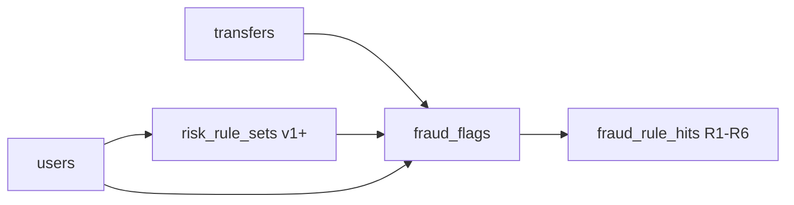

# DBS-58 · Migration lưu cấu hình và cờ fraud

> **Status:** Implemented; Draft PR #44, chờ manual/Dev review/merge · **Vai:** #4 Fraud · **Nhánh:** `feat/DBS-58-fraud-migration` · **Ngày:** 2026-10-30

## 1. Bối cảnh

Board: Task, High, In Progress, P5; DBS-21 và DBS-27 đều Done. Repo hiện chưa có ba bảng fraud. Nguồn Accepted là [database-design §4.8](../components/_shared/database-design.md#48-nhóm-fraud), [risk architecture](../components/risk/02-architecture.md), [guide §4.2](../components/risk/FRAUD_DETECTION_GUIDE.md), ADR-08. ADR-14 còn Proposed và không áp dụng vào migration này. Task thuộc #4 nên không đọc thư mục generator/holdout của #6.

DoD: seed `risk_rule_sets` v1 ngay trong migration, cặp trigger append-only; `fraud_flags` một cờ/transfer và review consistency; `fraud_rule_hits` một hit/rule; DB từ chối bản ghi trùng và review thiếu người; revert được; không có `rule_version` trong hits; CI xanh, Dev review và merge.

Backlog liên quan: BL-021 (cặp trigger, owner/no-match/empty truncate/revert) và BL-047 (CHECK review baseline bị hở) được nhận vào task. BL-048/049 và ADR-14 Proposed về `risk_decisions` giữ ngoài phạm vi. Không có bảng hay worker fraud trước đó.

Docker daemon và PostgreSQL local không có trên máy hiện tại; test PostgreSQL sẽ chạy qua `test:db` trên GitHub CI service. Manual local migration/psql chỉ đánh dấu đạt nếu chạy được với DB tạm thật; nếu không, ghi `chưa chạy` và dùng CI integration evidence riêng, không thay thế bằng giả lập.

## 2. Hành vi

- `risk_rule_sets(version int PK, config jsonb NOT NULL, created_by uuid nullable FK users, created_at timestamptz)` có một seed v1, `created_by=NULL`, `mode=rule_only`, ngưỡng MEDIUM=40/HIGH=70. Sáu luật enabled với weight R1–R6 = 30,25,35,20,40,30 và tham số chính xác trong JSON dưới đây. Đây là contract bàn giao cho task scoring/UC-12; task này chưa cài engine chấm điểm.

```json
{
  "mode": "rule_only",
  "thresholds": { "medium": 40, "high": 70 },
  "rules": {
    "R1": { "enabled": true, "weight": 30, "maxTransfers": 5, "windowMinutes": 10 },
    "R2": { "enabled": true, "weight": 25, "medianMultiplier": 5, "historyDays": 30, "minHistory": 5 },
    "R3": { "enabled": true, "weight": 35, "maxAccountAgeHoursExclusive": 24, "minAmountExclusive": "10000000" },
    "R4": { "enabled": true, "weight": 20, "reverseWindowMinutes": 60 },
    "R5": { "enabled": true, "weight": 40, "minNewRecipients": 5, "windowMinutes": 60, "noveltyDays": 30, "sameOwnerExempt": true },
    "R6": { "enabled": true, "weight": 30, "minBalancePercent": 90, "minBalance": "1000000", "sameOwnerExempt": true }
  },
  "ml": { "enabled": false }
}
```

- Append-only: matched `UPDATE`/`DELETE` và mọi `TRUNCATE` trên `risk_rule_sets` bị từ chối bằng `public.forbid_mutation()` của DBS-27 (SQLSTATE 42501). No-match `UPDATE`/`DELETE` thành công với 0 dòng do trigger chạy theo row; empty `TRUNCATE` vẫn bị chặn do trigger theo statement. INSERT phiên bản mới vẫn được.
- `fraud_flags` có `transfer_id` PK/FK transfers, score không âm, risk_level MEDIUM/HIGH, `rule_set_version` FK, review_status OPEN/CONFIRMED_FRAUD/FALSE_POSITIVE. `OPEN` cần `reviewed_by` và `reviewed_at` cùng NULL; non-OPEN cần cả hai NOT NULL. CHECK `fraud_flags_review_consistent` dùng hai nhánh tường minh `(OPEN AND both NULL) OR (non-OPEN AND both NOT NULL)` để khép BL-047, không dùng biểu thức tương đương boolean có thể thành UNKNOWN trong SQL. `review_note` nullable, `created_at` default clock timestamp.
- `fraud_rule_hits` có PK `(transfer_id,rule_id)`, FK đến flag, chỉ R1–R6, `weight int NOT NULL`, `explanation text NOT NULL`; không có `rule_version`.
- Index `fraud_flags_open_queue_idx` trên `(risk_level,created_at DESC) WHERE review_status='OPEN'` phục vụ hàng đợi review. Down trong transaction READ COMMITTED, khóa bảng rồi chỉ cho revert khi không có flag/hit, chỉ còn đúng seed v1 chưa sửa; không xóa dữ liệu người dùng. Sau down DBS-27 vẫn còn nguyên function/triggers của nó.

## 3. Kiến trúc

Một migration TypeORM mới `CreateFraudStorage1792713600000` sau DBS-27, tạo theo thứ tự rule sets → seed → flags → hits → index → 2 triggers. Down gỡ hits → flags → 2 trigger rule sets → rule sets sau khi kiểm dữ liệu. Dùng `QueryRunner`/SQL giống migrations hiện có, không thêm dependency/entity/runtime API.



## 4. Test cases tự động

| ID | DoD/backlog | Lớp | Kỳ vọng |
|---|---|---|---|
| TC-58-01 | Seed/schema | PostgreSQL DB | Cột, constraint, FK, index, seed v1 khớp từng key/value JSON §2; không có `rule_version` |
| TC-58-02 | Một cờ/hit | PostgreSQL DB | PK chặn cờ trùng, hit trùng; FK chặn transfer/rule set/flag/user thiếu; rule_id ngoài R1–R6 bị chặn |
| TC-58-03 | Review consistency, BL-047 | PostgreSQL DB | OPEN chỉ khi hai review fields NULL; non-OPEN thiếu một hoặc cả hai đều bị chặn; giá trị hợp lệ được chấp nhận |
| TC-58-04 | Append-only, BL-021 | PostgreSQL DB | Non-superuser owner INSERT được; matched UPDATE/DELETE và cả empty TRUNCATE bị 42501; no-match UPDATE/DELETE trả 0 dòng; trigger gọi shared function |
| TC-58-05 | Revert | PostgreSQL DB | Run → revert → run trên DB tạm; down từ chối khi có flag/hit, version mới, hoặc seed v1 bị thiếu/sửa; gỡ trigger fraud nhưng giữ function DBS-27 |
| Quy trình | CI/review/merge | GitHub | CI thật, Dev khác review và merge; PR có bảng này |

## 5. Test thủ công

Chạy trên **database tạm riêng**, không dùng database chung. `migration:run` → xem `\d risk_rule_sets`, `\d fraud_flags`, `\d fraud_rule_hits`, query seed v1; insert fixture transfer từ account/user tạm; thử cờ/hit trùng và review thiếu `reviewed_by`; kiểm SQLSTATE/constraint; `migration:revert` khi chỉ còn seed; `migration:run` lần nữa; cuối cùng dọn DB tạm. Nếu thiếu Docker/PG local, ghi từng bước `chưa chạy`, không coi test DB CI là test tay.

## 6. Domain review

[Review độc lập](screenshots/DBS-58/domain-review.md): lượt đầu REVISE vì no-match UPDATE/DELETE không kích hoạt row trigger, JSON seed chưa có key contract, CHECK baseline có lỗ NULL; đã sửa cả ba trong §2/§4. Lượt hai APPROVE. Review bổ sung yêu cầu test down với seed bị thiếu/sửa đã đưa vào TC-58-05. Authorization commit/push/Draft PR là quy trình DBS-71 mà người dùng yêu cầu tiếp tục trong hội thoại; không sửa sheet hay tự merge.

## 7. Kế hoạch triển khai

1. Viết `backend/test/db/fraud-schema.db-spec.ts` cho TC-58-01..05, xác nhận đỏ do migration chưa có.
2. Thêm migration TypeORM schema/seed/trigger/down, đưa DB tests xanh trên PostgreSQL 17 CI; không thêm package.
3. Kiểm lint/typecheck/build/unit/db/e2e, test tay DB tạm nếu local có Docker; lưu output thật.
4. Hoàn thiện feature doc, README/index, backlog, kiểm link, commit/push Draft PR và quan sát CI theo quy trình DBS-71 mà người dùng đã ủy quyền trong hội thoại. Chỉ Dev khác review/merge; không sửa sheet.

Rủi ro: seed config chưa có interface runtime nên key shape cần đồng bộ với task scoring; ghi handoff rõ. Down phải từ chối xóa flag/version thật. Revert PR sẽ không đụng dữ liệu ngoài migration này.

## 8. Kết quả

Code migration commit `1d1f06d74a098e0859578e239a8d892aba4dd0ef`, test cuối `a0596c092f3362b0c84adea94a6d5cfecddb67da`. Test-first red: `npm run typecheck` báo TS2307 thiếu module migration; sau implementation typecheck, lint, format, build đều xanh. `npm run test:db -- --runInBand --runTestsByPath test/db/fraud-schema.db-spec.ts` dừng ở globalSetup vì Docker daemon không có; không chạy được PostgreSQL local. Backend unit baseline trên main: 493/495 pass, 2 test cooldown JWKS lỗi theo thời gian, không có code identity thay đổi trong PR.

[CI run 41040395347](https://github.com/Lawliet119/digital-banking-simulator/actions/runs/41040395347) trên `b37b359`: 6/6 job success; DB 9/9 suites, 162/162 tests trên PostgreSQL 17. [CI run 41040889485](https://github.com/Lawliet119/digital-banking-simulator/actions/runs/41040889485) trên code cuối `32bab0b`: 6/6 job success, gồm hai assertions FK bổ sung và kiểm trực tiếp `tgfoid` của shared function. Hai CI đỏ trước đó là lỗi test (trigger FK nội bộ, scope DBS-27 cũ, dạng kết quả TypeORM), đã sửa. [Checks PR #44](https://github.com/Lawliet119/digital-banking-simulator/pull/44/checks) là trạng thái hiện hành trước khi merge.

| Case / DoD | Bằng chứng | Trạng thái |
|---|---|---|
| TC-58-01 / schema + seed | `fraud-schema.db-spec.ts`, so từng cột/constraint/JSON/trigger | Đạt trên CI PostgreSQL |
| TC-58-02 / PK, FK, rule ID | Test lỗi 23505, 23503, 23514 trên DB thật; thêm FK users ở commit cuối | Đạt trên CI PostgreSQL |
| TC-58-03 / review | Test partial NULL bị 23514, bản hợp lệ được nhận | Đạt trên CI PostgreSQL |
| TC-58-04 / BL-021 | Test owner NOSUPERUSER, matched/no-match, empty TRUNCATE | Đạt trên CI PostgreSQL |
| TC-58-05 / revert | CLI run→revert→run; thử dữ liệu user, version mới, seed sửa/xóa | Đạt trên CI PostgreSQL |
| Manual M-58 | [Transcript](screenshots/DBS-58/manual-test.txt) | Chưa chạy do không có Docker/PG local; BL-056 |
| CI, Dev review, merge | [Draft PR #44](https://github.com/Lawliet119/digital-banking-simulator/pull/44), [CI 6/6 xanh trên code cuối](https://github.com/Lawliet119/digital-banking-simulator/actions/runs/41040889485) | CI đạt; chờ Dev review/merge; BL-057 |

Các test DBS-27 đã được giới hạn về migration prefix của chính nó để migration DBS-58 về sau không thay đổi lịch sử mà suite cũ đang kiểm. Không tạo `risk_decisions` hay áp ADR-14 Proposed. Contract JSON v1 bàn giao cho Dev task scoring và API UC-12; không sửa sheet. Ảnh `\d` và SQL manual chưa có do chưa chạy được, được theo dõi trong BL-056.

## 9. Tài liệu cập nhật

- [database-design §4.8 và §8.3](../components/_shared/database-design.md): CHECK review không hở NULL, migration trigger risk đã triển khai.
- [Risk README](../../backend/src/modules/risk/README.md), [feature index](README.md), [BACKLOG](../BACKLOG.md), [domain review](screenshots/DBS-58/domain-review.md), [manual transcript](screenshots/DBS-58/manual-test.txt).
- Xóa BL-021 và BL-047: CI PostgreSQL đã chứng minh trigger và CHECK review trên bảng thật.
