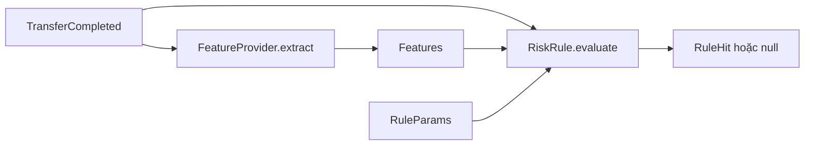
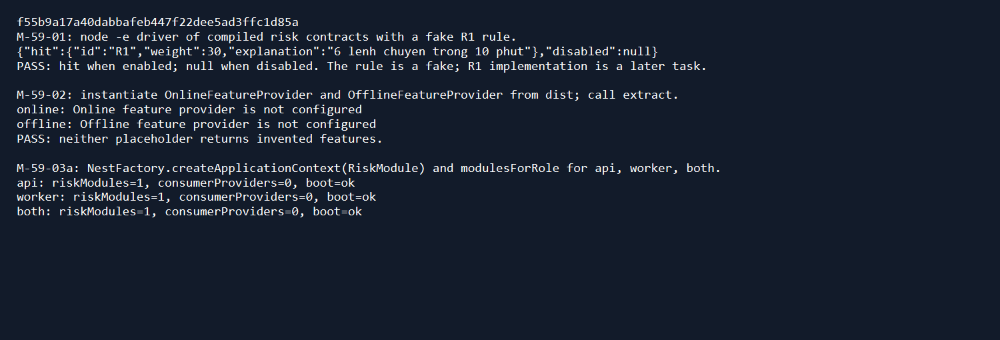

# DBS-59 · Khung module risk

> **Status:** Implemented (Draft PR, chờ CI, review và merge) · **Vai board:** #4 Fraud · **Nhánh:** `feat/DBS-59-risk-module-skeleton` · **PR:** [#42](https://github.com/Lawliet119/digital-banking-simulator/pull/42) · **Ngày:** 2026-10-30

## 1. Bối cảnh

Board: Task, High, In Progress, P5; không có dependency. Expect: "Khung sẵn để viết 6 luật mà không phải sửa lại cấu trúc." Board giao cho #4 Fraud; người dùng xác nhận chính mình nhận task và đã kéo trạng thái In Progress. Repo ban đầu chỉ có `modules/risk/README.md`; `modules/index.ts` chưa đăng ký RiskModule. Docker daemon local không chạy và Docker Desktop executable không có ở đường dẫn mặc định.

DoD: (1) `RiskRule {id; evaluate(event, features, params): RuleHit|null}` thuần, `RuleHit` có weight và explanation; (2) `FeatureProvider` với hai hiện thực rỗng online/offline, chữ ký theo thiết kế cùng #1/#6; (3) RiskModule chỉ khởi động consumer ở worker, import module khác qua public index; (4) unit test rule giả/provider giả; (5) PR merge main, CI xanh, Dev review và bảng đối chiếu đầy đủ.

Giới hạn: chưa có `ConsumerBase`, Redis/SQS adapter, migration risk, audit service hay sáu luật. Không tạo consumer giả hoặc ghi dữ liệu fraud trong task khung. ADR-14 vẫn Proposed; contract dùng thiết kế Accepted ở guide/ADR-08. Backlog BL-041 về implementation đầy đủ vẫn mở.

## 2. Hành vi

- `RiskRule.evaluate` là hàm đồng bộ, chỉ nhận `TransferCompleted` có `type='TRANSFER'`, `Features` và `RuleParams`, trả một hit có `id`, `weight`, giải thích tiếng Việt, hoặc `null`. `DEPOSIT` phải được consumer lọc trước khi gọi rule; kiểu đầu vào cũng ngăn gọi nhầm ở compile time.
- `FeatureProvider.extract(event)` là bất đồng bộ và dùng cùng một contract cho online/offline. Hai lớp khung chưa có nguồn dữ liệu và phải **báo lỗi rõ ràng**, không trả feature giả hoặc kết quả được hiểu là thật.
- Module được nạp ở cả `api` và `worker` qua `sharedModules`. Chưa có consumer để chạy; **DoD #3 mới đạt phần đăng ký**, không thể chứng minh điều kiện worker-only. Khi task consumer thực hiện, chỉ đăng ký/lifecycle ở `runsWorkers()`, không poll ở API.
- Không có endpoint, SQL, event contract hoặc `ErrorCode` mới trong task này.

## 3. Kiến trúc

Các file mới trong `backend/src/modules/risk/`: `rules/rule.ts`, `features/feature-provider.ts`, `features/online-feature-provider.ts`, `features/offline-feature-provider.ts`, `risk.module.ts`, `index.ts`. `modules/index.ts` là điểm đăng ký duy nhất. Import `TransferCompleted` qua `@common/events`; không import sâu module khác. Contract dự kiến:

```ts
type TransferEvent = TransferCompleted & { type: 'TRANSFER' };
type RuleId = 'R1' | 'R2' | 'R3' | 'R4' | 'R5' | 'R6';
interface RuleHit { readonly id: RuleId; readonly weight: number; readonly explanation: string }
interface Features {
  readonly txCount10m: number; // gồm event hiện tại, theo occurredAt
  readonly txCount1h: number; // gồm event hiện tại
  readonly historyCount30d: number; // chỉ event trước occurredAt
  readonly medianAmount30dTimes2: string | null; // 2 × trung vị, số nguyên dạng chuỗi
  readonly reverseTransferOccurredAt: string | null; // ISO UTC, trong 1 giờ trước event
  readonly newRecipients1h: number; // gồm event hiện tại
  readonly distinctRecipients24h: number; // gồm event hiện tại
  readonly sumOut24h: string; // đồng nguyên dạng chuỗi, gồm event hiện tại
  readonly smallTxCount24h: number; // gồm event hiện tại
}
interface RuleParams {
  readonly enabled: boolean;
  readonly weight: number;
  readonly thresholds: Readonly<Record<string, number | string>>;
}
interface RiskRule { readonly id: RuleId; evaluate(event: TransferEvent, features: Features, params: RuleParams): RuleHit | null }
interface FeatureProvider { extract(event: TransferEvent): Promise<Features> }
```

`RuleParams.thresholds` hiện chưa có schema cấu hình `risk_rule_sets`; bảng đó thuộc migration DBS-58. Các ngưỡng được đặt tên và validate khi triển khai luật/config, không đọc trực tiếp từ một JSON chưa kiểm tra. Tiền luôn ở chuỗi số nguyên; `medianAmount30dTimes2` biểu diễn nửa đồng chính xác. R3/R6 dùng snapshot sẵn trong event, không đọc số dư/tuổi hiện tại. Điểm thời gian luôn là `event.occurredAt`.



Không có transaction trong DBS-59. Những phần Redis, SQL fallback, dedup, audit, flag và score do task sau triển khai và test trên dịch vụ/DB thật.

## 4. Test cases tự động

| ID | Truy vết | Lớp | Given · When · Then |
|---|---|---|---|
| TC-59-01 | DoD 1 | Unit | Rule giả nhận transfer event/features/params và trả hit hoặc null, không cần I/O; compile-time test từ chối DEPOSIT |
| TC-59-02 | DoD 2 | Unit | Provider giả theo interface trả cùng Features; placeholder online/offline từ chối rõ ràng khi bị gọi |
| TC-59-03 | DoD 3 (phần đăng ký) | Unit | `modulesForRole(api/worker/both)` đều chứa RiskModule đúng một lần; module không đăng ký consumer giả |
| TC-59-04 | DoD 4 | Unit | Rule giả và provider giả chạy được qua contract TypeScript |
| Quy trình | DoD 5 | GitHub | CI/Dev review/merge thực tế mới được đánh dấu đạt |

Không có `errorCode` trong module khung. Các test role/module không chứng minh xử lý queue; ranh giới này được ghi ở §8 và backlog.

## 5. Test thủ công

| Bước | Thao tác | Kỳ vọng |
|---|---|---|
| M-59-01 | Chạy driver TypeScript dùng rule giả với một `TransferCompleted` mẫu | In hit và null đúng theo tham số |
| M-59-02 | Gọi hai provider khung từ driver | Báo lỗi chưa cấu hình, không trả feature giả |
| M-59-03 | Khởi động Nest context của RiskModule dưới `api`, `worker`, `both`; nếu Docker có sẵn thì khởi động cả AppModule | Module khởi động; bước này **chỉ chứng minh bootstrap**, chưa chứng minh worker-only consumer |

M-59-03 cần Docker/PostgreSQL local; nếu daemon chưa chạy sẽ ghi chưa chạy và lý do thật. Không có consumer runtime để gửi message ở task này. Test queue/worker-only được bàn giao vào backlog khi consumer ra đời.

## 6. Domain review

[Review độc lập](screenshots/DBS-59/domain-review.md) vòng đầu có 1 blocking, 2 should-fix, 1 minor; đã sửa §1–§5 và nhận verdict **APPROVE cho phạm vi khung đã giới hạn rõ**. Còn phải nhờ #1/#6 xác nhận chữ ký và test consumer runtime khi có code thật.

## 7. Kế hoạch triển khai

| Bước | File | Test trước | Lệnh chứng minh |
|---|---|---|---|
| 1 | `rules/rule.ts`, `features/*.ts` | TC-59-01/02/04, đỏ vì contract chưa tồn tại | Unit Jest |
| 2 | `risk.module.ts`, `index.ts`, `modules/index.ts` | TC-59-03, đỏ vì module chưa có | Unit Jest, app bootstrap |
| 3 | README, feature doc, backlog | Đối chiếu DoD | `check-doc-links.mjs` |

Rủi ro: placeholder bị dùng như provider thật; giảm bằng lỗi rõ ràng và không đăng ký chúng trong Nest DI. Rút lại bằng cách bỏ branch local; không có migration.

## 8. Kết quả

| Kiểm tra | Kết quả |
|---|---|
| `lint:check`, `typecheck`, `build` | Đạt sau khi sửa import test và kiểu DEPOSIT |
| Test DBS-59 (`risk.contract.spec.ts`, `modules.spec.ts`) | 2 suite, 10 test đạt; test đầu đỏ vì các contract/module chưa tồn tại |
| Unit toàn repo | Baseline 29/30 suite, 493/495 test đạt; 2 test JWKS cooldown của Identity đỏ. Chạy lại riêng: 1/13 test vẫn đỏ. Không sửa Identity trong DBS-59 |
| E2E toàn repo | Không hoàn tất: AppModule không nối được PostgreSQL vì Docker local không có |
| Manual | [Transcript](screenshots/DBS-59/manual-test.txt) trên commit code `f55b9a1`: M-59-01/02 và bootstrap RiskModule đạt; full app chưa chạy do Docker; không có consumer thật |



Đối chiếu: TC-59-01/02/04 đạt ở lớp unit. TC-59-03 chỉ đạt phần module registration; worker-only consumer chưa kiểm được (BL-041). DoD #2 chưa có xác nhận chữ ký từ #1/#6 (BL-053). DoD #5 chưa đạt: [Draft PR #42](https://github.com/Lawliet119/digital-banking-simulator/pull/42) đã mở, CI/Dev review/merge còn chờ (BL-054). Người dùng đã cho phép commit, push và Draft PR; manual test được chạy lại trên commit code cuối `f55b9a1`.

## 9. Tài liệu cập nhật

Đã cập nhật `backend/src/modules/risk/README.md`, `docs/features/README.md`, `docs/BACKLOG.md`; thêm BL-053 và BL-054, cập nhật BL-041. Không đổi ADR/event contract/schema/env var/dependency.
