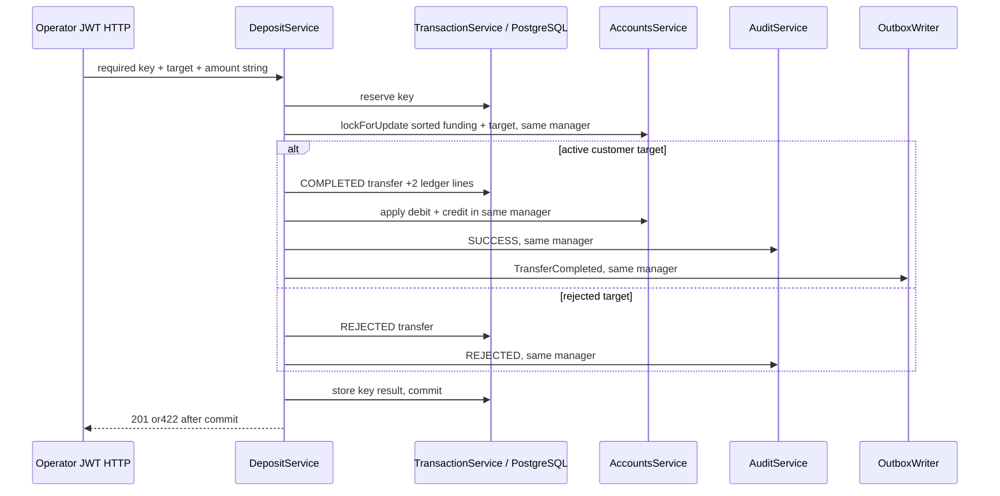

# DBS-60 · UC-3 raw operator deposits

Status: Implemented; [Draft PR57](https://github.com/Lawliet119/digital-banking-simulator/pull/57) targets main, finalCI/Dev review/merge tracked by BL-149. Owner Dev, updated2026-11-04. Branch feat/DBS-60-operator-deposits from main a9e607b.

## 1. Scope / dependencies

Exact sheet: Week2 Story Dev Highest In Progress. All implementation dependencies on main:21/22/55/56/57/51 Done;53 board In Progress but actual local auth/JWT tools merged PR48. No temporary62/63/64 base needed. DoD: operator-only POST /v1/operator/deposits; required Idempotency-Key, amount string; one transaction key+ordered account locks+DEPOSIT transfer+two ledger lines/balance_after+balances+audit+TransferCompleted outbox; SYSTEM funding source bypasses balance/limits, locked destination422 REJECTED; real PG1,000,000 proof; replay/conflict semantics deferred79; PR/CI/review/merge.

Scope is deposit first execution. Reused key safely409, no second mutation, no replay/hash comparison until79. Store hash/transfer/status/response for future79. No new ErrorCode/schema/env/dependency/ADR, customer transfer/limits, queues/HTTP/Redis inside transaction, replay claims or SQL financial seeding. Main lacks opening API; test/manual label zero-default users/customers/accounts as input fixtures only (allowed input-row setup, never seed balances/ledger). Actual auth/identity/accounts/transaction/audit/outbox modules, no business-service stub. Account-opening APIs are not declared dependencies and are not faked.

Backlog: resolve BL-002 deposit event snapshot contract; BL-122 deposit portion handled, transfer portion left for61; BL-004 hash definition conflict left for79 (this endpoint follows ADR05 canonical method/path/body). Existing BL-005/006/017 DB-role/complete-pair constraints, BL-008 money lint, BL-112/121 timing and BL-130/132 identity/global role audit unchanged. No general ownership bypass: operator is authorized to credit customer accounts, not debit them.

## 2. HTTP / monetary behaviour

POST /v1/operator/deposits @Roles('operator') using actual global guards. Body exactly {"toAccountId":"<uuid>","amount":"1000000"}; UUID validate/normalize lower-case; amount @IsMoneyAmount canonical positive decimal string<=9223372036854775807, reject JSON numbers/0/negative/decimal/exponent/extra fields400. Source/account owner/actor/correlation cannot be supplied in body. Idempotency-Key absent/empty/blank ->400 IDEMPOTENCY_KEY_REQUIRED; >128 characters ->400 generic validation, never echo key. Response201 {transferId,status:'COMPLETED'}.

Actor internal users.id from CurrentUser; server correlationId required. Funding UUID00000000-0000-4000-8000-000000000001, must resolve actual SYSTEM/no customer; missing/corrupt funding is500 and rollback. AccountsService.lockForUpdate([funding,target],manager) enforces sorted locks/outermost tx. Destination must exist, customer-owned nonSYSTEM and ACTIVE after locks. LOCKED ->persist REJECTED with targetFK; missing/SYSTEM ->persist REJECTED with to_account_id NULL (avoids missing FK/distinct source-target violation),422 ACCOUNT_NOT_ACTIVE +transferId. No ledger/balance mutation/outbox on rejection, audit+key response commit before throwing422. No transfer event for rejection.

Skip SYSTEM available-balance/per-transfer/day limits (ADR09); no limits provider needed. Debit funding into negative, credit target by exact bigint through AccountsService.applyBalanceChange in the same manager which acquired locks. Compute new balances before any update using common money functions; overflow is unexpected500, not a false business422, all state/key rolls back. Only accounts module writes accounts SQL. Positive deposit above2^53 must preserve exact DB/ledger/event string. No Number/parseInt on money.

Audit action deposit outcome SUCCESS/REJECTED, role operator, actor verified id, target transfer/id, server correlationId, metadata{id:normalizedRequestedToAccountId} or{id:normalizedRequestedToAccountId,reason:ACCOUNT_NOT_ACTIVE}. Retain the requested destination even when transfer targetFK is NULL (database-design4.3); transfer ID already exists as audit target. No names/email/free text. Audit/outbox/second-line/balance/response-storage failure ->rollback every business row and key; sanitized500 (or503 SERVICE_TEMPORARILY_UNAVAILABLE+Retry-After for transient failures). Retry same key after rollback can execute normally. Existing wrapper handles deadlock retries; no second loop or external side effects.

Key first INSERT(user_id,idem_key,request_hash) ON CONFLICT DO NOTHING RETURNING idem_key. If no row,409 conflict with generic detail (only409 path), no original response leaked, no mutation; same/different body not distinguished (79). Hash SHA256 JSON with method POST,path /v1/operator/deposits,body sorted amount/toAccountId normalized. Final UPDATE key transfer_id,response_code,response_body in same transaction; COMPL201 response body, REJECT422 stable errorCode/transferId/message payload. Full stored HTTP replay and retention worker remain79/136. Never return201 for unhandled duplicate. No key echoed in response/log.

## 3. Architecture / ordering

New LedgerModule(index export only module), DepositService, DepositDto, OperatorDepositsController. Imports AccountsModule/AuditModule/OutboxModule public surfaces. Register LedgerModule in apiModules only, both inherits it, worker has no deposit controller. No SQL accounts access in service; ownership/state/balance/timestamps from locked account snapshots returned by AccountsService. No change to primitive signatures.

tx.run READ COMMITTED: reserve key ->lock sorted accounts ->validate snapshots ->insert transfer(COMP or REJECT, initiated_by/correlation) RETURNING id,created_at ->ifsuccess insert exactly2 ledger lines DEBIT funding/CREDITtarget using computed balance_after, apply both deltas via actual accounts primitive ->audit ->outbox success ->UPDATE key ->commit ->201 or throw422. Generate transfer/event IDs within callback or by DB, retry no survivors. Any wrapper retry gets new runner and fresh snapshots.

TransferCompleted event: eventId randomUUID, transferId; type DEPOSIT, from funding,to target, amount formatMoney; fromBalanceBefore formatBalance actual locked funding snapshot (may be negative), createdAt snapshots ISO Z, fromUserId null,sameOwner false,toUserId target.userId; occurredAt exactly transfer.created_at Date.toISOString(), server correlationId same as audit/request. Actual OutboxWriter validates via assertEvent and requires active same transaction. No network publication.

## 4. Tests

Real JWT/IdentityService/TypeORM/TransactionService/AccountsService/AuditService/OutboxWriter and HTTP in test/db/operator-deposits.db-spec.ts. New test/support/deposit-app.ts supplies only configuration/public JWKS and actual modules with global guards; real Pino HTTP bindings for event correlation. Zero-default input rows in owned temp PG17 DB; no fake service or SQL-created money. Invariant checker after EVERY money scenario. App/DB/JWKS cleanup in finally.

| Case | Proof / trace |
|---|---|
| TC-60-01 | Deposit1,000,000 ->201; funding -1m,target1m; one completed DEPOSIT, exactly2 lines DEBIT/CREDIT correct balance_after, one audit/one outbox/one completed key scopedactor; event validateEvent, exacttransfer timestamps/correlation and owner snapshots |
| TC-60-02 | Next deposit same/different target; event negative fromBalanceBefore; fundingbalance below0 allowed, no normal per-TX/day guard; total balance0 |
| TC-60-03 | LOCKED/missing/SYSTEM target ->422 ACCOUNT_NOT_ACTIVE, persisted REJECTED transfer/key/audit; existingtargetFK forLOCKED otherwiseNULL; no lines/money/outbox |
| TC-60-04 | Actual guards operator accepted; customer/auditor/admin403, absent/expiredJWT401 codes; body amount JSONnumber/0/decimal/negative/exponent/overflow, UUID invalid/extraowner/from/correlation fields400; no business writes |
| TC-60-05 | Missing/blank key400 required code, >128 rejected400; valid128 accepted; key digest/result fieldspersisted |
| TC-60-06 | Ten distinct keys concurrent same target all201, no lost credit; ten same key ->one201+nine409, exactlyone set business effects. Other operator can reuse same key independently. No full replay79 claim |
| TC-60-07 | Real audit trigger fails ->500, balance/transfer/lines/outbox/key all unchanged; remove trigger retry SAME key succeeds; REJECTED auditfailure also rollback |
| TC-60-08 | Real outbox INSERT trigger fails after balance/audit ->500 all rollback; recovery same key succeeds. Real CREDIT-line trigger fails after DEBIT inserted ->rollback both lines/transfer/key/money |
| TC-60-09 | Real account UPDATE target trigger fails after funding update ->rollback both balances and all writes; recovery safe; no swallowed primitive errors |
| TC-60-09b | Real idempotency_keys BEFORE UPDATE trigger rejects final response storage after ledger/balances/audit/outbox; both success and REJECTED result updates fail500 with all state unchanged. Remove trigger, same key can execute/reject normally |
| TC-60-10 | Hold actual funding row until locktimeout ->503 code+Retry-After/no business writes/key; release retry same key201 |
| TC-60-11 | Deposit9007199254740993 ->exact decimal acrossrequest/PG/balances/lines/outbox; numeric capacity exhaustion ->500/all rollback (fixture reaches boundary only via real deposit API) |
| TC-60-12 | Missing funding zero-input fixture before any transfer ->500 not422 and key rollback; restore initial default-zero input row, no SQL financial seed |
| TC-60-13 | OpenAPI operator role/bearer, keyrequired1..128, amountstring/examples,201/400/401/403/409/422/500/503; module actual role registration |
| Process | Main-based Draft PR, CI URLs, Dev review/merge pending until evidence |

Physical fault triggers operate only in suite-owned DB; always drop in finally. Input LOCKED status fixture is not a fake lock/revocation API. AC-5.3/4/5 replay/conflict response matching deferred79; AC-5.9 money invariants/concurrency apply; lockedtarget AC-5.7 equivalent covered; caller ownership source AC-5.8 not applicable because operator/system source. No fraud-flag leakage or private-key logs. Production DB role proof remains017.

## 5. Manual

backend/scripts/manual-dbs60.cjs, run node scripts/manual-dbs60.cjs from backend on final code SHA. Creates ownedPG17/tempDB and actual deposit app. Label SQL fixture users/customers/zero-default accounts; all money ONLY via API. Raw HTTP status/body/correlation + safe balance/ledger/audit/outbox/key counts and invariant report; no tokens/password/URI. Tested SHA firstline.

| Step | Action -> expected |
|---|---|
| M-60-01 | Operator deposit1m ->201, exact2 ledger lines, funding negative,targetpositive, audit1/outbox1/keyresult, invariantPASS |
| M-60-02 | Another deposit ->negative funding snapshot event validates with occurredAt DBtimestamp, nullsourceowner/false sameowner |
| M-60-03 | Locked/missing/SYSTEM target ->422 persistedreject with no money/lines/event; missingkey400, wrongrole403 |
| M-60-04 | Actual audit/outboxfault ->500rollback, remove trigger retry samekey201; invariantPASS |
| M-60-05 | Ten parallel distinct requests totalscorrect; duplicate key guarded409 (replay explicitlypending79); >2^53 exact deposit, invariantPASS |
| M-60-06 | Closeapp/removepublicJWKS/tempDB/container; keep transcript/screenshot/finalSHA |

## 6. Review

First review REVISE with2 should-fix: preserve requested destination in audit metadata and prove final key-response UPDATE failure atomicity for success/rejection. Both addressed in sections2/4 and corresponding cases; final re-review APPROVE, no remaining findings. [Round1](screenshots/DBS-60/domain-review-round1.md), [final raw reply](screenshots/DBS-60/domain-review.md). Inherited Codex reviewer, no model override; no human gate approvals claimed.

## 7. Plan

1. Exact requirements/dependency/code/schema/event/backlog inspection; branch main a9e607b with main CI6green and actual dependencies, docker compose/local baseline checks.
2. Design review raw reply, fix/re-review findings. User's previous workflow skips human gate pauses, not review/tests.
3. Write full HTTP/PG failure cases first, run missing-route red; fixture only real services/config. No financial SQLseeds.
4. DTO/controller, service transaction ordering through account primitives, LedgerModule registration; test atomic balances/rejections/faults/concurrency/event/samekey safety. No new contract/schema/dependency.
5. Lint/typecheck/build/fullunit/e2e/relevantPG; commit code then manual all6 on finalSHA; actual screenshots/invariantreports.
6. Docs03 API, ledgerREADME/featureindex/backlog; resolve002 and deposit portion122 with evidence, track79/process gaps and anyknownbaselinefailures; linkcheck; commit/push/mainDraftPR, actualCI, no merge/boardedit.

Rollbackcodeonly on branch; no sharedDBrevert/financialrowdelete. Greatest risks: premature422 rollsback rejection, deadlock retries duplicating side effects, wrongfunding owner/balancesnapshot, incomplete half-bookings; targetedtests above. FixtureloadingactualPino/guards modules is part of integration, not mocked audit/outbox.

## 8. Results / handoffs

Implemented LedgerModule/DepositService/DTO/operator controller from main, no62/63/64 branch dependencies. Fresh lint/typecheck/build passed; full unit55 suites826/826 passed (45.158s); related4 PostgreSQL suites104/104 passed (9.872s), including16 deposit/fault scenarios. Initial TypeScript test-key inference corrected; meaningful red run16/16 failed because actual route absent404, before production code. Real auth/audit/accounts/outbox modules used, no stubs.

Both design findings fixed and re-reviewed APPROVE. BL-002 resolved by actual valid deposit events including negativefundingsnapshot/DBtime/nullsourceowner. BL-122 narrowed to remaining transfer work; deposit part tested. BL-148 explicitly tracks79 replay/conflict work per board, BL-149 process/CI/Dev review/merge. BL-004 and other source gaps preserved. No human gate approvals or CI outcome claimed before actual run. Input SQL only creates zero-default accounts/customers/users, not money or ledger.

Code commit `f011937a881b5c017e0cd07e6a28a40dc99b9f00`. Full e2e13 suites135/135 passed (83.334s); final deposit suite16/16 passed (6.232s) after lint-compatible bigint subtraction change. No skipped task tests; full DB suite not rerun locally, four affected suites used. [Verification summary](screenshots/DBS-60/verification.txt), [prepared PR mapping](screenshots/DBS-60/pr-description.md).

Manual `node scripts/manual-dbs60.cjs` executed all6 steps on code commit: [raw transcript](screenshots/DBS-60/manual-test.txt). M1 deposit1m exacttwo lines/audit1/outbox1/key1; M2 negative funding/valid event nullowner/false sameOwner/DBZtime; M3 locked/missing/SYSTEM422 with persistedreject, missingkey400/wrongrole403; M4 actual audit/outboxfault500 and samekeyretry201; M5 ten concurrent distinct deposits, guarded duplicate409,9007199254740993 exact via actualAPI; M6 app/publicJWKS/tempDB/container cleanup. Every invariant report PASS, zero violations,total balance0. No unexecuted step claimed passed; no token/credential markers in output.

Case mapping: TC-60-01/02/03/04/05/06/07/08/09/09b/10/11/12/13 all matched by named cases in operator-deposits.db-spec.ts (16 Jest cases, fault matrix includes success/rejection and each failure stage). Test13 role registration additionally validated by real AppModule full e2e. DoD replay explicitly deferred79, AC-5.3/4/5 matching responses not claimed. BL-149 remains until actual CI/Dev review/merge; agent does not merge or edit board.

Main-based [Draft PR57](https://github.com/Lawliet119/digital-banking-simulator/pull/57), [final checks](https://github.com/Lawliet119/digital-banking-simulator/pull/57/checks). Local results do not substitute for these checks. Delivery checklist: independent review APPROVE, planned cases matched, manual6/6 and actual screenshot/zero-violation reports retained at codeSHA; no tokens/credentials in transcript; no schema/env/ADR/event change; Dev review/merge and exact replay79 explicitly still open. User moves board to In Review when handing the PR to a Dev reviewer; no gate approval or Dev review fabricated.

## 9. Sources / docs

Sheet60, docs02 UC3/FR-LED-01/05/06, BR01/02/04/07/09, docs03 criticalpath6.1/UC3 diagram6.4; ADR04/05/07/09; database-design4.2-4.5; event-contract, actual accountprimitives/audit/outbox/transaction/guards, CONTRIBUTING5/5b. No sealed fraud dataset reads.

Updated Ledger README/public exports and docs03 API maturity note, featureindex, BACKLOG (removed002, narrowed122, added148/149), independent review/manual/screenshot/verification artifacts. No schema/ADR/event/env change. Fixture-only user/customer/default-zero rows clearly labelled; no financial seeding or new mocked service.
