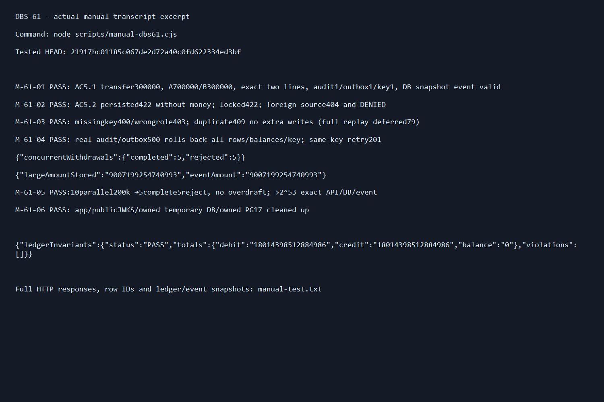

# DBS-61 · Customer transfers with atomic double entry

> **Status:** Rebased onto main after DBS-60 merge; Draft PR/final CI in progress, Dev review/merge pending · **Role:** Dev · **Branch:** `feat/DBS-61-customer-transfers` · **PR:** pending dependency merge · **Updated:** 2026-11-05

## 1. Context

Board: Week 2, Story, Dev, Highest, In Progress, P2. Expect: “Khách chuyển được tiền cho khách khác, số dư hai bên đúng.”

DoD from board:
1. POST /v1/transfers (customer) bắt buộc Idempotency-Key; lấy from từ tài khoản thuộc về mình (getOwnedAccount).
2. FOR UPDATE hai tài khoản theo thứ tự id → kiểm sơ bộ ACTIVE và đủ số dư (sync guard đầy đủ làm ở tuần 3) → INSERT transfers + 2 ledger_entries + cập nhật 2 số dư + audit + outbox.
3. INSUFFICIENT_FUNDS → lệnh REJECTED trả 422 problem+json (lưu đầy đủ làm ở DBS-83); số dư không đổi; không có bút toán.
4. Test e2e Postgres thật: AC-5.1 (A 1.000.000, B 0, chuyển 300.000) và AC-5.2.
5. PR đã merge vào main (CI xanh); Dev review; bảng «Đối chiếu test case» trong PR điền đủ.

Dependency: [DBS-60](DBS-60-operator-deposits.md), Draft [PR57](https://github.com/Lawliet119/digital-banking-simulator/pull/57), not in main at start. User explicitly authorizes temporary base `42d5d1d1205f2d5aed0e59f8b4efecafad9c1531`, isolated DBS-61 commits, rebase after dependency merge; no main PR before then. User's prior instruction overrides human gate pauses; no claim of human G1–G4 approval. No shared board edits or merge.

Existing primitives: AccountsService ownership read/ordered locks/balance apply, TransactionService bounded retry, real AuditService and OutboxWriter, deposit API and its real JWT/HTTP/PG fixture. Baseline running; results recorded §8 before production code. No transfer endpoint exists yet (red test will demonstrate404).

Scope: raw transfer, basic ACTIVE/balance guard, ownership DENIED audit, atomic failure proof. Resolve BL-003 SYSTEM transfer protection and BL-122 transfer integration. Deferred: limits/day clock and full sync guard (week3); replay/conflict DBS-79 (safe409 barrier only, inherited BL-148); comprehensive rejection persistence DBS-83 (here basic transfer/reason/key/audit persisted). BL-004 hash documentation inconsistency remains for79: follow ADR05 canonical method/path/body. BL-005/006/008/017 DB role/constraints/lint, BL-007 config-money parsing, BL-112 Identity timing, BL-121 logging startup timing, BL-130 provisioning audit, BL-132 role-denial audit remain separate. No schema, event, ErrorCode, env or dependency changes.

## 2. Behaviour

Customer-only POST `/v1/transfers`; JWT roles from existing guards. Header `Idempotency-Key` required, nonblank, max128 codepoints, missing400 IDEMPOTENCY_KEY_REQUIRED. DTO exactly `{fromAccountId,toAccountId,amount}`; UUIDs lowercase-normalized, amount positive canonical whole-VND string <=signed64MAX; unknown fields/numbers/decimal/zero/negative fail400. Equal normalized account IDs fail400 before transaction (no schema violation).

Example `{ "fromAccountId":"<owned UUID>", "toAccountId":"<other customer UUID>", "amount":"300000" }` →201 `{ "transferId":"<UUID>", "status":"COMPLETED" }`.

Call `getOwnedAccount(from,actor)` before business transaction; its snapshot authorizes only, never supplies balance/status for guards. Missing/foreign/SYSTEM source → separate `recordDenied` action `transfer`, target account/sourceUUID, metadata NOT_OWNER, then same404. Audit failure →500, fail closed. Ownership rechecked on locked snapshot; if it changed, abort transaction and record DENIED outside then404. Source/customer ownership is currently immutable, but do not rely on stale authorization for money movement.

New key → lock both accounts by id → ACTIVE first, then sufficient source balance. SYSTEM/missing target is treated absent (`to_account_id=NULL`), LOCKED target retains valid FK. Invalid target or locked source →422 ACCOUNT_NOT_ACTIVE. Valid target but insufficient source →422 INSUFFICIENT_FUNDS. Persist transfer REJECTED +audit REJECTED +key result, commit then throw422. Problem response includes transferId/errorCode/server correlationId; no lines, balance change or outbox. Same-owner distinct accounts allowed, sameOwner event true.

Success: transfer TRANSFER +exact DEBIT source/CREDIT destination with balance_after +both balance updates +audit SUCCESS +one valid TransferCompleted +key result commit atomically. Snapshot fromBalanceBefore from locked source; owner IDs non-null, sameOwner from owner IDs, times from DB row/account snapshots using ISO Z. No TransferRejected event. Amount above2^53 stays bigint/string. Overflow is500 rollback, not a business422. Every unexpected write fault rolls back all effects and key; transient503+Retry-After uses existing filter/retry. Key reuse409 (no replay claim), scoped actor. No network in transaction.

Security: JWT/role TC05, ownership TC03/11, user-key scope TC07, business audit TC02/04, denied separate/failclosed TC03/11, no fraud/owner response fields TC01, safe generic errors TC08/09, parameterized SQL and hostile inputs TC05. Existing TLS configuration unchanged; local PG container is test only.

## 3. Architecture

API/both LedgerModule registers internal TransferService, TransfersController and TransferDto/TransferResultDto. No exported API changes; existing AccountsService/AuditService/OutboxWriter callers unmodified. Reuse test/support/deposit-app.ts actual production modules and zero-default SQL INPUT fixtures (onboarding not in main); ALL money seeded through deposit HTTP.

Interfaces: `getOwnedAccount(accountId:string,userId:string):Promise<Account>`; `lockForUpdate(ids:string[],manager:EntityManager):Promise<LockedAccount[]>`; `applyBalanceChange(accountId:string,delta:bigint,manager:EntityManager):Promise<void>`; `TransactionService.run<T>(work:(manager:EntityManager)=>Promise<T>):Promise<T>`; `AuditService.record(manager,input)` and `recordDenied(input)`; `OutboxWriter.add(manager,event)`. Transfer service `transfer(actor,key,body,correlationId):Promise<TransferResultDto>`.

Tables written: idempotency_keys, transfers, ledger_entries, accounts through public primitives, audit_log and outbox_events through owner services. Existing constraints only. Hash SHA256 JSON sorted keys: method,path,body (body amount,fromAccountId,toAccountId). One outermost transaction reservekey → orderedlocks → guardedwrites →audit/event →storedresult. Denial outside that transaction. Rejected outcome thrown only after commit.

```mermaid
sequenceDiagram
 participant C as Customer
 participant L as Ledger
 participant A as Accounts
 participant DB as PostgreSQL
 C->>L: POST transfers + JWT + key
 L->>A: getOwnedAccount
 L->>DB: BEGIN; reserve key
 L->>A: ordered locks; use locked snapshots
 L->>DB: guard; transfer/lines/balances/audit/outbox/key
 L->>DB: COMMIT
 L-->>C: 201 or persisted422
```

Docs facts updated: ledger README, docs03 API maturity, feature index/backlog. ADRs/event schema unchanged.

## 4. Automated cases

All cases real PostgreSQL17 through actual JWT/HTTP, no money mocks; invariant checker after each case. Own isolated temporary database, never modify shared balances or revert shared DB.

| ID | Trace | Given / when / then | ErrorCode |
|---|---|---|---|
| TC-61-01 | DoD1/2/4, AC5.1 | Deposit A1m via API, B0; transfer300k →700k/300k, exact2lines/balance_after, audit/key/event snapshots/DBtime | — |
| TC-61-02 | DoD3/4, AC5.2 | Deposit100k, transfer300k →persist REJECTED/key/audit; no lines/event/balance change, problem+json | INSUFFICIENT_FUNDS |
| TC-61-03 | DoD1, AC5.8, BL003 | Foreign/missing/SYSTEM source uniform404+DENIED, no money/key | — |
| TC-61-04 | DoD2, AC5.7, BL003 | Source/target LOCKED, missing/SYSTEM target persisted422, no money; precedence ACTIVE beforebalance | ACCOUNT_NOT_ACTIVE |
| TC-61-05 | DoD1 security | No/expired JWT401, wrong3roles403, key/DTO/static sameaccount/hostile input400; header128/129 boundary | UNAUTHENTICATED/TOKEN_EXPIRED/FORBIDDEN/IDEMPOTENCY_KEY_REQUIRED |
| TC-61-06 | DoD2, BR03 | 10parallel distinct-key withdrawals200k from1m →5success5insufficient, nevernegative; cross-transfers opposite direction invariant | INSUFFICIENT_FUNDS |
| TC-61-07 | DoD1 barrier | 10samekey →one201/nine409, samekey otheractor succeeds; sameowner distinct accounts eventtrue | — (full replay79 deferred) |
| TC-61-08 | DoD2, BR02/09 | Real triggers fail CREDITinsert, targetUPDATE,audit,outbox,keyUPDATE (also rejectionaudit/key) →500 exact prior snapshot; remove then retry samekey succeeds | — |
| TC-61-09 | DoD2 recovery | Hold real rowlock →503 Retry-After/no effects; release samekey201 | SERVICE_TEMPORARILY_UNAVAILABLE |
| TC-61-10 | DoD2 ADR07 | Deposit >2^53, transfer exact amount, DB/lines/event strings; signed64overflow rollback | — |
| TC-61-11 | DoD1 audit | Ownership-denial auditfault500, no key/writes; recovery404+oneDENIED | — |
| TC-61-12 | DoD1 API | Swagger request/key/role/statuses published | — |
| Process | DoD5 | Dependency merge →rebase →DraftPR →CI →Dev review →merge (agent never merges) | Pending |

## 5. Manual test

Run `node scripts/manual-dbs61.cjs` from backend. Actual NestHTTP/JWT/PG17 Testcontainers, SQL INPUT users/customers/defaultzeroaccounts labeled explicitly; seed money only via depositAPI. Print no token/credential. Own container/database cleaned in finally.

| Step | Action | Observable result |
|---|---|---|
| M-61-01 | Deposit1m then POST transfer300k | 201;700k/300k, exact2lines/audit/outbox/key and invariant PASS |
| M-61-02 | Separate A100k →transfer300k; lockedtarget; foreignsource | persisted422 insufficient/active;404 DENIED; moneyunchanged |
| M-61-03 | Missingkey and wrongrole, duplicatekey |400required/403/409; no extra money |
| M-61-04 | Actual audit/outbox failtrigger, remove and retry samekey |500 fullrollback then201; invariantPASS |
| M-61-05 |10parallel200k withdrawals from1m; >2^53 transfer |5completed5rejected; exact stringamount; invariantPASS |
| M-61-06 | Close app/tempJWKS/drop ownedDB/stop ownedcontainer |Cleanup succeeds |

## 6. Domain review

Independent fresh subagent `/root/dbs61_design_review`, inherited current model, 2026-11-05: zero findings, `Verdict: APPROVE`. [Raw reply](screenshots/DBS-61/domain-review.md). Independent follow-up inspection of final implementation/tests also zero findings, [APPROVE](screenshots/DBS-61/implementation-review.md). No human gate approval claimed; continuing under user's instruction.

## 7. Implementation plan

| Step | Files | Test first / red | Proof | Commit |
|---|---|---|---|---|
|1|test/db/customer-transfers.db-spec.ts|TC01–12, endpoint404 before code|test:db target|test+feature commit|
|2|src/modules/ledger/transfer.dto.ts,transfer.service.ts,transfers.controller.ts,ledger.module.ts|same tests|lint/typecheck/build/test:db|feat(ledger): implement atomic customer transfers|
|3|scripts/manual-dbs61.cjs|manual assertions use realHTTP/DB|manual on final codeSHA|same source commit|
|4|docs/features/DBS-61-customer-transfers.md,screenshots/DBS-61/*,feature index,BACKLOG,ledger README,docs03|actual evidence only|full unit/e2e/relatedDB;linkcheck|docs(ledger): record DBS-61 evidence|

Sweep: schema/event/env/dependency/other modules unchanged. No broad refactor DepositService; share primitives rather than change existing deposit behaviour. Rollback branch only, no migrations. Keep parent42d5d1d fixed for rebase of DBS61-only commits; no PR against dependency branch.

## 8. Results

Baseline on temporary parent: lint/typecheck/build passed; unit55 suites826/826 (97.570s), e2e13 suites135/135 (107.520s). Red test after fixing one test-helper TypeScript body type: real PG19/19 cases fail, endpoint404 (AC5.1 expected201 got404; Swagger route absent), 9.315s. No production code existed at this point.

Final source commit: `58d628e5274fd2f05bd8df0a75a4b9e442f1e994`. Later commits change documentation/evidence only. Commands from backend:

| Command | Actual result |
|---|---|
| `npm run lint:check` | PASS after correcting an unnecessary source non-null assertion and typing the test balance query |
| `npm run typecheck` / `npm run build` | PASS |
| `npm test -- --runInBand` | **824 passed, 2 failed /826**, 54/55 suites,82.360s. Both failures inherited BL-112 JWKS cooldown fetch counts (expected1 got2; expected2 got3). Not fixed or hidden; baseline826/826 passed. No rerun-until-green |
| `npm run test:e2e -- --runInBand` | **135/135**,13 suites,126.079s |
| `npm run test:db -- --runInBand customer-transfers` | Initial green **19/19**,12.481s |
| `npm run test:db -- --runInBand customer-transfers operator-deposits accounts-service audit-service outbox-writer` | Final **129/129**,6 matching suites,74.124s, includes all19 DBS61 and deposit regression |
| `node --check scripts/manual-dbs61.cjs` | PASS |
| `node scripts/manual-dbs61.cjs` | **6/6 manual steps PASS**, actual JWT/HTTP/PG17; source SHA first line |
| `node .claude/skills/dbs-delivering-task/scripts/check-doc-links.mjs` from root | PASS,203 files,0broken links |

No skipped DBS61 cases, no `.only`/`.skip`/`.todo`. Full `test:db` and CI not run for this branch yet; targeted129 is not claimed as full DB suite. No mock money services; fresh PG databases and actual modules. Overflow case uses a second isolated DB so API deposits of MAX+1 total fit signed-min funding without unrelated deposits exhausting capacity.

### Case mapping

All tests below in [customer-transfers.db-spec.ts](../../backend/test/db/customer-transfers.db-spec.ts); each business case ends with the shared five-invariant check, capacity DB also checked before cleanup.

| Case | Actual test evidence | Depth |
|---|---|---|
| TC01 | `AC5.1 A1m → B300k` exact balances, pair/balance_after, actor/audit, valid event with DB timestamps/owner snapshots/server CID, canonical hash/key201 | Full |
| TC02 | `AC5.2 insufficient commits rejection` +shared assertRejected checks totals delta, no money/lines/events, stored422/audit/transfer reason/problem JSON | Full |
| TC03 | `foreign/missing/SYSTEM sources uniformly404` exact DENIED per request, no key/business effect | Full |
| TC04 | `ACTIVE first` source/target LOCKED/missing/SYSTEM including locked source withzero balance, stored422 and FK null distinction | Full |
| TC05 | `JWT/role/input/key validation` no/expired token, threewrongroles, malformed/hostile/extra fields, money bounds, sameaccount, key missing/128/129 | Full |
| TC06 | `ten concurrent withdrawals` actual Promise.all10 →5completed5insufficient, exactbalances; tenactual opposite-direction transfers all201, invariant clean | Full for raw concurrency; no full load/limit claim |
| TC07 | `duplicate barrier user scope and same-owner` 10samekey →one201/nine409, otheractor samekey succeeds; own distinct account eventtrue | Full barrier scope; AC5.3/4/5 replay deferred79 |
| TC08 | Five success-write real DB triggers +two rejection-write triggers: full snapshot identical on500, samekey succeeds/persists422 after trigger removal | Full,7 parameterized cases |
| TC09 | `real lock timeout503` heldPGrowlock, key/money rollback, Retry-After, release/retry201 | Full |
| TC10 | `>2^53 exact` +`signed64 destination overflow500` 2 real API cases including every financial write rollback in owned capacityDB | Full |
| TC11 | `denied audit failure` actual audittrigger500, no effects; remove/retry404+oneDENIED | Full |
| TC12 | `Swagger lists JWT,key,DTO example and response statuses` | Full |
| Process | No PR/CI/Dev review/merge yet; dependency PR57 still required | Pending BL-152 |

### Manual results

Command `node scripts/manual-dbs61.cjs`, raw [manual-test.txt](screenshots/DBS-61/manual-test.txt). SQL INPUT only users/customers/default-zeroaccounts; no SQL balances or ledger seeding. **All money seeded through actual operator deposit HTTP**. Public JWKS temporary file only, private signing key in memory. Transcript checked for Authorization/Bearer/JWT/connection URI/password/AWS ARN patterns: none.

| Step | Real response / query evidence | Result |
|---|---|---|
| M01 | Actual201 transfer `1eb42bcf-2770-44b2-95d2-defca4642a7f`, correlation `952b279c-36ee-4bd4-a77a-0954e39ca1ec`; queried700000/300000 and exact2lines, audit/outbox/key counts1, event validator success | PASS |
| M02 | Actual422 INSUFFICIENT_FUNDS and ACCOUNT_NOT_ACTIVE with persisted IDs/reasons, totals unchanged except transfer/audit/key; foreign source404+queried DENIED | PASS |
| M03 |400 IDEMPOTENCY_KEY_REQUIRED,403 FORBIDDEN, duplicate409 with exact snapshot unchanged | PASS |
| M04 | Actual audit/outbox failures500 with generic detail, full snapshot unchanged; remove trigger, samekey201 twice | PASS |
| M05 |10parallel200000 →5completed5insufficient, source0/destination1000000; large amount API→DB→event `9007199254740993` exact; final debit=credit `18014398512884986`, totalbalance0, zero violations | PASS |
| M06 |App, publicJWKS directory, ownedtemporaryDB and ownedPG17 cleaned in finally | PASS |



Screenshot is an excerpt rendered from the actual transcript, not a fabricated application UI. Raw HTTP and rows remain available alongside it.

Plan sweep: source files match §7; changes since parent are isolated DBS61 commits. No schema/event/env/dependency/module boundary changes; no own merge or shared sheet edits. Assertions/type-helper corrections were implementation fixes within plan. Manual runs on final codeSHA; no later source edits.

### Handoffs

- **BL-152:** Dependency PR57 merge/rebase now resolved as recorded below. Final main-based Draft PR/CI/Dev review/merge tracked in final handover; [PR mapping](screenshots/DBS-61/pr-description.md). No PR against the DBS60 feature branch.
- **BL-148:** DBS79 replay/hash conflict, currentlysafe409 for reused keys. No claim of full idempotency acceptance/replay semantics.
- **BL-151:** full week3 syncguard/limits/daily boundary and comprehensive DBS83 rejection contract.
- **BL-112:** inherited full-unit JWKS cooldown timing failures remain visible. No Identity source changed.

## 9. Documentation

Updated ledger README, docs03 API current maturity, feature index, BACKLOG. Removed resolved **BL-003** and **BL-122** (source SYSTEM404/DENIED, targetSYSTEM422, actual transfer primitive/rollback integration proved). Extended existing BL-148 to include transfer; added BL-152/151. Other unrelated backlog rows retained. Added feature doc, raw independent reviews, actual manual transcript, screenshot, verification and prepared PR description. No ADR edits.

## Final rebase handover ? 2026-11-06

DBS60 PR57 independently verified merged into main d01907f82c7fd216f1edf653663fb1e95e129c64. Replayed only DBS61 commits after42d5d1d onto origin/main2df7d0a. Rebased source28c0cc4; tested tree21917bc includes only later docs. Application source/tests/manual driver byte-identical before/after; no business changes. Conflicts only BACKLOG/feature index: preserved main records, resolved removal of completed BL-122, extended existing BL-148. Main had independently allocated BL-150 to DBS77, so own process handoff renumbered to **BL-152**; syncguard handoff remainsBL-151. No lost main row or duplicate IDs. Actual rerun results and new PR recorded below after observed.

Current checks after rebase: lint/typecheck/build PASS; full unit56suites832/832 PASS(70.158s). Historical824/826 result above retained as actual BL-112 timing evidence; no Identity change and no root-cause fix claimed. Manual rerun6/6 at tested tree21917bc; new raw HTTP IDs/screenshot retained. E2E/DB and final main PR/CI recorded below once complete.

Rebased full E2E13suites135/135 PASS(96.796s); no task skips. Docs link check209files0broken; git diff --check clean. Targeted DB result below, full DB suite covered by CI rather than inferred from local selection.

Final explicit related-DB selection after rebase: five suites123/123 PASS(26.876s), includes all19 DBS61 cases. Selection uses exact paths customer-transfers/operator-deposits/accounts-service/audit.service/outbox-writer; older129 result used a broader regex/six suites, so not the same selection. Full DB evidence belongs to final CI.
