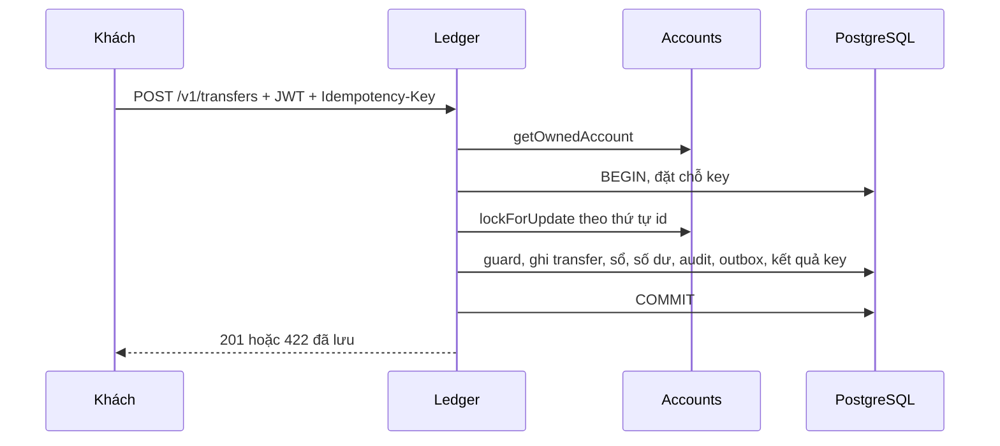

# DBS-61 · Chuyển tiền bản thô giữa khách, hai bút toán trong một transaction

> **Status:** Plan approved (làm bù sau góp ý review PR #61; chờ G4) · **Vai:** Dev · **Nhánh:** `feat/DBS-61-customer-transfers` · **PR:** [#61](https://github.com/Lawliet119/digital-banking-simulator/pull/61) (Draft, base `main`) · **Cập nhật:** 2026-11-06

## 1. Bối cảnh

- **Task trên board:** Story, Tuần 2, vai Dev, ưu tiên Highest, deliverable P2. **Expect:** «Khách chuyển được tiền cho khách khác, số dư hai bên đúng.»
- **DoD:**
  1. POST /v1/transfers (customer) bắt buộc Idempotency-Key; lấy from từ tài khoản thuộc về mình (getOwnedAccount).
  2. FOR UPDATE hai tài khoản theo thứ tự id → kiểm sơ bộ ACTIVE và đủ số dư (sync guard đầy đủ làm ở tuần 3) → INSERT transfers + 2 ledger_entries + cập nhật 2 số dư + audit + outbox.
  3. INSUFFICIENT_FUNDS → lệnh REJECTED trả 422 problem+json (lưu đầy đủ làm ở DBS-83); số dư không đổi; không có bút toán.
  4. Test e2e Postgres thật: AC-5.1 (A 1.000.000, B 0, chuyển 300.000) và AC-5.2.
  5. PR đã merge vào main (CI xanh); Dev review; bảng «Đối chiếu test case» trong PR điền đủ.
- **Phụ thuộc:** [DBS-60](DBS-60-operator-deposits.md) (nạp tiền bản thô) đã vào `main` qua PR #57 (`d01907f`). DBS-61 nằm trên `main` từ `2df7d0a`.
- **Đã có gì:** `AccountsService` (`getOwnedAccount`, `lockForUpdate`, `applyBalanceChange`), `TransactionService.run`, `AuditService`, `OutboxWriter`, `DepositService` làm khuôn, và fixture HTTP/JWT/PostgreSQL của DBS-60 (`test/support/deposit-app.ts`). Trước task này chưa có endpoint chuyển tiền.
- **Baseline:** xem §8.
- **Ngoài phạm vi:**
  - Hạn mức theo lần và theo ngày, đồng hồ ngày giờ Việt Nam, sync guard đầy đủ (FR-LED-04, AC-5.6): tuần 3, [BL-151](../BACKLOG.md).
  - Replay đúng response cũ và `IDEMPOTENCY_KEY_REUSED` (AC-5.3/4/5): [DBS-79](../BACKLOG.md), [BL-148](../BACKLOG.md). Task này chỉ chặn key trùng bằng 409.
  - Lưu từ chối đầy đủ: DBS-83. Ở đây chỉ lưu transfer REJECTED, lý do, audit và kết quả của key.
  - AC-5.9 (nhiều khách chuyển chéo đồng thời, một tài khoản nhận rất nhiều lệnh): TC-61-06 chỉ phủ một nguồn → một đích và chuyển chéo hai chiều. Phần nhiều người gửi → một tài khoản nóng thuộc test tải; ghi BACKLOG.
  - Giới hạn tốc độ 10 lệnh/phút/khách (NFR-SEC-05, `RATE_LIMITED`) và thu hồi phiên khi khóa tài khoản (BR-12, NFR-SEC-02, `SESSION_REVOKED`): docs/03 §6.1 đặt trước transaction, thuộc identity/gateway; module identity chưa có kiểm tra này nên chủ tài khoản LOCKED vẫn gọi được endpoint. Bàn giao qua BACKLOG.
  - Không đổi schema, event, `ErrorCode`, biến môi trường hay dependency.
  - Các dòng backlog không liên quan (BL-004 định nghĩa hash, BL-005/006/008/017, BL-007, BL-112, BL-121, BL-130, BL-132) giữ nguyên.
- **Backlog đã xử lý trong task:** BL-003 (chặn chuyển tiền vào/ra tài khoản SYSTEM) và BL-122 (tích hợp chuyển tiền với primitive của `AccountsService`).
- **Câu hỏi mở / quyết định ở G1 (lần làm bù theo góp ý review PR #61):**
  1. Làm trực tiếp trong worktree `dbs-61`, không tạo nhánh mới. Người dùng đã trả lời đúng như vậy; được coi là duyệt G1 kèm chỉnh sửa.
  2. Không thêm `ErrorCode` cho lỗi `Idempotency-Key` quá 128 ký tự: quy tắc trong `error-code.enum.ts` chỉ thêm mã khi client phải rẽ nhánh theo nó. Chỉ sửa câu chữ của `detail`.

## 2. Hành vi

Endpoint: `POST /v1/transfers`, chỉ vai `customer`. Guard JWT và vai có sẵn.

| # | Quy tắc | Kết quả |
|---|---|---|
| B1 | Thiếu hoặc hết hạn JWT; sai vai | 401 `UNAUTHENTICATED` / `TOKEN_EXPIRED`; 403 `FORBIDDEN` |
| B2 | Header `Idempotency-Key` thiếu hoặc chỉ có khoảng trắng | 400 `IDEMPOTENCY_KEY_REQUIRED` |
| B3 | Key dài hơn 128 ký tự (tính theo codepoint) | 400, `detail` ghi rõ giới hạn 128; 128 hợp lệ, 129 bị từ chối |
| B4 | Body đúng ba trường `{fromAccountId, toAccountId, amount}`. UUID được chuyển về chữ thường. `amount` là chuỗi số nguyên đồng dương, tối đa 9223372036854775807. Trường thừa, số kiểu `number`, thập phân, 0, âm | 400 |
| B5 | `fromAccountId` và `toAccountId` trùng nhau sau khi chuẩn hóa | 400, trước khi mở transaction |
| B6 | Nguồn không tồn tại, của người khác hoặc là SYSTEM | 404 `Account not found` giống hệt nhau, kèm một audit `DENIED` (action `transfer`, `metadata.reason = NOT_OWNER`) ghi **ngoài** transaction nghiệp vụ. Ghi audit lỗi → 500, không cho đi tiếp |
| B7 | Nguồn hợp lệ, key mới: khóa cả hai tài khoản theo thứ tự id; kiểm lại chủ sở hữu trên bản đã khóa (đổi chủ → hủy transaction, ghi DENIED rồi 404). Snapshot của `getOwnedAccount` chỉ dùng để phân quyền, không dùng làm số dư hay trạng thái | — |
| B8 | Guard theo thứ tự: nguồn ACTIVE, đích là tài khoản khách ACTIVE (đích thiếu hoặc SYSTEM coi như không tồn tại), rồi mới đến đủ số dư. Đích là tài khoản `funding` (id cố định, ADR-09) **không bị khóa**: chỉ khóa nguồn, nên lệnh chuyển tới `funding` không tranh khóa với lệnh nạp tiền | Sai ACTIVE → 422 `ACCOUNT_NOT_ACTIVE`; đủ ACTIVE nhưng thiếu tiền → 422 `INSUFFICIENT_FUNDS` |
| B9 | Từ chối nghiệp vụ: ghi transfer `REJECTED` (+ `reject_reason`), audit `REJECTED` và kết quả của key, **commit**, rồi mới trả 422 problem+json kèm `transferId`, `errorCode`, `correlationId` do server tạo. Đích thiếu hoặc SYSTEM lưu `to_account_id = NULL`; đích LOCKED giữ nguyên khóa ngoại | Không có bút toán, không đổi số dư, không có outbox |
| B10 | Thành công: một transaction ghi transfer `COMPLETED`, đúng hai dòng sổ (DEBIT nguồn, CREDIT đích, có `balance_after`), hai lần cập nhật số dư, audit `SUCCESS`, một event `TransferCompleted` và kết quả của key | 201 `{transferId, status: "COMPLETED"}` |
| B11 | Event `TransferCompleted`: `fromBalanceBefore` lấy từ bản đã khóa của nguồn; `fromUserId`, `toUserId` khác null; `sameOwner` tính từ hai chủ; giờ lấy từ DB, dạng ISO Z. Hai tài khoản khác nhau của cùng một người vẫn được chuyển, `sameOwner = true` | Không có event `TransferRejected` |
| B12 | Số tiền lớn hơn 2^53 giữ nguyên là `bigint` / chuỗi. Tràn số `signed 64` là lỗi hạ tầng: 500 và rollback toàn bộ, không đổi thành 422 | — |
| B13 | Mọi lỗi ghi bất ngờ rollback tất cả, kể cả key. Lỗi tạm thời (khóa quá hạn) → 503 `SERVICE_TEMPORARILY_UNAVAILABLE` kèm `Retry-After`, thử lại cùng key được | — |
| B14 | Key đã dùng bởi cùng người → 409 (không kèm `transferId` hay `errorCode`); người khác dùng cùng chuỗi key không bị ảnh hưởng. Chưa có replay. Hệ quả: nếu transaction đã commit nhưng client mất response (UC-5 E1, AC-5.10), gửi lại cùng key nhận 409 và chưa biết kết quả; đây là giới hạn của bản thô, DBS-79 xử lý | — |
| B15 | Không gọi mạng (Redis, HTTP, SQS) trong transaction | — |

Ví dụ thành công:

```json
POST /v1/transfers   Idempotency-Key: 6f1c…
{ "fromAccountId": "c8bbbfe3-7079-4e8b-ab54-f7a7c0f5d073", "toAccountId": "eb303144-804a-43af-baf2-45630ac1f6bd", "amount": "300000" }
→ 201 { "transferId": "1eb42bcf-2770-44b2-95d2-defca4642a7f", "status": "COMPLETED" }
```

Ví dụ thiếu tiền (422, `application/problem+json`):

```json
{ "errorCode": "INSUFFICIENT_FUNDS", "transferId": "545214a5-4107-4f3d-bea9-4b468671eb7b", "type": "about:blank", "title": "Unprocessable Entity", "status": 422, "detail": "Transfer rejected", "correlationId": "886f94a6-63ce-4046-b098-959e9633e141" }
```

Bảo mật: kiểm tra JWT và vai (TC-61-05), quyền sở hữu (TC-61-03, 11), phạm vi key theo người dùng (TC-61-07), audit của thành công, từ chối và bị chặn (TC-61-02, 03, 04), không lộ trường fraud hay chủ sở hữu trong response (TC-61-01), lỗi chung không lộ chi tiết nội bộ (TC-61-08, 09), SQL tham số hóa và đầu vào độc hại (TC-61-05).

## 3. Kiến trúc

- **Vị trí:** module `ledger`, chạy ở role `api` (và `both`); không nạp trong `worker`. File mới: `transfer.dto.ts`, `transfer.service.ts`, `transfers.controller.ts`; `ledger.module.ts` đăng ký `TransferService` và `TransfersController`. Không đổi API xuất ra của module khác; không đổi người gọi `AccountsService`, `AuditService`, `OutboxWriter`.
- **Interface dùng:**
  - `AccountsService.getOwnedAccount(accountId: string, userId: string): Promise<Account>`
  - `AccountsService.lockForUpdate(ids: string[], manager: EntityManager): Promise<LockedAccount[]>`
  - `AccountsService.applyBalanceChange(accountId: string, delta: bigint, manager: EntityManager): Promise<void>`
  - `TransactionService.run<T>(work: (manager: EntityManager) => Promise<T>): Promise<T>`
  - `AuditService.record(manager, input)` và `AuditService.recordDenied(input)`
  - `OutboxWriter.add(manager, event)`
  - Cung cấp: `TransferService.transfer(actor: string, key: string, body: TransferDto, correlationId: string): Promise<TransferResultDto>`
- **Dữ liệu:** ghi `idempotency_keys`, `transfers`, `ledger_entries`; `accounts` qua `applyBalanceChange`; `audit_log` và `outbox_events` qua service sở hữu bảng. Chỉ dùng ràng buộc sẵn có. `request_hash` là SHA-256 của `JSON.stringify({method, path, body})` với `body = {amount, fromAccountId, toAccountId}` (khóa của `body` sắp xếp theo bảng chữ cái; ba khóa tầng ngoài viết theo thứ tự `method, path, body`, không sắp xếp). `DepositService` dùng cùng dạng. Dạng canonical đệ quy theo ADR-05 do DBS-79 chốt, xem [BL-148](../BACKLOG.md).
- **Ranh giới transaction:** một `TransactionService.run` ngoài cùng: đặt chỗ key → khóa theo thứ tự id → guard → ghi transfer, sổ, số dư → audit và outbox → lưu kết quả của key. DENIED ghi ngoài transaction. Lỗi 422 chỉ được ném **sau** commit.



- **Thay đổi cấp hệ thống:** [docs/03](../03_HIGH_LEVEL_ARCHITECTURE.md) (bảng API), README module `ledger`, [chỉ mục feature](README.md), [BACKLOG](../BACKLOG.md). Không đổi ADR hay hợp đồng event.

## 4. Test cases tự động

Tất cả chạy trên PostgreSQL 17 thật qua HTTP và JWT thật, không mock tiền; sau mỗi ca kiểm tra bất biến sổ cái. Mỗi lần chạy dùng một database tạm riêng.

| ID | Truy vết | Lớp | Given · When · Then | `errorCode` |
|---|---|---|---|---|
| TC-61-01 | DoD #1, #2, #4; AC-5.1 | e2e Postgres | Nạp 1.000.000 cho A qua API, B có 0. Chuyển 300.000 → A 700.000, B 300.000; đúng hai dòng sổ với `balance_after`; audit, key, event đủ và đúng giờ DB | — |
| TC-61-02 | DoD #3, #4; AC-5.2 | e2e Postgres | A có 100.000, chuyển 300.000 → 422; transfer REJECTED, key, audit được lưu; không có dòng sổ, event hay đổi số dư | `INSUFFICIENT_FUNDS` |
| TC-61-03 | DoD #1; AC-5.8; BL-003 | e2e Postgres | Nguồn của người khác, không tồn tại hoặc SYSTEM → 404 với body giống hệt nhau (bỏ `correlationId`), mỗi lần một audit DENIED; không có key hay thay đổi tiền | — |
| TC-61-04 | DoD #2; AC-5.7; BL-003 | e2e Postgres | Nguồn hoặc đích LOCKED; đích không tồn tại hoặc SYSTEM → 422 đã lưu; ACTIVE được kiểm trước số dư, cả khi nguồn khóa lẫn khi đích khóa và nguồn thiếu tiền | `ACCOUNT_NOT_ACTIVE` |
| TC-61-05 | DoD #1 (bảo mật) | e2e / security | Không JWT, JWT hết hạn, ba vai sai, thiếu key, key 128/129, DTO sai, hai tài khoản trùng, đầu vào độc hại → không có hiệu ứng nghiệp vụ | `UNAUTHENTICATED`, `TOKEN_EXPIRED`, `FORBIDDEN`, `IDEMPOTENCY_KEY_REQUIRED` |
| TC-61-06 | DoD #2; BR-03 | e2e Postgres | 10 lệnh rút 200.000 song song từ 1.000.000 → 5 thành công, 5 bị từ chối, số dư không âm; 10 lệnh chuyển chéo hai chiều đều 201, bất biến giữ nguyên | `INSUFFICIENT_FUNDS` |
| TC-61-07 | DoD #1 (rào chắn key) | e2e Postgres | 10 yêu cầu cùng key → một 201 và chín 409; người khác dùng cùng key thành công; hai tài khoản cùng chủ cho `sameOwner = true` | — |
| TC-61-08 | DoD #2; BR-02, BR-09 | e2e Postgres | Trigger thật làm hỏng lần lượt: insert dòng CREDIT, update số dư đích, audit, outbox, update key (và audit, key của nhánh từ chối) → 500, trạng thái y hệt trước; gỡ trigger rồi dùng lại cùng key thành công | — |
| TC-61-09 | DoD #2 (phục hồi) | e2e Postgres | Giữ khóa hàng thật → 503 kèm `Retry-After`, không để lại key hay hiệu ứng; nhả khóa, cùng key → 201 | `SERVICE_TEMPORARILY_UNAVAILABLE` |
| TC-61-10 | DoD #2; ADR-07 | e2e Postgres | Nạp quá 2^53, chuyển đúng số đó: API, DB, dòng sổ, event giữ chuỗi chính xác; tràn `signed 64` ở đích → 500 và rollback toàn bộ | — |
| TC-61-11 | DoD #1 (audit) | e2e Postgres | Trigger làm hỏng audit DENIED → 500, không có hiệu ứng; gỡ trigger → 404 và đúng một DENIED | — |
| TC-61-12 | DoD #1 (API) | integration | Swagger công bố JWT, header key, ví dụ DTO và các mã trạng thái | — |
| TC-61-13 | DoD #1 (B7) | e2e Postgres | Đổi chủ nguồn sau khi `getOwnedAccount` đã qua và trước khi khóa được cấp → 404, đúng một audit DENIED, không có key, transfer hay thay đổi tiền | — |
| TC-61-14 | DoD #2; BL-003 | e2e Postgres | Một transaction giữ khóa hàng `funding`; chuyển tới `funding` vẫn trả 422 ngay (không 503), transfer REJECTED có `to_account_id` rỗng, đúng một audit REJECTED và một key | `ACCOUNT_NOT_ACTIVE` |
| Quy trình | DoD #5 | — | Rebase, Draft PR, CI, Dev khác review, merge (agent không merge) | chờ [BL-152](../BACKLOG.md) |

Sửa lỗi chữ trong `detail` của lỗi độ dài key (§2 B3) không đổi hành vi nên dùng lại TC-61-05 (kiểm 128/129 theo mã trạng thái, không theo chữ).

## 5. Test thủ công

Chạy `node scripts/manual-dbs61.cjs` trong `backend/`. Script dựng ứng dụng NestJS thật, JWT thật và PostgreSQL 17 bằng Testcontainers; chỉ user, customer và tài khoản số dư 0 được tạo bằng SQL (ghi rõ "SQL INPUT"), mọi khoản tiền vào đi qua API nạp tiền của operator. Không in token hay thông tin xác thực. Container và database tạm được dọn trong `finally`. Cần Docker.

| Bước | Việc làm | Kết quả mong đợi |
|---|---|---|
| M-61-01 | Nạp 1.000.000 cho A, chuyển 300.000 sang B | 201; A 700.000, B 300.000; đúng hai dòng sổ; audit, outbox, key mỗi thứ một; bất biến đạt |
| M-61-02 | A có 100.000 chuyển 300.000; đích LOCKED; nguồn của người khác | 422 `INSUFFICIENT_FUNDS` và 422 `ACCOUNT_NOT_ACTIVE` đã lưu; 404 kèm DENIED; tiền không đổi |
| M-61-03 | Thiếu key; sai vai; dùng lại key | 400 `IDEMPOTENCY_KEY_REQUIRED`; 403; 409; không có thêm tiền |
| M-61-04 | Gài trigger làm hỏng audit/outbox, chuyển, gỡ trigger, thử lại cùng key | 500 và rollback toàn bộ; sau đó 201; bất biến đạt |
| M-61-05 | 10 lệnh rút 200.000 song song từ 1.000.000; chuyển số lớn hơn 2^53 | 5 hoàn tất, 5 bị từ chối; số tiền lớn khớp chính xác ở API, DB và event; bất biến đạt |
| M-61-06 | Đóng ứng dụng, xóa thư mục JWKS tạm, drop database và dừng container | Thư mục JWKS không còn, database không còn trong `pg_database`; dòng PASS chỉ in khi mọi bước M-61-01..05 đã đạt và dọn dẹp không lỗi |

## 6. Domain review (AI)

**Reviewer:** subagent mới, model Opus 5.5 (effort medium), 2026-11-06, đọc cả thiết kế §1–§5, code và test · **Kết quả:** 12 phát hiện (blocking 0, should-fix 4, minor 8), verdict REVISE · [trả lời nguyên văn](screenshots/DBS-61/domain-review.md). Lần review trước (bảng rỗng, APPROVE, không ghi model) không đủ làm bằng chứng nên đã được thay.

| # | Mức | Phát hiện | Xử lý |
|---|---|---|---|
| 1 | should-fix | Đích SYSTEM vẫn khóa hàng `funding`, tranh khóa với nạp tiền và có thể gây 503 | Chưa sửa, chờ quyết định ở G2 (câu hỏi 1): đổi code `transfer.service.ts` là mở rộng phạm vi |
| 2 | should-fix | §3 mô tả hash "khóa sắp xếp" nhưng tầng ngoài không sắp xếp | Đã sửa §3 cho đúng dạng thật; thống nhất dạng canonical giao DBS-79 qua BL-148 (G2 câu hỏi 3) |
| 3 | should-fix | TC-61-03 không so sánh body của ba response 404 | Đề xuất thêm assertion, chờ G2 (câu hỏi 2) |
| 4 | should-fix | Nhánh `SourceOwnershipChangedError` (B7) chưa có test | Đề xuất thêm TC-61-13, chờ G2 (câu hỏi 2); nếu không làm được thì ghi "chưa test" ở §4 và BACKLOG |
| 5 | minor | Thứ tự ACTIVE trước số dư chưa chứng minh cho đích | Đề xuất thêm ca vào TC-61-04, chờ G2 (câu hỏi 2) |
| 6 | minor | AC-5.9 chưa truy vết | Đề xuất: ghi ngoài phạm vi kèm BL (đã có TC-61-06 chéo hai chiều), chờ G2 (câu hỏi 2) |
| 7 | minor | 409 không báo kết quả khi mất response | Đã nêu giới hạn ở §2 B14; trả `transferId` trong 409 để DBS-79 quyết định (BL-148) |
| 8 | minor | §3 ghi sai role chạy | Đã sửa §3 |
| 9 | minor | Câu chữ `detail` và Swagger còn dính chữ ("most128", "return409") | Sẽ sửa trong code ở Phase 4, không thêm `ErrorCode` |
| 10 | minor | `M-61-06 PASS` in trong `finally`, có thể PASS sai | Đề xuất sửa `manual-dbs61.cjs`, chờ G2 (câu hỏi 2) |
| 11 | minor | Thiếu bàn giao rate limit và `SESSION_REVOKED` | Đã thêm vào §1 ngoài phạm vi; dòng BACKLOG sẽ thêm ở Phase 5 |
| 12 | minor | `response_body` đã lưu của 422 khác body thật | Chuyển sang §8 Bàn giao, gắn BL-148 |

**Quyết định ở G2** (người dùng trả lời «duyệt», nhận các đề xuất mặc định): (1) sửa #1 trong PR này; (2) thêm test #3/#4/#5, sửa script manual #10, AC-5.9 ghi ngoài phạm vi kèm BL; (3) không đổi hash ở DBS-60/61, giao dạng canonical và dạng `response_body` cho DBS-79 qua BL-148; (4) dùng Node 24 portable trong scratchpad, không đổi cài đặt hệ thống.

## 7. Kế hoạch triển khai

Toàn bộ lệnh chạy trong `backend/` bằng Node 24.22.2 (bản portable, ngoài repo). Máy chạy có dịch vụ PostgreSQL cài sẵn chiếm cổng 5432, nên e2e chạy với `DATABASE_URL` trỏ tới một container Postgres 17 tạm ở cổng 55432; `test:db` tự dựng Postgres bằng Testcontainers.

| Bước | File | Test viết trước | Kết quả đỏ | Lệnh chứng minh | Commit |
|---|---|---|---|---|---|
| 0 | — (chỉ chạy) | Baseline trước khi sửa: `npm ci`, `lint:check`, `typecheck`, `test`, `test:e2e` | Không đỏ ở phần của task: unit 831/832, một test JWKS thuộc BL-112 hỏng; e2e 135/135 | xem §8 | — |
| 1 | `test/db/customer-transfers.db-spec.ts`, `src/modules/ledger/transfer.service.ts` | TC-61-14 | `expected 422 "Unprocessable Entity", got 503 "Service Unavailable"` (lệnh chờ khóa hàng `funding` đến hết `lock_timeout`) | `npm run test:db -- customer-transfers` | `f300059` `fix(ledger): do not lock the funding account on transfers` |
| 2 | `test/db/customer-transfers.db-spec.ts` | TC-61-13 | Không đỏ vì code đã có nhánh này. Kiểm chứng bằng đột biến: bỏ ghi audit DENIED thì test hỏng (`Expected: 404 Received: 500`) | như trên | `2e262fe` `test(ledger): cover ownership change under lock` |
| 3 | `test/db/customer-transfers.db-spec.ts` | Siết TC-61-03 và TC-61-04 | Không đỏ: chỉ siết assertion, đạt ngay | như trên | `d804867` `test(ledger): tighten denial and precedence assertions` |
| 4 | `src/modules/ledger/transfers.controller.ts`, `transfer.dto.ts` | Dùng lại TC-61-05 và TC-61-12 | Không đỏ: chỉ sửa câu chữ, không đổi hành vi | `npm run lint:check && npm run typecheck && npm run build && npm run test:db -- customer-transfers` | `55b018d` `fix(ledger): correct transfer wording in errors and Swagger` |
| 5 | `scripts/manual-dbs61.cjs` | Chạy một bản sao có cố tình làm hỏng bước M-61-01 | Trước khi sửa script in `M-61-06 PASS` bất kể bước trước; sau khi sửa, bản sao đó thoát mã 1 và in `M-61-06 NOT RUN AS PASS` | `node scripts/manual-dbs61.cjs` | `b34bec7` `fix(ledger): make DBS-61 manual driver report cleanup honestly` |
| 6 | feature doc, `screenshots/DBS-61/*`, `docs/BACKLOG.md`, `docs/features/README.md`, `docs/03_HIGH_LEVEL_ARCHITECTURE.md`, README module `ledger` | — | — | `node .claude/skills/dbs-delivering-task/scripts/check-doc-links.mjs` | `docs(ledger): rewrite DBS-61 doc and evidence in Vietnamese` |

**Quét giới hạn và DoD:**

- DoD #1–#4: phủ bởi TC-61-01..14. Hành vi chỉ đổi ở B8 (không khóa `funding`).
- DoD #5 (merge, review, CI): quy trình, nằm ở [BL-152](../BACKLOG.md).
- Giới hạn trong doc: hạn mức và sync guard ([BL-151](../BACKLOG.md)), replay và hash canonical ([BL-148](../BACKLOG.md)), lưu từ chối đầy đủ (DBS-83, BL-151), rate limit và `SESSION_REVOKED` ([BL-153](../BACKLOG.md)), AC-5.9 ([BL-154](../BACKLOG.md)), trùng lặp với `DepositService` ([BL-155](../BACKLOG.md)).
- Không đổi migration, event, `ErrorCode`, env, dependency hay module khác. Không sửa `AccountsService`.

**Rủi ro và cách lùi:**

- Điều kiện bỏ khóa chỉ đúng khi `funding` là tài khoản SYSTEM duy nhất (ADR-09). Đã ghi vào comment mã nguồn và README ledger.
- TC-61-13 chờ theo trạng thái khóa thật trong `pg_locks`, không dùng `sleep` cố định.
- Lùi: `git revert` từng commit; không có migration, không đụng dữ liệu.

**Quyết định ở G3:** người dùng trả lời «duyệt G3» (gõ «duỵet»). Các đề xuất 1 (hằng id `funding`), 2 (push và sửa body PR chỉ sau G4, khi người dùng xác nhận lại) và 3 (các dòng BACKLOG) được nhận theo đề xuất.

## 8. Kết quả

- **Lệnh kiểm tra** (Node 24.22.2, commit code cuối `b34bec7`, trong `backend/`):

| Lệnh | Kết quả |
|---|---|
| `npm run lint:check` | đạt |
| `npm run typecheck` | đạt |
| `npm run build` | đạt |
| `npm test -- --runInBand` | **831/832 đạt**, 55/56 suite, 37,3 s. 1 test hỏng trong `jwks-verifier.service.spec.ts` (BL-112, xem dưới) |
| `npm run test:e2e -- --runInBand` | **135/135** đạt, 13 suite, 66,2 s (với `DATABASE_URL` tới Postgres 17 cổng 55432) |
| `npm run test:db -- --runInBand` | **390/390** đạt, 21 suite, 219,6 s (toàn bộ, không chọn lọc) |
| `npm run test:db -- --runInBand customer-transfers` | **21/21** đạt, gồm cả TC-61-13 và TC-61-14 |
| `node scripts/manual-dbs61.cjs` | **6/6 bước đạt** |
| `node .claude/skills/dbs-delivering-task/scripts/check-doc-links.mjs` | xem mục 9 |

  Test JWKS hỏng là [BL-112](../BACKLOG.md), lỗi thời gian đếm số lần refetch của module identity, không liên quan Ledger. Mỗi lần chạy hỏng một test khác nhau: trước khi sửa là `honours the refetch cooldown…`, lần chạy cuối là `refetches on key rotation…`, và chạy riêng suite đó một lần là `honours the refetch cooldown…`. Không sửa Identity, không chạy lặp cho đến khi xanh. Không có `.skip`, `.only`, `.todo` trong test của task (0 test bị bỏ qua). Trước khi có Node 24, cùng các lệnh trên Node 18 hỏng thêm `typeorm-options.spec.ts` (`crypto is not defined`) và 16 test e2e; đó là lỗi môi trường, không dùng làm bằng chứng.

- **Đối chiếu test case** (file: `test/db/customer-transfers.db-spec.ts`; mỗi ca kết thúc bằng kiểm tra bất biến sổ cái):

| ID | Test | Đạt? |
|---|---|---|
| TC-61-01 | `TC-61-01 AC5.1 A1m → B300k…` | đạt |
| TC-61-02 | `TC-61-02 AC5.2 insufficient commits rejection…` | đạt |
| TC-61-03 | `TC-61-03 foreign/missing/SYSTEM sources…` | đạt (đã siết: so body ba response 404; đạt ngay, không đỏ) |
| TC-61-04 | `TC-61-04 ACTIVE first…` | đạt (đã thêm ca đích LOCKED với nguồn thiếu tiền; đạt ngay, không đỏ) |
| TC-61-05 | `TC-61-05 JWT/role/input/key validation…` | đạt |
| TC-61-06 | `TC-61-06 ten concurrent withdrawals…` | đạt cho phạm vi của ca; AC-5.9 người gửi → tài khoản nóng chưa kiểm, [BL-154](../BACKLOG.md) |
| TC-61-07 | `TC-61-07 duplicate barrier user scope and same-owner…` | đạt (chỉ rào chắn 409; replay thuộc DBS-79) |
| TC-61-08 | `TC-61-08 …` (7 ca tham số hóa) | đạt |
| TC-61-09 | `TC-61-09 real lock timeout503…` | đạt |
| TC-61-10 | `TC-61-10 >2^53 exact…` và `TC-61-10 signed64 destination overflow500…` | đạt |
| TC-61-11 | `TC-61-11 denied audit failure…` | đạt |
| TC-61-12 | `TC-61-12 Swagger lists JWT,key,DTO example…` | đạt |
| TC-61-13 | `TC-61-13 owner changed after authorization…` | đạt. Đã kiểm bằng đột biến (bỏ audit DENIED thì hỏng). Lưu ý: khi đổi `accounts.customer_id`, PostgreSQL loại hàng khỏi `FOR UPDATE OF a … LEFT JOIN customers` nên nhánh `!source` bắt trường hợp này; nhánh `source.userId !== actor` không được test này chạm tới |
| TC-61-14 | `TC-61-14 transfer to the funding account never waits…` | đạt (đỏ trước với 503, xanh sau khi sửa) |
| Quy trình | DoD #5 | chưa làm: chờ review và merge, [BL-152](../BACKLOG.md) |

  Tổng cộng 14/14 ca tự động đạt, 0 ca đơn giản hóa, 1 dòng quy trình chờ.

- **Test thủ công** (`node scripts/manual-dbs61.cjs` trong `backend/`, chạy trên `b34bec7`; output thô ở [manual-test.txt](screenshots/DBS-61/manual-test.txt), dòng đầu là SHA). Seed SQL chỉ cho user, customer và tài khoản số dư 0; mọi khoản tiền vào qua API nạp tiền.

| Bước | Phản hồi thật (rút gọn) | Kết quả |
|---|---|---|
| M-61-01 | Nạp 1.000.000, chuyển 300.000 → 201 `COMPLETED`; A 700.000, B 300.000, hai dòng sổ, audit/outbox/key mỗi thứ một; bất biến PASS | đạt |
| M-61-02 | Thiếu tiền 100.000 → 300.000 → 422 `INSUFFICIENT_FUNDS`; đích LOCKED → 422 `ACCOUNT_NOT_ACTIVE`; nguồn của người khác → 404 và DENIED | đạt |
| M-61-03 | Thiếu key → 400 `IDEMPOTENCY_KEY_REQUIRED`; sai vai → 403 `FORBIDDEN`; dùng lại key → 409, không ghi thêm | đạt |
| M-61-04 | Gài lỗi audit/outbox → 500, rollback toàn bộ; gỡ rồi dùng lại cùng key → 201 (hai lần) | đạt |
| M-61-05 | 10 lệnh 200.000 song song → 5 hoàn tất, 5 `INSUFFICIENT_FUNDS`; số lớn `9007199254740993` khớp ở API, DB và event; tổng Nợ = tổng Có = `18014398512884986`, tổng số dư 0 | đạt |
| M-61-06 | Thư mục JWKS không còn, database tạm không còn trong `pg_database`, container Postgres đã bị xóa | đạt |

  Kịch bản manual chưa có bước riêng cho TC-61-14 (chuyển tới `funding`); ca đó được kiểm bằng test tự động.

- **Phạm vi so với §7:** `git diff --stat 2771771 b34bec7` (so với đầu PR trước khi sửa): `manual-dbs61.cjs` (+64), `transfer.service.ts` (+9), `transfers.controller.ts` (±4), `transfer.dto.ts` (±2), `customer-transfers.db-spec.ts` (+69), và xóa `implementation-review.md`. Khớp danh sách ở §7.
- **Ảnh chụp** (dựng từ output thật của lần chạy trên `b34bec7`):


- **Lệch so với kế hoạch:**
  - Commit `f300059` vô tình kèm việc xóa `implementation-review.md`, vốn đã được duyệt bỏ ở G2 (review mới thay thế). Không viết lại lịch sử.
  - §4 TC-61-14 bỏ vế "lệnh nạp tiền đồng thời không bị chặn" vì test không kiểm vế đó; đã sửa doc cho khớp.
  - Thử phụ: đổi chủ bằng `UPDATE customers SET user_id` khiến test hỏng vì lý do chưa xác định; nằm ngoài phạm vi nên không điều tra và không kết luận gì về nó.
- **Bàn giao cho vai khác** (đã có dòng trong [`docs/BACKLOG.md`](../BACKLOG.md)):
  - BL-148 (DBS-79): idempotency đầy đủ, dạng canonical của hash, dạng `response_body` của 422, 409 không báo kết quả khi mất response.
  - BL-151 (tuần 3, DBS-83): sync guard đầy đủ và lưu từ chối đầy đủ.
  - BL-152: review và merge PR #61.
  - BL-153 (identity/gateway): rate limit và `SESSION_REVOKED`.
  - BL-154 (test tải): AC-5.9.
  - BL-155 (DBS-79): tách phần trùng lặp giữa `TransferService` và `DepositService`.

## 9. Tài liệu đã cập nhật

- Feature doc này (viết lại bằng tiếng Việt), [domain-review.md](screenshots/DBS-61/domain-review.md) (thay bằng review mới, xóa `implementation-review.md`), `manual-test.txt`, `verification.txt`, `pr-description.md` và ảnh trong `screenshots/DBS-61/`.
- [docs/03](../03_HIGH_LEVEL_ARCHITECTURE.md): dòng `POST /v1/transfers` trong bảng API.
- [README module ledger](../../backend/src/modules/ledger/README.md): mục chuyển tiền (thêm quy tắc không khóa `funding`, bỏ ghi chú nhánh tạm đã lỗi thời).
- [Chỉ mục feature](README.md): dòng DBS-61.
- [BACKLOG](../BACKLOG.md): đã xóa BL-003 và BL-122 (giải quyết bởi DBS-61, xem §8 TC-61-03, 04, 14); mở rộng BL-148; viết lại BL-151 và BL-152 bằng tiếng Việt; thêm BL-153, BL-154, BL-155.
