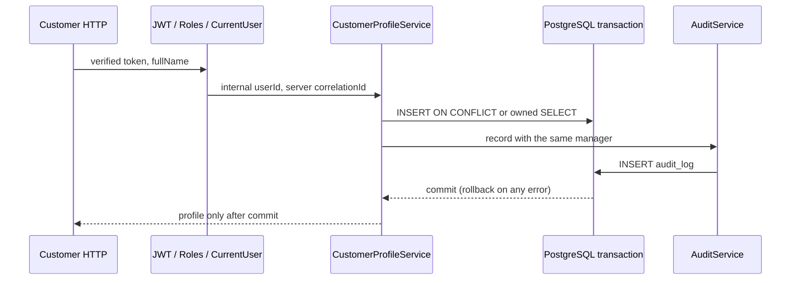

# DBS-62 · Customer onboarding

Status: Implemented; [Draft PR56](https://github.com/Lawliet119/digital-banking-simulator/pull/56) targets main after rebase. Dev review/merge pending BL-144. Owner: Dev. Updated 2026-11-04.

## 1. Scope and dependencies

Board Dev, Highest, In Progress. DBS-20/51/52 Done. DBS-53 board says In Progress but its implementation/token tools are on main via merged PR48. AuditService is now on main via [PR54](https://github.com/Lawliet119/digital-banking-simulator/pull/54), commit7f3b700, including metadata serialization and nested-transaction protections. On 2026-11-04 rebased only the three DBS-62 commits onto main a9e607b, removing temporary integration08e605e and all dependency commits from the PR diff. Kept main's backlog rows (including audit BL-137); the temporary BL-143 duplicate was discarded. No schema or audit implementation changes in DBS-62.

Deliver POST/GET /v1/customers/me per docs03 UC-1. Actual requirement is FR-ID-02 (board references FR-ACC-01, which docs02 assigns to account opening/UC-2). User authorizes prior delivery workflow without gate pauses: design review/test/manual/commit/push; main-based PR when dependencies available.

## 2. API and rules

Customer-only endpoints using existing global JwtAuthGuard/RolesGuard and @CurrentUser. Caller userId comes only from verified token mapping, never body/path/query. POST body {fullName:"Nguyễn Minh Anh"}; normalize NFC and trim, require1..200 characters, reject control characters/non-string/empty and extra fields with400 problem+json. Do not add ErrorCode: current validation400 and profile404 are distinguished by HTTP status. 401 UNAUTHENTICATED/TOKEN_EXPIRED and403 FORBIDDEN are existing guard codes.

POST is create-or-return, HTTP200 for first creation and replay. Response {id:<uuid>,fullName:<stored name>,createdAt:<ISO UTC Z>}. First committed insert wins; later valid body with a different name returns original profile unchanged. customers.user_id UNIQUE guarantees one row; do not use DO UPDATE or mutate name on replay. GET returns caller's profile, or404 if not onboarded. No accounts/balances created, no CustomerCreated event invented (not in accepted event contract).

Audit in same transaction: new profile -> customer.created SUCCESS, replay/GET existing profile -> customer.read SUCCESS (sensitive access); actor verified internal userId, acting role customer, target customer/id, server-generated correlationId, metadata only id. Audit failure rolls back profile; no swallowing errors. Missing GET profile is404, not permission denial. Generic role403 audit persistence remains existing global guard gap BL-132 and is not claimed fixed here. No token/name/email/full request data in audit metadata or errors.

## 3. Architecture and transaction

AccountsModule imports AuditModule. New CustomerProfileService injects real TransactionService + AuditService, queries owned customers only via parameterized SQL and manager in tx.run. POST INSERT ... ON CONFLICT(user_id) DO NOTHING RETURNING ...; if no returned row, separate SELECT in READ COMMITTED sees the committed winner after unique-conflict wait. Then audit the result and commit before HTTP response. No service-level retry beyond TransactionService. GET selects/audits in same transaction. Request middleware correlationId is required before invoking service; missing server context is a programming error500.

DTO/controller/response types are module-local; existing AccountsService public primitives remain unchanged. No schema/entity/new dependency/env/ADR/ErrorCode changes. Main role module registry already loads AccountsModule for api/both. Actor identity upsert remains its existing separate guard transaction (BL-130 exemption); failure of onboarding does not delete valid users identity.

## 4. Cases

| Case | Evidence |
|---|---|
| TC-62-01 | Actual JWT/local JWKS, real IdentityService, RolesGuard, HTTP+Postgres: valid POST ->200 normalized name, one customer and customer.created audit with server correlationId; no account created |
| TC-62-02 | Replay same/different valid name ->identical profile, unchanged stored name, one creation audit; reads audit per request |
| TC-62-03 | 20 real simultaneous first POSTs (Promise.all, pool30) ->identical200 bodies, one users mapping, one customer and one creation audit; other requests read winner |
| TC-62-04 | GET missing404, owner GET exact own profile, another identity cannot obtain it by forged query/body; extra userId/role fields400 |
| TC-62-05 | No/expired token401 existing code; operator/auditor/admin403 FORBIDDEN; customer accepted; no unauthorized customer writes |
| TC-62-06 | Empty/whitespace/too-long/control/non-string name400; valid Vietnamese/max boundary; SQL-like name is a parameter, no SQL execution; metadata no name |
| TC-62-07 | Real DB trigger rejects audit INSERT ->HTTP500 sanitized, customer insert rolled back; GET/replay existing profile also500/no profile disclosed/no mutation or audit; remove fixture trigger and retry ->success; guard-created user may remain |
| TC-62-08 | Swagger bearer auth, role, name constraints/examples and success/error responses; role metadata uses existing public contracts |
| Process | Full CI, Dev review, merge, complete PR DoD table |

Tests live test/db/customer-onboarding.db-spec.ts: full HTTP-to-real-Postgres end-to-end layer discovered by existing CI db job. Reuse production migrations and real auth/audit services, with temporary JWKS public file and issuer from DBS-53. No fake user resolver or AuditService. Each test uses distinct sub; isolated temp DB owned by suite, cleanup after app.close. Fault trigger only on this disposable DB, removed in finally.

## 5. Manual

Implement backend/scripts/manual-dbs62.cjs; run from backend: npm run build then node scripts/manual-dbs62.cjs. Driver creates disposable Postgres17, runs real migrations, boots real Nest AccountsModule/IdentityModule/guards/TransactionService/AuditService with local signing helper. Temp public JWKS only; do not log token/private key, connection credentials or real PII. HTTP requests use demo Vietnamese names. Source is kept for replay.

| Step | Action | Expected |
|---|---|---|
| M-62-01 | GET me before onboarding, then valid customer POST | 404 then200; profile matches normalized demo name; query one customer and creation audit |
| M-62-02 | POST replay with different name, GET me | Same original id/name/timestamp; no duplicate customer/creation audit |
| M-62-03 | 20 simultaneous new-user POSTs | All200 with identical profile; one customer/creation audit |
| M-62-04 | No token, operator token, invalid/forged body | 401 UNAUTHENTICATED,403 FORBIDDEN,400; no unauthorized customer writes |
| M-62-05 | Install audit failure fixture, fresh customer POST; remove trigger and retry | Sanitized500/no customer; retry200/one customer; audit metadata only ids |
| M-62-06 | finally close app, remove JWKS/temp DB/container | No shared DB touched, no handles; raw output + final codeSHA recorded, no tokens/credentials |

## 6. Review

Independent design review APPROVE with one should-fix for explicit GET/replay audit success/failure evidence and one minor column naming correction. Both addressed in cases/tests; no blocking finding. [Raw review](screenshots/DBS-62/domain-review.md), reviewer inherited Codex model (no override). No blocking finding, 1 should-fix addressed, 1 minor addressed.

## 7. Plan

Temporary real audit integration08e605e, then tests first (missing route404 red). Implement DTO/profile service/controller, register and import real AuditModule. HTTP/Postgres tests, audit fault/rollback, concurrency and security; lint/typecheck/build/unit/e2e/db and manual on final code commit. Update docs03/accounts README/feature index/backlog, link check, push branch. Open main-based Draft PR only after audit dependency is on main; rebase only DBS-62 commits (strip temporary integration base). No account opening/balance/ledger/idempotency-key feature, no auth guard rewrite or worker operation.

## 8. Results

Rebased code commits: `586ef11` implementation and `08d50fa` real-provider fixture adjustment (originally e7b96a2 and1f9f4a4). Test first: all 7 new tests failed because `/v1/customers/me` was absent (HTTP404); after implementation all7 passed. No skipped task tests. Results below are the original 2026-11-02 verification; the post-rebase results are recorded in verification.txt and the final handover below.

| Verification | Actual result |
|---|---|
| lint:check / typecheck / build | Passed |
| Unit, full suite | 54 suites, 801/801 passed on retry. First run800/801: existing Identity JWKS cooldown timing test failed under concurrent load; isolated retry13/13 and subsequent full801/801 passed. No Identity code changed |
| e2e, full suite | 13 suites,135/135 passed |
| Database | Final full run18 suites,345/345 passed (253.021s),0 skipped. First run344/345, existing AccountsModule fixture missing newly-required real TransactionService. Added real provider/config fixture, no stub; affected AccountsService+onboarding suites52/52 passed before final full run. Existing server MaxListeners warnings appeared; no test failure |
| Docs link check | 190 files,0 broken links before adding verification summary; final count recorded in handover |

| DoD / case | Proof | Depth |
|---|---|---|
| Unique customer, consistent replay; TC-62-01/02 | Actual HTTP, JWT verification, identity mapping, PostgreSQL INSERT, stored profile and audit assertions | Matched |
| Parallel onboarding; TC-62-03 | 20 concurrent first HTTP requests, pool30; users=1, customer=1, created audit=1, read audits=19 | Matched |
| Own GET/security; TC-62-04/05 | Actual guards, expired/missing JWT, customer/staff, forged owner body/query,404 | Matched |
| Validation and privacy; TC-62-06 | Vietnamese names, boundaries, parameterized SQL-like input; metadata onlyid | Matched |
| Atomic audit; TC-62-07 | Real database trigger rejects audit INSERT; creation rollback, GET/replay500 without profile; recovery succeeds | Matched |
| Swagger examples/errors; TC-62-08 | OpenAPI generated from real controller/DTO; bearer/security/statuses; property examples and existing error codes documented | Matched; Swagger UI clicking not claimed |
| PR/CI/Dev review/merge | BL-144 | Pending real audit dependency on main; local results do not prove GitHub CI |

Manual command from `backend`: `node scripts/manual-dbs62.cjs`. [Raw output](screenshots/DBS-62/manual-test.txt) first line contains final code SHA. Six steps M-62-01..06 executed successfully: missing GET404/create200, replay/GET unchanged,20 parallel200 with one customer/audit,401/403/400 rejection, actual audit failure500/rollback/recovery200, cleanup. Public JWKS file only; disposable PostgreSQL17 and owned temp database, no shared DB revert. Driver logs HTTP status, sanitized response and server correlationId, never token or connection URL.

[Verification summary](screenshots/DBS-62/verification.txt) and [PR description](screenshots/DBS-62/pr-description.md) retain the DoD mapping for the main-based PR. GitHub branch `feat/DBS-62-customer-onboarding`; current PR/check links are recorded in the final handover.

Deviation: AccountsModule now has a real audit/transaction dependency; updated existing TC-55-15 fixture to provide real TransactionService/config, identified by the full DB run. Completed `git rebase --onto origin/main 08e605e feat/DBS-62-customer-onboarding` on2026-11-04. Conflict only in BACKLOG; kept main's rows and DBS-62 handoff. No dependency code is in the diff. The existing design and real audit interface remain compatible; runtime tests include actual PR54 implementation.

BL-144 now tracks Dev review and merge after the main-based Draft PR and its CI. BL-132 global roles-denial audit, BL-130 identity provision audit and BL-019 audit API/roles remain owned by their existing tasks. No fabricated service or silently waived onboarding mutation audit. No backlog items closed by DBS-62.

2026-11-04 handover: [Draft PR56](https://github.com/Lawliet119/digital-banking-simulator/pull/56), base main a9e607b. [GitHub checks](https://github.com/Lawliet119/digital-banking-simulator/pull/56/checks) are authoritative for final PR status; first run [41843997481](https://github.com/Lawliet119/digital-banking-simulator/actions/runs/41843997481). No local result is substituted for CI.

Post-rebase lint/typecheck/build passed; three real PostgreSQL suites65/65 passed (onboarding, AccountsService and actual merged AuditService). Manual6/6 passed at e40a7e45 with refreshed screenshot/transcript. Full unit825/826, isolated Identity retry12/13: the same cooldown fetch-count failure on this machine, tracked by existing BL-112; Identity source/test unchanged. E2E and CI final results recorded in verification.txt/PR checks.

Handover checklist: implementation/manual/evidence/docs complete; raw output inspected for tokens/secrets; independent review findings addressed; no dependency/env/schema/ErrorCode change. GitHub CI/Dev review/merge tracked in PR56 and BL-144. User moves board to In Review when handing this PR to a Dev reviewer. No human gate approval or Dev review is claimed.

## 9. Sources

docs02 UC-1/FR-ID-02/FR-AUD-01/02, docs03 §7/§8 API table, database-design §4.1, ADR-06, accounts/audit README, actual AuditService public index and metadata guard. Changes tracked here rather than inventing retired component feature files.

Updated docs03 API table, accounts README, feature index, BACKLOG BL-144, this feature doc and raw review/manual evidence. Runtime change is in accounts controller/DTO/service/module; existing AccountsService primitive code remains unchanged.
