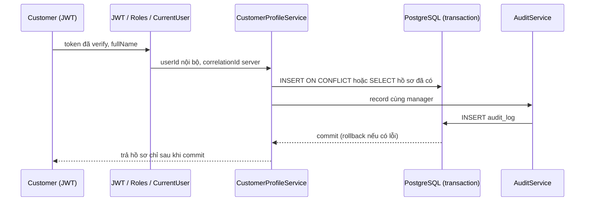
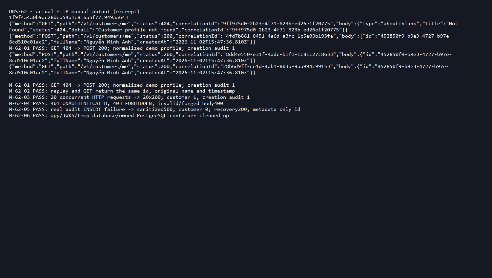

# DBS-62 · UC-1 onboarding: tạo hồ sơ customers cho người dùng

> **Status:** Implemented · PR #56 đã merge 2026-11-06; chưa có Dev review (BL-160) · **Vai:** Dev (Accounts) · **Nhánh:** `feat/DBS-62-customer-onboarding` · **PR:** [#56](https://github.com/Lawliet119/digital-banking-simulator/pull/56) · **Cập nhật:** 2026-11-07

## 1. Bối cảnh

**Board:** Story, Tuần 2, Highest, Dev, In Progress; đọc bằng `fetch-task.mjs DBS-62`.

**Expect nguyên văn:** Người dùng mới tự tạo hồ sơ khách hàng.

**DoD nguyên văn:**

1. Endpoint onboarding (customer) tạo `customers` với `user_id` UNIQUE: mỗi user đúng một customer; gọi lại → kết quả nhất quán, không tạo trùng.
2. Swagger có ví dụ và mã lỗi; test e2e Postgres thật gồm gọi song song.
3. PR đã merge vào main (CI xanh); Dev review; bảng «Đối chiếu test case» trong PR điền đủ.

**Phụ thuộc:**

| Phụ thuộc | Board | Thực tế trong repo |
|---|---|---|
| DBS-20 Migration 1 (`users`, `customers`, `accounts`) | Done | [Migration](../../backend/src/database/migrations/1791763200000-CreateUsersCustomersAccounts.ts) |
| DBS-51 `@Roles`/`RolesGuard`/`@CurrentUser` | Done | [identity module](../../backend/src/modules/identity/index.ts) |
| DBS-52 Tạo dòng `users` bằng upsert theo `cognito_sub` | Done | [identity.service.ts](../../backend/src/modules/identity/identity.service.ts) |
| DBS-53 Xác thực local/test (token mẫu từng vai) | Board "In Progress" nhưng code đã merge main qua PR #48 | [auth-local](../../backend/src/config/auth-local.ts) |
| DBS-56 `AuditService.record` | Không nằm trong danh sách phụ thuộc gốc của board, nhưng cần cho fail-closed audit; đã merge main qua PR #54 (commit `7f3b700`) trước khi rebase nhánh này | [audit.service.ts](../../backend/src/modules/audit/audit.service.ts) |

**Đã có:** schema migration 1 (bảng `customers` có `user_id UNIQUE`), `AccountsService` (DBS-55, chỉ primitive, chưa có HTTP). Chưa có module `accounts` phần HTTP (chỉ README). Luồng tham chiếu: [docs/BRD.md FR-ID-02](../BRD.md), [docs/03](../03_HIGH_LEVEL_ARCHITECTURE.md). Board ghi `FR-ACC-01`, nhưng docs/BRD.md dùng mã đó cho mở tài khoản (UC-2) — mã đúng cho onboarding là `FR-ID-02`.

**Baseline sau rebase lên `a9e607b`:** `lint:check`/`typecheck`/`build` exit 0; e2e 13 suites/135 tests; PostgreSQL thật 65/65 tests liên quan (onboarding + AccountsService + AuditService); unit 825/826 (1 lỗi timing đã biết của `jwks-verifier.service.spec.ts`, xem BL-112, không liên quan code task này).

**Ngoài phạm vi:** mở tài khoản/số dư/sổ cái (task riêng); event `CustomerCreated` (không có trong event contract đã chốt); sửa guard xác thực hiện có; vận hành worker.

**Quyết định ở G1 (ghi lại, techlead duyệt retroactive 2026-11-06):** chấp nhận phạm vi và phụ thuộc như trên; DBS-53 coi là đủ điều kiện vì code thật đã merge dù board lag; DBS-56 (không có trong danh sách phụ thuộc gốc trên board) là phụ thuộc thật cần thêm vì audit fail-closed là một phần DoD #1 ("kết quả nhất quán").

## 2. Hành vi

**2.1 `POST /v1/customers/me`.** `@Roles('customer')`, guard toàn cục (`JwtAuthGuard`, `RolesGuard`). Body `{"fullName": "Nguyễn Minh Anh"}`: chuẩn hóa Unicode NFC và trim trước khi validate, 1–200 ký tự, không chứa ký tự điều khiển ASCII (`\u0000`–`\u001f`, `\u007f`), phải là string, không field lạ (`ValidationPipe` toàn cục `whitelist: true, forbidNonWhitelisted: true` tự chặn `userId`, `role`, … bằng 400).

Trả `200` (không phải `201` — đây là create-or-return, không phải tạo mới thuần) `{"id": "<uuid>", "fullName": "<tên đã lưu>", "createdAt": "<ISO UTC Z>"}` cho cả lần gọi đầu và mọi lần gọi lại. Tên gửi ở lần gọi lại **không** được dùng để cập nhật hồ sơ — hồ sơ giữ nguyên tên của lần tạo đầu tiên thắng cuộc.

**2.2 `GET /v1/customers/me`.** Trả hồ sơ của caller (từ JWT, không bao giờ từ body/query/path), hoặc `404 Customer profile not found` nếu chưa onboarding. Không có DTO cho query string nên một `userId` giả trong query bị Nest bỏ qua hoàn toàn, không ảnh hưởng logic.

**2.3 Đảm bảo không trùng.** `customers.user_id UNIQUE` (từ migration 1) là ràng buộc DB thật sự bảo vệ request đồng thời: `INSERT INTO customers (user_id, full_name) VALUES ($1, $2) ON CONFLICT (user_id) DO NOTHING RETURNING ...`. Nếu không chèn được (đã có hồ sơ), chạy `SELECT` riêng trong cùng transaction — ở READ COMMITTED, câu `SELECT` này chờ transaction đang giữ `user_id` đó commit/rollback xong rồi mới thấy đúng dòng đã thắng (cùng pattern với `IdentityService.lookupOrCreate`, DBS-52). Không dùng `DO UPDATE`: không có gì để update, và sẽ ghi dead tuple mỗi lần gọi lại.

**2.4 Audit, fail-closed.** Cùng transaction với dữ liệu: tạo mới → `customer.created` (SUCCESS); gọi lại hoặc GET → `customer.read` (SUCCESS, vì đang truy cập dữ liệu nhạy cảm — đúng FR-AUD-02). Actor là `users.id` đã verify, role `customer`, target `{type: 'customer', id}`, correlationId do server sinh, `metadata` chỉ có `{id}` — không tên, không token, không PII khác. `AuditService.record` không try/catch lỗi insert; lỗi bất kỳ (ví dụ trigger DB từ chối) làm rollback toàn bộ transaction, kể cả với GET (không trả hồ sơ, không rò dữ liệu, lỗi trả `500` chung). `404` khi chưa onboarding không ghi audit (không có dữ liệu nhạy cảm nào để xem).

**2.5 Không áp dụng cho task này.** Việc 403 `FORBIDDEN` (sai role) được ghi `audit_log` với `outcome = DENIED` là lỗ hổng chung đã biết của `RolesGuard` (BL-132), không thuộc DBS-62 và không được sửa ở đây.

## 3. Kiến trúc

- **Vị trí:** module có sẵn `backend/src/modules/accounts/` (chỉ có `AccountsService` trước đây), thêm `CustomerProfileService`, `CreateCustomerProfileDto`/`CustomerProfileDto`, `CustomersController`. Đăng ký ở `apiModules` qua [`modules/index.ts`](../../backend/src/modules/index.ts) (đã có từ trước, không đổi).
- **Import:** `AccountsModule` giờ import `AuditModule` (export công khai `@modules/audit`) để inject `AuditService`. `AccountsService` export công khai không đổi chữ ký.
- **Interface dùng:**
  - `TransactionService.run<T>(fn)` — [transaction.service.ts](../../backend/src/database/transaction.service.ts).
  - `AuditService.record(manager, input)` — [audit.service.ts](../../backend/src/modules/audit/audit.service.ts).
- **Dữ liệu:** bảng `customers` (đã có từ migration 1), `audit_log`; không migration mới, không ErrorCode/schema/env/ADR mới.
- **Ranh giới transaction:** toàn bộ §2.3–§2.4 nằm trong một `TransactionService.run`. Không Redis/HTTP/SQS trong callback.
- **Người gọi bị ảnh hưởng (grep):** fixture test cũ `backend/test/db/accounts-service.db-spec.ts` (DBS-55) giờ cần cung cấp `TransactionService` thật (vì `AccountsModule` kéo thêm `AuditModule`) — đã thêm module fixture `AccountsTransactionFixtureModule` trong chính file test đó, không đổi `AccountsService` hay API công khai của nó.

## 4. Test cases tự động

Toàn bộ ở `backend/test/db/customer-onboarding.db-spec.ts`, PostgreSQL thật qua Testcontainers, app thật dựng bởi `backend/test/support/onboarding-app.ts` (JWT/Identity/TransactionService/AuditService và guard toàn cục thật).

| ID | Truy vết (DoD / AC) | Lớp | Given · When · Then | `errorCode` mong đợi |
|---|---|---|---|---|
| TC-62-01/02 | DoD #1 | e2e Postgres | POST lần đầu → 200, tên chuẩn hóa NFC/trim; gọi lại với tên khác → 200 trả lại đúng hồ sơ cũ (tên không đổi); đúng 1 audit `customer.created`, mỗi lần gọi lại thêm 1 audit `customer.read` | — |
| TC-62-03 | DoD #1, #2 | e2e Postgres, đồng thời | 20 POST thật chạy song song (`Promise.all`) cho cùng user mới → cả 20 trả cùng body; đúng 1 dòng `users`, 1 dòng `customers`, 1 audit `customer.created`, 19 audit `customer.read` | — |
| TC-62-04 | DoD #1 | e2e Postgres + security | GET trước khi onboarding → 404; GET sau khi tạo → đúng hồ sơ của mình; user khác GET bằng query giả `?userId=...` → vẫn 404 (không rò); body có field lạ (`userId`, `role`) → 400 | — |
| TC-62-05 | DoD #2 (security) | e2e Postgres | Không token → 401 `UNAUTHENTICATED`; token hết hạn → 401 `TOKEN_EXPIRED`; role operator/auditor/admin → 403 `FORBIDDEN`, không ghi gì | `UNAUTHENTICATED` / `TOKEN_EXPIRED` / `FORBIDDEN` |
| TC-62-06 | DoD #1 | e2e Postgres + security | Tên rỗng/chỉ khoảng trắng/201 ký tự/chứa ký tự điều khiển/không phải string/null → 400; tên dạng SQL injection (`O'Neil'); DROP TABLE customers; --`) lưu đúng y nguyên qua parameterized query, không thực thi; tên đúng 200 ký tự (biên) → 200; audit `metadata` chỉ có `id`, không tên | — |
| TC-62-07 | DoD #1 (fail-closed) | e2e Postgres, fault injection | Trigger giả lỗi `audit_log` BEFORE INSERT → POST mới trả 500, không tạo customer; GET hồ sơ cũ đã tồn tại cũng trả 500 (không rò hồ sơ, không đổi tên); bỏ trigger, gửi lại → 200 thành công | — |
| TC-62-08 | DoD #2 | e2e | OpenAPI: route có bearer auth, DTO `fullName` có ví dụ, có đủ response 200/400, GET có 404 | — |
| Quy trình | DoD #3 | PR/CI | Bảng đối chiếu TC trong PR; CI, Dev review, merge theo dõi riêng (xem §8) | — |

## 5. Test thủ công

`backend/scripts/manual-dbs62.cjs`, chạy `npm run build` rồi `node scripts/manual-dbs62.cjs` từ `backend/`. Script tự dựng PostgreSQL 17 (Testcontainers), chạy migration thật, dựng app Nest thật (`AccountsModule`/`IdentityModule`/guard/`TransactionService`/`AuditService`) với JWKS local tạm. Không log token/private key/connection string/PII thật — chỉ dùng tên demo tiếng Việt.

| Bước | Việc làm | Kết quả mong đợi |
|---|---|---|
| M-62-01 | GET trước khi onboarding, rồi POST hợp lệ | 404 rồi 200; hồ sơ khớp tên demo chuẩn hóa; 1 customer + 1 audit created |
| M-62-02 | POST lại với tên khác, rồi GET | Cùng id/tên/thời điểm tạo ban đầu; không có customer hay audit created thứ hai |
| M-62-03 | 20 POST đồng thời cho user mới | Cả 20 trả 200 giống nhau; 1 customer + 1 audit created |
| M-62-04 | Không token, token staff, body giả mạo | 401 `UNAUTHENTICATED`, 403 `FORBIDDEN`, 400; không ghi gì trái phép |
| M-62-05 | Gắn fault audit, POST mới; bỏ fault, gửi lại | 500 không tạo customer; gửi lại 200 tạo thành công; audit metadata chỉ có id |
| M-62-06 | Đóng app, xóa JWKS tạm, drop DB tạm, dừng container | Không đụng DB chia sẻ, không còn handle treo; transcript ghi SHA cuối, không token/credential |

Điều kiện chạy: Docker (Testcontainers tự dựng PostgreSQL, không cần Docker Compose có sẵn).

## 6. Domain review (AI)

**Reviewer:** subagent kế thừa model Codex (không override), 2026-11-02 · **Kết quả:** 1 should-fix, 1 minor, 0 blocking, verdict **APPROVE** · [nguyên văn](screenshots/DBS-62/domain-review.md)

| # | Mức | Phát hiện | Xử lý |
|---|---|---|---|
| 1 | should-fix | TC-62-04/07 chưa có assertion rõ ràng rằng GET thành công ghi đúng 1 audit `customer.read`; case audit-failure chỉ test nhánh tạo mới, chưa test GET/replay khi audit lỗi | Đã sửa: TC-62-01/02/04 giờ assert đúng actor/target/correlationId của audit `customer.read`; TC-62-07 mở rộng để GET hồ sơ cũ cũng trả 500 khi audit lỗi, không rò hồ sơ |
| 2 | minor | §2 (bản cũ) viết sai "`users.id` UNIQUE trong customers" — cột đúng là `user_id` | Đã sửa cách diễn đạt ở §2.3 trên: "`customers.user_id UNIQUE`" |

**Quyết định ở G2 (ghi lại, techlead duyệt retroactive 2026-11-06):** chấp nhận §2–§5 ở trên; cả should-fix và minor đã sửa đúng, verdict APPROVE không còn finding mở.

## 7. Kế hoạch triển khai

**Kế hoạch đã thực hiện (ghi lại sau khi code xong, techlead duyệt retroactive 2026-11-06):**

| Bước | File | Test viết trước | Kết quả đỏ | Lệnh chứng minh | Commit |
|---|---|---|---|---|---|
| 1 | `test/db/customer-onboarding.db-spec.ts`, `test/support/onboarding-app.ts` | TC-62-01…08 | Route `/v1/customers/me` chưa tồn tại → 7 test đỏ (404) trước khi có code | `npm run test:db -- --runInBand customer-onboarding.db-spec.ts` | `586ef11` |
| 2 | `customer-profile.dto.ts`, `customer-profile.service.ts`, `customers.controller.ts`, `accounts.module.ts` | (cùng bộ test trên) | Sau code: 7/7 xanh | `npm run test:db -- --runInBand customer-onboarding.db-spec.ts` | `586ef11` |
| 3 | `test/db/accounts-service.db-spec.ts` — fixture cung cấp `TransactionService` thật | Toàn bộ suite DBS-55 cũ | Đỏ vì `AccountsModule` giờ cần `AuditModule`/`TransactionService` mà fixture cũ chưa cấp | `npm run test:db -- --runInBand accounts-service.db-spec.ts` | `08d50fa` |
| 4 | Domain review → sửa audit assertion rõ hơn + diễn đạt §2 | (mở rộng TC-62-01/02/04/07) | — | `npm run test:db -- --runInBand customer-onboarding.db-spec.ts` | `e40a7e4` |
| 5 | Rebase chỉ 2 commit code (`586ef11`, `08d50fa`) lên `main` sau khi AuditService merge qua PR #54; toàn bộ baseline + docs | — | `lint:check`/`typecheck`/`build`/unit/e2e/PostgreSQL thật đầy đủ | xem §8 | `2e7f3bc`, `7d41a51` |

**Rủi ro và cách lùi:** rollback chỉ ở nhánh code, không revert schema hay xóa dữ liệu chung. Rủi ro lớn nhất đã kiểm: race condition khi 20 request đồng thời (bảo vệ bằng UNIQUE constraint + SELECT sau conflict, không retry thủ công); tên bị đổi khi gọi lại (ngăn bằng `DO NOTHING`, không `DO UPDATE`); audit lỗi làm lộ hồ sơ hoặc tạo mutation không có log (ngăn bằng không try/catch, rollback toàn transaction).

## 8. Kết quả

**Lệnh kiểm tra** (chạy lúc bàn giao, trên `7d41a51` — commit cuối đổi docs sau rebase):

| Lệnh | Kết quả |
|---|---|
| `npm run lint:check` | exit 0 |
| `npm run typecheck` | exit 0 |
| `npm run build` | exit 0 |
| `npm test -- --runInBand` (unit, full) | 825/826 tests đạt; 1 lỗi timing đã biết của `jwks-verifier.service.spec.ts` (BL-112), không liên quan code task này; retry riêng 12/13 (cùng lỗi lặp lại) |
| `npm run test:e2e -- --runInBand` | 13 suites, 135/135 tests đạt |
| PostgreSQL thật, 3 suites liên quan (onboarding, AccountsService, AuditService) | 65/65 tests đạt |

Không `.skip`/`.only`/`.todo` trong test của task.

**Đối chiếu test case:**

| ID | Test | Đạt? |
|---|---|---|
| TC-62-01…08 | `test/db/customer-onboarding.db-spec.ts` (7 test case Jest) | đạt |
| Quy trình (DoD #3) | — | chưa làm (CI/Dev review/merge) — xem BL-144 |

**Test thủ công:** chạy `node scripts/manual-dbs62.cjs` trên commit `e40a7e4` (commit cuối đổi code nghiệp vụ trước rebase; `2e7f3bc`/`7d41a51` sau đó chỉ đổi evidence/docs sau rebase, không đổi logic — rebase chỉ thay đổi base, không thay đổi nội dung 2 commit code). SHA đầu [manual-test.txt](screenshots/DBS-62/manual-test.txt) là `e40a7e45aa293737876bb1c8a43b82b2a40b2172`.

| Bước | Kết quả thật (rút gọn) | Kết quả |
|---|---|---|
| M-62-01 | GET 404 → POST 200, hồ sơ chuẩn hóa; audit created = 1 | đạt |
| M-62-02 | Replay và GET trả cùng id/tên/thời điểm tạo ban đầu | đạt |
| M-62-03 | 20 request đồng thời → 20×200; customer = 1, audit created = 1 | đạt |
| M-62-04 | 401 `UNAUTHENTICATED`, 403 `FORBIDDEN`; body giả mạo → 400 | đạt |
| M-62-05 | Audit INSERT lỗi thật → 500, customer = 0; phục hồi → 200, metadata chỉ có id | đạt |
| M-62-06 | Dọn app/JWKS/DB tạm/container | đạt |

Full output thô: [manual-test.txt](screenshots/DBS-62/manual-test.txt).

**Phạm vi so với §7:** `git diff --stat main...HEAD` khớp danh sách file production/test ở §7, cộng các file docs/evidence liệt kê ở §9. Không có file lạ ngoài kế hoạch.

**Ảnh:**

**Lệch so với kế hoạch:** không có lệch kỹ thuật. Lệch về quy trình: PR #56 được mở (push nhánh, tạo Draft PR) **trước khi có người duyệt thật các gate G1–G3** — cùng tình trạng với PR #57. Techlead xác nhận ngày 2026-11-06 duyệt retroactive G1–G3 dựa trên nội dung đã có trong tài liệu (không đổi phạm vi/thiết kế/kế hoạch), đồng thời yêu cầu viết lại toàn bộ feature doc và dòng BACKLOG liên quan bằng tiếng Việt, theo đúng văn phong chuẩn của repo — đã thực hiện ở lượt sửa 2026-11-06, không đổi code.

**Bàn giao cho vai khác:**

- **BL-112** (đã có từ trước, thêm nguồn) — lỗi timing của `jwks-verifier.service.spec.ts` cũng xuất hiện khi chạy full unit + isolated retry trên nhánh này; không phải lỗi mới, không liên quan code DBS-62.
- **BL-132** (đã có từ trước, không đổi) — 403 `FORBIDDEN` chưa ghi `audit_log DENIED`; DBS-62 không nhận đã sửa gap này, thuộc `RolesGuard` (DBS-51/56).
- **BL-144** (mới) — Draft PR #56 cần CI xanh trên head cuối, một Dev khác review đầy đủ bảng đối chiếu test case, rồi mới merge main. Đóng khi có CI xanh + Dev review + merge, link bằng chứng.

## 9. Tài liệu đã cập nhật

- `backend/src/modules/accounts/README.md` — thêm mục "Onboarding (DBS-62)".
- `docs/03_HIGH_LEVEL_ARCHITECTURE.md` — cập nhật 2 dòng API `/v1/customers/me` (POST/GET) trong bảng danh sách endpoint.
- `docs/features/README.md` — thêm dòng DBS-62.
- `docs/BACKLOG.md` — thêm nguồn DBS-62 vào BL-112, thêm BL-144.
- `docs/features/screenshots/DBS-62/` — `domain-review.md`, `manual-test.txt`, `verification.txt`, `pr-description.md`, `01-http-results.png`.
- Lượt sửa 2026-11-06 (viết lại tiếng Việt, không đổi code): file này (`DBS-62-customer-onboarding.md`), `docs/BACKLOG.md` (viết lại BL-144 bằng tiếng Việt, cập nhật nguồn BL-112), `docs/features/README.md` (sửa tóm tắt DBS-62 sang tiếng Việt, bỏ dòng trống thừa).
