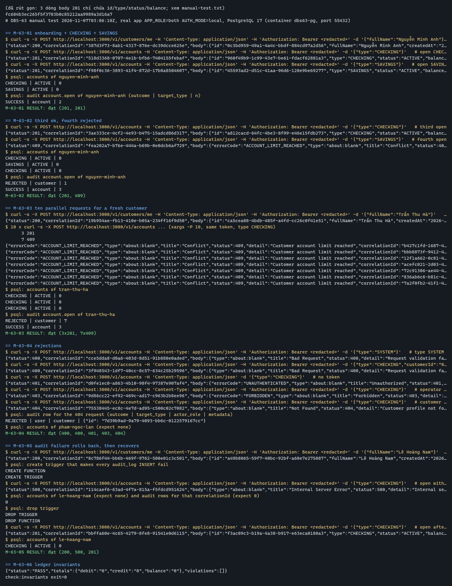

# DBS-63 · UC-2 mở tài khoản, tối đa 3 tài khoản mỗi khách

> **Status:** Implemented (G1–G4 đã duyệt 2026-11-07; Dev review và merge chờ BL-158) · **Vai:** Dev (Accounts) · **Nhánh:** `feat/DBS-63-open-accounts` · **PR:** [#58 · Draft](https://github.com/Lawliet119/digital-banking-simulator/pull/58) · **Cập nhật:** 2026-11-07

> **Ghi chú quy trình:** phần implement, test và manual test của task này đã làm trước khi có G1, G2 và G3, vì yêu cầu ban đầu bỏ qua gate. Skill không cho phép việc đó. Từ đây các gate được bù lần lượt, mỗi gate một tin nhắn, người duyệt trả lời rồi mới sang gate sau. Các mục §2–§9 bên dưới là bản cũ, sẽ được viết lại ở G2 (§2–§6), G3 (§7) và G4 (§8–§9).

## 1. Bối cảnh

- **Task trên board:** Story · Tuần 2 · vai `Dev` · ưu tiên Highest · Status `In Progress` · Deliverable/Demo `P2`.
  - **Thực trạng:** Giới hạn 3 tài khoản/khách (BR-14) không biểu diễn được bằng CHECK nên phải giữ bằng transaction có SELECT … FOR UPDATE hàng customers (database-design §4.2).
  - **Expect:** Khách mở được tối đa 3 tài khoản kể cả khi bấm song song.
- **DoD** (chép nguyên văn):
  1. Endpoint mở tài khoản CHECKING/SAVINGS; kiểm số tài khoản trong transaction có khóa hàng customers
  2. Test: ≥ 5 request mở tài khoản cùng lúc → đúng 3 tài khoản, phần còn lại ACCOUNT_LIMIT_REACHED
  3. Ghi audit; số dư ban đầu 0; không thể chọn type SYSTEM từ API
  4. PR đã merge vào main (CI xanh); Dev review; bảng «Đối chiếu test case» trong PR điền đủ
- **Phụ thuộc:**

  | Task | Board | Thực trạng trong repo |
  |---|---|---|
  | DBS-62 onboarding | Done | Đã vào main (`689a8e8`, [PR #56](https://github.com/Lawliet119/digital-banking-simulator/pull/56)); `customers` và `POST /v1/customers/me` có thật |
  | DBS-55 AccountsService | Done | Đã vào main ([PR #33](https://github.com/Lawliet119/digital-banking-simulator/pull/33)); không đổi chữ ký nào của `AccountsService` |

  Lúc bắt đầu implement, DBS-62 chưa merge. Người dùng đã duyệt bằng văn bản (2026-11-04) việc dựng tạm trên nhánh DBS-62 thật, không stub guard hay service, không seed customer bằng SQL. Khoảng đó đã hết: nhánh nay chứa main mới nhất.
- **Đã có gì (trên PR #58):**
  - Code: `account-opening.service.ts`, `accounts.controller.ts`, `open-account.dto.ts`, đăng ký trong `accounts.module.ts`. Test `backend/test/db/account-opening.db-spec.ts` (10 case, HTTP + PostgreSQL thật). Script manual `backend/scripts/manual-dbs63.cjs`.
  - Tài liệu: README module accounts, docs/03 (bảng API), `docs/features/README.md`, `docs/BACKLOG.md`, bằng chứng trong `screenshots/DBS-63/`.
  - Người gọi của symbol đã có: `AccountsService` giữ nguyên, không đổi export. `AccountsModule` chỉ thêm `AccountsController` và `AccountOpeningService`.
  - CI: 6/6 job xanh trên head `ec2f995` của PR (run `42169084841`), trước khi merge main mới và trước rebase.
- **Baseline** (cây đã merge main `aeee9c9`, commit merge `e06dbb1` trước rebase, cây sau rebase giống hệt; Node **v24.22.2** bản portable đặt ngoài repo, SHA256 đã kiểm; Postgres riêng cho e2e vì container `dbs-postgres-1` trên máy thuộc worktree khác và có mật khẩu khác, không đụng vào):

  | Lệnh | Kết quả |
  |---|---|
  | `npm run lint:check` | đạt |
  | `npm run typecheck` | đạt |
  | `npm run build` | đạt |
  | `npm test -- --runInBand` | 838/839 đạt, 56/57 suite; **1 đỏ**: `jwks-verifier.service.spec.ts` › "honours the refetch cooldown…" (đúng BL-112, đã biết, không do task này) |
  | `npm run test:e2e -- --runInBand` | 135/135 đạt, 13/13 suite (`DATABASE_URL` trỏ Postgres 17 riêng) |

  Lần chạy đầu trên Node 18.20.8 cho kết quả đỏ giả (`crypto is not defined`); không dùng. Chạy song song (không `--runInBand`) trên Node 24 cũng đỏ vì timeout khi máy quá tải, chạy riêng từng suite thì đạt. Baseline chốt là hai dòng `--runInBand`. Test DB (`test:db`) sẽ chạy ở Phase 4b.
- **Backlog liên quan (module accounts / DoD này):** BL-112 và BL-121 (test thời gian đã có, không do task này), BL-130 và BL-132 (audit từ chối vai ở tầng identity), BL-017 (test DB chạy bằng superuser nên chưa chứng minh quyền role ứng dụng), BL-122 và BL-008 (nằm ngoài). Không dòng nào được đưa vào phạm vi; task này không đóng dòng nào.
- **Ngoài phạm vi:** thay đổi schema, env, dependency hay `ErrorCode`; sự kiện mới / outbox; API khóa, mở khóa, liệt kê hay xem số dư tài khoản (các task khác); idempotency của việc mở tài khoản (FR-LED-05 chỉ nói nạp và chuyển tiền); ràng buộc DB cho giới hạn 3 (BR-14 giữ bằng khóa hàng customers, SQL của admin ngoài API không được bảo vệ).
- **Câu hỏi mở:**
  1. **Bù gate.** Code đã xong trước khi có G1–G3. Đề xuất: đi bù G1 → G2 → G3 → G4, mỗi gate một tin nhắn, dùng code hiện có làm đối tượng để duyệt, chỉ sửa code nếu review hoặc test mới phát hiện lỗi. Nếu bạn muốn làm lại từ đầu, nói rõ.
  2. **Baseline đỏ vì Node 18.** Đề xuất: chạy baseline và các test DB trong container `node:24` bằng Docker (không cài gì lên máy bạn). Hoặc bạn tự cài Node 24 rồi mình chạy lại. Chưa có kết quả này thì G4 không thể nói "đạt".
  3. **Reviewer ở G2.** Lần trước domain review dùng "Codex, cùng model", trong khi skill yêu cầu model mạnh nhất. Đề xuất: chạy lại domain review bằng một subagent mới, lưu nguyên văn đè lên `domain-review.md` (bản cũ vẫn trong git).
  4. **Nhánh và push.** Mình đã merge main vào nhánh (không rebase) để không phải force-push; conflict chỉ ở `docs/BACKLOG.md`, dòng của task đổi thành `BL-158` vì main đã dùng đến `BL-157`. Mọi thay đổi hiện chỉ nằm trên máy. Đề xuất: không push gì cho đến sau G3, và khi push thì push thường (nhánh này là của PR #58 đang mở, tác giả commit khác, nên cần bạn đồng ý).
  5. **Fixture trạng thái.** TC-63-05 dùng `UPDATE accounts SET status='LOCKED'` bằng SQL vì API khóa tài khoản chưa có. `module-notes.md` chỉ cấm seed số dư bằng SQL, không cấm trạng thái. Đề xuất: giữ, ghi rõ ở §4, không stub API khóa.

**Quyết định ở G1** (người dùng trả lời «duyệt», 2026-11-07, chấp nhận mọi đề xuất): (1) đi bù G1 → G4 từng gate trên code hiện có; (2) baseline chạy trên Node 24, thực hiện bằng bản portable thay vì container vì Testcontainers cần Docker socket; (3) chạy lại domain review bằng subagent mới ở G2; (4) không push trước G3, khi push là push thường và hỏi lại; (5) giữ fixture `UPDATE accounts SET status='LOCKED'`, ghi ở §4.

## 2. Hành vi

`POST /v1/accounts` · vai `customer` · guard JWT và vai là guard toàn cục có sẵn · không có `Idempotency-Key` (mỗi lần gọi là một tài khoản mới, đến tối đa 3; FR-LED-05 chỉ áp dụng cho nạp và chuyển tiền).

**Request:** đúng một trường `{"type": "CHECKING"}` hoặc `{"type": "SAVINGS"}`. Hai loại hành xử giống nhau, chỉ là nhãn (database-design §4.2). Owner, số dư, trạng thái và id không bao giờ lấy từ client.

| # | Điều kiện | Kết quả | `errorCode` / ghi chú |
|---|---|---|---|
| 2.1 | Customer đã onboarding, đang có 0–2 tài khoản | 201, tạo tài khoản mới của chính caller | — |
| 2.2 | Customer đang có đủ 3 tài khoản (tính cả `LOCKED`) | 409, không tạo gì | `ACCOUNT_LIMIT_REACHED` |
| 2.3 | `type` là `SYSTEM`, chữ thường, rỗng, `null`, số, chuỗi SQL, hoặc thiếu | 400 | lỗi validate, không tới service |
| 2.4 | Body có thêm `customerId`, `userId`, `balance`, `status`, `id` | 400 | `forbidNonWhitelisted` toàn cục |
| 2.5 | Không có token, token sai chữ ký / rác, hoặc hết hạn | 401 | `UNAUTHENTICATED` / `TOKEN_EXPIRED` |
| 2.6 | Vai `operator`, `auditor`, `admin` | 403 | `FORBIDDEN` |
| 2.7 | Customer có token hợp lệ nhưng chưa gọi `POST /v1/customers/me` | 404, không tạo gì, có audit `REJECTED` | không có `errorCode` mới (không thêm `ErrorCode`); khác `GET /v1/customers/me` (404, không audit) vì đây là một lệnh ghi bị từ chối còn GET chỉ đọc |
| 2.8 | Lỗi DB tạm thời (kể cả hết thời gian chờ khóa hàng `customers`) | 503 | `SERVICE_TEMPORARILY_UNAVAILABLE` + `Retry-After`, không tạo tài khoản, không ghi audit SUCCESS |
| 2.9 | Ghi audit thất bại | 500, rollback, không tạo tài khoản | thông điệp chung, không lộ SQL hay PII |

**201 (ví dụ):**

```json
{
  "id": "2c0f9e9b-638b-4b69-aa26-aa767bd7ee38",
  "type": "CHECKING",
  "status": "ACTIVE",
  "balance": "0",
  "createdAt": "2026-11-06T05:28:48.632Z",
  "updatedAt": "2026-11-06T05:28:48.632Z"
}
```

**409 (ví dụ):**

```json
{
  "errorCode": "ACCOUNT_LIMIT_REACHED",
  "type": "about:blank",
  "title": "Conflict",
  "status": 409,
  "detail": "Customer account limit reached",
  "correlationId": "18b6d366-e244-4aa2-a008-fe7691b26521"
}
```

**Quy tắc:**
- Số dư ban đầu là `0` lấy từ DEFAULT của cột, trả về dạng chuỗi (`balance::text`), ứng dụng không chuyển sang `Number`. Trạng thái `ACTIVE` cũng từ DEFAULT. Không có bút toán sổ cái nào được tạo.
- Giới hạn 3 tính theo `customer_id`, mọi `type` và mọi `status`. Hai customer khác nhau không ảnh hưởng nhau.
- Giới hạn chỉ được bảo đảm cho mọi đường mở tài khoản đi qua service này. SQL của admin ngoài API không được bảo vệ (BR-14 không biểu diễn được bằng `CHECK`).
- Mọi truy vấn có tham số. Không có sự kiện outbox: không có `AccountOpened` trong `event-contract.md`.

**Audit** (action `account.open`, actor là `users.id` đã xác minh, vai `customer`, `correlationId` do server sinh):

| Tình huống | `outcome` | `target` | `metadata` | Giao dịch |
|---|---|---|---|---|
| 2.1 thành công | `SUCCESS` | `account` / id tài khoản mới | `{id}` | cùng transaction với INSERT |
| 2.2 đủ 3 | `REJECTED` | `customer` / id customer | `{reason: "ACCOUNT_LIMIT_REACHED", count}` | cùng transaction, **commit trước khi trả 409** |
| 2.7 chưa onboarding | `REJECTED` | `user` / id người gọi | `{id}` (không có `reason`: `reason` chỉ nhận giá trị của `ErrorCode` hoặc `AuditReason`, và không thêm mã mới) | cùng transaction (không ghi dữ liệu nào khác), 404 ném sau commit |

Lỗi audit lan ra ngoài và làm rollback (FR-AUD-01: không ghi được audit thì hủy thao tác). Nếu ghi audit của 2.2 hoặc 2.7 lỗi thì trả 500 thay vì 409 / 404.

**Vì sao 2.7 là `REJECTED` chứ không phải `DENIED`:** database-design định nghĩa `DENIED` là lần bị từ chối quyền (A đụng vào tài nguyên của B). Thiếu hồ sơ customer là điều kiện nghiệp vụ chưa đủ, không phải vi phạm quyền; ghi `DENIED` sẽ làm bẩn truy vấn truy vết vi phạm truy cập của auditor. Quy tắc trong `references/testing.md`: từ chối nghiệp vụ → `REJECTED` cùng transaction. Không có nhánh `DENIED` nào trong endpoint này vì request không mang id tài nguyên của người khác. *(Thay đổi so với code hiện có, đang chờ duyệt ở G2: code đang ghi `DENIED` bằng transaction riêng.)*

## 3. Kiến trúc

- **Vị trí:** module `accounts`, role `api` (cũng có khi `APP_ROLE=both`; worker không mở HTTP). File: `account-opening.service.ts` (`AccountOpeningService`, chỉ dùng trong module), `accounts.controller.ts` (`AccountsController`), `open-account.dto.ts` (`CreateAccountDto`, `OpenedAccountDto`), đăng ký trong `accounts.module.ts`.
- **Interface dùng:** `TransactionService.run<T>(cb)` (READ COMMITTED, có retry `40P01`/`40001` ba lần rồi 503), `AuditService.record(manager, entry)`, `@CurrentUser()`, `@Roles('customer')`, `request.correlationId` từ middleware.
- **Interface cung cấp:** `AccountOpeningService.open(userId: string, type: CustomerAccountType, correlationId: string): Promise<OpenedAccountDto>`. `AccountsService` (export) và mọi người gọi nó **không đổi**: module chỉ thêm controller và provider.
- **Dữ liệu:** `customers` (khóa hàng `FOR UPDATE`), `accounts` (COUNT, INSERT; `accounts_customer_idx` phục vụ COUNT), `audit_log`. Không migration, không đổi schema.
- **Ranh giới transaction:** một `TransactionService.run` gồm: khóa hàng `customers` theo `user_id` → COUNT → (INSERT hoặc audit REJECTED) → audit SUCCESS. Không gọi Redis, HTTP, SQS bên trong. Callback trả một kết quả (`created` / `limit` / `missing`); 409 và 404 chỉ được ném **sau khi** transaction trả về, để audit REJECTED (cả hai nhánh) không bị rollback. Không bắt lỗi DB trong callback.
- **Khóa:** khóa hàng cha `customers` làm hàng đợi cho cùng một customer, kể cả khi chưa có tài khoản nào để khóa. COUNT là câu lệnh riêng sau khi giữ khóa nên thấy tài khoản mà người giữ khóa trước vừa commit (READ COMMITTED). Chỉ có **một khóa độc quyền** (hàng `customers`), nên không có thứ tự khóa và không có chu trình. Ngoài ra có hai khóa `FOR KEY SHARE` do khóa ngoại: INSERT `accounts` lên chính hàng `customers` đó (cùng transaction, không xung đột), và INSERT `audit_log` lên hàng `users` của actor qua `audit_log_actor_user_id_fkey`; hiện chưa có đường ghi nào trong code vào `users` ngoài `INSERT … ON CONFLICT DO NOTHING` của identity; đường thu hồi phiên sau này chỉ đổi `sessions_revoked_at` (không phải cột khóa) nên lấy `NO KEY UPDATE`, không xung đột với `KEY SHARE`. Vì vậy không có chu trình khóa.

```mermaid
sequenceDiagram
    participant C as Customer
    participant G as JWT / Roles / ValidationPipe
    participant S as AccountOpeningService
    participant DB as PostgreSQL
    participant A as AuditService
    C->>G: POST /v1/accounts {type}
    G->>S: userId, type, correlationId
    S->>DB: BEGIN; SELECT id FROM customers WHERE user_id=$1 FOR UPDATE
    alt không có hàng customers
      S->>A: record REJECTED (cùng manager)
      S->>DB: COMMIT
      S-->>C: 404
    else có
      S->>DB: SELECT count(*) FROM accounts WHERE customer_id=$1
      alt count >= 3
        S->>A: record REJECTED (cùng manager)
        S->>DB: COMMIT
        S-->>C: 409 ACCOUNT_LIMIT_REACHED
      else count < 3
        S->>DB: INSERT INTO accounts (customer_id, type)
        S->>A: record SUCCESS (cùng manager)
        S->>DB: COMMIT
        S-->>C: 201
      end
    end
```

- **Thay đổi cấp hệ thống:** docs/03 bảng API (dòng `POST /v1/accounts`: thêm audit `REJECTED` cho 409 và 404, và 503 + `Retry-After` khi hết thời gian chờ khóa) và README module accounts. Không đổi ADR, `_shared`, env, `ErrorCode`, event.
- **Hạn chế chấp nhận:** (a) giới hạn 3 chỉ do quy ước khóa của ứng dụng giữ, admin SQL ngoài API không được bảo vệ; (b) 404 "chưa onboarding" không mang `errorCode` riêng (nhất quán với `GET /v1/customers/me` và docs/03 §7.1: chỉ thêm mã khi client cần rẽ nhánh).
- **Bàn giao cho vai khác (phát hiện ở domain review):** PostgreSQL đòi quyền `UPDATE` trên ít nhất một cột của `customers` cho mọi câu `SELECT … FOR UPDATE`, nhưng ma trận quyền ở database-design §8 chỉ cho role `dbs_api` `S I` trên `customers`. Khi các quyền theo role được áp dụng (DBS-40/41, BL-017), `POST /v1/accounts` sẽ lỗi `42501` → 500. Hiện chưa có `GRANT` nào trong repo và test DB chạy bằng superuser nên không phát hiện được. Đề xuất: người làm phần role cấp `GRANT UPDATE (full_name) ON customers TO dbs_api` (hoặc sửa ma trận) và task đó phụ thuộc vào kết quả này. Không đổi chiến lược khóa. Thêm một dòng `BL-NNN` ở G4.

## 4. Test cases tự động

File `backend/test/db/account-opening.db-spec.ts` (`npm run test:db`), HTTP thật với JWT cục bộ, PostgreSQL thật qua Testcontainers, hồ sơ customer tạo bằng onboarding thật, tài khoản chỉ tạo qua API mới. Sau mỗi case có `checkLedgerInvariants` phải PASS. Không seed số dư hay bút toán bằng SQL; ngoại lệ duy nhất là TC-63-05 dùng `UPDATE accounts SET status='LOCKED'` làm fixture trạng thái vì API khóa chưa có (không stub API khóa).

| ID | Truy vết | Lớp | Given · When · Then | `errorCode` |
|---|---|---|---|---|
| TC-63-01 | DoD #1, #3; FR-ACC-01 | e2e Postgres | Customer đã onboarding mở CHECKING rồi SAVINGS → 201, body đúng từng trường, `balance` là chuỗi `"0"`, `ACTIVE`; dòng DB đúng `customer_id`; audit SUCCESS đúng actor, vai, target, `correlationId`, metadata chỉ có `id` | — |
| TC-63-02 | DoD #1; BR-14 | e2e Postgres | Mở tuần tự 3 lần → 201; lần 4 → 409; DB vẫn đúng 3 dòng; audit REJECTED còn sau 409 với `count: 3` | `ACCOUNT_LIMIT_REACHED` |
| TC-63-03 | DoD #2 | e2e Postgres, đồng thời | 10 request mở cùng lúc (`Promise.all`, loại xen kẽ) cho một customer mới → đúng 3×201 và 7×409; 3 id khác nhau; DB đúng 3 dòng số dư 0; mỗi `correlationId` có đúng 1 dòng audit, SUCCESS (3) hoặc REJECTED (7) với actor, target, metadata đúng | `ACCOUNT_LIMIT_REACHED` |
| TC-63-04 | Expect; ownership | e2e Postgres, đồng thời | Hai customer, mỗi người 5 request cùng lúc → 6×201 + 4×409 (**mọi** 409 mang `errorCode`), mỗi người đúng 3 tài khoản, 3 audit SUCCESS + 2 REJECTED; body có `customerId` của người khác → 400 | `ACCOUNT_LIMIT_REACHED` |
| TC-63-05 | DoD #1 (khóa hàng customers) | e2e Postgres, khóa thật | Một kết nối giữ `FOR UPDATE` hàng customer A; request mở của A bắt đầu; thăm dò `pg_stat_activity` đến khi thấy truy vấn thật sự chờ `Lock`; trong lúc đó chưa có tài khoản, và customer B mở được; nhả khóa → request của A xong 201. Sau đó đặt một tài khoản `LOCKED` (fixture) → vẫn bị tính vào giới hạn | `ACCOUNT_LIMIT_REACHED` |
| TC-63-06 | DoD #3 | e2e Postgres, bảo mật | `SYSTEM`, `checking`, chuỗi SQL, rỗng, `null`, `42`, thiếu `type`, và từng trường thừa `customerId/userId/balance/status/id` → 400; không tạo tài khoản nào | 400 |
| TC-63-07 | Bảo mật; FR-AUD-01/02 | e2e Postgres, bảo mật | Không token → 401; token rác / sai chữ ký → 401; token hết hạn → 401; `operator`/`auditor`/`admin` → 403; customer chưa onboarding → 404 và có đúng 1 audit `REJECTED` (actor, vai `customer`, target `user`, metadata `{id}`) | `UNAUTHENTICATED`, `TOKEN_EXPIRED`, `FORBIDDEN` |
| TC-63-08 | DoD #3; FR-AUD-01, NFR-AUD-01 | e2e Postgres, lỗi thật | Trigger làm INSERT `audit_log` luôn lỗi: mở thành công / đủ 3 / chưa onboarding đều 500, thông điệp chung (không lộ SQL, không có "audit unavailable"), tài khoản được rollback, không có dòng audit; bỏ trigger → mở lại 201, đủ 3 vẫn 409, chưa onboarding vẫn 404 | `ACCOUNT_LIMIT_REACHED` |
| TC-63-09 | docs/03 §7 (OpenAPI) | e2e (tài liệu) | OpenAPI có bearer, enum `type` đúng 2 giá trị, ví dụ, và các phản hồi 201/400/401/403/404/409/500/503, ví dụ 409 chứa `ACCOUNT_LIMIT_REACHED` | — |
| TC-63-10 | ADR-04 | e2e Postgres, khóa thật | Một kết nối giữ khóa hàng customer đến quá thời gian chờ khóa → 503 + `Retry-After`; không tài khoản, không audit; nhả khóa → mở lại 201 | `SERVICE_TEMPORARILY_UNAVAILABLE` |
| TC-63-11 | DoD #2 (biên) | e2e Postgres, đồng thời | Customer đã có 2 tài khoản; 5 request mở cùng lúc → đúng 1×201 và 4×409 (`errorCode`), DB đúng 3 tài khoản, audit 1 SUCCESS (mới) + 4 REJECTED | `ACCOUNT_LIMIT_REACHED` |
| Quy trình | DoD #4 | — | PR vào main, CI xanh, Dev khác review, bảng đối chiếu điền đủ | `BL-158` |

**Checklist bảo mật** (`references/testing.md`):

| Yêu cầu | Chỗ thực thi | Case | Ghi chú |
|---|---|---|---|
| Guard vai đúng | controller `@Roles('customer')` | TC-63-07 | |
| Ownership, 404 cho tài nguyên người khác | service | TC-63-04, 06 | Không có id tài nguyên trong request; owner luôn lấy từ JWT, mọi trường owner gửi lên bị 400. Không áp dụng "404 + DENIED cho người khác". |
| Idempotency key theo user | — | không áp dụng | Mỗi lần gọi tạo tài nguyên mới đến tối đa 3 |
| REJECTED cùng transaction, DENIED transaction riêng | service | TC-63-02, 03, 07, 08, 11 | Mọi từ chối nghiệp vụ (đủ 3, chưa onboarding) là `REJECTED` cùng transaction. Không có nhánh `DENIED`: request không mang id tài nguyên của người khác |
| Không có trường fraud trong response | DTO | TC-63-01 | `toEqual` đúng 6 trường |
| Lỗi không lộ nội bộ; có `correlationId` | `ProblemDetailsFilter` | TC-63-08 | |
| SQL có tham số; đầu vào độc hại | service | TC-63-06 | |
| TLS Postgres/Redis; không secret | config | không áp dụng | Không đổi cấu hình |

**Thay đổi test so với file hiện có (làm ở Phase 4, sau G3):** TC-63-04 thêm khẳng định `errorCode` và audit; TC-63-07 thêm token rác, đổi kỳ vọng `DENIED` → `REJECTED` kèm `actor_role` và `metadata`; thêm TC-63-11. TC-63-03 và TC-63-05 giữ nguyên: TC-63-03 chứng minh kết quả đúng dưới 10 request đồng thời, còn việc các request thực sự chờ nhau được chứng minh riêng ở TC-63-05.

**Chưa có test, ghi để reviewer thấy:** không có test cho việc admin SQL chèn thẳng tài khoản thứ 4 (ngoài phạm vi, đã nêu ở §3); không có test thu hồi phiên (do guard Identity, task khác).

## 5. Test thủ công

Chạy trên **ứng dụng thật** (`npm run start:dev`, `APP_ROLE=both`) với PostgreSQL, Valkey và ElasticMQ thật, token thật từ `auth:dev-token` (DBS-53), bằng `curl` và `psql`. Output thô ghi vào `docs/features/screenshots/DBS-63/manual-test.txt` (đường dẫn tính từ gốc repo; Git Bash, `tee -a`), dòng đầu là SHA commit cuối cùng đổi code.

**Điều kiện chạy:** từ gốc repo `docker compose up -d` (nếu cổng 5432 đã bị Postgres khác dùng: chạy Postgres riêng `dbs63-pg` ở cổng 55432 với `banking/banking_local_only` và đặt `DATABASE_URL` tương ứng, ghi ở §1 và §8). Từ `backend/`: `cp env/.env.example env/.env.development`, `npm run auth:dev-keys`, chú thích mọi dòng `COGNITO_*` và thêm `AUTH_MODE=local`, `AUTH_LOCAL_JWKS_PATH=.auth-local/jwks.json`; `npm run migration:run`; `npm run start:dev`. Token: `TOKEN=$(npm run --silent auth:dev-token -- --role customer --sub nguyen-minh-anh)`.

| Bước | Việc làm | Kết quả mong đợi |
|---|---|---|
| M-63-01 | `POST /v1/customers/me {"fullName":"Nguyễn Minh Anh"}`, rồi `POST /v1/accounts` với `CHECKING` và `SAVINGS`. `psql`: các tài khoản và audit | 200, rồi 201 hai lần, `balance:"0"`, `ACTIVE`; 2 dòng `accounts`, 2 audit `SUCCESS` `account.open` |
| M-63-02 | Mở thêm lần 3 (201) và lần 4 | lần 3 → 201; lần 4 → 409 `ACCOUNT_LIMIT_REACHED` kèm `correlationId`; `psql`: 3 tài khoản, 1 audit `REJECTED` `count:3` |
| M-63-03 | Customer mới `--sub tran-thu-ha`, onboarding, rồi 10 `curl` chạy song song (`xargs -P 10`) | đúng 3×201 và 7×409; `psql`: 3 tài khoản, 3 audit SUCCESS + 7 REJECTED |
| M-63-04 | `"type":"SYSTEM"`; body có `"customerId"`; không token; token `--role operator`; customer chưa onboarding (`--sub pham-ngoc-lan`) | 400; 400; 401; 403; 404 và 1 audit `REJECTED` (target `user`, metadata `{id}`); không tài khoản nào được tạo |
| M-63-05 | Customer mới `--sub le-hoang-nam`: onboarding (`"fullName":"Lê Hoàng Nam"`) → 200. `psql`: tạo trigger làm `audit_log` luôn lỗi. Mở tài khoản. Bỏ trigger, mở lại | onboarding 200 trước khi có trigger; mở khi có trigger → 500 chung chung, `accounts` của người đó = 0 và không có audit `account.open` cho `correlationId` đó; sau khi bỏ trigger → 201, `balance:"0"` |
| M-63-06 | Chạy `npm run --silent check:invariants` | thoát mã 0, `PASS`, không vi phạm |
| M-63-07 | Dừng app, dọn container riêng và dữ liệu thử | không còn tiến trình hay container của task |

Bước ép khóa quá thời gian (503) được chứng minh bằng TC-63-10 chứ không có bước tay riêng. `backend/scripts/manual-dbs63.cjs` chạy một app dựng trong test-support với JWKS giả, nên **không thay** cho các bước trên.

## 6. Domain review (AI)

**Reviewer:** subagent mới, model Opus ở mức effort medium (**người dùng chọn rõ ràng**, thay cho "model mạnh nhất" mà skill yêu cầu), 2026-11-07 · **Kết quả:** 9 phát hiện (blocking 0, should-fix 2, minor 7), verdict **REVISE** · [trả lời nguyên văn](screenshots/DBS-63/domain-review.md). Lần review trước (Codex, cùng model với tác giả code) đã bị thay thế; bản đó còn trong lịch sử git.

| # | Mức | Phát hiện | Xử lý |
|---|---|---|---|
| 1 | should-fix (bàn giao) | `SELECT … FOR UPDATE` trên `customers` cần quyền `UPDATE` một cột, mà ma trận quyền chỉ cho `dbs_api` `S I`; lỗi `42501` → 500 khi quyền role được áp dụng. Test chạy bằng superuser nên không bắt được | Đã xác minh với nguồn. Không sửa trong task này; ghi vào §3 là bàn giao, thêm dòng `BL-NNN` ở G4, liên quan BL-017 |
| 2 | should-fix | M-63-05 không onboarding trước khi tạo trigger, nên onboarding lỗi và kết quả "0 tài khoản" đúng một cách tầm thường | Đã sửa §5 (onboarding → trigger → mở → bỏ trigger → mở lại). Đã xác minh: `createOrGet` ghi audit trong cùng transaction |
| 3 | minor | `DENIED` cho "chưa onboarding" sai định nghĩa (`DENIED` là từ chối quyền), không nhất quán với `GET /me` | Đã sửa §2/§3/§4: chuyển sang `REJECTED` cùng transaction, giải thích lý do, nêu khác biệt với GET. **Đổi hành vi so với code hiện có, là câu hỏi 1 của G2** |
| 4 | minor | TC-63-04 không khẳng định `errorCode` của 4 lần 409 và không kiểm audit | Đã sửa §4; sửa test ở Phase 4 |
| 5 | minor | §2.5 hứa 401 cho token sai nhưng test chỉ có thiếu và hết hạn; DENIED không kiểm `actor_role`/`metadata` | Đã sửa §4 (thêm token rác, kiểm `actor_role` và `metadata`); sửa test ở Phase 4 |
| 6 | minor | Thiếu ca biên 2 tài khoản + N request song song; TC-63-03 không chứng minh các request thật sự chồng nhau | Đã thêm TC-63-11. Không thêm kiểm chồng nhau vào TC-63-03: TC-63-05 đã chứng minh chờ khóa thật, ghi rõ ở §4 |
| 7 | minor | "Không có hai khóa" không chính xác (có `FOR KEY SHARE` qua khóa ngoại) | Đã sửa §3, liệt kê khóa và lý do không có chu trình |
| 8 | minor | §5: đường dẫn `manual-test.txt` sai nếu chạy từ `backend/`; ghi chú đổi cổng phải ở §1 | Đã sửa §5 (đường dẫn từ gốc repo, ghi ở §1 và §8) |
| 9 | minor | Dòng API ở docs/03 thiếu audit và 503 | Ghi ở §3 "Thay đổi cấp hệ thống"; sửa file ở Phase 5 |

**Vòng 2** (cùng reviewer, chạy lại trên §2–§5): 2 phát hiện, verdict **REVISE**. Cả 9 phát hiện vòng 1 được xác nhận đã xử lý.

| # | Mức | Phát hiện | Xử lý |
|---|---|---|---|
| R2-1 | blocking | `metadata.reason = CUSTOMER_PROFILE_MISSING` không hợp lệ: `serializeMetadata` chỉ nhận `ErrorCode` hoặc `AuditReason` (`audit-metadata.guard.ts`), nên `record()` ném lỗi và đường chưa onboarding luôn trả 500 | Đã xác minh với code. Đã sửa §2, §4 (TC-63-07), §5 (M-63-04): bỏ `reason`, dùng `metadata {id}` như code hiện tại đang ghi; không đổi module audit hay `ErrorCode` |
| R2-2 | minor | §3 ngụ ý đã có đường ghi `users.sessions_revoked_at`; hiện chưa có trong code | Đã sửa §3 thành quy tắc cho tương lai |

**Vòng 3 chưa chạy.** Bản sửa R2-1 chính là phương án thay thế mà reviewer đề xuất, và `{id}` đã được code hiện tại ghi thành công (TC-63-07 đang đạt với `metadata {id}`), nên mình không chạy thêm vòng. Nếu bạn muốn đúng quy tắc "review lại mọi mục đã đổi" thì nói, mình chạy vòng 3.

**Quyết định ở G2** (người dùng trả lời «duyệt», 2026-11-07, chấp nhận mọi đề xuất): (1) đổi audit "chưa onboarding" từ `DENIED` sang `REJECTED` cùng transaction, sửa code ở Phase 4; (2) sửa TC-63-04, TC-63-07 và thêm TC-63-11 ở Phase 4; (3) test thủ công chạy trên app thật, giữ `manual-dbs63.cjs` làm bằng chứng bổ sung, không tính là test thủ công; (4) bàn giao quyền `UPDATE` trên `customers` thành một dòng `BL-NNN` ở G4; (5) bỏ vòng review 3.

## 7. Kế hoạch triển khai

Phần lớn code đã có từ trước; kế hoạch này chỉ gồm những gì **còn phải làm** để khớp §2–§5 đã duyệt, rồi chứng minh lại trên cây đã merge main. Thứ tự: test trước, code sau, tài liệu cuối. Mỗi bước xanh mới commit; không `--no-verify`.

| Bước | File | Test viết trước | Kết quả đỏ (điền khi chạy) | Lệnh chứng minh (từ `backend/`, Node 24) | Commit |
|---|---|---|---|---|---|
| 1 | `test/db/account-opening.db-spec.ts` | TC-63-11 (2 tài khoản + 5 request song song → 1×201 + 4×409). Hành vi đã đúng nên **xanh ngay**; chứng minh test có giá trị bằng đột biến: tạm bỏ `FOR UPDATE` trong service, chạy lại, TC-63-03 và TC-63-11 phải **đỏ**, rồi khôi phục (đột biến không commit) | xanh ngay (hành vi đã đúng). Đột biến bỏ `FOR UPDATE`: **4 test đỏ** (TC-63-03, 04, 05, 11), đã khôi phục | `npm run test:db -- --runInBand --runTestsByPath test/db/account-opening.db-spec.ts` | `test(accounts): add boundary concurrency case (DBS-63)` |
| 2 | `test/db/account-opening.db-spec.ts` | TC-63-07: token rác → 401; chưa onboarding → audit `REJECTED` với `actor_role` và `metadata {id}` (đổi từ `DENIED`) | `Expected outcome "REJECTED"`, `Received "DENIED"` (token rác đã qua assertion 401) | như bước 1 | `test(accounts): expect REJECTED audit for missing profile (DBS-63)` |
| 3 | `test/db/account-opening.db-spec.ts` | TC-63-04: khẳng định `errorCode` của mọi 409, 3 SUCCESS + 2 REJECTED mỗi customer. Đặc tả hành vi đã đúng nên xanh ngay | xanh ngay (hành vi đã đúng) | như bước 1 | `test(accounts): assert errorCode and audit in parallel case (DBS-63)` |
| 4 | `src/modules/accounts/account-opening.service.ts` | TC-63-07 và TC-63-08 từ bước 2 | — | như bước 1, sau đó `npm run lint:check && npm run typecheck` | `fix(accounts): audit missing profile as REJECTED in the same transaction (DBS-63)` |
| 5 | `scripts/manual-dbs63.cjs` | — (script bổ sung) | — | `node scripts/manual-dbs63.cjs` chạy sau bước 4: kỳ vọng `DENIED` → `REJECTED` ở M-63-04 | `test(accounts): update supplementary manual driver (DBS-63)` |
| 6 | — | Chạy lại toàn bộ trên cây hiện tại | — | `npm run lint:check && npm run typecheck && npm run build`; `npm test -- --runInBand`; `npm run test:e2e -- --runInBand` (`DATABASE_URL` Postgres riêng); `npm run test:db -- --runInBand` (**toàn bộ**, không chỉ 4 suite) | — |
| 7 | `docs/features/screenshots/DBS-63/manual-test.txt`, `01-*.png` | Test thủ công §5 M-63-01 → M-63-07 trên app thật; SHA ở dòng đầu là commit cuối cùng đổi code | — | Các lệnh ở §5 (Git Bash, `tee -a`); xóa token và header `Authorization` khỏi file | `docs(accounts): record DBS-63 manual test` |
| 8 | `README` module accounts, `docs/03` dòng `POST /v1/accounts`, `docs/features/README.md` (dòng DBS-63, viết lại tiếng Việt), `docs/BACKLOG.md` (thêm `BL-159`, cập nhật `BL-158`), xóa `screenshots/DBS-63/verification.txt` và `pr-description.md` (số liệu cũ, trùng với §8 và mô tả PR), §8–§9 của doc này, bỏ phần "Rebase and final handover" cũ | — | — | `node .claude/skills/dbs-delivering-task/scripts/check-doc-links.mjs` | `docs(accounts): finish DBS-63 handover docs` |

**Quét theo DoD và hạn chế trong tài liệu:**

| Mục | Xử lý |
|---|---|
| DoD #1 (khóa hàng customers) | TC-63-02, 05, 10, 11, đột biến ở bước 1 |
| DoD #2 (≥ 5 request song song) | TC-63-03 (10 request), TC-63-04, TC-63-11 |
| DoD #3 (audit, số dư 0, cấm SYSTEM) | TC-63-01, 06, 07, 08 |
| DoD #4 (merge, CI, Dev review, bảng đối chiếu) | Quy trình, dòng `BL-158`; bảng đối chiếu ở §8 và mô tả PR; **không** claim xong |
| Hạn chế BR-14: admin SQL ngoài API | Giữ nguyên trong README và §3; không xử lý |
| Quyền `UPDATE` trên `customers` cho `dbs_api` | Bàn giao, dòng `BL-159`, liên quan BL-017 |
| Fixture `UPDATE accounts SET status='LOCKED'` | Giữ, ghi ở §4, không stub API khóa |
| BL-112 (test cooldown JWKS, đỏ ở baseline) | Báo là đã biết; không được đếm vào kết quả của task này |
| Mô tả PR #58 lỗi thời và trạng thái trong README module | Cập nhật ở G4, sau khi được duyệt (chỉ khi người dùng đồng ý sửa mô tả PR) |

**Phạm vi file:** code chỉ đổi `account-opening.service.ts` (và test, script). Mọi file khác là tài liệu. Cuối task sẽ chạy `git diff --stat main...HEAD` và đối chiếu với bảng này ở §8.

**Rủi ro và cách lùi:** đổi audit sang `REJECTED` chỉ ảnh hưởng đường 404 của endpoint này; lùi bằng `git revert` các commit ở bước 4–5. Không migration, không dữ liệu cần dọn. Đột biến ở bước 1 chỉ nằm trong working tree, phải khôi phục trước khi commit (kiểm bằng `git diff` trước mỗi commit).

**Quyết định ở G3** (người dùng trả lời «duyệt», 2026-11-07, chấp nhận mọi đề xuất): (1) xóa `verification.txt` và `pr-description.md`; (2) viết lại dòng DBS-63 ở `docs/features/README.md` và README module accounts bằng tiếng Việt; (3) không push trước G4, sau G4 push thường lên nhánh PR #58 và hỏi riêng việc sửa mô tả PR.

## 8. Kết quả

- **Lệnh kiểm tra** (2026-11-07, Node v24.22.2 portable, `--runInBand`; code cuối cùng là commit `b34f9f3`, các commit sau chỉ đổi tài liệu và bằng chứng):

```text
npm run lint:check && npm run typecheck && npm run build   -> đạt
npm test -- --runInBand            Test Suites: 1 failed, 56 passed, 57 total | Tests: 1 failed, 838 passed, 839 total
npm run test:e2e -- --runInBand    Test Suites: 13 passed, 13 total           | Tests: 135 passed, 135 total
npm run test:db -- --runInBand     Test Suites: 22 passed, 22 total           | Tests: 401 passed, 401 total (toàn bộ, 0 skipped)
test/db/account-opening.db-spec.ts                                              | Tests: 11 passed, 11 total
```

  - Test đỏ duy nhất ở `npm test`: `jwks-verifier.service.spec.ts` › "refetches on key rotation once the cooldown has elapsed, but not before". Đây là BL-112 (test cooldown JWKS phụ thuộc thời gian, lúc chậm lúc đỏ khi máy bận), **không do task này**. Ở baseline đỏ test kia trong cùng cặp ("honours the refetch cooldown…"). Không được đếm vào kết quả của task.
  - `e2e` chạy với `DATABASE_URL` trỏ Postgres 17 riêng ở cổng 55432, vì container `dbs-postgres-1` trên máy thuộc worktree khác và có mật khẩu khác (không đụng vào). `test:db` dùng Testcontainers.
  - Không có `.skip`, `.only`, `.todo` trong test của task (0 skipped).
  - **Đột biến (§7 bước 1):** tạm bỏ `FOR UPDATE` khỏi truy vấn `customers` → 4 test đỏ: TC-63-03, TC-63-04, TC-63-05, TC-63-11. Đã khôi phục (`git diff` sạch trước khi commit). TC-63-10 vẫn xanh khi bỏ `FOR UPDATE` vì `INSERT INTO accounts` lấy `FOR KEY SHARE` trên hàng `customers` qua khóa ngoại, và khóa đó xung đột với `FOR UPDATE` do kết nối ngoài giữ; điều này không làm yếu các case khác.

- **Đối chiếu test case:**

| ID | Test (`test/db/account-opening.db-spec.ts`) | Đạt? |
|---|---|---|
| TC-63-01 | `TC-63-01 opens CHECKING/SAVINGS with zero string and correct atomic audit` | đạt |
| TC-63-02 | `TC-63-02 fourth opening returns409 with a committed rejection audit` | đạt |
| TC-63-03 | `TC-63-03 ten simultaneous first requests create exactly3 and reject7` | đạt (kết quả đúng với 10 request; việc các request thật sự chờ nhau được chứng minh riêng ở TC-63-05 và bằng đột biến) |
| TC-63-04 | `TC-63-04 each customer has an independent limit and cannot forge an owner` | đạt (đã thêm `errorCode` và audit) |
| TC-63-05 | `TC-63-05 opening really waits for its parent lock, another customer proceeds, LOCKED counts` | đạt; dùng fixture SQL `UPDATE accounts SET status='LOCKED'` (không có API khóa), không seed số dư |
| TC-63-06 | `TC-63-06 rejects SYSTEM, invalid types and every privileged extra field` | đạt |
| TC-63-07 | `TC-63-07 applies real guards and audits a missing profile as REJECTED before404` | đạt (đã thêm token rác, `actor_role`, `metadata`; đổi sang `REJECTED`) |
| TC-63-08 | `TC-63-08 audit failure rolls back success; rejection/denial fail closed and recover` | đạt (tên test còn chữ "denial" từ trước; nội dung kiểm đường chưa onboarding vẫn 500 khi audit lỗi) |
| TC-63-09 | `TC-63-09 OpenAPI documents allowed types, examples, security and error responses` | đạt |
| TC-63-10 | `TC-63-10 real parent lock timeout returns503 with Retry-After, then recovers` | đạt |
| TC-63-11 | `TC-63-11 a customer at two accounts gets exactly one more from five simultaneous requests` | đạt (mới) |
| Quy trình | DoD #4 | **chưa đạt**, tracked `BL-158` |

  11/11 test case đạt đủ độ sâu, 0 đơn giản hóa, 0 chưa làm (không kể dòng quy trình).

- **Test thủ công** (app thật `npm run start:dev`, `APP_ROLE=both`, `AUTH_MODE=local`, token từ `auth:dev-token`, Postgres 17 riêng ở cổng 55432). Output thô: [manual-test.txt](screenshots/DBS-63/manual-test.txt), SHA ở dòng đầu `b34f9f3c23fdee5bf7c3b4738c1f4873504e8ada` (commit cuối cùng đổi code). Token không được in; `Authorization` hiển thị `<redacted>`.

| Bước | Phản hồi thật (rút gọn) | Kết quả |
|---|---|---|
| M-63-01 | onboarding 200; `POST /v1/accounts` CHECKING 201 và SAVINGS 201, `balance:"0"`, `ACTIVE`; `psql`: 2 tài khoản, `SUCCESS \| account \| 2` | đạt |
| M-63-02 | lần 3 → 201; lần 4 → 409 `ACCOUNT_LIMIT_REACHED`; `psql`: 3 tài khoản, `REJECTED \| customer \| 1`, `SUCCESS \| account \| 3` | đạt |
| M-63-03 | 10 `curl` song song (`xargs -P 10`): `3 201`, `7 409`; `psql`: 3 tài khoản, `REJECTED \| customer \| 7`, `SUCCESS \| account \| 3` | đạt |
| M-63-04 | `SYSTEM` 400; `customerId` thừa 400; không token 401 `UNAUTHENTICATED`; `operator` 403 `FORBIDDEN`; chưa onboarding 404; `psql`: `REJECTED \| user \| customer \| {"id": "…"}`, không tài khoản nào | đạt |
| M-63-05 | onboarding 200; trigger làm `audit_log` lỗi; mở → 500 chung chung; `psql`: không có tài khoản, 0 audit cho `correlationId` đó; bỏ trigger; mở lại → 201 `balance:"0"` | đạt |
| M-63-06 | `npm run --silent check:invariants` → `{"status":"PASS",…,"violations":[]}`, `exit=0` | đạt |
| M-63-07 | Dừng app và watcher của worktree, xóa container `dbs63-pg`, xóa `.auth-local`, `env/.env.development`, `dist`; xác nhận `health` không còn trả lời, không còn container hay tiến trình `node` của worktree. Thực hiện sau khi ghi `manual-test.txt` nên không nằm trong file đó | đạt |

  Không có bước nào ở trạng thái "chưa chạy". Không bước nào dùng SQL seed; `psql` chỉ để đọc, và để tạo/bỏ trigger ở M-63-05. Bước ép khóa quá thời gian (503) không có bước tay riêng, được chứng minh bằng TC-63-10.

- **Phạm vi so với §7** (`git diff --stat main...HEAD`, trước commit cuối của tài liệu):

```text
 backend/scripts/manual-dbs63.cjs                   | 184 +++++++++++
 backend/src/modules/accounts/README.md             |   6 +
 .../modules/accounts/account-opening.service.ts    |  99 ++++++
 .../src/modules/accounts/accounts.controller.ts    |  67 ++++
 backend/src/modules/accounts/accounts.module.ts    |   6 +-
 backend/src/modules/accounts/open-account.dto.ts   |  31 ++
 backend/test/db/account-opening.db-spec.ts         | 361 +++++++++++++++++++++
 docs/03_HIGH_LEVEL_ARCHITECTURE.md                 |   2 +-
 docs/BACKLOG.md                                    |   2 +
 docs/features/DBS-63-open-accounts.md              | 358 ++++++++++++++++++++
 docs/features/README.md                            |   1 +
 .../screenshots/DBS-63/01-manual-test-results.png  | Bin 0 -> 459509 bytes
 docs/features/screenshots/DBS-63/domain-review.md  |  13 +
 docs/features/screenshots/DBS-63/manual-test.txt   |  94 ++++++
 14 files changed, 1221 insertions(+), 3 deletions(-)
```

  Khớp bảng §7: code sản xuất chỉ có `account-opening.service.ts`; `accounts.controller.ts`, `open-account.dto.ts`, `accounts.module.ts` là phần đã có từ PR cũ (không đổi trong các bước ở đây). Không có file lạ ngoài kế hoạch.

- **Ảnh chụp:**



- **Lệch so với kế hoạch:**
  1. §7 bước 2, 3 và 4 được commit gộp thành một commit `b81aa22` (test và bản sửa). Hai thay đổi test nằm chung một file đã sửa cùng lúc nên không tách được thành commit xanh riêng. Không đổi phạm vi, không cần gate phụ.
  2. Đột biến ở bước 1 làm đỏ 4 test, nhiều hơn 2 test (TC-63-03 và TC-63-11) kế hoạch dự kiến; là kết quả tốt hơn dự kiến.
  3. Lần chạy test thủ công đầu tiên bị bỏ: tên tiếng Việt bị hỏng khi truyền qua `curl.exe` trên Windows (`Tr?n Thu H�`). Đã sửa kịch bản (gửi body qua file), chạy lại từ database sạch; `manual-test.txt` chỉ chứa lần chạy lại.
  4. Môi trường: Node 24 bản portable (ngoài repo, SHA256 đã kiểm) và Postgres riêng ở cổng 55432, đã ghi ở §1 và §5. Không đổi cấu hình repo.
  5. Domain review đổi hành vi 404 từ `DENIED` sang `REJECTED` (câu hỏi 1 của G2, đã duyệt) nên code có một thay đổi hành vi so với PR cũ.

- **Bàn giao cho vai khác:**

| Mục | Dòng backlog |
|---|---|
| DoD #4: PR vào main, CI xanh trên head cuối, Dev khác review, bảng đối chiếu điền đủ | `BL-158` |
| Quyền `UPDATE` trên `customers` cho role `dbs_api` (cần cho `SELECT … FOR UPDATE`); liên quan BL-017 | `BL-159` (mới) |
| Test cooldown JWKS phụ thuộc thời gian, đỏ ngẫu nhiên khi máy bận | `BL-112` (đã có, không do task này) |

  Mô tả PR #58 hiện còn lỗi thời (nói chưa mở PR vào main, thiếu bảng đối chiếu mới). Sẽ cập nhật sau G4 nếu người dùng đồng ý.

## 9. Tài liệu đã cập nhật

- `backend/src/modules/accounts/README.md`: mục "Mở tài khoản (DBS-63)" (404 chưa onboarding là `REJECTED` cùng transaction; lưu ý quyền `UPDATE`, `BL-159`).
- `docs/03_HIGH_LEVEL_ARCHITECTURE.md`: dòng `POST /v1/accounts` (audit `REJECTED` cho 409 và 404, 503 + `Retry-After`).
- `docs/features/README.md`: dòng DBS-63, viết lại bằng tiếng Việt.
- `docs/BACKLOG.md`: thêm `BL-158` (đổi từ `BL-145`, vì main đã dùng đến `BL-157`) và `BL-159`; không xóa dòng nào.
- `docs/features/screenshots/DBS-63/`: thay `manual-test.txt`, `domain-review.md`, ảnh `01-manual-test-results.png`; xóa `01-http-results.png`, `verification.txt`, `pr-description.md`, `domain-review-round1.md` (số liệu cũ hoặc đã bị thay thế, còn trong lịch sử git).
- Không đổi ADR, `_shared`, env, `ErrorCode`, event.
