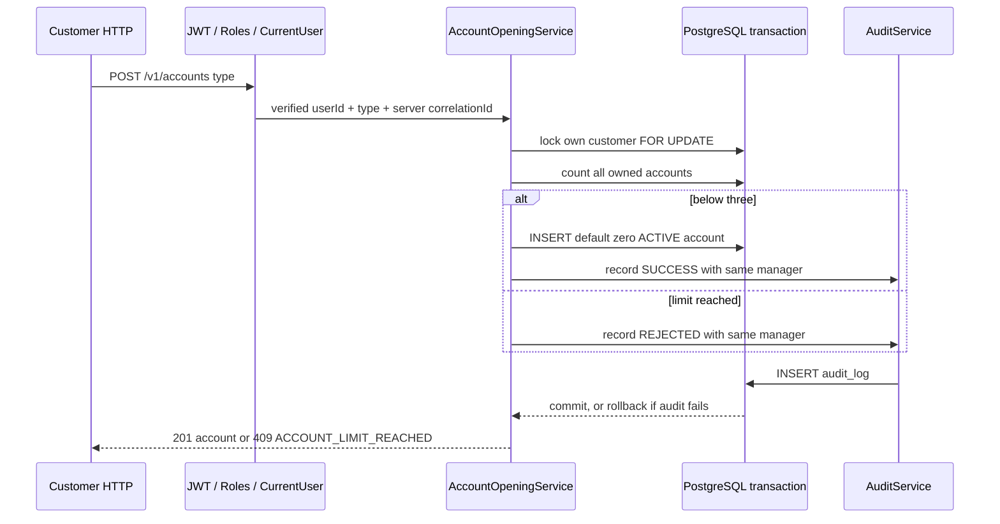
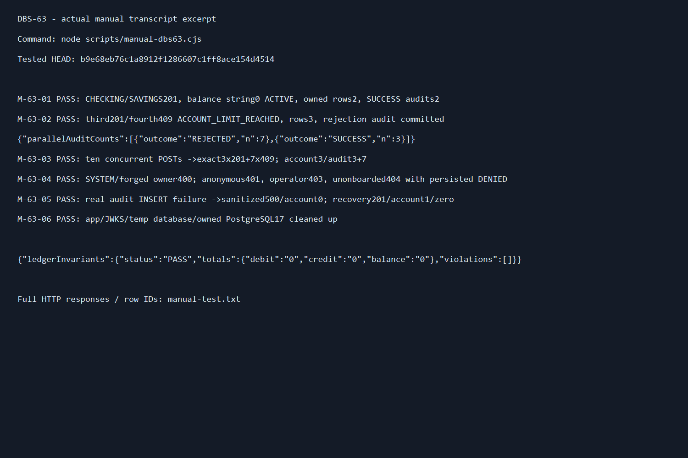

# DBS-63 · UC-2 open customer accounts

Status: Rebased onto main2df7d0a after DBS-62 merge; main-based Draft PR/CI in progress, Dev review/merge pending BL-145. Owner: Dev. Updated 2026-11-06.

## 1. Context and scope

Board: Week2, Story, Dev, Highest, In Progress. Exact DoD: open CHECKING/SAVINGS inside a transaction locking the customers row; at least5 concurrent requests create exactly3 accounts, others ACCOUNT_LIMIT_REACHED; audit, initial balance0, SYSTEM forbidden; CI green, Dev review, PR merged and complete test mapping.

Dependencies now on main: DBS-55 PR33; DBS-62 [PR56](https://github.com/Lawliet119/digital-banking-simulator/pull/56) merged2026-11-06 at689a8e85831f1ff6c9c51b8aeef66a4ba1f73caa. Historical implementation started before that merge; main then a9e607b lacked onboarding. Branch feat/DBS-63-open-accounts starts from current main; User explicitly approved using the real DBS-62 branch temporarily on2026-11-04. No fake onboarding or SQL customer seed. Fast-forwarded to DBS-62 at7d41a51; keep DBS-63 commits separate, then rebase only those commits onto main after PR56 merges before opening a main-based PR. No board edits or merges by agent.

Scope is POST /v1/accounts (UC-2, FR-ACC-01, BR-14), zero balance creation plus audit. No balance mutation, deposit/transfer, new account-number field, schema/env/dependency/ErrorCode changes, lock/unlock API, list/balance API, or event contract extension. Account creation is a new resource per request (until3), not transfer/deposit idempotency. Existing gaps BL-112/121 test timing and BL-130/132 identity/global-role audit are reported and remain with their owners. BL-017 application-role test harness is not claimed solved. BL-122 ledger callers/BL-008 money lint remain out of scope.

## 2. Behaviour and HTTP contract

POST /v1/accounts, existing global JWT/role guards, @Roles('customer'). Request exactly {"type":"CHECKING"} or {"type":"SAVINGS"}; IsIn only these two values, forbid extra owner/balance/status/id fields. Missing/null/non-string/lowercase/SYSTEM/SQL-like type ->400. Caller internal users.id only from @CurrentUser, server correlationId required from middleware.

201 response {"id":"<uuid>","type":"CHECKING","status":"ACTIVE","balance":"0","createdAt":"<ISO UTC Z>","updatedAt":"<ISO UTC Z>"}. Both labels behave identically. All accounts belonging to the customer count toward3, including LOCKED. No application balance conversion to Number; SQL DEFAULT0/ACTIVE used, money serialized as string. A fourth valid request ->409 with existing errorCode ACCOUNT_LIMIT_REACHED. The rejection is audited REJECTED and COMMITTED before throwing409; no extra account. Invalid DTO400 happens before service; global guard401 UNAUTHENTICATED/TOKEN_EXPIRED or403 FORBIDDEN use current contracts (role DENIED persistence remains BL-132).

Authenticated customer without onboarding ->404 (no new ErrorCode). Service returns missing from its first transaction; outside its callback calls real AuditService.recordDenied in its own transaction, action account.open, target {type:'user',id:callerUserId}, metadata{id:callerUserId}, then throws404. No nonexistent account/customer id invented. If denial audit fails,500 instead of clean404.

Audit SUCCESS action account.open targets {type:'account',id:newAccountId}, metadata{id:newAccountId}, actor verified internal userId, role customer, correlationId server UUID. Limit REJECTED same action targets {type:'customer',id:customerId}, metadata{reason:ACCOUNT_LIMIT_REACHED,count:actualCount}. Audit errors propagate and rollback insert/rejection; unexpected audit trigger errors produce sanitized500, while transient PostgreSQL errors (including lock timeout) use the existing filter's503 SERVICE_TEMPORARILY_UNAVAILABLE plus Retry-After. The same mapping applies to a denial-audit transaction. No SQL/token/PII echoed. No AccountCreated event in accepted contract; no invented event/outbox insertion.

## 3. Architecture and locking

New module-private AccountOpeningService and AccountsController/CreateAccountDto/OpenedAccountDto in accounts module. Keep exported AccountsService and its callers/signatures unchanged. Reuse real TransactionService, AuditModule/AuditService from actual dependencies. Register controller/service in AccountsModule; api/both via current registry, worker does not expose HTTP.

open(userId,type,correlationId): tx.run READ COMMITTED -> SELECT id FROM customers WHERE user_id=$1 FOR UPDATE -> if missing return missing -> SELECT count(*)::int AS count FROM accounts WHERE customer_id=$1 (all types/statuses) -> count>=3: audit REJECTED same manager, return limit -> else INSERT accounts(customer_id,type) VALUES($1,$2) RETURNING id,type,status,balance::text,... -> audit SUCCESS same manager -> return created. After tx commit: map created to201, limit to409, missing to separate DENIED audit then404. Never recordDenied inside transaction (PR54 nested-transaction protection). Do not catch a failed statement to keep using aborted transaction. No additional retry loop; tx wrapper handles deadlock/serialization.

Parent row lock serializes ONLY the same customer's openings, then a fresh statement snapshot sees prior committed accounts. Other customers are independent. Every production opening path must use this protocol; direct administrator SQL remains outside API guarantee. No account/ledger row locks needed to initialize a new zero balance account. No external I/O inside transaction. Missing server correlation context is programmer error500 before SQL.

## 4. Automated cases

Full HTTP/auth-to-PostgreSQL tests in test/db/account-opening.db-spec.ts, reusing real DBS-62 startOnboardingApp, JWT issuer, migrations and temporary DB. Customer profiles created through actual onboarding HTTP, accounts only via the new API (no SQL balance/ledger seed). Pool30; Promise.all sends10 requests without awaiting each. Assert ledger invariants PASS after each business case; no funding or ledger changes. Fault trigger only in this suite's owned database, always removed in finally.

| Case | Expected and proof | Trace |
|---|---|---|
| TC-63-01 | CHECKING/SAVINGS201, exact DTO, zero string, ACTIVE, UUID/timestamps, correct own DB FK and SUCCESS audit actor/role/target/server correlationId, metadata onlyid | DoD1/3, FR-ACC-01 |
| TC-63-02 | Three sequential opens201, fourth409 ACCOUNT_LIMIT_REACHED; count3/zero, REJECTED audit persists with count3 and reason | BR-14, audit |
| TC-63-03 | Ten parallel first opens ->exact3x201+7x409 with correct code; 3 distinct ids/rows/SUCCESS audits,7 REJECTED audits; responses' correlation IDs match audits | DoD2 |
| TC-63-04 | Two customers each receive independent limit3, cannot redirect creation with forged owner fields; new request always binds caller | Ownership, BR-10 |
| TC-63-05 | Physically hold one customer's row lock; start API open, poll pg_stat_activity Lock for actual opening query before releasing; no account while blocked. Another customer's open completes while first waits. Release ->first succeeds. A LOCKED existing account still counts toward limit | Required FOR UPDATE, count all statuses |
| TC-63-06 | SYSTEM, other/missing/null/lowercase/SQL-like type and extra customerId/userId/balance/status/id400; no account or money mutation | DoD3, DTO/security |
| TC-63-07 | Missing/expired JWT401 with code, all3 staff roles403; fresh unonboarded customer404 with persisted DENIED audit targeted at user; no account | Role, dependency |
| TC-63-08 | Real audit trigger failure on successful open500 ->account rollback/count0; after trigger removal retry201. Limit audit failure500 leaves3 accounts and no false REJECTED row; denied audit failure500 instead404; recovery consistent | Fail-closed FR-AUD-01/02 |
| TC-63-09 | Swagger customer bearer/type enum/example,201 DTO and400/401/403/404/409/500/503; error409 example ACCOUNT_LIMIT_REACHED,503 SERVICE_TEMPORARILY_UNAVAILABLE with Retry-After | API docs |
| TC-63-10 | Hold actual parent customer lock until configured lock timeout; HTTP503 SERVICE_TEMPORARILY_UNAVAILABLE + Retry-After, no account/SUCCESS audit. Release lock, retry201, invariants PASS. No artificial sleep or timeout override; wait for real DB refusal | ADR-04, transient recovery |
| Process | Main-based Draft PR, actual CI checks, complete mapping; Dev review/merge remain backlog until proven | DoD4 |

Money fields never number, fraud fields absent, correlationId in problem responses, all SQL parameterized. No new resource path accepts another owner's UUID. Revocation remains real Identity guard. Idempotency-Key is not applicable: FR-LED-05 covers deposit/transfer, not account opening. TLS/env/secrets config unchanged; local owned Testcontainers only.

## 5. Manual script (before implementation)

Keep backend/scripts/manual-dbs63.cjs, run from backend after build with node scripts/manual-dbs63.cjs. Owned PostgreSQL17+temp database, actual migrations/auth/onboarding/accounts/audit, local public JWKS only; tokens/credentials never printed. Demo names Vietnamese, output real HTTP status/body/correlation IDs and safe counts/invariant result. First transcript line tested code SHA. All cleanup in finally.

| Step | Action -> expected |
|---|---|
| M-63-01 | Actual JWT, onboarding Nguyen demo profile, open CHECKING/SAVINGS ->201 zero ACTIVE and2 SUCCESS audits; DB ownership/invariants PASS |
| M-63-02 | Third open201/fourth409 ACCOUNT_LIMIT_REACHED ->3 accounts, committed REJECTED audit, balances zero |
| M-63-03 | Fresh demo profile,10 simultaneous first POSTs ->3 success7 rejection; count3/audit3+7/invariants PASS |
| M-63-04 | SYSTEM/forged owner400, no JWT401, operator403, unonboarded404 with DENIED audit; no account mutation |
| M-63-05 | Actual audit failure trigger, fresh profile open500/count0; recover/retry201; invariant PASS |
| M-63-06 | app/JWKS/temp DB/container cleanup ->no owned handles; retain raw transcript/screenshot and SHA |

## 6. Design review

First independent review: REVISE with1 should-fix: distinguish unexpected500 from transient503 and test parent-lock timeout/recovery. Addressed in section2 and TC-63-09/10. Final re-review APPROVE, no remaining findings. Read-only reviewer inherited Codex model, no override. [Round1](screenshots/DBS-63/domain-review-round1.md), [final raw reply](screenshots/DBS-63/domain-review.md).

## 7. Implementation plan

1. Resolve dependency choice; actual DBS-62 base only if explicitly approved. Retain separate DBS-63 commits.
2. Write HTTP/PostgreSQL cases first; run and record red404 for missing POST /v1/accounts.
3. Add DTO, module-private opening service with parent lock/count/insert/audit, controller and module registration. No public primitive signature changes.
4. Prove concurrency, actual lock blocking/isolation, audit commit/rollback/denial, auth/validation/OpenAPI; lint/typecheck/build/unit/e2e and relevant real DB suites. Reuse exact preceding dependency baseline checks for identical source where applicable; disclose known BL-112 local unit timing failure rather than claim green baseline.
5. Manual driver on final code commit, all six steps and actual screenshot/transcript; invariant checker after business cases.
6. Update Accounts README, docs03 POST contract, feature index/backlog and test mapping; doc link check. Commit/push per user's existing workflow. Main-based Draft PR after DBS-62 merge, then actual final CI; no stacked PR silently created.

Rollback: remove DBS-63-only commits; no schema/data teardown or shared DB revert. No migration needed. Parent locking assumes all customer-account creation follows this service; count is not a schema invariant and administrator SQL is not covered.

## 8. Results / handoff

Implemented AccountOpeningService, AccountsController and DTOs; registered in the real AccountsModule. New HTTP/PostgreSQL suite has10 cases, all passed. Four related DB suites75/75 passed (42.017s), including actual onboarding/AccountsService/AuditService. Full unit55 suites826/826 passed (190.029s); full E2E13 suites135/135 passed (158.212s). Lint/typecheck/build passed. Manual6/6 passed on code commit. No skipped task tests. Full DB suite not rerun; the four related PostgreSQL suites cover affected modules. Doc links202 files/0 broken.

Test-first evidence: after fixing a TypeScript test-helper signature (unknown body vs Supertest object), all10 tests failed as expected because POST /v1/accounts was absent (404, no OpenAPI route). Production code was written after that red run; all10 passed, then strengthened concurrent audit actor/target assertions and reran related suites75/75.

User's existing request skips gate pauses, not design review/tests/evidence. No human gate approval claimed. Existing known handoffs BL-112/121/130/132/017/122/008 remain; process dependency/PR handoff gets next free BL id at delivery if still pending.

Initial checks on main a9e607b: docker compose up -d succeeded (all3 local services running); local lint:check/typecheck passed; main CI [41840640181](https://github.com/Lawliet119/digital-banking-simulator/actions/runs/41840640181) has6 required jobs green. Main branch deliberately has no onboarding; User explicitly approved temporary DBS-62 source via the dependency question on2026-11-04; branch fast-forwarded to7d41a51 before implementation. Separate DBS-63 branch published at handover; no PR before dependency merge, shared status edit, or test stub.

Implementation commit `eb645902758d0f6d885fa3d494aa797d33bf321d`. Manual driver executed on that commit; [raw transcript](screenshots/DBS-63/manual-test.txt), [verification summary](screenshots/DBS-63/verification.txt), [prepared PR mapping](screenshots/DBS-63/pr-description.md).

| Case / DoD | Evidence in account-opening.db-spec.ts | Result |
|---|---|---|
| TC-63-01 / DoD1/3 | Both labels, own FK, zero string/ACTIVE, exact SUCCESS audit | Matched |
| TC-63-02 / BR-14 | Third201/fourth409 and committed REJECTED audit | Matched |
| TC-63-03 / DoD2 | 10 simultaneous first requests; exactly3 distinct accounts/7 correct409; every audit actor,target,metadata,correlation verified | Matched |
| TC-63-04 / ownership | Independent limits for two customers; forged owner400 | Matched |
| TC-63-05 / locking | Observe actual pg_stat_activity Lock; other customer proceeds; LOCKED account counted (status-only SQL input fixture, no balance seed) | Matched |
| TC-63-06 / DoD3 | SYSTEM/bad types and privileged extra fields400, no accounts | Matched |
| TC-63-07 / security | Real JWT/roles,401 codes, staff403; missing profile404 and DENIED survives | Matched |
| TC-63-08 / atomic audit | DB trigger fails audit INSERT; success/rejection/denial500, account rollback and subsequent recovery | Matched |
| TC-63-09 / OpenAPI | Allowed enum, DTO/example, bearer role, success and errors incl503 | Matched |
| TC-63-10 / recovery | Real parent-lock timeout503 stable code/Retry-After, no account/audit, release/retry201 | Matched |
| DoD4 / process | BL-145 | Main-based PR/CI/Dev review/merge pending, not claimed complete |

All business cases end with actual ledger-invariant checker PASS, zero violations. Only account initialization at default zero; no funds moved, deposits/transfers synthesized or balance UPDATE.

| Manual step | Actual result on code commit |
|---|---|
| M-63-01 | CHECKING and SAVINGS201, zero string/ACTIVE; rows2/audit SUCCESS2, invariants PASS |
| M-63-02 | Third201/fourth409; count3, REJECTED audit committed, invariants PASS |
| M-63-03 | 10 real parallel POSTs ->3 success7 rejection; actual audit counts3+7, invariants PASS |
| M-63-04 | SYSTEM/forged owner400;401/403; missing onboarding404 with stored DENIED; invariants PASS |
| M-63-05 | Audit trigger fault500 rolls back account; remove trigger/retry201, zero, invariants PASS |
| M-63-06 | App/public JWKS/temp DB/owned PostgreSQL container cleaned up |

Historical BL-145 dependency handoff is now resolved by rebase after PR56 merge; current PR/CI/review state is recorded in the final handover below. No PR against dependency branch, board edit or auto-merge. BL-145 remains open only for final CI/Dev review/merge.

Historical pre-merge fetch2026-11-04: PR56 was still open/unmerged and origin/main a9e607b. [Published DBS-63 branch](https://github.com/Lawliet119/digital-banking-simulator/tree/feat/DBS-63-open-accounts). At that historical handoff no GitHub CI/Dev review/merge was claimed for DBS-63; see current handover below. Delivery checklist: design/re-review APPROVE, all ten planned cases matched, local automated checks and six manual steps complete; raw output inspected for credential markers and screenshot visually checked; source SHA recorded; no schema/env/dependency/ErrorCode/ADR/event change. Current final CI and Dev review/merge tracked in BL-145; main PR is now authorized by the follow-up request.

## 9. Sources and changed docs

Exact sheet DBS-63; docs02 UC-2, FR-ACC-01, BR-14, FR-AUD-01/02; docs03 API/error table; shared database-design4.2, event-contract; Accounts/Audit README, actual schema/TransactionService/AuditService, CONTRIBUTING5/5b. Updated Accounts README and docs03 POST API contract, this feature doc, feature index, BACKLOG BL-145 and raw review/test/manual evidence. Public primitive exports and schema unchanged.

## Rebase and final handover ? 2026-11-06

User requested completion after DBS-62 merge. Independently verified PR56 merged into main689a8e8 (GitHub API), then replayed ONLY commits after7d41a51 onto main2df7d0a. Rebasing application code/tests/manual driver caused no conflicts and byte-for-byte task source is unchanged. Resolved BACKLOG/feature-index conflicts by retaining main rows plus DBS63 own row; no duplicate DBS62 row or inherited commits in PR. Rebased source commit a69bfcf; tested tree/manual HEAD b9e68eb includes only later documentation. Manual re-executed6/6 on that exact tree, raw firstline SHA records it. Automated check results, new PR and final CI appended below once observed. No human Dev review/merge claimed; board changes remain with user.

Rebased-tree checks2026-11-06: lint/typecheck/build PASS; full unit56 suites832/832 PASS(50.551s), full e2e13 suites135/135 PASS(83.168s), manual6/6 PASS at b9e68eb. Initial related-DB command had a filename typo(audit-service instead of actual audit.service),62 actual cases passed but command failed ENOENT; corrected command rerun and final result recorded below. Never treated ENOENT as suite success. No task test skips.

Final corrected related-DB command: four suites75/75 PASS(10.185s), including all10 account-opening cases and real parent-lock503/recovery. Full DB suite remains for PR CI; selected75 not claimed fullDB.

Opened [Draft PR58](https://github.com/Lawliet119/digital-banking-simulator/pull/58), base **main**. Final required jobs lint/typecheck/build/unit/e2e/db tracked in [Checks](https://github.com/Lawliet119/digital-banking-simulator/pull/58/checks); actual result verified before handover. Local checks above do not replace CI. Another Dev review and merge pending BL-145. User can move board to In Review after this main-based handover; agent does not edit sheet or merge. Final docs link check209 files0broken.
