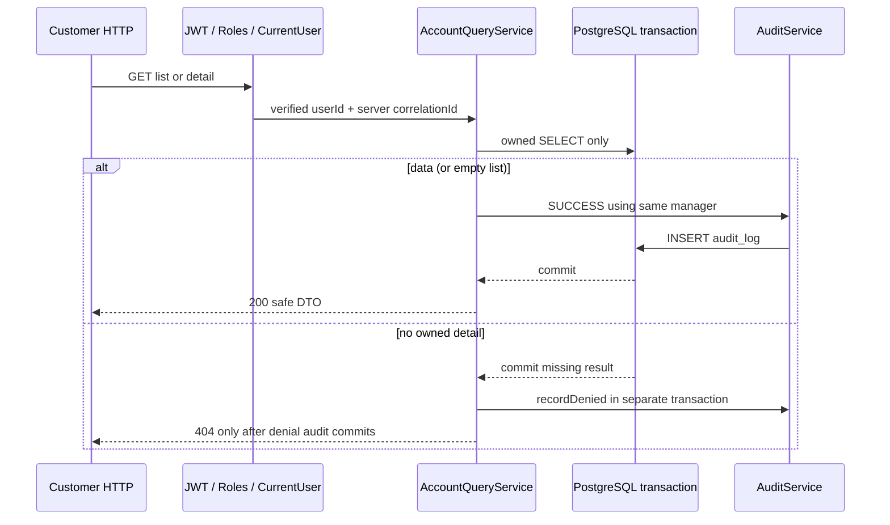

# DBS-64 · UC-4 own accounts and balance reads

Status: Implementing on user-approved temporary DBS-63 base24d33f4. Owner Dev, updated2026-11-04.

## 1. Context and scope

Exact sheet: Week2 Story Dev High In Progress. Dependencies DBS-63 In Progress, DBS-22 Done. DoD: own account list and single-account GET with balance string; foreign account404 (broader ownership framework DBS-86); no Redis balance cache; preliminary small-data read p95<150ms; main PR/CI/Dev review/merge and complete test mapping.

Main a9e607b lacks onboarding/account-opening endpoints. Actual DBS-63 branch24d33f4 contains real DBS-62+63; DBS-62 Draft PR56 is open. User explicitly approved using DBS-63 temporarily via the dependency question. Branch feat/DBS-64-read-accounts starts from main. Fast-forwarded to actual DBS-63 at24d33f4; retain separate64 commits, rebase only64 onto main after dependency merges; main-based PR then. No fake onboarding, opening or ledger services.

Deliver GET /v1/accounts and GET /v1/accounts/:id, customer only. No new schema/env/dependency/ErrorCode/ADR/events, money mutation, deposit/transfer API, Redis adapter or general ownership-guard framework. Existing public AccountsService.getOwnedAccount remains unchanged: it queries outside a caller transaction and does not record audit, so this module-private query service uses owned SQL and audit through one transaction manager. Callers inventoried: primitive DB tests/manual driver only, no production callers. No exported symbol change.

Existing handoffs: BL-112/121 local timing, BL-017 DB roles, BL-130/132 identity/global role denial, BL-008 money lint, BL-122 ledger integration. DBS-86 owns broader ownership consolidation, but64 fully filters ownership for both new endpoints. Nonzero/above2^53 HTTP balance roundtrip waits for actual deposit flow (DBS-60); never fabricate money via SQL/test ledger stub. Test canonical large bigint projection/DTO mapping separately, mark shallower proof and hand off actual nonzero API roundtrip explicitly. Core balance-string endpoint cases use actual zero accounts created by real63 API.

## 2. Behaviour

GET /v1/accounts ->200 bare array sorted by created_at ASC,id ASC; only accounts JOIN customers WHERE user_id=verified internal caller id. Include CHECKING/SAVINGS and ACTIVE/LOCKED. No profile/no account ->[]. Ignore owner query params as selectors; they cannot override caller. Max3 under opening protocol, no pagination needed for this bounded list; no artificial LIMIT hiding existing accounts.

GET /v1/accounts/:id ->200 own account, same DTO {id,type,status,balance,createdAt,updatedAt}. Balance canonical string via @common/money parseBalance/formatBalance, no Number/parseFloat; created/updated ISO UTC. No user/customer ids, names or fraud data in DTO. Missing, foreign, SYSTEM, malformed UUID all same404 Account not found with existing problem envelope, no new errorCode. Case-insensitive UUID normalized. No ParseUUIDPipe400: invalid id follows uniform404, never echoed into detail/audit metadata. JWT absent/expired401 with existing codes, staff403 FORBIDDEN. Server middleware correlationId required.

Audit before exposing sensitive balance: list action account.list SUCCESS, target user/callerId, metadata{count:rows.length}; detail account.read SUCCESS target account/id, metadata{id}. Same manager/transaction as SELECT; errors propagate, unexpected500 sanitized, transient503 SERVICE_TEMPORARILY_UNAVAILABLE + Retry-After. No successful body if audit INSERT/COMMIT fails.

Detail no owned row: tx returns missing and commits; outside callback call real AuditService.recordDenied before404. Valid UUID target account/normalized requestedid, metadata{reason:NOT_OWNER}; malformed id target user/callerId with same closed reason (never store raw invalid path). Missing/foreign/SYSTEM indistinguishable externally; audit denial transaction survives404 and failure gives500/503 instead of clean404. Global role-denial audit remains BL-132.

Read current committed PostgreSQL state on every request; no Redis/cache interface or balance memoization. No row locks needed for snapshot reads, READ COMMITTED. Each statement returns a committed balance at SELECT time, not a promise that it cannot change before HTTP delivery.

## 3. Architecture

New module-private AccountQueryService injecting real TransactionService and AuditService; methods list(userId,correlationId), get(userId,accountId,correlationId). AccountsController gains GET decorators plus injected query provider; opening route unchanged. New AccountViewDto/row mapper supports both statuses. AccountsModule adds query provider. Public AccountsService, AccountOpeningService, shared money API untouched.

SELECT explicit safe columns a.id,type,status,balance::text,created_at,updated_at FROM accounts a JOIN customers c ON c.id=a.customer_id WHERE c.user_id=$1 [AND a.id=$2::uuid]. Parameterized, never access foreign row then filter in JS. INNER JOIN excludes SYSTEM. Mapper validates/formats through existing money library. List audit stored once per response, not once per account; empty list audited. Detail's denial recorded outside tx per actual AuditService PR54 protection. No Redis import/injection/network use.

## 4. Cases and depth

Real HTTP/JWT/PostgreSQL cases test/db/account-reads.db-spec.ts reuse actual63 onboarding/opening APIs and startOnboardingApp (pool30), migrations/temp DB cleanup. No SQL balance/ledger seed. Real invariant checker PASS after each business case; a status-only input fixture may set LOCKED, never changes balance. Mapper unit test file covers mathematical bigints, invalid/numeric input and strict safe DTO shape; actual PostgreSQL SELECT bigint projection at >2^53 plus mapper proves PG->mapper only, not balance API roundtrip. Label this limitation explicitly.

| Case | Proof | Trace |
|---|---|---|
| TC-64-01 | Own list200 exact safe DTOs/zero string, CHECKING+SAVINGS, deterministic order, no other owner's accounts; list audit actor/role,target/count/correlation | DoD1, FR-ACC-02, audit |
| TC-64-02 | Own detail200 matches list; uppercase UUID accepted; correct SUCCESS account.read audit; LOCKED included; repeated GET after committed status change reflects DB | DoD1, fresh reads |
| TC-64-03 | Foreign/missing/SYSTEM/malformed IDs404 same sanitized shape except correlationId; real stored DENIED per request with actor and target; no token/path PII | DoD2, BR-10 |
| TC-64-04 | Empty owner and unonboarded list[] audited; forged owner query never selects another user; no state/money mutation | Ownership |
| TC-64-05 | Actual missing/expired JWT401, operator/auditor/admin403 on BOTH list/detail | Roles |
| TC-64-06 | Real audit INSERT trigger fault: own list/detail500 without balances, missing detail500 instead404; remove trigger, success/denial recover. No false SUCCESS row for failed calls | Fail-closed |
| TC-64-07 | Mapper exact0/9007199254740993/max signed-bigint; PostgreSQL SELECT $1::bigint->mapper exact string; non-string/bad number rejected. Not claimed API nonzero roundtrip | Money precision (partial layer) |
| TC-64-08 | OpenAPI GET paths bearer, safe DTO examples, both status enums,200/401/403/404/500/503; problem errors current contract | API docs |
| TC-64-09 | Many parallel reads for different owners retain correct ids/balances and each request's audit/correlation; no cross-user context leakage | Isolation |
| TC-64-10 | Small-data HTTP benchmark in manual driver, warmup10 per route+100 measured per route, latency covers JWT/DB/audit/response; p95 nearest-rank, raw samples/environment/status stored; compare <150ms | DoD3, measurement not fixed Jest timing assertion |
| Process | Actual main-based PR/CI/Dev review/merge after dependency lands | DoD4 |

Security: current guards/revocation unchanged, no owner accepted from request body/query, no generic ownership stub, no cache, parameterized SQL and UUID check, safe response whitelist and audit metadata ids/codes/count only. Non-mutating reads need no Idempotency-Key or outbox. Unexpected errors sanitized by real ProblemDetailsFilter, transient errors preserve503+Retry-After. TLS/env unchanged.

## 5. Manual run plan

Implement backend/scripts/manual-dbs64.cjs, invoke from backend with node scripts/manual-dbs64.cjs on final code commit. Own PostgreSQL17 and temp database, actual migrations/JWT/onboarding/opening/query/audit, public JWKS only; always cleanup. Print tested SHA first, real HTTP responses/server correlation IDs, safe query counts and invariants, never tokens/connection credentials.

| Step | Action -> observable expected |
|---|---|
| M-64-01 | Real customer onboarding/open3; list/detail200 zero string, matching DTO/own ids; SUCCESS audits, invariants PASS |
| M-64-02 | Other customer list isolated, foreign/SYSTEM/missing/malformed detail404 with stored DENIED; unauthenticated401/operator403 |
| M-64-03 | Empty list[], forged owner selector ignored; committed status-only LOCKED fixture visible on next GET; no balance cache code path |
| M-64-04 | Real audit fault trigger: list/detail500 without balances; remove trigger, GET recovers; invariant PASS |
| M-64-05 | Once other heavy tests finish, warm10 then100 measured sequential HTTP reads for each route against3 accounts. Log individual sample milliseconds and p95, real status200. Include JWT verification and audit commit. Threshold150ms; report actual pass/fail, never infer from code or remove slow samples. Preliminary local baseline, not production/load SLO evidence |
| M-64-06 | close app/remove JWKS/drop owned temp DB/stop owned container, retain transcript/screenshot. Nonzero financial roundtrip explicitly not run pending real deposit API |

If p95 misses target, report and investigate PostgreSQL/audit/request overhead before claiming completion; no hardcoded results or changes to threshold. No Redis provider exists in the read service: review its dependency boundary; do not stop shared Valkey as misleading proof of a cache integration not present on this base.

## 6. Review

Independent read-only reviewer (inherited Codex model, no override): APPROVE with no verified findings. [Raw reply](screenshots/DBS-64/domain-review.md). No human gate approval claimed.

## 7. Plan

1. Read exact task/docs/callers/backlog and resolve dependency choice; no dependent implementation before answer. Reuse immediately preceding exact-base baseline where identical:63 code has unit826/e2e135/relatedDB75/manual6 all passed. Main CI6 green; do not claim new64 checks from old evidence.
2. Fresh design review; save raw reply/fix findings/re-review if needed.
3. Write tests first, execute missing GET404 red, then add AccountViewDto/mapper, AccountQueryService and AccountsController/Module additions.
4. Prove owned reads/audit/denial/faults and money boundaries at permitted depth; lint/typecheck/build, full unit/e2e, related real PostgreSQL suites. No financial SQL seed or fake ledger endpoint to bypass DBS-60.
5. Commit code, execute all manual steps/latency sampling on final SHA after heavy tests; raw output and actual screenshot, compare p95.
6. Update Accounts README/docs03 GET table, feature index/BACKLOG, case mapping/depth. Commit/push per prior authorized workflow; after dependency merge rebase only64, rerun affected checks/manual, main Draft PR and CI. No auto-merge or board edit.

Files: query service, account-view DTO/mapper/unit tests, existing AccountsController/Module, new DB suite and manual driver; Accounts README, docs03, feature doc/index/backlog/evidence. No public primitive signature changes. Roll back64-only commits; no schema or shared-data rollback. Risks: identity/audit overhead affects p95; nonzero balance API proof waits for real ledger flow, tracked separately rather than fabricated.

## 8. Results and handoffs

Implemented AccountQueryService, safe AccountViewDto/mapper and the two GET controller methods, registered the provider. Existing opening route and public primitives unchanged. Initial red run8 failed/1 passed: reads returned404 because routes were absent; the passing case only proved PostgreSQL bigint projection. After implementation9/9 PostgreSQL cases passed (12.999s), including added real PG projection-to-mapper assertion. Mapper unit tests were written before implementation; their results included in the final unit verification. No skipped cases or human gate approvals claimed.

Current automated verification: lint/typecheck/build passed;56 unit suites834/834 passed (117.624s), including8 mapper boundary/privacy cases. Five related real PostgreSQL suites84/84 passed (43.461s); full DB suite not rerun. Full E2E/manual/benchmark results recorded at handover after execution. No result inferred from implementation.

Initial independent work: exact task/dependencies fetched; main a9e607b lacked opening/onboarding and PR56 remained unmerged. docker compose up -d and local main lint/typecheck passed; design and10 planned cases reviewed APPROVE. User then explicitly approved temporary DBS-63 source, branch fast-forwarded to24d33f4 before code. No dependency stub or shared status update. User requests no gate pauses; no claim of human gate approval.

BL-146 tracks main-based PR, actual CI, Dev review and merge after dependency. BL-147 tracks real nonzero/above2^53 HTTP roundtrip with actual deposit flow; unit/projection evidence is explicitly shallower, not substituted for that flow. Existing gaps in section1 remain; no backlog row closed by64.

## 9. Sources and changed docs

Sheet DBS-64; docs02 UC-4/FR-ACC-02/FR-ID-04/BR-10/FR-AUD-02, docs03 API/read-cache/performance tables; database-design accounts; ADR-07 money; accounts/audit README and actual64 dependency code, CONTRIBUTING5/5b. Feature doc written before production implementation.
