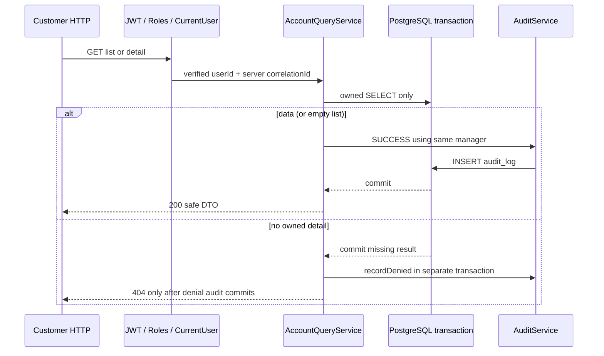
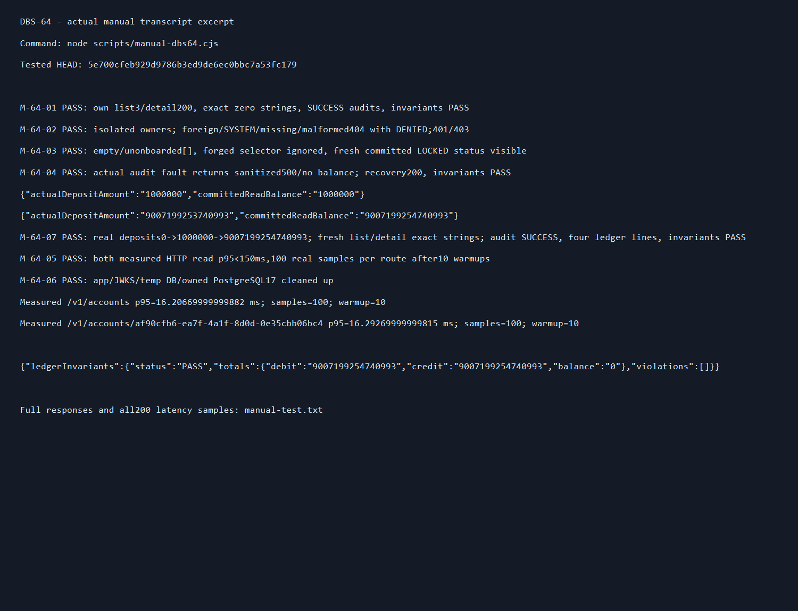

# DBS-64 · UC-4 own accounts and balance reads

Status: Đã rebase phần DBS-64 lên main sau khi DBS-63 merge; [Draft PR66](https://github.com/Lawliet119/digital-banking-simulator/pull/66), final CI trong Checks; chờ Dev review/merge BL-160. Owner Dev, cập nhật2026-11-07. Các kết quả2026-11-04 bên dưới là lịch sử; kết quả bàn giao mới nằm cuối tài liệu.

## 1. Context and scope

Exact sheet: Week2 Story Dev High In Progress. Dependencies DBS-63 In Progress, DBS-22 Done. DoD: own account list and single-account GET with balance string; foreign account404 (broader ownership framework DBS-86); no Redis balance cache; preliminary small-data read p95<150ms; main PR/CI/Dev review/merge and complete test mapping.

Main a9e607b lacks onboarding/account-opening endpoints. Actual DBS-63 branch24d33f4 contains real DBS-62+63; DBS-62 Draft PR56 is open. User explicitly approved using DBS-63 temporarily via the dependency question. Branch feat/DBS-64-read-accounts starts from main. Fast-forwarded to actual DBS-63 at24d33f4; retain separate64 commits, rebase only64 onto main after dependency merges; main-based PR then. No fake onboarding, opening or ledger services.

Deliver GET /v1/accounts and GET /v1/accounts/:id, customer only. No new schema/env/dependency/ErrorCode/ADR/events, money mutation, deposit/transfer API, Redis adapter or general ownership-guard framework. Existing public AccountsService.getOwnedAccount remains unchanged: it queries outside a caller transaction and does not record audit, so this module-private query service uses owned SQL and audit through one transaction manager. Callers inventoried: primitive DB tests/manual driver only, no production callers. No exported symbol change.

Existing handoffs: BL-112/121 local timing, BL-017 DB roles, BL-130/132 identity/global role denial, BL-008 money lint, BL-122 ledger integration. DBS-86 owns broader ownership consolidation, but64 fully filters ownership for both new endpoints. Nonzero/above2^53 HTTP balance roundtrip waits for actual deposit flow (DBS-60); never fabricate money via SQL/test ledger stub. Test canonical large bigint projection/DTO mapping separately, mark shallower proof and hand off actual nonzero API roundtrip explicitly. Core balance-string endpoint cases use actual zero accounts created by real63 API.

## 2. Behaviour

GET /v1/accounts ->200 bare array sorted by created_at ASC,id ASC; only accounts JOIN customers WHERE user_id=verified internal caller id. Include CHECKING/SAVINGS and ACTIVE/LOCKED. No profile/no account ->[]. Ignore owner query params as selectors; they cannot override caller. Max3 under opening protocol, no pagination needed for this bounded list; no artificial LIMIT hiding existing accounts.

GET /v1/accounts/:id ->200 own account, same DTO {id,type,status,balance,createdAt,updatedAt}. Balance canonical string via @common/money parseBalance/formatBalance, no Number/parseFloat; created/updated ISO UTC. No user/customer ids, names or fraud data in DTO. Missing, foreign, SYSTEM, malformed UUID all same404 Account not found with existing problem envelope, no new errorCode. Case-insensitive UUID normalized. No ParseUUIDPipe400: invalid id follows uniform404, never echoed into detail/audit metadata. JWT absent/expired401 with existing codes, staff403 FORBIDDEN. Server middleware correlationId required.

Audit before exposing sensitive balance: list action account.list SUCCESS, target user/callerId, metadata{count:rows.length}; detail account.read SUCCESS target account/id, metadata{id}. Same manager/transaction as SELECT; errors propagate, unexpected500 sanitized, transient503 SERVICE_TEMPORARILY_UNAVAILABLE + Retry-After. No successful body if audit INSERT/COMMIT fails.

Detail no owned row: tx returns missing and commits; outside callback call real AuditService.recordDenied before404. Valid UUID target account/normalized requestedid, metadata{reason:NOT_OWNER}; malformed id target user/callerId with same closed reason (never store raw invalid path). Missing/foreign/SYSTEM indistinguishable externally; audit denial transaction survives404 and failure gives500/503 instead of clean404. Global role-denial audit remains BL-132.

Read current committed PostgreSQL state on every request; no Redis/cache interface or balance memoization. No row locks needed for snapshot reads, READ COMMITTED. Each statement returns a committed balance at SELECT time, not a promise that it cannot change before HTTP delivery.

## 3. Architecture

New module-private AccountQueryService injecting real TransactionService and AuditService; methods list(userId,correlationId), get(userId,accountId,correlationId). AccountsController gains GET decorators plus injected query provider; opening route unchanged. New AccountViewDto/row mapper supports both statuses. AccountsModule adds query provider. Public AccountsService, AccountOpeningService, shared money API untouched.

SELECT explicit safe columns a.id,type,status,balance::text,created_at,updated_at FROM accounts a JOIN customers c ON c.id=a.customer_id WHERE c.user_id=$1 [AND a.id=$2::uuid]. Parameterized, never access foreign row then filter in JS. INNER JOIN excludes SYSTEM. Mapper validates/formats through existing money library. List audit stored once per response, not once per account; empty list audited. Detail's denial recorded outside tx per actual AuditService PR54 protection. No Redis import/injection/network use.

## 4. Cases and depth

Real HTTP/JWT/PostgreSQL cases test/db/account-reads.db-spec.ts reuse actual63 onboarding/opening APIs and startOnboardingApp (pool30), migrations/temp DB cleanup. No SQL balance/ledger seed. Real invariant checker PASS after each business case; a status-only input fixture may set LOCKED, never changes balance. Mapper unit test file covers mathematical bigints, invalid/numeric input and strict safe DTO shape; actual PostgreSQL SELECT bigint projection at >2^53 plus mapper proves PG->mapper only, not balance API roundtrip. Label this limitation explicitly.

| Case | Proof | Trace |
|---|---|---|
| TC-64-01 | Own list200 exact safe DTOs/zero string, CHECKING+SAVINGS, deterministic order, no other owner's accounts; list audit actor/role,target/count/correlation | DoD1, FR-ACC-02, audit |
| TC-64-02 | Own detail200 matches list; uppercase UUID accepted; correct SUCCESS account.read audit; LOCKED included; repeated GET after committed status change reflects DB | DoD1, fresh reads |
| TC-64-03 | Foreign/missing/SYSTEM/malformed IDs404 same sanitized shape except correlationId; real stored DENIED per request with actor and target; no token/path PII | DoD2, BR-10 |
| TC-64-04 | Empty owner and unonboarded list[] audited; forged owner query never selects another user; no state/money mutation | Ownership |
| TC-64-05 | Actual missing/expired JWT401, operator/auditor/admin403 on BOTH list/detail | Roles |
| TC-64-06 | Real audit INSERT trigger fault: own list/detail500 without balances, missing detail500 instead404; remove trigger, success/denial recover. No false SUCCESS row for failed calls | Fail-closed |
| TC-64-07 | Mapper exact0/9007199254740993/max signed-bigint; PostgreSQL SELECT $1::bigint->mapper exact string; non-string/bad number rejected. Not claimed API nonzero roundtrip | Money precision (partial layer) |
| TC-64-08 | OpenAPI GET paths bearer, safe DTO examples, both status enums,200/401/403/404/500/503; problem errors current contract | API docs |
| TC-64-09 | Many parallel reads for different owners retain correct ids/balances and each request's audit/correlation; no cross-user context leakage | Isolation |
| TC-64-10 | Small-data HTTP benchmark in manual driver, warmup10 per route+100 measured per route, latency covers JWT/DB/audit/response; p95 nearest-rank, raw samples/environment/status stored; compare <150ms | DoD3, measurement not fixed Jest timing assertion |
| Process | Actual main-based PR/CI/Dev review/merge after dependency lands | DoD4 |

Security: current guards/revocation unchanged, no owner accepted from request body/query, no generic ownership stub, no cache, parameterized SQL and UUID check, safe response whitelist and audit metadata ids/codes/count only. Non-mutating reads need no Idempotency-Key or outbox. Unexpected errors sanitized by real ProblemDetailsFilter, transient errors preserve503+Retry-After. TLS/env unchanged.

## 5. Manual run plan

Implement backend/scripts/manual-dbs64.cjs, invoke from backend with node scripts/manual-dbs64.cjs on final code commit. Own PostgreSQL17 and temp database, actual migrations/JWT/onboarding/opening/query/audit, public JWKS only; always cleanup. Print tested SHA first, real HTTP responses/server correlation IDs, safe query counts and invariants, never tokens/connection credentials.

| Step | Action -> observable expected |
|---|---|
| M-64-01 | Real customer onboarding/open3; list/detail200 zero string, matching DTO/own ids; SUCCESS audits, invariants PASS |
| M-64-02 | Other customer list isolated, foreign/SYSTEM/missing/malformed detail404 with stored DENIED; unauthenticated401/operator403 |
| M-64-03 | Empty list[], forged owner selector ignored; committed status-only LOCKED fixture visible on next GET; no balance cache code path |
| M-64-04 | Real audit fault trigger: list/detail500 without balances; remove trigger, GET recovers; invariant PASS |
| M-64-05 | Once other heavy tests finish, warm10 then100 measured sequential HTTP reads for each route against3 accounts. Log individual sample milliseconds and p95, real status200. Include JWT verification and audit commit. Threshold150ms; report actual pass/fail, never infer from code or remove slow samples. Preliminary local baseline, not production/load SLO evidence |
| M-64-06 | close app/remove JWKS/drop owned temp DB/stop owned container, retain transcript/screenshot. Nonzero financial roundtrip explicitly not run pending real deposit API |

If p95 misses target, report and investigate PostgreSQL/audit/request overhead before claiming completion; no hardcoded results or changes to threshold. No Redis provider exists in the read service: review its dependency boundary; do not stop shared Valkey as misleading proof of a cache integration not present on this base.

## 6. Review

Independent read-only reviewer (inherited Codex model, no override): APPROVE with no verified findings. [Raw reply](screenshots/DBS-64/domain-review.md). No human gate approval claimed.

## 7. Plan

1. Read exact task/docs/callers/backlog and resolve dependency choice; no dependent implementation before answer. Reuse immediately preceding exact-base baseline where identical:63 code has unit826/e2e135/relatedDB75/manual6 all passed. Main CI6 green; do not claim new64 checks from old evidence.
2. Fresh design review; save raw reply/fix findings/re-review if needed.
3. Write tests first, execute missing GET404 red, then add AccountViewDto/mapper, AccountQueryService and AccountsController/Module additions.
4. Prove owned reads/audit/denial/faults and money boundaries at permitted depth; lint/typecheck/build, full unit/e2e, related real PostgreSQL suites. No financial SQL seed or fake ledger endpoint to bypass DBS-60.
5. Commit code, execute all manual steps/latency sampling on final SHA after heavy tests; raw output and actual screenshot, compare p95.
6. Update Accounts README/docs03 GET table, feature index/BACKLOG, case mapping/depth. Commit/push per prior authorized workflow; after dependency merge rebase only64, rerun affected checks/manual, main Draft PR and CI. No auto-merge or board edit.

Files: query service, account-view DTO/mapper/unit tests, existing AccountsController/Module, new DB suite and manual driver; Accounts README, docs03, feature doc/index/backlog/evidence. No public primitive signature changes. Roll back64-only commits; no schema or shared-data rollback. Risks: identity/audit overhead affects p95; nonzero balance API proof waits for real ledger flow, tracked separately rather than fabricated.

## 8. Results and handoffs

Implemented AccountQueryService, safe AccountViewDto/mapper and the two GET controller methods, registered the provider. Existing opening route and public primitives unchanged. Initial red run8 failed/1 passed: reads returned404 because routes were absent; the passing case only proved PostgreSQL bigint projection. After implementation9/9 PostgreSQL cases passed (12.999s), including added real PG projection-to-mapper assertion. Mapper unit tests were written before implementation; their results included in the final unit verification. No skipped cases or human gate approvals claimed.

Final automated verification: lint/typecheck/build passed;56 unit suites834/834 passed (117.624s), including8 mapper boundary/privacy cases. Five related real PostgreSQL suites84/84 passed (43.461s); full DB suite not rerun. Full E2E13 suites135/135 passed (226.543s). No skipped task tests. No result inferred from implementation.

Initial independent work: exact task/dependencies fetched; main a9e607b lacked opening/onboarding and PR56 remained unmerged. docker compose up -d and local main lint/typecheck passed; design and10 planned cases reviewed APPROVE. User then explicitly approved temporary DBS-63 source, branch fast-forwarded to24d33f4 before code. No dependency stub or shared status update. User requests no gate pauses; no claim of human gate approval.

BL-160 tracks main-based PR, actual CI, Dev review and merge after dependency. BL-147 tracks real nonzero/above2^53 HTTP roundtrip with actual deposit flow; unit/projection evidence is explicitly shallower, not substituted for that flow. Existing gaps in section1 remain; no backlog row closed by64.

Code commit `9660737906d2526759202269e8f2b2be362165bc`. Executed `node scripts/manual-dbs64.cjs` from backend after all heavy tests finished. [Raw output](screenshots/DBS-64/manual-test.txt), [verification](screenshots/DBS-64/verification.txt), [prepared PR mapping](screenshots/DBS-64/pr-description.md). Transcript first line matches code SHA; tokens/credentials markers checked absent. Six manual steps executed, no skipped manual step beyond the separately disclosed nonzero financial roundtrip.

| Case | Actual proof | Depth |
|---|---|---|
| TC-64-01 | Real HTTP list own3, exact safe fields/order, list SUCCESS audit bound actor/count/server correlationId | Matched |
| TC-64-02 | Detail equals list, uppercase UUID, actual SUCCESS audit, next read reflects committed LOCKED fixture | Matched for committed status/zero balance; nonzero freshness BL-147 |
| TC-64-03 | Foreign/missing/SYSTEM/malformed uniform404; persisted DENIED with safe target/reason, invalid path not recorded | Matched |
| TC-64-04 | Empty/unonboarded[], ignored forged owner selectors, per-request list audit | Matched |
| TC-64-05 | Actual missing/expired JWT401 and all3 staff403 on both GET endpoints | Matched |
| TC-64-06 | Real audit trigger fault, no list/detail data; denial500 instead404; recovery | Matched |
| TC-64-07 |8 unit boundary/privacy cases and real PG bigint projection->mapper exact string | Simplified: no actual account balance above2^53 HTTP roundtrip, BL-147 |
| TC-64-08 | Actual generated OpenAPI for both GETs, safe DTO/status enums/examples/error responses | Matched |
| TC-64-09 |12 parallel cross-owner reads each return correct own data and correct actor/correlation audit | Matched |
| TC-64-10 / p95 DoD | M-64-05:100 real full HTTP samples per route after10 warmups, nearest-rank p95 independently recomputed from saved raw samples | Matched for preliminary local small-data target |
| Process DoD | BL-160, actual CI/review/merge pending main-based PR | Not yet achieved |

| Manual step | Actual result |
|---|---|
| M-64-01 | Own list3/detail200, balance string0, matching audit SUCCESS, invariant PASS |
| M-64-02 | Other owner isolated; foreign/SYSTEM/missing/malformed404+DENIED;401/403 |
| M-64-03 | Empty/unonboarded[], forged selector ignored; committed LOCKED visible |
| M-64-04 | Audit fault500 with no balance; recovered200 and invariant PASS |
| M-64-05 | List p95 **23.631000000001222ms**, detail p95 **21.182700000001205ms**, both <150ms;100 samples+10 warmups per route |
| M-64-06 | App/public JWKS/temp database/owned PostgreSQL17 cleaned up |

Measurement environment: Node24.19.0, PostgreSQL17 Docker local,127.0.0.1 HTTP, actual local JWT verification and read/audit transaction,3 accounts per measured owner, concurrency1, sequential samples. Includes response JSON consumption; printing excluded from timed requests. No samples discarded. This is a preliminary local measurement, not a cloud sustained-load SLO claim. All business invariant checks PASS with zero violations; status-only fixture never changes money.

Final fetch main still a9e607b, lacks onboarding/opening: dependency not on main. [Published DBS-64 branch](https://github.com/Lawliet119/digital-banking-simulator/tree/feat/DBS-64-read-accounts). After dependency merge, `git rebase --onto origin/main 24d33f4 feat/DBS-64-read-accounts` replays64-only commits; rerun affected checks and all manual/latency evidence at final rebased SHA before Draft PR/CI. No stacked PR, auto-merge or board edit. Keep In Progress until reviewable main-based PR exists.

Delivery checklist: design review APPROVE, source/tests/manual/latency/raw output/screenshot/docs complete locally; screenshot visually inspected; credential markers absent; exact source SHA and measurement depth disclosed. Main PR/CI/Dev review/merge and nonzero account HTTP proof explicitly pending BL-160/147. No human gate approval or full financial roundtrip claim.

## 9. Sources and changed docs

Sheet DBS-64; docs02 UC-4/FR-ACC-02/FR-ID-04/BR-10/FR-AUD-02, docs03 API/read-cache/performance tables; database-design accounts; ADR-07 money; accounts/audit README and actual64 dependency code, CONTRIBUTING5/5b. Feature doc written before production implementation. Updated Accounts README, docs03 GET contract, feature index/BACKLOG BL-160/147, review and verification/manual evidence. No schema/env/ADR/event changes, no public primitive signature change. No backlog rows closed.

## Bàn giao sau dependency merge · 2026-11-07

Người dùng yêu cầu hoàn tất DBS-64 sau khi DBS-63 đã merge. Kiểm tra main `ea1af08` có PR58 và các cập nhật mới của Ledger/Identity/Audit. Sheet ghi DBS-64 Done nhưng main chưa có hai GET; không dùng trạng thái sheet làm bằng chứng hoàn thành. Chỉ replay các thay đổi DBS-64 sau base24d33f4. Xung đột tài liệu được xử lý bằng cách giữ nội dung main, thêm đúng mục64; không khôi phục backlog/tài liệu62/63 đã cũ. Hai commit64 cũ gộp thành commit rebase66183b5. Code query/DTO/controller và test cũ giữ nguyên.

Kế hoạch bổ sung kiểm chứng BL-147 trước bàn giao: dùng `startDepositApp` thật đã có trên main (bao gồm Accounts/Ledger, JWT/roles, audit/outbox/transaction thật), thay fixture chỉ có onboarding trong test đọc và script thủ công. Không sửa fixture chung hoặc code Ledger. Mở account qua POST API, đọc0, operator nạp1000000 qua API, GET list/detail phải trả đúng chuỗi1000000; nạp tiếp9007199253740993, đọc chính xác9007199254740993 (>2^53). Mỗi lần GET đọc giá trị đã commit mới, audit thành công, checker bất biến PASS, hai lần nạp sinh đúng4 dòng sổ. Không seed balance/ledger bằng SQL. **TC-64-11** chứng minh luồng này trên HTTP/PostgreSQL thật; **M-64-07** chạy thủ công cùng luồng trước benchmark100mẫu/route. Đo lại p95 sau khi các test nặng đã kết thúc, không bỏ mẫu chậm và giữ ngưỡng150ms.

Không đổi thiết kế sản phẩm, schema, event, env, ErrorCode hoặc public primitive. Giữ audit REJECTED của mở tài khoản mới trên main; audit DENIED cho đọc sai quyền của64 vẫn theo hợp đồng riêng. BL-160 còn quy trình PR/CI/Dev review/merge; chỉ xóa BL-147 sau khi bằng chứng tiền thật đạt. Không sửa sheet hoặc tự merge.

### Kết quả kiểm chứng mới

Review độc lập phần tích hợp: **APPROVE**, không có lỗi đã xác minh; [phản hồi nguyên văn](screenshots/DBS-64/final-integration-review.md). Reviewer là subagent mới `/root/dbs64_final_review`, model kế thừa phiên hiện tại. Không nhận đã có human Dev review.

| Kiểm tra sau rebase | Kết quả thực tế |
|---|---|
| `npm run lint:check`, `npm run typecheck`, `npm run build` | Đạt; lint/typecheck chạy lại sau khi đổi test fixture |
| `npm test -- --runInBand` | 59 suites, **860/860 đạt**,88.633s |
| `npm run test:e2e -- --runInBand` | 13 suites, **135/135 đạt**,97.547s |
| `npm run test:db -- --runInBand --runTestsByPath test/db/account-reads.db-spec.ts test/db/account-opening.db-spec.ts test/db/customer-onboarding.db-spec.ts test/db/accounts-service.db-spec.ts test/db/audit.service.db-spec.ts` | 5 suites, **86/86 đạt**,17.924s; gồm10 case64, không skip |
| Test đọc riêng với fixture Ledger thật | **10/10 đạt**,12.073s; TC-64-11 thực sự nạp tiền qua HTTP |
| `node --check scripts/manual-dbs64.cjs` | Đạt |
| `node scripts/manual-dbs64.cjs` | **7/7 bước đạt**, trên code SHA `ec12b9ec3004dcf7589c3f4eb565fd0f0db02f0d`; sau đó chỉ đổi tài liệu/bằng chứng |

Các case TC-64-01..09 giữ nguyên độ sâu đã mô tả; fixture nay dùng đúng Accounts/Ledger/Identity/Audit/Outbox thật, không fake nghiệp vụ. TC-64-07 projection/mapper vẫn là phép kiểm tầng hẹp; **TC-64-11** bổ sung chứng minh HTTP tài khoản thật, hoàn tất phần trước đây đơn giản hóa. TC-64-02 được bổ sung bằng chứng số dư mới sau commit qua TC11. TC-64-10 vẫn là đo sơ bộ local, không nhận đã kiểm tải cloud. Full `test:db` chờ CI; không dùng86 selected thay cho full DB suite.

| Bước thủ công chạy lại | Kết quả |
|---|---|
| M01 | Mở3 account qua API, list/detail200, balance chuỗi0, audit SUCCESS và bất biến PASS |
| M02 | Owner khác không thấy dữ liệu; foreign/missing/SYSTEM/invalid cùng404 +DENIED;401/403 đúng |
| M03 | Empty/unonboarded[], query owner giả không đổi caller, LOCKED đã commit đọc thấy |
| M04 | Trigger audit thật gây500 không trả balance; bỏ trigger đọc200, bất biến PASS |
| **M07 mới** | Operator nạp1000000 rồi9007199253740993; list/detail trả lần lượt chuỗi1000000 và9007199254740993, khớp PostgreSQL; mỗi GET có audit SUCCESS; hai deposit sinh đúng4 dòng sổ |
| M05 | Warmup10 rồi100 mẫu HTTP mỗi route; p95 list **16.111700000001292ms**, detail **15.979299999999057ms**, cả hai<150ms |
| M06 | Dọn app/publicJWKS/tempDB/container sở hữu thành công |

M07 chạy trước benchmark; các test nặng đã kết thúc trước phép đo. Đã tính lại nearest-rank p95 từ toàn bộ200 mẫu lưu trong transcript, đúng số script báo và không bỏ mẫu. Node24.19.0, PostgreSQL17 Docker local, HTTP127.0.0.1,3 account/caller, concurrency1; bao gồm JWT, read/audit commit và đọc JSON response. Một account có balance>2^53, một account LOCKED. Kết quả cuối: tổng Nợ=Có **9007199254740993**, tổng balance0, không vi phạm bất biến. Không có SQL balance/ledger seed. Không thấy Bearer/JWT/connection URI/AWS ARN trong transcript. Ảnh mới là trích output thật, đã kiểm tra trực quan.

**BL-147 đã giải quyết và xóa** sau cả test tự động lẫn M07 đạt. **BL-160** còn final CI/Dev review/merge của PR64 vào main. Các dòng backlog khác của main được giữ nguyên; không coi merge PR58 là bằng chứng đã có Dev review. Sheet ghi Done nhưng chưa có PR64 merged, nên người dùng cần đối chiếu trạng thái In Review trong lúc chờ review.

Phạm vi diff từ main chỉ có64: query/DTO/controller/module, test/script, README/API và feature/backlog/evidence. Không mang commit62/63 cũ vào PR. Nhánh rebase cũ được giữ qua local ref để kiểm tra, lịch sử remote chỉ cập nhật bằng force-with-lease với SHA đã biết. Không push main, không merge hoặc sửa board.

Đã mở **[Draft PR66](https://github.com/Lawliet119/digital-banking-simulator/pull/66)**, base **main**. Sáu required jobs lint/typecheck/build/unit/e2e/db được kiểm tra trên đúng HEAD cuối qua [Checks](https://github.com/Lawliet119/digital-banking-simulator/pull/66/checks) trước khi bàn giao; local xanh không thay CI. Có đầy đủ bảng đối chiếu case trong PR. Link check218 file/0 link hỏng, git diff --check sạch. Chưa có bằng chứng Dev review hoặc merge PR64; người dùng có thể để In Review trong lúc chờ, agent không sửa sheet.

### Cập nhật main trong lúc CI · kết quả bàn giao cuối

Run42386422590 đã xanh6/6 trên HEAD9ce0a13, nhưng ngay lúc bàn giao main có PR45 mới (`e8d7ab6`, adapter Risk độc lập). Vì phát sinh xung đột backlog, đã rebase lại toàn bộ phần64 lên main này, giữ dòng BL-162 của nhóm Risk. Không đọc nguồn/dữ liệu fraud đã niêm phong. Toàn bộ code Accounts, test và script64 **không đổi** so với tree đã kiểm trước; chỉ giải quyết xung đột tài liệu. Các kết quả CI9ce0a13 là lịch sử, không dùng thay CI trên HEAD mới.

Chạy lại5 suite PostgreSQL liên quan: **86/86 đạt**,15.101s. Sau khi các test kết thúc, chạy lại7/7 bước thủ công trên tested HEAD **5e700cfeb929d9786b3ed9de6ec0bbc7a53fc179** (source test/manual c366a61). Transcript dòng đầu đúng SHA này, ảnh đã làm mới và kiểm tra. Đã tính lại toàn bộ200 mẫu: p95 list **16.20669999999882ms**, detail **16.29269999999815ms**, cả hai<150ms; giữ100 mẫu/route sau10warmup, không bỏ mẫu. Nạp tiền thật và đọc số dư9007199254740993, audit và bất biến vẫn PASS. Không chỉnh code sau lần chạy này.

Unit860/e2e135 và lint/typecheck/build local bên trên chạy trước commit Risk mới, trên cùng code Accounts. Full unit/e2e/database cho toàn bộ main mới được kiểm chứng qua **CI cuối của PR66**, độc lập với run cũ. Link check mới **222 file/0 link hỏng**. Dòng backlog146 và index64 đặt cạnh các task cùng nhóm để tránh xung đột chỉ vì task khác thêm dòng cuối file. Agent vẫn không tự merge hoặc sửa trạng thái sheet.
