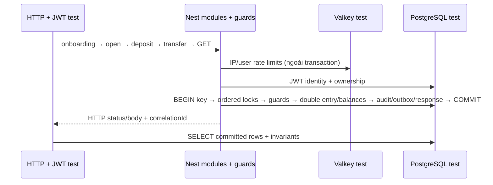
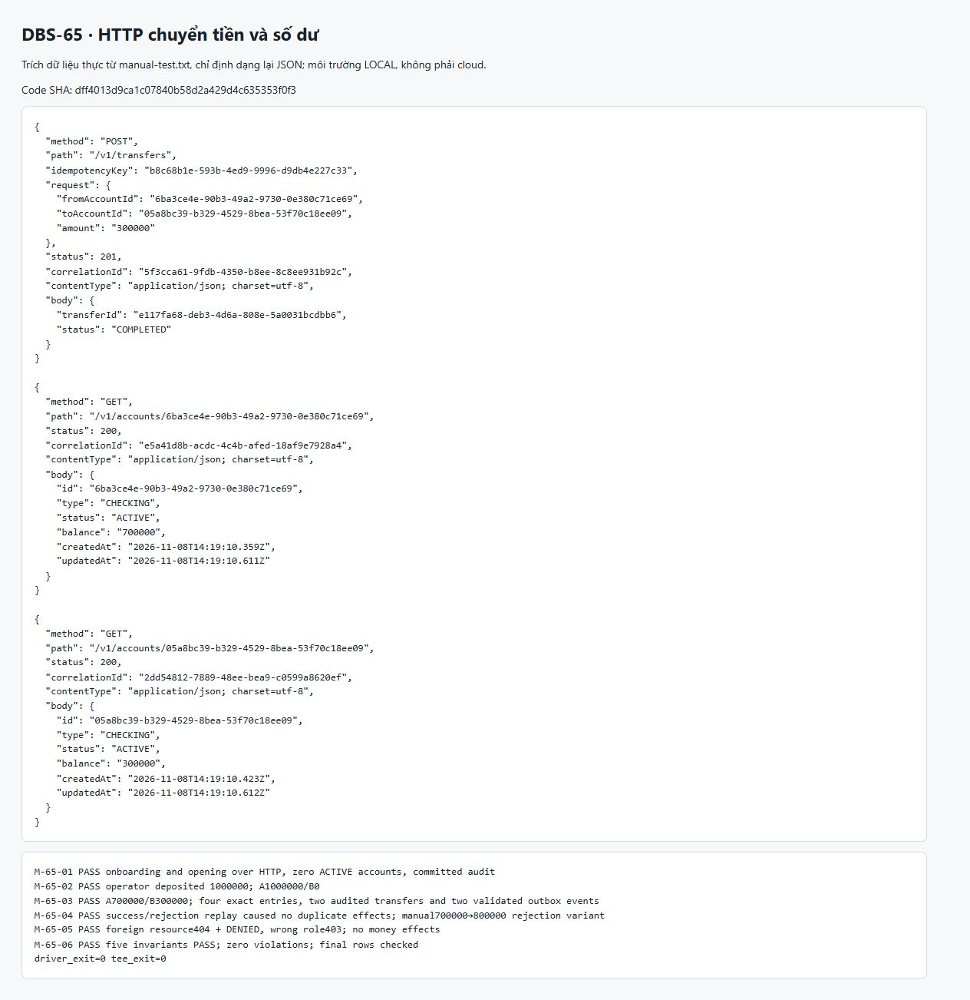
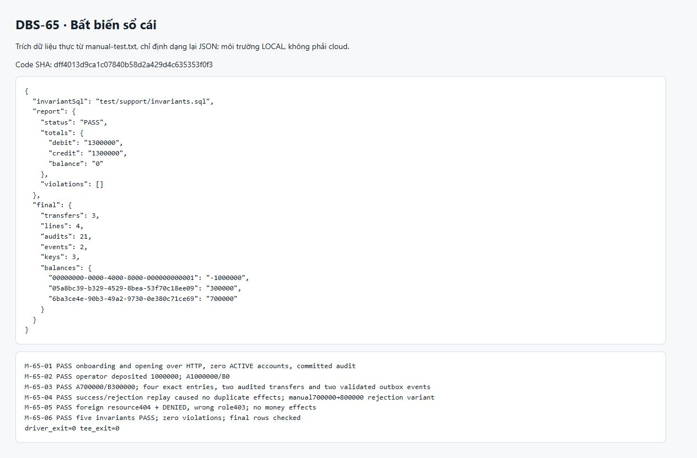

# DBS-65 · e2e trên Postgres thật: nạp → chuyển → xem số dư

> **Status:** Implemented (phạm vi local) · G4 người dùng đã duyệt; cloud còn BL-198 · **Vai:** Dev · **Nhánh:** `codex/dbs-65-money-flow` · **PR:** [#95](https://github.com/Lawliet119/digital-banking-simulator/pull/95) · **Cập nhật:** 2026-11-08

## 1. Bối cảnh

### Task trên board

Đọc bằng `node .claude/skills/dbs-delivering-task/scripts/fetch-task.mjs DBS-65` ngày 2026-11-08 từ repository gốc.

| Cột | Giá trị nguyên văn |
|---|---|
| Issue Key | DBS-65 |
| Loại | Task |
| Tóm tắt | e2e trên Postgres thật: nạp → chuyển → xem số dư |
| Assignee (vai) | Dev |
| Ưu tiên | High |
| Status | To Do |
| Deliverable / Demo | P2 |
| Thực trạng | Chưa có luồng tiền nào chạy từ đầu đến cuối. |
| Expect | Cổng ra tuần 2: mở tài khoản → nạp → chuyển → xem số dư chạy được. |

**DoD nguyên văn:**

1. Test e2e: tạo 2 khách (token thử nghiệm) → mở tài khoản → operator nạp → chuyển → xem số dư hai bên → kiểm audit và outbox
2. Chạy trong CI (Testcontainers)
3. Chạy được trên cloud theo cổng ra tuần 2 (kiểm bằng một lần chạy tay có ghi lại lệnh và kết quả)
4. PR đã merge vào main (CI xanh); Dev review; bảng «Đối chiếu test case» trong PR điền đủ

### Phụ thuộc và thực trạng đã kiểm tra

- DBS-61: board **Done**. Main có `TransferService`, `POST /v1/transfers` và `test/db/customer-transfers.db-spec.ts`; chuyển tiền dùng ledger, audit và outbox thật.
- DBS-64: board **Done**. Main có `AccountQueryService`, `GET /v1/accounts`, `GET /v1/accounts/:id` và `test/db/account-reads.db-spec.ts`.
- Chuỗi đầu vào đã có: onboarding DBS-62, mở tài khoản DBS-63, operator nạp tiền DBS-60, token test DBS-53 và harness PostgreSQL DBS-39/41. Không cần giả lập service nghiệp vụ hay SQL seed tài khoản/số dư.
- `startDepositApp(databaseUrl, options?)` khởi động các module identity/accounts/ledger/audit/outbox thật với JWT ký bằng khóa test. Có thể dùng lại cho suite mới. Cấu hình mặc định helper này không nạp RateLimitModule; thiết kế G2 phải nói rõ mức độ khớp AppModule và lựa chọn Valkey nếu cần, không nhận đã kiểm rate limit chỉ từ fixture mặc định.
- Suite DBS-61 tạo đầu vào user/customer/account bằng SQL rồi kiểm chuyển tiền; suite DBS-64 có onboarding/mở tài khoản/nạp/đọc nhưng không nối thêm chuyển tiền. Chưa có suite riêng đi hết chuỗi DoD #1 bằng HTTP.
- Job CI `db` chạy toàn bộ `test/db/*.db-spec.ts` với service PostgreSQL. Bước ép PostgreSQL Testcontainers trong job `e2e` hiện chỉ chọn `testcontainers-sample` và `migration-revert`. DoD #2 cần chọn đích danh suite DBS-65 trong bước bỏ `DATABASE_URL` này.
- Đã tạo checkout độc lập trong workspace từ origin/main `1b0a585` (PR #82), không sửa checkout gốc `D:\UET_PROJECT\digital-banking-simulator`. Chỉ có thay đổi tài liệu Phase 1 trước G1.

### Baseline

Môi trường: Windows, Node 24.15.0; `npm ci --no-audit --no-fund` cài 956 package theo lockfile, không đổi dependency. Docker Engine 29.5.2. `docker compose up -d` thành công; PostgreSQL và Valkey đã chạy sẵn, ElasticMQ được recreate theo đường dẫn config của checkout mới.

| Kiểm tra | Kết quả |
|---|---|
| `npm run lint:check` | Đạt, exit 0 |
| `npm run typecheck` | Đạt, exit 0 |
| `npm test -- --runInBand --json --outputFile=../../baseline-unit.json` | Đạt: 69 suite, 1.129/1.129 test, 0 skipped, exit 0. Lần đầu trong sandbox exit 1 không có chẩn đoán; kết quả này là lần chạy lại ngoài sandbox |
| `npm run test:e2e -- --runInBand` | Đạt: 15 suite, 153/153 test, 0 skipped, exit 0 |
| Hai suite `account-reads` và `customer-transfers` qua `test:db`, không đặt `DATABASE_URL` | Đạt: 2 suite, 46/46 test, 0 skipped, exit 0, PostgreSQL Testcontainers |

Các cảnh báo xuất hiện trong baseline: JWKS chưa cấu hình tại fixture âm; RateLimiter báo fail-open UNAVAILABLE/SHUTDOWN/UNEXPECTED/TIMEOUT; unit kiểm cấu hình DB thiếu password phát thông báo từ chối. Suite vẫn exit 0. Không tắt hoặc thay đổi cảnh báo/test. Chưa chạy toàn bộ suite DB/service hoặc build tại Phase 1; đây là baseline bốn lệnh bắt buộc và hai suite liên quan, không phải xác nhận hồi quy toàn hệ thống hay cloud acceptance.

### Phạm vi đề xuất

- Thêm suite HTTP/JWT/PostgreSQL thật: hai khách onboarding và mở tài khoản bằng API, operator nạp 1.000.000đ vào A, A chuyển 300.000đ cho B, cả list/detail trả A `"700000"`, B `"300000"`.
- Hậu kiểm bằng SELECT: giao dịch, đúng hai bút toán cho mỗi lệnh thành công, số dư funding, audit đúng actor/action/outcome/correlationId, sự kiện `TransferCompleted` đúng payload và một bản cho mỗi giao dịch. Kết thúc bằng `checkLedgerInvariants` PASS.
- Bổ sung hồi quy nối cùng luồng: gửi lại cùng Idempotency-Key không nhân đôi tiền/audit/outbox; từ chối thiếu tiền giữ số dư; khách không được nạp tiền như operator hoặc đọc tài khoản của người khác.
- Chạy suite mới trong bước CI ép Testcontainers, dùng harness hiện có; test thất bại rõ ràng khi Docker không dùng được.
- Viết kịch bản chạy tay local và runbook cloud, ghi lệnh/kết quả thật và tình trạng chưa chạy. Cloud cần ứng dụng đã deploy, hai khách và operator Cognito, quyền quan sát audit/outbox qua kênh hiện có. Không in token/credential trong transcript.
- Cập nhật feature doc, feature index, hướng dẫn test và backlog phát sinh khi bàn giao.

### Ngoài phạm vi và backlog liên quan

| Mục | Quyết định đề xuất ở G1 |
|---|---|
| BL-038, BL-100, BL-104, BL-106, BL-109: API cloud, đăng nhập Cognito, deploy, RDS TLS, migration cloud chưa có đủ evidence | Giữ ngoài phần triển khai DBS-65; chuẩn bị runbook và ghi DoD #3 **chưa chạy** cho tới khi có phiên cloud sẵn sàng. Không dùng local thay cho evidence AWS, không tự apply Terraform/deploy hoặc thay AUTH_MODE trên cloud |
| BL-005, BL-017: production grants và dbs_migrator | Không đổi DB roles/schema trong task e2e này; nêu rõ test bằng role harness không chứng minh đầy đủ production grants |
| BL-019: toàn bộ AC-8.1/8.2, registry audit và đo tải recordDenied | Chỉ kiểm actor/audit của luồng DoD và quyền ghi cần thiết; không tuyên bố đóng toàn bộ backlog audit |
| BL-155: endpoint khóa tài khoản và Redis revocation cache | Ngoài phạm vi; không giả lập endpoint khóa |
| BL-156: nhiều người gửi đồng thời vào tài khoản nóng | Thuộc test tải/ledger tuần 3; DBS-65 không thay thế AC-5.9 |
| BL-160: review các PR lịch sử | Không sửa lịch sử hay xác nhận thay người review; DBS-65 vẫn cần Dev khác review trước merge |
| Relay/SQS/consumer/notification | Kiểm việc ghi outbox đúng DoD, không mở rộng thành kiểm giao nhận toàn bộ worker |
| Production code, schema, event contract, ADR, env, dependency | Dự kiến không đổi. Nếu test phát hiện lỗi cần sửa thì trình gate phụ với bằng chứng |

### Câu hỏi / quyết định G1

1. Đề xuất duyệt phạm vi test/harness/CI/tài liệu ở trên. Giữ phần chạy tay cloud trong DoD, đánh dấu **chưa chạy (chờ môi trường cloud sẵn sàng, BL-038)** nếu chưa có môi trường; không coi task hoàn thành toàn bộ DoD khi thiếu bước này.
2. Người quản lý board chuyển DBS-65 từ To Do sang In Progress; agent không sửa board.

**Quyết định ở G1:** người dùng trả lời «duyệt g1» ngày 2026-11-08, duyệt phạm vi và giới hạn cloud nêu trên. Chưa xác nhận board đã được người quản lý chuyển trạng thái. Chưa viết test/code DBS-65.

## 2. Hành vi

### Luồng chuẩn và bằng chứng

Hai JWT customer có `sub` khác nhau, một JWT operator; khóa RS256 test do helper hiện có cấp. Khách Nguyễn Minh Anh và Trần Thu Hà tự gọi `POST /v1/customers/me` với `{ "fullName": "…" }` (200), rồi `POST /v1/accounts` với `{ "type": "CHECKING" }` (201, ACTIVE, balance `"0"`). Khách được cấp tài khoản qua HTTP; chỉ SELECT để quan sát DB.

Operator gọi `POST /v1/operator/deposits`, `Idempotency-Key: K1`, body `{ "toAccountId": "<A>", "amount": "1000000" }`. Sau 201 `{ "transferId": "<D>", "status": "COMPLETED" }`, kiểm list/detail A = `"1000000"`, B = `"0"`. A gọi `POST /v1/transfers`, key K2, body `{ "fromAccountId": "<A>", "toAccountId": "<B>", "amount": "300000" }`; sau 201, kiểm cả GET list và detail của mỗi khách: A `"700000"`, B `"300000"`. DTO account chỉ có `id,type,status,balance,createdAt,updatedAt`; không owner/PII/fraud.

Trong DB tạm của từng case: đúng 2 COMPLETED transfers, 4 ledger entries, 2 idempotency keys, 2 outbox events; funding `"-1000000"`. Mỗi transfer có đúng DEBIT/CREDIT đúng account, amount và balance_after. Audit onboarding/open/read kiểm theo correlation của request, đúng actor internal `users.id` (tra theo sub), role, target, action và outcome; deposit/transfer mỗi giao dịch đúng một audit SUCCESS. `outbox_events.aggregate_id`, `event_type`, `correlation_id` khớp giao dịch; `validateEvent(payload).ok = true`, các field khớp event-contract, gồm `occurredAt = transfers.created_at`, snapshot số dư/tuổi tài khoản và owner. DEPOSIT có fromUserId null, TRANSFER có hai owner thật; sameOwner false. API role không chạy relay nên outbox local có published_at null. Cloud có worker có thể published_at khác null; không xem đó là lỗi và không dừng worker.

### Gửi lại, từ chối và biên

- Replay deposit cùng K1/body và transfer cùng K2/body: cùng HTTP201/body, số dư và bộ `{transfers, ledger, keys, money audits, outbox}` không đổi. Đo snapshot trước các GET sau replay vì GET tạo audit đọc. Response replay có correlation request mới; transfer/audit/outbox gốc giữ correlation ban đầu. Cùng key khác body → 422 `IDEMPOTENCY_KEY_REUSED`, không thêm money effects. Ca scope user dùng **cùng POST /v1/transfers** và cùng key K4: sau luồng chuẩn A gửi100k cho B, B gửi50k cho A; hai transferId khác nhau, hai hàng `(user_id, idem_key)` đúng hai actor; A650k/B350k. Replay từng actor trả riêng đúng kết quả cũ, không tăng money rows hoặc đổi tiền. Không dùng hai endpoint khác nhau làm bằng chứng scope user.
- TC thiếu tiền dùng fixture riêng: mở hai account, operator nạp A `"100000"`, A gửi B `"300000"` đúng AC-5.2: 422 `INSUFFICIENT_FUNDS`, `transferId` mới, DB REJECTED và một audit REJECTED + key đã commit, không ledger/outbox của lệnh bị từ chối, A100k/B0. Replay K3 vẫn cùng HTTP422/errorCode/transferId, không so toàn bộ ProblemDetails vì correlation thay đổi. Manual M04 giữ biến thể nối tiếp A700k gửi800k, ghi rõ không phải fixture nguyên văn AC-5.2.
- A đọc tài khoản B, account không tồn tại hoặc UUID hostile qua path đã encode: cùng HTTP404, không `errorCode` (contract hiện tại), `application/problem+json`, correlation khớp header, không dữ liệu B/SQL/stack/token; mỗi lần đúng một `account.read` DENIED độc lập. A chuyển từ B → 404, một `ledger.transfer` DENIED, không key/transfer/ledger/outbox mới.
- Customer hoặc auditor gọi operator deposit, operator gọi customer transfer → 403 `FORBIDDEN`, không money effects. Auditor token thêm chỉ cho test phân quyền, không cần cho luồng chuẩn. RolesGuard chưa ghi audit DENIED (BL-132): đây là khoảng thiếu hiện hữu, bàn giao, không khẳng định FR-AUD-02 đạt đủ và không sửa guard trong task này.
- Không bearer token → 401 `UNAUTHENTICATED`; thiếu Idempotency-Key → 400 `IDEMPOTENCY_KEY_REQUIRED`; amount dạng số hoặc có phần lẻ → 400 không errorCode. Không money effects; lỗi không phản chiếu input nhạy cảm.
- Chính xác số lớn: operator nạp `"9007199254740993"`, A chuyển `"300000"` (không nâng hạn mức), list/detail A `"9007199254440993"`, B `"300000"`, funding `"-9007199254740993"`. Các amount/balance/snapshot đi qua API → PostgreSQL → event → API nguyên chuỗi, không ép Number.
- Mọi case có hoạt động tiền kết thúc `checkLedgerInvariants` PASS, violations rỗng. Không sửa tiền bằng SQL, không inject lỗi/đổi service nghiệp vụ. Concurrency, kill/retry giữa transaction, midnight và Redis outage thuộc các suite riêng; không tuyên bố AC-5.4/5.6/5.7/5.9/5.10 từ suite tuần 2 này.

## 3. Kiến trúc

Suite đề xuất `backend/test/db/money-flow.db-spec.ts`. Dùng interface hiện có, không đổi exported symbol hoặc production code:

| Interface | Cách dùng |
|---|---|
| `createTempDatabase(): Promise<TempDatabase>`; `migrate(url, 'up'?)` | Một DB riêng được migrate cho mỗi case; cleanup drop chỉ DB helper đã tạo |
| `startValkeyContainer(): Promise<StartedValkey>` | Một container Valkey riêng của suite; client `redis` hiện có flushDb giữa case để cách ly bộ đếm, tuyệt đối không flush Redis dùng chung |
| `startDepositApp(databaseUrl, {rateLimit:{redisUrl}})` | App thật và đủ guard JWT → RolesGuard → TransferRateLimitGuard; giữ defaults 10 transfer/phút/customer, 100 request/phút/IP; mỗi case dưới ngưỡng |
| `app.issuer.token(role, {sub})` | JWT ký thật; chỉ config test thay Cognito/JWKS; không override guard/service |
| `checkLedgerInvariants(runner): Promise<LedgerInvariantReport>` | SELECT hậu kiểm năm bất biến; không đổi lifecycle transaction |
| `validateEvent(event: unknown)` | Kiểm schema và đối chiếu thêm snapshot/correlation với SELECT |

Thứ tự setup: suite tạo Valkey; từng case flush container riêng → tạo DB/migrate → app → HTTP; cleanup app, DB, rồi suite đóng client/Valkey trong finally kể cả setup lỗi. PostgreSQL globalSetup/globalTeardown hiện có quản lý container khi không có DATABASE_URL. Timeout setup Valkey đặt 420s để bao phủ ngân sách startup/probe hiện có; test business 120s, cleanup hữu hạn. Không Promise bỏ quên, không `.skip/.only/.todo`.

App test gồm identity/accounts/ledger/audit/outbox/health và RateLimitModule. Đây là integration các module thật qua HTTP, chưa chứng minh toàn bộ AppModule/Cognito/worker hay production DB grants; baseline app-guard đã kiểm wiring AppModule riêng. Không thay AUTH_MODE production. DB/app trong suite vẫn dùng role harness; BL-005/017 giữ nguyên.



Không thêm bảng/cột/index, env, ErrorCode, dependency hoặc sửa ADR/event-contract. CI sửa bước Testcontainers hiện có: giữ nguyên tên sáu job, thêm suite mới vào `env -u DATABASE_URL npm run test:db -- --runInBand --runTestsByPath …`; job db vẫn tự discover suite. Có thể cần tăng timeout bước/job nếu đo cold image pull vượt ngân sách; không tự đổi tại G2, báo gate phụ nếu cần.

## 4. Test cases tự động

| ID | Truy vết | Lớp | Given → When → Then | errorCode |
|---|---|---|---|---|
| TC-65-01 | DoD1, AC-5.1, BR-01/02/04/09/10 | HTTP/JWT/PG/Valkey | Chuỗi đầy đủ §2; kiểm hai GET trước/sau chuyển, 2 transfer/4 bút toán/2 event, audit mỗi request và invariants | Không |
| TC-65-02 | DoD1, AC-5.3/5.5, BR-07 | HTTP/PG | Chuỗi đầy đủ → replay cả deposit/transfer + key khác body → tiền và money rows không nhân đôi | IDEMPOTENCY_KEY_REUSED |
| TC-65-03 | DoD1, BR-07, NFR-SEC-01 | HTTP/PG | Sau luồng chuẩn, A gửi100k/B gửi50k qua cùng POST /v1/transfers và K4; hai transferId + actor/key riêng, A650k/B350k; replay mỗi actor đúng response riêng, không thêm money effects | Không |
| TC-65-04 | DoD1, AC-5.2/5.3, BR-03/09 | HTTP/PG | Fixture riêng A100k/B0 → gửi300k rồi replay → một REJECTED/audit/key, không ledger/event của rejection, hai balance giữ nguyên | INSUFFICIENT_FUNDS |
| TC-65-05 | DoD1, AC-5.8, FR-ID-04 | Security HTTP/PG | A đọc B/missing/hostile, chuyển từ B →404; DENIED đúng action/actor/correlation, không money effects, DTO không lộ fraud/PII | Không mã ở404 hiện tại |
| TC-65-06 | DoD1, BR-04/10 | Security HTTP/PG | Customer/auditor deposit; operator transfer →403; snapshot tiền không đổi; BL-132 chưa có audit role denial | FORBIDDEN |
| TC-65-07 | DoD1, BR-01, NFR-COR-02 | HTTP/PG | Nạp 2^53+1 → chuyển300k → amount/balance/event exact như §2; invariants PASS | Không |
| TC-65-08 | DoD1, BR-01/07, NFR-SEC-01 | Security HTTP/PG | Không token, thiếu key, numeric/fractional amount →401/400 đúng contract; không money effects | UNAUTHENTICATED / IDEMPOTENCY_KEY_REQUIRED; validation không mã |
| TC-65-CI | DoD2 | CI + chạy suite | Bước e2e bỏ DATABASE_URL, chạy đích danh suite mới và globalSetup PostgreSQL; checkout sạch chạy đạt, Docker endpoint không khả dụng → lệnh thất bại rõ; CI draft đỏ có chủ đích rồi xanh (M08–M10) | Không |
| M-65-07 | DoD3 | Cloud manual | Theo §5; chưa chạy nếu chưa có môi trường, không suy từ local | Theo response thật |
| Quy trình | DoD4 | Dev/CI/PR | Bảng TC đủ trong PR; Dev khác review; CI xanh; merge do người có quyền | Chưa hoàn thành ở G2 |

Checklist security: role TC06; ownership TC05; user-scoped key TC03; REJECTED/DENIED TC04/05 (role denial còn BL-132); DTO không fraud TC01/05; lỗi an toàn và correlation TC05/08; SQL tham số hóa dùng code hiện có + hostile path TC05. TLS PostgreSQL/Redis local không áp dụng (mạng container local); cloud bắt buộc TLS giữ cấu hình hiện có, chưa được suite này chứng minh. Secret: JWT chỉ giữ trong RAM, transcript không header Authorization/token/password/ARN/account AWS; không thay credential file.

## 5. Test thủ công

Driver đề xuất `backend/scripts/manual-dbs65.cjs` (chưa viết ở G2), chạy từ backend trong Git Bash theo lệnh dưới. Script in SHA code ở dòng đầu, setup PostgreSQL/Valkey Testcontainers riêng và migrate; dùng helper thật như suite; in method/path/status/body đã che fullName, correlationId và các SELECT/JSON hậu kiểm. Không in JWT, kết nối hay raw error có thể chứa secrets; lỗi in loại/mã cố định, exit1. Kết quả manual không dùng output Jest thay thế.

```bash
set -o pipefail
node scripts/manual-dbs65.cjs 2>&1 | tee ../docs/features/screenshots/DBS-65/manual-test.txt
dbs65_pipeline_status=("${PIPESTATUS[@]}")
printf 'driver_exit=%s tee_exit=%s\n' "${dbs65_pipeline_status[0]}" "${dbs65_pipeline_status[1]}" | tee -a ../docs/features/screenshots/DBS-65/manual-test.txt
test "${dbs65_pipeline_status[0]}" -eq 0 && test "${dbs65_pipeline_status[1]}" -eq 0
```

Thu PIPESTATUS ngay sau pipeline, không bật errexit trước khi thu. Phải kiểm cả driver và tee exit0, không dùng riêng exit code của tee để đánh dấu đạt; lỗi ghi transcript cũng không đạt.

| Bước | Thao tác | Kết quả phải quan sát |
|---|---|---|
| M-65-01 | Onboard Nguyễn Minh Anh/Trần Thu Hà, mở một CHECKING cho mỗi người bằng API | 200/201, hai owner khác, ACTIVE, balance0, đúng audit tạo/mở |
| M-65-02 | Operator nạp1tr; đọc list/detail cả hai |201; A1tr/B0; deposit/funding/2 bút toán/audit/event khớp |
| M-65-03 | A chuyển300k cho B; mỗi người đọc list/detail |201; A700k/B300k, exact string;2 transfer/4 ledger/2 event, correlation đối chiếu |
| M-65-04 | Gửi lại key nạp và key chuyển, rồi A gửi800k bằng key mới và replay | Replay201 không đổi tiền;422 INSUFFICIENT_FUNDS cùng transferId;REJECTED audit/key, không event/bút toán mới |
| M-65-05 | A đọc B và chuyển từ B; customer gọi deposit |404 + DENIED cho ownership;403 FORBIDDEN cho role, BL-132 ghi nhận chưa có role-denial audit;tiền không đổi |
| M-65-06 | Chạy invariants, kiểm outbox/audit cuối, cleanup | PASS,0 violation; transcript exit0; chỉ DB/container tự tạo được dọn |
| M-65-07 | Chạy tay cloud theo runbook dưới | Chưa chạy nếu điều kiện thiếu; giữ DoD3 chưa đạt |
| M-65-08 | Từ repo đã commit, `git clone --no-hardlinks --branch codex/dbs-65-money-flow <checkout-nguồn> <thư-mục-mới>`; vào backend của clone, `npm ci`, `env -u DATABASE_URL npm run test:db -- --runInBand --runTestsByPath test/db/money-flow.db-spec.ts` | Clone không có thay đổi tracked; suite đạt8/8,0skip trên Postgres/Valkey Testcontainers; transcript UTF-8 ghi SHA và exit code. Không chép node_modules hoặc config bí mật từ checkout cũ |
| M-65-09 | Chạy lại suite trong process mới với `env -u DATABASE_URL DOCKER_HOST=tcp://127.0.0.1:1 DOCKER_CONFIG=<thư-mục-rỗng-riêng> npm run test:db -- --runInBand --runTestsByPath test/db/money-flow.db-spec.ts` | Exit khác0, Docker-unreachable diagnostic, không skip/pass. Không dừng daemon/container dùng chung; nếu Testcontainers tự fallback được socket thì bằng chứng chưa đạt và cần phương án cô lập Docker client khác trước khi kết luận |
| M-65-10 | Sau G3, **chỉ khi người dùng yêu cầu Draft PR ở phản hồi G3**: commit test kỳ vọng A700001 thay vì700000; push draft, lưu run URL+SHA và assertion failure; commit khôi phục đúng kỳ vọng, push, lưu run URL+SHA và checks xanh | Suite mới thực sự làm CI đỏ, rồi xanh trên code cuối; không đổi job names/skip tests/force-push. Run red là tạm có chủ đích, không merge. Chưa có quyền Draft PR thì bước này **chưa chạy**, không giả CI xanh; đưa DoD2 chưa kiểm trên GitHub và evidence gap vào backlog G4 |

**Runbook cloud (thực thi chỉ trong phiên môi trường sẵn sàng):** cần ALB HTTPS và CA được tin cậy, image chứa endpoint, hai user Cognito customer dành riêng chưa có profile/account, operator, đường SELECT RDS qua TLS do Ops cấp sẵn. Chưa có tunnel/query runner được kiểm chứng trong repo; Ops phải cung cấp cách vào hợp lệ trước bước SQL, không mở RDS public hoặc thay SG để test. Không tự apply/deploy/tạo credential. Phiên cloud có giá trị viết tiền nạp thử, không phải read-only; cần môi trường demo riêng do người quản lý cho phép sử dụng.

Người chạy nhận access token qua quy trình Cognito hiện có và giữ trong biến shell/credential file ngoài repo, tắt shell tracing. Dùng `curl --silent --show-error --cacert "$ALB_CA_FILE" --dump-header "$HEADER_FILE" --output "$BODY_FILE" --write-out '%{http_code}'` với `Authorization: Bearer $TOKEN` (không `-v/-k/--trace`); không ghi command đã expand token hoặc header vào transcript. Các tên biến chỉ là biến shell của runbook, không thêm env config ứng dụng. Token không ghi vào source, transcript hay ảnh.

1. `GET /health/ready` →200; `GET /v1/accounts` không token →401. Kiểm fingerprint version bằng SHA image do Ops cung cấp (không khẳng định health trả SHA). Ghi UTC time, SHA, endpoint bỏ query/token.
2. Chạy tuần tự M01–M05 qua curl, key UUID riêng cho deposit/transfer/rejection và giữ key khi replay. Lưu command template đã che token, response JSON đã che fullName, HTTP code và x-correlation-id. List/detail ban đầu và cuối đối chiếu đúng amount; không retry POST mở tài khoản hoặc chuyển key mới khi mất response. Nếu onboarding/open account mất response, dừng và kiểm GET trước khi chạy tiếp; nếu giao dịch mất response, dùng lại key.
3. Qua kết nối RDS TLS sẵn có, dùng một phiên `BEGIN ISOLATION LEVEL REPEATABLE READ READ ONLY;` và SELECT tham số theo hai accountId, ba transferId, actor/correlation của lần chạy; kiểm những hàng cùng actor/target/request, không đếm global đúng2/4. Bước audit role-denial giữ BL-132; worker có thể đã publish outbox, kiểm hàng vẫn tồn tại và payload đúng, không cần published_at null. Chạy `backend/test/support/invariants.sql` trên cùng snapshot; `COMMIT`. Ghi lệnh SELECT tham số và kết quả đã loại secret/PII. Không cần auditor token nếu dùng SQL được cấp quyền để quan sát, không thêm route outbox.
4. Đính transcript/ảnh thật cho M07; nếu thiếu CA/token/app/RDS access thì ghi rõ từng bước chưa chạy và bàn giao Ops qua backlog tại G4. Không xóa transfer/ledger/audit hoặc tự hoàn tiền bằng SQL; dữ liệu mẫu giữ nguyên, thông báo số đã nạp cho chủ môi trường. Không tuyên bố cloud acceptance nếu mới local.

## 6. Domain review (AI)

**Reviewer:** subagent độc lập `dbs65_g2_review`, model `gpt-6-astra`, ngày2026-11-08. Vòng1: 3 should-fix,1 minor,0 blocking; **Verdict: REVISE**. [Phản hồi nguyên văn vòng1](screenshots/DBS-65/domain-review.md). Review lại xác nhận cả4 đã xử lý,0 phát hiện mới,0 còn mở: **Verdict: APPROVE**. [Phản hồi nguyên văn cuối](screenshots/DBS-65/domain-review-final.md). Đây là AI review thiết kế, không thay human G2 hoặc Dev review PR.

| # | Xử lý |
|---|---|
| 1 | Đã bổ sung M08 checkout sạch, M09 Docker không khả dụng không dừng daemon chung, M10 CI đỏ→xanh phụ thuộc yêu cầu Draft PR tại G3; chưa chạy phải ghi rõ và backlog G4 |
| 2 | Đã đổi TC03 thành hai khách dùng cùng key trên cùng POST /v1/transfers, replay theo từng actor |
| 3 | Đã dùng pipefail, giữ PIPESTATUS của driver và tee, yêu cầu cả hai exit0 |
| 4 | Đã đổi TC04 thành fixture đúng A100k gửi300k; manual700k→800k ghi rõ biến thể |

**Quyết định ở G2:** người dùng trả lời «duyệt g2» ngày2026-11-08, duyệt thiết kế sau domain review APPROVE. Không suy thành phê duyệt G3 hoặc quyền mở Draft PR.

## 7. Kế hoạch triển khai

### Thứ tự, file và lệnh chứng minh

G3 duyệt kế hoạch dưới đây; mọi kết quả chạy trong Phase4 sẽ ghi ở §8, không điền trước kết quả đỏ/xanh. Command npm chạy từ backend; command git từ root. Không sửa migration/service/controller/DTO/audit writer/outbox writer: các transaction hiện có là đối tượng được kiểm thử, không phải phần triển khai mới của task.

| Bước | File/phạm vi | Test viết trước | Kết quả đỏ (điền khi chạy) | Lệnh chứng minh | Commit dự kiến |
|---|---|---|---|---|---|
| P0 | Đồng bộ branch riêng từ main; bảo toàn feature doc/review chưa commit | Baseline hiện có; kiểm diff contract trước khi thêm test | Chưa chạy trên base mới; nếu baseline đỏ thì dừng triển khai, báo nguyên nhân | `git merge --ff-only origin/main`, `npm run lint:check`, `npm run typecheck`, `npm test -- --runInBand`, `npm run test:e2e -- --runInBand` | Không tạo commit merge; ghi base SHA và kết quả baseline |
| P1 | Thêm `backend/test/db/money-flow.db-spec.ts`: setup/cleanup, HTTP onboarding/open/deposit/transfer/read và SELECT/assertion | TC-65-01 viết trước driver, dùng helper hiện có, giữ toàn bộ guard và invariants | Chưa chạy; regression có thể xanh ngay vì nghiệp vụ đã có, không gọi đó là một lỗi nghiệp vụ đã tái hiện | `npm run test:db -- --runInBand --runTestsByPath test/db/money-flow.db-spec.ts --testNamePattern=TC-65-01` | `test(ledger): cover end-to-end money flow (DBS-65)` |
| P2 | Cùng suite mới, bổ sung replay/scope/rejection | TC-65-02, TC-65-03, TC-65-04; oracle đúng §2, snapshot money effects tách audit đọc | Chưa chạy; không sửa production để ép test đỏ | Cùng lệnh test suite, bỏ testNamePattern; kiểm cả case mới và TC01 | `test(ledger): verify replay and actor isolation (DBS-65)` |
| P3 | Cùng suite mới, bổ sung ownership/role/precision/input | TC-65-05, TC-65-06, TC-65-07, TC-65-08; không skip BL-132 thành giả audit | Chưa chạy; ghi nguyên kết quả, nếu phát hiện bug cần sửa production thì gate phụ | `npm run test:db -- --runInBand --runTestsByPath test/db/money-flow.db-spec.ts` | `test(ledger): verify ownership and exact balances (DBS-65)` |
| P4 | Thêm `backend/scripts/manual-dbs65.cjs`; HTTP driver và assertions riêng, không lấy expected result từ hàm tạo response của suite | TC01–08 là đối chiếu độc lập đã viết trước; driver triển khai M-65-01, M-65-02, M-65-03, M-65-04, M-65-05, M-65-06 | Chưa chạy; manual fail phải tái hiện/sửa trước khi đánh dấu đạt | `node --check scripts/manual-dbs65.cjs`; lệnh driver + pipefail/PIPESTATUS ở §5, thực chạy sau commit cuối đổi code | `test(ledger): add reproducible money-flow driver (DBS-65)` |
| P5 | `.github/workflows/ci.yml`: thêm đường dẫn suite vào bước ép PostgreSQL Testcontainers, sửa đúng comment/name bước liên quan; giữ các job và bước mới từ main | TC-65-CI: suite đạt local trước; M-65-10 sau khi có quyền Draft PR dùng oracle tạm700001 để chứng minh test làm CI đỏ | Chưa chạy; đỏ phải là assertion TC01 đúng chủ đích, lỗi hạ tầng không tính | Bỏ DATABASE_URL trong process riêng rồi chạy danh sách suite của bước CI; `actionlint` nếu sẵn; M10 lưu run URL/SHA | `ci(test): run money flow with Testcontainers (DBS-65)`; nếu có M10: commit negative control rồi commit khôi phục oracle |
| P6 | Không thêm source file; chạy regression, clean clone, Docker-unreachable và manual trên SHA cuối đổi code | Toàn bộ8 TC, TC-CI; M-65-08 checkout sạch; M-65-09 Docker client cô lập | Chưa chạy; M09 chỉ đạt khi exit khác0 vì Docker không khả dụng, không đếm test bị skip là pass | lint/typecheck/unit/e2e/db/build; `npm run test:db -- --runInBand` dùng Testcontainers; M08–09 theo §5; driver M01–06 sau final code SHA | Không commit source chỉ để rerun; evidence đi cùng P7 |
| P7 | `backend/README.md`, `docs/features/README.md`, `docs/BACKLOG.md`, feature doc này, evidence theo manifest dưới | Đối chiếu từng TC/DoD/M, từng limitation và diff; M-65-07 cloud chỉ thực chạy khi đủ điều kiện đã duyệt | Chưa chạy; DoD3/Dev review/merge chưa đạt giữ đúng trạng thái | `node .claude/skills/dbs-delivering-task/scripts/check-doc-links.mjs`; `git diff --check`; kiểm Markdown/Mermaid và log không chứa secret; đối chiếu `git diff --stat origin/main...HEAD` | `docs(test): record DBS-65 evidence and handoffs` |

**Tính chất test-only:** viết assertion và case trước driver/CI. Nghiệp vụ có sẵn có thể vượt qua test mới ngay từ lần đầu; không bịa một bước đỏ hoặc đổi code tiền để hợp thức hóa TDD. Bằng chứng test phát hiện kết quả sai là negative control **trong kỳ vọng của test** tại M10 (G2 đã duyệt), khôi phục trước bàn giao. Task không tạo hoặc đổi hành vi production. Bất kỳ phát hiện đòi sửa production đều dừng ở gate phụ, bổ sung test tái hiện đúng lỗi trước khi sửa.

### Base, hồi quy và giới hạn thời gian

Fetch ở Phase3 cho thấy main đã từ `1b0a585` lên `a10dad4` qua4 commit (#89–92): tài liệu API dùng chung, relay/SQS, test và2 bước CI liên quan relay. Chưa fast-forward branch ở Phase3. P0 đồng bộ trước code, đọc thêm `docs/components/_shared/api-design.md`, giữ nguyên thay đổi main trong workflow/index/backlog và xác nhận interface HTTP/JWT/DB/event của §2–§3 không đổi. Nếu đổi contract liên quan thì báo lại thiết kế trước triển khai, không dùng review trên base cũ để nhận đã kiểm base mới. Không sửa các file main chỉ vì đang có diff lịch sử.

P6 chạy `npm run lint:check`, `npm run typecheck`, `npm test -- --runInBand`, `npm run test:e2e -- --runInBand`, `npm run test:db -- --runInBand`, `npm run build`; thêm targeted suite trong process đã bỏ DATABASE_URL để chứng minh không dùng PostgreSQL có sẵn. `test:db` đã có globalSetup PostgreSQL; suite65 tự dùng Valkey riêng. Không cần chạy toàn bộ test:services vì không đổi adapter/worker; các test relay mới của main vẫn giữ CI của chúng. Cold image pull có thể kéo dài; nếu ngân sách job không đủ, trình gate phụ trước khi tăng timeout. Chưa thấy `actionlint` hoặc mermaid-cli cài sẵn; ghi rõ nếu chưa chạy được, không thêm vào production dependencies. Mermaid mới phải render bằng CLI/tool riêng trong workspace khi bàn giao; công cụ tạm không sửa package/lockfile.

### Manifest file và evidence được phép tạo/sửa

Source/docs:7 file ở P1–P7 gồm suite, driver, workflow, backend README, feature index, BACKLOG và feature doc. Tái dùng nguyên `deposit-app.ts`, `dev-tokens.ts`, `temp-database.ts`, `postgres.container.ts`, `valkey.container.ts`, `invariants.ts/sql`, event validator; không sửa helper hoặc package/lockfile nếu chưa có gate phụ.

Trong `docs/features/screenshots/DBS-65/`: hai raw review `domain-review.md`, `domain-review-final.md` đã có; được thêm `baseline.txt`, `tdd-red-green.txt`, `verification.txt`, `manual-test.txt`, `clean-clone.txt`, `docker-unavailable.txt`, `ci-evidence.md`, `pr-description.md`, `plan-sweep.txt`; ảnh output thật `01-money-flow.png`, `02-invariants.png`, `03-ci.png`, và `04-cloud.png` chỉ khi đã chạy cloud. Không tạo ảnh hoặc transcript giả. Thiếu ảnh/bước nào phải nêu đúng tên ở G4. File work, container/DB tạm và bản xuất trong outputs không vào PR.

SHA đầu transcript manual là final commit đổi test/driver/workflow, gồm commit khôi phục oracle sau negative control nếu có. Tất cả M01–06, M08–09 chạy lại trên SHA đó; CI xanh phải gắn đúng HEAD cuối được kiểm, các commit docs sau cũng chờ checks của HEAD mới. Transcript/ảnh chỉ chứa ID kỹ thuật, số tiền, outcome/correlation, lệnh và code thoát; che tên thật, JWT/header Authorization/credential/AWS account/ARN. Không log prompt hoặc chain-of-thought.

### Rà soát DoD và limitation (plan sweep)

| Yêu cầu | Hàng kế hoạch / ngoài phạm vi |
|---|---|
| DoD1: hai khách/token thật, mở/nạp/chuyển/đọc/audit/outbox | P1–P4; TC01–08; M01–06; invariants mỗi case tiền |
| DoD2: CI Testcontainers | P5–P6; TC-CI; M08–10; giữ CI xanh sau khôi phục, không suy từ local |
| DoD3: chạy cloud có lệnh/kết quả | P7; M07; chưa có môi trường thì chưa chạy và backlog cụ thể cho65, không dùng evidence local thay |
| DoD4: CI xanh, Dev review, merge, bảng TC trong PR | P5/P7; PR body đủ bảng khi được cho phép; Dev review/merge là quy trình còn chờ, agent không tự merge/đổi board |
| BL-132 role-denial audit | P3/P7: kiểm403, ghi giới hạn, thêm nguồn65 vào backlog hiện có; không sửa RolesGuard |
| BL-005/017 production DB roles/grants | Ngoài phạm vi; test dùng role harness, không tuyên bố production grants |
| BL-019 full audit registry/AC8.1/8.2 | Ngoài phạm vi; P1/P3 chỉ kiểm audit thuộc luồng task |
| BL-038/100/104/106/109, cloud TLS/Cognito/RDS access | P7/M07 bàn giao; không Terraform apply/deploy/tạo credential hoặc mở mạng |
| BL-155 session revocation/lock API; BL-156 hot account; BL-160 review lịch sử | Ngoài phạm vi, không đóng các dòng này bằng test65 |
| Full AppModule/Cognito/worker, relay/consumer/SQS, midnight/kill/concurrency/Redis outage | Ngoài phạm vi theo G1/G2; P0 baseline AppModule không thay cloud acceptance; không đổi limiter/auth để suite pass |
| Amount >2^53, DTO không PII/fraud, lỗi không SQL/secret, replay scope user | P2/P3 và TC03/05/07/08; kiểm bằng assertion chính xác, không Number |
| Setup/cleanup, Docker vắng, cold pull, default rate limits | P1/P6, M08/M09; chỉ dọn tài nguyên tự tạo; fixture mặc định không nâng ngưỡng |
| Docs/index/backlog, link/Mermaid, screenshot/manualSHA, PR diff/secret | P7 và manifest; toàn bộ khoản chưa đạt có ID backlog ở G4, đối chiếu file lạ để trình gate phụ |

**Kết quả sweep:** đã rà DoD1–4, TC-65-01–08/TC-CI, M-65-01–10 và từng limitation; tất cả có hàng kế hoạch hoặc ngoài phạm vi rõ ràng. Kiểm tra cấu trúc kế hoạch **PASS:42 mục được kiểm,0 mục thiếu**, gồm7 file source/docs,8 TC nghiệp vụ + CI,10 manual và4 DoD. [Output thô](screenshots/DBS-65/plan-sweep.txt). Đây là kiểm tra độ đầy đủ của kế hoạch, chưa có test/evidence Phase4 nào được đánh dấu đạt ở G3.

### Rủi ro và cách lùi

- Không đụng dữ liệu người dùng: DB có tên do helper kiểm tra, Valkey container riêng mới được flush; cleanup trong finally. M09 chỉ đổi Docker client của process, không dừng Docker Desktop/Compose chung.
- Nếu test mới phát hiện tiền/quyền/audit sai, giữ output đỏ và trình gate phụ, không sửa rộng hoặc nới assertion. Trong giới hạn BL-132 đã duyệt chỉ ghi phần chưa đạt.
- Khi cần lùi thay đổi, hoàn tác đúng commit DBS-65 trên branch riêng; không reset/clean, không force-push hoặc đụng lịch sử nhánh người khác. Đồng bộ main dùng fast-forward; nếu không còn fast-forward được thì bảo toàn file và xử lý branch riêng, không ghi đè.
- Muốn thực hiện M10 cần người dùng yêu cầu **commit, push và mở Draft PR trong phản hồi G3**. Kế hoạch đề xuất ghi commit local sau từng bước xanh và chạy CI đỏ→xanh trên branch65; chỉ Ready sau G4. Nếu chỉ duyệt triển khai local, M10 để chưa chạy và nêu thiếu evidence tại G4.
- PR có thể vượt400 dòng vì8 case integration + driver độc lập + raw evidence cho cùng một task; nếu vượt, PR body giải thích đây là một kịch bản nghiệm thu thống nhất, phân biệt diff test/code với transcript/tài liệu và không ghép tính năng khác.

**Quyết định ở G3:** người dùng trả lời «duyệt g3» ngày2026-11-08, duyệt triển khai theo kế hoạch và commit local theo từng bước xanh. Không có yêu cầu push hoặc Draft PR trong phản hồi, nên M10 chưa được thực hiện; ghi đúng khoảng thiếu CI GitHub khi bàn giao. Không merge hoặc sửa board.

## 8. Kết quả

**Base:** đã fast-forward tới `a10dad4`, giữ toàn bộ thay đổi relay/SQS/CI mới. HTTP/identity/account/ledger/event và helper mà thiết kế dùng không đổi. **Code SHA cuối:** `dff4013d9ca1c07840b58d2a429d4c635353f0f3`. Các commit triển khai local: `27ad0ce` (luồng chuẩn và tài liệu gate), `97b90e3` (replay/scope/rejection), `804277d` (security/precision/input), `236007e` (driver), `dff4013` (CI). Không push, PR hoặc sửa board. Chưa có Dev review hoặc merge.

### Kiểm tra tự động

Chạy trên Windows với portable Node24.22.2, cùng package-lock đã có. [Verification](screenshots/DBS-65/verification.txt), [lần đỏ/negative control và lần xanh](screenshots/DBS-65/tdd-red-green.txt). Các kết quả này là local, không phải checks trên GitHub.

| Lệnh (backend/) | Kết quả |
|---|---|
| `npm run lint:check` | exit0 |
| `npm run typecheck` | exit0 |
| `npm test -- --runInBand` |70 suite,1135/1135,0skip,exit0 |
| `npm run test:e2e -- --runInBand` |15 suite,153/153,0skip,exit0 |
| `npm run test:db -- --runInBand` (bỏ DATABASE_URL) |43 suite,732/732,0skip,exit0;580.576s; PostgreSQL Testcontainers thật |
| `npm run build` |exit0 |
| Ba suite được chọn trong bước CI, qua npm và bỏ DATABASE_URL |3 suite,13/13,0skip,exit0;51.207s; gồm sample/migration run–revert–run/money-flow |
| Suite mới từ checkout sạch + npm ci |8/8,0skip,exit0;không chép node_modules hoặc config từ checkout cũ |
| Docker client không khả dụng (M09) |exit1 với Docker-unreachable diagnostic trước khi có test; không có kết quả xanh/skip giả |
| Link/Mermaid/secret/diff |Mermaid CLI render PNG bằng Edge headless đạt; actionlint không cài nên chưa chạy; link check và secret/diff kiểm ở cuối bàn giao |

| ID | Test trong `backend/test/db/money-flow.db-spec.ts` | Đối chiếu |
|---|---|---|
| TC-65-01 |onboard → open → deposit → transfer → both balances, audit and outbox |Đạt đúng luồng/AC-5.1, hai GET mỗi owner, bút toán/audit/event/correlation/invariant |
| TC-65-02 |replays deposit and transfer without duplicating any money effect |Đạt cả201 replay và422 key khác body;không thêm money rows |
| TC-65-03 |scopes the same key by customer on the same transfer endpoint |Đạt hai actor/cùng endpoint/cùngkey,2id riêng/replay riêng,số dư650k/350k |
| TC-65-04 |AC-5.2 commits one insufficient-funds rejection and replays it |Đạt đúng fixture100k gửi300k,REJECTED/audit/key đã commit,không ledger/event mới |
| TC-65-05 |hides foreign, missing and hostile accounts and commits ownership denials |Đạt404/account.read và ledger.transfer DENIED riêng;không money effects |
| TC-65-06 |refuses wrong roles at real deposit and transfer routes |Đạt403/no money effects trong phạm vi G2;role-denial audit vẫn thiếu BL-132 |
| TC-65-07 |preserves 2^53+1 through funding, transfer, balance reads and events |Đạt exact string qua HTTP/SQL/event,số dư9007199254440993 sau chuyển300k |
| TC-65-08 |rejects absent credentials, absent keys and noncanonical amounts without money effects |Đạt401/400 và mã lỗi đúng;validation không mã;tiền không đổi |
| TC-65-CI |workflow + run local tương đương |Đạt cấu hình và local13/13;chưa kiểm GitHub đỏ→xanh,BL-199 |
| DoD3 |M07 cloud |Chưa chạy,BL-198 |
| DoD4 |PR/Dev review/CI HEAD/merge |Chưa đạt,BL-199;PR body đã chuẩn bị local |

Không test case nào bị đơn giản hóa so với thiết kế G2 cuối; TC-CI/cloud/quy trình còn thiếu được ghi riêng. Các lượt khoanh vùng hoặc negative control dùng testNamePattern có7 hoặc5 case không được chọn; không dùng số đó làm nghiệm thu. Lượt nghiệm thu suite đủ8 và hồi quy732 đều0skip.

### Test thủ công

[Transcript gốc](screenshots/DBS-65/manual-test.txt) chạy bằng Git Bash trên code SHA ở trên; dòng cuối `driver_exit=0 tee_exit=0`. Các request đều HTTP thật với JWT ký thật; không SQL seed customer/account/money. Kịch bản local dùng module thật và Valkey, không khẳng định full Cognito/AppModule/worker/cloud/production grants.

| Bước | Lệnh/quan sát thật | Kết quả |
|---|---|---|
| M-65-01 |POST customers/me200,POST accounts201 cho2khách;SELECT audit theo correlation |Đạt,hai owner khác nhau,ACTIVE/balance0,audit tạo/mở đã commit |
| M-65-02 |POST operator/deposits1tr201;GET list/detail A/B |Đạt,A1000000/B0,operator actor đúng |
| M-65-03 |POST transfers300k201;GET cả hai;SELECT transfer/ledger/outbox |Đạt,A700000/B300000;2COMPLETED/4ledger/2event;payload/snapshot/correlation đúng |
| M-65-04 |Replay hai lệnh201;gửi800k422 rồi replay422 |Đạt,cùng response/id;có một REJECTED/audit/key,không thêm ledger/event;đây là biến thể manual,TC04 dùng nguyên AC100k→300k |
| M-65-05 |A đọc B404,chuyển từB404,customer deposit403 |Đạt,2DENIED ownership;role403 giữ khoảng thiếu BL-132;tiền không đổi |
| M-65-06 |SELECT key và chạy invariants.sql;cleanup riêng |Đạt,Nợ=Có1300000,tổngbalance0,0violation;cuối3transfer(2completed+1rejected)/4ledger/3key/2event/21audit;cleanup vàdriver/tee exit0 |
| M-65-07 |Cloud |**Chưa chạy**:chưa có phiên API/Cognito/RDS TLS được cấp cho task;BL-198;thiếu04-cloud.png |
| M-65-08 |Clone local branch ở dff4013,npmci956packages,bỏDATABASE_URL chạy suite |Đạt8/8,0skip,git diff--exit-code0;[raw output](screenshots/DBS-65/clean-clone.txt) |
| M-65-09 |Process riêng với Dockerhost127.0.0.1:1 và config riêng không có credential |Đạtexit1,Docker không tìm thấy runtime strategy;không dừng daemon/container chung;[raw output](screenshots/DBS-65/docker-unavailable.txt) |
| M-65-10 |CI GitHub đỏ→xanh |**Chưa chạy**:G3 không yêu cầu push/Draft PR;BL-199;thiếu03-ci.png;[evidence trạng thái](screenshots/DBS-65/ci-evidence.md) |

Ảnh01/02 là screenshot trình duyệt của **trích transcript thật**, chỉ định dạng lại JSON để đọc, giữ SHA/ID/correlation và ghi rõ LOCAL. Không phải ảnh Swagger/terminal trực tiếp và không phải bằng chứng cloud/CI.




### Sự cố, lệch và bàn giao

- Baseline e2e đầu thất bại ECONNREFUSED vì Docker Desktop tắt; đã start Docker/Compose và chạy lại đạt153/153 trước khi triển khai. Không sửa/skip test để qua baseline.
- Một lượt Node24.15.0 thoát native0xC0000409 không có assertion. Thử `--jitless` không dùng được với ssh2/WebAssembly; không tính là nghiệm thu. Portable24.22.1 cho thấy một assertion quá rộng chặn từ Authorization trong thông báo cố định; chỉ sửa oracle kiểm secret, không sửa errorCode/guard/contract. Portable24.22.2 lấy từnodejs.org, kiểm SHA256 theo SHASUMS; dependency/lockfile giữ nguyên. Crash chưa xác định nguyên nhân→BL-200.
- Local negative control đổi riêng kỳ vọng A700000 thành700001: TC01 đỏexit1 đúng assertion;finally khôi phục file giống commit. Sau khôi phục, local danh sách CI13/13 đạt; suite checkout sạch8/8 đạt trên cùng code SHA. Đây là kiểm sensitivity local, không thay M10 GitHub. Test nghiệp vụ đã có có thể xanh ngay khi thêm coverage; không nhận đã sửa một bug production.
- Lần smoke đầu gọi trực tiếp Jest qua Node thiếu npm_execpath nên migration harness từ chối; đổi lệnh về npm như repo hướng dẫn,3suite13/13 đạt. Không chỉnh migration/harness để bỏ điều kiện này.
- P0 phát hiện api-design mới khác code/ADR ở thời hạn key và tên audit action; giữ oracle theo code/ADR đã duyệt, không thay contract. Bàn giaoBL-201.
- Cập nhật (BL-201 đã đóng): retention đã đồng bộ ở DBS-136; tên audit action trong `docs/components/_shared/api-design.md` nay khớp code (`customer.created`/`customer.read` ở `customer-profile.service.ts`, `transfer` ở `transfer.service.ts`, `deposit` ở `deposit.service.ts`), không đổi code hay contract.
- Phạm vi source/docs đúng7file kế hoạch; các raw output/ảnh nằm trong manifest P7. Không đổi production code/schema/ADR/env/dependency/helpers. Công cụ Node/Mermaid, clean clone và server xem transcript ở work ngoài PR. Diff test/driver lớn vì8case integration và driver oracle độc lập cho cùng task; lý do đã ghi trong PR body chuẩn bị.

| Backlog | Việc còn lại / vai |
|---|---|
| BL-132 |Dev identity/audit bổ sung audit khi RolesGuard403;đã thêm nguồn65 vào dòng hiện có |
| BL-198 |Dev/Ops thực chạyM07 cloud và ảnh04-cloud.png;DoD3 chưa đạt |
| BL-199 |Sau quyền push/PR:GitHubred→green/CI HEAD,ảnh03-ci.png,Dev review vàmerge;DoD2/4 còn thiếu |
| BL-200 |Dev harness/runtime điều tra nativecrashWindows24.15,không đóng bằng rerunxanh |
| BL-201 |Dev tài liệuAPI đồng bộ keyretention/audit action với nguồn đã chốt |

BL-005/017/019/155/156/160 và các hạn chế G1 khác vẫn ngoài phạm vi;không xóa dòng backlog nào. Chờ G4 chấp nhận từng bước/ảnh còn thiếu; task chưa đạt toàn bộ DoD hoặc được chuyển Done.

## 9. Tài liệu đã cập nhật

- `backend/README.md`:lệnh suite/driver,Valkey thật và giới hạn local/CI/cloud.
- `docs/features/README.md`:thêm dòng65,trạng tháiPlan approved/chờG4 và cácBL.
- `docs/BACKLOG.md`:thêmBL-198–186,bổ sung nguồn65 ởBL-132;không đóngBLkhác.
- Feature doc này và evidence trong `screenshots/DBS-65/`, gồm rawreview,baseline/sweep,verification/manual/cleanclone/Docker/negativecontrol/CI-status,PRbodylocal và2ảnh.

## Checklist G4 (chờ người dùng duyệt)

- [x]8/8 case nghiệp vụ đạt đúng độ sâu,0 đơn giản hóa;TC-CI đạt local nhưng phần GitHub cònBL-199.
- [x]Manual localM01–06 vàM08–09 đã chạy trên codeSHA dff4013;driver/teeexit0. M07cloud vàM10GitHub **chưa chạy**, cần chấp nhận riêng theo tên khi duyệtG4.
- [ ]Ảnh01-money-flow.png/02-invariants.png đã có,đã xem;ảnh03-ci.png và04-cloud.png chưa có vì hai bước chưa chạy. Transcript che tên,không token/headerAuthorization/credential/ARN/AWSaccount.
- [x]Diff nguồn đúng7file đã duyệt;artifact trongmanifest P7;không source/helpers/dependency/schema/env phát sinh ngoài kế hoạch.
- [x]Lint/typecheck/unit/e2e/db/build hoàn tất local,1135/153/732 test,0skip;CI-selected13/13 vàcleanclone8/8.
- [x]Docs fact/index/backlog cập nhật;Mermaid render đạt;linkcheck263file0broken,diffcheck sạch. Trạng thái doc: Implemented (phạm vi local).
- [x]Khoảng thiếu/việc bàn giao ghi §8 vàBL-132/183–186;DoD3/4 chưa đạt,DoD2 cònCIremote. Không chuyểnboardDone hoặc tựmerge.

## Sau G4

Người dùng duyệt G4 ngày2026-11-08, chấp nhận bàn giao với M07cloud và M10CI red→green chưa chạy, ảnh03/04 chưa có. Sau fetch đã merge main479e77d (#93 đổi skill tự duyệt gate; #94 cleanup outbox), không xung đột. Giữ nguyên lịch sử gate do người dùng đã duyệt. Chạy lại suite65 và driver trên merge SHA; bằng chứng cũ giữ ở §8 là lịch sử, transcript manual mới ở cùng đường dẫn. Push/PR sau G4; không merge/đổi board. CI GitHub xanh thông thường không đồng nghĩa đã chạy negativecontrol M10.
Sau đồng bộ: suite65 đạt8/8,0skip; driverM01–06 đạt trên71c96f58cd991bc9afc31651184347dc62b92684 (dòng đầu manual-test.txt). Ảnh01/02 giữ lần chạy dff4013 trước đồng bộ, có SHA hiển thị; không nhận là ảnh của lần mới. G4 người dùng đã duyệt, trạng thái local Implemented; cloud và CI negativecontrol vẫn chưa chạy.

Đã push và mở Ready PR95 sau G4. CI thông thường xem Checks của PR; M10 negativecontrol chưa chạy, cloud chưa chạy; Dev khác review và merge còn chờ. Nhờ người quản lý chuyển board In Review.

## Sau rebase (techlead review PR #95, 2026-11-09)

Rebase lên `main` `18f93dc` (đã có DBS-113, DBS-92, DBS-109, DBS-110). Chạy lại trên PostgreSQL 17 và Valkey thật: `money-flow.db-spec` 8/8, lint và typecheck sạch; `manual-dbs65.cjs` đạt (M-65-01..06 và M-65-08..09), `manual-test.txt` là lần chạy mới, dòng đầu là commit `c3c82873926c06bec022085fe49b9dcb98e84fbb`. Ảnh `01-money-flow.png` và `02-invariants.png` là của lượt trước rebase. Các bước chưa chạy vẫn như đã chấp nhận ở G4: M-65-07 (cloud) và M-65-10 (CI đỏ→xanh). `BL-183..186` của PR bị đánh lại thành `BL-198..201` vì main đã dùng các số đó.
