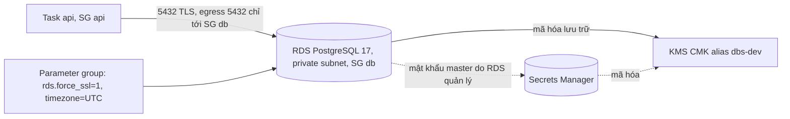

# DBS-66 · Terraform: RDS PostgreSQL 17 (dev), mã hóa và ép TLS

> **Status:** Draft (đang làm, đến G2) · **Vai:** #5 Platform & Ops · **Cặp đôi review:** Dev · **Nhánh:** `chore/DBS-66-terraform-rds` (xếp chồng trên `chore/DBS-54-terraform-cognito`) · **PR:** — · **Cập nhật:** 2026-10-26

## 1. Bối cảnh

- **Task trên board:** Task, Deliverable P3, Ưu tiên Highest, board "To Do" (sẽ đặt In Progress). **Expect:** Có database trên cloud để app nối vào.
- **DoD** (nguyên văn, đánh số):
  1. RDS PostgreSQL 17, Single-AZ (cấu hình dev), mã hóa lưu trữ, parameter group rds.force_ssl=1 và timezone UTC, backup tự động bật; thuộc nhóm «xóa hằng ngày»
  2. Security group chỉ cho phép từ task ECS
  3. Ghi chi phí RDS dev theo giờ vào báo cáo chi phí
  4. PR đã merge vào main (CI xanh); Dev review; bảng «Đối chiếu test case» trong PR điền đủ
- **Thực trạng trên board:** chưa có RDS; app đã hỗ trợ `DATABASE_SSL` và `DATABASE_SSL_CA_PATH` (`pg-ssl.ts` + test).
- **Phụ thuộc:** DBS-33 (board In Review; `base` đã dựng thật). Nhánh xếp chồng trên DBS-54 (PR #26): `main` ← #22 ← #23 ← #24 ← #25 ← #26 ← nhánh này.
- **Đã có gì:** `base` có VPC, 2 private subnet không route ra internet, 2 public subnet, SG `alb` và `api` (DBS-34), log group (DBS-34); `session` có cluster, service, ALB, IAM (DBS-34); ADR-10 (RDS ở private subnet, SG chỉ nhận từ task), ADR-11 (RDS `db.t4g.micro` Single-AZ ≈ 0,025 USD/giờ, KMS 1 key), docs/03 §13.1–§13.2 (`DATABASE_POOL_MAX = 10`, `số task × 10 + 5 ≤ max_connections`, `db.t4g.micro` ≈ 80–110 kết nối, dev tối đa 6 task); NFR-SEC-03 (mã hóa at-rest bằng KMS cho RDS; TLS tới RDS) và NFR-SEC-06; `validation.schema.ts` bắt buộc `DATABASE_SSL=true` khi `staging`/`production`.
- **Baseline:** `terraform test`: bootstrap 9/9, `base` 24/24, `session` 9/9; test script Cognito 12/12 (lúc bàn giao DBS-54).
- **Ngoài phạm vi:** tạo DB role `dbs_api`, `dbs_worker`, `dbs_migrator` và chạy migration (DBS-68); `DATABASE_URL`, secret và CA bundle trong image (DBS-67, `Dockerfile`); production Multi-AZ, `db.t4g.small` (cấu hình prod; chỉ để biến); đối soát chi phí thật trên Cost Explorer (BL-031 kiểu, ngày hôm sau); failover (DBS-181).
- **Câu hỏi mở** (kèm đề xuất):
  1. **Vị trí:** KMS CMK **dùng chung** (alias `alias/dbs-dev`, bật xoay khóa, chờ xóa 7 ngày, key policy mặc định có statement root để IAM grant của DBS-67 hoạt động; Secrets, SQS, ElastiCache dùng lại, đúng ADR-11 "KMS 1 key"), DB subnet group (2 private subnet), SG `db` (`5432` chỉ từ SG `api`) và luật egress `5432` của SG `api` tới SG `db` ở `envs/dev/base` (BL-032; gần như miễn phí: KMS ≈ 1 USD/tháng); parameter group và instance ở `envs/dev/session` (xóa hằng ngày).
  2. **Mật khẩu master:** `manage_master_user_password = true` (RDS tự tạo và xoay secret trong Secrets Manager, mã hóa bằng CMK; mật khẩu không vào Terraform state, không biến). Secret bị xóa cùng instance khi `destroy`. DBS-67 đọc secret này để tạo DB role và ghép `DATABASE_URL`. Tên master user `dbs_master`, database `dbs`.
  3. **Phiên bản:** `engine = "postgres"`, `engine_version = "17"` (RDS chọn bản nhỏ mới nhất của 17, hiện 17.11), `auto_minor_version_upgrade = true`, `ca_cert_identifier = "rds-ca-rsa2048-g1"` (ghim CA để DBS-67 biết bundle nào cần); ghi bản thật vào §8. Tên cố định: instance `identifier = "dbs-dev"`, parameter group `dbs-dev-postgres17` (family trong tên).
  4. **Cấu hình dev:** `db.t4g.micro`, `gp3` 20 GB, Single-AZ (`multi_az` là biến, mặc định `false`), `publicly_accessible = false`, `backup_retention_period = 1`, `skip_final_snapshot = true`, `delete_automated_backups = true`, `deletion_protection = false`, `apply_immediately = true`; `performance_insights_enabled = false`, `monitoring_interval = 0`, không xuất log CloudWatch (tránh phí). Biến `instance_class` và `multi_az` để production đổi (không dùng ở task này).
  5. **Parameter group** `family = postgres17`: `rds.force_ssl = 1`, `timezone = UTC` (cả hai áp dụng ngay, không cần reboot).
  6. **Kiểm TLS và `max_connections` bằng task thử** (image công khai có `psql`, SG `api`, public subnet) thay vì bastion: IAM role tạm (tạo bằng CLI, xóa sau) cho phép đọc secret master; mật khẩu vào container qua `secrets` của ECS (không argv). Một task chạy cả hai kiểm tra bằng một lệnh container (xem §5); một task thứ hai dùng SG tạm `dbs-probe-deny` (có egress 443 và 5432 nhưng không được SG `db` cho phép) làm đối chứng âm.
  7. **Chi phí:** ghi ≈ 0,025 USD/giờ (ADR-11) cộng gp3 20 GB (≈ 0,004 USD/giờ), secret master (0,40 USD/tháng theo tỉ lệ), IPv4 của task thử vào §8 và README; đối chiếu thật bằng Cost Explorer ngày hôm sau (BACKLOG, cùng BL-031).
  8. **`apply` và `destroy`** trên AWS thật: người dùng đã đồng ý ngày 2026-10-26 (destroy ngay sau khi kiểm). RDS tạo mất ≈ 10–15 phút (ADR-11), xóa ≈ 5–8 phút; tổng thời gian tính tiền dưới 30 phút (≈ 0,02 USD).

**Quyết định ở G1** (tự duyệt theo `CLAUDE_local.md`, 2026-10-26): chọn đúng đề xuất 1 đến 8; mọi giá trị theo ADR-10, ADR-11, docs/03 §13 và NFR-SEC-03/06, không đổi ADR hay NFR.

## 2. Hành vi

| Tác nhân | Hành động | Kết quả |
|---|---|---|
| Task `api` (SG `api`) | kết nối TCP 5432 tới endpoint RDS | cho phép (SG `db` nhận 5432 chỉ từ SG `api`; SG `api` có luật egress 5432 chỉ tới SG `db`) |
| Bất kỳ ai khác (internet, ALB, SG khác, máy cá nhân) | kết nối 5432 | không tới được: instance ở private subnet, `publicly_accessible = false`, SG chỉ nhận từ SG `api` |
| Client | kết nối không mã hóa (`sslmode=disable`) | **bị từ chối** (`rds.force_ssl = 1`: "no encryption") |
| Client | kết nối `sslmode=require` với đúng user và mật khẩu | vào được; `pg_stat_ssl` của chính phiên đó báo `ssl = t`, `version = TLSv1.2/1.3`; `SHOW timezone` = `UTC` |
| RDS | lưu trữ | mã hóa bằng CMK `alias/dbs-dev` (`storage_encrypted = true`); backup tự động giữ 1 ngày |
| Mật khẩu master | tạo và xoay | do RDS quản lý trong Secrets Manager (mã hóa bằng CMK); không có trong state hay biến |
| `terraform destroy session` | xóa | instance xóa không snapshot cuối (`skip_final_snapshot`), xóa cả backup tự động (`delete_automated_backups`), secret master bị xóa theo; chi phí về ≈ 0; KMS key, subnet group, SG ở `base` ở lại |
| `multi_az = true` hoặc `instance_class` khác | đặt qua biến | áp dụng (dành cho production, không dùng ở task này) |

**Ca biên và rủi ro:**
- `max_connections` của `db.t4g.micro` là giá trị tính theo RAM (≈ 80–110); `superuser_reserved_connections` (3) và `reserved_connections` (PG 16+; tham số `rds.rds_superuser_reserved_connections` chỉ có ở PG 15 trở xuống) bị giữ lại: ghi con số thật vào §8 và kiểm `số task × 10 + 5 ≤ max_connections − superuser_reserved_connections − reserved_connections`.
- Trên RDS PostgreSQL 15+ `rds.force_ssl` mặc định đã là 1 và `timezone` mặc định UTC; parameter group tùy chỉnh đặt tường minh để giá trị không phụ thuộc mặc định của AWS (kiểm bằng `describe-db-parameters --source user`).
- Secret master có tên `rds!db-<uuid>` duy nhất theo từng instance, nên tạo lại instance cùng `identifier` không đụng bẫy trùng tên secret (khác platform.md).
- Tên database `dbs` khác `banking` ở local/CI: app chỉ nhận `DATABASE_URL` nên vô hại; ghi trong bàn giao cho DBS-67/68.
- Dữ liệu dev **bị xóa mỗi lần `destroy`**; seed lại bằng script/migration (DBS-68).
- Nếu quên `destroy`: ≈ 0,025 USD/giờ (RDS) ≈ 18 USD/tháng; KMS CMK ≈ 1 USD/tháng chạy liên tục (giữ lại).
- `rds.force_ssl` chỉ chặn kết nối không TLS; chứng chỉ máy chủ phải được client kiểm bằng CA bundle (DBS-67), không tắt kiểm chứng.
- KMS CMK bị xóa có 7 ngày chờ (teardown DBS-208): lên lịch xóa từ trước.

## 3. Kiến trúc

- **Vị trí:**
  - `envs/dev/base`: `kms.tf` (mới: `aws_kms_key.main`, `aws_kms_alias.main` = `alias/dbs-dev`), `rds_network.tf` (mới: `aws_db_subnet_group.main` trên 2 private subnet, `aws_security_group.db`, `aws_vpc_security_group_ingress_rule.db_from_api`, `aws_vpc_security_group_egress_rule.api_to_db`), `outputs.tf` (thêm `kms_key_arn`, `db_subnet_group_name`, `db_security_group_id`), `tests/rds_network.tftest.hcl`.
  - `envs/dev/session`: `rds.tf` (mới: `aws_db_parameter_group.postgres17` tên `dbs-dev-postgres17`, `aws_db_instance.main` `identifier = "dbs-dev"`), `variables.tf` (thêm `db_instance_class` mặc định `db.t4g.micro`, `db_multi_az` mặc định `false`), `outputs.tf` (thêm `db_endpoint`, `db_address`, `db_port`, `db_master_secret_arn`, `db_instance_id`), `tests/session.tftest.hcl` (thêm các run RDS, cập nhật override).
  - `infra/terraform/README.md`: biến, chi phí RDS theo giờ, cách xóa, ghi chú KMS.
- **Dữ liệu chạm tới:** `dev/base.tfstate` (KMS, subnet group, SG), `dev/session.tfstate` (parameter group, instance; không có mật khẩu). Secret master do RDS tạo (ngoài Terraform).
- **Sơ đồ:**



- **Thay đổi cấp hệ thống:** README Terraform; docs/03 §13.2 và ADR-11 đã khớp (không đổi). CMK chung `alias/dbs-dev` được tái dùng bởi các dịch vụ sau (mỗi CMK thêm sẽ vượt dự toán "KMS 1 key" ≈ 1 USD/tháng).
- **Hợp đồng với task khác:** DBS-67 (đọc secret master, tạo `DATABASE_URL` với database `dbs` (khác `banking` ở local/CI), thêm `secretsmanager:GetSecretValue` và `kms:Decrypt` cho execution role, CA bundle cho `rds-ca-rsa2048-g1`), DBS-68 (tạo `dbs_api`, `dbs_worker`, `dbs_migrator` bằng master, chạy migration), DBS-34 (SG `api` nay có thêm egress 5432).

## 4. Test cases tự động

`terraform test` với `mock_provider "aws"`. Cần cập nhật `session/tests/session.tftest.hcl` (nếu không **mọi** run của `session` đều lỗi: Unsupported attribute khi instance tham chiếu output mới, và `[0]` trên list rỗng ở các run apply): thêm vào override `terraform_remote_state` `kms_key_arn = "arn:aws:kms:ap-southeast-1:123456789012:key/00000000-0000-0000-0000-000000000000"` (phải là ARN hợp lệ vì provider kiểm định dạng `kms_key_id`), `db_subnet_group_name`, `db_security_group_id`; và `override_resource` mức tệp cho `aws_db_instance.main` với `master_user_secret = [{ secret_arn = "arn:aws:secretsmanager:ap-southeast-1:123456789012:secret:rds!db-00000000-0000-0000-0000-000000000000-AbCdEf", kms_key_id = <ARN KMS giả>, secret_status = "active" }]`. `aws_kms_key.main` ở `base` nên không có trong override của `session`.

| ID | Truy vết | Lớp | Given · When · Then | Mong đợi |
|---|---|---|---|---|
| TC-66-01 | DoD 1 | tf test (session) | Instance: `identifier = dbs-dev`, `engine = postgres`, `engine_version` bắt đầu bằng `17`, `instance_class = db.t4g.micro`, `multi_az = false`, `allocated_storage = 20`, `storage_type = gp3`, `db_name = dbs`, `username = dbs_master`, `port = 5432`, `ca_cert_identifier = rds-ca-rsa2048-g1`, `auto_minor_version_upgrade = true`, `performance_insights_enabled = false`, `monitoring_interval = 0`, `enabled_cloudwatch_logs_exports` rỗng | đúng |
| TC-66-02 | DoD 1 (security) | tf test (session, `apply`) | `storage_encrypted = true`, `kms_key_id` là ARN CMK từ base; `publicly_accessible = false` | đúng |
| TC-66-03 | DoD 1 (security) | tf test (session) | Parameter group `dbs-dev-postgres17`, `family = postgres17`, có `parameter` `rds.force_ssl = 1` và `timezone = UTC` (kiểm bằng `anytrue([for p in ...parameter : ...])`); instance dùng đúng parameter group đó | đúng |
| TC-66-04 | DoD 1 | tf test (session) | `backup_retention_period = 1`; `skip_final_snapshot = true`, `delete_automated_backups = true`, `deletion_protection = false`, `apply_immediately = true` | đúng |
| TC-66-05 | DoD 1 (security) | tf test (session, `apply`) | `manage_master_user_password = true`, `master_user_secret_kms_key_id` là CMK từ base; không đặt `password`; output `db_master_secret_arn` lấy từ `master_user_secret` | đúng |
| TC-66-06 | DoD 2 | tf test (base, `apply`) | SG `db`: ingress duy nhất `tcp 5432` từ SG `api`, không CIDR; không có `aws_vpc_security_group_egress_rule` nào nhắm SG `db`; subnet group gồm đúng 2 private subnet (egress rỗng thật được kiểm ở M-66-01) | đúng |
| TC-66-07 | DoD 2 | tf test (base) | SG `api` có thêm egress `tcp 5432` chỉ tới SG `db`; luật 443 cũ giữ nguyên | đúng |
| TC-66-08 | DoD 1 | tf test (session) | Instance gắn SG `db` và subnet group từ base | đúng |
| TC-66-09 | DoD 1 | tf test (base) | CMK: bật xoay khóa, `deletion_window_in_days = 7`, alias `alias/dbs-dev` | đúng |
| TC-66-10 | an toàn | tf test (session) | `db_multi_az` và `db_instance_class` đổi theo biến (prod) | đúng |
| TC-66-11 | hồi quy | tf test | Các test cũ của `base` (24) và `session` (9) vẫn đạt sau khi cập nhật override | đúng |
| TC-66-12 | DoD 1, 2 | thủ công | Kết nối thật: TLS ép buộc, không TLS bị từ chối, phiên dùng TLS, SG chỉ từ task, timezone, `max_connections` (M-66-04…M-66-08) | thủ công |
| TC-66-13 | DoD 4 | quy trình | PR merge, CI xanh, Dev review, bảng đối chiếu | quy trình |

DoD 3 (ghi chi phí) kiểm bằng §8 và README, không có test tự động.

## 5. Test thủ công

Điều kiện chạy: `AWS_PROFILE=dbs-admin`, `.tools/bin` trong PATH; người dùng đã đồng ý `apply` và `destroy` ngày 2026-10-26; destroy ngay sau khi kiểm. Biến session: `-var account_id=<id> -var state_bucket=dbs-tfstate-<id>-ap-southeast-1 -var image_tag=<40 chữ 0>`; `desired_count = 0`. Mật khẩu chỉ vào container qua `secrets` của ECS; không bao giờ trên argv, không `set -x`, không `env`.

| Bước | Việc làm | Kết quả mong đợi |
|---|---|---|
| M-66-00 | `terraform plan -out=base.tfplan -var account_id=<id>` ở `base` | thêm KMS key và alias, subnet group, SG `db`, 2 luật; `0 to destroy` |
| M-66-01 | `apply` base; `describe-security-groups` (SG `db`, SG `api`), `kms describe-key`, `get-key-rotation-status` | SG `db`: ingress 5432 chỉ từ SG `api`, `IpPermissionsEgress == []`; SG `api` có egress 5432 tới SG `db`; xoay khóa `true` |
| M-66-02 | `terraform plan` session với biến trên | `Plan: … to add`, `0 to destroy`; tag đủ |
| M-66-03 | `apply` session (ghi giờ bắt đầu); `aws rds describe-db-instances --db-instance-identifier dbs-dev`; `describe-db-parameters --db-parameter-group-name dbs-dev-postgres17 --source user` | `available`, `postgres 17.x`, `db.t4g.micro`, `MultiAZ false`, `StorageEncrypted true` với CMK, `PubliclyAccessible false`, parameter group `in-sync`, `BackupRetentionPeriod 1`, `CACertificateIdentifier rds-ca-rsa2048-g1`; tham số `rds.force_ssl=1`, `timezone=UTC` |
| M-66-04 | Chuẩn bị probe: IAM role tạm `dbs-probe-exec` (trust `ecs-tasks.amazonaws.com`; inline policy `secretsmanager:GetSecretValue` trên secret master, `kms:Decrypt` trên CMK, `logs:CreateLogStream`/`PutLogEvents` trên `/dbs/dev/api:*`); task definition `dbs-probe-db` (image `public.ecr.aws/docker/library/postgres:17-alpine`; `PGPASSWORD` và `PGUSER` từ `secrets` `<secret ARN>:password::`, `:username::`; `PGHOST`, `PGDATABASE=dbs`, `PGCONNECT_TIMEOUT=5` là biến thường; log `awslogs` về `/dbs/dev/api` prefix `probe`); ``run-task` ở public subnet, SG `api`, `assignPublicIp=ENABLED`, lệnh container qua `--overrides file://probe-overrides.json` (nội dung ở khối code dưới bảng) | task `STOPPED` exit code 0 |
| M-66-05 | Đọc log của task (CloudWatch Logs, prefix `probe`) | `FATAL: no pg_hba.conf entry for host "…", user "dbs_master", database "dbs", no encryption` cho phiên không TLS |
| M-66-06 | Đọc phần còn lại của log | `t` và `TLSv1.2` hoặc `TLSv1.3`; `UTC`; `max_connections` (ghi lại); `3` (`superuser_reserved_connections`); `reserved_connections` (ghi lại); `PostgreSQL 17.x` |
| M-66-07 | **Đối chứng âm:** SG tạm `dbs-probe-deny` (egress 443 tới `0.0.0.0/0` và 5432 tới CIDR VPC; không có trong ingress của SG `db`); chạy cùng task với SG này, lệnh `psql "sslmode=require connect_timeout=5" -c "select 1"` | log báo timeout kết nối (`timeout expired`/`Connection timed out`): SG `db` chỉ nhận từ SG `api` |
| M-66-08 | Dọn theo thứ tự: `wait tasks-stopped` → `iam delete-role-policy` → `iam delete-role` → `ecs deregister-task-definition` → `ecs delete-task-definitions` → xóa SG `dbs-probe-deny` (sau khi ENI nhả); kiểm `iam get-role` (NoSuchEntity), `ecs list-task-definitions --family-prefix dbs-probe-db --status ACTIVE` | không còn role, task definition hay SG tạm |
| M-66-09 | `terraform destroy` session (ghi giờ kết thúc); đợi instance biến mất | `Destroy complete` |
| M-66-10 | Kiểm sạch: `aws rds describe-db-instances`, `aws rds describe-db-instance-automated-backups --db-instance-identifier dbs-dev`, `describe-db-snapshots` (manual, rỗng), `secretsmanager list-secrets --include-planned-deletion --filters Key=owning-service,Values=rds` (ghi lại trạng thái xóa), `describe-network-interfaces` theo VPC | không còn instance, backup tự động, ENI; secret master bị xóa (hoặc đang chờ xóa theo cách RDS quản lý: ghi lại) |
| M-66-11 | Chi phí: ghi giờ bật/tắt; ước tính RDS 0,025 + gp3 0,004 USD/giờ; đối chiếu Cost Explorer ngày hôm sau | **chưa chạy ở bước này** (billing trễ): BACKLOG |

Script của container (M-66-04), `probe-overrides.json` (tệp thường, không chứa bí mật; mật khẩu vào qua `secrets` của task definition):

```json
{"containerOverrides": [{"name": "probe", "command": ["sh", "-c",
 "out=$(psql 'sslmode=disable' -c 'select 1' 2>&1); echo \"$out\"; echo \"$out\" | grep -q 'no encryption' || exit 1; psql 'sslmode=require' -At -v ON_ERROR_STOP=1 -c 'select ssl, version from pg_stat_ssl where pid = pg_backend_pid()' -c 'show timezone' -c 'show max_connections' -c 'show superuser_reserved_connections' -c 'show reserved_connections' -c 'select version()'"]}]}
```

Thời gian: tạo ≈ 10–15 phút, xóa ≈ 5–8 phút; chi phí ≈ 0,02 USD.

## 6. Domain review (AI)

**Reviewer:** subagent, model opus, 2026-10-26 · [trả lời nguyên văn](screenshots/DBS-66/domain-review.md)

| Vòng | Phát hiện | Verdict |
|---|---|---|
| 1 | 15 (blocking 1, should-fix 6, minor 8) | REVISE |
| 2 | 3 mới (blocking 1, should-fix 1, minor 1) | REVISE, đã sửa; không chạy vòng 3 (xem dưới) |

| # | Mức | Phát hiện | Xử lý |
|---|---|---|---|
| V1-1 | blocking | đối chứng âm với SG `alb` vô hiệu (không có egress 443) | đã sửa: SG tạm `dbs-probe-deny` (M-66-07) |
| V1-2 | should-fix | `SHOW ssl` không chứng minh TLS của phiên | đã sửa: `pg_stat_ssl` |
| V1-3 | should-fix | mock `master_user_secret[0]` và ARN KMS | đã sửa §4 (vòng 2 làm chặt thêm) |
| V1-4 | should-fix | M-66-04..06 mâu thuẫn, thiếu lệnh | đã sửa: một lệnh container trong khối code |
| V1-5 | should-fix | thiếu `identifier` và tên parameter group | đã sửa: `dbs-dev`, `dbs-dev-postgres17` |
| V1-6, 7 | should-fix | dọn dẹp thiếu bước; API kiểm backup/secret sai | đã sửa M-66-08, M-66-10 |
| V1-8..15 | minor | mặc định `force_ssl` PG 15+, tính set block, `reserved_connections`, chi phí/thời gian, key chung, `ca_cert_identifier`, cờ chi phí, tên DB | đã sửa |
| V2-1 | blocking | `rds.rds_superuser_reserved_connections` không có ở PG 17 | đã sửa: `reserved_connections`, `ON_ERROR_STOP` |
| V2-2 | should-fix | chỗ đặt mock override sai (`aws_kms_key` ở base) | đã sửa §4 |
| V2-3 | minor | `\|` và JSON `--overrides` | đã sửa: khối code, `file://probe-overrides.json` |

Vòng 3 không chạy: ba phát hiện vòng 2 là lỗi chi tiết lệnh và mock, đã tái hiện/kiểm bằng nguồn (AWS docs, Terraform 1.16.6 + aws 6.70.0), không đổi thiết kế; việc chứng minh thật nằm ở test Terraform và M-66-04..07 sẽ chạy trên AWS.

**Quyết định ở G2** (tự duyệt theo `CLAUDE_local.md`, 2026-10-26): chấp nhận mọi xử lý; không còn câu hỏi blocking.

## 7. Kế hoạch triển khai

Gate: G2 tự duyệt (hai vòng review, không còn phát hiện chưa xử lý). Rà soát kế hoạch: mọi file ở §3, mọi DoD và mọi giới hạn ở §1/§2 có hàng bên dưới hoặc nằm ngoài phạm vi.

**Tóm tắt `plan` dự kiến:** `base`: `+` KMS key, alias, subnet group, SG `db`, 2 luật (`7 to add`, `0 to change`, `0 to destroy`). `session`: `+` parameter group, instance (`2 to add`, thêm vào các tài nguyên hiện có), `0 to destroy`.

| Bước | File | Test viết trước | Kết quả đỏ | Lệnh chứng minh | Commit |
|---|---|---|---|---|---|
| 1 | `base/{kms,rds_network}.tf`, `outputs.tf` | `base/tests/rds_network.tftest.hcl` (TC-66-06, 07, 09) | điền khi chạy | `cd infra/terraform/envs/dev/base && terraform test` | `feat(infra): kms key, db subnet group and rds security group` |
| 2 | `session/{rds,variables,outputs}.tf`, `tests/session.tftest.hcl` | TC-66-01..05, 08, 10 và override mới | điền khi chạy | `cd ../session && terraform test` | `feat(infra): rds postgresql 17 for the dev session` |
| 3 | `infra/terraform/README.md`, `docs/BACKLOG.md` | `check-doc-links.mjs` | n/a | `node .claude/skills/dbs-delivering-task/scripts/check-doc-links.mjs` | `docs(infra): rds build order, cost and handoffs` |
| 4 | (không file) | M-66-00..11 trên AWS thật, rồi `destroy` session | n/a | theo §5, output vào `screenshots/DBS-66/manual-test.txt` | `docs(features): DBS-66 results` |

Rủi ro và cách lùi: RDS tính tiền theo giờ; `destroy` ngay sau khi kiểm. Nếu `destroy` kẹt: kiểm ENI và chạy lại. KMS key (≈ 1 USD/tháng) và SG ở `base` giữ lại; xóa key phải chờ 7 ngày (DBS-208). Mật khẩu master do RDS quản lý nên không có gì để rò rỉ. Không để RDS chạy qua đêm.

**Quyết định ở G3** (tự duyệt theo `CLAUDE_local.md`): kế hoạch như trên; người dùng đã đồng ý `apply` và `destroy` ngày 2026-10-26 cho tuần 1–2.

## 8. Kết quả

(Điền ở Phase 4–5.)

## 9. Tài liệu đã cập nhật

(Điền ở Phase 4–5.)
