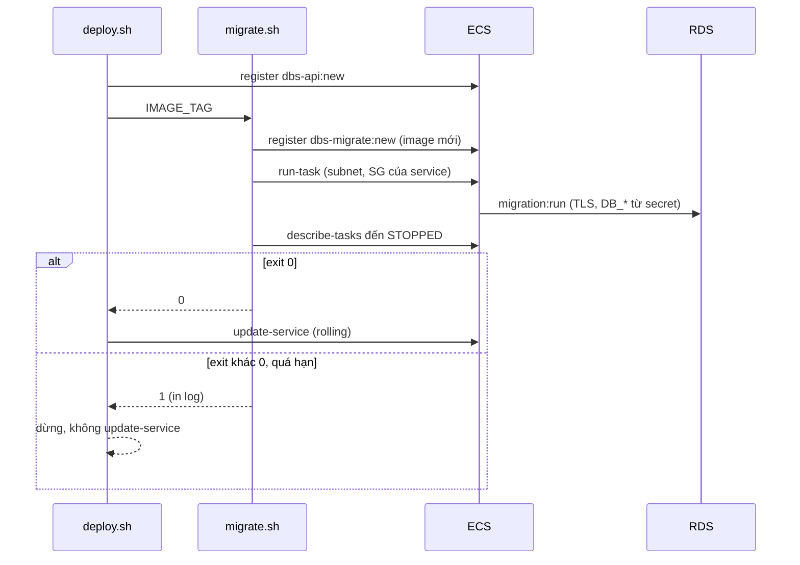

# DBS-68 · Bước migration riêng trong pipeline (task ECS một lần, trước khi deploy)

> **Status:** Implemented (chờ G4, chưa có PR) · **Vai:** #5 Platform & Ops · **Cặp đôi review:** Dev · **Nhánh:** `chore/DBS-68-migration-step` (xếp chồng trên `chore/DBS-67-rds-tls-secrets`) · **PR:** — · **Cập nhật:** 2026-10-26

## 1. Bối cảnh

- **Task trên board:** Task, Tuần 2, Deliverable P3, Ưu tiên High, board "To Do". **Expect:** Migration chạy như một bước riêng trước deploy.
- **DoD** (nguyên văn, đánh số):
  1. Bước pipeline chạy migration:run:prod bằng thông tin kết nối riêng (chưa cần role dbs_migrator đầy đủ, hoàn thiện ở DBS-119) trước khi deploy
  2. Chạy hai lần liên tiếp không lỗi; migration lỗi thì deploy dừng
  3. README ghi cách chạy tay khi cần
  4. PR đã merge vào main (CI xanh); Dev review; bảng «Đối chiếu test case» trong PR điền đủ
- **Thực trạng trên board:** script `migration:run:prod` đã có trong `package.json`; chưa có bước pipeline. Quy tắc: không chạy migration lúc app khởi động; kiểu expand → migrate → contract.
- **Phụ thuộc:** DBS-21 (Done). DBS-67 (To Do trên board, mã đã xong trên nhánh trước, **mọi bước AWS chưa chạy**, BL-106): task chạy migration dùng đúng cách nối DB của DBS-67 (`DB_*` → `DATABASE_URL`, CA bundle trong image). Phạm vi không bị thu hẹp về mã.
- **Đã có gì:** `backend/package.json` `migration:run:prod` = `node ./node_modules/typeorm/cli.js -d dist/database/data-source.js migration:run`; `data-source.ts` import `env.bootstrap` đầu tiên nên ghép `DATABASE_URL` từ `DB_*` (DBS-67); image chứa `dist`, `node_modules`, `package.json`, CA RDS; `.github/scripts/deploy.sh` (DBS-38) đăng ký revision mới của `dbs-api` rồi `update-service`; role OIDC `dbs-github-deploy` (không có `ecs:RunTask`); RDS nằm ở subnet riêng, SG chỉ nhận 5432 từ SG `dbs-dev-api`. docs/03 §13.3: "Migration chạy như một bước riêng trước deploy, expand → migrate → contract". `platform.md`: "run migrations as a one-off ECS task".
- **Ngoài phạm vi:** tạo role `dbs_api`, `dbs_worker`, `dbs_migrator` và dùng `dbs_migrator` (DBS-119, BL-103); seed dữ liệu; migration tự revert khi deploy lỗi (rollback theo kiểu expand, §2); service `worker`; chạy thật trên AWS (§5).
- **Baseline** (lúc bắt đầu): `terraform test` `base` 29/29, `session` 15/15; `test_deploy.py` 17 OK, `test_render_task_definition.py` 6 OK, `check-image-workflow.py` OK. Backend không đổi.
- **Câu hỏi mở** (kèm đề xuất):
  1. **Chạy migration ở đâu?** Runner GitHub không với tới RDS (subnet riêng, SG chỉ cho task api). Đề xuất: task ECS Fargate chạy một lần (`run-task`) với image của commit đang deploy, cùng subnet và SG với service `api` (lấy từ `describe-services`, không ghi cứng).
  2. **Một family hay hai?** Đề xuất family riêng `dbs-migrate` (container `migrate`, `command` = `migration:run`, cpu 256 / mem 512), không dùng `containerOverrides` trên `dbs-api`: khi DBS-119 đổi sang secret của `dbs_migrator`, chỉ sửa Terraform của family này, pipeline giữ nguyên, và task migration không bao giờ nhận quyền của app. Bây giờ cả hai cùng dùng secret master (BL-103) và cùng execution role.
  3. **Thứ tự trong `deploy.sh`:** đăng ký revision api mới → **chạy migration** → `update-service`. Migration lỗi thì thoát trước `update-service` (service vẫn chạy bản cũ).
  4. **Quyền thêm cho `dbs-github-deploy`** (sau review V1-1, V1-2, V1-4, V1-8): `ecs:RunTask` trên `task-definition/dbs-migrate:*` với `ArnEquals ecs:cluster = arn:aws:ecs:<region>:<account>:cluster/dbs-dev`; `ecs:StopTask` trên `task/dbs-dev/*` cùng điều kiện cluster ARN; `ecs:DescribeTasks` trên `task/dbs-dev/*`; `ecs:ListTasks` trên `*` với điều kiện cluster ARN (action này không hỗ trợ giới hạn theo tài nguyên); `ecs:TagResource` cho revision `dbs-api:*` **và** `dbs-migrate:*` (điều kiện `CreateAction = RegisterTaskDefinition`) và cho `task/dbs-dev/*` (điều kiện `CreateAction = RunTask`, vì `run-task` dùng `--propagate-tags TASK_DEFINITION` để task giữ tag chi phí); `logs:GetLogEvents` chỉ trên `<log-group-arn>:log-stream:migrate/*` (không đọc được stream `api/*`). `iam:PassRole` đã có cho hai role.
  5. **Chạy chồng:** TypeORM không có khóa nên hai lần chạy song song (tay và pipeline) có thể va nhau. Đề xuất: `migrate.sh` từ chối chạy khi `list-tasks --family dbs-migrate --desired-status RUNNING` còn task. Hai lần chạy cùng lúc hoàn toàn trong một khoảng hở nhỏ vẫn có thể lọt: chấp nhận (dev, một người vận hành), ghi ở §2.
  6. **Đợt khởi động đầu (`desired_count = 0`):** `deploy.sh` bỏ qua khi service không có task, nên lần dựng đầu phải chạy `migrate.sh` bằng tay trước khi nâng `desired_count` lên 1. Đề xuất: ghi vào README (đúng `platform.md` "Up"), không đổi hành vi bỏ qua của `deploy.sh`.
- **Quyết định ở G1** (tự duyệt theo `CLAUDE_local.md`, 2026-10-26): theo đề xuất cả sáu. Không có câu hỏi chạm ADR, schema bảng của người khác, hợp đồng event, `ErrorCode`, biến môi trường dùng chung hay quy tắc tiền (không biến mới; `DB_*` đã chốt ở DBS-67).

## 2. Hành vi

**`.github/scripts/migrate.sh`** (mới; chạy bởi `deploy.sh` hoặc bằng tay): `IMAGE_TAG=<sha40> AWS_PROFILE=dbs-admin bash .github/scripts/migrate.sh`.

| Điều kiện | Kết quả |
|---|---|
| `IMAGE_TAG` không phải 40 hex | thoát 1 trước mọi lời gọi `aws` |
| Service `api` không tồn tại hoặc không ACTIVE | thoát 1 (khi gọi từ `deploy.sh` trường hợp này đã bị bỏ qua từ trước) |
| Đã có task `dbs-migrate` đang `RUNNING` (`list-tasks`) | thoát 1, nêu ARN task đang chạy; không `run-task` |
| `describe-task-definition dbs-migrate` lỗi `Unable to describe task definition` (family chưa có hoặc không còn revision ACTIVE) | thoát 1, thông báo: chạy `terraform apply` ở `session`; lỗi khác (`AccessDenied`, mạng) in nguyên stderr, không nói "chưa có" |
| Bình thường | render revision `dbs-migrate` từ revision ACTIVE mới nhất, chỉ đổi image container `migrate` thành `<repo>:<tag>` (bỏ qua đăng ký nếu đã đúng image) → `run-task` Fargate, `count 1`, `started-by migrate-<sha7>`, subnet, SG và `assignPublicIp` lấy từ service → poll `describe-tasks` đến `STOPPED` |
| Container `migrate` thoát mã 0 | in "Migration xong", thoát 0 |
| Container thoát khác 0, hoặc không có `exitCode` (task chết trước khi chạy: kéo image lỗi, thiếu quyền secret) | in `stoppedReason` và 50 dòng log cuối, thoát 1 |
| `run-task` trả `failures` hoặc không có task; hoặc `describe-tasks` trả `failures`/`tasks` rỗng (tối đa 3 lần lỗi liên tiếp kể cả lỗi gọi `aws`, mỗi lần chờ `POLL_SECONDS`) | in lý do, thoát 1, không lặp tới hạn |
| Quá `MIGRATE_DEADLINE_SECONDS` (mặc định 600), ở bất kỳ trạng thái nào (PROVISIONING, PENDING, RUNNING) | `stop-task` (lỗi của lệnh này bị bỏ qua), **chờ `STOPPED`** tối đa 120 s, rồi quyết theo `exitCode` thật: 0 (task vừa xong đúng lúc) thì thành công; còn lại thoát 1 với thông báo "quá hạn", không phải "migration lỗi" |

`exitCode` đọc từ container tên `migrate`, không phải phần tử đầu. Log lấy từ stream `migrate/migrate/<task-id>`; stream không tồn tại thì bỏ qua, không làm lỗi thêm. Log in giữa `::group::`/`::endgroup::`, bọc bằng `::stop-commands::<token ngẫu nhiên>` để dòng log bắt đầu bằng `::` không thành lệnh của runner, mỗi dòng cắt 2000 ký tự, và `DB_HOST` của task definition được `::add-mask::` trước khi in.

**`deploy.sh`:** thêm bước giữa đăng ký task definition và `update-service`: `bash migrate.sh`; mã thoát khác 0 thì `deploy.sh` thoát 1 và **không gọi `update-service`**. Các đường bỏ qua cũ (không có cluster, service, `desiredCount = 0`, tag chưa lên ECR, commit không còn là đầu `main`) không chạy migration.

**Chạy hai lần liên tiếp:** TypeORM ghi các migration đã chạy vào bảng `migrations`; lần hai không có gì để chạy và thoát 0. Script không giữ trạng thái nên chạy lại được. `concurrency` của `deploy.yml` (DBS-38) chặn hai deploy song song; chạy tay chen vào pipeline bị chặn bằng kiểm `list-tasks` ở trên (còn hở rất nhỏ giữa kiểm và `run-task`).

**Khởi động đầu:** khi `desired_count = 0` `deploy.sh` bỏ qua (không có task api); trình tự "Up" ghi ở README: `apply` → đẩy image → `migrate.sh` bằng tay → nâng `desired_count`.

**Quy tắc phối hợp với deploy:** migration chạy khi bản app cũ vẫn đang phục vụ, nên mỗi migration phải tương thích ngược (expand). Deploy lỗi sau khi migration đã chạy thì rollback task definition (DBS-38) không hoàn tác schema; contract (xóa cột, đổi tên) chỉ làm ở release sau khi bản dùng cột cũ đã gỡ.

**Rủi ro còn lại:** (a) task migration dùng secret master (BL-103, DBS-119). (b) Log lỗi của task in vào log của GitHub Actions và có thể chứa tên máy chủ RDS, tên user DB, giá trị dữ liệu trong `detail` của lỗi Postgres (không chứa mật khẩu: `typeorm` không in chuỗi kết nối); chỉ in khi migration lỗi, đã che `DB_HOST` và vô hiệu lệnh `::`. Giả định repo private; nếu thành public thì bỏ việc in log (BL-109). (c) TypeORM mặc định `migrationsTransactionMode: 'all'`: mọi migration đang chờ chạy trong **một** transaction nên task chết giữa chừng không để schema nửa chừng; đổi lại không dùng được `CREATE INDEX CONCURRENTLY` hay `ALTER TYPE ... ADD VALUE` trong cùng lô (hiện chưa có, cần thì đổi sang `each` hoặc đường riêng, BL-109). (d) Hai migration cùng timestamp hoặc thứ tự lệch không thuộc task này. (e) Mật khẩu master xoay 7 ngày (BL-107): task migration đọc secret mới ở mỗi lần chạy nên không bị ảnh hưởng.

## 3. Kiến trúc

- **Vị trí:** `.github/scripts/migrate.sh` (mới), `deploy.sh` (gọi `migrate.sh`), `render-task-definition.py` (thêm `--container`, mặc định `api`), `infra/terraform/envs/dev/session/ecs.tf` (task definition `dbs-migrate`), `infra/terraform/envs/dev/base/deploy_role.tf` (quyền), README Terraform và backend, BACKLOG.
- **Task definition `dbs-migrate`:** cùng execution role và task role với `dbs-api` (execution role đã đọc secret master, DBS-67; task role không có quyền nào; DBS-119 sẽ tách, xem dưới); container `migrate`, `essential`, `image = ${ecr}:${var.image_tag}`, `command = ["node","./node_modules/typeorm/cli.js","-d","dist/database/data-source.js","migration:run"]` (đúng `migration:run:prod`; không qua `npm`, không `shell`), môi trường `NODE_ENV`, `AWS_REGION`, `DB_HOST`, `DB_PORT`, `DB_NAME`, `DATABASE_SSL`, `DATABASE_SSL_CA_PATH`, secret `DB_USER` và `DB_PASSWORD` giống `dbs-api`, log vào log group api với `awslogs-stream-prefix = "migrate"` (stream thực tế `migrate/migrate/<task-id>`). Chi phí: Fargate 0,25 vCPU / 0,5 GB ≈ 0,012 USD/giờ, tối đa 600 s mỗi lần. `destroy session` bỏ task definition; chỉ còn log event ở log group của `base` (giữ 7 ngày). Không `portMappings`, không `COGNITO_*` (CLI không đọc; kiểm bằng M-68-08, không chỉ nói).
- **Mạng:** `run-task --propagate-tags TASK_DEFINITION --network-configuration` dựng từ `networkConfiguration.awsvpcConfiguration` của service `api` (subnet public, SG `dbs-dev-api`, `assignPublicIp ENABLED`): SG này đã được RDS cho vào cổng 5432; task cần public IP để kéo image (không NAT, ADR-10).
- **Quyền của role deploy** (`base/deploy_role.tf`): xem câu hỏi 4. Không thêm quyền `secretsmanager`/`rds`; role không đọc được secret. DBS-119 khi tách secret/role cho `dbs_migrator` sẽ phải thêm execution role riêng và sửa danh sách `iam:PassRole` ở file này (không chỉ Terraform của family `dbs-migrate`).
- **Interface:** `render-task-definition.py --image <ref> [--container <tên>]`. Người gọi (grep): `deploy.sh` (không đổi hành vi), test. `migrate.sh` đọc env `CLUSTER`, `SERVICE`, `MIGRATE_FAMILY`, `MIGRATE_DEADLINE_SECONDS`, `POLL_SECONDS` (đều có mặc định).
- **Ranh giới transaction / dữ liệu:** không chạm bảng nào ngoài việc TypeORM chạy migration đã có; không migration mới.
- **Sơ đồ:**

- **Thay đổi cấp hệ thống:** `infra/terraform/README.md` (mục Migration), `backend/README.md` (cách chạy tay), `docs/BACKLOG.md`. docs/03 §13.3 đã mô tả đúng ("bước riêng trước deploy"); không sửa.

## 4. Test cases tự động

`python3` (stdlib) với `aws` giả như DBS-38, chạy trong job CI của `.github/scripts`; `terraform test` với `mock_provider`.

| ID | Truy vết | Lớp | Given · When · Then | Mong đợi |
|---|---|---|---|---|
| TC-68-01 | DoD 1 | python, `aws` giả | `migrate.sh` thành công: đăng ký `dbs-migrate` với image `<repo>:<tag>` (chỉ container `migrate` đổi), `run-task` có cluster, ARN revision mới, `FARGATE`, `count 1`, `started-by migrate-<sha7>`, subnet/SG/`assignPublicIp` lấy từ service; poll đến `STOPPED` | thoát 0, in "Migration xong" |
| TC-68-02 | DoD 2 | python | Container thoát mã 1 | `migrate.sh` thoát 1, in log cuối và `stoppedReason`; chạy qua `deploy.sh`: **không có** lời gọi `update-service` |
| TC-68-03 | DoD 2 | python | Container không có `exitCode` (task chết khi kéo image); task có hai container, `exitCode` đọc đúng container `migrate` | thoát 1, in `stoppedReason`; đọc đúng container |
| TC-68-04 | DoD 2 | python | `run-task` trả `failures`; `describe-tasks` trả `failures`/`tasks` rỗng; lỗi `aws` thoáng qua 1 lần rồi hồi phục; lỗi 3 lần liên tiếp | `failures`: thoát 1 không lặp; thoáng qua: tiếp tục tới xong; 3 lần: thoát 1; không `update-service` |
| TC-68-05 | DoD 2 | python | Task kẹt `PENDING`, rồi `RUNNING`, quá `MIGRATE_DEADLINE_SECONDS`; `stop-task` báo lỗi vì task vừa `STOPPED`; sau `stop-task` task có `exitCode` 0 hoặc 137 | gọi `stop-task`, chờ `STOPPED`, thoát 1 với "quá hạn" (137), thoát 0 nếu `exitCode` 0; lỗi `stop-task` không che mã thoát |
| TC-68-06 | DoD 2 | python | `describe-task-definition` lỗi `Unable to describe task definition` → thông báo `terraform apply`; lỗi `AccessDenied` → in nguyên lỗi, không nói "chưa có"; còn task `dbs-migrate` đang `RUNNING` → từ chối | thoát 1, không `run-task`, thông báo đúng từng ca |
| TC-68-16 | an toàn | python | Log của task có dòng `::set-output::x`, `::error::x`, `::stop-commands::`, dòng 5000 ký tự; stream log không tồn tại | log in trong `::group::` bọc `::stop-commands::<token>`, không dòng `::` nào ở đầu dòng ngoài lệnh của script, dòng bị cắt 2000, `DB_HOST` có `::add-mask::`; stream thiếu không làm lỗi thêm |
| TC-68-07 | DoD 2 | python | Chạy `migrate.sh` hai lần liên tiếp; lần hai revision mới nhất đã đúng image | cả hai thoát 0; lần hai không đăng ký lại, vẫn `run-task` |
| TC-68-08 | DoD 1 | python | `deploy.sh` đường thành công | thứ tự gọi: `register-task-definition`(api) → `register-task-definition`(migrate) → `run-task` → `update-service`; các đường bỏ qua cũ (không cluster, `desiredCount 0`, tag chưa có, không phải đầu main) **không** gọi `run-task` |
| TC-68-09 | an toàn | python | `IMAGE_TAG=latest` hoặc rỗng | thoát 1 trước mọi lời gọi `aws` |
| TC-68-10 | DoD 1 | python | `render-task-definition.py --container migrate`: chỉ container `migrate` đổi image, `command` giữ nguyên; `--container` không tồn tại → lỗi; mặc định `api` như cũ | đúng |
| TC-68-11 | DoD 1 | tf test (session) | Task definition `dbs-migrate`: family, container `migrate`, `command` = `migration:run:prod`, đủ `DB_*`, `DATABASE_SSL=true`, CA path, `secrets` `DB_USER`/`DB_PASSWORD` trỏ secret master, cùng hai role với `dbs-api`, log group api prefix `migrate`, không `portMappings`, không `secrets` hay env nào có `COGNITO`/`REDIS` | đúng |
| TC-68-12 | an toàn | tf test (base) | Policy deploy: `ecs:RunTask` chỉ trên `task-definition/dbs-migrate:*` với `ArnEquals` + khóa `ecs:cluster` + giá trị đúng `cluster/dbs-dev` ARN; `StopTask` cùng điều kiện, `DescribeTasks` chỉ trên `task/dbs-dev/*`; `ListTasks` có điều kiện cluster; `TagResource` trên `dbs-api:*` và `dbs-migrate:*` (CreateAction RegisterTaskDefinition) và `task/dbs-dev/*` (RunTask); `GetLogEvents` chỉ trên `:log-stream:migrate/*`, không khớp `api/*`; không `ecs:*`, không `Resource = "*"` mới ngoài `ListTasks` và ba action cũ | đúng |
| TC-68-17 | DoD 2 | không làm | Testcontainers: chạy `createMigrationDataSource` hai lần trên Postgres thật (lần hai 0 migration) và một migration lỗi giữ nguyên `migrations` | **chưa làm** ở task này: máy dev không có Docker nên không chứng minh được; chuyển BL (M-68-04 là bằng chứng thật khi chạy) |
| TC-68-13 | hồi quy | tất cả | `terraform test` (`base`, `session`), `test_deploy.py`, `test_render_task_definition.py`, `check-image-workflow.py`, `check-doc-links.mjs`, `fmt -check` | xanh |
| TC-68-14 | DoD 3 | thủ công | README (Terraform và backend) có lệnh chạy tay | thủ công |
| TC-68-15 | DoD 4 | quy trình | PR merge, CI xanh, Dev review, bảng đối chiếu | quy trình |

## 5. Test thủ công

Điều kiện: `.tools/bin` trong PATH, profile `dbs-admin` (read-only ở đây), không `apply`/`destroy`.

| Bước | Việc làm | Kết quả mong đợi | Trạng thái dự kiến |
|---|---|---|---|
| M-68-01 | `bash -n` cho `migrate.sh`, `deploy.sh`; `IMAGE_TAG=latest bash .github/scripts/migrate.sh` thật (không `aws` giả) | cú pháp đúng; từ chối trước mọi lời gọi `aws`, thoát 1 | chạy |
| M-68-02 | `terraform plan` ở `session` (`-lock=false`, không `apply`) | thêm `aws_ecs_task_definition.migrate`; `grep -i password` không thấy giá trị | chạy; nếu không đọc được state thì chạy `terraform validate` và ghi "chưa chạy" |
| M-68-03 | `terraform plan` ở `base` (`-lock=false`) | chỉ `aws_iam_role_policy.deploy` đổi tại chỗ (thêm statement), không tạo/xóa tài nguyên khác | chạy nếu state `base` đọc được |
| M-68-04 | Dựng `session`, đẩy image, `migrate.sh` lần 1 rồi lần 2 trên RDS thật | lần 1 áp dụng migration, lần 2 "No migrations are pending", cả hai thoát 0 | **chưa chạy** (cần `apply` AWS thật, RDS ≈ 0,03 USD/giờ; người dùng dặn ghi chưa chạy): BACKLOG |
| M-68-05 | Cùng môi trường: image có migration cố ý lỗi; chạy `deploy.sh` | `migrate.sh` thoát 1, `update-service` không được gọi, service vẫn ở revision cũ | **chưa chạy**: BACKLOG |
| M-68-06 | `workflow_dispatch` Deploy từ `main` thật | bước migration thấy trong log, xanh | **chưa chạy** (chờ merge và biến repo, BL-104): BACKLOG |
| M-68-07 | `aws iam simulate-custom-policy` với policy JSON dựng từ `terraform plan` của `base` (có `ecs:cluster` trong `ContextEntries`): `ecs:RunTask` trên `dbs-migrate:1` (cluster đúng và sai) và trên `dbs-api:1` | cho phép dbs-migrate với cluster đúng; từ chối cluster sai và `dbs-api` | chạy nếu profile có `iam:SimulateCustomPolicy`, nếu không: chưa chạy, BACKLOG |
| M-68-08 | Sau `npm run build`: `NODE_ENV=staging` và **chỉ** các biến mà task definition đặt (`DB_*`, `DATABASE_SSL`, CA path), chạy `node -e "require('./dist/database/data-source')"` | nạp được `data-source` và entity mà không đòi `COGNITO_*`, `REDIS_URL`, `APP_ROLE` | chạy |

## 6. Domain review (AI)

**Reviewer:** subagent general-purpose (model mặc định của phiên), 2026-10-26 · **Kết quả:** 16 phát hiện (blocking 2, should-fix 10, minor 4), verdict REVISE · [trả lời nguyên văn](screenshots/DBS-68/domain-review.md)

| # | Mức | Phát hiện | Xử lý |
|---|---|---|---|
| 1 | blocking | `ecs:cluster` phải là ARN, dùng `ArnEquals` | đã sửa §1 Q4, §3, TC-68-12 |
| 2 | blocking | `TagResource` chỉ cho `dbs-api:*`; task không có tag chi phí | đã sửa: danh sách resource, thêm `RunTask` CreateAction, `--propagate-tags` |
| 3 | should-fix | TypeORM mặc định transaction `all`, không phải mỗi migration | đã sửa §2 (c); BL-109 |
| 4 | should-fix | `concurrency` không chặn chạy tay; TypeORM không khóa | đã sửa: kiểm `list-tasks`, `ListTasks`, TC-68-06, §1 Q5 |
| 5 | should-fix | đường `stop-task`: chờ STOPPED, race, 137, PENDING | đã sửa §2, TC-68-05 |
| 6 | should-fix | `describe-tasks` có `failures`, container tên `migrate`, lỗi thoáng qua | đã sửa §2, TC-68-03, TC-68-04 |
| 7 | should-fix | log vào CI: `::` injection, tên user/host, dữ liệu | đã sửa §2, TC-68-16 |
| 8 | should-fix | tên stream và resource `GetLogEvents` | đã sửa §3, Q4, TC-68-12 |
| 9 | should-fix | BL-103/046, thiếu ID BL cho bước chưa chạy | đã sửa ở Phase 5 (BL-103 sửa, BL-109, 049 thêm) |
| 10 | should-fix | `desired_count = 0` không migrate | đã sửa: ghi trình tự "Up" vào README, §1 Q6, §2 |
| 11 | should-fix | CLI nạp entity với env rút gọn chưa được kiểm | đã sửa: M-68-08 chạy thật |
| 12 | should-fix | không có test Postgres thật cho chạy hai lần | không sửa trong task này (không có Docker): TC-68-17 "chưa làm", BL-110 |
| 13 | minor | phân biệt "chưa có family" với `AccessDenied` | đã sửa §2, TC-68-06 |
| 14 | minor | chi phí và dọn | đã sửa §3 |
| 15 | minor | DBS-119 cũng phải sửa PassRole | đã sửa §3 |
| 16 | minor | fallback khi không đọc được state | đã sửa §5 |

**Quyết định ở G2** (tự duyệt, 2026-10-26): sửa như bảng; vì REVISE, phần đã đổi được review lại ở Phase 3 bằng rà soát kế hoạch (không có phát hiện blocking mới được giữ lại).

## 7. Kế hoạch triển khai

Mỗi bước: test trước, chạy thấy đỏ, code tối thiểu, xanh, commit.

| Bước | File | Test viết trước | Kết quả đỏ (điền khi chạy) | Lệnh chứng minh | Commit |
|---|---|---|---|---|---|
| 1 | `render-task-definition.py` (`--container`) | TC-68-10 | (điền) | `python3 .github/scripts/tests/test_render_task_definition.py` | `feat(ci): render task definition per container` |
| 2 | `fake_aws_deploy.py` (run-task, describe-tasks, stop-task, list-tasks, logs), `migrate.sh`, `tests/test_migrate.py` | TC-68-01..07, 09, 16 | (điền) | `python3 .github/scripts/tests/test_migrate.py` | `feat(ci): one-off ecs migration task script` |
| 3 | `deploy.sh`, `test_deploy.py` | TC-68-02 (qua deploy), 08 | (điền) | `python3 .github/scripts/tests/test_deploy.py` | `feat(ci): run migration before update-service` |
| 4 | `session/ecs.tf`, `tests/session.tftest.hcl` | TC-68-11 | (điền) | `terraform test` ở `session` | `feat(infra): migrate task definition` |
| 5 | `base/deploy_role.tf`, `tests/deploy_role.tftest.hcl` | TC-68-12 | (điền) | `terraform test` ở `base` | `feat(infra): deploy role may run the migration task` |
| 6 | `infra/terraform/README.md`, `backend/README.md`, `docs/BACKLOG.md`, `docs/features/README.md` | TC-68-14 | n/a | `check-doc-links.mjs` | `docs(infra): migration step` |
| 7 | (không file) | M-68-01..03, 07, 08 | n/a | theo §5, output vào `screenshots/DBS-68/manual-test.txt` | `docs(features): DBS-68 results` |

Rủi ro và cách lùi: lùi bằng revert; không đổi schema, không đổi bảng. Role deploy chỉ có quyền mới sau khi chủ repo `apply base` (BL); trước đó `Deploy` lên cloud sẽ đỏ ở `run-task` với `AccessDenied` thay vì deploy bản chưa migrate (fail an toàn). Rà soát kế hoạch (plan sweep): mọi mục trong §4 có bước; mọi giới hạn nêu ở §2 (khởi động đầu, chạy chồng, log, transaction) có dòng README hoặc BL. **Quyết định ở G3** (tự duyệt): kế hoạch như trên; không `apply` AWS, không push.

## 8. Kết quả

- **Lệnh kiểm tra** (SHA code cuối `ebeb1ca`): `test_migrate.py` **19 OK** (mới), `test_deploy.py` **20 OK** (17 cũ + 3 mới), `test_render_task_definition.py` **9 OK** (6 + 3), `check-image-workflow.py` OK; `terraform test`: `base` **30/30** (29 cũ + 1 mới, 2 assert cũ sửa), `session` **16/16** (15 + 1); `terraform fmt -check -recursive` sạch ở cả hai; `check-doc-links.mjs` 0 link hỏng. Không `.skip`, `.only`, `.todo` (0 skipped). Backend không đổi mã.
- **Đối chiếu test case:**

| ID | Test | Đạt? |
|---|---|---|
| TC-68-01 | `test_migrate.py` › `test_success_registers_new_image_and_runs_task_with_service_network`, `test_network_configuration_comes_from_the_service` | đạt |
| TC-68-02 | `test_nonzero_exit_is_red_and_prints_logs`; `test_deploy.py` › `test_failed_migration_stops_the_deploy` | đạt |
| TC-68-03 | `test_missing_exit_code_is_red_...`, `test_exit_code_is_read_from_the_container_named_migrate` | đạt |
| TC-68-04 | `test_run_task_failures_...`, `test_describe_tasks_failures_stop_after_three_times`, `test_transient_describe_error_recovers`, `test_three_describe_errors_in_a_row_are_red` | đạt |
| TC-68-05 | `test_deadline_stops_the_task_...`, `test_stop_task_error_does_not_hide_a_successful_exit`, `test_task_that_never_stops_...` (ca PENDING nằm trong chuỗi PENDING → RUNNING của ca đầu) | đạt |
| TC-68-06 | `test_family_missing_...`, `test_access_denied_is_passed_through_...`, `test_running_migration_blocks_a_second_run` | đạt |
| TC-68-07 | `test_run_twice_second_time_does_not_register_again` (chỉ chứng minh script chạy lại được; hành vi TypeORM thật xem TC-68-17) | đơn giản hóa (aws giả, không có Postgres) |
| TC-68-08 | `test_migration_runs_between_register_and_update_service`, `test_skip_paths_never_run_a_migration` | đạt |
| TC-68-09 | `test_bad_tags_rejected_before_aws` | đạt |
| TC-68-10 | `test_render_task_definition.py` › ba test `--container` | đạt |
| TC-68-11 | `session.tftest.hcl` › `migrate_task_definition` | đạt |
| TC-68-12 | `deploy_role.tftest.hcl` › `deploy_policy_migration` (+ `deploy_policy` sửa) | đạt |
| TC-68-13 | toàn bộ lệnh ở trên | đạt |
| TC-68-14 | README Terraform và backend | đạt |
| TC-68-15 | quy trình | chưa làm (chờ review và merge) |
| TC-68-16 | `test_hostile_log_lines_...`, `test_db_host_is_masked_...`, `test_missing_log_stream_...` | đạt |
| TC-68-17 | test Postgres thật chạy hai lần | **chưa làm** (không có Docker): BL-110 |

17 test case: 14 đạt, 1 đơn giản hóa (TC-68-07), 2 chưa làm (TC-68-15 quy trình, TC-68-17).

- **Test thủ công** ([manual-test.txt](screenshots/DBS-68/manual-test.txt), SHA `ebeb1ca`, id tài khoản AWS đã thay bằng `<account>`):

| Bước | Kết quả |
|---|---|
| M-68-01 | đạt: `bash -n` đúng; `IMAGE_TAG=latest` bị từ chối, thoát 1, không gọi `aws` |
| M-68-02 | đạt: `plan` ở `session` báo `17 to add` (16 cũ + `aws_ecs_task_definition.migrate`); chỉ thấy cờ `manage_master_user_password` và `password_wo` |
| M-68-03 | đạt, **khác kỳ vọng ban đầu**: `plan` ở `base` báo `2 to add` (role `dbs-github-deploy` và policy của nó); role của DBS-38 chưa từng được `apply` (BL-104), nên không phải "đổi tại chỗ". Không có thay đổi nào khác |
| M-68-04, 05, 06 | **chưa chạy** (cần AWS thật, `apply`; người dùng dặn ghi chưa chạy): BL-109 |
| M-68-07 | đạt một phần: simulator cho phép `RunTask dbs-migrate:1` với cluster ARN đúng, từ chối cluster sai, từ chối `dbs-api`, từ chối tên cluster không ARN, cho phép `StopTask`; `GetLogEvents` chỉ khớp ARN có `:*` ở cuối (dạng không `:*` bị từ chối, nên policy liệt kê cả hai dạng) và từ chối `api/*` ở cả hai dạng. Hành vi thật của IAM với log stream chưa kiểm: BL-109 |
| M-68-08 | đạt một phần: `data-source` nạp với env rút gọn của task (không `COGNITO_*`, `REDIS_URL`, `APP_ROLE`); repo chưa có file `*.entity.js` (0 file) nên phần nạp entity chưa chứng minh được: BL-110 |

Chưa có ảnh chụp màn hình (không có bước giao diện; bằng chứng là `manual-test.txt`).
- **Chưa chứng minh bằng chạy thật:** `run-task` Fargate thật vào RDS, quyền IAM của role thật, lần chạy hai lần liên tiếp với TypeORM thật, hành vi `deploy.sh` khi migration lỗi trên AWS. Mọi test của script dùng `aws` giả nên chỉ chứng minh logic.
- **Phạm vi so với §7:** khớp; thêm `fake_aws_deploy.py` và sửa `test_deploy.py` (mặc định migration thành công, đổi một assert vì `dbs-migrate` có thể đăng ký revision), như §7 bước 2–3 đã gồm. Không có file ngoài kế hoạch.
- **Lệch so với kế hoạch (tự ghi, người duyệt xem ở G4):** (1) `migrate.sh` được viết trước test của nó; test sau đó viết với script đặt tạm ra ngoài, xác nhận đỏ (19/19 lỗi vì thiếu script), rồi đặt lại script và xanh; thêm 4 phép thử đột biến (bỏ `::add-mask::`, bỏ kiểm đang chạy, luôn coi `exitCode` là 0, ngưỡng 3 lần lỗi) đều làm test đỏ. Cột "Kết quả đỏ" của §7 vì vậy không điền từng dòng. (2) Resource `GetLogEvents` sửa thêm dạng `:*` sau khi M-68-07 cho thấy simulator chỉ khớp dạng đó; test và code đổi cùng lúc, không chạy riêng test đỏ.
- **Bàn giao / BACKLOG:** BL-109 (chạy thật M-68-04..06, `apply base`, kiểm quyền log thật), BL-110 (giới hạn đã chấp nhận: test Postgres thật, transaction `all`, log khi repo public, nạp entity). Đã sửa BL-103 (tạo role chuyển sang DBS-119, kèm execution role riêng và PassRole) và BL-107 (task migration không bị ảnh hưởng bởi xoay mật khẩu).

## 9. Tài liệu đã cập nhật

- `infra/terraform/README.md`: mục "Migration trước deploy (DBS-68)" (luồng, chạy tay, trình tự "Up" lần đầu, quy tắc).
- `backend/README.md`: mục migration trỏ tới bước pipeline và lệnh chạy tay.
- `docs/BACKLOG.md`: thêm BL-109, BL-110; sửa BL-103, BL-107.
- `docs/features/README.md`: thêm dòng DBS-68.
