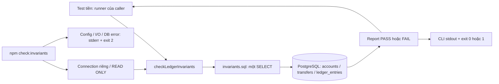
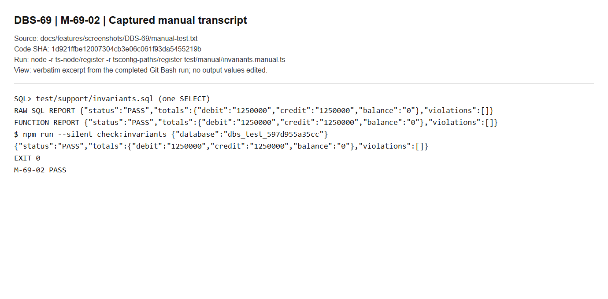
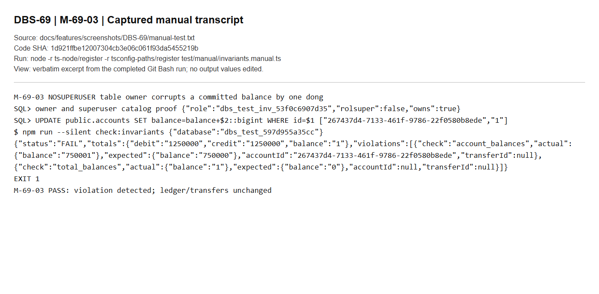
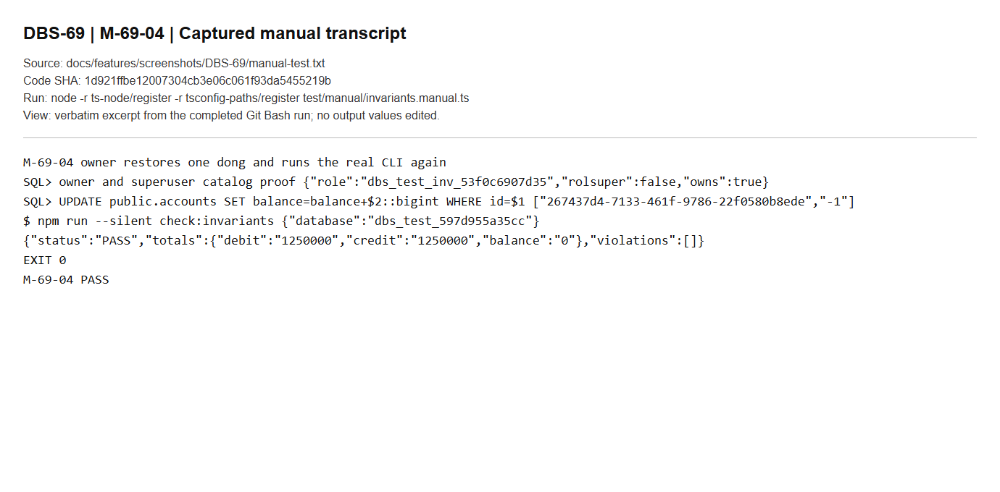
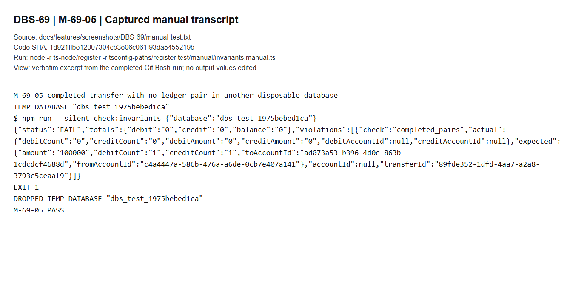
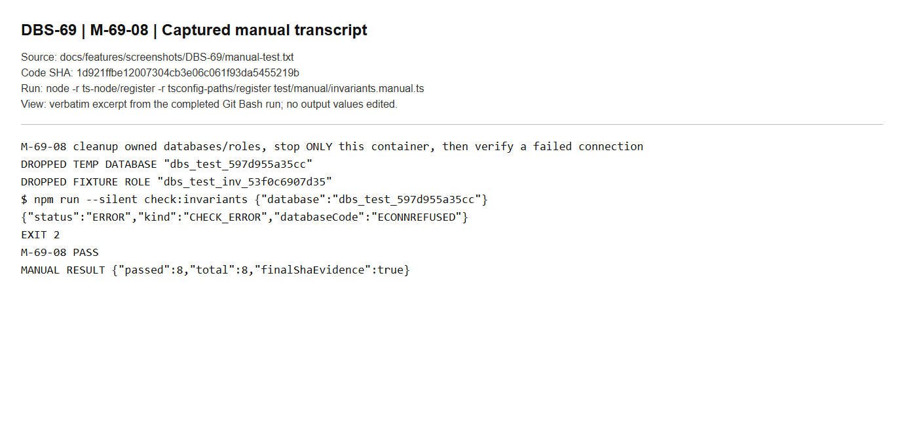

# DBS-69 · Script kiểm tra bất biến sổ cái

> **Status:** Plan approved (code và bằng chứng local hoàn tất, chờ G4) · **Vai:** Dev · **Cặp đôi review:** chưa chỉ định · **Nhánh:** `codex/DBS-69-ledger-invariants` · **PR:** — · **Cập nhật:** 2026-10-29

## 1. Bối cảnh

### Task trên board

Đọc trực tiếp ngày 2026-10-28, xác minh lại ngày 2026-10-29 (yêu cầu/status/dependency không đổi) bằng `node .claude/skills/dbs-delivering-task/scripts/fetch-task.mjs DBS-69`.

| Trường | Giá trị |
|---|---|
| Issue Key | DBS-69 |
| Loại / tuần | Task / Tuần 2 |
| Tóm tắt | Script kiểm tra bất biến sổ cái (SQL) và cách thử bằng cố ý làm lệch |
| Assignee (vai) / ưu tiên | Dev / High |
| Status | In Progress |
| Deliverable / Demo | P4 |
| Phụ thuộc | DBS-21 Migration 2: transfers, ledger_entries, idempotency_keys, … (T1) — Done |
| Thực trạng trên board | Chưa có script kiểm tra. Bất biến cần chứng minh: Nợ = Có, tổng số dư = 0, không tài khoản khách nào âm. |

**Expect (nguyên văn):** Có công cụ chứng minh tiền không sai, dùng sau mọi test và load test.

**DoD (nguyên văn):**

1. Script kiểm: (1) tổng DEBIT = tổng CREDIT; (2) accounts.balance = tổng bút toán của từng tài khoản; (3) SUM(balance) mọi tài khoản = 0; (4) không tài khoản khách nào âm; (5) mỗi giao dịch COMPLETED có đúng 1 DEBIT + 1 CREDIT cùng số tiền
2. Mã thoát ≠ 0 và in id tài khoản/giao dịch lệch khi vi phạm
3. Thử cố ý sửa một số dư bằng role chủ bảng → script báo lệch; sửa lại → sạch
4. Gọi được từ test (hàm) và từ dòng lệnh (CI, load test); ghi cách dùng ở backend/README
5. PR đã merge vào main (CI xanh); Dev review; bảng «Đối chiếu test case» trong PR điền đủ

### Đã có gì và phụ thuộc thực tế

- Checkout ban đầu sạch trên `main` tại `ab53152`. Đã fetch, fast-forward tới `origin/main` tại `b8742a3d137b0081120f87fa6e5959656a0665b6` (DBS-41), rồi tạo nhánh riêng nêu trên. Tại G1 chưa commit, push hoặc mở PR cho DBS-69; trạng thái bàn giao hiện tại xem §8.
- DBS-21 thực sự có [migration transfers/ledger/idempotency](../../backend/src/database/migrations/1791849600000-CreateTransfersLedgerIdempotency.ts), [DB tests](../../backend/test/db/ledger-schema.db-spec.ts) và [feature doc](DBS-21-migration-transfers-ledger-idempotency.md). Accounts và SYSTEM funding có trong [DBS-20](DBS-20-migration-users-customers-accounts.md); trigger chỉ-thêm có trong [DBS-27](DBS-27-append-only-triggers.md).
- Constraints hiện chặn khách âm và sai tiền/nguồn/đích bút toán, nhưng vẫn cho `COMPLETED` thiếu bút toán và số dư tài khoản lệch sổ. Dữ liệu hỏng vốn bị CHECK/FK chặn cần cách dựng fixture cô lập được trình ở G2; không nới ràng buộc schema ứng dụng.
- Tìm code, tests và npm scripts chưa thấy công cụ kiểm bất biến hay caller. [Module notes](../../.claude/skills/dbs-delivering-task/references/module-notes.md) và [testing](../../.claude/skills/dbs-delivering-task/references/testing.md) đã dành đường dẫn `backend/test/support/invariants.sql` cho nguồn kiểm SQL dùng chung của DBS-69.
- [Ledger README](../../backend/src/modules/ledger/README.md) xác nhận luồng chuyển/nạp tiền chưa triển khai. Không giả lập service/API đang thiếu để hoàn thành task này.
- Có helper [database tạm](../../backend/test/support/temp-database.ts) và [Testcontainers PostgreSQL 17](../../backend/test/support/postgres.container.ts). Test liên quan tiền phải chạy trên PostgreSQL thật, không mock.

### Quy tắc và phạm vi đề xuất

| Hạng mục | Phạm vi DBS-69 |
|---|---|
| Năm bất biến DoD #1 | Công cụ chỉ đọc, kiểm tất cả tài khoản và bút toán; trả thông tin giúp tìm tài khoản/giao dịch lệch |
| Dấu số dư | `SUM(CREDIT) - SUM(DEBIT)`; tài khoản không có bút toán có số dư kỳ vọng 0 |
| SYSTEM funding | Tính vào tổng số dư toàn hệ thống; cho phép âm. Chỉ tài khoản khách bị coi là vi phạm khi âm, đúng [ADR-09](../adr/0009-funding-system-account.md) |
| Độ chính xác | Tiền dùng bigint/string; tổng SQL có thể vượt miền bigint từng hàng. Không đổi tiền hay tổng tiền thành JavaScript `number` |
| Khi có ghi đồng thời | Kiểm trên cùng trạng thái dữ liệu nhất quán; không báo lệch do các câu kiểm nhìn thấy các thời điểm commit khác nhau |
| Hàm và CLI | Cùng nguồn kiểm SQL, dùng lại từ test và chạy sau load test/CI; không tự chữa dữ liệu |
| Demo cố ý làm lệch | Đề xuất dùng database tạm cô lập, migrate schema thật, seed SQL cân bằng; role chủ bảng sửa `accounts.balance`, chạy kiểm thấy lệch, phục hồi rồi kiểm sạch |
| Tài liệu / bằng chứng | Cách dùng trong [backend/README](../../backend/README.md), feature doc, test và bằng chứng manual PostgreSQL thật |

Nguồn truy vết: [docs/02](../02_REQUIREMENTS_AND_DOMAIN_MODEL.md) AC-5.9, NFR-COR-02, §7.1; [docs/03](../03_HIGH_LEVEL_ARCHITECTURE.md) §8.2; [database-design](../components/_shared/database-design.md) §4.2–4.4, §5, §10; [ADR-02](../adr/0002-postgresql-ledger.md); [ADR-09](../adr/0009-funding-system-account.md).

### Baseline

Chạy trước khi viết code trên base `b8742a3`, Node `v24.15.0`, npm `11.12.1`. `docker compose up -d` thành công; PostgreSQL 17 và Valkey healthy, ElasticMQ running.

| Kiểm tra | Kết quả |
|---|---|
| `npm run lint:check` | Đạt, exit 0 |
| `npm run typecheck` | Đạt, exit 0 |
| `npm test -- --runInBand` | Đạt: 30 suites, 495/495 tests, 0 skipped, exit 0 |
| `npm run test:e2e -- --runInBand` | Đạt: 8 suites, 57/57 tests, 0 skipped, exit 0 |
| `npm run test:db -- --runInBand` | Đạt: 8 suites, 154/154 tests, 0 skipped, exit 0; PostgreSQL 17 Testcontainers thật |

Output các lần chạy được lưu tại [baseline-phase1.txt](screenshots/DBS-69/baseline-phase1.txt). Đây là kiểm tra local của mã nền, chưa phải test cho DBS-69 hoặc GitHub CI. E2E có cảnh báo fixture không cấu hình `COGNITO_ISSUER`; 57 tests vẫn đạt, không coi kết quả này là kiểm chứng Cognito AWS thật.

### Ngoài phạm vi và backlog liên quan

- Không triển khai scheduler đối soát, `reconciliation_runs`, metric/alarm, API nạp/chuyển, seed demo hoặc tích hợp vào những money/load test chưa tồn tại. Task này cung cấp công cụ và cách gọi để các task đó dùng lại.
- Không thêm migration/constraint trigger, sửa schema, quyền production, dependency, env var, event contract, `ErrorCode` hoặc quy tắc tiền.
- Không kiểm chuỗi lịch sử `balance_after` trong DBS-69: DoD chỉ yêu cầu số dư tổng và đủ cặp bút toán. [BL-006](../BACKLOG.md) còn phần trigger/`balance_after`; không xóa hoặc nhận đã xử lý trọn dòng này chỉ nhờ có checker.
- Các mục liên quan giữ ngoài phạm vi: [BL-005, BL-017](../BACKLOG.md) quyền production/chủ view; BL-008 lint tiền diện rộng; BL-015 test thời gian migration từng flaky; BL-019 AuditService và production grants. Nếu baseline tái hiện lỗi, báo riêng và không sửa lẫn task.
- DoD #5 là công việc quy trình cần Dev khác review, CI thật và merge sau khi được cho phép. Hiện chưa thực hiện; đưa phần còn thiếu vào backlog khi bàn giao nếu vẫn chưa đạt. Không tự commit/push/tạo PR hay sửa board khi chưa có quyền từ người dùng.

### Câu hỏi mở / quyết định G1

1. **Đề xuất duyệt phạm vi đủ năm bất biến và function + CLI như trên**, với SYSTEM funding âm hợp lệ; scheduler, chuỗi `balance_after` và production grants ngoài phạm vi.
2. **Đề xuất cho phép seed SQL và cố ý sửa số dư chỉ trong database tạm phục vụ test/manual.** API nạp tiền chưa có nên chưa thể seed qua API theo quy tắc thông thường. Đây là ngoại lệ cho fixture/DoD #3, không đổi cách seed ứng dụng và không sửa ledger_entries/transfers để phục hồi.

**Quyết định ở G1 (2026-10-28):** người dùng trả lời «duyệt G1», chấp thuận hai đề xuất trên: đủ năm bất biến, SYSTEM âm hợp lệ, các giới hạn đã nêu và ngoại lệ seed SQL/cố ý sửa số dư chỉ trong database tạm. G1 không cấp quyền commit/push/tạo PR. Chưa viết code; chỉ thực hiện thiết kế G2.

## 2. Hành vi

### 2.1 Phép kiểm và kết quả

Một câu `WITH … SELECT` chỉ đọc ba bảng `public.accounts`, `public.transfers`, `public.ledger_entries`; không loại tài khoản LOCKED, SYSTEM hoặc tài khoản chưa có bút toán. Không sửa dữ liệu hoặc tự chữa lỗi.

| `check` | Điều kiện sạch | Chi tiết vi phạm |
|---|---|---|
| `ledger_totals` | Tổng DEBIT = tổng CREDIT của toàn bộ sổ | Tổng hai phía; không quy kết tùy ý cho một ID |
| `account_balances` | Mỗi `accounts.balance` = SUM(CREDIT) − SUM(DEBIT); không có entry thì kỳ vọng 0 | Một dòng mỗi account sai: ID, số dư thực và kỳ vọng |
| `total_balances` | SUM(balance) mọi tài khoản, kể cả funding, = 0 | Tổng thực và kỳ vọng `"0"` |
| `customer_balances` | Tài khoản có `type <> 'SYSTEM'` không âm | ID và số dư của từng account khách âm |
| `completed_pairs` | Mỗi transfer COMPLETED có đúng một DEBIT và một CREDIT, mỗi dòng bằng `transfers.amount`, cùng đúng nguồn/đích | ID transfer, ID nguồn/đích, số dòng từng hướng, tổng tiền từng hướng và amount kỳ vọng |

Kiểm cuối bắt cả COMPLETED có **0 dòng** bằng LEFT JOIN từ transfers, không chỉ nhóm các ledger entry đã có. Hai transfer sai bù trừ nhau vẫn phải bị phát hiện. REJECTED không cần cặp; CHECK/FK hiện có chịu trách nhiệm cấm entry cho REJECTED. Checker không mở rộng sang kiểm lịch sử `balance_after`, orphan rows hay toàn bộ ràng buộc schema đã nằm ngoài G1.

Tiền từng hàng và tất cả SUM/count trong kết quả được SQL đổi sang `text` trước khi dựng JSON. SUM và phép trừ dùng `numeric`, không ép aggregate về `bigint`, `Money` hoặc `Balance`; không dùng JavaScript Number/parseInt trên tiền. Sắp xếp vi phạm theo thứ tự năm check, rồi ID để kết quả ổn định. Không cắt bớt ID vi phạm.

DB mới migrate chỉ có funding 0, hoặc các bảng tồn tại nhưng không có phát sinh, trả PASS. Thiếu bảng/quyền, lỗi SQL, timeout hoặc không đọc được file SQL là ERROR, không phải PASS. Có thể chạy hàm trong transaction của caller để nhìn thấy cả dữ liệu chưa commit của chính transaction đó; kiểm sau commit từ kết nối riêng chỉ thấy trạng thái đã commit.

### 2.2 Hàm và CLI

SQL trả đúng một hàng có cột `report` JSONB. Hàm trả cùng report đó; không ghi log, mở/commit/rollback transaction hoặc tạo kết nối. Lỗi thực thi/nạp SQL hoặc hình dạng kết quả không hợp lệ làm hàm reject. Các `check` là nhãn nội bộ công cụ; không sửa enum HTTP `ErrorCode`.

Ví dụ sạch sau seed nạp 1.000.000 đồng và chuyển 250.000 đồng:

```json
{"status":"PASS","totals":{"debit":"1250000","credit":"1250000","balance":"0"},"violations":[]}
```

Ví dụ khách có balance bị cộng ngoài sổ một đồng:

```json
{"status":"FAIL","totals":{"debit":"1250000","credit":"1250000","balance":"1"},"violations":[{"check":"account_balances","accountId":"11111111-1111-4111-8111-111111111111","transferId":null,"actual":{"balance":"750001"},"expected":{"balance":"750000"}},{"check":"total_balances","accountId":null,"transferId":null,"actual":{"balance":"1"},"expected":{"balance":"0"}}]}
```

| CLI (từ `backend/`) | stdout / stderr | Exit |
|---|---|---|
| `npm run check:invariants` sạch | Một report PASS trên stdout | 0 |
| Cùng lệnh, có vi phạm | Một report FAIL trên stdout, đủ ID và số tiền | 1 |
| Cấu hình, kết nối, quyền, schema, timeout hoặc đọc SQL lỗi | Không có report PASS/FAIL; một JSON ERROR trên stderr | 2 |
| `npm run check:invariants -- --help` | Hướng dẫn cố định, không kết nối DB | 0 |
| Có tham số ngoài `--help` | ERROR `INVALID_ARGUMENT`, không kết nối DB | 2 |

ERROR ví dụ: `{"status":"ERROR","kind":"CHECK_ERROR","databaseCode":"42P01"}`. `kind` chỉ thuộc `INVALID_ARGUMENT`, `INVALID_CONFIG`, `CHECK_ERROR`. `databaseCode` tùy chọn, chỉ SQLSTATE 5 ký tự hợp lệ hoặc mã network trong allowlist; không in message/stack/SQL/URL/credential từ lỗi gốc. Lỗi cấu hình không lặp lại giá trị đầu vào.

stdout chỉ là JSON khi chạy trực tiếp `npx ts-node -r tsconfig-paths/register test/support/invariants.ts`; npm có thể in thêm banner của script. CI/load test dùng exit code; nếu cần đọc JSON từ npm thì dùng `npm run --silent check:invariants`. Chạy riêng `psql -f test/support/invariants.sql` chỉ trả report, **không ánh xạ FAIL thành mã thoát**; dùng CLI để làm gate.

### 2.3 Giới hạn vận hành

Công cụ dành cho checkout dev/CI/load-test runner có Node, devDependencies và thư mục `test/`; không đóng gói vào image ứng dụng hoặc tự khởi động ở `api`/`worker`. Đây là full scan; CLI giới hạn chờ kết nối 5 giây, chờ khóa 2 giây, statement 60 giây, idle transaction 10 giây. Hết hạn trả ERROR, không nhận là dữ liệu sạch. Hàm giữ nguyên timeout/transaction do caller cấu hình.

## 3. Kiến trúc

### 3.1 Vị trí, dữ liệu và interface

| File dự kiến | Trách nhiệm |
|---|---|
| `backend/test/support/invariants.sql` | Nguồn duy nhất của năm phép kiểm, một statement, chỉ SELECT |
| `backend/test/support/invariants.ts` | Đọc SQL tương đối `__dirname`, export hàm; CLI dưới `require.main === module` |
| `backend/package.json` | Thêm `check:invariants`: `ts-node -r tsconfig-paths/register test/support/invariants.ts` |
| `backend/test/db/invariants.db-spec.ts` | Migrate DB tạm thật, kiểm hành vi tiền, concurrency, role và CLI |
| `backend/test/support/invariant-fixtures.ts` | Seed SQL cân bằng dùng chung test/manual, chỉ nhận DB tạm có tên hợp lệ |
| `backend/test/manual/invariants.manual.ts` | Driver vận hành SQL/hàm/CLI thật, ghi các bước §5 và dọn tài nguyên của chính nó |

Chữ ký **mới dự kiến**, không phải code đã tồn tại:

```ts
type InvariantCheck = 'ledger_totals' | 'account_balances' | 'total_balances'
  | 'customer_balances' | 'completed_pairs';
interface InvariantViolation {
  check: InvariantCheck;
  accountId: string | null;
  transferId: string | null;
  actual: Record<string, string | null>;
  expected: Record<string, string | null>;
}
interface LedgerInvariantReport {
  status: 'PASS' | 'FAIL';
  totals: { debit: string; credit: string; balance: string };
  violations: InvariantViolation[];
}
function checkLedgerInvariants(
  runner: Pick<QueryRunner, 'query'>,
): Promise<LedgerInvariantReport>;
```

Chi tiết `completed_pairs`: `actual` có `debitCount`, `creditCount`, `debitAmount`, `creditAmount`, `debitAccountId`, `creditAccountId`; `expected` có counts `"1"`, `amount`, `fromAccountId`, `toAccountId`. Giá trị là chuỗi hoặc null nếu thiếu entry; count bắt trường hợp nhiều entry, không suy ra hợp lệ chỉ từ SUM. Không lộ `users`, họ tên, idempotency payload hay thông tin fraud. Caller dùng `db.runner` hiện hữu; SQL không nhận tên bảng/schema hay lọc ID từ tham số dòng lệnh. Tất cả bảng có tiền được qualify `public` để không đọc nhầm bảng temp/search_path.

Các interface **đã có và dùng lại**: `createTempDatabase(): Promise<TempDatabase>`, `migrate(url: string, direction?: 'up' | 'undoLast'): Promise<void>` ở [temp-database.ts](../../backend/test/support/temp-database.ts); `buildSslOptions(settings: PgSslSettings): PgSsl` ở [pg-ssl.ts](../../backend/src/database/pg-ssl.ts); `loadEnv(nodeEnv?: string): string | undefined` ở [load-env.ts](../../backend/src/config/load-env.ts); `validationSchema` ở [validation.schema.ts](../../backend/src/config/validation.schema.ts). Không đổi exported symbol hiện hữu; tìm caller ở Phase 1 không thấy checker cũ.

Không sửa migration, schema, index, event, ADR hay transaction helper. Cách dùng mới cập nhật tại backend README, scripts README, ledger README, load-tests README, feature index và BACKLOG khi bàn giao; chỉ mô tả khả năng gọi, không nhận các load/money test chưa có đã tích hợp.

### 3.2 Cấu hình và transaction

- Import hàm không nạp `.env`, kết nối hoặc chạy CLI. Khi chạy CLI, gọi `loadEnv()` trong entrypoint; biến môi trường đã export thắng file dev như quy ước hiện tại.
- CLI tạo schema Joi chỉ cho `NODE_ENV`, `DATABASE_URL`, `DATABASE_SSL`, `DATABASE_SSL_CA_PATH`, dùng `validationSchema.extract` để giữ đúng luật hiện hữu (bao gồm staging/production bắt buộc TLS). Không gọi validator toàn ứng dụng vốn yêu cầu Redis, SQS và Cognito không liên quan. Không thêm/chỉnh env var; không đọc credential từ argv hoặc sửa `.env`.
- Từ chối mọi query key bắt đầu `ssl` (không phân biệt hoa/thường), gồm `sslnegotiation`, cùng `uselibpqcompat` trong DATABASE_URL. Parser pg hiện có biến `sslnegotiation=direct` thành `ssl=true` và cho URL ghi đè SSL object; vì vậy chỉ liệt kê sslmode/sslcert là thiếu. TLS cấu hình bằng hai biến hiện có, luôn `rejectUnauthorized: true` khi bật. TC-69-16 dùng `pg.Client` thật không connect để kiểm CA và rejectUnauthorized giữ nguyên cho URL hợp lệ, và từ chối từng dạng override trước connect. Không đổi cách cấu hình của ứng dụng/migration CLI.
- CLI dùng DataSource riêng không entities/migrations, `synchronize: false`, `migrationsRun: false`, pool 1, `connectionTimeoutMillis: 5000`. Tạo QueryRunner, mở transaction READ COMMITTED, đặt READ ONLY và các `SET LOCAL` timeout §2.3, gọi hàm đúng một lần, commit rồi release/destroy trong finally; lỗi thì rollback. Chỉ in PASS/FAIL sau khi hoàn tất đóng tài nguyên thành công; lỗi hoàn tất được ánh xạ ERROR. Đặt `poolErrorHandler` riêng để ghi nhận lỗi pool mà không log error gốc; kiểm lỗi này trước khi xuất kết quả, ánh xạ ERROR cùng allowlist §2.2. Không dùng handler mặc định của TypeORM có thể đưa raw message vào log.
- Một statement có cùng MVCC snapshot cho toàn bộ CTE trong READ COMMITTED. Không cần khóa tài khoản hoặc nâng isolation; không gọi `TransactionService.run` vốn dành cho nghiệp vụ/retry, không Redis/HTTP/SQS và không retry. Hàm thực hiện đúng một query qua runner caller cấp, không thay isolation hay timeout của caller.
- SQL tính aggregates theo account và theo transfer, join account/COMPLETED từ phía bảng gốc để giữ cả trường hợp không có entry; dựng summaries và violations trong cùng SELECT. LEFT JOIN phải tránh `COUNT(*)` nhầm thành một entry khi không có dòng; dùng count entry thực và FILTER theo hướng. Không inner join các aggregates làm rơi account/transfer rỗng.



## 4. Test cases tự động

Mọi ca tiền dùng schema migrate mới nhất trên PostgreSQL thật, không fake DB. Mỗi test transaction rollback hoặc DB tạm riêng khi cần commit cho subprocess. Fixture xác nhận `current_database()` khớp `^dbs_test_[0-9a-f]{12}$` trước khi seed/làm lệch; chỉ drop DB/role do fixture vừa tạo. Test lỗi giữ nguyên dữ liệu vi phạm đến lúc assert, sau đó rollback/drop, không sửa sổ append-only để dọn.

| ID | Truy vết | Lớp | Given → When → Then | Mã/kết quả |
|---|---|---|---|---|
| TC-69-01 | DoD #1 | DB | DB vừa migrate, funding 0, không entry → kiểm → sạch và ba tổng `"0"` | PASS |
| TC-69-02 | DoD #1; AC-5.9 | DB | Seed DEPOSIT + TRANSFER đủ cặp, funding âm, CHECKING/SAVINGS/LOCKED/unused, REJECTED không entry → kiểm → sạch | PASS |
| TC-69-03 | DoD #1(2), #2 | DB | Cộng balance account A 1, trừ B 1 để tổng vẫn 0 → kiểm → cả hai ID lệch, signed expected đúng | FAIL account_balances |
| TC-69-04 | DoD #1(1), #2 | DB | Chỉ có DEBIT hoặc chỉ CREDIT (hai subcase) → tổng lệch, transfer ID và số tiền được báo | FAIL ledger_totals/completed_pairs |
| TC-69-05 | DoD #1(3), #2 | DB | Cộng account một đồng ngoài sổ → kiểm → balance total `"1"` và account ID | FAIL total_balances/account_balances |
| TC-69-06 | DoD #1(4) | DB | Trong transaction DB tạm bỏ riêng CHECK non-negative, insert khách balance -1 → kiểm báo ID; rollback phục hồi CHECK | FAIL customer_balances |
| TC-69-07 | DoD #1(5), #2 | DB | COMPLETED không có entry, các tổng vẫn 0 → kiểm → bắt transfer ID, counts 0/0 | FAIL completed_pairs |
| TC-69-08 | DoD #1(5) | DB | Fixture legacy bỏ composite FK trong transaction DB tạm: (a) cặp tiền bằng nhau nhưng khác transfer.amount; (b) đúng tiền nhưng DEBIT sai account nguồn; (c) đúng tiền nhưng CREDIT sai account đích. Hai subcase account giữ từng balance khớp sổ, tổng 0 và khách không âm để chỉ cặp sai bị bắt; assert actual/expected account IDs | FAIL completed_pairs từng subcase |
| TC-69-09 | DoD #1(1,5) | DB | Hai cặp legacy sai tiền bù trừ nhau, tổng DEBIT=CREDIT → kiểm → hai transfer ID vẫn lệch | FAIL completed_pairs |
| TC-69-10 | DoD #1; BR-01 | DB | Số tiền `9007199254740993`, từng dòng tới `9223372036854775807`, luân chuyển để SUM vượt bigint → giữ đúng string; lệch một đồng vẫn bắt | PASS rồi FAIL chính xác |
| TC-69-11 | DoD #1; AC-5.9 | DB concurrency | Writer connection ghi đầy đủ balance/transfer/entries nhưng chưa commit; checker connection chạy cùng lúc → thấy snapshot trước sạch; commit writer → checker thấy tổng mới sạch | PASS cả hai snapshot |
| TC-69-12 | DoD #4 | DB | Caller có transaction chưa commit → gọi hàm bằng cùng runner → thấy dữ liệu chính nó, không tự commit; rollback caller có hiệu lực; theo dõi query xác nhận một statement thật | PASS/FAIL đúng fixture |
| TC-69-13 | DoD #3 | DB roles | Owner accounts NOSUPERUSER thật → UPDATE +1 và commit → kiểm FAIL đúng ID; owner khôi phục → PASS; ledger/transfers không đổi | PASS → FAIL → PASS |
| TC-69-14 | DoD #1–4 | DB roles | Role local chỉ SELECT ba bảng, transaction READ ONLY → hàm chạy được; report chỉ ID/số tiền/check, dữ liệu trước/sau giữ nguyên | PASS/FAIL, không mutation |
| TC-69-15 | DoD #2, #4 | DB + CLI subprocess | Cùng DB commit sạch/lệch/phục hồi, chạy npm script thật (NODE_ENV=test, không Redis/SQS/Cognito) → report khớp hàm/SQL | exit 0/1/0 |
| TC-69-16 | DoD #2, #4 | CLI/config | Thiếu/sai DATABASE_URL; mỗi SSL query key và uselibpqcompat, riêng sslnegotiation=direct; production không TLS; CA không đọc được; flag lạ. URL hợp lệ qua pg.Client parser thật vẫn giữ CA/rejectUnauthorized. --help không cần DB; lỗi không in giá trị/stack | exit 2 hoặc help 0 |
| TC-69-17 | DoD #2, #4 | DB + CLI | Database có thật nhưng chưa migrate, role thiếu SELECT hoặc lỗi kết nối/pool → không trả PASS; kiểm không lộ sentinel credential cả lỗi được handler pool nhận | exit 2; SQLSTATE 42P01/42501 khi có |
| TC-69-18 | DoD #2, #4 | DB | Connection khác giữ ACCESS EXCLUSIVE; runner kiểm có statement_timeout ngắn → lỗi 57014; release lock/rollback → chạy lại sạch | reject 57014, rồi PASS |
| TC-69-19 | DoD #4 | DB + subprocess | Gọi raw SQL/hàm/CLI trên cùng trạng thái, import hàm từ cwd khác → cùng nội dung; không tự mở connection lúc import | Kết quả tương đương |
| Quy trình | DoD #4 | Docs | README ghi hàm/CLI, exit codes, SQL trực tiếp và giới hạn | link check |
| Quy trình | DoD #5 | Review/CI/merge | Bảng TC đầy đủ trong PR, Dev khác review, CI xanh và merge khi được phép | Chưa thực hiện; backlog khi bàn giao |

TC-69-06/08/09 chỉ nới CHECK/FK trong transaction **của database fixture tạm**, rollback sau assert; không sửa migration, không tắt trigger append-only và không mô tả các case này là dữ liệu schema hiện hành cho phép. Các case còn lại giữ nguyên constraints thật. Không skip/only/todo; từng subcase phải có kết quả riêng trong §8.

Security áp dụng: SQL tĩnh qualify public, không nhận SQL identifier/input để nối query (TC-69-19); local SELECT-only/read-only và không mutation (TC-69-14); report không PII và lỗi không lộ credential/SQL (TC-69-14/16/17); TLS dùng config hiện hữu (TC-69-16). Auth guard, ownership HTTP, audit nghiệp vụ và fraud DTO không áp dụng vì công cụ operator không có endpoint/ghi nghiệp vụ; quyền kết nối/grants DB do môi trường cấp, không nhận đã chứng minh roles production.

## 5. Test thủ công

Driver đã triển khai: từ `backend/` chạy `npx ts-node -r tsconfig-paths/register test/manual/invariants.manual.ts`. Đây là driver gọi SQL/hàm/CLI thật, không gọi Jest. Nó tạo riêng PostgreSQL 17 qua Testcontainers, tạo database tạm và role fixture, migrate bằng helper thật; không dừng Docker hoặc PostgreSQL compose đang dùng chung. Đã chạy đủ tám bước trên working tree và chạy lại 8/8 trên commit code cuối `1d921ff`; kết quả ở §8.3.

Điều kiện: Node ≥24, npm dependencies hiện hữu, Docker đang chạy. Dùng tên fixture Việt Nam có nghĩa, tiền nguyên đồng. Không cần Cognito/token/Redis/SQS/API. CLI nhận URL riêng qua môi trường child process, không in URL. Ghi Git SHA code cuối và transcript UTF-8 bằng Git Bash `… 2>&1 | tee …/manual-test.txt`; khi chưa có commit code thì không nhận transcript là bằng chứng final-SHA.

| Bước | Thao tác thực được driver in và chạy | Kết quả mong đợi |
|---|---|---|
| M-69-01 | Start container riêng, create DB tạm, migrate latest; truy vấn database/role/constraints; chạy CLI trên funding 0 | PASS, totals 0, exit 0; ghi tên DB và schema, không credential |
| M-69-02 | **Seed SQL** nạp 1.000.000, chuyển 250.000, một account không phát sinh và một REJECTED không entry; chạy raw SQL, hàm và CLI | Cùng PASS; Nợ=Có=1.250.000; funding -1.000.000, khách 750.000/250.000, tổng 0 |
| M-69-03 | Tạo role owner accounts NOSUPERUSER; xác minh current_user/relowner; owner UPDATE một khách +1, commit; chạy CLI và đọc lại ledger | FAIL account ID đúng, balance total 1, exit 1; ledger/transfers không đổi |
| M-69-04 | Owner trừ lại đúng một đồng, commit; chạy CLI lần nữa và đối chiếu snapshot | PASS, exit 0; số dư và sổ trở lại trạng thái M-69-02 |
| M-69-05 | DB tạm thứ hai, schema nguyên vẹn; seed COMPLETED 0 entry, các tổng 0; chạy CLI; drop riêng DB này sau assert | FAIL completed_pairs, transfer ID và counts 0/0, exit 1; không xóa transfer để dọn |
| M-69-06 | DB tạm khác, seed số tiền `9007199254740993`, đọc raw SQL/hàm/CLI | PASS, chuỗi tiền nguyên vẹn trên cả ba đường |
| M-69-07 | CLI tới DB tạm chưa migrate; rồi chạy lại DB M-69-02 đã phục hồi | ERROR 42P01, exit 2, không in URL/SQL/stack; tiếp theo PASS exit 0 |
| M-69-08 | Drop các DB/role của driver, stop container riêng; chạy CLI với URL riêng cũ | ERROR kết nối, exit 2 trong thời gian hữu hạn; không PASS khi DB down; xác nhận không còn tài nguyên fixture |

Sau mọi lỗi, driver rollback/release, drop **chỉ** DB/role do nó tạo có tên khớp guard và stop container riêng trong finally. Ghi câu SQL, ID, report, exit, kết quả từng bước; không in họ tên hoặc credential. Ảnh cuối dự kiến: `01-clean.png` (M-69-02), `02-owner-mismatch.png` (M-69-03), `03-restored.png` (M-69-04), `04-missing-pair.png` (M-69-05), `05-unavailable.png` (M-69-08); cả năm đã chụp từ transcript final-SHA, xem §8.3.

## 6. Domain review (AI)

**Reviewer:** subagent mới, model `gpt-6-astra`, reasoning `xhigh`, ngày 2026-10-28. Vòng 1: 2 should-fix, 0 blocking, 0 minor, `Verdict: REVISE`; [raw reply vòng 1 nguyên văn](screenshots/DBS-69/domain-review-round-1.txt). Đã xử lý cả hai và gửi review lại các mục thay đổi. Vòng 2: **0 blocking, 0 should-fix, 0 minor**, **`Verdict: APPROVE`**; [raw reply cuối nguyên văn](screenshots/DBS-69/domain-review.md). Không còn finding mở. Hai khảo sát Phase 1 không tính là domain review.

| # | Mức | Phát hiện | Xử lý |
|---|---|---|---|
| 1 | should-fix | sslnegotiation=direct ghi đè SSL object, mất CA | Đã sửa §3.2: từ chối mọi key ssl* và uselibpqcompat; TC-69-16 kiểm parser pg thật bảo toàn CA/rejectUnauthorized |
| 2 | should-fix | Thiếu test bút toán sai account dù cam kết kiểm nguồn/đích | Đã sửa TC-69-08 thành ba subcase riêng; hai ca sai nguồn/đích giữ các tổng và balance sạch, assert actual/expected IDs |

Tự rà soát bổ sung từ `PostgresDriver.createPool`: handler lỗi pool mặc định log raw error; §3.2 và TC-69-17 nay yêu cầu handler riêng và lỗi pool không lộ nội dung gốc. [Probe TLS thư viện thật](screenshots/DBS-69/design-probes.txt) tái hiện mất CA với URL override và giữ CA/rejectUnauthorized khi URL không override, không mở kết nối DB. Probe cấu hình Joi trong thiết kế có 5 tình huống đúng kỳ vọng; đây không phải test checker đã triển khai.

**Quyết định ở G2 (2026-10-28):** người dùng trả lời «duyệt g2», chấp thuận thiết kế §2–§5 đã qua review, gồm các fixture nới CHECK/FK trong transaction database tạm rồi rollback. Không đổi hành vi/miền tiền, transaction helper, schema ứng dụng hoặc phạm vi đã duyệt. Chuyển sang lập kế hoạch G3, chưa viết code.

## 7. Kế hoạch triển khai

### 7.1 Thứ tự thực hiện và test trước

Các lệnh dưới đây chạy từ `backend/`, trừ lệnh được ghi từ root. Kế hoạch được G3 duyệt trước code; **kết quả thực** nay cập nhật ở §8 và [red-green.txt](screenshots/DBS-69/red-green.txt): core 20 đỏ → 20 xanh; sau đó thêm CLI có 18 đỏ/22 xanh → 40 xanh. Không viết checker/CLI trước test tương ứng. TC-69-19 chia phần SQL/hàm ở bước 1 và subprocess ở bước 3, không bỏ phần nào.

| Bước | File (§7.2) | Test viết trước | Kết quả đỏ (điền lệnh/exit thực khi chạy) | Lệnh chứng minh | Commit dự kiến, chỉ khi có quyền |
|---|---|---|---|---|---|
| 1 | F01, F02 | TC-69-01, TC-69-02, TC-69-03, TC-69-04, TC-69-05, TC-69-06, TC-69-07, TC-69-08, TC-69-09, TC-69-10, TC-69-11, TC-69-12, TC-69-13, TC-69-14, TC-69-18 và phần SQL/hàm TC-69-19. Migrate DB thật; fixture xác nhận DB tạm trước seed; mỗi corruption rollback/drop riêng | Đã chạy: TS2307 ban đầu; sau skeleton/fixture đúng, 20/20 đỏ do checker chưa triển khai hoặc thiếu SQL (red-green.txt) | `npm run test:db -- --runInBand --runTestsByPath test/db/invariants.db-spec.ts` | Chưa commit ở trạng thái đỏ; gộp với bước 2 xanh |
| 2 | F03, F04 | Các test bước 1 đã có trước SQL/hàm. Thực hiện lần lượt aggregate numeric và text JSON, năm check, deterministic IDs, một SELECT, không side effect khi import | Đã ghi behavioral red 20/20 → green 20/20 vào red-green.txt, sau khi fixture/module chạy được | Cùng lệnh DB bước 1; `npm run lint:check`; `npm run typecheck` | `feat(ledger): add SQL ledger invariant checks` |
| 3 | F01 | TC-69-15, TC-69-16, TC-69-17 và phần CLI/cwd/import TC-69-19. Viết đủ subcase SSL/parser, config không cần Redis/SQS/Cognito, lỗi DB/quyền/pool không lộ sentinel, exit/report, --help | Đã chạy: 18 test CLI đỏ, 22 test core/import/parser xanh; chưa có script/entrypoint đúng. Hai finding review đã có test | `npm run test:db -- --runInBand --runTestsByPath test/db/invariants.db-spec.ts` | Chưa commit ở trạng thái đỏ; gộp với bước 4 xanh |
| 4 | F04, F05 | Các test CLI bước 3; thêm entrypoint đọc config DB hiện có, SSL guard, read-only transaction, timeouts, cleanup và `poolErrorHandler` riêng. Không sửa code SQL đã xanh nếu không có test đỏ chứng minh cần sửa | Đã chạy: 40/40 xanh, gồm exit 0/1/2, TLS override, lỗi pool không lộ raw message | Cùng lệnh DB; `npm run lint:check`; `npm run typecheck`; `npm run --silent check:invariants -- --help` | `feat(ledger): add invariant check CLI` |
| 5 | F06, F02 | TC-69-13/15/17 đã kiểm các hành vi owner/CLI/failure trước driver; dùng kịch bản M-69-01, M-69-02, M-69-03, M-69-04, M-69-05, M-69-06, M-69-07, M-69-08 đã viết ở G2 để hoàn thiện driver gọi thật | Đã triển khai sau TC hành vi; 8/8 bước working tree đạt; đã chạy lại final-SHA 8/8 trên 1d921ff | `npm run typecheck`; DB suite riêng; chuẩn bị lệnh `npx ts-node -r tsconfig-paths/register test/manual/invariants.manual.ts` cho bước 7 | `test(ledger): add invariant manual driver` |
| 6 | F07–F19 | Đối chiếu cách dùng với CLI/hàm đã chạy, DoD #4, giữ đúng giới hạn §7.4. Chỉ sửa các dòng liên quan tool; không viết unit test lặp lại nội dung README | Links 135/135 sạch, Mermaid CLI 12.0.0 render thành công; lệnh CLI/hàm đã chạy thật | Từ root: `node .claude/skills/dbs-delivering-task/scripts/check-doc-links.mjs`; kiểm render Mermaid bằng renderer tạm ngoài repo | Gộp commit tài liệu/bằng chứng sau bước 8 |
| 7 | F01–F06, F13; bằng chứng §7.2 | Chạy toàn bộ test và build; sau khi code cuối đã có commit được cho phép, chạy lại toàn bộ M-69-01…08 trên SHA đó và chụp output thật | Sáu lệnh local xanh khi kiểm tra lại G3; manual final-SHA 8/8, đủ năm ảnh transcript thật; code đổi thì chạy lại §5 | Sáu lệnh §7.5; driver manual; link check và `git diff --check` | Không đổi code chỉ để tạo bằng chứng; SHA code cuối cố định |
| 8 | F11–F13; bằng chứng §7.2 | Điền đối chiếu đủ 19 TC và mọi subcase; 8 bước manual; file thực tế khớp allowlist; mọi handoff/DoD chưa đạt có BL và điều kiện đóng | Đã điền TC/manual và BL-053/054; inventory đã đối chiếu trước commit; CI/Dev review/merge chưa thực hiện | Từ root: link check, `git status --short --untracked-files=all`, `git diff --check`; so diff/commit tree khi có commit | `docs(ledger): document invariant checks and evidence` |

### 7.2 Danh sách file được dự kiến thay đổi

Đây là allowlist đã được G3 duyệt; kết quả triển khai khớp F01–F19 và bằng chứng liệt kê dưới đây. F14–F19 chỉ cập nhật dòng tình trạng/cách gọi của DBS-69: SQL raw trả report; CLI mới ánh xạ mã thoát để chặn CI/load run. Hai bản skill đều có ghi chú cũ nên cập nhật đúng các dòng liên quan, không đồng bộ các khác biệt khác giữa `.claude` và `.agents`.

| ID | File | Phạm vi |
|---|---|---|
| F01 | `backend/test/db/invariants.db-spec.ts` | Mới: toàn bộ TC-69-01…19, có subcase; DB thật |
| F02 | `backend/test/support/invariant-fixtures.ts` | Mới: seed cân bằng, kiểm tên DB/role fixture, dùng lại cho test/manual |
| F03 | `backend/test/support/invariants.sql` | Mới: một SELECT dùng chung, năm bất biến |
| F04 | `backend/test/support/invariants.ts` | Mới: report/function và CLI theo §2–§3 |
| F05 | `backend/package.json` | Chỉ thêm npm script; không đổi dependency hoặc lockfile |
| F06 | `backend/test/manual/invariants.manual.ts` | Mới: driver §5, sở hữu và dọn container/DB/role của nó |
| F07 | `backend/README.md` | Lệnh, import hàm, exit, config/TLS, raw SQL, full scan và giới hạn |
| F08 | `backend/src/scripts/README.md` | Link công cụ one-shot nằm ở test/support, phân biệt seed nghiệp vụ |
| F09 | `backend/src/modules/ledger/README.md` | Checker đã có nhưng luồng chuyển/nạp và scheduler vẫn chưa có |
| F10 | `load-tests/README.md` | Cách gọi CLI sau run, yêu cầu exit 0; không nhận load run đã thực hiện |
| F11 | `docs/features/README.md` | Thêm DBS-69, đúng trạng thái gate |
| F12 | `docs/BACKLOG.md` | BL-006 thêm nguồn checker, không xóa gap balance_after/trigger; thêm/gộp handoff và DoD #5 chưa đạt |
| F13 | `docs/features/DBS-69-ledger-invariants.md` | Gate, kế hoạch, TC mapping, manual, giới hạn và bằng chứng |
| F14 | `.claude/skills/dbs-delivering-task/references/testing.md` | Chỉ dòng checker DBS-69 và cách gọi cuối money test |
| F15 | `.claude/skills/dbs-delivering-task/references/module-notes.md` | Chỉ ghi chú checker: hiện hữu, đủ năm check, function/CLI |
| F16 | `.claude/skills/dbs-delivering-task/references/platform.md` | Chỉ dòng gọi checker sau load/drill bằng CLI để nhận exit |
| F17 | `.agents/skills/dbs-delivering-task/references/testing.md` | Cùng phạm vi F14, không sửa command/path khác |
| F18 | `.agents/skills/dbs-delivering-task/references/module-notes.md` | Cùng phạm vi F15 |
| F19 | `.agents/skills/dbs-delivering-task/references/platform.md` | Cùng phạm vi F16 |

Bằng chứng chỉ trong `docs/features/screenshots/DBS-69/`: các file đã có `baseline-phase1.txt`, `design-probes.txt`, `domain-review-round-1.txt`, `domain-review.md`; thêm `plan-sweep.txt`, `red-green.txt`, `verification.txt`, `manual-test.txt`, `01-clean.png`, `02-owner-mismatch.png`, `03-restored.png`, `04-missing-pair.png`, `05-unavailable.png`. Nếu cần file code/test hoặc artifact khác, ghi lý do và xin duyệt gate phụ trước khi ra ngoài allowlist.

### 7.3 Đối chiếu DoD và sweep kế hoạch

| DoD / điều kiện | Test / manual | Bước |
|---|---|---|
| #1(1) tổng Nợ=Có | TC-69-01/02/04/09/10; M-69-01/02/05/06 | 1–2, 7 |
| #1(2) từng balance khớp sổ | TC-69-02/03/05/10/12; M-69-02/03/04 | 1–2, 7 |
| #1(3) tổng balance=0, gồm funding | TC-69-01/02/03/05/10; M-69-01/02/03/04 | 1–2, 7 |
| #1(4) khách không âm, SYSTEM âm hợp lệ | TC-69-02/06; M-69-02 | 1–2, 7 |
| #1(5) COMPLETED đủ cặp/đúng tiền và account | TC-69-04/07/08/09; M-69-05 | 1–2, 7 |
| #2 exit và IDs lệch, ERROR không giả PASS | TC-69-03/04/05/07/13/15/16/17/18; M-69-03/05/07/08 | 1–4, 7 |
| #3 owner làm lệch rồi phục hồi | TC-69-13; M-69-03/04 | 1–2, 5, 7 |
| #4 hàm/CLI/README, dùng lại sau test/run | TC-69-12/14/15/19; M-69-02/06; F05/F07–F10/F14–F19 | 1–7 |
| #5 bảng TC, Dev review, CI, merge | Quy trình: §8/§9, feature index và backlog; chưa cấp quyền xuất bản | 8; reviewer/người quản lý repo thực hiện phần còn lại |
| Đồng thời và một snapshot | TC-69-11/12; writer và reader là kết nối thật, không sleep; kiểm query một statement | 1–2 |
| TLS, read-only, không rò secret/PII | TC-69-14/16/17; M-69-03/07/08 | 1–4, 7 |

Đã sweep ngày 2026-10-28 bằng đọc lại §1–§5, DoD, file thực tế và kiểm mapping tự động: **19/19 nhóm TC, 8/8 bước M, 19/19 file dự kiến** đều có bước thực hiện; đủ năm phép kiểm và DoD #2–#5. Lần đầu sweep yêu cầu nêu rõ `poolErrorHandler` trong bước 4; đã bổ sung, kết quả cuối **PASS**, không còn mapping thiếu. Mọi giới hạn có bước xử lý hoặc dòng ngoài phạm vi §7.4. [Kết quả sweep](screenshots/DBS-69/plan-sweep.txt) là bằng chứng rà kế hoạch, không phải code/test đã chạy.

### 7.4 Giới hạn giữ nguyên và xử lý rủi ro

| Mục | Quyết định / cách kiểm soát |
|---|---|
| Migration/schema/constraint trigger, balance_after lịch sử | Ngoài phạm vi. Không sửa FKs/CHECK production; ngoại lệ fixture TC-69-06/08/09 đã được G2 duyệt và phải rollback. BL-006 còn mở |
| Production roles/view owner, audit service | Ngoài phạm vi: BL-005/017/019. Owner/reader fixture không chứng minh quyền dbs_api/dbs_worker |
| API chuyển/nạp, demo seed, scheduler/reconciliation_runs, metric/alarm | Ngoài phạm vi; không tạo stub. Checker chỉ đọc, không chữa dữ liệu; seed SQL chỉ ở DB tạm |
| Tích hợp vào money/load test chưa tồn tại | Cung cấp hàm/lệnh và bàn giao Dev/Ops; không nhận đã chạy end-to-end. Handoff chưa hoàn tất có BL ở bước 8 |
| Lint tiền chung và thời gian migration flaky | BL-008/015 ngoài phạm vi. Nếu baseline đỏ, báo và điều tra riêng; không giảm assertion/skip để tiếp tục |
| Hợp đồng chung | Không đổi ADR, event, HTTP ErrorCode, env var, dependency, lockfile, transaction helper, config hoặc CI workflow |
| Packaging | Tool cần checkout và devDependencies; không nằm trong build/image ứng dụng. `tsconfig.build.json` loại test và Dockerfile không copy test; `npm run build` kiểm build không bị ảnh hưởng |
| Full scan / aggregate lớn | Numeric→text, cùng snapshot; timeout hữu hạn, ERROR khi không hoàn tất, không cắt IDs hoặc báo PASS một phần |
| Fixture / cleanup | DB/role mới có tên guard, xác nhận current_database/owner; rollback/release trước drop, chỉ dọn tài nguyên do test/driver tạo; không dừng Docker/compose chung |
| Tài liệu skill | Chỉ sáu dòng/nhóm dòng F14–F19 về checker; không sửa SKILL.md, fetcher, checker docs hoặc lỗi path khác |
| Render và terminal | Git Bash ở `C:\Program Files\Git\bin\bash.exe` đã chạy manual final-SHA. Mermaid CLI 12.0.0 render thành công bằng Chrome headless ngoài repo; không thêm project dependency |
| Git / final-SHA | Đã có quyền commit cục bộ ngày 2026-10-29 sau kiểm tra lại G3. Gộp các bước code/test xanh vào `1d921ff`; manual chạy trên SHA này, tài liệu/bằng chứng commit riêng. Push/PR vẫn chưa được cấp quyền |

Lùi thay đổi: khôi phục riêng các file/lệnh của DBS-69 từ diff đã review nếu cần; không chạy migration down, không chữa DB ứng dụng, không reset/clean hoặc đè thay đổi người dùng. Không sửa phần ngoài allowlist nếu chưa có gate phụ. Khi được cho phép commit, chỉ stage file đã review, kiểm commit tree/staged paths để loại workbook `.xls/.xlsx`, secrets và artifact ngoài scope; không dùng `git add .`.

### 7.5 Lệnh kiểm tra khi bàn giao

Từ root chạy `docker compose up -d`; từ `backend/` chạy riêng từng lệnh, ghi exit, tổng suites/tests và số skipped:

```text
npm run lint:check
npm run typecheck
npm test -- --runInBand
npm run test:e2e -- --runInBand
npm run test:db -- --runInBand
npm run build
```

DB suite mới chạy trong `test:db` hiện hữu; CI đã thu toàn bộ `test/db/*.db-spec.ts`, không cần sửa workflow. Từ root kiểm `node .claude/skills/dbs-delivering-task/scripts/check-doc-links.mjs` và `git diff --check`; kiểm Mermaid render. Chạy manual ở §5 trên SHA code cuối được cho phép commit, giữ nguyên output đã khử credential trong `manual-test.txt` và năm ảnh thật. Sau thay đổi code, chạy lại kiểm tra liên quan và toàn bộ manual; không chạy lại test đã xanh nếu không có thay đổi hay vấn đề mới cần xác minh.

Đối chiếu phạm vi bằng inventory cả file tracked/untracked hiện có. Chỉ dùng `git diff --stat main...HEAD` như bằng chứng code task khi đã có commit; diff này không phản ánh file mới chưa commit. §8 giữ đúng phân biệt local test, manual, CI thật, review Dev và merge. Tại G4, mọi DoD/handoff thiếu được thêm/gộp vào BACKLOG, chọn ID trống thực tế lúc ghi (tại G3 cao nhất BL-052), không đoán CI hay trạng thái PR.

**Quyết định ở G3 (2026-10-28):** người dùng trả lời «duyệt g3», chấp thuận kế hoạch §7 và allowlist. Bắt đầu test trước/code/test/manual theo kế hoạch. Chưa có quyền commit, push hoặc tạo PR; sẽ trình diff cụ thể sau khi code/test xanh để xin quyền commit cục bộ phục vụ manual final-SHA.

**Kiểm tra lại G3 và quyền Git (2026-10-29):** người dùng yêu cầu «kiểm tra lại từ G3 nếu ổn thì commit cục bộ». Đã đọc lại kế hoạch, code SQL/hàm/CLI, fixture, toàn bộ test/manual và diff tài liệu; không phát hiện lỗi chặn commit hoặc lệch allowlist. Sáu file code/test khớp SHA256 của lần kiểm trước; 19/19 nhóm TC và 8/8 bước manual giữ nguyên. Fetch lại task: yêu cầu không đổi, In Progress, DBS-21 Done. Quyền mới bao gồm commit cục bộ code và tài liệu/bằng chứng của DBS-69; chưa cấp quyền push/PR. Chạy lại sáu lệnh kiểm tra trước commit, rồi manual trên commit code cuối.

## 8. Kết quả

### 8.1 Triển khai và mức bằng chứng

SQL/hàm/CLI đã commit cục bộ tại `1d921ffbe12007304cb3e06c061f93da5455219b` (`feat(ledger): add SQL invariant checks and CLI (DBS-69)`). Npm script hoạt động, một SELECT cho năm bất biến, toàn bộ tiền/tổng/count giữ text chính xác. Commit chứa đúng sáu file F01–F06; tài liệu/bằng chứng commit riêng. Nhánh vẫn dựa trên `b8742a3`; chưa push hoặc mở PR.

Test trước đã thực hiện: thiếu module TS2307 → skeleton typed chạy được fixture → **20 test đỏ** vì checker chưa có/thiếu SQL → **20/20 xanh**. Thêm test CLI trước entrypoint/script: **18 đỏ, 22 xanh** → triển khai CLI → **40/40 xanh**, 0 skipped. Fixture UPDATE RETURNING và require dotenv từ cwd khác được sửa trong harness trước khi ghi nhận behavioral red; không nhận lỗi setup đó là bằng chứng checker sai. Output nguyên văn: [red-green.txt](screenshots/DBS-69/red-green.txt).

| Kiểm tra toàn repo khi bàn giao local | Kết quả |
|---|---|
| lint / typecheck | Đạt, exit 0 |
| unit | 30 suites, 495/495, 0 skipped |
| e2e | 8 suites, 57/57, 0 skipped; cảnh báo fixture thiếu COGNITO_ISSUER, không chứng minh Cognito thật |
| DB toàn bộ | 9 suites, 194/194, 0 skipped; gồm 40 test DBS-69, exit 0 |
| build | Đạt `nest build`, exit 0 |
| docs / Mermaid | 135 file, 0 link hỏng; Mermaid CLI 12.0.0 render thành SVG qua Chrome headless, công cụ/cache ngoài repo |

Sáu lệnh đã chạy lại ngày 2026-10-29 trước commit; sáu file code/test khớp SHA256 đã kiểm và được commit nguyên trạng tại `1d921ff`. Output lần kiểm lại và metadata render/manual: [verification.txt](screenshots/DBS-69/verification.txt). Các thông báo lỗi migration có chủ ý trong DB suite là ca kiểm rollback; tổng suite/test đều xanh. Test local không thay CI remote.

### 8.2 Đối chiếu test case

Tất cả tên dưới thuộc `backend/test/db/invariants.db-spec.ts`; lớp tiền dùng PostgreSQL thật qua Testcontainers. Đạt ở đây là kiểm tra local trên đúng nội dung code đã commit tại `1d921ff`, không phải CI hay production role.

| ID | Test / độ sâu thực | Kết quả |
|---|---|---|
| TC-69-01 | fresh migrated funding / empty ledger | Đạt |
| TC-69-02 | funding âm, SAVINGS/LOCKED/unused và REJECTED không entry | Đạt |
| TC-69-03 | hai account lệch bù trừ, tổng vẫn 0 | Đạt |
| TC-69-04 | hai subcase chỉ DEBIT / chỉ CREDIT, bắt ID transfer | Đạt 2/2 |
| TC-69-05 | lệch một đồng: ID account và tổng | Đạt |
| TC-69-06 | khách âm trong fixture legacy, rollback phục hồi CHECK | Đạt |
| TC-69-07 | COMPLETED không entry, các tổng vẫn 0 | Đạt |
| TC-69-08 | sai amount, sai nguồn, sai đích; account/tổng vẫn khớp để cô lập cặp sai | Đạt 3/3 |
| TC-69-09 | hai cặp sai bù trừ, tổng Nợ=Có nhưng hai ID vẫn bị bắt | Đạt |
| TC-69-10 | 2^53+1 và MAX int64, luân chuyển cho SUM=3×amount; sau đó lệch một đồng | Đạt 2/2 |
| TC-69-11 | writer giữ transaction chưa commit; reader thấy trước/sau commit sạch, không sleep | Đạt |
| TC-69-12 | spy pass-through query thật: một query; caller vẫn sở hữu transaction/rollback | Đạt |
| TC-69-13 | owner NOSUPERUSER thật, catalog proof, +1/−1 commit, ledger giữ nguyên | Đạt |
| TC-69-14 | SELECT-only / READ ONLY, không đổi rows, không lộ identity | Đạt |
| TC-69-15 | npm subprocess thật, sạch/lệch/phục hồi exit 0/1/0 và report khớp hàm | Đạt |
| TC-69-16 | 8 TLS URL keys, 4 lỗi cấu hình, help/flag lạ, parser pg thật giữ CA (không connect TLS) | Đạt 14/14 test, gồm hai nhánh help/flag trong một test |
| TC-69-17 | schema 42P01, SELECT 42501, auth 28P01; pool event được inject vào pool thật, không lộ sentinel | Đạt 4/4; pool notification là fault injection, không nhận đã kill DB giữa query |
| TC-69-18 | ACCESS EXCLUSIVE khóa thật, statement timeout 57014, rollback/release rồi sạch | Đạt |
| TC-69-19 | raw SQL = hàm; shadow temp tables không che public; import cwd khác không load env/connect; CLI so hàm ở TC-69-15 | Đạt 2 test và đối chiếu subprocess |
| Quy trình DoD #4 | README có lệnh/hàm/exit/TLS/giới hạn, links sạch | Đạt local |
| Quy trình DoD #5 | PR/CI/Dev review/merge | Chưa thực hiện — BL-053 |

### 8.3 Manual trên SHA code cuối

Lệnh đã chạy trong **Git Bash**: `node -r ts-node/register -r tsconfig-paths/register test/manual/invariants.manual.ts 2>&1 | tee ../docs/features/screenshots/DBS-69/manual-test.txt`. Driver chạy SQL/hàm/npm CLI thật, migrate PostgreSQL 17 riêng. [Transcript](screenshots/DBS-69/manual-test.txt) có SHA `1d921ffbe12007304cb3e06c061f93da5455219b` ở dòng đầu và `finalShaEvidence: true` ở cuối, exit 0. Code đổi thì chạy lại toàn bộ tám bước.

| Bước | Quan sát thực | Kết quả |
|---|---|---|
| M-69-01 | Năm migration thật; funding 0; CLI PASS exit 0 | Đạt trên 1d921ff |
| M-69-02 | Seed SQL; raw SQL/hàm/CLI cùng Nợ=Có=1250000, balance=0; funding âm | Đạt trên 1d921ff |
| M-69-03 | Catalog owns=true, rolsuper=false; owner +1; account `267437d4-7133-461f-9786-22f0580b8ede` lệch 750001/750000, tổng 1; exit 1; ledger/transfers không đổi | Đạt trên 1d921ff |
| M-69-04 | Owner −1, snapshot đúng như trước, PASS exit 0 | Đạt trên 1d921ff |
| M-69-05 | Transfer `89fde352-1dfd-4aa7-a2a8-3793c5ceaaf9` có counts 0/0, tổng vẫn 0, FAIL exit 1 | Đạt trên 1d921ff |
| M-69-06 | `9007199254740993` nguyên vẹn ở SQL/hàm/CLI | Đạt trên 1d921ff |
| M-69-07 | Chưa migrate: ERROR 42P01 exit 2; DB đã phục hồi: PASS exit 0 | Đạt trên 1d921ff |
| M-69-08 | Drop DB/role fixture; stop container riêng; ERROR ECONNREFUSED exit 2; Docker compose chung còn healthy/running | Đạt trên 1d921ff |

**Manual final-SHA 8/8 đạt; đủ năm ảnh §5.** Ảnh được Chrome headless chụp từ trang hiển thị trích nguyên văn output đã chạy trong Git Bash; header ghi rõ nguồn transcript và SHA, không phải ảnh phiên terminal trực tiếp. Đã mở và kiểm tra cả năm ảnh. Transcript/ảnh không có URL/credential, Authorization/token, AWS account ID hoặc ARN; chỉ chuẩn hóa khoảng trắng cuối dòng trong text để qua whitespace check, không đổi giá trị output.











### 8.4 Phạm vi, hạn chế và bàn giao

Đối chiếu inventory và diff với base `main` tại `b8742a3`: **32 file = 19 source/docs F01–F19 + 8 text evidence + 5 PNG**; tất cả đúng §7.2. Đã kiểm staged paths trước mỗi commit và diff sau commit; không có workbook, env, state hoặc artifact ngoài scope. Chưa có lệch phạm vi; chưa thêm dependency/lockfile/env/schema/CI hoặc sửa producer/API.

- **BL-006 giữ mở:** tool bắt cặp thiếu/balance tổng lệch; không kiểm lịch sử balance_after hoặc chặn commit bằng trigger.
- **BL-053 mới:** còn PR/TC table, CI thật, Dev khác review và merge. Commit code và manual/ảnh final-SHA đã hoàn tất cục bộ.
- **BL-054 mới:** Dev/Ops nhận cách gọi checker cho money/load/drill và scheduler tương lai; chưa nhận các luồng chưa có đã được tích hợp/chạy.
- Tests TLS mới chứng minh config/parser giữ CA, không phải kết nối RDS/TLS server thật. Roles owner/SELECT-only là local fixture, không phải production grants (BL-005/017/019). Không chạy load/AWS E2E hoặc sửa board.

## 9. Tài liệu đã cập nhật

Đã cập nhật feature doc, backend README, scripts README, ledger README, load-tests README, feature index và sáu dòng/nhóm dòng checker ở references của `.claude`/`.agents` đúng F07–F19. BACKLOG: BL-006 thêm nguồn; BL-053/054 mới; không xóa dòng nào. Các file code/test theo F01–F06 đã tạo/sửa.

Bằng chứng: [baseline](screenshots/DBS-69/baseline-phase1.txt), [review vòng 1](screenshots/DBS-69/domain-review-round-1.txt), [review cuối](screenshots/DBS-69/domain-review.md), [probe TLS](screenshots/DBS-69/design-probes.txt), [plan sweep](screenshots/DBS-69/plan-sweep.txt), [red/green](screenshots/DBS-69/red-green.txt), [verification](screenshots/DBS-69/verification.txt), [manual final-SHA](screenshots/DBS-69/manual-test.txt) và năm ảnh §8.3.

## Checklist G4

- [x] 19/19 nhóm TC đạt đủ độ sâu, 40 tests, 0 đơn giản hóa, 0 skipped.
- [x] Manual 8/8 trên SHA code cuối `1d921ff`, gồm đường thành công; không có bước chưa chạy.
- [x] Đủ năm ảnh chụp transcript thật; đã kiểm không có credential/token/Authorization/AWS ID/ARN.
- [x] Phạm vi 32 file khớp §7; không có file lạ hoặc thay đổi scope.
- [x] Sáu lệnh local xanh: lint, typecheck, 495 unit, 57 e2e, 194 DB, build.
- [x] Docs cập nhật; link check 135 file, 0 hỏng; giữ status **Plan approved**, chuyển Implemented sau G4.
- [x] Mọi phần DoD/handoff còn thiếu ghi ở §8 và BL-006/053/054; chưa có dòng backlog nào được xử lý trọn để xóa.

**G4 đang chờ người dùng duyệt.** Chỉ có quyền commit cục bộ; chưa push, PR, CI remote, Dev review hoặc merge.
