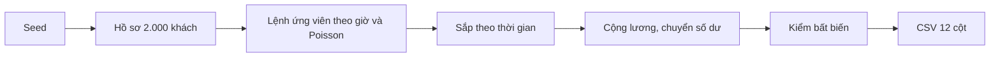

# DBS-71 · Generator giao dịch bình thường

> **Status:** Implemented; Draft PR #43, Dev review/merge pending · **Vai:** Dev (#6 Quality/data) · **Nhánh:** `feat/DBS-71-normal-fraud-dataset` · **Ngày:** 2026-10-30

## 1. Bối cảnh

Board: Task, Medium, In Progress, P5; không dependency. Expect: "Sinh được giao dịch bình thường có thói quen riêng của từng khách." Repo chưa có `load-tests/fraud-dataset/`; chỉ có `load-tests/README.md`. Nguồn định dạng và quy tắc là [FRAUD guide §6.1](../components/risk/FRAUD_DETECTION_GUIDE.md) và DBS-11 đã Done.

DoD: (1) seed cố định, chạy hai lần CSV byte-identical/sha256 bằng nhau; (2) thói quen riêng: số tiền lệch phải, giờ hoạt động, 3–8 người nhận quen, lương định kỳ; (3) đúng 12 cột, mọi `is_fraud=false` và scenario bình thường; (4) tự kiểm thời gian không lùi, số tiền dương, id tham chiếu hợp lệ, không âm số dư; (5) README cách chạy, bức tường #4 chỉ nhận CSV; (6) CI/Dev review/merge, bảng test case trong PR.

Phạm vi: giao dịch bình thường của ~2.000 khách trong 60 ngày, khoảng 100.000 dòng. Không sinh gian lận, hard negative có nhãn, train/tune/holdout hay xuất nhãn holdout. CSV đầu ra là dữ liệu tạo mới, không commit; đặt dưới `load-tests/results/` đã được gitignore. #4 không review code generator. ADR-14 còn Proposed, không đổi hợp đồng dữ liệu Accepted.

## 2. Hành vi

- CLI `node load-tests/fraud-dataset/generate.mjs --seed dbs-normal-v1 --output <path>`; mặc định 2.000 khách, 60 ngày và output `load-tests/results/fraud-normal.csv`. Cùng seed/tham số tạo cùng bytes trên Windows/Linux; đổi seed tạo dữ liệu khác. Tham số sai bị từ chối với exit khác 0.
- Tên cột, theo đúng thứ tự: `tx_id,occurred_at,from_account,to_account,from_customer,to_customer,amount,from_balance_before,from_account_created_at,to_account_created_at,is_fraud,scenario`. CSV dùng `0` = false và `NORMAL` cho mọi dòng.
- Mỗi khách có một tài khoản và hồ sơ riêng: mức chi tiêu trung vị 100.000–3.000.000 đồng, cường độ Poisson `λ = 0,3 + 2,7 × U⁴` giao dịch/ngày (trải từ 0,3 đến 3; trung bình gần 0,84), 3–8 người nhận quen; khoảng 80% lượt chọn người nhận rơi vào vòng quen. Giờ hoạt động ưu tiên 9–17 và 18–22 theo giờ Việt Nam. Lương được cộng vào số dư mô phỏng theo chu kỳ 30 ngày; vào ngày lương, λ được nhân 1,7 để tạo đỉnh giao dịch. Lương không xuất thành dòng chuyển tiền.
- Lệnh ứng viên được sắp tăng theo `occurred_at`, sau đó mới chuyển tiền. Nếu số dư thấp hơn số tiền đã lấy mẫu, số tiền được giới hạn bởi số dư; dưới 1.000 đồng thì bỏ lệnh. Nguồn trừ và đích cộng cùng một bước, không cho số dư âm. `from_balance_before` là ảnh chụp ngay trước bước trừ. Mô phỏng giữ tài khoản funding nội bộ: vốn đầu và lương làm funding âm tương ứng, mỗi chuyển tiền có debit = credit, tổng mọi số dư gồm funding luôn bằng 0.
- ID khách, tài khoản và giao dịch là UUID tổng hợp tất định; đích luôn là tài khoản của một khách có trong tập, khác nguồn. Ngày mở tài khoản có trước giao dịch. Không chứa tên, email, số tài khoản thật.

## 3. Kiến trúc

`generate.mjs` chỉ dùng Node standard library: PRNG 32-bit seeded, UUID từ SHA-256, Box–Muller cho log-normal, Poisson cho số giao dịch, UTC milliseconds để sắp xếp. Hàm `generateDataset({seed,customers,days})` trả CSV và thống kê/registry nội bộ cho test; CLI ghi CSV và in tóm tắt an toàn. Đầu ra không là bảng DB, không có transaction, Redis hoặc SQS. Test `generate.test.mjs` chạy bằng Node test runner trong CI unit job, không thêm dependency hay đổi tên required checks.

## 4. Test cases tự động

| ID | Truy vết DoD | Lớp | Chứng minh |
|---|---|---|---|
| TC-71-01 | 1 | Node integration | Hai lần cùng seed byte-identical/sha256; seed khác thì hash khác |
| TC-71-02 | 2 | Node integration | 3–8 người nhận quen/hồ sơ; λ min < 0,35, max > 2,5; ≥ 75% và ≤ 85% giao dịch tới người quen; p90 số tiền > 2 × p50; > 55% giao dịch trong giờ 9–22; số lệnh/ngày lương ít nhất 1,3 lần ngày khác sau chuẩn hóa số ngày; mỗi khách nhận hai kỳ lương trong 60 ngày |
| TC-71-03 | 3 | Node integration | Header đúng 12 cột; mọi dòng `is_fraud=0`, `scenario=NORMAL` |
| TC-71-04 | 4 | Node integration | Thời gian tăng, `amount>0`, IDs/registry hợp lệ, snapshot số dư đủ, min balance >= 0; tổng debit = credit và tổng số dư khách + funding = 0 |
| TC-71-05 | 1, 4 | CLI | Tham số sai bị từ chối; output được ghi ở đường đã chọn |
| Quy trình | 5, 6 | Docs/CI/PR | README, CI thật, Dev review và merge được đối chiếu riêng |

## 5. Test thủ công

| Bước | Lệnh | Kết quả mong đợi |
|---|---|---|
| M-71-01 | `node load-tests/fraud-dataset/generate.mjs --output load-tests/results/dbs71-a.csv` rồi cùng lệnh với `dbs71-b.csv`; `Get-FileHash load-tests/results/dbs71-a.csv -Algorithm SHA256` và `Get-FileHash load-tests/results/dbs71-b.csv -Algorithm SHA256` | Hai hash bằng nhau, khoảng 100.000 dòng |
| M-71-02 | `node load-tests/fraud-dataset/generate.mjs --seed dbs-normal-v2 --output load-tests/results/dbs71-c.csv`; `Get-FileHash load-tests/results/dbs71-c.csv -Algorithm SHA256` | Hash khác |
| M-71-03 | `Get-Content load-tests/results/dbs71-a.csv -TotalCount 3`; `Get-Content load-tests/results/dbs71-a.csv -Tail 2`; đọc JSON summary của CLI | 12 cột, thứ tự thời gian, không âm, mọi dòng bình thường, debit=credit |
| M-71-04 | `node load-tests/fraud-dataset/generate.mjs --customers 0 --output load-tests/results/dbs71-invalid.csv` | Exit khác 0, không tạo CSV |

Không cần Docker hoặc thông tin AWS. Không gửi source generator/holdout cho #4. Dữ liệu CSV chỉ bàn giao cho #4 theo quy ước nhóm khi cần, ngoài PR.

## 6. Domain review

[Review độc lập](screenshots/DBS-71/domain-review.md): lượt đầu REVISE với 5 finding; đã sửa đủ 5 mục trong §2/§4/§5. Lượt hai APPROVE, không còn finding. Reviewer không đọc generator source.

## 7. Kế hoạch triển khai

| Bước | File | Test viết trước | Chứng minh |
|---|---|---|---|
| 1 | `load-tests/fraud-dataset/generate.test.mjs`, `generate.mjs` | TC-71-01/03/04 đỏ do module chưa có | `node --test` |
| 2 | Hồ sơ, PRNG, Poisson, log-normal, lương, người nhận | TC-71-02, red về phân phối/thói quen | `node --test` |
| 3 | CLI, CI unit step, README | TC-71-05 đỏ do CLI chưa có | `node --test`, GitHub CI |
| 4 | Feature doc, transcript, screenshot, backlog | Đối chiếu DoD | link check |

Rủi ro: dữ liệu trông đều, thiếu lương hoặc tạo số dư âm; test thống kê và bất biến xử lý. Rút lại bằng revert PR; không thay đổi DB hoặc cloud.

## 8. Kết quả

Code commit `263d08baae91b0d3537b2a261cb9065579a96628`. `node --test load-tests/fraud-dataset/generate.test.mjs`: 4 pass, 0 fail, 0 skip. Backend `lint:check`, `typecheck`, `build` pass. Backend unit test local: 494 pass, 1 fail trên JWKS cooldown (DBS-50, không có thay đổi backend trong PR), ba lần chạy gồm lệnh CI `npm test`; assertion timeout thay đổi giữa các lần. [CI run 41037306313](https://github.com/Lawliet119/digital-banking-simulator/actions/runs/41037306313) trên commit `aade4fb`: cả sáu required jobs `lint`, `typecheck`, `unit`, `e2e`, `db`, `build` đều success; unit chạy cả test DBS-71. Kết quả runner Linux này là bằng chứng CI thật, không suy ra từ local.

| Case / DoD | Test / bằng chứng | Kết quả |
|---|---|---|
| TC-71-01 / seed | Test byte/sha256 và [manual M-71-01/02](screenshots/DBS-71/manual-test.txt) | Đạt; cùng seed hash `60e10c49…`, seed khác `ca224bc7…` |
| TC-71-02 / thói quen | Node test thống kê: 3–8 người quen, λ 0,3–3, familiar 80,05%, giờ hoạt động 93,79%, payday ratio 1,69, p90/p50 > 5 | Đạt |
| TC-71-03 / schema | Node test toàn bộ 96.200 rows và manual header | Đạt; 12 cột, `0,NORMAL` |
| TC-71-04 / bất biến | Node test toàn bộ rows; min balance 0, debit=credit 96.043.641.000, ending+funding=0 | Đạt |
| TC-71-05 / CLI | Node test và M-71-04 | Đạt; exit 1, không tạo CSV |
| DoD 5 / README, wall | [README generator](../../load-tests/fraud-dataset/README.md) | Đạt; chỉ giao CSV cho #4 |
| DoD 6 / CI, review, merge | [Draft PR #43](https://github.com/Lawliet119/digital-banking-simulator/pull/43); [CI 6/6 xanh](https://github.com/Lawliet119/digital-banking-simulator/actions/runs/41037306313); Dev khác review và merge | CI đạt; review/merge chưa đạt; [BL-055](../BACKLOG.md) |

Manual test [transcript](screenshots/DBS-71/manual-test.txt), [ảnh kết quả CLI được dựng từ output đã đo](screenshots/DBS-71/01-cli-evidence.png): M-71-01 đến M-71-04 đều đạt. Ba CSV nằm trong `load-tests/results/`, không commit. Không gửi source generator hoặc nhãn holdout cho #4.

Không đổi dependency, biến môi trường, DB, hợp đồng sự kiện hay ADR. Giới hạn: bộ này chỉ sinh dữ liệu bình thường; fraud injection, tune và holdout thuộc task khác. Bàn giao: Dev khác review [PR #43](https://github.com/Lawliet119/digital-banking-simulator/pull/43); người quản lý repo merge. Theo BL-055, không tự nhận hoàn tất DoD 6.

## 9. Tài liệu cập nhật

- [README load-tests](../../load-tests/README.md) và [README generator](../../load-tests/fraud-dataset/README.md): cách chạy, schema, seed và ranh giới bàn giao.
- [Feature index](README.md), [BACKLOG](../BACKLOG.md), review độc lập và bằng chứng manual ở `screenshots/DBS-71/`.
