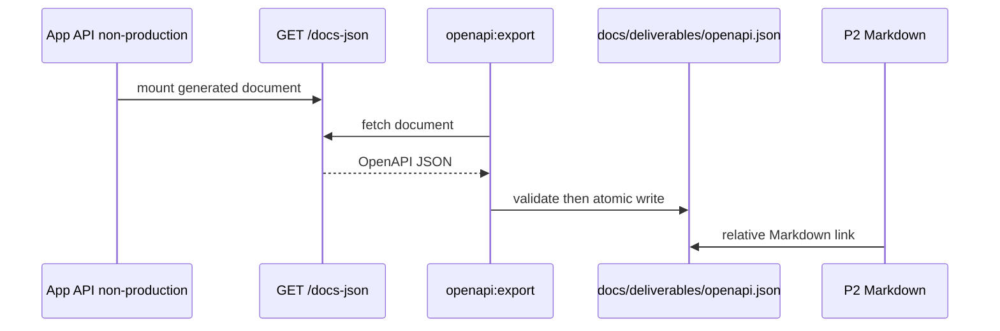

# DBS-72 · Ghép và nộp P2: kiến trúc, API, data model, ADR

> **Status:** Plan approved · **Vai:** Dev · **Nhánh:** `docs/DBS-72-p2-submission` · **PR:** — · **Cập nhật:** 2026-11-08

## 1. Bối cảnh

- **Task trên board:** Story, Tuần 2, Deliverable/Demo **P2**. **Expect:** Bản P2 đúng yêu cầu: component, API spec, data model, luồng đồng bộ/bất đồng bộ, ít nhất 3 ADR.
- **DoD:**
  1. Bản ghép P2 trong `docs/deliverables` trỏ về nguồn: `docs/03`, database-design, event-contract, ADR-01/02/03/13 (Accepted), OpenAPI/Swagger xuất từ các endpoint đã có.
  2. Đối chiếu từng mục với rubric ở DBS-13; mục thiếu có người nhận.
  3. Nộp đúng hạn; link ghi vào cột «Bản nộp / link» của P2 trong `docs/deliverables/README`; cổng ra tuần 2 đạt.
  4. PR đã merge vào main; Dev review; không còn liên kết hỏng, tên bảng/cột/mã lỗi khớp các tài liệu khác (đã grep).
- **Phụ thuộc:**
  - DBS-61 — board ghi Done; mã và feature doc về chuyển tiền đã có trên `main`: [TransferService](../../backend/src/modules/ledger/transfer.service.ts), [DBS-61](DBS-61-customer-transfers.md). Chưa tái chạy luồng thật ở phiên này vì Docker daemon không hoạt động.
  - DBS-63 — board ghi Done; source/test mở tài khoản có trên `main`: [account opening DB test](../../backend/test/db/account-opening.db-spec.ts). Feature index còn mô tả Draft PR #58, nên tình trạng review/merge trong docs là dữ kiện cũ, không dùng thay cho board.
  - DBS-13 — board ghi Done, nhưng task gốc ghi chưa có deadline/mẫu nộp trong repo; [deliverables README](../deliverables/README.md) hiện vẫn nói deadline chờ giảng viên xác nhận và P2 “chưa nộp”.
- **Đã có gì:**
  - Bản ghép [P2](../deliverables/P2-application-data-integration.md) đã liên kết component, API, data model, đồng bộ/bất đồng bộ và ADR; status của nó nêu còn thiếu artifact OpenAPI xuất từ code.
  - Nguồn thiết kế là [docs/03](../03_HIGH_LEVEL_ARCHITECTURE.md), [database design](../components/_shared/database-design.md), [event contract](../components/_shared/event-contract.md), cùng [ADR-01](../adr/0001-modular-monolith-worker.md), [ADR-02](../adr/0002-postgresql-ledger.md), [ADR-03](../adr/0003-sync-transfer-async-outbox-sqs.md), [ADR-13](../adr/0013-one-app-app-role.md), đều Accepted.
  - Swagger đã được dựng ở runtime qua [`setupSwagger`](../../backend/src/app.setup.ts); `/docs-json` được test, nhưng checkout chưa có artifact `openapi.json` để đính kèm P2.
  - **Baseline (docs-only):** `node .claude/skills/dbs-delivering-task/scripts/check-doc-links.mjs` đạt: **253 files checked, 0 broken links**. Không cần Docker cho baseline này.
- **Ngoài phạm vi:** không đổi endpoint, DTO, schema, event contract, ADR Accepted, `ErrorCode`, quy tắc tiền hay dependency. Việc nộp lên cổng/mẫu ngoài repo và cập nhật board không tự suy ra quyền thực hiện từ task này.
- **Câu hỏi mở:**
  1. **Rubric/mẫu nộp của giảng viên chưa nằm trong repository.** Đề xuất: bạn cung cấp file/link hoặc nội dung rubric; nếu không có, ghi rõ bằng chứng thiếu và người nhận trong backlog thay vì tuyên bố DoD #2 đã đạt.
  2. **Deadline và nơi nộp P2 chưa có trong repo.** Đề xuất: hoàn tất artifact và bản đối chiếu trong repo; bạn thực hiện bước nộp/link ngoài hệ thống hoặc chỉ rõ đích và quyền truy cập cần thiết.
  3. **Artifact OpenAPI.** Đề xuất: sinh từ đúng app/commit cuối qua Swagger hiện có, lưu cạnh P2 và liên kết tương đối; không tự tạo schema thủ công.

**Quyết định ở G1 (2026-11-08):** người dùng trả lời «duyệt G1». Phạm vi artifact OpenAPI, liên kết P2 và đối chiếu tài liệu được duyệt; rubric/mẫu nộp, deadline và nơi nộp vẫn chưa được cung cấp, nên được giữ là hand-off rõ ràng thay vì suy đoán hoặc tự sửa board/cổng nộp.

## 2. Hành vi

### 2.1 Artifact OpenAPI và P2

1. Khi app chạy cục bộ ở role `api` hoặc `both`, môi trường không-production công bố `GET /docs-json`. Exporter chỉ đọc endpoint này, từ chối HTTP khác 200, JSON không phải object OpenAPI, hoặc tài liệu không có `openapi`, `info` và `paths`.
2. Sau khi xác thực, exporter ghi JSON UTF-8 có format ổn định vào `docs/deliverables/openapi.json` bằng file tạm cùng thư mục rồi rename; lỗi không được làm ghi đè artifact hợp lệ đã có.
3. [P2](../deliverables/P2-application-data-integration.md) phải liên kết trực tiếp artifact, [docs/deliverables README](../deliverables/README.md) nêu P2 đã có artifact trong repo nhưng không tuyên bố đã nộp khi chưa có link nơi nộp.
4. Artifact phải mô tả endpoint thật đã có, gồm tối thiểu `POST /v1/transfers`, `POST /v1/operator/deposits`, các route account và health; Swagger giữ role/Bearer auth, tiền kiểu string và các response/error đã khai báo bởi controller. Không tự tạo hoặc sửa schema OpenAPI bằng tay.
5. Đối chiếu P2 xác nhận nguồn C4/module, API, data model, luồng sync/async và ADR-01/02/03/13. P2 phải phân biệt rõ **đang chạy** (outbox relay và notification worker) với **kiến trúc đích/chưa triển khai** (risk scoring, job đối soát và dọn dữ liệu), khớp `docs/03` và `modulesForRole()`. Mục rubric/deadline/nộp không có nguồn đáng tin cậy được ghi là chưa xác minh, kèm owner/handoff ở §8 nếu còn thiếu tại G4.

Ví dụ lệnh thành công sau khi app local đã sẵn sàng:

```text
npm --prefix backend run openapi:export -- --url http://127.0.0.1:3000/docs-json
# docs/deliverables/openapi.json được tạo; P2 liên kết file này
```

Không có `errorCode` mới: đây là công cụ build artifact, không phải API nghiệp vụ. Lỗi CLI chỉ in chẩn đoán đã lọc (status/đường dẫn công khai), mã thoát khác 0 và không ghi artifact nửa chừng.

## 3. Kiến trúc

- **Vị trí:** thêm `backend/src/scripts/export-openapi.ts` và unit test cùng thư mục. CLI chạy bằng `ts-node -r tsconfig-paths/register` qua script mới `openapi:export` trong `backend/package.json`; nó không được import bởi `main.ts`, không đổi runtime API/worker.
- **Interface cung cấp:** `exportOpenApi(options: { url: string; destination: string; fetchImpl?: typeof fetch }): Promise<void>`. Hàm lấy document qua `fetchImpl`, kiểm shape tối thiểu, chuẩn hóa JSON và ghi atomically; CLI chỉ parse `--url`/destination an toàn rồi gọi hàm. Không đổi exported symbol nghiệp vụ nào.
- **Dữ liệu:** chỉ ghi artifact tài liệu `docs/deliverables/openapi.json`; không chạm bảng, migration, cache, event, audit hay transaction.
- **Ranh giới:** request lấy Swagger xảy ra ngoài mọi `TransactionService.run`; không có Redis, SQS hoặc HTTP call trong transaction.
- **Luồng:**



- **Thay đổi cấp hệ thống:** cập nhật P2 và deliverables README cho artifact/link, đồng thời sửa P2 để phân biệt current state với kiến trúc đích của worker/risk/đối soát. Không đổi `docs/03`, database-design, event-contract hay ADR vì các fact nguồn đã đúng. Nếu danh sách rubric/link nộp vẫn thiếu ở G4, thêm handoff/backlog thay vì sửa lịch sử hoặc nêu thông tin không kiểm được.

## 4. Test cases tự động

| ID | Truy vết (DoD / AC) | Lớp | Given · When · Then | `errorCode` mong đợi |
|---|---|---|---|---|
| TC-72-01 | DoD #1 | unit | Fake `/docs-json` trả document hợp lệ; exporter chạy → artifact JSON UTF-8 parse được, có đúng `openapi/info/paths`, không bị thêm schema thủ công | — |
| TC-72-02 | DoD #1, #4 | unit | Fetch trả 500, JSON lỗi hoặc thiếu field bắt buộc → exporter reject/mã thoát khác 0 và giữ artifact hợp lệ trước đó nguyên vẹn | — |
| TC-72-03 | DoD #1, #4 | integration–e2e app thật | App API không-production chạy với Postgres thật; export từ `/docs-json` → artifact có các path/response auth, tiền string và endpoint hiện hữu; JSON artifact bằng document endpoint sau chuẩn hóa | — |
| TC-72-04 | DoD #1, #4 | docs | `check-doc-links.mjs` quét P2, README, artifact link và feature doc → không liên kết hỏng | — |
| TC-72-05 | DoD #2, #3 | quy trình | Rubric, deadline và link nộp có nguồn do người dùng/giảng viên cung cấp; nếu không, §8 và `docs/BACKLOG.md` nêu phần còn thiếu/owner, không đánh dấu đạt | — |
| TC-72-06 | DoD #4 | docs | Grep mọi tên bảng/cột trong P2, đối chiếu database-design và migrations; đối chiếu mã lỗi với error-code.enum.ts/docs/03 §7.1; kiểm worker hiện hữu so với modulesForRole và docs/03. Lưu bảng đối chiếu và sửa mọi mismatch trước handover. | — |
| Quy trình | DoD #4 | — | CI xanh, Dev khác review, merge PR là công việc sau G4; ghi chưa đạt/backlog nếu chưa hoàn tất. | — |

## 5. Test thủ công

Điều kiện: Docker Desktop chạy, app local dùng `APP_ROLE=api`, DB migrate; không dùng token hoặc dữ liệu khách thật. Nếu task kết thúc chỉ với tài liệu mà không có app đang chạy, M-72-01 là **chưa chạy** và phải được chấp nhận tường minh ở G4 — không suy từ unit test.

Setup trong Git Bash: từ root chạy `npm --prefix backend ci`, bảo đảm `.env` và `backend/env/.env.development` đã có cấu hình local theo hai file mẫu (chỉ copy mẫu nếu file đích chưa tồn tại; không ghi đè env hiện có). `DATABASE_URL` phải trỏ DB local riêng và `REDIS_URL` trỏ Valkey local; kiểm không trỏ production trước migration. Chạy `docker compose up -d`, sau đó từ `backend/` chạy `npm run migration:run` và `npm run start:dev:api`. API phải nghe cổng 3000 trước M-72-01; endpoint Swagger không cần token.

| Bước | Việc làm (lệnh hoặc thao tác) | Kết quả mong đợi |
|---|---|---|
| M-72-01 | Khởi động app non-production thật, lấy `GET /docs-json`; chạy `npm --prefix backend run openapi:export -- --url http://127.0.0.1:3000/docs-json`; mở P2 và artifact | Artifact parse được, khớp document endpoint sau chuẩn hóa; P2 có link hoạt động và các route API thật, không có token/header trong transcript |
| M-72-02 | Chạy exporter với URL local không phục vụ Swagger, sau khi đã giữ một artifact hợp lệ | Mã thoát khác 0, thông báo không lộ secret, artifact hợp lệ cũ không thay đổi |
| M-72-03 | Chạy `node .claude/skills/dbs-delivering-task/scripts/check-doc-links.mjs` từ root | Không có link hỏng; P2/README không nói “đã nộp” khi chưa có link nộp |

## 6. Domain review (AI)

**Reviewer vòng 1:** subagent độc lập gpt-6-luna · 3 finding: 1 blocking, 2 should-fix, 0 minor · Verdict REVISE · [raw reply](screenshots/DBS-72/domain-review.md).

| # | Mức | Phát hiện | Xử lý |
|---|---|---|---|
| 1 | blocking | Worker/ledger trong P2 chưa phân biệt kiến trúc đích và code đã chạy | Đã sửa thiết kế §2/§3 và bản P2: đối soát/dọn dữ liệu/risk consumer đầy đủ là chưa triển khai. |
| 2 | should-fix | Thiếu đối chiếu định danh và quy trình DoD #4 | Đã thêm TC-72-06 và hàng quy trình. |
| 3 | should-fix | Thiếu lệnh setup manual | Đã bổ sung setup Git Bash, DATABASE_URL/REDIS_URL, compose, migration và start:dev:api. |

**Reviewer vòng 2:** subagent độc lập gpt-6-astra · 0 finding còn mở (0 blocking, 0 should-fix, 0 minor) · **Verdict: APPROVE** · [raw reply vòng 2](screenshots/DBS-72/domain-review-round-2.md). Ba finding vòng 1 đã được reviewer xác nhận xử lý.

## 7. Kế hoạch triển khai

**G2:** người dùng trả lời «duyệt g2», duyệt §2–§5 cho cả ba ticket. Status chuyển Design approved. G3 chưa được duyệt.

| Bước | File | Test viết trước | Kết quả đỏ | Lệnh chứng minh (từ backend/) | Commit dự kiến, chỉ tạo khi được cho phép |
|---|---|---|---|---|---|
| 0 | Không sửa file: đồng bộ dependency trong worktree, kiểm Docker và baseline | Baseline lint/typecheck/unit/e2e/db/build | Typecheck base đã đỏ TS2322 ở manual-smoke.dbs50.ts:147; chưa sửa | npm ci; npm run lint:check; npm run typecheck; npm test -- --runInBand; npm run test:e2e -- --runInBand; npm run test:db -- --runInBand; npm run build | — |
| 1 | backend/src/scripts/export-openapi.spec.ts (mới), backend/src/scripts/export-openapi.ts (mới), backend/package.json | TC-72-01/02: valid JSON, HTTP failure, malformed/invalid doc, giữ artifact cũ, lỗi ghi/rename và dọn file tạm | Chưa chạy; phải ghi lỗi behavioral thực ở Phase 4, không nhận import lỗi là đủ | npm test -- --runInBand export-openapi; npm run typecheck | feat(docs): export generated OpenAPI safely |
| 2 | backend/test/db/openapi-export.db-spec.ts (mới) | TC-72-03: boot AppModule role api với PG thật và config local cô lập; lấy /docs-json, gọi exporter qua CLI thật tới temp destination; assert JSON/route/auth/money/string khớp document thật; dọn app/DB/temp trong finally | Chưa chạy | npm run test:db -- --runInBand openapi-export | test(docs): verify export from the real api |
| 3 | docs/deliverables/openapi.json (mới), docs/deliverables/P2-application-data-integration.md, docs/deliverables/README.md | TC-72-04/06: kiểm relative links, bảng/cột/ErrorCode và current-vs-target; đối chiếu ADR-14 Accepted/Proposed đang lạc hậu trong P2, ghi bảng nguồn bằng grep | Chưa chạy | npm run openapi:export -- --url http://127.0.0.1:3000/docs-json; link checker từ root | docs(p2): attach generated API and reconcile sources |
| 4 | docs/features/DBS-72-p2-architecture-submission.md; docs/features/screenshots/DBS-72/{domain-review.md,domain-review-round-2.md,manual-test.txt,verification.txt,definition-check.txt,01-export.png,02-failure.png,plan-sweep.txt}; docs/features/README.md; docs/BACKLOG.md | TC-72-05/quy trình và M-72-01…03: app thật, export thành công/lỗi, nguồn rubric/nộp nếu được cấp | Chưa chạy; giữ raw output trên code cuối | Toàn bộ baseline + script check-doc-links.mjs; git diff --check | docs(p2): record evidence and submission handoffs |

**Phạm vi file:** chỉ các path trong bảng; source định nghĩa schema/event/ADR chỉ đọc. Exporter không vào app bootstrap; thêm export script vào exclude của build chỉ khi cần sẽ là gate phụ vì tsconfig.build.json chưa nằm trong allowlist.

**Rủi ro/cách lùi:** artifact cũ chỉ thay sau khi export hợp lệ; unit test lỗi rename chứng minh không mất file cũ. P2 đang có draft sửa worker từ Phase 2, chưa là bản nộp; Phase 4 hoàn thiện theo nguồn. Nếu không có rubric/deadline/link nộp, giữ DoD #2/#3 chưa đạt và tạo dòng backlog có owner, không đoán thông tin. Lùi bằng revert từng commit sau khi được phép commit; trước đó chỉ hoàn lại đúng hunk do task tạo, không đụng thay đổi người khác.

**Plan sweep:** DoD #1 → bước1–3; #2/#3 → bước4/handoff; #4 → bước0/2/3/4 và Dev review/merge bên ngoài. Mọi TC-72-01…06 và M-72-01…03 có bước. Không sửa ADR/schema/event/env/dependency/money rule. PR/review/merge/nộp thật chưa được tính đạt, không sửa board.

## 8. Kết quả

**G3:** người dùng trả lời «duyệt g3», chấp nhận kế hoạch cùng đề xuất sửa baseline và commit local; không cấp quyền push/PR. Phase 4 đang thực hiện.

**Đề xuất prerequisite xin duyệt cùng G3:** thêm duy nhất `backend/src/scripts/manual-smoke.dbs50.ts` vào allowlist trước bước0, đổi lời gọi `fixture.setKeys([publicJwk])` thành object copy `fixture.setKeys([{ ...publicJwk }])` để TypeScript suy luận object tương thích index signature. Không sửa guard hay logic xác thực. Test đỏ là typecheck TS2322 đã chạy; chứng minh xanh bằng typecheck và chạy script smoke hiện có. Chỉ thực hiện nếu G3 chấp nhận đề xuất này; nếu không, chờ baseline được sửa bởi task khác. Thay đổi tương đương ở ba nhánh được ghi rõ dependency baseline, không giả là tính năng của ticket.

**Quyền git:** tên commit trong §7 là dự kiến. Chưa có quyền commit/push/PR; G3 sẽ xin phép lưu commit local để có SHA cho manual evidence và checkout sạch. Nếu chỉ duyệt kế hoạch mà không cấp quyền git, giữ thay đổi chưa commit, không tự push/tạo PR.

**Code cuối:** 4e5446f. Đã sửa baseline JWK đúng đề xuất G3. Unit toàn bộ: 70 suites/1135 tests đạt; unit exporter 6/6; integration app thật 1/1. Lint/typecheck/build đã chạy xanh sau sửa lint. Full DB/E2E chưa xác nhận xanh: lượt wrapper Git Bash thoát127 không có Jest summary, đang chẩn đoán; không suy từ targeted sang full baseline.

| Case | Evidence | Kết quả |
|---|---|---|
| TC-72-01/02 | export-openapi.spec.ts | Đạt: export JSON; HTTP/schema/JSON lỗi; rename lỗi giữ artifact và dọn temp |
| TC-72-03 | openapi-export.db-spec.ts | Đạt với CLI thật, AppModule/PG thật, Swagger equality/roles/Bearer/string money |
| TC-72-04/06 | definition-check.txt và link checker | Đã đối chiếu schema/mã lỗi/module/ADR; link checker sạch |
| TC-72-05 / quy trình | P2 §6, backlog | Chưa đạt rubric/nộp, CI/review/merge; BL-180/181 |

**Manual:** M-72-01/02 đã chạy trên code cuối, cả API snapshot và CLI subprocess thật: artifact 12 paths khớp /docs-json; failure giữ file cũ. Lần driver đầu lỗi cleanup vì kết nối drop nhầm URL quản trị; đã sửa lệnh driver (không sửa code ứng dụng), chạy lại hoàn tất exit0; raw giữ cả lần lỗi. M-72-03 link checker đạt 256files/0broken ở lượt đã lưu. [Raw manual](screenshots/DBS-72/manual-test.txt), [đối chiếu nguồn](screenshots/DBS-72/definition-check.txt).

**Ảnh còn thiếu:** 01-export.png, 02-failure.png. Browser local bị tắt trong Work settings; viewer Notepad đã mở transcript nhưng screenshot có overlay Meet và tab ngoài phạm vi nên không lưu vào repo. Mermaid đã đọc/review nhưng chưa render bằng CLI/browser; chưa tuyên bố visual QA đạt.

**Bàn giao:** BL-180 (rubric/deadline/nộp thật); BL-181 (CI/Dev review/merge và ảnh). Git chỉ commit local theo G3, chưa push/PR/board. Lượt verification thoát127 chưa được coi là lỗi đã sửa.

## 9. Tài liệu đã cập nhật

**Cập nhật cuối lượt:** E2E toàn bộ trên nhánh DBS-72 đạt 15 suites/153 tests, không skip, process cha ghi processExit=0/signal=null. Script legacy manual-smoke.dbs50.ts sau sửa type boot được nhưng M50-01 lỗi SyntaxError Unexpected end of JSON input; đã dừng process treo, không sửa runtime ngoài phạm vi. Typecheck xanh không đồng nghĩa smoke legacy xanh. Full DB toàn repo chưa có summary xanh (wrapper thoát127); cần CI/Linux để kiểm chứng trước G4. M72-01/02 đã chạy lại bằng CLI subprocess thật, export12paths và giữ artifact khi lỗi; M72-03 link check256/0broken.

Đã cập nhật feature doc/index/BACKLOG và evidence theo §7; P2, deliverables README và OpenAPI artifact; thêm BL-180/181.
