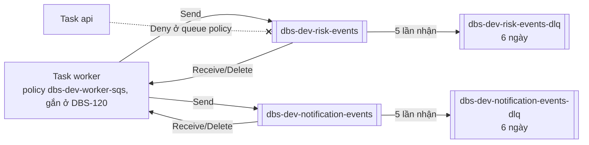

# DBS-73 · Terraform: hai queue SQS (risk-events, notification-events) mỗi queue một DLQ

> **Status:** Draft (G1 đã duyệt) · **Vai:** #5 Platform & Ops · **Cặp đôi review:** Dev · **Nhánh:** `chore/DBS-73-terraform-sqs` (từ `main`, không xếp chồng) · **PR:** — · **Cập nhật:** 2026-10-29

## 1. Bối cảnh

- **Task trên board:** Task, Tuần 3, Deliverable P3, Ưu tiên High, board "To Do". **Expect:** Hạ tầng hàng đợi dựng bằng code, khớp bảng định tuyến ở docs/03 §10.
- **DoD** (nguyên văn, đánh số):
  1. Hai queue + hai DLQ, redrive maxReceiveCount = 5, mã hóa phía server, thời gian giữ message ghi rõ (khớp tính toán thời gian giữ processed_events ở database-design)
  2. Chính sách IAM chỉ cho task worker gửi/nhận/xóa; api không có quyền SQS
  3. Tên queue và URL đưa vào biến môi trường theo sqs.config.ts
  4. PR đã merge vào main (CI xanh); Dev review; bảng «Đối chiếu test case» trong PR điền đủ
- **Thực trạng trên board:** SQS mới chạy local bằng ElasticMQ; ADR-03: visibility 30 giây, long polling 20 giây, `maxReceiveCount` 5, giữ message 4 ngày.
- **Phụ thuộc:** DBS-33 (Done, đã merge `main`). Không phụ thuộc các PR Ops đang mở (#27, #36–#39): nhánh cắt từ `main`, chỉ thêm file mới ở `envs/dev/base`.
- **Đã có gì:**
  - `infra/local/elasticmq.conf`: `risk-events`, `notification-events`, mỗi queue một DLQ, visibility 30 giây, chờ 20 giây, `maxReceiveCount = 5`.
  - `backend/src/config/sqs.config.ts` và `validation.schema.ts`: `SQS_RISK_QUEUE_URL`, `SQS_NOTIFICATION_QUEUE_URL` bắt buộc khi `APP_ROLE` là `worker` hoặc `both`; `SQS_ENDPOINT` chỉ dùng cho ElasticMQ; `AWS_REGION` mặc định `ap-southeast-1`. Tên queue không có biến riêng: app chỉ nhận URL.
  - ADR-03 (tham số queue), docs/03 §10 (bảng định tuyến, mỗi consumer một queue), §14 (alarm DLQ > 0, tuổi message cũ nhất), database-design §10 (`processed_events` giữ 7 ngày vì queue giữ 4 ngày).
  - `envs/dev/session/iam.tf`: chỉ có role `dbs-dev-api-task` (không policy). **Chưa có** role task worker, chưa có ECS service `worker`: đó là DBS-120 (task role riêng api và worker, Tuần 4) và DBS-121 (service worker, Tuần 4).
  - Backlog cùng chủ đề: BL-051 (alarm DLQ, runbook redrive, "retention DLQ do Ops xác nhận"). Task này **xác nhận retention DLQ** (thêm DBS-73 làm nguồn của BL-051); alarm thuộc DBS-163, runbook redrive giữ ở BL-051.
- **Baseline** (`main` b8742a3, Terraform 1.16.6): `terraform fmt -check -recursive` sạch; `validate` đạt cả ba stack; `terraform test`: bootstrap 9/9, `base` 17/17, `session` 9/9.
- **Ngoài phạm vi:** role task worker và gắn policy vào role (DBS-120); service worker và đưa URL vào task definition worker (DBS-121); alarm DLQ và tuổi message (DBS-163); runbook redrive (BL-051); `libs/sqs` và consumer (DBS-77, DBS-90); queue production (DBS-152).
- **Câu hỏi mở** (kèm đề xuất):
  1. **Stack:** đặt queue ở `envs/dev/base` (giữ lại), không ở `session`. Lý do: SQS không tính tiền khi rảnh (trả theo request, 1 triệu request/tháng đầu miễn phí), URL ổn định qua các phiên nên task definition worker không đổi, message trong DLQ sống qua một lần `destroy session` để còn redrive. `references/platform.md` đã xếp SQS vào phần giữ lại; README Terraform đang xếp vào `session`: sửa README cho khớp.
  2. **Tên:** `dbs-dev-risk-events`, `dbs-dev-risk-events-dlq`, `dbs-dev-notification-events`, `dbs-dev-notification-events-dlq` (tiền tố `dbs-<env>-` theo README). Tên local (`risk-events`) khác cũng không sao vì app chỉ nhận URL.
  3. **Mã hóa:** SSE-SQS (`sqs_managed_sse_enabled = true`, miễn phí, không cần quyền KMS cho worker), không dùng CMK `alias/dbs-dev` (CMK chưa có trên `main`, nằm ở PR #27; thêm phí request KMS và quyền `kms:Decrypt`/`GenerateDataKey` cho worker).
  4. **Retention:** queue chính 4 ngày (ADR-03). DLQ **6 ngày**, không phải 14: với queue standard, hạn của message trong DLQ tính từ lúc gửi gốc, nên tổng đời message ≤ 6 ngày < 7 ngày `processed_events`. Nếu DLQ giữ lâu hơn 7 ngày, một message đã xử lý (commit `processed_events`) nhưng xóa thất bại có thể được redrive sau khi dòng dedup bị dọn, gây xử lý hai lần. Đổi lại: redrive phải xong trong 6 ngày kể từ lúc gửi (ghi vào BL-051). Cách redrive có reset hạn hay không sẽ kiểm ở Phase 2.
  5. **IAM khi chưa có role worker:** tạo **managed policy** `dbs-dev-worker-sqs` ở `base` (gửi tới hai queue chính; nhận, xóa, đổi visibility, đọc thuộc tính trên hai queue chính; không quyền trên DLQ ngoài đọc thuộc tính) nhưng **không gắn** vào role nào; DBS-120 gắn vào role task worker. Không tạo role worker giả (SKILL: không stub thứ task khác giao). Test chứng minh role `dbs-dev-api-task` không có quyền SQS. Bàn giao bằng một dòng BL.
  6. **Biến môi trường:** `base` xuất output `sqs_risk_queue_url`, `sqs_notification_queue_url` (và ARN, tên); README ghi bảng output → `SQS_RISK_QUEUE_URL`, `SQS_NOTIFICATION_QUEUE_URL`. Đưa vào task definition worker là DBS-121 (chưa có task worker), ghi BL. Không thêm biến môi trường mới cho app.
  7. **Redrive allow policy:** mỗi DLQ chỉ nhận từ đúng queue chính của nó (`redrivePermission = byQueue`).
  8. **Test thủ công trên AWS thật:** cần `terraform apply envs/dev/base` (chỉ thêm 4 queue và 1 policy, ≈ 0 USD). Kịch bản: gửi một message, nhận 5 lần không xóa, lần 6 thấy ở DLQ; `simulate-principal-policy` cho policy worker (đạt) và role api (bị từ chối); đọc thuộc tính queue. Queue giữ lại sau kiểm (phần giữ lại). Cần bạn đồng ý `apply` trong hội thoại này.
  9. **`CLAUDE_local.md`:** file cục bộ (không commit) ghi rằng bạn cho phép agent tự duyệt G1–G4 cho task #5 và sửa cột Status trên board. Đó là nội dung file, không phải lời bạn nói trong hội thoại này, còn `CLAUDE.md` thì cấm sửa board và cấm bỏ gate; nên mình chưa áp dụng và chờ bạn xác nhận.

**Quyết định ở G1** (người dùng trả lời «Duyệt cả hai G1», 2026-10-29): chọn đúng đề xuất 1 đến 8. `apply` thật cho test thủ công (câu 8) sẽ hỏi riêng ngay trước khi chạy. Câu 9: người dùng chưa xác nhận `CLAUDE_local.md`, nên mọi gate vẫn chờ người dùng trả lời.

## 2. Hành vi

| Tác nhân | Hành động | Kết quả |
|---|---|---|
| Relay outbox (task worker, sau DBS-120 gắn policy) | `SendMessage` tới `dbs-dev-risk-events`, `dbs-dev-notification-events` | cho phép (policy `dbs-dev-worker-sqs`) |
| Consumer risk/notification (task worker) | `ReceiveMessage` (long polling 20 giây), `DeleteMessage`, `ChangeMessageVisibility`, `GetQueueAttributes` trên queue chính của mình | cho phép |
| Task worker | bất kỳ action nào trên DLQ, hoặc `PurgeQueue`, `DeleteQueue`, `SetQueueAttributes` | bị từ chối (không có trong policy) |
| Task api (`dbs-dev-api-task`) | bất kỳ action SQS nào trên 4 queue | bị từ chối hai lớp: role không có policy SQS, và queue policy `Deny` theo `aws:PrincipalArn` |
| Consumer | nhận một message 5 lần không xóa (lỗi tạm thời lặp lại) | lần nhận tiếp theo SQS chuyển message sang DLQ của queue đó (`maxReceiveCount = 5`, visibility 30 giây, tức khoảng 2,5 phút) |
| Queue khác (ngoài queue chính tương ứng) | đặt DLQ của mình trỏ vào `*-dlq` | bị từ chối (`redrivePermission = byQueue`, chỉ queue chính của nó) |
| Ops | redrive DLQ → queue chính (`start-message-move-task`) | message về queue chính với `MessageId` mới, hạn giữ reset (tài liệu AWS) |
| `terraform destroy envs/dev/session` | xóa phần theo phiên | queue không bị đụng (nằm ở `base`) |

**Tham số** (ADR-03, docs/03 §10):

| Thuộc tính | Queue chính | DLQ |
|---|---|---|
| Visibility timeout | 30 giây | mặc định (30 giây) |
| Long polling (`receive_wait_time_seconds`) | 20 giây | 0 |
| Giữ message | 4 ngày (345600 giây) | 6 ngày (518400 giây) |
| Redrive | `maxReceiveCount = 5` → DLQ của nó | redrive allow `byQueue` = queue chính của nó |
| Mã hóa | SSE-SQS | SSE-SQS |
| Delay | 0 | 0 |

**Thời gian giữ và `processed_events` (7 ngày, database-design §10):**
- Message chỉ còn có thể giao lại cho consumer khi còn trong queue chính (≤ 4 ngày từ lúc gửi) hoặc sau redrive. 4 ngày < 7 ngày: giao lại muộn vẫn gặp dòng dedup.
- Hạn trong DLQ tính từ lúc gửi gốc (queue standard), nên DLQ 6 ngày nghĩa là message bị xóa khỏi DLQ chậm nhất 6 ngày sau khi gửi. AWS khuyên DLQ giữ lâu hơn queue chính (6 > 4 đạt).
- **Redrive reset hạn**, nên giới hạn của DLQ không đủ: một message đã commit `processed_events` nhưng xóa thất bại 5 lần, nếu redrive ở ngày 6 và chờ trong queue tới sau ngày 7, sẽ bị xử lý lại. Quy tắc cho runbook (BL-051): chỉ redrive khi consumer đang chạy khỏe và queue chính đang rỗng dần, xong trong vòng 6 ngày kể từ lúc gửi; message lỗi thật (chưa commit) không có dòng dedup nên không bị ảnh hưởng.

**Ca biên:**
- `maxReceiveCount > 3` trên queue standard: SQS đẩy message nhận ≥ 3 lần về cuối queue, `ApproximateAgeOfOldestMessage` bỏ qua nó (tài liệu AWS). Ghi cho DBS-163 (alarm tuổi message).
- Tên queue có tiền tố `dbs-dev-`, khác local (`risk-events`): app chỉ dùng URL nên không ảnh hưởng.
- Queue policy `Deny` theo tên role `dbs-dev-api-task`: nếu DBS-120 đổi tên role api thì phải sửa queue policy (bàn giao).
- Chi phí: 0 khi rảnh; worker long polling 20 giây ≈ 4.320 request/ngày mỗi queue mỗi task, trong 1 triệu request miễn phí/tháng.

## 3. Kiến trúc

- **Vị trí:** `envs/dev/base` (giữ lại).
  - `sqs.tf` (mới): `locals.sqs_consumers = ["risk", "notification"]`; `aws_sqs_queue.dlq[each]`, `aws_sqs_queue.main[each]` (`for_each`), `aws_sqs_queue_redrive_allow_policy.dlq[each]`, `aws_sqs_queue_policy.deny_api[each]` cho cả 4 queue, `aws_iam_policy.worker_sqs` (`dbs-dev-worker-sqs`, không gắn).
  - `outputs.tf`: thêm `sqs_risk_queue_url`, `sqs_notification_queue_url`, `sqs_queue_arns` (map), `sqs_dlq_arns` (map), `sqs_dlq_names` (map, cho alarm DBS-163), `worker_sqs_policy_arn`.
  - `tests/sqs.tftest.hcl` (mới).
  - `infra/terraform/README.md`: SQS chuyển sang cột "giữ lại", mục "Hàng đợi SQS (DBS-73)" (bảng output → biến môi trường, retention, redrive, chi phí).
- **Interface cung cấp:** output → biến môi trường của `sqs.config.ts`: `sqs_risk_queue_url` → `SQS_RISK_QUEUE_URL`, `sqs_notification_queue_url` → `SQS_NOTIFICATION_QUEUE_URL`; `AWS_REGION` = `ap-southeast-1` (task đã có); `SQS_ENDPOINT` không đặt trên AWS. DBS-121 đưa vào task definition worker qua `terraform_remote_state` của `base`; DBS-120 gắn `worker_sqs_policy_arn` vào role task worker.
- **Policy worker** (`dbs-dev-worker-sqs`):

```json
{ "Version": "2012-10-17", "Statement": [
  { "Sid": "PublishAndConsume", "Effect": "Allow",
    "Action": ["sqs:SendMessage", "sqs:ReceiveMessage", "sqs:DeleteMessage",
               "sqs:ChangeMessageVisibility", "sqs:GetQueueAttributes"],
    "Resource": ["<arn dbs-dev-risk-events>", "<arn dbs-dev-notification-events>"] } ] }
```

  `SendMessageBatch`, `DeleteMessageBatch`, `ChangeMessageVisibilityBatch` dùng chung quyền của action đơn. Không quyền KMS (SSE-SQS).
- **Queue policy** (mỗi queue): `Deny`, `Principal: *`, `Action: sqs:*`, điều kiện `ArnLike aws:PrincipalArn = arn:aws:iam::<account_id>:role/dbs-dev-api-task`. Không có `Allow` trong queue policy: quyền vẫn đến từ IAM của cùng account.
- **Dữ liệu chạm tới:** `dev/base.tfstate` (không có bí mật). Không bảng DB nào.
- **Sơ đồ:**



- **Thay đổi cấp hệ thống:** README Terraform (SQS thuộc phần giữ lại). docs/03 §10 thêm retention DLQ 6 ngày cạnh "giữ message 4 ngày"; ADR-03 không đổi (DLQ retention chưa được ADR chốt).

## 4. Test cases tự động

`terraform test` ở `envs/dev/base` với `mock_provider "aws"` (thêm `override_resource` cho ARN/URL của `aws_sqs_queue` vì mock sinh chuỗi ngẫu nhiên, policy cần ARN hợp lệ).

| ID | Truy vết | Lớp | Given · When · Then | Mong đợi |
|---|---|---|---|---|
| TC-73-01 | DoD 1 | tf test | Hai queue chính: tên `dbs-dev-{risk,notification}-events`, visibility 30, wait 20, retention 345600, `sqs_managed_sse_enabled = true`, delay 0 | đúng |
| TC-73-02 | DoD 1 | tf test | Hai DLQ: tên `*-dlq`, retention 518400, SSE-SQS; retention DLQ > retention chính và < 604800 (7 ngày `processed_events`) | đúng |
| TC-73-03 | DoD 1 | tf test | `redrive_policy` mỗi queue chính: `maxReceiveCount = 5`, `deadLetterTargetArn` = DLQ **của chính nó** (không chéo) | đúng |
| TC-73-04 | DoD 1 | tf test | Redrive allow policy mỗi DLQ: `redrivePermission = byQueue`, `sourceQueueArns` = [queue chính tương ứng] | đúng |
| TC-73-05 | DoD 2 | tf test | Policy worker: đúng 5 action ở §3, `Resource` đúng 2 ARN queue chính, không `*`, không ARN DLQ, không action quản trị | đúng |
| TC-73-06 | DoD 2 | tf test | Queue policy cả 4 queue: một statement `Deny`, `sqs:*`, `aws:PrincipalArn` = role `dbs-dev-api-task` của `account_id` | đúng |
| TC-73-07 | DoD 2 | tĩnh (grep) | Không file nào ở `envs/dev` gắn policy SQS vào role `task` của api; `session` không có `sqs:` | không có dòng nào |
| TC-73-08 | DoD 3 | tf test | Output `sqs_risk_queue_url`, `sqs_notification_queue_url` bằng URL queue chính; `worker_sqs_policy_arn`, map ARN/tên DLQ có đủ 2 khóa | đúng |
| TC-73-09 | DoD 1 | tf test | Không queue nào là FIFO; `kms_master_key_id` null (đúng SSE-SQS, không lẫn hai kiểu) | đúng |
| — | DoD 4 | quy trình | PR merge, CI xanh, Dev review, bảng đối chiếu | kiểm lúc review |

## 5. Test thủ công

Điều kiện: `AWS_PROFILE=dbs-admin`, `ap-southeast-1`, budget alarm có sẵn; `terraform apply envs/dev/base` **chỉ sau khi người dùng đồng ý trong hội thoại**. Output thô vào `screenshots/DBS-73/manual-test.txt` (xóa account id và ARN). Message thử là một `TransferCompleted` mẫu (Nguyễn Văn An chuyển 1.500.000 đ cho Trần Thị Bình), không phải dữ liệu thật.

| Bước | Việc làm (lệnh hoặc thao tác) | Kết quả mong đợi |
|---|---|---|
| M-73-01 | `terraform plan -var account_id=…` ở `base` | chỉ thêm: 4 queue, 2 redrive allow, 4 queue policy, 1 IAM policy; 0 change, 0 destroy |
| M-73-02 | `terraform apply` bản plan đó; `aws sqs get-queue-attributes --attribute-names All` cho `dbs-dev-risk-events` | `VisibilityTimeout=30`, `ReceiveMessageWaitTimeSeconds=20`, `MessageRetentionPeriod=345600`, `SqsManagedSseEnabled=true`, `RedrivePolicy` có `maxReceiveCount 5` và ARN `dbs-dev-risk-events-dlq` |
| M-73-03 | `get-queue-attributes` cho `dbs-dev-risk-events-dlq` | `MessageRetentionPeriod=518400`, `RedriveAllowPolicy` `byQueue` chỉ `dbs-dev-risk-events` |
| M-73-04 | Gửi message mẫu vào `dbs-dev-risk-events`; `receive-message --visibility-timeout 1` 5 lần (mỗi lần chờ 2 giây, không xóa), rồi nhận lần 6 | 5 lần đầu nhận được (cùng `MessageId`, `ApproximateReceiveCount` 1→5); lần 6 queue chính trả rỗng |
| M-73-05 | `receive-message` trên `dbs-dev-risk-events-dlq` | message mẫu có ở DLQ, cùng nội dung |
| M-73-06 | Redrive: `aws sqs start-message-move-task --source-arn <dlq>`; `list-message-move-tasks` tới `COMPLETED`; nhận ở queue chính rồi `delete-message` | message trở lại queue chính với `MessageId` mới; xóa xong cả hai queue rỗng |
| M-73-07 | Tạo queue tạm `dbs-dev-probe` với `RedrivePolicy` trỏ `dbs-dev-risk-events-dlq`; xóa queue tạm | bị từ chối (redrive allow `byQueue`); queue tạm đã xóa |
| M-73-08 | `aws iam simulate-custom-policy` với policy `dbs-dev-worker-sqs` (lấy bằng `get-policy-version`): `sqs:SendMessage`/`ReceiveMessage`/`DeleteMessage` trên 2 queue chính; `sqs:ReceiveMessage` trên DLQ; `sqs:PurgeQueue` trên queue chính | 3 action đầu `allowed`; DLQ và `PurgeQueue` `implicitDeny` |
| M-73-09 | `aws sqs get-queue-attributes --attribute-names Policy` của 4 queue; `grep -rn sqs infra/terraform/envs/dev/session` | mỗi queue có statement `Deny` cho role `dbs-dev-api-task`; `session` không có dòng `sqs` |
| M-73-10 | `terraform output` ở `base` | có `sqs_risk_queue_url`, `sqs_notification_queue_url` dạng `https://sqs.ap-southeast-1.amazonaws.com/<account>/dbs-dev-…-events` |

Không chạy được trên AWS (role `dbs-dev-api-task` chỉ tồn tại khi `session` được dựng): kiểm role api bị chặn bằng thực thi thật. Bước này ghi **chưa chạy** nếu `session` không dựng; queue policy được kiểm bằng nội dung (M-73-09) và TC-73-06.
